# Polyglot Codebase Knowledge Graph

> Generated offline by **readmenator**. Supports C, C++, Python, Go, Rust, JS/TS, Java, C#, Shell, PHP, Dart, GDScript, Nim, ASM, Ruby, Swift, Kotlin, Scala, Lua, Elixir.
> No LLMs. No tokens. Pure static analysis. See more [here](https://github.com/grisuno/ReadMenator)

**Total Files Parsed:** 108 | **Total Symbols Extracted:** 488 | **Total Imports:** 206

<!-- ranking_model: v1.0 | weights: {ppr:0.45,auth:0.2,test:0.15,doc:0.1,fresh:0.1} | alpha:0.85 | commit:75d209c | date:2026-07-18 -->


## Table of Contents

1. [Statistics Dashboard](#statistics-dashboard)
2. [Architectural Layers](#architectural-layers)
3. [Ranked Context](#ranked-context)
4. [God Nodes](#god-nodes)
5. [Suggested Questions](#suggested-questions)
6. [Taint Propagation Map](#taint-propagation-map)
7. [Hotspot Analysis](#hotspot-analysis)
8. [Change Impact Analysis](#change-impact-analysis)
9. [Suggested Linting Rules](#suggested-linting-rules)
10. [Orphans](#orphans)
11. [Query Recipes](#query-recipes)
12. [Structural Knowledge Map](#structural-knowledge-map)
13. [UML Class Diagram](#uml-class-diagram)
14. [Code Property Graph](#code-property-graph)
15. [Architecture Reference](#architecture-reference)
    - [CS (15 files)](#cs-15-files)
    - [H (2 files)](#h-2-files)
    - [JAVA (14 files)](#java-14-files)
    - [JS (22 files)](#js-22-files)
    - [PHP (55 files)](#php-55-files)

---

## Statistics Dashboard

| Metric | Value |
|--------|-------|
| Total Files | 108 |
| Total Symbols | 488 |
| Total Imports | 206 |
| Call Edges | 19601 |
| Inheritance Edges | 0 |
| Languages | 5 |
| Avg Symbols/File | 4.5 |
| Avg Imports/File | 1.9 |

### Top Files by Import Count (Fan-Out)

| File | Imports | Symbols | Language |
|------|---------|---------|----------|
| `LocationService.java` | 22 | 15 | java |
| `GpsTrackerActivity.java` | 22 | 22 | java |
| `LocationService.java` | 22 | 15 | java |
| `GpsTrackerActivity.java` | 19 | 16 | java |
| `MainPage.xaml.cs` | 15 | 12 | cs |
| `App.xaml.cs` | 9 | 14 | cs |
| `GpsTrackerBootReceiver.java` | 7 | 2 | java |
| `GpsTrackerBootReceiver.java` | 7 | 2 | java |
| `UpdateLocation.aspx.cs` | 5 | 3 | cs |
| `class-gpstracker.php` | 5 | 13 | php |

---

## Architectural Layers

Auto-detected from path patterns, naming conventions, and imported frameworks.

| Layer | Files |
|-------|-------|
| utility | 48 |
| infrastructure | 32 |
| presentation | 26 |
| business_logic | 2 |

### infrastructure

- `GpsTrackerActivity.java` (java, 22 symbols)
- `GpsTrackerAlarmReceiver.java` (java, 2 symbols)
- `GpsTrackerBootReceiver.java` (java, 2 symbols)
- `GpsTrackerActivity.java` (java, 16 symbols)
- `GpsTrackerAlarmReceiver.java` (java, 2 symbols)
- `GpsTrackerBootReceiver.java` (java, 2 symbols)
- `WSAppDelegate.h` (h, 0 symbols)
- `GpsHelper.java` (java, 13 symbols)
- `GpsTracker.java` (java, 15 symbols)
- `NetWorker.java` (java, 4 symbols)
- `RmsHelper.java` (java, 6 symbols)
- `App.xaml.cs` (cs, 14 symbols)
- `LocalizedStrings.cs` (cs, 1 symbols)
- `AssemblyInfo.cs` (cs, 0 symbols)
- `AppResources.Designer.cs` (cs, 4 symbols)
- *... and 17 more*

### business_logic

- `LocationService.java` (java, 15 symbols)
- `LocationService.java` (java, 15 symbols)

### presentation

- `LoopjHttpClient.java` (java, 5 symbols)
- `LoopjHttpClient.java` (java, 4 symbols)
- `WSViewController.h` (h, 0 symbols)
- `MainPage.xaml.cs` (cs, 12 symbols)
- `DeleteRoute.aspx.cs` (cs, 2 symbols)
- `GetAllRoutesForMap.aspx.cs` (cs, 3 symbols)
- `GetRouteForMap.aspx.cs` (cs, 3 symbols)
- `GetRoutes.aspx.cs` (cs, 3 symbols)
- `leaflet-src.js` (js, 33 symbols)
- `deleteroute.php` (php, 0 symbols)
- `getallroutesformap.php` (php, 0 symbols)
- `getrouteformap.php` (php, 0 symbols)
- `getroutes.php` (php, 0 symbols)
- `leaflet-src.js` (js, 33 symbols)
- `admin.php` (php, 0 symbols)
- *... and 11 more*

### utility

- `DbJsonReader.cs` (cs, 3 symbols)
- `DbWriter.cs` (cs, 4 symbols)
- `UpdateLocation.aspx.cs` (cs, 3 symbols)
- `leaflet.js` (js, 3 symbols)
- `maps.js` (js, 19 symbols)
- `dbconnect.php` (php, 0 symbols)
- `leaflet.js` (js, 3 symbols)
- `maps.js` (js, 19 symbols)
- `updatelocation.php` (php, 0 symbols)
- `index.php` (php, 0 symbols)
- `admin.js` (js, 0 symbols)
- `index.php` (php, 0 symbols)
- `class-gpstracker-admin.php` (php, 7 symbols)
- `index.php` (php, 0 symbols)
- `index.php` (php, 0 symbols)
- *... and 33 more*

---

## Ranked Context

Files ranked by composite score for the current query context. The ranking combines Personalized PageRank (query relevance), global authority, test coverage, documentation coverage, and code freshness. Model: v1.0.

| Rank | File | Composite | PPR | Authority | Test | Doc |
|------|------|-----------|-----|-----------|------|-----|
| 1 | `WSAppDelegate.h` | 0.1000 | 0.0000 | 0.0000 | 0.00 | 1.00 |
| 2 | `WSViewController.h` | 0.1000 | 0.0000 | 0.0000 | 0.00 | 1.00 |
| 3 | `LocalizedStrings.cs` | 0.1000 | 0.0000 | 0.0000 | 0.00 | 1.00 |
| 4 | `class-gpstracker-admin.php` | 0.1000 | 0.0000 | 0.0000 | 0.00 | 1.00 |
| 5 | `class-gpstracker-setup.php` | 0.1000 | 0.0000 | 0.0000 | 0.00 | 1.00 |
| 6 | `class-gpstracker-template-loader.php` | 0.1000 | 0.0000 | 0.0000 | 0.00 | 1.00 |
| 7 | `class-gpstracker-ajax.php` | 0.1000 | 0.0000 | 0.0000 | 0.00 | 1.00 |
| 8 | `class-gpstracker-endpoint.php` | 0.1000 | 0.0000 | 0.0000 | 0.00 | 1.00 |
| 9 | `class-gpstracker-admin.php` | 0.1000 | 0.0000 | 0.0000 | 0.00 | 1.00 |
| 10 | `class-gpstracker-setup.php` | 0.1000 | 0.0000 | 0.0000 | 0.00 | 1.00 |

**Query anchors:** phoneClients/windowsPhone/GPSTracker/Resources/AppResources.Designer.cs

---

## God Nodes

Most architecturally central files ranked by combined import/export degree and symbol richness.

| File | Score | Connections | PageRank |
|------|-------|-------------|----------|
| `leaflet-src.js` | 3.3 | | 0.0000 |
| `leaflet-src.js` | 3.3 | | 0.0000 |
| `leaflet-src.js` | 3.3 | | 0.0000 |
| `leaflet-src.js` | 3.3 | | 0.0000 |
| `GpsTrackerActivity.java` | 2.2 | | 0.0000 |
| `maps.js` | 1.9 | | 0.0000 |
| `maps.js` | 1.9 | | 0.0000 |
| `gpstracker-map.js` | 1.8 | | 0.0000 |
| `gpstracker-map.js` | 1.8 | | 0.0000 |
| `GpsTrackerActivity.java` | 1.6 | | 0.0000 |

---

## Suggested Questions

Auto-generated exploration prompts based on graph structure:

- What does leaflet-src.js depend on, and what depends on it? (0 connections)
- What does leaflet-src.js depend on, and what depends on it? (0 connections)
- What does leaflet-src.js depend on, and what depends on it? (0 connections)
- What is GpsTrackerActivity in GpsTrackerActivity.java and how is it used?
- What is GpsTrackerAlarmReceiver in GpsTrackerAlarmReceiver.java and how is it used?

---

## Taint Propagation Map

Taint analysis traces how dangerous imports propagate through the codebase via transitive dependencies. Source files import dangerous modules directly; sink files receive the danger indirectly.

**Taint Sources:** 5 | **Taint Sinks:** 5 | **Propagation Paths:** 7

- `GpsTrackerActivity.java` imports `os.system` (0 hop to `GpsTrackerActivity.java`) [critical]
  Path: GpsTrackerActivity.java
- `GpsTrackerActivity.java` imports `input` (0 hop to `GpsTrackerActivity.java`) [medium]
  Path: GpsTrackerActivity.java
- `GpsTrackerBootReceiver.java` imports `os.system` (0 hop to `GpsTrackerBootReceiver.java`) [critical]
  Path: GpsTrackerBootReceiver.java
- `GpsTrackerActivity.java` imports `os.system` (0 hop to `GpsTrackerActivity.java`) [critical]
  Path: GpsTrackerActivity.java
- `GpsTrackerActivity.java` imports `input` (0 hop to `GpsTrackerActivity.java`) [medium]
  Path: GpsTrackerActivity.java
- `GpsTrackerBootReceiver.java` imports `os.system` (0 hop to `GpsTrackerBootReceiver.java`) [critical]
  Path: GpsTrackerBootReceiver.java
- `AssemblyInfo.cs` imports `compile` (0 hop to `AssemblyInfo.cs`) [medium]
  Path: AssemblyInfo.cs

---

## Hotspot Analysis

Files ranked by combined complexity (symbol count) and centrality (connection count). High-scoring files are architecturally critical and may need refactoring attention.

| File | Complexity | Centrality | Combined | Symbols | Connections |
|------|-----------|------------|----------|---------|-------------|
| `WSAppDelegate.h` | 0.000 | 0.000 | 0.000 | 0 | 0 |
| `WSViewController.h` | 0.000 | 0.000 | 0.000 | 0 | 0 |
| `LocalizedStrings.cs` | 0.030 | 0.000 | 0.012 | 1 | 0 |
| `class-gpstracker-admin.php` | 0.212 | 0.000 | 0.085 | 7 | 0 |
| `class-gpstracker-setup.php` | 0.091 | 0.000 | 0.036 | 3 | 0 |
| `class-gpstracker-template-loader.php` | 0.030 | 0.000 | 0.012 | 1 | 0 |
| `class-gpstracker-ajax.php` | 0.182 | 0.000 | 0.073 | 6 | 0 |
| `class-gpstracker-endpoint.php` | 0.151 | 0.000 | 0.061 | 5 | 0 |
| `class-gpstracker-admin.php` | 0.212 | 0.000 | 0.085 | 7 | 0 |
| `class-gpstracker-setup.php` | 0.091 | 0.000 | 0.036 | 3 | 0 |
| `leaflet-src.js` | 1.000 | 1.000 | 1.000 | 33 | 2360 |
| `leaflet-src.js` | 1.000 | 1.000 | 1.000 | 33 | 2360 |
| `leaflet-src.js` | 1.000 | 1.000 | 1.000 | 33 | 2360 |
| `leaflet-src.js` | 1.000 | 1.000 | 1.000 | 33 | 2360 |
| `leaflet.js` | 0.091 | 0.978 | 0.623 | 3 | 2309 |

---

## Change Impact Analysis

Files sorted by how many other files would be affected if they changed. High-impact files should be changed with caution.

| File | Direct Dependents | Transitive Dependents | Total Impact |
|------|------------------|----------------------|--------------|
| `GpsTrackerActivity.java` | 0 | 0 | 0 |
| `GpsTrackerAlarmReceiver.java` | 0 | 0 | 0 |
| `GpsTrackerBootReceiver.java` | 0 | 0 | 0 |
| `LocationService.java` | 0 | 0 | 0 |
| `LoopjHttpClient.java` | 0 | 0 | 0 |
| `GpsTrackerActivity.java` | 0 | 0 | 0 |
| `GpsTrackerAlarmReceiver.java` | 0 | 0 | 0 |
| `GpsTrackerBootReceiver.java` | 0 | 0 | 0 |
| `LocationService.java` | 0 | 0 | 0 |
| `LoopjHttpClient.java` | 0 | 0 | 0 |
| `WSAppDelegate.h` | 0 | 0 | 0 |
| `WSViewController.h` | 0 | 0 | 0 |
| `GpsHelper.java` | 0 | 0 | 0 |
| `GpsTracker.java` | 0 | 0 | 0 |
| `NetWorker.java` | 0 | 0 | 0 |

---

## Suggested Linting Rules

Automatically suggested linting and security rules based on patterns detected in the codebase. These can be exported as Semgrep rules using the `--export-rules` flag.

| Rule ID | Severity | Description | Language | Matches |
|---------|----------|-------------|----------|---------|
| `RM001` | info | Large number of functions in java: 108 total | java | 108 |
| `RM002` | info | Large number of functions in cs: 37 total | cs | 37 |
| `RM003` | info | Large number of functions in js: 170 total | js | 170 |
| `RM004` | info | Large number of functions in php: 67 total | php | 67 |

---

## Orphans

Files with no documentation or low connectivity. These are candidates for documentation investment or cleanup.

- `GpsTrackerActivity.java` (16 symbols, no doc)
- `GpsTrackerBootReceiver.java` (2 symbols, no doc)
- `LoopjHttpClient.java` (4 symbols, no doc)
- `GpsTrackerActivity.java` (22 symbols, no doc)
- `GpsTrackerBootReceiver.java` (2 symbols, no doc)
- `LoopjHttpClient.java` (5 symbols, no doc)
- `MainPage.xaml.cs` (12 symbols, no doc)
- `AssemblyInfo.cs` (0 symbols, no doc)
- `DeleteRoute.aspx.cs` (2 symbols, no doc)
- `DisplayMap-Blue.aspx.cs` (2 symbols, no doc)
- `DisplayMap-Dark.aspx.cs` (2 symbols, no doc)
- `DisplayMap.aspx.cs` (2 symbols, no doc)
- `GetAllRoutesForMap.aspx.cs` (3 symbols, no doc)
- `GetRouteForMap.aspx.cs` (3 symbols, no doc)
- `GetRoutes.aspx.cs` (3 symbols, no doc)
- `UpdateLocation.aspx.cs` (3 symbols, no doc)
- `bing.js` (0 symbols, no doc)
- `google.js` (0 symbols, no doc)
- `dbconnect.php` (0 symbols, no doc)
- `deleteroute.php` (0 symbols, no doc)
- *... and 47 more*

---

## Query Recipes

Example queries you can run against this knowledge base using the ranking engine:

```
# Find files most relevant to a concept
readmenator query "Where is the import resolver implemented?"

# Rank files by relevance to a topic
readmenator query "How does documentation generation work?"

# Explain why a file ranks highly
readmenator query "explain readmenator/_documentation.py"

# Trace dependency paths with ranked context
readmenator query "path from CLI to exporter"
```

The ranking model uses the following signals:

- **Personalized PageRank** (45% weight): query-specific relevance via seed propagation
- **Global Authority** (20% weight): structural importance via standard PageRank
- **Test Coverage** (15% weight): fraction of symbols referenced in test files
- **Doc Coverage** (10% weight): presence of docstrings and file-level docs
- **Freshness** (10% weight): recent modification activity

Results include score decomposition and justification paths for each ranked item.

---

## Structural Knowledge Map

> **Note:** The visual graph below has been intelligently pruned to the top 300 most relevant nodes to prevent rendering crashes. Full details of all files are documented in the Architecture Reference.

```mermaid
graph TD
    classDef mod fill:#1e1e1e,stroke:#ff6666,stroke-width:2px,color:#fff;
    classDef cls fill:#2d2d2d,stroke:#4ec9b0,stroke-width:2px,color:#fff;
    classDef fn fill:#333,stroke:#dcdcaa,stroke-width:1px,color:#dcdcaa;
    classDef ext fill:#111,stroke:#666,stroke-dasharray:5 5,color:#aaa;
    servers_dotNet_js_leaflet_0_7_5_leaflet_src_js["leaflet-src.js (js)"]
    class servers_dotNet_js_leaflet_0_7_5_leaflet_src_js mod;
    servers_dotNet_js_leaflet_0_7_5_leaflet_src_js_wrapperFn["wrapperFn"]
    class servers_dotNet_js_leaflet_0_7_5_leaflet_src_js_wrapperFn fn;
    servers_dotNet_js_leaflet_0_7_5_leaflet_src_js --> servers_dotNet_js_leaflet_0_7_5_leaflet_src_js_wrapperFn
    servers_dotNet_js_leaflet_0_7_5_leaflet_src_js_getPrefixed["getPrefixed"]
    class servers_dotNet_js_leaflet_0_7_5_leaflet_src_js_getPrefixed fn;
    servers_dotNet_js_leaflet_0_7_5_leaflet_src_js --> servers_dotNet_js_leaflet_0_7_5_leaflet_src_js_getPrefixed
    servers_dotNet_js_leaflet_0_7_5_leaflet_src_js_timeoutDefer["timeoutDefer"]
    class servers_dotNet_js_leaflet_0_7_5_leaflet_src_js_timeoutDefer fn;
    servers_dotNet_js_leaflet_0_7_5_leaflet_src_js --> servers_dotNet_js_leaflet_0_7_5_leaflet_src_js_timeoutDefer
    servers_dotNet_js_leaflet_0_7_5_leaflet_src_js_isn["isn"]
    class servers_dotNet_js_leaflet_0_7_5_leaflet_src_js_isn fn;
    servers_dotNet_js_leaflet_0_7_5_leaflet_src_js --> servers_dotNet_js_leaflet_0_7_5_leaflet_src_js_isn
    servers_dotNet_js_leaflet_0_7_5_leaflet_src_js_createMulti["createMulti"]
    class servers_dotNet_js_leaflet_0_7_5_leaflet_src_js_createMulti fn;
    servers_dotNet_js_leaflet_0_7_5_leaflet_src_js --> servers_dotNet_js_leaflet_0_7_5_leaflet_src_js_createMulti
    servers_php_js_leaflet_0_7_5_leaflet_src_js["leaflet-src.js (js)"]
    class servers_php_js_leaflet_0_7_5_leaflet_src_js mod;
    servers_tk103_gps_tracker_public_assets_js_leaflet_0_7_5_leaflet_src_js["leaflet-src.js (js)"]
    class servers_tk103_gps_tracker_public_assets_js_leaflet_0_7_5_leaflet_src_js mod;
    servers_wordpress_gps_tracker_public_assets_js_leaflet_0_7_5_leaflet_src_js["leaflet-src.js (js)"]
    class servers_wordpress_gps_tracker_public_assets_js_leaflet_0_7_5_leaflet_src_js mod;
    servers_dotNet_js_leaflet_0_7_5_leaflet_js["leaflet.js (js)"]
    class servers_dotNet_js_leaflet_0_7_5_leaflet_js mod;
    servers_php_js_leaflet_0_7_5_leaflet_js["leaflet.js (js)"]
    class servers_php_js_leaflet_0_7_5_leaflet_js mod;
    servers_tk103_gps_tracker_public_assets_js_leaflet_0_7_5_leaflet_js["leaflet.js (js)"]
    class servers_tk103_gps_tracker_public_assets_js_leaflet_0_7_5_leaflet_js mod;
    servers_wordpress_gps_tracker_public_assets_js_leaflet_0_7_5_leaflet_js["leaflet.js (js)"]
    class servers_wordpress_gps_tracker_public_assets_js_leaflet_0_7_5_leaflet_js mod;
    servers_dotNet_js_maps_js["maps.js (js)"]
    class servers_dotNet_js_maps_js mod;
    servers_php_js_maps_js["maps.js (js)"]
    class servers_php_js_maps_js mod;
    servers_tk103_gps_tracker_public_assets_js_gpstracker_map_js["gpstracker-map.js (js)"]
    class servers_tk103_gps_tracker_public_assets_js_gpstracker_map_js mod;
    servers_wordpress_gps_tracker_public_assets_js_gpstracker_map_js["gpstracker-map.js (js)"]
    class servers_wordpress_gps_tracker_public_assets_js_gpstracker_map_js mod;
    servers_dotNet_js_leaflet_plugins_google_js["google.js (js)"]
    class servers_dotNet_js_leaflet_plugins_google_js mod;
    servers_php_js_leaflet_plugins_google_js["google.js (js)"]
    class servers_php_js_leaflet_plugins_google_js mod;
    servers_tk103_gps_tracker_public_assets_js_leaflet_plugins_google_js["google.js (js)"]
    class servers_tk103_gps_tracker_public_assets_js_leaflet_plugins_google_js mod;
    servers_wordpress_gps_tracker_public_assets_js_leaflet_plugins_google_js["google.js (js)"]
    class servers_wordpress_gps_tracker_public_assets_js_leaflet_plugins_google_js mod;
    servers_dotNet_js_leaflet_plugins_bing_js["bing.js (js)"]
    class servers_dotNet_js_leaflet_plugins_bing_js mod;
    servers_php_js_leaflet_plugins_bing_js["bing.js (js)"]
    class servers_php_js_leaflet_plugins_bing_js mod;
    servers_tk103_gps_tracker_public_assets_js_leaflet_plugins_bing_js["bing.js (js)"]
    class servers_tk103_gps_tracker_public_assets_js_leaflet_plugins_bing_js mod;
    servers_wordpress_gps_tracker_public_assets_js_leaflet_plugins_bing_js["bing.js (js)"]
    class servers_wordpress_gps_tracker_public_assets_js_leaflet_plugins_bing_js mod;
    phoneClients_android_wp_app_src_main_java_com_websmithing_wp_gpstracker_GpsTrackerActivity_java["GpsTrackerActivity.java (java)"]
    class phoneClients_android_wp_app_src_main_java_com_websmithing_wp_gpstracker_GpsTrackerActivity_java mod;
    phoneClients_android_app_src_main_java_com_websmithing_gpstracker_LocationService_java["LocationService.java (java)"]
    class phoneClients_android_app_src_main_java_com_websmithing_gpstracker_LocationService_java mod;
    phoneClients_android_wp_app_src_main_java_com_websmithing_wp_gpstracker_LocationService_java["LocationService.java (java)"]
    class phoneClients_android_wp_app_src_main_java_com_websmithing_wp_gpstracker_LocationService_java mod;
    phoneClients_android_app_src_main_java_com_websmithing_gpstracker_GpsTrackerActivity_java["GpsTrackerActivity.java (java)"]
    class phoneClients_android_app_src_main_java_com_websmithing_gpstracker_GpsTrackerActivity_java mod;
    phoneClients_windowsPhone_GPSTracker_MainPage_xaml_cs["MainPage.xaml.cs (cs)"]
    class phoneClients_windowsPhone_GPSTracker_MainPage_xaml_cs mod;
    phoneClients_windowsPhone_GPSTracker_App_xaml_cs["App.xaml.cs (cs)"]
    class phoneClients_windowsPhone_GPSTracker_App_xaml_cs mod;
    phoneClients_android_app_src_main_java_com_websmithing_gpstracker_GpsTrackerBootReceiver_java["GpsTrackerBootReceiver.java (java)"]
    class phoneClients_android_app_src_main_java_com_websmithing_gpstracker_GpsTrackerBootReceiver_java mod;
    phoneClients_android_wp_app_src_main_java_com_websmithing_wp_gpstracker_GpsTrackerBootReceiver_java["GpsTrackerBootReceiver.java (java)"]
    class phoneClients_android_wp_app_src_main_java_com_websmithing_wp_gpstracker_GpsTrackerBootReceiver_java mod;
    servers_tk103_gps_tracker_public_class_gpstracker_php["class-gpstracker.php (php)"]
    class servers_tk103_gps_tracker_public_class_gpstracker_php mod;
    servers_wordpress_gps_tracker_public_class_gpstracker_php["class-gpstracker.php (php)"]
    class servers_wordpress_gps_tracker_public_class_gpstracker_php mod;
    servers_dotNet_UpdateLocation_aspx_cs["UpdateLocation.aspx.cs (cs)"]
    class servers_dotNet_UpdateLocation_aspx_cs mod;
    servers_tk103_gps_tracker_includes_class_gpstracker_gamajo_template_loader_php["class-gpstracker-gamajo-template-loader.php (php)"]
    class servers_tk103_gps_tracker_includes_class_gpstracker_gamajo_template_loader_php mod;
    servers_wordpress_gps_tracker_includes_class_gpstracker_gamajo_template_loader_php["class-gpstracker-gamajo-template-loader.php (php)"]
    class servers_wordpress_gps_tracker_includes_class_gpstracker_gamajo_template_loader_php mod;
    phoneClients_android_wp_app_src_main_java_com_websmithing_wp_gpstracker_LoopjHttpClient_java["LoopjHttpClient.java (java)"]
    class phoneClients_android_wp_app_src_main_java_com_websmithing_wp_gpstracker_LoopjHttpClient_java mod;
    phoneClients_android_app_src_main_java_com_websmithing_gpstracker_LoopjHttpClient_java["LoopjHttpClient.java (java)"]
    class phoneClients_android_app_src_main_java_com_websmithing_gpstracker_LoopjHttpClient_java mod;
    servers_dotNet_App_Code_DbWriter_cs["DbWriter.cs (cs)"]
    class servers_dotNet_App_Code_DbWriter_cs mod;
    servers_dotNet_App_Code_DbJsonReader_cs["DbJsonReader.cs (cs)"]
    class servers_dotNet_App_Code_DbJsonReader_cs mod;
    phoneClients_javaMe_src_com_websmithing_gpstracker_GpsTracker_java["GpsTracker.java (java)"]
    class phoneClients_javaMe_src_com_websmithing_gpstracker_GpsTracker_java mod;
    phoneClients_javaMe_src_com_websmithing_gpstracker_GpsHelper_java["GpsHelper.java (java)"]
    class phoneClients_javaMe_src_com_websmithing_gpstracker_GpsHelper_java mod;
    phoneClients_android_app_src_main_java_com_websmithing_gpstracker_GpsTrackerAlarmReceiver_java["GpsTrackerAlarmReceiver.java (java)"]
    class phoneClients_android_app_src_main_java_com_websmithing_gpstracker_GpsTrackerAlarmReceiver_java mod;
    phoneClients_android_wp_app_src_main_java_com_websmithing_wp_gpstracker_GpsTrackerAlarmReceiver_java["GpsTrackerAlarmReceiver.java (java)"]
    class phoneClients_android_wp_app_src_main_java_com_websmithing_wp_gpstracker_GpsTrackerAlarmReceiver_java mod;
    phoneClients_windowsPhone_GPSTracker_Properties_AssemblyInfo_cs["AssemblyInfo.cs (cs)"]
    class phoneClients_windowsPhone_GPSTracker_Properties_AssemblyInfo_cs mod;
    phoneClients_javaMe_src_com_websmithing_gpstracker_RmsHelper_java["RmsHelper.java (java)"]
    class phoneClients_javaMe_src_com_websmithing_gpstracker_RmsHelper_java mod;
    phoneClients_javaMe_src_com_websmithing_gpstracker_NetWorker_java["NetWorker.java (java)"]
    class phoneClients_javaMe_src_com_websmithing_gpstracker_NetWorker_java mod;
    servers_dotNet_GetAllRoutesForMap_aspx_cs["GetAllRoutesForMap.aspx.cs (cs)"]
    class servers_dotNet_GetAllRoutesForMap_aspx_cs mod;
    servers_dotNet_GetRouteForMap_aspx_cs["GetRouteForMap.aspx.cs (cs)"]
    class servers_dotNet_GetRouteForMap_aspx_cs mod;
    servers_tk103_tk103_server_php["tk103-server.php (php)"]
    class servers_tk103_tk103_server_php mod;
    servers_dotNet_DeleteRoute_aspx_cs["DeleteRoute.aspx.cs (cs)"]
    class servers_dotNet_DeleteRoute_aspx_cs mod;
    servers_dotNet_DisplayMap_Blue_aspx_cs["DisplayMap-Blue.aspx.cs (cs)"]
    class servers_dotNet_DisplayMap_Blue_aspx_cs mod;
    servers_dotNet_DisplayMap_Dark_aspx_cs["DisplayMap-Dark.aspx.cs (cs)"]
    class servers_dotNet_DisplayMap_Dark_aspx_cs mod;
    servers_dotNet_DisplayMap_aspx_cs["DisplayMap.aspx.cs (cs)"]
    class servers_dotNet_DisplayMap_aspx_cs mod;
    servers_tk103_gps_tracker_admin_assets_js_admin_js["admin.js (js)"]
    class servers_tk103_gps_tracker_admin_assets_js_admin_js mod;
    servers_wordpress_gps_tracker_admin_assets_js_admin_js["admin.js (js)"]
    class servers_wordpress_gps_tracker_admin_assets_js_admin_js mod;
    servers_dotNet_GetRoutes_aspx_cs["GetRoutes.aspx.cs (cs)"]
    class servers_dotNet_GetRoutes_aspx_cs mod;
    servers_php_dbconnect_php["dbconnect.php (php)"]
    class servers_php_dbconnect_php mod;
    servers_php_deleteroute_php["deleteroute.php (php)"]
    class servers_php_deleteroute_php mod;
    servers_php_getallroutesformap_php["getallroutesformap.php (php)"]
    class servers_php_getallroutesformap_php mod;
    servers_php_getrouteformap_php["getrouteformap.php (php)"]
    class servers_php_getrouteformap_php mod;
    servers_php_getroutes_php["getroutes.php (php)"]
    class servers_php_getroutes_php mod;
    servers_php_updatelocation_php["updatelocation.php (php)"]
    class servers_php_updatelocation_php mod;
    servers_tk103_gps_tracker_admin_views_admin_php["admin.php (php)"]
    class servers_tk103_gps_tracker_admin_views_admin_php mod;
    servers_tk103_gps_tracker_gpstracker_php["gpstracker.php (php)"]
    class servers_tk103_gps_tracker_gpstracker_php mod;
    servers_wordpress_gps_tracker_admin_views_admin_php["admin.php (php)"]
    class servers_wordpress_gps_tracker_admin_views_admin_php mod;
    servers_wordpress_gps_tracker_gpstracker_php["gpstracker.php (php)"]
    class servers_wordpress_gps_tracker_gpstracker_php mod;
    servers_tk103_gps_tracker_admin_class_gpstracker_admin_php["class-gpstracker-admin.php (php)"]
    class servers_tk103_gps_tracker_admin_class_gpstracker_admin_php mod;
    servers_wordpress_gps_tracker_admin_class_gpstracker_admin_php["class-gpstracker-admin.php (php)"]
    class servers_wordpress_gps_tracker_admin_class_gpstracker_admin_php mod;
    servers_tk103_gps_tracker_public_includes_class_gpstracker_ajax_php["class-gpstracker-ajax.php (php)"]
    class servers_tk103_gps_tracker_public_includes_class_gpstracker_ajax_php mod;
    servers_wordpress_gps_tracker_public_includes_class_gpstracker_ajax_php["class-gpstracker-ajax.php (php)"]
    class servers_wordpress_gps_tracker_public_includes_class_gpstracker_ajax_php mod;
    servers_tk103_gps_tracker_public_includes_class_gpstracker_endpoint_php["class-gpstracker-endpoint.php (php)"]
    class servers_tk103_gps_tracker_public_includes_class_gpstracker_endpoint_php mod;
    servers_wordpress_gps_tracker_public_includes_class_gpstracker_endpoint_php["class-gpstracker-endpoint.php (php)"]
    class servers_wordpress_gps_tracker_public_includes_class_gpstracker_endpoint_php mod;
    phoneClients_windowsPhone_GPSTracker_Resources_AppResources_Designer_cs["AppResources.Designer.cs (cs)"]
    class phoneClients_windowsPhone_GPSTracker_Resources_AppResources_Designer_cs mod;
    servers_tk103_gps_tracker_includes_class_gpstracker_setup_php["class-gpstracker-setup.php (php)"]
    class servers_tk103_gps_tracker_includes_class_gpstracker_setup_php mod;
    servers_wordpress_gps_tracker_includes_class_gpstracker_setup_php["class-gpstracker-setup.php (php)"]
    class servers_wordpress_gps_tracker_includes_class_gpstracker_setup_php mod;
    phoneClients_windowsPhone_GPSTracker_LocalizedStrings_cs["LocalizedStrings.cs (cs)"]
    class phoneClients_windowsPhone_GPSTracker_LocalizedStrings_cs mod;
    servers_tk103_gps_tracker_includes_class_gpstracker_template_loader_php["class-gpstracker-template-loader.php (php)"]
    class servers_tk103_gps_tracker_includes_class_gpstracker_template_loader_php mod;
    servers_wordpress_gps_tracker_includes_class_gpstracker_template_loader_php["class-gpstracker-template-loader.php (php)"]
    class servers_wordpress_gps_tracker_includes_class_gpstracker_template_loader_php mod;
    phoneClients_ios_GpsTracker_WSAppDelegate_h["WSAppDelegate.h (h)"]
    class phoneClients_ios_GpsTracker_WSAppDelegate_h mod;
    phoneClients_ios_GpsTracker_WSViewController_h["WSViewController.h (h)"]
    class phoneClients_ios_GpsTracker_WSViewController_h mod;
    servers_php_displaymap_blue_php["displaymap-blue.php (php)"]
    class servers_php_displaymap_blue_php mod;
    servers_php_displaymap_dark_php["displaymap-dark.php (php)"]
    class servers_php_displaymap_dark_php mod;
    servers_php_displaymap_php["displaymap.php (php)"]
    class servers_php_displaymap_php mod;
    servers_tk103_gps_tracker_admin_assets_css_index_php["index.php (php)"]
    class servers_tk103_gps_tracker_admin_assets_css_index_php mod;
    servers_tk103_gps_tracker_admin_assets_js_index_php["index.php (php)"]
    class servers_tk103_gps_tracker_admin_assets_js_index_php mod;
    servers_tk103_gps_tracker_admin_includes_index_php["index.php (php)"]
    class servers_tk103_gps_tracker_admin_includes_index_php mod;
    servers_tk103_gps_tracker_assets_index_php["index.php (php)"]
    class servers_tk103_gps_tracker_assets_index_php mod;
    servers_tk103_gps_tracker_includes_index_php["index.php (php)"]
    class servers_tk103_gps_tracker_includes_index_php mod;
    servers_tk103_gps_tracker_index_php["index.php (php)"]
    class servers_tk103_gps_tracker_index_php mod;
    servers_tk103_gps_tracker_languages_index_php["index.php (php)"]
    class servers_tk103_gps_tracker_languages_index_php mod;
    servers_tk103_gps_tracker_public_assets_css_index_php["index.php (php)"]
    class servers_tk103_gps_tracker_public_assets_css_index_php mod;
    servers_tk103_gps_tracker_public_assets_index_php["index.php (php)"]
    class servers_tk103_gps_tracker_public_assets_index_php mod;
    servers_tk103_gps_tracker_public_assets_js_index_php["index.php (php)"]
    class servers_tk103_gps_tracker_public_assets_js_index_php mod;
    servers_tk103_gps_tracker_public_includes_index_php["index.php (php)"]
    class servers_tk103_gps_tracker_public_includes_index_php mod;
    servers_tk103_gps_tracker_templates_shortcode_gpstracker_map_php["shortcode-gpstracker-map.php (php)"]
    class servers_tk103_gps_tracker_templates_shortcode_gpstracker_map_php mod;
    servers_tk103_gps_tracker_uninstall_php["uninstall.php (php)"]
    class servers_tk103_gps_tracker_uninstall_php mod;
    servers_tk103_socket_client_php["socket-client.php (php)"]
    class servers_tk103_socket_client_php mod;
    servers_wordpress_gps_tracker_admin_assets_css_index_php["index.php (php)"]
    class servers_wordpress_gps_tracker_admin_assets_css_index_php mod;
    servers_wordpress_gps_tracker_admin_assets_js_index_php["index.php (php)"]
    class servers_wordpress_gps_tracker_admin_assets_js_index_php mod;
    servers_wordpress_gps_tracker_admin_includes_index_php["index.php (php)"]
    class servers_wordpress_gps_tracker_admin_includes_index_php mod;
    servers_wordpress_gps_tracker_assets_index_php["index.php (php)"]
    class servers_wordpress_gps_tracker_assets_index_php mod;
    servers_wordpress_gps_tracker_includes_index_php["index.php (php)"]
    class servers_wordpress_gps_tracker_includes_index_php mod;
    servers_wordpress_gps_tracker_index_php["index.php (php)"]
    class servers_wordpress_gps_tracker_index_php mod;
    servers_wordpress_gps_tracker_languages_index_php["index.php (php)"]
    class servers_wordpress_gps_tracker_languages_index_php mod;
    servers_wordpress_gps_tracker_public_assets_css_index_php["index.php (php)"]
    class servers_wordpress_gps_tracker_public_assets_css_index_php mod;
    servers_wordpress_gps_tracker_public_assets_index_php["index.php (php)"]
    class servers_wordpress_gps_tracker_public_assets_index_php mod;
    servers_wordpress_gps_tracker_public_assets_js_index_php["index.php (php)"]
    class servers_wordpress_gps_tracker_public_assets_js_index_php mod;
    servers_wordpress_gps_tracker_public_includes_index_php["index.php (php)"]
    class servers_wordpress_gps_tracker_public_includes_index_php mod;
    servers_wordpress_gps_tracker_templates_shortcode_gpstracker_map_php["shortcode-gpstracker-map.php (php)"]
    class servers_wordpress_gps_tracker_templates_shortcode_gpstracker_map_php mod;
    servers_wordpress_gps_tracker_uninstall_php["uninstall.php (php)"]
    class servers_wordpress_gps_tracker_uninstall_php mod;
    ext_android_app_AlarmManager["android.app.AlarmManager"]
    class ext_android_app_AlarmManager ext;
    phoneClients_android_app_src_main_java_com_websmithing_gpstracker_GpsTrackerActivity_java -.->|imports| ext_android_app_AlarmManager
    ext_android_app_PendingIntent["android.app.PendingIntent"]
    class ext_android_app_PendingIntent ext;
    phoneClients_android_app_src_main_java_com_websmithing_gpstracker_GpsTrackerActivity_java -.->|imports| ext_android_app_PendingIntent
    ext_android_content_Context["android.content.Context"]
    class ext_android_content_Context ext;
    phoneClients_android_app_src_main_java_com_websmithing_gpstracker_GpsTrackerActivity_java -.->|imports| ext_android_content_Context
    ext_android_content_Intent["android.content.Intent"]
    class ext_android_content_Intent ext;
    phoneClients_android_app_src_main_java_com_websmithing_gpstracker_GpsTrackerActivity_java -.->|imports| ext_android_content_Intent
    ext_android_content_SharedPreferences["android.content.SharedPreferences"]
    class ext_android_content_SharedPreferences ext;
    phoneClients_android_app_src_main_java_com_websmithing_gpstracker_GpsTrackerActivity_java -.->|imports| ext_android_content_SharedPreferences
    ext_android_graphics_Color["android.graphics.Color"]
    class ext_android_graphics_Color ext;
    phoneClients_android_app_src_main_java_com_websmithing_gpstracker_GpsTrackerActivity_java -.->|imports| ext_android_graphics_Color
    ext_android_os_Bundle["android.os.Bundle"]
    class ext_android_os_Bundle ext;
    phoneClients_android_app_src_main_java_com_websmithing_gpstracker_GpsTrackerActivity_java -.->|imports| ext_android_os_Bundle
    ext_android_os_SystemClock["android.os.SystemClock"]
    class ext_android_os_SystemClock ext;
    phoneClients_android_app_src_main_java_com_websmithing_gpstracker_GpsTrackerActivity_java -.->|imports| ext_android_os_SystemClock
    ext_android_support_v7_app_ActionBarActivity["android.support.v7.app.ActionBarActivity"]
    class ext_android_support_v7_app_ActionBarActivity ext;
    phoneClients_android_app_src_main_java_com_websmithing_gpstracker_GpsTrackerActivity_java -.->|imports| ext_android_support_v7_app_ActionBarActivity
    ext_android_util_Log["android.util.Log"]
    class ext_android_util_Log ext;
    phoneClients_android_app_src_main_java_com_websmithing_gpstracker_GpsTrackerActivity_java -.->|imports| ext_android_util_Log
    ext_android_view_View["android.view.View"]
    class ext_android_view_View ext;
    phoneClients_android_app_src_main_java_com_websmithing_gpstracker_GpsTrackerActivity_java -.->|imports| ext_android_view_View
    ext_android_view_inputmethod_EditorInfo["android.view.inputmethod.EditorInfo"]
    class ext_android_view_inputmethod_EditorInfo ext;
    phoneClients_android_app_src_main_java_com_websmithing_gpstracker_GpsTrackerActivity_java -.->|imports| ext_android_view_inputmethod_EditorInfo
    ext_android_widget_Button["android.widget.Button"]
    class ext_android_widget_Button ext;
    phoneClients_android_app_src_main_java_com_websmithing_gpstracker_GpsTrackerActivity_java -.->|imports| ext_android_widget_Button
    ext_android_widget_EditText["android.widget.EditText"]
    class ext_android_widget_EditText ext;
    phoneClients_android_app_src_main_java_com_websmithing_gpstracker_GpsTrackerActivity_java -.->|imports| ext_android_widget_EditText
    ext_android_widget_RadioGroup["android.widget.RadioGroup"]
    class ext_android_widget_RadioGroup ext;
    phoneClients_android_app_src_main_java_com_websmithing_gpstracker_GpsTrackerActivity_java -.->|imports| ext_android_widget_RadioGroup
    ext_android_widget_Toast["android.widget.Toast"]
    class ext_android_widget_Toast ext;
    phoneClients_android_app_src_main_java_com_websmithing_gpstracker_GpsTrackerActivity_java -.->|imports| ext_android_widget_Toast
    ext_com_google_android_gms_common_ConnectionResult["com.google.android.gms.common.ConnectionResult"]
    class ext_com_google_android_gms_common_ConnectionResult ext;
    phoneClients_android_app_src_main_java_com_websmithing_gpstracker_GpsTrackerActivity_java -.->|imports| ext_com_google_android_gms_common_ConnectionResult
    ext_com_google_android_gms_common_GooglePlayServicesUtil["com.google.android.gms.common.GooglePlayServicesUtil"]
    class ext_com_google_android_gms_common_GooglePlayServicesUtil ext;
    phoneClients_android_app_src_main_java_com_websmithing_gpstracker_GpsTrackerActivity_java -.->|imports| ext_com_google_android_gms_common_GooglePlayServicesUtil
    ext_java_util_UUID["java.util.UUID"]
    class ext_java_util_UUID ext;
    phoneClients_android_app_src_main_java_com_websmithing_gpstracker_GpsTrackerActivity_java -.->|imports| ext_java_util_UUID
    phoneClients_android_app_src_main_java_com_websmithing_gpstracker_GpsTrackerAlarmReceiver_java -.->|imports| ext_android_content_Context
    phoneClients_android_app_src_main_java_com_websmithing_gpstracker_GpsTrackerAlarmReceiver_java -.->|imports| ext_android_content_Intent
    ext_android_support_v4_content_WakefulBroadcastReceiver["android.support.v4.content.WakefulBroadcastReceiver"]
    class ext_android_support_v4_content_WakefulBroadcastReceiver ext;
    phoneClients_android_app_src_main_java_com_websmithing_gpstracker_GpsTrackerAlarmReceiver_java -.->|imports| ext_android_support_v4_content_WakefulBroadcastReceiver
    phoneClients_android_app_src_main_java_com_websmithing_gpstracker_GpsTrackerBootReceiver_java -.->|imports| ext_android_app_AlarmManager
    phoneClients_android_app_src_main_java_com_websmithing_gpstracker_GpsTrackerBootReceiver_java -.->|imports| ext_android_app_PendingIntent
    ext_android_content_BroadcastReceiver["android.content.BroadcastReceiver"]
    class ext_android_content_BroadcastReceiver ext;
    phoneClients_android_app_src_main_java_com_websmithing_gpstracker_GpsTrackerBootReceiver_java -.->|imports| ext_android_content_BroadcastReceiver
    phoneClients_android_app_src_main_java_com_websmithing_gpstracker_GpsTrackerBootReceiver_java -.->|imports| ext_android_content_Context
    phoneClients_android_app_src_main_java_com_websmithing_gpstracker_GpsTrackerBootReceiver_java -.->|imports| ext_android_content_Intent
    phoneClients_android_app_src_main_java_com_websmithing_gpstracker_GpsTrackerBootReceiver_java -.->|imports| ext_android_content_SharedPreferences
    phoneClients_android_app_src_main_java_com_websmithing_gpstracker_GpsTrackerBootReceiver_java -.->|imports| ext_android_os_SystemClock
    ext_android_app_Service["android.app.Service"]
    class ext_android_app_Service ext;
    phoneClients_android_app_src_main_java_com_websmithing_gpstracker_LocationService_java -.->|imports| ext_android_app_Service
    phoneClients_android_app_src_main_java_com_websmithing_gpstracker_LocationService_java -.->|imports| ext_android_content_Context
    phoneClients_android_app_src_main_java_com_websmithing_gpstracker_LocationService_java -.->|imports| ext_android_content_Intent
    phoneClients_android_app_src_main_java_com_websmithing_gpstracker_LocationService_java -.->|imports| ext_android_content_SharedPreferences
    ext_android_location_Location["android.location.Location"]
    class ext_android_location_Location ext;
    phoneClients_android_app_src_main_java_com_websmithing_gpstracker_LocationService_java -.->|imports| ext_android_location_Location
    phoneClients_android_app_src_main_java_com_websmithing_gpstracker_LocationService_java -.->|imports| ext_android_os_Bundle
    ext_android_os_IBinder["android.os.IBinder"]
    class ext_android_os_IBinder ext;
    phoneClients_android_app_src_main_java_com_websmithing_gpstracker_LocationService_java -.->|imports| ext_android_os_IBinder
    phoneClients_android_app_src_main_java_com_websmithing_gpstracker_LocationService_java -.->|imports| ext_android_util_Log
    phoneClients_android_app_src_main_java_com_websmithing_gpstracker_LocationService_java -.->|imports| ext_com_google_android_gms_common_ConnectionResult
    phoneClients_android_app_src_main_java_com_websmithing_gpstracker_LocationService_java -.->|imports| ext_com_google_android_gms_common_GooglePlayServicesUtil
    ext_com_google_android_gms_common_api_GoogleApiClient["com.google.android.gms.common.api.GoogleApiClient"]
    class ext_com_google_android_gms_common_api_GoogleApiClient ext;
    phoneClients_android_app_src_main_java_com_websmithing_gpstracker_LocationService_java -.->|imports| ext_com_google_android_gms_common_api_GoogleApiClient
    ext_com_google_android_gms_location_LocationListener["com.google.android.gms.location.LocationListener"]
    class ext_com_google_android_gms_location_LocationListener ext;
    phoneClients_android_app_src_main_java_com_websmithing_gpstracker_LocationService_java -.->|imports| ext_com_google_android_gms_location_LocationListener
    ext_com_google_android_gms_location_LocationRequest["com.google.android.gms.location.LocationRequest"]
    class ext_com_google_android_gms_location_LocationRequest ext;
    phoneClients_android_app_src_main_java_com_websmithing_gpstracker_LocationService_java -.->|imports| ext_com_google_android_gms_location_LocationRequest
    ext_com_google_android_gms_location_LocationServices["com.google.android.gms.location.LocationServices"]
    class ext_com_google_android_gms_location_LocationServices ext;
    phoneClients_android_app_src_main_java_com_websmithing_gpstracker_LocationService_java -.->|imports| ext_com_google_android_gms_location_LocationServices
    ext_com_loopj_android_http_AsyncHttpResponseHandler["com.loopj.android.http.AsyncHttpResponseHandler"]
    class ext_com_loopj_android_http_AsyncHttpResponseHandler ext;
    phoneClients_android_app_src_main_java_com_websmithing_gpstracker_LocationService_java -.->|imports| ext_com_loopj_android_http_AsyncHttpResponseHandler
    ext_com_loopj_android_http_RequestParams["com.loopj.android.http.RequestParams"]
    class ext_com_loopj_android_http_RequestParams ext;
    phoneClients_android_app_src_main_java_com_websmithing_gpstracker_LocationService_java -.->|imports| ext_com_loopj_android_http_RequestParams
    ext_java_io_UnsupportedEncodingException["java.io.UnsupportedEncodingException"]
    class ext_java_io_UnsupportedEncodingException ext;
    phoneClients_android_app_src_main_java_com_websmithing_gpstracker_LocationService_java -.->|imports| ext_java_io_UnsupportedEncodingException
    ext_java_net_URLEncoder["java.net.URLEncoder"]
    class ext_java_net_URLEncoder ext;
    phoneClients_android_app_src_main_java_com_websmithing_gpstracker_LocationService_java -.->|imports| ext_java_net_URLEncoder
    ext_java_text_DateFormat["java.text.DateFormat"]
    class ext_java_text_DateFormat ext;
    phoneClients_android_app_src_main_java_com_websmithing_gpstracker_LocationService_java -.->|imports| ext_java_text_DateFormat
    ext_java_text_SimpleDateFormat["java.text.SimpleDateFormat"]
    class ext_java_text_SimpleDateFormat ext;
    phoneClients_android_app_src_main_java_com_websmithing_gpstracker_LocationService_java -.->|imports| ext_java_text_SimpleDateFormat
    ext_java_util_Date["java.util.Date"]
    class ext_java_util_Date ext;
    phoneClients_android_app_src_main_java_com_websmithing_gpstracker_LocationService_java -.->|imports| ext_java_util_Date
    ext_java_util_TimeZone["java.util.TimeZone"]
    class ext_java_util_TimeZone ext;
    phoneClients_android_app_src_main_java_com_websmithing_gpstracker_LocationService_java -.->|imports| ext_java_util_TimeZone
    phoneClients_android_app_src_main_java_com_websmithing_gpstracker_LoopjHttpClient_java -.->|imports| ext_android_util_Log
    ext_com_loopj_android_http_AsyncHttpClient["com.loopj.android.http.AsyncHttpClient"]
    class ext_com_loopj_android_http_AsyncHttpClient ext;
    phoneClients_android_app_src_main_java_com_websmithing_gpstracker_LoopjHttpClient_java -.->|imports| ext_com_loopj_android_http_AsyncHttpClient
    phoneClients_android_app_src_main_java_com_websmithing_gpstracker_LoopjHttpClient_java -.->|imports| ext_com_loopj_android_http_AsyncHttpResponseHandler
    phoneClients_android_app_src_main_java_com_websmithing_gpstracker_LoopjHttpClient_java -.->|imports| ext_com_loopj_android_http_RequestParams
    phoneClients_android_wp_app_src_main_java_com_websmithing_wp_gpstracker_GpsTrackerActivity_java -.->|imports| ext_android_app_AlarmManager
    phoneClients_android_wp_app_src_main_java_com_websmithing_wp_gpstracker_GpsTrackerActivity_java -.->|imports| ext_android_app_PendingIntent
    phoneClients_android_wp_app_src_main_java_com_websmithing_wp_gpstracker_GpsTrackerActivity_java -.->|imports| ext_android_content_Context
    phoneClients_android_wp_app_src_main_java_com_websmithing_wp_gpstracker_GpsTrackerActivity_java -.->|imports| ext_android_content_Intent
    phoneClients_android_wp_app_src_main_java_com_websmithing_wp_gpstracker_GpsTrackerActivity_java -.->|imports| ext_android_content_SharedPreferences
    phoneClients_android_wp_app_src_main_java_com_websmithing_wp_gpstracker_GpsTrackerActivity_java -.->|imports| ext_android_graphics_Color
    phoneClients_android_wp_app_src_main_java_com_websmithing_wp_gpstracker_GpsTrackerActivity_java -.->|imports| ext_android_os_Bundle
    phoneClients_android_wp_app_src_main_java_com_websmithing_wp_gpstracker_GpsTrackerActivity_java -.->|imports| ext_android_os_SystemClock
    phoneClients_android_wp_app_src_main_java_com_websmithing_wp_gpstracker_GpsTrackerActivity_java -.->|imports| ext_android_support_v7_app_ActionBarActivity
    phoneClients_android_wp_app_src_main_java_com_websmithing_wp_gpstracker_GpsTrackerActivity_java -.->|imports| ext_android_util_Log
    phoneClients_android_wp_app_src_main_java_com_websmithing_wp_gpstracker_GpsTrackerActivity_java -.->|imports| ext_android_view_View
    phoneClients_android_wp_app_src_main_java_com_websmithing_wp_gpstracker_GpsTrackerActivity_java -.->|imports| ext_android_view_inputmethod_EditorInfo
    phoneClients_android_wp_app_src_main_java_com_websmithing_wp_gpstracker_GpsTrackerActivity_java -.->|imports| ext_android_widget_Button
    phoneClients_android_wp_app_src_main_java_com_websmithing_wp_gpstracker_GpsTrackerActivity_java -.->|imports| ext_android_widget_EditText
    phoneClients_android_wp_app_src_main_java_com_websmithing_wp_gpstracker_GpsTrackerActivity_java -.->|imports| ext_android_widget_RadioGroup
    phoneClients_android_wp_app_src_main_java_com_websmithing_wp_gpstracker_GpsTrackerActivity_java -.->|imports| ext_android_widget_Toast
    phoneClients_android_wp_app_src_main_java_com_websmithing_wp_gpstracker_GpsTrackerActivity_java -.->|imports| ext_com_google_android_gms_common_ConnectionResult
    phoneClients_android_wp_app_src_main_java_com_websmithing_wp_gpstracker_GpsTrackerActivity_java -.->|imports| ext_com_google_android_gms_common_GooglePlayServicesUtil
    phoneClients_android_wp_app_src_main_java_com_websmithing_wp_gpstracker_GpsTrackerActivity_java -.->|imports| ext_com_loopj_android_http_AsyncHttpResponseHandler
    phoneClients_android_wp_app_src_main_java_com_websmithing_wp_gpstracker_GpsTrackerActivity_java -.->|imports| ext_com_loopj_android_http_RequestParams
    phoneClients_android_wp_app_src_main_java_com_websmithing_wp_gpstracker_GpsTrackerActivity_java -.->|imports| ext_java_util_UUID
    phoneClients_android_wp_app_src_main_java_com_websmithing_wp_gpstracker_GpsTrackerActivity_java -.->|imports| ext_java_util_Date
    phoneClients_android_wp_app_src_main_java_com_websmithing_wp_gpstracker_GpsTrackerAlarmReceiver_java -.->|imports| ext_android_content_Context
    phoneClients_android_wp_app_src_main_java_com_websmithing_wp_gpstracker_GpsTrackerAlarmReceiver_java -.->|imports| ext_android_content_Intent
    phoneClients_android_wp_app_src_main_java_com_websmithing_wp_gpstracker_GpsTrackerAlarmReceiver_java -.->|imports| ext_android_support_v4_content_WakefulBroadcastReceiver
    phoneClients_android_wp_app_src_main_java_com_websmithing_wp_gpstracker_GpsTrackerBootReceiver_java -.->|imports| ext_android_app_AlarmManager
    phoneClients_android_wp_app_src_main_java_com_websmithing_wp_gpstracker_GpsTrackerBootReceiver_java -.->|imports| ext_android_app_PendingIntent
    phoneClients_android_wp_app_src_main_java_com_websmithing_wp_gpstracker_GpsTrackerBootReceiver_java -.->|imports| ext_android_content_BroadcastReceiver
    phoneClients_android_wp_app_src_main_java_com_websmithing_wp_gpstracker_GpsTrackerBootReceiver_java -.->|imports| ext_android_content_Context
    phoneClients_android_wp_app_src_main_java_com_websmithing_wp_gpstracker_GpsTrackerBootReceiver_java -.->|imports| ext_android_content_Intent
    phoneClients_android_wp_app_src_main_java_com_websmithing_wp_gpstracker_GpsTrackerBootReceiver_java -.->|imports| ext_android_content_SharedPreferences
    phoneClients_android_wp_app_src_main_java_com_websmithing_wp_gpstracker_GpsTrackerBootReceiver_java -.->|imports| ext_android_os_SystemClock
    phoneClients_android_wp_app_src_main_java_com_websmithing_wp_gpstracker_LocationService_java -.->|imports| ext_android_app_Service
    phoneClients_android_wp_app_src_main_java_com_websmithing_wp_gpstracker_LocationService_java -.->|imports| ext_android_content_Context
    phoneClients_android_wp_app_src_main_java_com_websmithing_wp_gpstracker_LocationService_java -.->|imports| ext_android_content_Intent
    phoneClients_android_wp_app_src_main_java_com_websmithing_wp_gpstracker_LocationService_java -.->|imports| ext_android_content_SharedPreferences
    phoneClients_android_wp_app_src_main_java_com_websmithing_wp_gpstracker_LocationService_java -.->|imports| ext_android_location_Location
    phoneClients_android_wp_app_src_main_java_com_websmithing_wp_gpstracker_LocationService_java -.->|imports| ext_android_os_Bundle
    phoneClients_android_wp_app_src_main_java_com_websmithing_wp_gpstracker_LocationService_java -.->|imports| ext_android_os_IBinder
    phoneClients_android_wp_app_src_main_java_com_websmithing_wp_gpstracker_LocationService_java -.->|imports| ext_android_util_Log
    phoneClients_android_wp_app_src_main_java_com_websmithing_wp_gpstracker_LocationService_java -.->|imports| ext_com_google_android_gms_common_ConnectionResult
    phoneClients_android_wp_app_src_main_java_com_websmithing_wp_gpstracker_LocationService_java -.->|imports| ext_com_google_android_gms_common_GooglePlayServicesUtil
    phoneClients_android_wp_app_src_main_java_com_websmithing_wp_gpstracker_LocationService_java -.->|imports| ext_com_google_android_gms_common_api_GoogleApiClient
    phoneClients_android_wp_app_src_main_java_com_websmithing_wp_gpstracker_LocationService_java -.->|imports| ext_com_google_android_gms_location_LocationListener
    phoneClients_android_wp_app_src_main_java_com_websmithing_wp_gpstracker_LocationService_java -.->|imports| ext_com_google_android_gms_location_LocationRequest
    phoneClients_android_wp_app_src_main_java_com_websmithing_wp_gpstracker_LocationService_java -.->|imports| ext_com_google_android_gms_location_LocationServices
    phoneClients_android_wp_app_src_main_java_com_websmithing_wp_gpstracker_LocationService_java -.->|imports| ext_com_loopj_android_http_AsyncHttpResponseHandler
    phoneClients_android_wp_app_src_main_java_com_websmithing_wp_gpstracker_LocationService_java -.->|imports| ext_com_loopj_android_http_RequestParams
    phoneClients_android_wp_app_src_main_java_com_websmithing_wp_gpstracker_LocationService_java -.->|imports| ext_java_io_UnsupportedEncodingException
    phoneClients_android_wp_app_src_main_java_com_websmithing_wp_gpstracker_LocationService_java -.->|imports| ext_java_net_URLEncoder
    phoneClients_android_wp_app_src_main_java_com_websmithing_wp_gpstracker_LocationService_java -.->|imports| ext_java_text_DateFormat
    phoneClients_android_wp_app_src_main_java_com_websmithing_wp_gpstracker_LocationService_java -.->|imports| ext_java_text_SimpleDateFormat
    phoneClients_android_wp_app_src_main_java_com_websmithing_wp_gpstracker_LocationService_java -.->|imports| ext_java_util_Date
    phoneClients_android_wp_app_src_main_java_com_websmithing_wp_gpstracker_LocationService_java -.->|imports| ext_java_util_TimeZone
    phoneClients_android_wp_app_src_main_java_com_websmithing_wp_gpstracker_LoopjHttpClient_java -.->|imports| ext_android_util_Log
    phoneClients_android_wp_app_src_main_java_com_websmithing_wp_gpstracker_LoopjHttpClient_java -.->|imports| ext_com_loopj_android_http_AsyncHttpClient
    phoneClients_android_wp_app_src_main_java_com_websmithing_wp_gpstracker_LoopjHttpClient_java -.->|imports| ext_com_loopj_android_http_AsyncHttpResponseHandler
    phoneClients_android_wp_app_src_main_java_com_websmithing_wp_gpstracker_LoopjHttpClient_java -.->|imports| ext_com_loopj_android_http_RequestParams
    ext_javax_microedition_location_["javax.microedition.location."]
    class ext_javax_microedition_location_ ext;
    phoneClients_javaMe_src_com_websmithing_gpstracker_GpsHelper_java -.->|imports| ext_javax_microedition_location_
    ext_java_util_Calendar["java.util.Calendar"]
    class ext_java_util_Calendar ext;
    phoneClients_javaMe_src_com_websmithing_gpstracker_GpsHelper_java -.->|imports| ext_java_util_Calendar
    phoneClients_javaMe_src_com_websmithing_gpstracker_GpsHelper_java -.->|imports| ext_java_util_Date
    ext_javax_microedition_midlet_["javax.microedition.midlet."]
    class ext_javax_microedition_midlet_ ext;
    phoneClients_javaMe_src_com_websmithing_gpstracker_GpsTracker_java -.->|imports| ext_javax_microedition_midlet_
    ext_javax_microedition_lcdui_["javax.microedition.lcdui."]
    class ext_javax_microedition_lcdui_ ext;
    phoneClients_javaMe_src_com_websmithing_gpstracker_GpsTracker_java -.->|imports| ext_javax_microedition_lcdui_
    phoneClients_javaMe_src_com_websmithing_gpstracker_GpsTracker_java -.->|imports| ext_java_util_Calendar
    ext_javax_microedition_io_["javax.microedition.io."]
    class ext_javax_microedition_io_ ext;
    phoneClients_javaMe_src_com_websmithing_gpstracker_NetWorker_java -.->|imports| ext_javax_microedition_io_
    ext_java_io_["java.io."]
    class ext_java_io_ ext;
    phoneClients_javaMe_src_com_websmithing_gpstracker_NetWorker_java -.->|imports| ext_java_io_
    ext_java_util_["java.util."]
    class ext_java_util_ ext;
    phoneClients_javaMe_src_com_websmithing_gpstracker_RmsHelper_java -.->|imports| ext_java_util_
    ext_javax_microedition_rms_["javax.microedition.rms."]
    class ext_javax_microedition_rms_ ext;
    phoneClients_javaMe_src_com_websmithing_gpstracker_RmsHelper_java -.->|imports| ext_javax_microedition_rms_
    ext_System_Diagnostics["System.Diagnostics"]
    class ext_System_Diagnostics ext;
    phoneClients_windowsPhone_GPSTracker_App_xaml_cs -.->|imports| ext_System_Diagnostics
    ext_System_Resources["System.Resources"]
    class ext_System_Resources ext;
    phoneClients_windowsPhone_GPSTracker_App_xaml_cs -.->|imports| ext_System_Resources
    ext_System_Windows["System.Windows"]
    class ext_System_Windows ext;
    phoneClients_windowsPhone_GPSTracker_App_xaml_cs -.->|imports| ext_System_Windows
    ext_System_Windows_Markup["System.Windows.Markup"]
    class ext_System_Windows_Markup ext;
    phoneClients_windowsPhone_GPSTracker_App_xaml_cs -.->|imports| ext_System_Windows_Markup
    ext_System_Windows_Navigation["System.Windows.Navigation"]
    class ext_System_Windows_Navigation ext;
    phoneClients_windowsPhone_GPSTracker_App_xaml_cs -.->|imports| ext_System_Windows_Navigation
    ext_Microsoft_Phone_Controls["Microsoft.Phone.Controls"]
    class ext_Microsoft_Phone_Controls ext;
    phoneClients_windowsPhone_GPSTracker_App_xaml_cs -.->|imports| ext_Microsoft_Phone_Controls
    ext_Microsoft_Phone_Shell["Microsoft.Phone.Shell"]
    class ext_Microsoft_Phone_Shell ext;
    phoneClients_windowsPhone_GPSTracker_App_xaml_cs -.->|imports| ext_Microsoft_Phone_Shell
    ext_GPSTracker_Resources["GPSTracker.Resources"]
    class ext_GPSTracker_Resources ext;
    phoneClients_windowsPhone_GPSTracker_App_xaml_cs -.->|imports| ext_GPSTracker_Resources
    ext_Windows_Devices_Geolocation["Windows.Devices.Geolocation"]
    class ext_Windows_Devices_Geolocation ext;
    phoneClients_windowsPhone_GPSTracker_App_xaml_cs -.->|imports| ext_Windows_Devices_Geolocation
    ext_System["System"]
    class ext_System ext;
    phoneClients_windowsPhone_GPSTracker_MainPage_xaml_cs -.->|imports| ext_System
    phoneClients_windowsPhone_GPSTracker_MainPage_xaml_cs -.->|imports| ext_System_Diagnostics
    ext_System_Collections_Generic["System.Collections.Generic"]
    class ext_System_Collections_Generic ext;
    phoneClients_windowsPhone_GPSTracker_MainPage_xaml_cs -.->|imports| ext_System_Collections_Generic
    ext_System_Net["System.Net"]
    class ext_System_Net ext;
    phoneClients_windowsPhone_GPSTracker_MainPage_xaml_cs -.->|imports| ext_System_Net
    phoneClients_windowsPhone_GPSTracker_MainPage_xaml_cs -.->|imports| ext_System_Windows
    ext_System_Windows_Controls["System.Windows.Controls"]
    class ext_System_Windows_Controls ext;
    phoneClients_windowsPhone_GPSTracker_MainPage_xaml_cs -.->|imports| ext_System_Windows_Controls
    phoneClients_windowsPhone_GPSTracker_MainPage_xaml_cs -.->|imports| ext_System_Windows_Navigation
    phoneClients_windowsPhone_GPSTracker_MainPage_xaml_cs -.->|imports| ext_Microsoft_Phone_Controls
    phoneClients_windowsPhone_GPSTracker_MainPage_xaml_cs -.->|imports| ext_Microsoft_Phone_Shell
    phoneClients_windowsPhone_GPSTracker_MainPage_xaml_cs -.->|imports| ext_GPSTracker_Resources
    ext_System_Device_Location["System.Device.Location"]
    class ext_System_Device_Location ext;
    phoneClients_windowsPhone_GPSTracker_MainPage_xaml_cs -.->|imports| ext_System_Device_Location
    ext_System_Threading_Tasks["System.Threading.Tasks"]
    class ext_System_Threading_Tasks ext;
    phoneClients_windowsPhone_GPSTracker_MainPage_xaml_cs -.->|imports| ext_System_Threading_Tasks
    phoneClients_windowsPhone_GPSTracker_MainPage_xaml_cs -.->|imports| ext_Windows_Devices_Geolocation
    ext_System_IO_IsolatedStorage["System.IO.IsolatedStorage"]
    class ext_System_IO_IsolatedStorage ext;
    phoneClients_windowsPhone_GPSTracker_MainPage_xaml_cs -.->|imports| ext_System_IO_IsolatedStorage
    ext_System_Net_Http["System.Net.Http"]
    class ext_System_Net_Http ext;
    phoneClients_windowsPhone_GPSTracker_MainPage_xaml_cs -.->|imports| ext_System_Net_Http
    ext_System_Runtime_CompilerServices["System.Runtime.CompilerServices"]
    class ext_System_Runtime_CompilerServices ext;
    phoneClients_windowsPhone_GPSTracker_Properties_AssemblyInfo_cs -.->|imports| ext_System_Runtime_CompilerServices
    ext_System_Runtime_InteropServices["System.Runtime.InteropServices"]
    class ext_System_Runtime_InteropServices ext;
    phoneClients_windowsPhone_GPSTracker_Properties_AssemblyInfo_cs -.->|imports| ext_System_Runtime_InteropServices
    phoneClients_windowsPhone_GPSTracker_Properties_AssemblyInfo_cs -.->|imports| ext_System_Resources
    ext_System_Configuration["System.Configuration"]
    class ext_System_Configuration ext;
    servers_dotNet_App_Code_DbJsonReader_cs -.->|imports| ext_System_Configuration
    ext_System_Data["System.Data"]
    class ext_System_Data ext;
    servers_dotNet_App_Code_DbJsonReader_cs -.->|imports| ext_System_Data
    ext_System_Data_SqlClient["System.Data.SqlClient"]
    class ext_System_Data_SqlClient ext;
    servers_dotNet_App_Code_DbJsonReader_cs -.->|imports| ext_System_Data_SqlClient
    ext_System_Text["System.Text"]
    class ext_System_Text ext;
    servers_dotNet_App_Code_DbJsonReader_cs -.->|imports| ext_System_Text
    servers_dotNet_App_Code_DbWriter_cs -.->|imports| ext_System
    servers_dotNet_App_Code_DbWriter_cs -.->|imports| ext_System_Configuration
    servers_dotNet_App_Code_DbWriter_cs -.->|imports| ext_System_Data
    servers_dotNet_App_Code_DbWriter_cs -.->|imports| ext_System_Data_SqlClient
    servers_dotNet_DeleteRoute_aspx_cs -.->|imports| ext_System
    servers_dotNet_DeleteRoute_aspx_cs -.->|imports| ext_System_Data_SqlClient
    servers_dotNet_DisplayMap_Blue_aspx_cs -.->|imports| ext_System
    ext_System_Web_UI["System.Web.UI"]
    class ext_System_Web_UI ext;
    servers_dotNet_DisplayMap_Blue_aspx_cs -.->|imports| ext_System_Web_UI
    servers_dotNet_DisplayMap_Dark_aspx_cs -.->|imports| ext_System
    servers_dotNet_DisplayMap_Dark_aspx_cs -.->|imports| ext_System_Web_UI
    servers_dotNet_DisplayMap_aspx_cs -.->|imports| ext_System
    servers_dotNet_DisplayMap_aspx_cs -.->|imports| ext_System_Web_UI
    servers_dotNet_GetAllRoutesForMap_aspx_cs -.->|imports| ext_System
    servers_dotNet_GetAllRoutesForMap_aspx_cs -.->|imports| ext_System_Data_SqlClient
    servers_dotNet_GetRouteForMap_aspx_cs -.->|imports| ext_System
    servers_dotNet_GetRouteForMap_aspx_cs -.->|imports| ext_System_Data_SqlClient
    servers_dotNet_GetRoutes_aspx_cs -.->|imports| ext_System
    servers_dotNet_UpdateLocation_aspx_cs -.->|imports| ext_System
    ext_System_IO["System.IO"]
    class ext_System_IO ext;
    servers_dotNet_UpdateLocation_aspx_cs -.->|imports| ext_System_IO
    servers_dotNet_UpdateLocation_aspx_cs -.->|imports| ext_System_Net
    servers_dotNet_UpdateLocation_aspx_cs -.->|imports| ext_System_Text
    servers_dotNet_UpdateLocation_aspx_cs -.->|imports| ext_System_Data_SqlClient
    ext_com["com"]
    class ext_com ext;
    servers_dotNet_js_leaflet_0_7_5_leaflet_src_js -.->|imports| ext_com
    ext_function["function"]
    class ext_function ext;
    servers_dotNet_js_leaflet_0_7_5_leaflet_src_js -.->|imports| ext_function
    ext_define["define"]
    class ext_define ext;
    servers_dotNet_js_leaflet_0_7_5_leaflet_src_js -.->|imports| ext_define
    servers_dotNet_js_leaflet_0_7_5_leaflet_src_js -.->|imports| ext_function
    servers_dotNet_js_leaflet_0_7_5_leaflet_src_js -.->|imports| ext_function
    ext_call["call"]
    class ext_call ext;
    servers_dotNet_js_leaflet_0_7_5_leaflet_src_js -.->|imports| ext_call
    servers_dotNet_js_leaflet_0_7_5_leaflet_src_js -.->|imports| ext_function
    servers_dotNet_js_leaflet_0_7_5_leaflet_src_js -.->|imports| ext_call
    servers_dotNet_js_leaflet_0_7_5_leaflet_src_js -.->|imports| ext_function
    ext_apply["apply"]
    class ext_apply ext;
    servers_dotNet_js_leaflet_0_7_5_leaflet_src_js -.->|imports| ext_apply
    servers_dotNet_js_leaflet_0_7_5_leaflet_src_js -.->|imports| ext_function
    servers_dotNet_js_leaflet_0_7_5_leaflet_src_js -.->|imports| ext_function
    servers_dotNet_js_leaflet_0_7_5_leaflet_src_js -.->|imports| ext_function
    servers_dotNet_js_leaflet_0_7_5_leaflet_src_js -.->|imports| ext_call
    servers_dotNet_js_leaflet_0_7_5_leaflet_src_js -.->|imports| ext_apply
    servers_dotNet_js_leaflet_0_7_5_leaflet_src_js -.->|imports| ext_function
    ext_wrapperFn["wrapperFn"]
    class ext_wrapperFn ext;
    servers_dotNet_js_leaflet_0_7_5_leaflet_src_js -.->|imports| ext_wrapperFn
    ext_setTimeout["setTimeout"]
    class ext_setTimeout ext;
    servers_dotNet_js_leaflet_0_7_5_leaflet_src_js -.->|imports| ext_setTimeout
    servers_dotNet_js_leaflet_0_7_5_leaflet_src_js -.->|imports| ext_apply
    servers_dotNet_js_leaflet_0_7_5_leaflet_src_js -.->|imports| ext_apply
    servers_dotNet_js_leaflet_0_7_5_leaflet_src_js -.->|imports| ext_function
    servers_dotNet_js_leaflet_0_7_5_leaflet_src_js -.->|imports| ext_function
    ext_pow["pow"]
    class ext_pow ext;
    servers_dotNet_js_leaflet_0_7_5_leaflet_src_js -.->|imports| ext_pow
    ext_round["round"]
    class ext_round ext;
    servers_dotNet_js_leaflet_0_7_5_leaflet_src_js -.->|imports| ext_round
    servers_dotNet_js_leaflet_0_7_5_leaflet_src_js -.->|imports| ext_function
    ext_trim["trim"]
    class ext_trim ext;
    servers_dotNet_js_leaflet_0_7_5_leaflet_src_js -.->|imports| ext_trim
    ext_replace["replace"]
    class ext_replace ext;
    servers_dotNet_js_leaflet_0_7_5_leaflet_src_js -.->|imports| ext_replace
    servers_dotNet_js_leaflet_0_7_5_leaflet_src_js -.->|imports| ext_function
    servers_dotNet_js_leaflet_0_7_5_leaflet_src_js -.->|imports| ext_trim
    ext_split["split"]
    class ext_split ext;
    servers_dotNet_js_leaflet_0_7_5_leaflet_src_js -.->|imports| ext_split
    servers_dotNet_js_leaflet_0_7_5_leaflet_src_js -.->|imports| ext_function
    ext_extend["extend"]
    class ext_extend ext;
    servers_dotNet_js_leaflet_0_7_5_leaflet_src_js -.->|imports| ext_extend
    servers_dotNet_js_leaflet_0_7_5_leaflet_src_js -.->|imports| ext_function
    ext_push["push"]
    class ext_push ext;
    servers_dotNet_js_leaflet_0_7_5_leaflet_src_js -.->|imports| ext_push
    ext_encodeURIComponent["encodeURIComponent"]
    class ext_encodeURIComponent ext;
    servers_dotNet_js_leaflet_0_7_5_leaflet_src_js -.->|imports| ext_encodeURIComponent
    ext_return["return"]
    class ext_return ext;
    servers_dotNet_js_leaflet_0_7_5_leaflet_src_js -.->|imports| ext_return
    ext_join["join"]
    class ext_join ext;
    servers_dotNet_js_leaflet_0_7_5_leaflet_src_js -.->|imports| ext_join
    servers_dotNet_js_leaflet_0_7_5_leaflet_src_js -.->|imports| ext_function
    servers_dotNet_js_leaflet_0_7_5_leaflet_src_js -.->|imports| ext_replace
    servers_dotNet_js_leaflet_0_7_5_leaflet_src_js -.->|imports| ext_function
    ext_value["value"]
    class ext_value ext;
    servers_dotNet_js_leaflet_0_7_5_leaflet_src_js -.->|imports| ext_value
    servers_dotNet_js_leaflet_0_7_5_leaflet_src_js -.->|imports| ext_function
    servers_dotNet_js_leaflet_0_7_5_leaflet_src_js -.->|imports| ext_return
    servers_dotNet_js_leaflet_0_7_5_leaflet_src_js -.->|imports| ext_function
    ext_getPrefixed["getPrefixed"]
    class ext_getPrefixed ext;
    servers_dotNet_js_leaflet_0_7_5_leaflet_src_js -.->|imports| ext_getPrefixed
    ext_timeoutDefer["timeoutDefer"]
    class ext_timeoutDefer ext;
    servers_dotNet_js_leaflet_0_7_5_leaflet_src_js -.->|imports| ext_timeoutDefer
    ext_max["max"]
    class ext_max ext;
    servers_dotNet_js_leaflet_0_7_5_leaflet_src_js -.->|imports| ext_max
    servers_dotNet_js_leaflet_0_7_5_leaflet_src_js -.->|imports| ext_setTimeout
    servers_dotNet_js_leaflet_0_7_5_leaflet_src_js -.->|imports| ext_getPrefixed
    servers_dotNet_js_leaflet_0_7_5_leaflet_src_js -.->|imports| ext_getPrefixed
    servers_dotNet_js_leaflet_0_7_5_leaflet_src_js -.->|imports| ext_getPrefixed
    servers_dotNet_js_leaflet_0_7_5_leaflet_src_js -.->|imports| ext_function
    ext_clearTimeout["clearTimeout"]
    class ext_clearTimeout ext;
    servers_dotNet_js_leaflet_0_7_5_leaflet_src_js -.->|imports| ext_clearTimeout
    servers_dotNet_js_leaflet_0_7_5_leaflet_src_js -.->|imports| ext_function
    ext_bind["bind"]
    class ext_bind ext;
    servers_dotNet_js_leaflet_0_7_5_leaflet_src_js -.->|imports| ext_bind
    servers_dotNet_js_leaflet_0_7_5_leaflet_src_js -.->|imports| ext_call
    servers_dotNet_js_leaflet_0_7_5_leaflet_src_js -.->|imports| ext_function
    servers_dotNet_js_leaflet_0_7_5_leaflet_src_js -.->|imports| ext_call
    servers_dotNet_js_leaflet_0_7_5_leaflet_src_js -.->|imports| ext_function
    servers_dotNet_js_leaflet_0_7_5_leaflet_src_js -.->|imports| ext_function
    servers_dotNet_js_leaflet_0_7_5_leaflet_src_js -.->|imports| ext_function
    servers_dotNet_js_leaflet_0_7_5_leaflet_src_js -.->|imports| ext_apply
    ext_callInitHooks["callInitHooks"]
    class ext_callInitHooks ext;
    servers_dotNet_js_leaflet_0_7_5_leaflet_src_js -.->|imports| ext_callInitHooks
    servers_dotNet_js_leaflet_0_7_5_leaflet_src_js -.->|imports| ext_function
    servers_dotNet_js_leaflet_0_7_5_leaflet_src_js -.->|imports| ext_extend
    servers_dotNet_js_leaflet_0_7_5_leaflet_src_js -.->|imports| ext_apply
    servers_dotNet_js_leaflet_0_7_5_leaflet_src_js -.->|imports| ext_extend
    servers_dotNet_js_leaflet_0_7_5_leaflet_src_js -.->|imports| ext_extend
    servers_dotNet_js_leaflet_0_7_5_leaflet_src_js -.->|imports| ext_function
    servers_dotNet_js_leaflet_0_7_5_leaflet_src_js -.->|imports| ext_call
    servers_dotNet_js_leaflet_0_7_5_leaflet_src_js -.->|imports| ext_call
    servers_dotNet_js_leaflet_0_7_5_leaflet_src_js -.->|imports| ext_function
    servers_dotNet_js_leaflet_0_7_5_leaflet_src_js -.->|imports| ext_extend
    servers_dotNet_js_leaflet_0_7_5_leaflet_src_js -.->|imports| ext_function
    servers_dotNet_js_leaflet_0_7_5_leaflet_src_js -.->|imports| ext_extend
    servers_dotNet_js_leaflet_0_7_5_leaflet_src_js -.->|imports| ext_function
    servers_dotNet_js_leaflet_0_7_5_leaflet_src_js -.->|imports| ext_call
    servers_dotNet_js_leaflet_0_7_5_leaflet_src_js -.->|imports| ext_function
    servers_dotNet_js_leaflet_0_7_5_leaflet_src_js -.->|imports| ext_apply
    servers_dotNet_js_leaflet_0_7_5_leaflet_src_js -.->|imports| ext_push
    servers_dotNet_js_leaflet_0_7_5_leaflet_src_js -.->|imports| ext_function
    ext_stamp["stamp"]
    class ext_stamp ext;
    servers_dotNet_js_leaflet_0_7_5_leaflet_src_js -.->|imports| ext_stamp
    ext_splitWords["splitWords"]
    class ext_splitWords ext;
    servers_dotNet_js_leaflet_0_7_5_leaflet_src_js -.->|imports| ext_splitWords
    ext_hash["hash"]
    class ext_hash ext;
    servers_dotNet_js_leaflet_0_7_5_leaflet_src_js -.->|imports| ext_hash
    servers_dotNet_js_leaflet_0_7_5_leaflet_src_js -.->|imports| ext_push
    servers_dotNet_js_leaflet_0_7_5_leaflet_src_js -.->|imports| ext_push
    servers_dotNet_js_leaflet_0_7_5_leaflet_src_js -.->|imports| ext_function
    servers_dotNet_js_leaflet_0_7_5_leaflet_src_js -.->|imports| ext_function
    ext_clearAllEventListeners["clearAllEventListeners"]
    class ext_clearAllEventListeners ext;
    servers_dotNet_js_leaflet_0_7_5_leaflet_src_js -.->|imports| ext_clearAllEventListeners
    servers_dotNet_js_leaflet_0_7_5_leaflet_src_js -.->|imports| ext_stamp
    servers_dotNet_js_leaflet_0_7_5_leaflet_src_js -.->|imports| ext_splitWords
    ext_splice["splice"]
    class ext_splice ext;
    servers_dotNet_js_leaflet_0_7_5_leaflet_src_js -.->|imports| ext_splice
    servers_dotNet_js_leaflet_0_7_5_leaflet_src_js -.->|imports| ext_function
    servers_dotNet_js_leaflet_0_7_5_leaflet_src_js -.->|imports| ext_function
    servers_dotNet_js_leaflet_0_7_5_leaflet_src_js -.->|imports| ext_extend
    ext_slice["slice"]
    class ext_slice ext;
    servers_dotNet_js_leaflet_0_7_5_leaflet_src_js -.->|imports| ext_slice
    servers_dotNet_js_leaflet_0_7_5_leaflet_src_js -.->|imports| ext_call
    servers_dotNet_js_leaflet_0_7_5_leaflet_src_js -.->|imports| ext_slice
    servers_dotNet_js_leaflet_0_7_5_leaflet_src_js -.->|imports| ext_call
    servers_dotNet_js_leaflet_0_7_5_leaflet_src_js -.->|imports| ext_function
    servers_dotNet_js_leaflet_0_7_5_leaflet_src_js -.->|imports| ext_bind
    ext_removeEventListener["removeEventListener"]
    class ext_removeEventListener ext;
    servers_dotNet_js_leaflet_0_7_5_leaflet_src_js -.->|imports| ext_removeEventListener
    servers_dotNet_js_leaflet_0_7_5_leaflet_src_js -.->|imports| ext_removeEventListener
    ext_addEventListener["addEventListener"]
    class ext_addEventListener ext;
    servers_dotNet_js_leaflet_0_7_5_leaflet_src_js -.->|imports| ext_addEventListener
    servers_dotNet_js_leaflet_0_7_5_leaflet_src_js -.->|imports| ext_addEventListener
    servers_dotNet_js_leaflet_0_7_5_leaflet_src_js -.->|imports| ext_function
    ext_toLowerCase["toLowerCase"]
    class ext_toLowerCase ext;
    servers_dotNet_js_leaflet_0_7_5_leaflet_src_js -.->|imports| ext_toLowerCase
    ext_indexOf["indexOf"]
    class ext_indexOf ext;
    servers_dotNet_js_leaflet_0_7_5_leaflet_src_js -.->|imports| ext_indexOf
    servers_dotNet_js_leaflet_0_7_5_leaflet_src_js -.->|imports| ext_indexOf
    servers_dotNet_js_leaflet_0_7_5_leaflet_src_js -.->|imports| ext_indexOf
    servers_dotNet_js_leaflet_0_7_5_leaflet_src_js -.->|imports| ext_indexOf
    ext_search["search"]
    class ext_search ext;
    servers_dotNet_js_leaflet_0_7_5_leaflet_src_js -.->|imports| ext_search
    servers_dotNet_js_leaflet_0_7_5_leaflet_src_js -.->|imports| ext_indexOf
    ext_matchMedia["matchMedia"]
    class ext_matchMedia ext;
    servers_dotNet_js_leaflet_0_7_5_leaflet_src_js -.->|imports| ext_matchMedia
    servers_dotNet_js_leaflet_0_7_5_leaflet_src_js -.->|imports| ext_matchMedia
    servers_dotNet_js_leaflet_0_7_5_leaflet_src_js -.->|imports| ext_function
    servers_dotNet_js_leaflet_0_7_5_leaflet_src_js -.->|imports| ext_round
    servers_dotNet_js_leaflet_0_7_5_leaflet_src_js -.->|imports| ext_round
    servers_dotNet_js_leaflet_0_7_5_leaflet_src_js -.->|imports| ext_function
    servers_dotNet_js_leaflet_0_7_5_leaflet_src_js -.->|imports| ext_function
    ext_clone["clone"]
    class ext_clone ext;
    servers_dotNet_js_leaflet_0_7_5_leaflet_src_js -.->|imports| ext_clone
    ext__add["_add"]
    class ext__add ext;
    servers_dotNet_js_leaflet_0_7_5_leaflet_src_js -.->|imports| ext__add
    servers_dotNet_js_leaflet_0_7_5_leaflet_src_js -.->|imports| ext_function
    servers_dotNet_js_leaflet_0_7_5_leaflet_src_js -.->|imports| ext_function
    servers_dotNet_js_leaflet_0_7_5_leaflet_src_js -.->|imports| ext_clone
    ext__subtract["_subtract"]
    class ext__subtract ext;
    servers_dotNet_js_leaflet_0_7_5_leaflet_src_js -.->|imports| ext__subtract
    servers_dotNet_js_leaflet_0_7_5_leaflet_src_js -.->|imports| ext_function
    servers_dotNet_js_leaflet_0_7_5_leaflet_src_js -.->|imports| ext_function
    servers_dotNet_js_leaflet_0_7_5_leaflet_src_js -.->|imports| ext_clone
    ext__divideBy["_divideBy"]
    class ext__divideBy ext;
    servers_dotNet_js_leaflet_0_7_5_leaflet_src_js -.->|imports| ext__divideBy
    servers_dotNet_js_leaflet_0_7_5_leaflet_src_js -.->|imports| ext_function
    servers_dotNet_js_leaflet_0_7_5_leaflet_src_js -.->|imports| ext_function
    servers_dotNet_js_leaflet_0_7_5_leaflet_src_js -.->|imports| ext_clone
    ext__multiplyBy["_multiplyBy"]
    class ext__multiplyBy ext;
    servers_dotNet_js_leaflet_0_7_5_leaflet_src_js -.->|imports| ext__multiplyBy
    servers_dotNet_js_leaflet_0_7_5_leaflet_src_js -.->|imports| ext_function
    servers_dotNet_js_leaflet_0_7_5_leaflet_src_js -.->|imports| ext_function
    servers_dotNet_js_leaflet_0_7_5_leaflet_src_js -.->|imports| ext_clone
    ext__round["_round"]
    class ext__round ext;
    servers_dotNet_js_leaflet_0_7_5_leaflet_src_js -.->|imports| ext__round
    servers_dotNet_js_leaflet_0_7_5_leaflet_src_js -.->|imports| ext_function
    servers_dotNet_js_leaflet_0_7_5_leaflet_src_js -.->|imports| ext_round
    servers_dotNet_js_leaflet_0_7_5_leaflet_src_js -.->|imports| ext_round
    servers_dotNet_js_leaflet_0_7_5_leaflet_src_js -.->|imports| ext_function
    servers_dotNet_js_leaflet_0_7_5_leaflet_src_js -.->|imports| ext_clone
    ext__floor["_floor"]
    class ext__floor ext;
    servers_dotNet_js_leaflet_0_7_5_leaflet_src_js -.->|imports| ext__floor
    servers_dotNet_js_leaflet_0_7_5_leaflet_src_js -.->|imports| ext_function
    ext_floor["floor"]
    class ext_floor ext;
    servers_dotNet_js_leaflet_0_7_5_leaflet_src_js -.->|imports| ext_floor
    servers_dotNet_js_leaflet_0_7_5_leaflet_src_js -.->|imports| ext_floor
    servers_dotNet_js_leaflet_0_7_5_leaflet_src_js -.->|imports| ext_function
    ext_point["point"]
    class ext_point ext;
    servers_dotNet_js_leaflet_0_7_5_leaflet_src_js -.->|imports| ext_point
    ext_sqrt["sqrt"]
    class ext_sqrt ext;
    servers_dotNet_js_leaflet_0_7_5_leaflet_src_js -.->|imports| ext_sqrt
    servers_dotNet_js_leaflet_0_7_5_leaflet_src_js -.->|imports| ext_function
    servers_dotNet_js_leaflet_0_7_5_leaflet_src_js -.->|imports| ext_point
    servers_dotNet_js_leaflet_0_7_5_leaflet_src_js -.->|imports| ext_function
    servers_dotNet_js_leaflet_0_7_5_leaflet_src_js -.->|imports| ext_point
    ext_abs["abs"]
    class ext_abs ext;
    servers_dotNet_js_leaflet_0_7_5_leaflet_src_js -.->|imports| ext_abs
    servers_dotNet_js_leaflet_0_7_5_leaflet_src_js -.->|imports| ext_abs
    servers_dotNet_js_leaflet_0_7_5_leaflet_src_js -.->|imports| ext_abs
    servers_dotNet_js_leaflet_0_7_5_leaflet_src_js -.->|imports| ext_abs
    servers_dotNet_js_leaflet_0_7_5_leaflet_src_js -.->|imports| ext_function
    ext_formatNum["formatNum"]
    class ext_formatNum ext;
    servers_dotNet_js_leaflet_0_7_5_leaflet_src_js -.->|imports| ext_formatNum
    servers_dotNet_js_leaflet_0_7_5_leaflet_src_js -.->|imports| ext_function
    servers_dotNet_js_leaflet_0_7_5_leaflet_src_js -.->|imports| ext_function
    servers_dotNet_js_leaflet_0_7_5_leaflet_src_js -.->|imports| ext_extend
    servers_dotNet_js_leaflet_0_7_5_leaflet_src_js -.->|imports| ext_function
    servers_dotNet_js_leaflet_0_7_5_leaflet_src_js -.->|imports| ext_point
    servers_dotNet_js_leaflet_0_7_5_leaflet_src_js -.->|imports| ext_clone
    servers_dotNet_js_leaflet_0_7_5_leaflet_src_js -.->|imports| ext_clone
    ext_min["min"]
    class ext_min ext;
    servers_dotNet_js_leaflet_0_7_5_leaflet_src_js -.->|imports| ext_min
    servers_dotNet_js_leaflet_0_7_5_leaflet_src_js -.->|imports| ext_max
    servers_dotNet_js_leaflet_0_7_5_leaflet_src_js -.->|imports| ext_min
    servers_dotNet_js_leaflet_0_7_5_leaflet_src_js -.->|imports| ext_max
    servers_dotNet_js_leaflet_0_7_5_leaflet_src_js -.->|imports| ext_function
    servers_dotNet_js_leaflet_0_7_5_leaflet_src_js -.->|imports| ext_function
    servers_dotNet_js_leaflet_0_7_5_leaflet_src_js -.->|imports| ext_function
    servers_dotNet_js_leaflet_0_7_5_leaflet_src_js -.->|imports| ext_function
    ext_subtract["subtract"]
    class ext_subtract ext;
    servers_dotNet_js_leaflet_0_7_5_leaflet_src_js -.->|imports| ext_subtract
    servers_dotNet_js_leaflet_0_7_5_leaflet_src_js -.->|imports| ext_function
    servers_dotNet_js_leaflet_0_7_5_leaflet_src_js -.->|imports| ext_point
    ext_bounds["bounds"]
    class ext_bounds ext;
    servers_dotNet_js_leaflet_0_7_5_leaflet_src_js -.->|imports| ext_bounds
    servers_dotNet_js_leaflet_0_7_5_leaflet_src_js -.->|imports| ext_return
    servers_dotNet_js_leaflet_0_7_5_leaflet_src_js -.->|imports| ext_function
    servers_dotNet_js_leaflet_0_7_5_leaflet_src_js -.->|imports| ext_bounds
    servers_dotNet_js_leaflet_0_7_5_leaflet_src_js -.->|imports| ext_function
    servers_dotNet_js_leaflet_0_7_5_leaflet_src_js -.->|imports| ext_function
    servers_dotNet_js_leaflet_0_7_5_leaflet_src_js -.->|imports| ext_function
    servers_dotNet_js_leaflet_0_7_5_leaflet_src_js -.->|imports| ext_function
    ext__transform["_transform"]
    class ext__transform ext;
    servers_dotNet_js_leaflet_0_7_5_leaflet_src_js -.->|imports| ext__transform
    ext_transform["transform"]
    class ext_transform ext;
    servers_dotNet_js_leaflet_0_7_5_leaflet_src_js -.->|imports| ext_transform
    servers_dotNet_js_leaflet_0_7_5_leaflet_src_js -.->|imports| ext_function
    servers_dotNet_js_leaflet_0_7_5_leaflet_src_js -.->|imports| ext_function
    servers_dotNet_js_leaflet_0_7_5_leaflet_src_js -.->|imports| ext_function
    servers_dotNet_js_leaflet_0_7_5_leaflet_src_js -.->|imports| ext_return
    servers_dotNet_js_leaflet_0_7_5_leaflet_src_js -.->|imports| ext_function
    ext_getComputedStyle["getComputedStyle"]
    class ext_getComputedStyle ext;
    servers_dotNet_js_leaflet_0_7_5_leaflet_src_js -.->|imports| ext_getComputedStyle
    servers_dotNet_js_leaflet_0_7_5_leaflet_src_js -.->|imports| ext_function
    ext_parseInt["parseInt"]
    class ext_parseInt ext;
    servers_dotNet_js_leaflet_0_7_5_leaflet_src_js -.->|imports| ext_parseInt
    servers_dotNet_js_leaflet_0_7_5_leaflet_src_js -.->|imports| ext_parseInt
    ext_getStyle["getStyle"]
    class ext_getStyle ext;
    servers_dotNet_js_leaflet_0_7_5_leaflet_src_js -.->|imports| ext_getStyle
    servers_dotNet_js_leaflet_0_7_5_leaflet_src_js -.->|imports| ext_getStyle
    servers_dotNet_js_leaflet_0_7_5_leaflet_src_js -.->|imports| ext_getStyle
    ext_getBoundingClientRect["getBoundingClientRect"]
    class ext_getBoundingClientRect ext;
    servers_dotNet_js_leaflet_0_7_5_leaflet_src_js -.->|imports| ext_getBoundingClientRect
    servers_dotNet_js_leaflet_0_7_5_leaflet_src_js -.->|imports| ext_function
    servers_dotNet_js_leaflet_0_7_5_leaflet_src_js -.->|imports| ext_getStyle
    servers_dotNet_js_leaflet_0_7_5_leaflet_src_js -.->|imports| ext_function
    ext_createElement["createElement"]
    class ext_createElement ext;
    servers_dotNet_js_leaflet_0_7_5_leaflet_src_js -.->|imports| ext_createElement
    ext_appendChild["appendChild"]
    class ext_appendChild ext;
    servers_dotNet_js_leaflet_0_7_5_leaflet_src_js -.->|imports| ext_appendChild
    servers_dotNet_js_leaflet_0_7_5_leaflet_src_js -.->|imports| ext_function
    ext_contains["contains"]
    class ext_contains ext;
    servers_dotNet_js_leaflet_0_7_5_leaflet_src_js -.->|imports| ext_contains
    ext__getClass["_getClass"]
    class ext__getClass ext;
    servers_dotNet_js_leaflet_0_7_5_leaflet_src_js -.->|imports| ext__getClass
    ext_test["test"]
    class ext_test ext;
    servers_dotNet_js_leaflet_0_7_5_leaflet_src_js -.->|imports| ext_test
    servers_dotNet_js_leaflet_0_7_5_leaflet_src_js -.->|imports| ext_function
    servers_dotNet_js_leaflet_0_7_5_leaflet_src_js -.->|imports| ext_splitWords
    ext_add["add"]
    class ext_add ext;
    servers_dotNet_js_leaflet_0_7_5_leaflet_src_js -.->|imports| ext_add
    servers_dotNet_js_leaflet_0_7_5_leaflet_src_js -.->|imports| ext__getClass
    ext__setClass["_setClass"]
    class ext__setClass ext;
    servers_dotNet_js_leaflet_0_7_5_leaflet_src_js -.->|imports| ext__setClass
    servers_dotNet_js_leaflet_0_7_5_leaflet_src_js -.->|imports| ext_function
    ext_remove["remove"]
    class ext_remove ext;
    servers_dotNet_js_leaflet_0_7_5_leaflet_src_js -.->|imports| ext_remove
    servers_dotNet_js_leaflet_0_7_5_leaflet_src_js -.->|imports| ext__setClass
    servers_dotNet_js_leaflet_0_7_5_leaflet_src_js -.->|imports| ext_replace
    servers_dotNet_js_leaflet_0_7_5_leaflet_src_js -.->|imports| ext_function
    servers_dotNet_js_leaflet_0_7_5_leaflet_src_js -.->|imports| ext_function
    servers_dotNet_js_leaflet_0_7_5_leaflet_src_js -.->|imports| ext_function
    ext_item["item"]
    class ext_item ext;
    servers_dotNet_js_leaflet_0_7_5_leaflet_src_js -.->|imports| ext_item
    servers_dotNet_js_leaflet_0_7_5_leaflet_src_js -.->|imports| ext_round
    servers_dotNet_js_leaflet_0_7_5_leaflet_src_js -.->|imports| ext_function
    servers_dotNet_js_leaflet_0_7_5_leaflet_src_js -.->|imports| ext_function
    ext_browsers["browsers"]
    class ext_browsers ext;
    servers_dotNet_js_leaflet_0_7_5_leaflet_src_js -.->|imports| ext_browsers
    servers_dotNet_js_leaflet_0_7_5_leaflet_src_js -.->|imports| ext_function
    ext_getTranslateString["getTranslateString"]
    class ext_getTranslateString ext;
    servers_dotNet_js_leaflet_0_7_5_leaflet_src_js -.->|imports| ext_getTranslateString
    ext_scale["scale"]
    class ext_scale ext;
    servers_dotNet_js_leaflet_0_7_5_leaflet_src_js -.->|imports| ext_scale
    servers_dotNet_js_leaflet_0_7_5_leaflet_src_js -.->|imports| ext_function
    servers_dotNet_js_leaflet_0_7_5_leaflet_src_js -.->|imports| ext_getTranslateString
    servers_dotNet_js_leaflet_0_7_5_leaflet_src_js -.->|imports| ext_function
    ext_testProp["testProp"]
    class ext_testProp ext;
    servers_dotNet_js_leaflet_0_7_5_leaflet_src_js -.->|imports| ext_testProp
    servers_dotNet_js_leaflet_0_7_5_leaflet_src_js -.->|imports| ext_testProp
    servers_dotNet_js_leaflet_0_7_5_leaflet_src_js -.->|imports| ext_function
    servers_dotNet_js_leaflet_0_7_5_leaflet_src_js -.->|imports| ext_extend
    servers_dotNet_js_leaflet_0_7_5_leaflet_src_js -.->|imports| ext_function
    ext_off["off"]
    class ext_off ext;
    servers_dotNet_js_leaflet_0_7_5_leaflet_src_js -.->|imports| ext_off
    servers_dotNet_js_leaflet_0_7_5_leaflet_src_js -.->|imports| ext_testProp
    servers_dotNet_js_leaflet_0_7_5_leaflet_src_js -.->|imports| ext_extend
    servers_dotNet_js_leaflet_0_7_5_leaflet_src_js -.->|imports| ext_function
    servers_dotNet_js_leaflet_0_7_5_leaflet_src_js -.->|imports| ext_extend
    servers_dotNet_js_leaflet_0_7_5_leaflet_src_js -.->|imports| ext_function
    servers_dotNet_js_leaflet_0_7_5_leaflet_src_js -.->|imports| ext_off
    servers_dotNet_js_leaflet_0_7_5_leaflet_src_js -.->|imports| ext_function
    ext_parseFloat["parseFloat"]
    class ext_parseFloat ext;
    servers_dotNet_js_leaflet_0_7_5_leaflet_src_js -.->|imports| ext_parseFloat
    servers_dotNet_js_leaflet_0_7_5_leaflet_src_js -.->|imports| ext_parseFloat
    ext_isNaN["isNaN"]
    class ext_isNaN ext;
    servers_dotNet_js_leaflet_0_7_5_leaflet_src_js -.->|imports| ext_isNaN
    servers_dotNet_js_leaflet_0_7_5_leaflet_src_js -.->|imports| ext_parseFloat
    servers_dotNet_js_leaflet_0_7_5_leaflet_src_js -.->|imports| ext_extend
    servers_dotNet_js_leaflet_0_7_5_leaflet_src_js -.->|imports| ext_function
    ext_latLng["latLng"]
    class ext_latLng ext;
    servers_dotNet_js_leaflet_0_7_5_leaflet_src_js -.->|imports| ext_latLng
    servers_dotNet_js_leaflet_0_7_5_leaflet_src_js -.->|imports| ext_max
    servers_dotNet_js_leaflet_0_7_5_leaflet_src_js -.->|imports| ext_abs
    servers_dotNet_js_leaflet_0_7_5_leaflet_src_js -.->|imports| ext_function
    servers_dotNet_js_leaflet_0_7_5_leaflet_src_js -.->|imports| ext_formatNum
    servers_dotNet_js_leaflet_0_7_5_leaflet_src_js -.->|imports| ext_function
    servers_dotNet_js_leaflet_0_7_5_leaflet_src_js -.->|imports| ext_latLng
    ext_sin["sin"]
    class ext_sin ext;
    servers_dotNet_js_leaflet_0_7_5_leaflet_src_js -.->|imports| ext_sin
    servers_dotNet_js_leaflet_0_7_5_leaflet_src_js -.->|imports| ext_sin
    ext_cos["cos"]
    class ext_cos ext;
    servers_dotNet_js_leaflet_0_7_5_leaflet_src_js -.->|imports| ext_cos
    servers_dotNet_js_leaflet_0_7_5_leaflet_src_js -.->|imports| ext_cos
    ext_atan2["atan2"]
    class ext_atan2 ext;
    servers_dotNet_js_leaflet_0_7_5_leaflet_src_js -.->|imports| ext_atan2
    servers_dotNet_js_leaflet_0_7_5_leaflet_src_js -.->|imports| ext_sqrt
    servers_dotNet_js_leaflet_0_7_5_leaflet_src_js -.->|imports| ext_function
    servers_dotNet_js_leaflet_0_7_5_leaflet_src_js -.->|imports| ext_function
    servers_dotNet_js_leaflet_0_7_5_leaflet_src_js -.->|imports| ext_function
    servers_dotNet_js_leaflet_0_7_5_leaflet_src_js -.->|imports| ext_extend
    servers_dotNet_js_leaflet_0_7_5_leaflet_src_js -.->|imports| ext_function
    servers_dotNet_js_leaflet_0_7_5_leaflet_src_js -.->|imports| ext_latLng
    ext_latLngBounds["latLngBounds"]
    class ext_latLngBounds ext;
    servers_dotNet_js_leaflet_0_7_5_leaflet_src_js -.->|imports| ext_latLngBounds
    servers_dotNet_js_leaflet_0_7_5_leaflet_src_js -.->|imports| ext_min
    servers_dotNet_js_leaflet_0_7_5_leaflet_src_js -.->|imports| ext_min
    servers_dotNet_js_leaflet_0_7_5_leaflet_src_js -.->|imports| ext_max
    servers_dotNet_js_leaflet_0_7_5_leaflet_src_js -.->|imports| ext_max
    servers_dotNet_js_leaflet_0_7_5_leaflet_src_js -.->|imports| ext_extend
    servers_dotNet_js_leaflet_0_7_5_leaflet_src_js -.->|imports| ext_extend
    servers_dotNet_js_leaflet_0_7_5_leaflet_src_js -.->|imports| ext_function
    servers_dotNet_js_leaflet_0_7_5_leaflet_src_js -.->|imports| ext_abs
    servers_dotNet_js_leaflet_0_7_5_leaflet_src_js -.->|imports| ext_abs
    servers_dotNet_js_leaflet_0_7_5_leaflet_src_js -.->|imports| ext_function
    servers_dotNet_js_leaflet_0_7_5_leaflet_src_js -.->|imports| ext_function
    servers_dotNet_js_leaflet_0_7_5_leaflet_src_js -.->|imports| ext_function
    servers_dotNet_js_leaflet_0_7_5_leaflet_src_js -.->|imports| ext_function
    ext_getWest["getWest"]
    class ext_getWest ext;
    servers_dotNet_js_leaflet_0_7_5_leaflet_src_js -.->|imports| ext_getWest
    servers_dotNet_js_leaflet_0_7_5_leaflet_src_js -.->|imports| ext_function
    ext_getEast["getEast"]
    class ext_getEast ext;
    servers_dotNet_js_leaflet_0_7_5_leaflet_src_js -.->|imports| ext_getEast
    servers_dotNet_js_leaflet_0_7_5_leaflet_src_js -.->|imports| ext_function
    servers_dotNet_js_leaflet_0_7_5_leaflet_src_js -.->|imports| ext_function
    servers_dotNet_js_leaflet_0_7_5_leaflet_src_js -.->|imports| ext_function
    servers_dotNet_js_leaflet_0_7_5_leaflet_src_js -.->|imports| ext_function
    servers_dotNet_js_leaflet_0_7_5_leaflet_src_js -.->|imports| ext_function
    servers_dotNet_js_leaflet_0_7_5_leaflet_src_js -.->|imports| ext_latLng
    servers_dotNet_js_leaflet_0_7_5_leaflet_src_js -.->|imports| ext_latLngBounds
    ext_getSouthWest["getSouthWest"]
    class ext_getSouthWest ext;
    servers_dotNet_js_leaflet_0_7_5_leaflet_src_js -.->|imports| ext_getSouthWest
    ext_getNorthEast["getNorthEast"]
    class ext_getNorthEast ext;
    servers_dotNet_js_leaflet_0_7_5_leaflet_src_js -.->|imports| ext_getNorthEast
    servers_dotNet_js_leaflet_0_7_5_leaflet_src_js -.->|imports| ext_return
    servers_dotNet_js_leaflet_0_7_5_leaflet_src_js -.->|imports| ext_function
    servers_dotNet_js_leaflet_0_7_5_leaflet_src_js -.->|imports| ext_latLngBounds
    servers_dotNet_js_leaflet_0_7_5_leaflet_src_js -.->|imports| ext_getSouthWest
    servers_dotNet_js_leaflet_0_7_5_leaflet_src_js -.->|imports| ext_getNorthEast
    servers_dotNet_js_leaflet_0_7_5_leaflet_src_js -.->|imports| ext_function
    servers_dotNet_js_leaflet_0_7_5_leaflet_src_js -.->|imports| ext_getWest
    ext_getSouth["getSouth"]
    class ext_getSouth ext;
    servers_dotNet_js_leaflet_0_7_5_leaflet_src_js -.->|imports| ext_getSouth
    servers_dotNet_js_leaflet_0_7_5_leaflet_src_js -.->|imports| ext_getEast
    ext_getNorth["getNorth"]
    class ext_getNorth ext;
    servers_dotNet_js_leaflet_0_7_5_leaflet_src_js -.->|imports| ext_getNorth
    servers_dotNet_js_leaflet_0_7_5_leaflet_src_js -.->|imports| ext_join
    servers_dotNet_js_leaflet_0_7_5_leaflet_src_js -.->|imports| ext_function
    servers_dotNet_js_leaflet_0_7_5_leaflet_src_js -.->|imports| ext_latLngBounds
    ext_equals["equals"]
    class ext_equals ext;
    servers_dotNet_js_leaflet_0_7_5_leaflet_src_js -.->|imports| ext_equals
    servers_dotNet_js_leaflet_0_7_5_leaflet_src_js -.->|imports| ext_equals
    servers_dotNet_js_leaflet_0_7_5_leaflet_src_js -.->|imports| ext_function
    servers_dotNet_js_leaflet_0_7_5_leaflet_src_js -.->|imports| ext_function
    servers_dotNet_js_leaflet_0_7_5_leaflet_src_js -.->|imports| ext_function
    servers_dotNet_js_leaflet_0_7_5_leaflet_src_js -.->|imports| ext_max
    ext_log["log"]
    class ext_log ext;
    servers_dotNet_js_leaflet_0_7_5_leaflet_src_js -.->|imports| ext_log
    servers_dotNet_js_leaflet_0_7_5_leaflet_src_js -.->|imports| ext_function
    ext_atan["atan"]
    class ext_atan ext;
    servers_dotNet_js_leaflet_0_7_5_leaflet_src_js -.->|imports| ext_atan
    ext_equirectangular["equirectangular"]
    class ext_equirectangular ext;
    servers_dotNet_js_leaflet_0_7_5_leaflet_src_js -.->|imports| ext_equirectangular
    servers_dotNet_js_leaflet_0_7_5_leaflet_src_js -.->|imports| ext_function
    servers_dotNet_js_leaflet_0_7_5_leaflet_src_js -.->|imports| ext_function
    servers_dotNet_js_leaflet_0_7_5_leaflet_src_js -.->|imports| ext_function
    ext_project["project"]
    class ext_project ext;
    servers_dotNet_js_leaflet_0_7_5_leaflet_src_js -.->|imports| ext_project
    servers_dotNet_js_leaflet_0_7_5_leaflet_src_js -.->|imports| ext_scale
    servers_dotNet_js_leaflet_0_7_5_leaflet_src_js -.->|imports| ext__transform
    servers_dotNet_js_leaflet_0_7_5_leaflet_src_js -.->|imports| ext_function
    servers_dotNet_js_leaflet_0_7_5_leaflet_src_js -.->|imports| ext_scale
    ext_untransform["untransform"]
    class ext_untransform ext;
    servers_dotNet_js_leaflet_0_7_5_leaflet_src_js -.->|imports| ext_untransform
    ext_unproject["unproject"]
    class ext_unproject ext;
    servers_dotNet_js_leaflet_0_7_5_leaflet_src_js -.->|imports| ext_unproject
    servers_dotNet_js_leaflet_0_7_5_leaflet_src_js -.->|imports| ext_function
    servers_dotNet_js_leaflet_0_7_5_leaflet_src_js -.->|imports| ext_project
    servers_dotNet_js_leaflet_0_7_5_leaflet_src_js -.->|imports| ext_function
    servers_dotNet_js_leaflet_0_7_5_leaflet_src_js -.->|imports| ext_pow
    servers_dotNet_js_leaflet_0_7_5_leaflet_src_js -.->|imports| ext_function
    servers_dotNet_js_leaflet_0_7_5_leaflet_src_js -.->|imports| ext_scale
    servers_dotNet_js_leaflet_0_7_5_leaflet_src_js -.->|imports| ext_point
    servers_dotNet_js_leaflet_0_7_5_leaflet_src_js -.->|imports| ext_extend
    servers_dotNet_js_leaflet_0_7_5_leaflet_src_js -.->|imports| ext_function
    servers_dotNet_js_leaflet_0_7_5_leaflet_src_js -.->|imports| ext_pow
    servers_dotNet_js_leaflet_0_7_5_leaflet_src_js -.->|imports| ext_extend
    servers_dotNet_js_leaflet_0_7_5_leaflet_src_js -.->|imports| ext_function
    servers_dotNet_js_leaflet_0_7_5_leaflet_src_js -.->|imports| ext_project
    ext_multiplyBy["multiplyBy"]
    class ext_multiplyBy ext;
    servers_dotNet_js_leaflet_0_7_5_leaflet_src_js -.->|imports| ext_multiplyBy
    servers_dotNet_js_leaflet_0_7_5_leaflet_src_js -.->|imports| ext_extend
    servers_dotNet_js_leaflet_0_7_5_leaflet_src_js -.->|imports| ext_extend
    servers_dotNet_js_leaflet_0_7_5_leaflet_src_js -.->|imports| ext_extend
    ext_setOptions["setOptions"]
    class ext_setOptions ext;
    servers_dotNet_js_leaflet_0_7_5_leaflet_src_js -.->|imports| ext_setOptions
    ext__initContainer["_initContainer"]
    class ext__initContainer ext;
    servers_dotNet_js_leaflet_0_7_5_leaflet_src_js -.->|imports| ext__initContainer
    ext__initLayout["_initLayout"]
    class ext__initLayout ext;
    servers_dotNet_js_leaflet_0_7_5_leaflet_src_js -.->|imports| ext__initLayout
    servers_dotNet_js_leaflet_0_7_5_leaflet_src_js -.->|imports| ext_bind
    ext__initEvents["_initEvents"]
    class ext__initEvents ext;
    servers_dotNet_js_leaflet_0_7_5_leaflet_src_js -.->|imports| ext__initEvents
    ext_setMaxBounds["setMaxBounds"]
    class ext_setMaxBounds ext;
    servers_dotNet_js_leaflet_0_7_5_leaflet_src_js -.->|imports| ext_setMaxBounds
    ext_setView["setView"]
    class ext_setView ext;
    servers_dotNet_js_leaflet_0_7_5_leaflet_src_js -.->|imports| ext_setView
    servers_dotNet_js_leaflet_0_7_5_leaflet_src_js -.->|imports| ext_callInitHooks
    ext__addLayers["_addLayers"]
    class ext__addLayers ext;
    servers_dotNet_js_leaflet_0_7_5_leaflet_src_js -.->|imports| ext__addLayers
    servers_dotNet_js_leaflet_0_7_5_leaflet_src_js -.->|imports| ext_function
    ext_getZoom["getZoom"]
    class ext_getZoom ext;
    servers_dotNet_js_leaflet_0_7_5_leaflet_src_js -.->|imports| ext_getZoom
    ext__resetView["_resetView"]
    class ext__resetView ext;
    servers_dotNet_js_leaflet_0_7_5_leaflet_src_js -.->|imports| ext__resetView
    ext__limitZoom["_limitZoom"]
    class ext__limitZoom ext;
    servers_dotNet_js_leaflet_0_7_5_leaflet_src_js -.->|imports| ext__limitZoom
    servers_dotNet_js_leaflet_0_7_5_leaflet_src_js -.->|imports| ext_function
    servers_dotNet_js_leaflet_0_7_5_leaflet_src_js -.->|imports| ext__limitZoom
    servers_dotNet_js_leaflet_0_7_5_leaflet_src_js -.->|imports| ext_setView
    servers_dotNet_js_leaflet_0_7_5_leaflet_src_js -.->|imports| ext_function
    ext_setZoom["setZoom"]
    class ext_setZoom ext;
    servers_dotNet_js_leaflet_0_7_5_leaflet_src_js -.->|imports| ext_setZoom
    servers_dotNet_js_leaflet_0_7_5_leaflet_src_js -.->|imports| ext_function
    servers_dotNet_js_leaflet_0_7_5_leaflet_src_js -.->|imports| ext_setZoom
    servers_dotNet_js_leaflet_0_7_5_leaflet_src_js -.->|imports| ext_function
    ext_getZoomScale["getZoomScale"]
    class ext_getZoomScale ext;
    servers_dotNet_js_leaflet_0_7_5_leaflet_src_js -.->|imports| ext_getZoomScale
    ext_getSize["getSize"]
    class ext_getSize ext;
    servers_dotNet_js_leaflet_0_7_5_leaflet_src_js -.->|imports| ext_getSize
    ext_divideBy["divideBy"]
    class ext_divideBy ext;
    servers_dotNet_js_leaflet_0_7_5_leaflet_src_js -.->|imports| ext_divideBy
    ext_latLngToContainerPoint["latLngToContainerPoint"]
    class ext_latLngToContainerPoint ext;
    servers_dotNet_js_leaflet_0_7_5_leaflet_src_js -.->|imports| ext_latLngToContainerPoint
    servers_dotNet_js_leaflet_0_7_5_leaflet_src_js -.->|imports| ext_subtract
    servers_dotNet_js_leaflet_0_7_5_leaflet_src_js -.->|imports| ext_multiplyBy
    ext_containerPointToLatLng["containerPointToLatLng"]
    class ext_containerPointToLatLng ext;
    servers_dotNet_js_leaflet_0_7_5_leaflet_src_js -.->|imports| ext_containerPointToLatLng
    servers_dotNet_js_leaflet_0_7_5_leaflet_src_js -.->|imports| ext_setView
    servers_dotNet_js_leaflet_0_7_5_leaflet_src_js -.->|imports| ext_function
    ext_getBounds["getBounds"]
    class ext_getBounds ext;
    servers_dotNet_js_leaflet_0_7_5_leaflet_src_js -.->|imports| ext_getBounds
    servers_dotNet_js_leaflet_0_7_5_leaflet_src_js -.->|imports| ext_latLngBounds
    servers_dotNet_js_leaflet_0_7_5_leaflet_src_js -.->|imports| ext_point
    servers_dotNet_js_leaflet_0_7_5_leaflet_src_js -.->|imports| ext_point
    ext_getBoundsZoom["getBoundsZoom"]
    class ext_getBoundsZoom ext;
    servers_dotNet_js_leaflet_0_7_5_leaflet_src_js -.->|imports| ext_getBoundsZoom
    servers_dotNet_js_leaflet_0_7_5_leaflet_src_js -.->|imports| ext_min
    servers_dotNet_js_leaflet_0_7_5_leaflet_src_js -.->|imports| ext_subtract
    servers_dotNet_js_leaflet_0_7_5_leaflet_src_js -.->|imports| ext_divideBy
    servers_dotNet_js_leaflet_0_7_5_leaflet_src_js -.->|imports| ext_project
    servers_dotNet_js_leaflet_0_7_5_leaflet_src_js -.->|imports| ext_project
    servers_dotNet_js_leaflet_0_7_5_leaflet_src_js -.->|imports| ext_unproject
    servers_dotNet_js_leaflet_0_7_5_leaflet_src_js -.->|imports| ext_divideBy
    servers_dotNet_js_leaflet_0_7_5_leaflet_src_js -.->|imports| ext_add
    servers_dotNet_js_leaflet_0_7_5_leaflet_src_js -.->|imports| ext_setView
    servers_dotNet_js_leaflet_0_7_5_leaflet_src_js -.->|imports| ext_function
    ext_fitBounds["fitBounds"]
    class ext_fitBounds ext;
    servers_dotNet_js_leaflet_0_7_5_leaflet_src_js -.->|imports| ext_fitBounds
    servers_dotNet_js_leaflet_0_7_5_leaflet_src_js -.->|imports| ext_function
    servers_dotNet_js_leaflet_0_7_5_leaflet_src_js -.->|imports| ext_setView
    servers_dotNet_js_leaflet_0_7_5_leaflet_src_js -.->|imports| ext_function
    ext_fire["fire"]
    class ext_fire ext;
    servers_dotNet_js_leaflet_0_7_5_leaflet_src_js -.->|imports| ext_fire
    ext__rawPanBy["_rawPanBy"]
    class ext__rawPanBy ext;
    servers_dotNet_js_leaflet_0_7_5_leaflet_src_js -.->|imports| ext__rawPanBy
    servers_dotNet_js_leaflet_0_7_5_leaflet_src_js -.->|imports| ext_fire
    servers_dotNet_js_leaflet_0_7_5_leaflet_src_js -.->|imports| ext_fire
    servers_dotNet_js_leaflet_0_7_5_leaflet_src_js -.->|imports| ext_function
    servers_dotNet_js_leaflet_0_7_5_leaflet_src_js -.->|imports| ext_latLngBounds
    servers_dotNet_js_leaflet_0_7_5_leaflet_src_js -.->|imports| ext_off
    ext__panInsideMaxBounds["_panInsideMaxBounds"]
    class ext__panInsideMaxBounds ext;
    servers_dotNet_js_leaflet_0_7_5_leaflet_src_js -.->|imports| ext__panInsideMaxBounds
    servers_dotNet_js_leaflet_0_7_5_leaflet_src_js -.->|imports| ext_function
    ext_getCenter["getCenter"]
    class ext_getCenter ext;
    servers_dotNet_js_leaflet_0_7_5_leaflet_src_js -.->|imports| ext_getCenter
    ext__limitCenter["_limitCenter"]
    class ext__limitCenter ext;
    servers_dotNet_js_leaflet_0_7_5_leaflet_src_js -.->|imports| ext__limitCenter
    ext_panTo["panTo"]
    class ext_panTo ext;
    servers_dotNet_js_leaflet_0_7_5_leaflet_src_js -.->|imports| ext_panTo
    servers_dotNet_js_leaflet_0_7_5_leaflet_src_js -.->|imports| ext_function
    servers_dotNet_js_leaflet_0_7_5_leaflet_src_js -.->|imports| ext_stamp
    servers_dotNet_js_leaflet_0_7_5_leaflet_src_js -.->|imports| ext_isNaN
    ext__updateZoomLevels["_updateZoomLevels"]
    class ext__updateZoomLevels ext;
    servers_dotNet_js_leaflet_0_7_5_leaflet_src_js -.->|imports| ext__updateZoomLevels
    ext__layerAdd["_layerAdd"]
    class ext__layerAdd ext;
    servers_dotNet_js_leaflet_0_7_5_leaflet_src_js -.->|imports| ext__layerAdd
    servers_dotNet_js_leaflet_0_7_5_leaflet_src_js -.->|imports| ext_function
    servers_dotNet_js_leaflet_0_7_5_leaflet_src_js -.->|imports| ext_stamp
    ext_onRemove["onRemove"]
    class ext_onRemove ext;
    servers_dotNet_js_leaflet_0_7_5_leaflet_src_js -.->|imports| ext_onRemove
    servers_dotNet_js_leaflet_0_7_5_leaflet_src_js -.->|imports| ext_fire
    servers_dotNet_js_leaflet_0_7_5_leaflet_src_js -.->|imports| ext__updateZoomLevels
    servers_dotNet_js_leaflet_0_7_5_leaflet_src_js -.->|imports| ext_off
    servers_dotNet_js_leaflet_0_7_5_leaflet_src_js -.->|imports| ext_function
    servers_dotNet_js_leaflet_0_7_5_leaflet_src_js -.->|imports| ext_return
    servers_dotNet_js_leaflet_0_7_5_leaflet_src_js -.->|imports| ext_function
    servers_dotNet_js_leaflet_0_7_5_leaflet_src_js -.->|imports| ext_call
    servers_dotNet_js_leaflet_0_7_5_leaflet_src_js -.->|imports| ext_function
    servers_dotNet_js_leaflet_0_7_5_leaflet_src_js -.->|imports| ext_extend
    servers_dotNet_js_leaflet_0_7_5_leaflet_src_js -.->|imports| ext_getSize
    servers_dotNet_js_leaflet_0_7_5_leaflet_src_js -.->|imports| ext_getSize
    servers_dotNet_js_leaflet_0_7_5_leaflet_src_js -.->|imports| ext_divideBy
    servers_dotNet_js_leaflet_0_7_5_leaflet_src_js -.->|imports| ext_round
    servers_dotNet_js_leaflet_0_7_5_leaflet_src_js -.->|imports| ext_divideBy
    servers_dotNet_js_leaflet_0_7_5_leaflet_src_js -.->|imports| ext_round
    servers_dotNet_js_leaflet_0_7_5_leaflet_src_js -.->|imports| ext_subtract
    ext_panBy["panBy"]
    class ext_panBy ext;
    servers_dotNet_js_leaflet_0_7_5_leaflet_src_js -.->|imports| ext_panBy
    servers_dotNet_js_leaflet_0_7_5_leaflet_src_js -.->|imports| ext__rawPanBy
    servers_dotNet_js_leaflet_0_7_5_leaflet_src_js -.->|imports| ext_fire
    servers_dotNet_js_leaflet_0_7_5_leaflet_src_js -.->|imports| ext_clearTimeout
    servers_dotNet_js_leaflet_0_7_5_leaflet_src_js -.->|imports| ext_setTimeout
    servers_dotNet_js_leaflet_0_7_5_leaflet_src_js -.->|imports| ext_fire
    servers_dotNet_js_leaflet_0_7_5_leaflet_src_js -.->|imports| ext_fire
    servers_dotNet_js_leaflet_0_7_5_leaflet_src_js -.->|imports| ext_function
    servers_dotNet_js_leaflet_0_7_5_leaflet_src_js -.->|imports| ext_push
    ext_enable["enable"]
    class ext_enable ext;
    servers_dotNet_js_leaflet_0_7_5_leaflet_src_js -.->|imports| ext_enable
    servers_dotNet_js_leaflet_0_7_5_leaflet_src_js -.->|imports| ext_function
    servers_dotNet_js_leaflet_0_7_5_leaflet_src_js -.->|imports| ext_fire
    servers_dotNet_js_leaflet_0_7_5_leaflet_src_js -.->|imports| ext__initEvents
    ext__clearPanes["_clearPanes"]
    class ext__clearPanes ext;
    servers_dotNet_js_leaflet_0_7_5_leaflet_src_js -.->|imports| ext__clearPanes
    ext__clearControlPos["_clearControlPos"]
    class ext__clearControlPos ext;
    servers_dotNet_js_leaflet_0_7_5_leaflet_src_js -.->|imports| ext__clearControlPos
    ext__clearHandlers["_clearHandlers"]
    class ext__clearHandlers ext;
    servers_dotNet_js_leaflet_0_7_5_leaflet_src_js -.->|imports| ext__clearHandlers
    servers_dotNet_js_leaflet_0_7_5_leaflet_src_js -.->|imports| ext_function
    ext__checkIfLoaded["_checkIfLoaded"]
    class ext__checkIfLoaded ext;
    servers_dotNet_js_leaflet_0_7_5_leaflet_src_js -.->|imports| ext__checkIfLoaded
    ext_layerPointToLatLng["layerPointToLatLng"]
    class ext_layerPointToLatLng ext;
    servers_dotNet_js_leaflet_0_7_5_leaflet_src_js -.->|imports| ext_layerPointToLatLng
    servers_dotNet_js_leaflet_0_7_5_leaflet_src_js -.->|imports| ext_function
    servers_dotNet_js_leaflet_0_7_5_leaflet_src_js -.->|imports| ext_function
    ext_getPixelBounds["getPixelBounds"]
    class ext_getPixelBounds ext;
    servers_dotNet_js_leaflet_0_7_5_leaflet_src_js -.->|imports| ext_getPixelBounds
    servers_dotNet_js_leaflet_0_7_5_leaflet_src_js -.->|imports| ext_unproject
    servers_dotNet_js_leaflet_0_7_5_leaflet_src_js -.->|imports| ext_unproject
    servers_dotNet_js_leaflet_0_7_5_leaflet_src_js -.->|imports| ext_function
    servers_dotNet_js_leaflet_0_7_5_leaflet_src_js -.->|imports| ext_function
    servers_dotNet_js_leaflet_0_7_5_leaflet_src_js -.->|imports| ext_function
    servers_dotNet_js_leaflet_0_7_5_leaflet_src_js -.->|imports| ext_latLngBounds
    ext_getMinZoom["getMinZoom"]
    class ext_getMinZoom ext;
    servers_dotNet_js_leaflet_0_7_5_leaflet_src_js -.->|imports| ext_getMinZoom
    ext_getMaxZoom["getMaxZoom"]
    class ext_getMaxZoom ext;
    servers_dotNet_js_leaflet_0_7_5_leaflet_src_js -.->|imports| ext_getMaxZoom
    servers_dotNet_js_leaflet_0_7_5_leaflet_src_js -.->|imports| ext_getSize
    ext_getNorthWest["getNorthWest"]
    class ext_getNorthWest ext;
    servers_dotNet_js_leaflet_0_7_5_leaflet_src_js -.->|imports| ext_getNorthWest
    ext_getSouthEast["getSouthEast"]
    class ext_getSouthEast ext;
    servers_dotNet_js_leaflet_0_7_5_leaflet_src_js -.->|imports| ext_getSouthEast
    servers_dotNet_js_leaflet_0_7_5_leaflet_src_js -.->|imports| ext_point
    servers_dotNet_js_leaflet_0_7_5_leaflet_src_js -.->|imports| ext_project
    servers_dotNet_js_leaflet_0_7_5_leaflet_src_js -.->|imports| ext_subtract
    servers_dotNet_js_leaflet_0_7_5_leaflet_src_js -.->|imports| ext_add
    servers_dotNet_js_leaflet_0_7_5_leaflet_src_js -.->|imports| ext_contains
    servers_dotNet_js_leaflet_0_7_5_leaflet_src_js -.->|imports| ext_function
    servers_dotNet_js_leaflet_0_7_5_leaflet_src_js -.->|imports| ext_clone
    servers_dotNet_js_leaflet_0_7_5_leaflet_src_js -.->|imports| ext_function
    ext__getTopLeftPoint["_getTopLeftPoint"]
    class ext__getTopLeftPoint ext;
    servers_dotNet_js_leaflet_0_7_5_leaflet_src_js -.->|imports| ext__getTopLeftPoint
    servers_dotNet_js_leaflet_0_7_5_leaflet_src_js -.->|imports| ext_function
    servers_dotNet_js_leaflet_0_7_5_leaflet_src_js -.->|imports| ext__checkIfLoaded
    servers_dotNet_js_leaflet_0_7_5_leaflet_src_js -.->|imports| ext_function
    servers_dotNet_js_leaflet_0_7_5_leaflet_src_js -.->|imports| ext_function
    servers_dotNet_js_leaflet_0_7_5_leaflet_src_js -.->|imports| ext_function
    servers_dotNet_js_leaflet_0_7_5_leaflet_src_js -.->|imports| ext_scale
    servers_dotNet_js_leaflet_0_7_5_leaflet_src_js -.->|imports| ext_scale
    servers_dotNet_js_leaflet_0_7_5_leaflet_src_js -.->|imports| ext_function
    servers_dotNet_js_leaflet_0_7_5_leaflet_src_js -.->|imports| ext_log
    servers_dotNet_js_leaflet_0_7_5_leaflet_src_js -.->|imports| ext_function
    ext_latLngToPoint["latLngToPoint"]
    class ext_latLngToPoint ext;
    servers_dotNet_js_leaflet_0_7_5_leaflet_src_js -.->|imports| ext_latLngToPoint
    servers_dotNet_js_leaflet_0_7_5_leaflet_src_js -.->|imports| ext_function
    ext_pointToLatLng["pointToLatLng"]
    class ext_pointToLatLng ext;
    servers_dotNet_js_leaflet_0_7_5_leaflet_src_js -.->|imports| ext_pointToLatLng
    servers_dotNet_js_leaflet_0_7_5_leaflet_src_js -.->|imports| ext_function
    servers_dotNet_js_leaflet_0_7_5_leaflet_src_js -.->|imports| ext_point
    servers_dotNet_js_leaflet_0_7_5_leaflet_src_js -.->|imports| ext_add
    servers_dotNet_js_leaflet_0_7_5_leaflet_src_js -.->|imports| ext_unproject
    servers_dotNet_js_leaflet_0_7_5_leaflet_src_js -.->|imports| ext_function
    servers_dotNet_js_leaflet_0_7_5_leaflet_src_js -.->|imports| ext_project
    servers_dotNet_js_leaflet_0_7_5_leaflet_src_js -.->|imports| ext__round
    servers_dotNet_js_leaflet_0_7_5_leaflet_src_js -.->|imports| ext__subtract
    servers_dotNet_js_leaflet_0_7_5_leaflet_src_js -.->|imports| ext_function
    servers_dotNet_js_leaflet_0_7_5_leaflet_src_js -.->|imports| ext_point
    servers_dotNet_js_leaflet_0_7_5_leaflet_src_js -.->|imports| ext_subtract
    servers_dotNet_js_leaflet_0_7_5_leaflet_src_js -.->|imports| ext_function
    servers_dotNet_js_leaflet_0_7_5_leaflet_src_js -.->|imports| ext_point
    servers_dotNet_js_leaflet_0_7_5_leaflet_src_js -.->|imports| ext_add
    servers_dotNet_js_leaflet_0_7_5_leaflet_src_js -.->|imports| ext_function
    ext_containerPointToLayerPoint["containerPointToLayerPoint"]
    class ext_containerPointToLayerPoint ext;
    servers_dotNet_js_leaflet_0_7_5_leaflet_src_js -.->|imports| ext_containerPointToLayerPoint
    servers_dotNet_js_leaflet_0_7_5_leaflet_src_js -.->|imports| ext_layerPointToLatLng
    servers_dotNet_js_leaflet_0_7_5_leaflet_src_js -.->|imports| ext_function
    ext_layerPointToContainerPoint["layerPointToContainerPoint"]
    class ext_layerPointToContainerPoint ext;
    servers_dotNet_js_leaflet_0_7_5_leaflet_src_js -.->|imports| ext_layerPointToContainerPoint
    servers_dotNet_js_leaflet_0_7_5_leaflet_src_js -.->|imports| ext_function
    ext_getMousePosition["getMousePosition"]
    class ext_getMousePosition ext;
    servers_dotNet_js_leaflet_0_7_5_leaflet_src_js -.->|imports| ext_getMousePosition
    servers_dotNet_js_leaflet_0_7_5_leaflet_src_js -.->|imports| ext_function
    servers_dotNet_js_leaflet_0_7_5_leaflet_src_js -.->|imports| ext_containerPointToLayerPoint
    servers_dotNet_js_leaflet_0_7_5_leaflet_src_js -.->|imports| ext_function
    servers_dotNet_js_leaflet_0_7_5_leaflet_src_js -.->|imports| ext_layerPointToLatLng
    servers_dotNet_js_leaflet_0_7_5_leaflet_src_js -.->|imports| ext_function
    ext_get["get"]
    class ext_get ext;
    servers_dotNet_js_leaflet_0_7_5_leaflet_src_js -.->|imports| ext_get
    servers_dotNet_js_leaflet_0_7_5_leaflet_src_js -.->|imports| ext_function
    ext_addClass["addClass"]
    class ext_addClass ext;
    servers_dotNet_js_leaflet_0_7_5_leaflet_src_js -.->|imports| ext_addClass
    servers_dotNet_js_leaflet_0_7_5_leaflet_src_js -.->|imports| ext_getStyle
    ext__initPanes["_initPanes"]
    class ext__initPanes ext;
    servers_dotNet_js_leaflet_0_7_5_leaflet_src_js -.->|imports| ext__initPanes
    ext__initControlPos["_initControlPos"]
    class ext__initControlPos ext;
    servers_dotNet_js_leaflet_0_7_5_leaflet_src_js -.->|imports| ext__initControlPos
    servers_dotNet_js_leaflet_0_7_5_leaflet_src_js -.->|imports| ext_function
    ext__createPane["_createPane"]
    class ext__createPane ext;
    servers_dotNet_js_leaflet_0_7_5_leaflet_src_js -.->|imports| ext__createPane
    servers_dotNet_js_leaflet_0_7_5_leaflet_src_js -.->|imports| ext__createPane
    servers_dotNet_js_leaflet_0_7_5_leaflet_src_js -.->|imports| ext__createPane
    servers_dotNet_js_leaflet_0_7_5_leaflet_src_js -.->|imports| ext__createPane
    servers_dotNet_js_leaflet_0_7_5_leaflet_src_js -.->|imports| ext__createPane
    servers_dotNet_js_leaflet_0_7_5_leaflet_src_js -.->|imports| ext__createPane
    servers_dotNet_js_leaflet_0_7_5_leaflet_src_js -.->|imports| ext__createPane
    servers_dotNet_js_leaflet_0_7_5_leaflet_src_js -.->|imports| ext_addClass
    servers_dotNet_js_leaflet_0_7_5_leaflet_src_js -.->|imports| ext_addClass
    servers_dotNet_js_leaflet_0_7_5_leaflet_src_js -.->|imports| ext_addClass
    servers_dotNet_js_leaflet_0_7_5_leaflet_src_js -.->|imports| ext_function
    ext_create["create"]
    class ext_create ext;
    servers_dotNet_js_leaflet_0_7_5_leaflet_src_js -.->|imports| ext_create
    servers_dotNet_js_leaflet_0_7_5_leaflet_src_js -.->|imports| ext_function
    ext_removeChild["removeChild"]
    class ext_removeChild ext;
    servers_dotNet_js_leaflet_0_7_5_leaflet_src_js -.->|imports| ext_removeChild
    servers_dotNet_js_leaflet_0_7_5_leaflet_src_js -.->|imports| ext_function
    ext_isArray["isArray"]
    class ext_isArray ext;
    servers_dotNet_js_leaflet_0_7_5_leaflet_src_js -.->|imports| ext_isArray
    ext_addLayer["addLayer"]
    class ext_addLayer ext;
    servers_dotNet_js_leaflet_0_7_5_leaflet_src_js -.->|imports| ext_addLayer
    servers_dotNet_js_leaflet_0_7_5_leaflet_src_js -.->|imports| ext_function
    servers_dotNet_js_leaflet_0_7_5_leaflet_src_js -.->|imports| ext_fire
    servers_dotNet_js_leaflet_0_7_5_leaflet_src_js -.->|imports| ext_fire
    ext__getNewTopLeftPoint["_getNewTopLeftPoint"]
    class ext__getNewTopLeftPoint ext;
    servers_dotNet_js_leaflet_0_7_5_leaflet_src_js -.->|imports| ext__getNewTopLeftPoint
    ext_setPosition["setPosition"]
    class ext_setPosition ext;
    servers_dotNet_js_leaflet_0_7_5_leaflet_src_js -.->|imports| ext_setPosition
    servers_dotNet_js_leaflet_0_7_5_leaflet_src_js -.->|imports| ext__add
    servers_dotNet_js_leaflet_0_7_5_leaflet_src_js -.->|imports| ext_fire
    servers_dotNet_js_leaflet_0_7_5_leaflet_src_js -.->|imports| ext_fire
    ext_eachLayer["eachLayer"]
    class ext_eachLayer ext;
    servers_dotNet_js_leaflet_0_7_5_leaflet_src_js -.->|imports| ext_eachLayer
    servers_dotNet_js_leaflet_0_7_5_leaflet_src_js -.->|imports| ext_fire
    servers_dotNet_js_leaflet_0_7_5_leaflet_src_js -.->|imports| ext_fire
    servers_dotNet_js_leaflet_0_7_5_leaflet_src_js -.->|imports| ext_fire
    servers_dotNet_js_leaflet_0_7_5_leaflet_src_js -.->|imports| ext_function
    servers_dotNet_js_leaflet_0_7_5_leaflet_src_js -.->|imports| ext_setPosition
    servers_dotNet_js_leaflet_0_7_5_leaflet_src_js -.->|imports| ext_subtract
    servers_dotNet_js_leaflet_0_7_5_leaflet_src_js -.->|imports| ext_function
    servers_dotNet_js_leaflet_0_7_5_leaflet_src_js -.->|imports| ext_getMaxZoom
    servers_dotNet_js_leaflet_0_7_5_leaflet_src_js -.->|imports| ext_getMinZoom
    servers_dotNet_js_leaflet_0_7_5_leaflet_src_js -.->|imports| ext_function
    ext__getZoomSpan["_getZoomSpan"]
    class ext__getZoomSpan ext;
    servers_dotNet_js_leaflet_0_7_5_leaflet_src_js -.->|imports| ext__getZoomSpan
    servers_dotNet_js_leaflet_0_7_5_leaflet_src_js -.->|imports| ext_min
    servers_dotNet_js_leaflet_0_7_5_leaflet_src_js -.->|imports| ext_max
    servers_dotNet_js_leaflet_0_7_5_leaflet_src_js -.->|imports| ext_fire
    servers_dotNet_js_leaflet_0_7_5_leaflet_src_js -.->|imports| ext_function
    ext_panInsideBounds["panInsideBounds"]
    class ext_panInsideBounds ext;
    servers_dotNet_js_leaflet_0_7_5_leaflet_src_js -.->|imports| ext_panInsideBounds
    servers_dotNet_js_leaflet_0_7_5_leaflet_src_js -.->|imports| ext_function
    servers_dotNet_js_leaflet_0_7_5_leaflet_src_js -.->|imports| ext_function
    servers_dotNet_js_leaflet_0_7_5_leaflet_src_js -.->|imports| ext_function
    ext_cancelAnimFrame["cancelAnimFrame"]
    class ext_cancelAnimFrame ext;
    servers_dotNet_js_leaflet_0_7_5_leaflet_src_js -.->|imports| ext_cancelAnimFrame
    ext_requestAnimFrame["requestAnimFrame"]
    class ext_requestAnimFrame ext;
    servers_dotNet_js_leaflet_0_7_5_leaflet_src_js -.->|imports| ext_requestAnimFrame
    ext_invalidateSize["invalidateSize"]
    class ext_invalidateSize ext;
    servers_dotNet_js_leaflet_0_7_5_leaflet_src_js -.->|imports| ext_invalidateSize
    servers_dotNet_js_leaflet_0_7_5_leaflet_src_js -.->|imports| ext_function
    ext_moved["moved"]
    class ext_moved ext;
    servers_dotNet_js_leaflet_0_7_5_leaflet_src_js -.->|imports| ext_moved
    ext__skipped["_skipped"]
    class ext__skipped ext;
    servers_dotNet_js_leaflet_0_7_5_leaflet_src_js -.->|imports| ext__skipped
    servers_dotNet_js_leaflet_0_7_5_leaflet_src_js -.->|imports| ext_fire
    ext__fireMouseEvent["_fireMouseEvent"]
    class ext__fireMouseEvent ext;
    servers_dotNet_js_leaflet_0_7_5_leaflet_src_js -.->|imports| ext__fireMouseEvent
    servers_dotNet_js_leaflet_0_7_5_leaflet_src_js -.->|imports| ext_function
    ext_preventDefault["preventDefault"]
    class ext_preventDefault ext;
    servers_dotNet_js_leaflet_0_7_5_leaflet_src_js -.->|imports| ext_preventDefault
    ext_mouseEventToContainerPoint["mouseEventToContainerPoint"]
    class ext_mouseEventToContainerPoint ext;
    servers_dotNet_js_leaflet_0_7_5_leaflet_src_js -.->|imports| ext_mouseEventToContainerPoint
    servers_dotNet_js_leaflet_0_7_5_leaflet_src_js -.->|imports| ext_containerPointToLayerPoint
    servers_dotNet_js_leaflet_0_7_5_leaflet_src_js -.->|imports| ext_layerPointToLatLng
    servers_dotNet_js_leaflet_0_7_5_leaflet_src_js -.->|imports| ext_fire
    servers_dotNet_js_leaflet_0_7_5_leaflet_src_js -.->|imports| ext_function
    servers_dotNet_js_leaflet_0_7_5_leaflet_src_js -.->|imports| ext_fire
    servers_dotNet_js_leaflet_0_7_5_leaflet_src_js -.->|imports| ext_function
    ext_disable["disable"]
    class ext_disable ext;
    servers_dotNet_js_leaflet_0_7_5_leaflet_src_js -.->|imports| ext_disable
    servers_dotNet_js_leaflet_0_7_5_leaflet_src_js -.->|imports| ext_function
    servers_dotNet_js_leaflet_0_7_5_leaflet_src_js -.->|imports| ext_call
    servers_dotNet_js_leaflet_0_7_5_leaflet_src_js -.->|imports| ext_function
    ext_onAdd["onAdd"]
    class ext_onAdd ext;
    servers_dotNet_js_leaflet_0_7_5_leaflet_src_js -.->|imports| ext_onAdd
    servers_dotNet_js_leaflet_0_7_5_leaflet_src_js -.->|imports| ext_fire
    servers_dotNet_js_leaflet_0_7_5_leaflet_src_js -.->|imports| ext_function
    ext_getPosition["getPosition"]
    class ext_getPosition ext;
    servers_dotNet_js_leaflet_0_7_5_leaflet_src_js -.->|imports| ext_getPosition
    servers_dotNet_js_leaflet_0_7_5_leaflet_src_js -.->|imports| ext_function
    ext__getMapPanePos["_getMapPanePos"]
    class ext__getMapPanePos ext;
    servers_dotNet_js_leaflet_0_7_5_leaflet_src_js -.->|imports| ext__getMapPanePos
    servers_dotNet_js_leaflet_0_7_5_leaflet_src_js -.->|imports| ext_equals
    servers_dotNet_js_leaflet_0_7_5_leaflet_src_js -.->|imports| ext_function
    ext_getPixelOrigin["getPixelOrigin"]
    class ext_getPixelOrigin ext;
    servers_dotNet_js_leaflet_0_7_5_leaflet_src_js -.->|imports| ext_getPixelOrigin
    servers_dotNet_js_leaflet_0_7_5_leaflet_src_js -.->|imports| ext_subtract
    servers_dotNet_js_leaflet_0_7_5_leaflet_src_js -.->|imports| ext_function
    servers_dotNet_js_leaflet_0_7_5_leaflet_src_js -.->|imports| ext_getSize
    servers_dotNet_js_leaflet_0_7_5_leaflet_src_js -.->|imports| ext__divideBy
    servers_dotNet_js_leaflet_0_7_5_leaflet_src_js -.->|imports| ext_project
    servers_dotNet_js_leaflet_0_7_5_leaflet_src_js -.->|imports| ext__subtract
    servers_dotNet_js_leaflet_0_7_5_leaflet_src_js -.->|imports| ext__round
    servers_dotNet_js_leaflet_0_7_5_leaflet_src_js -.->|imports| ext_function
    servers_dotNet_js_leaflet_0_7_5_leaflet_src_js -.->|imports| ext__getNewTopLeftPoint
    servers_dotNet_js_leaflet_0_7_5_leaflet_src_js -.->|imports| ext_add
    servers_dotNet_js_leaflet_0_7_5_leaflet_src_js -.->|imports| ext_project
    servers_dotNet_js_leaflet_0_7_5_leaflet_src_js -.->|imports| ext__subtract
    servers_dotNet_js_leaflet_0_7_5_leaflet_src_js -.->|imports| ext_function
    servers_dotNet_js_leaflet_0_7_5_leaflet_src_js -.->|imports| ext_containerPointToLayerPoint
    servers_dotNet_js_leaflet_0_7_5_leaflet_src_js -.->|imports| ext__divideBy
    servers_dotNet_js_leaflet_0_7_5_leaflet_src_js -.->|imports| ext_function
    ext_latLngToLayerPoint["latLngToLayerPoint"]
    class ext_latLngToLayerPoint ext;
    servers_dotNet_js_leaflet_0_7_5_leaflet_src_js -.->|imports| ext_latLngToLayerPoint
    servers_dotNet_js_leaflet_0_7_5_leaflet_src_js -.->|imports| ext_subtract
    servers_dotNet_js_leaflet_0_7_5_leaflet_src_js -.->|imports| ext_function
    servers_dotNet_js_leaflet_0_7_5_leaflet_src_js -.->|imports| ext_project
    servers_dotNet_js_leaflet_0_7_5_leaflet_src_js -.->|imports| ext_getSize
    servers_dotNet_js_leaflet_0_7_5_leaflet_src_js -.->|imports| ext_divideBy
    servers_dotNet_js_leaflet_0_7_5_leaflet_src_js -.->|imports| ext_add
    ext__getBoundsOffset["_getBoundsOffset"]
    class ext__getBoundsOffset ext;
    servers_dotNet_js_leaflet_0_7_5_leaflet_src_js -.->|imports| ext__getBoundsOffset
    servers_dotNet_js_leaflet_0_7_5_leaflet_src_js -.->|imports| ext_unproject
    servers_dotNet_js_leaflet_0_7_5_leaflet_src_js -.->|imports| ext_function
    servers_dotNet_js_leaflet_0_7_5_leaflet_src_js -.->|imports| ext_getPixelBounds
    servers_dotNet_js_leaflet_0_7_5_leaflet_src_js -.->|imports| ext_add
    servers_dotNet_js_leaflet_0_7_5_leaflet_src_js -.->|imports| ext_add
    servers_dotNet_js_leaflet_0_7_5_leaflet_src_js -.->|imports| ext_function
    servers_dotNet_js_leaflet_0_7_5_leaflet_src_js -.->|imports| ext_project
    servers_dotNet_js_leaflet_0_7_5_leaflet_src_js -.->|imports| ext_subtract
    servers_dotNet_js_leaflet_0_7_5_leaflet_src_js -.->|imports| ext_project
    servers_dotNet_js_leaflet_0_7_5_leaflet_src_js -.->|imports| ext_subtract
    ext__rebound["_rebound"]
    class ext__rebound ext;
    servers_dotNet_js_leaflet_0_7_5_leaflet_src_js -.->|imports| ext__rebound
    servers_dotNet_js_leaflet_0_7_5_leaflet_src_js -.->|imports| ext__rebound
    servers_dotNet_js_leaflet_0_7_5_leaflet_src_js -.->|imports| ext_function
    servers_dotNet_js_leaflet_0_7_5_leaflet_src_js -.->|imports| ext_round
    servers_dotNet_js_leaflet_0_7_5_leaflet_src_js -.->|imports| ext_max
    servers_dotNet_js_leaflet_0_7_5_leaflet_src_js -.->|imports| ext_max
    servers_dotNet_js_leaflet_0_7_5_leaflet_src_js -.->|imports| ext_function
    servers_dotNet_js_leaflet_0_7_5_leaflet_src_js -.->|imports| ext_getMinZoom
    servers_dotNet_js_leaflet_0_7_5_leaflet_src_js -.->|imports| ext_getMaxZoom
    servers_dotNet_js_leaflet_0_7_5_leaflet_src_js -.->|imports| ext_max
    servers_dotNet_js_leaflet_0_7_5_leaflet_src_js -.->|imports| ext_function
    servers_dotNet_js_leaflet_0_7_5_leaflet_src_js -.->|imports| ext_function
    servers_dotNet_js_leaflet_0_7_5_leaflet_src_js -.->|imports| ext_max
    servers_dotNet_js_leaflet_0_7_5_leaflet_src_js -.->|imports| ext_sqrt
    servers_dotNet_js_leaflet_0_7_5_leaflet_src_js -.->|imports| ext_sin
    servers_dotNet_js_leaflet_0_7_5_leaflet_src_js -.->|imports| ext_pow
    ext_tan["tan"]
    class ext_tan ext;
    servers_dotNet_js_leaflet_0_7_5_leaflet_src_js -.->|imports| ext_tan
    servers_dotNet_js_leaflet_0_7_5_leaflet_src_js -.->|imports| ext_log
    servers_dotNet_js_leaflet_0_7_5_leaflet_src_js -.->|imports| ext_function
    servers_dotNet_js_leaflet_0_7_5_leaflet_src_js -.->|imports| ext_sqrt
    ext_exp["exp"]
    class ext_exp ext;
    servers_dotNet_js_leaflet_0_7_5_leaflet_src_js -.->|imports| ext_exp
    servers_dotNet_js_leaflet_0_7_5_leaflet_src_js -.->|imports| ext_atan
    servers_dotNet_js_leaflet_0_7_5_leaflet_src_js -.->|imports| ext_sin
    servers_dotNet_js_leaflet_0_7_5_leaflet_src_js -.->|imports| ext_atan
    servers_dotNet_js_leaflet_0_7_5_leaflet_src_js -.->|imports| ext_extend
    servers_dotNet_js_leaflet_0_7_5_leaflet_src_js -.->|imports| ext_extend
    servers_dotNet_js_leaflet_0_7_5_leaflet_src_js -.->|imports| ext_setOptions
    servers_dotNet_js_leaflet_0_7_5_leaflet_src_js -.->|imports| ext_floor
    servers_dotNet_js_leaflet_0_7_5_leaflet_src_js -.->|imports| ext_latLngBounds
    servers_dotNet_js_leaflet_0_7_5_leaflet_src_js -.->|imports| ext_split
    servers_dotNet_js_leaflet_0_7_5_leaflet_src_js -.->|imports| ext_function
    servers_dotNet_js_leaflet_0_7_5_leaflet_src_js -.->|imports| ext__initContainer
    ext_limitExecByInterval["limitExecByInterval"]
    class ext_limitExecByInterval ext;
    servers_dotNet_js_leaflet_0_7_5_leaflet_src_js -.->|imports| ext_limitExecByInterval
    ext__reset["_reset"]
    class ext__reset ext;
    servers_dotNet_js_leaflet_0_7_5_leaflet_src_js -.->|imports| ext__reset
    ext__update["_update"]
    class ext__update ext;
    servers_dotNet_js_leaflet_0_7_5_leaflet_src_js -.->|imports| ext__update
    servers_dotNet_js_leaflet_0_7_5_leaflet_src_js -.->|imports| ext_function
    servers_dotNet_js_leaflet_0_7_5_leaflet_src_js -.->|imports| ext_addLayer
    servers_dotNet_js_leaflet_0_7_5_leaflet_src_js -.->|imports| ext_function
    servers_dotNet_js_leaflet_0_7_5_leaflet_src_js -.->|imports| ext_removeChild
    servers_dotNet_js_leaflet_0_7_5_leaflet_src_js -.->|imports| ext_off
    servers_dotNet_js_leaflet_0_7_5_leaflet_src_js -.->|imports| ext_off
    servers_dotNet_js_leaflet_0_7_5_leaflet_src_js -.->|imports| ext_off
    servers_dotNet_js_leaflet_0_7_5_leaflet_src_js -.->|imports| ext_function
    servers_dotNet_js_leaflet_0_7_5_leaflet_src_js -.->|imports| ext_appendChild
    ext__setAutoZIndex["_setAutoZIndex"]
    class ext__setAutoZIndex ext;
    servers_dotNet_js_leaflet_0_7_5_leaflet_src_js -.->|imports| ext__setAutoZIndex
    servers_dotNet_js_leaflet_0_7_5_leaflet_src_js -.->|imports| ext_function
    ext_insertBefore["insertBefore"]
    class ext_insertBefore ext;
    servers_dotNet_js_leaflet_0_7_5_leaflet_src_js -.->|imports| ext_insertBefore
    servers_dotNet_js_leaflet_0_7_5_leaflet_src_js -.->|imports| ext__setAutoZIndex
    servers_dotNet_js_leaflet_0_7_5_leaflet_src_js -.->|imports| ext_function
    servers_dotNet_js_leaflet_0_7_5_leaflet_src_js -.->|imports| ext_function
    servers_dotNet_js_leaflet_0_7_5_leaflet_src_js -.->|imports| ext_function
    ext__updateOpacity["_updateOpacity"]
    class ext__updateOpacity ext;
    servers_dotNet_js_leaflet_0_7_5_leaflet_src_js -.->|imports| ext__updateOpacity
    servers_dotNet_js_leaflet_0_7_5_leaflet_src_js -.->|imports| ext_function
    ext__updateZIndex["_updateZIndex"]
    class ext__updateZIndex ext;
    servers_dotNet_js_leaflet_0_7_5_leaflet_src_js -.->|imports| ext__updateZIndex
    servers_dotNet_js_leaflet_0_7_5_leaflet_src_js -.->|imports| ext_function
    ext_redraw["redraw"]
    class ext_redraw ext;
    servers_dotNet_js_leaflet_0_7_5_leaflet_src_js -.->|imports| ext_redraw
    servers_dotNet_js_leaflet_0_7_5_leaflet_src_js -.->|imports| ext_function
    servers_dotNet_js_leaflet_0_7_5_leaflet_src_js -.->|imports| ext__reset
    servers_dotNet_js_leaflet_0_7_5_leaflet_src_js -.->|imports| ext__update
    servers_dotNet_js_leaflet_0_7_5_leaflet_src_js -.->|imports| ext_function
    servers_dotNet_js_leaflet_0_7_5_leaflet_src_js -.->|imports| ext_function
    ext_compare["compare"]
    class ext_compare ext;
    servers_dotNet_js_leaflet_0_7_5_leaflet_src_js -.->|imports| ext_compare
    servers_dotNet_js_leaflet_0_7_5_leaflet_src_js -.->|imports| ext_parseInt
    servers_dotNet_js_leaflet_0_7_5_leaflet_src_js -.->|imports| ext_compare
    ext_isFinite["isFinite"]
    class ext_isFinite ext;
    servers_dotNet_js_leaflet_0_7_5_leaflet_src_js -.->|imports| ext_isFinite
    servers_dotNet_js_leaflet_0_7_5_leaflet_src_js -.->|imports| ext_compare
    servers_dotNet_js_leaflet_0_7_5_leaflet_src_js -.->|imports| ext_function
    ext_setOpacity["setOpacity"]
    class ext_setOpacity ext;
    servers_dotNet_js_leaflet_0_7_5_leaflet_src_js -.->|imports| ext_setOpacity
    servers_dotNet_js_leaflet_0_7_5_leaflet_src_js -.->|imports| ext_setOpacity
    servers_dotNet_js_leaflet_0_7_5_leaflet_src_js -.->|imports| ext_function
    servers_dotNet_js_leaflet_0_7_5_leaflet_src_js -.->|imports| ext_create
    servers_dotNet_js_leaflet_0_7_5_leaflet_src_js -.->|imports| ext__updateZIndex
    servers_dotNet_js_leaflet_0_7_5_leaflet_src_js -.->|imports| ext_create
    servers_dotNet_js_leaflet_0_7_5_leaflet_src_js -.->|imports| ext_create
    servers_dotNet_js_leaflet_0_7_5_leaflet_src_js -.->|imports| ext_appendChild
    servers_dotNet_js_leaflet_0_7_5_leaflet_src_js -.->|imports| ext__updateOpacity
    servers_dotNet_js_leaflet_0_7_5_leaflet_src_js -.->|imports| ext_function
    servers_dotNet_js_leaflet_0_7_5_leaflet_src_js -.->|imports| ext_fire
    ext__clearBgBuffer["_clearBgBuffer"]
    class ext__clearBgBuffer ext;
    servers_dotNet_js_leaflet_0_7_5_leaflet_src_js -.->|imports| ext__clearBgBuffer
    servers_dotNet_js_leaflet_0_7_5_leaflet_src_js -.->|imports| ext__initContainer
    servers_dotNet_js_leaflet_0_7_5_leaflet_src_js -.->|imports| ext_function
    servers_dotNet_js_leaflet_0_7_5_leaflet_src_js -.->|imports| ext_getZoom
    servers_dotNet_js_leaflet_0_7_5_leaflet_src_js -.->|imports| ext_round
    servers_dotNet_js_leaflet_0_7_5_leaflet_src_js -.->|imports| ext_getZoomScale
    servers_dotNet_js_leaflet_0_7_5_leaflet_src_js -.->|imports| ext_function
    servers_dotNet_js_leaflet_0_7_5_leaflet_src_js -.->|imports| ext_getPixelBounds
    servers_dotNet_js_leaflet_0_7_5_leaflet_src_js -.->|imports| ext_getZoom
    ext__getTileSize["_getTileSize"]
    class ext__getTileSize ext;
    servers_dotNet_js_leaflet_0_7_5_leaflet_src_js -.->|imports| ext__getTileSize
    servers_dotNet_js_leaflet_0_7_5_leaflet_src_js -.->|imports| ext_bounds
    servers_dotNet_js_leaflet_0_7_5_leaflet_src_js -.->|imports| ext__floor
    servers_dotNet_js_leaflet_0_7_5_leaflet_src_js -.->|imports| ext_divideBy
    servers_dotNet_js_leaflet_0_7_5_leaflet_src_js -.->|imports| ext__floor
    ext__addTilesFromCenterOut["_addTilesFromCenterOut"]
    class ext__addTilesFromCenterOut ext;
    servers_dotNet_js_leaflet_0_7_5_leaflet_src_js -.->|imports| ext__addTilesFromCenterOut
    ext__removeOtherTiles["_removeOtherTiles"]
    class ext__removeOtherTiles ext;
    servers_dotNet_js_leaflet_0_7_5_leaflet_src_js -.->|imports| ext__removeOtherTiles
    servers_dotNet_js_leaflet_0_7_5_leaflet_src_js -.->|imports| ext_function
    servers_dotNet_js_leaflet_0_7_5_leaflet_src_js -.->|imports| ext_getCenter
    servers_dotNet_js_leaflet_0_7_5_leaflet_src_js -.->|imports| ext_push
    ext_sort["sort"]
    class ext_sort ext;
    servers_dotNet_js_leaflet_0_7_5_leaflet_src_js -.->|imports| ext_sort
    ext_distanceTo["distanceTo"]
    class ext_distanceTo ext;
    servers_dotNet_js_leaflet_0_7_5_leaflet_src_js -.->|imports| ext_distanceTo
    servers_dotNet_js_leaflet_0_7_5_leaflet_src_js -.->|imports| ext_distanceTo
    ext_createDocumentFragment["createDocumentFragment"]
    class ext_createDocumentFragment ext;
    servers_dotNet_js_leaflet_0_7_5_leaflet_src_js -.->|imports| ext_createDocumentFragment
    servers_dotNet_js_leaflet_0_7_5_leaflet_src_js -.->|imports| ext_fire
    ext__addTile["_addTile"]
    class ext__addTile ext;
    servers_dotNet_js_leaflet_0_7_5_leaflet_src_js -.->|imports| ext__addTile
    servers_dotNet_js_leaflet_0_7_5_leaflet_src_js -.->|imports| ext_appendChild
    servers_dotNet_js_leaflet_0_7_5_leaflet_src_js -.->|imports| ext_function
    ext__getWrapTileNum["_getWrapTileNum"]
    class ext__getWrapTileNum ext;
    servers_dotNet_js_leaflet_0_7_5_leaflet_src_js -.->|imports| ext__getWrapTileNum
    servers_dotNet_js_leaflet_0_7_5_leaflet_src_js -.->|imports| ext__getTileSize
    servers_dotNet_js_leaflet_0_7_5_leaflet_src_js -.->|imports| ext_multiplyBy
    servers_dotNet_js_leaflet_0_7_5_leaflet_src_js -.->|imports| ext_add
    servers_dotNet_js_leaflet_0_7_5_leaflet_src_js -.->|imports| ext_unproject
    servers_dotNet_js_leaflet_0_7_5_leaflet_src_js -.->|imports| ext_unproject
    ext_wrap["wrap"]
    class ext_wrap ext;
    servers_dotNet_js_leaflet_0_7_5_leaflet_src_js -.->|imports| ext_wrap
    servers_dotNet_js_leaflet_0_7_5_leaflet_src_js -.->|imports| ext_wrap
    servers_dotNet_js_leaflet_0_7_5_leaflet_src_js -.->|imports| ext_function
    servers_dotNet_js_leaflet_0_7_5_leaflet_src_js -.->|imports| ext_split
    servers_dotNet_js_leaflet_0_7_5_leaflet_src_js -.->|imports| ext_parseInt
    servers_dotNet_js_leaflet_0_7_5_leaflet_src_js -.->|imports| ext_parseInt
    ext__removeTile["_removeTile"]
    class ext__removeTile ext;
    servers_dotNet_js_leaflet_0_7_5_leaflet_src_js -.->|imports| ext__removeTile
    servers_dotNet_js_leaflet_0_7_5_leaflet_src_js -.->|imports| ext_function
    servers_dotNet_js_leaflet_0_7_5_leaflet_src_js -.->|imports| ext_fire
    ext_removeClass["removeClass"]
    class ext_removeClass ext;
    servers_dotNet_js_leaflet_0_7_5_leaflet_src_js -.->|imports| ext_removeClass
    servers_dotNet_js_leaflet_0_7_5_leaflet_src_js -.->|imports| ext_push
    servers_dotNet_js_leaflet_0_7_5_leaflet_src_js -.->|imports| ext_removeChild
    servers_dotNet_js_leaflet_0_7_5_leaflet_src_js -.->|imports| ext_function
    ext__getTilePos["_getTilePos"]
    class ext__getTilePos ext;
    servers_dotNet_js_leaflet_0_7_5_leaflet_src_js -.->|imports| ext__getTilePos
    ext__getTile["_getTile"]
    class ext__getTile ext;
    servers_dotNet_js_leaflet_0_7_5_leaflet_src_js -.->|imports| ext__getTile
    ext_left["left"]
    class ext_left ext;
    servers_dotNet_js_leaflet_0_7_5_leaflet_src_js -.->|imports| ext_left
    ext_instead["instead"]
    class ext_instead ext;
    servers_dotNet_js_leaflet_0_7_5_leaflet_src_js -.->|imports| ext_instead
    servers_dotNet_js_leaflet_0_7_5_leaflet_src_js -.->|imports| ext_setPosition
    ext__loadTile["_loadTile"]
    class ext__loadTile ext;
    servers_dotNet_js_leaflet_0_7_5_leaflet_src_js -.->|imports| ext__loadTile
    servers_dotNet_js_leaflet_0_7_5_leaflet_src_js -.->|imports| ext_appendChild
    servers_dotNet_js_leaflet_0_7_5_leaflet_src_js -.->|imports| ext_function
    servers_dotNet_js_leaflet_0_7_5_leaflet_src_js -.->|imports| ext_getZoom
    servers_dotNet_js_leaflet_0_7_5_leaflet_src_js -.->|imports| ext_min
    servers_dotNet_js_leaflet_0_7_5_leaflet_src_js -.->|imports| ext_function
    servers_dotNet_js_leaflet_0_7_5_leaflet_src_js -.->|imports| ext_getPixelOrigin
    servers_dotNet_js_leaflet_0_7_5_leaflet_src_js -.->|imports| ext__getTileSize
    servers_dotNet_js_leaflet_0_7_5_leaflet_src_js -.->|imports| ext_multiplyBy
    servers_dotNet_js_leaflet_0_7_5_leaflet_src_js -.->|imports| ext_subtract
    ext_code["code"]
    class ext_code ext;
    servers_dotNet_js_leaflet_0_7_5_leaflet_src_js -.->|imports| ext_code
    servers_dotNet_js_leaflet_0_7_5_leaflet_src_js -.->|imports| ext_function
    ext_template["template"]
    class ext_template ext;
    servers_dotNet_js_leaflet_0_7_5_leaflet_src_js -.->|imports| ext_template
    servers_dotNet_js_leaflet_0_7_5_leaflet_src_js -.->|imports| ext_function
    servers_dotNet_js_leaflet_0_7_5_leaflet_src_js -.->|imports| ext_getSize
    servers_dotNet_js_leaflet_0_7_5_leaflet_src_js -.->|imports| ext_divideBy
    servers_dotNet_js_leaflet_0_7_5_leaflet_src_js -.->|imports| ext__floor
    servers_dotNet_js_leaflet_0_7_5_leaflet_src_js -.->|imports| ext_function
    servers_dotNet_js_leaflet_0_7_5_leaflet_src_js -.->|imports| ext__getWrapTileNum
    ext__getZoomForUrl["_getZoomForUrl"]
    class ext__getZoomForUrl ext;
    servers_dotNet_js_leaflet_0_7_5_leaflet_src_js -.->|imports| ext__getZoomForUrl
    servers_dotNet_js_leaflet_0_7_5_leaflet_src_js -.->|imports| ext_function
    servers_dotNet_js_leaflet_0_7_5_leaflet_src_js -.->|imports| ext_abs
    servers_dotNet_js_leaflet_0_7_5_leaflet_src_js -.->|imports| ext_function
    ext_pop["pop"]
    class ext_pop ext;
    servers_dotNet_js_leaflet_0_7_5_leaflet_src_js -.->|imports| ext_pop
    ext__resetTile["_resetTile"]
    class ext__resetTile ext;
    servers_dotNet_js_leaflet_0_7_5_leaflet_src_js -.->|imports| ext__resetTile
    ext__createTile["_createTile"]
    class ext__createTile ext;
    servers_dotNet_js_leaflet_0_7_5_leaflet_src_js -.->|imports| ext__createTile
    servers_dotNet_js_leaflet_0_7_5_leaflet_src_js -.->|imports| ext_function
    servers_dotNet_js_leaflet_0_7_5_leaflet_src_js -.->|imports| ext_function
    servers_dotNet_js_leaflet_0_7_5_leaflet_src_js -.->|imports| ext_create
    servers_dotNet_js_leaflet_0_7_5_leaflet_src_js -.->|imports| ext__getTileSize
    servers_dotNet_js_leaflet_0_7_5_leaflet_src_js -.->|imports| ext_setOpacity
    servers_dotNet_js_leaflet_0_7_5_leaflet_src_js -.->|imports| ext_function
    ext__adjustTilePoint["_adjustTilePoint"]
    class ext__adjustTilePoint ext;
    servers_dotNet_js_leaflet_0_7_5_leaflet_src_js -.->|imports| ext__adjustTilePoint
    ext_getTileUrl["getTileUrl"]
    class ext_getTileUrl ext;
    servers_dotNet_js_leaflet_0_7_5_leaflet_src_js -.->|imports| ext_getTileUrl
    servers_dotNet_js_leaflet_0_7_5_leaflet_src_js -.->|imports| ext_fire
    servers_dotNet_js_leaflet_0_7_5_leaflet_src_js -.->|imports| ext_function
    servers_dotNet_js_leaflet_0_7_5_leaflet_src_js -.->|imports| ext_addClass
    servers_dotNet_js_leaflet_0_7_5_leaflet_src_js -.->|imports| ext_fire
    ext_loaded["loaded"]
    class ext_loaded ext;
    servers_dotNet_js_leaflet_0_7_5_leaflet_src_js -.->|imports| ext_loaded
    servers_dotNet_js_leaflet_0_7_5_leaflet_src_js -.->|imports| ext_clearTimeout
    servers_dotNet_js_leaflet_0_7_5_leaflet_src_js -.->|imports| ext_setTimeout
    servers_dotNet_js_leaflet_0_7_5_leaflet_src_js -.->|imports| ext_function
    servers_dotNet_js_leaflet_0_7_5_leaflet_src_js -.->|imports| ext_addClass
    servers_dotNet_js_leaflet_0_7_5_leaflet_src_js -.->|imports| ext_fire
    ext__tileLoaded["_tileLoaded"]
    class ext__tileLoaded ext;
    servers_dotNet_js_leaflet_0_7_5_leaflet_src_js -.->|imports| ext__tileLoaded
    servers_dotNet_js_leaflet_0_7_5_leaflet_src_js -.->|imports| ext_function
    servers_dotNet_js_leaflet_0_7_5_leaflet_src_js -.->|imports| ext_fire
    servers_dotNet_js_leaflet_0_7_5_leaflet_src_js -.->|imports| ext__tileLoaded
    servers_dotNet_js_leaflet_0_7_5_leaflet_src_js -.->|imports| ext_function
    servers_dotNet_js_leaflet_0_7_5_leaflet_src_js -.->|imports| ext_extend
    servers_dotNet_js_leaflet_0_7_5_leaflet_src_js -.->|imports| ext_extend
    servers_dotNet_js_leaflet_0_7_5_leaflet_src_js -.->|imports| ext_setOptions
    servers_dotNet_js_leaflet_0_7_5_leaflet_src_js -.->|imports| ext_function
    servers_dotNet_js_leaflet_0_7_5_leaflet_src_js -.->|imports| ext_parseFloat
    servers_dotNet_js_leaflet_0_7_5_leaflet_src_js -.->|imports| ext_call
    servers_dotNet_js_leaflet_0_7_5_leaflet_src_js -.->|imports| ext_function
    servers_dotNet_js_leaflet_0_7_5_leaflet_src_js -.->|imports| ext_multiplyBy
    servers_dotNet_js_leaflet_0_7_5_leaflet_src_js -.->|imports| ext_add
    servers_dotNet_js_leaflet_0_7_5_leaflet_src_js -.->|imports| ext_project
    servers_dotNet_js_leaflet_0_7_5_leaflet_src_js -.->|imports| ext_project
    servers_dotNet_js_leaflet_0_7_5_leaflet_src_js -.->|imports| ext_join
    servers_dotNet_js_leaflet_0_7_5_leaflet_src_js -.->|imports| ext_join
    servers_dotNet_js_leaflet_0_7_5_leaflet_src_js -.->|imports| ext_template
    ext_getParamString["getParamString"]
    class ext_getParamString ext;
    servers_dotNet_js_leaflet_0_7_5_leaflet_src_js -.->|imports| ext_getParamString
    servers_dotNet_js_leaflet_0_7_5_leaflet_src_js -.->|imports| ext_function
    servers_dotNet_js_leaflet_0_7_5_leaflet_src_js -.->|imports| ext_extend
    servers_dotNet_js_leaflet_0_7_5_leaflet_src_js -.->|imports| ext_redraw
    servers_dotNet_js_leaflet_0_7_5_leaflet_src_js -.->|imports| ext_function
    servers_dotNet_js_leaflet_0_7_5_leaflet_src_js -.->|imports| ext_extend
    servers_dotNet_js_leaflet_0_7_5_leaflet_src_js -.->|imports| ext_setOptions
    servers_dotNet_js_leaflet_0_7_5_leaflet_src_js -.->|imports| ext_function
    servers_dotNet_js_leaflet_0_7_5_leaflet_src_js -.->|imports| ext__reset
    servers_dotNet_js_leaflet_0_7_5_leaflet_src_js -.->|imports| ext__update
    ext__redrawTile["_redrawTile"]
    class ext__redrawTile ext;
    servers_dotNet_js_leaflet_0_7_5_leaflet_src_js -.->|imports| ext__redrawTile
    servers_dotNet_js_leaflet_0_7_5_leaflet_src_js -.->|imports| ext_function
    ext_drawTile["drawTile"]
    class ext_drawTile ext;
    servers_dotNet_js_leaflet_0_7_5_leaflet_src_js -.->|imports| ext_drawTile
    servers_dotNet_js_leaflet_0_7_5_leaflet_src_js -.->|imports| ext_function
    servers_dotNet_js_leaflet_0_7_5_leaflet_src_js -.->|imports| ext_create
    servers_dotNet_js_leaflet_0_7_5_leaflet_src_js -.->|imports| ext_function
    servers_dotNet_js_leaflet_0_7_5_leaflet_src_js -.->|imports| ext__redrawTile
    ext_tileDrawn["tileDrawn"]
    class ext_tileDrawn ext;
    servers_dotNet_js_leaflet_0_7_5_leaflet_src_js -.->|imports| ext_tileDrawn
    servers_dotNet_js_leaflet_0_7_5_leaflet_src_js -.->|imports| ext_function
    servers_dotNet_js_leaflet_0_7_5_leaflet_src_js -.->|imports| ext_function
    servers_dotNet_js_leaflet_0_7_5_leaflet_src_js -.->|imports| ext_call
    servers_dotNet_js_leaflet_0_7_5_leaflet_src_js -.->|imports| ext_function
    ext_map["map"]
    class ext_map ext;
    servers_dotNet_js_leaflet_0_7_5_leaflet_src_js -.->|imports| ext_map
    servers_dotNet_js_leaflet_0_7_5_leaflet_src_js -.->|imports| ext_extend
    servers_dotNet_js_leaflet_0_7_5_leaflet_src_js -.->|imports| ext_latLngBounds
    servers_dotNet_js_leaflet_0_7_5_leaflet_src_js -.->|imports| ext_setOptions
    servers_dotNet_js_leaflet_0_7_5_leaflet_src_js -.->|imports| ext_function
    ext__initImage["_initImage"]
    class ext__initImage ext;
    servers_dotNet_js_leaflet_0_7_5_leaflet_src_js -.->|imports| ext__initImage
    servers_dotNet_js_leaflet_0_7_5_leaflet_src_js -.->|imports| ext_appendChild
    servers_dotNet_js_leaflet_0_7_5_leaflet_src_js -.->|imports| ext__reset
    servers_dotNet_js_leaflet_0_7_5_leaflet_src_js -.->|imports| ext_function
    ext_getPanes["getPanes"]
    class ext_getPanes ext;
    servers_dotNet_js_leaflet_0_7_5_leaflet_src_js -.->|imports| ext_getPanes
    servers_dotNet_js_leaflet_0_7_5_leaflet_src_js -.->|imports| ext_removeChild
    servers_dotNet_js_leaflet_0_7_5_leaflet_src_js -.->|imports| ext_off
    servers_dotNet_js_leaflet_0_7_5_leaflet_src_js -.->|imports| ext_off
    servers_dotNet_js_leaflet_0_7_5_leaflet_src_js -.->|imports| ext_function
    servers_dotNet_js_leaflet_0_7_5_leaflet_src_js -.->|imports| ext_addLayer
    servers_dotNet_js_leaflet_0_7_5_leaflet_src_js -.->|imports| ext_function
    servers_dotNet_js_leaflet_0_7_5_leaflet_src_js -.->|imports| ext__updateOpacity
    servers_dotNet_js_leaflet_0_7_5_leaflet_src_js -.->|imports| ext_function
    servers_dotNet_js_leaflet_0_7_5_leaflet_src_js -.->|imports| ext_appendChild
    servers_dotNet_js_leaflet_0_7_5_leaflet_src_js -.->|imports| ext_function
    servers_dotNet_js_leaflet_0_7_5_leaflet_src_js -.->|imports| ext_insertBefore
    servers_dotNet_js_leaflet_0_7_5_leaflet_src_js -.->|imports| ext_function
    servers_dotNet_js_leaflet_0_7_5_leaflet_src_js -.->|imports| ext_function
    servers_dotNet_js_leaflet_0_7_5_leaflet_src_js -.->|imports| ext_function
    servers_dotNet_js_leaflet_0_7_5_leaflet_src_js -.->|imports| ext_create
    servers_dotNet_js_leaflet_0_7_5_leaflet_src_js -.->|imports| ext_addClass
    servers_dotNet_js_leaflet_0_7_5_leaflet_src_js -.->|imports| ext_addClass
    servers_dotNet_js_leaflet_0_7_5_leaflet_src_js -.->|imports| ext__updateOpacity
    servers_dotNet_js_leaflet_0_7_5_leaflet_src_js -.->|imports| ext_extend
    servers_dotNet_js_leaflet_0_7_5_leaflet_src_js -.->|imports| ext_function
    servers_dotNet_js_leaflet_0_7_5_leaflet_src_js -.->|imports| ext_getZoomScale
    servers_dotNet_js_leaflet_0_7_5_leaflet_src_js -.->|imports| ext_getNorthWest
    servers_dotNet_js_leaflet_0_7_5_leaflet_src_js -.->|imports| ext_getSouthEast
    ext__latLngToNewLayerPoint["_latLngToNewLayerPoint"]
    class ext__latLngToNewLayerPoint ext;
    servers_dotNet_js_leaflet_0_7_5_leaflet_src_js -.->|imports| ext__latLngToNewLayerPoint
    servers_dotNet_js_leaflet_0_7_5_leaflet_src_js -.->|imports| ext__latLngToNewLayerPoint
    servers_dotNet_js_leaflet_0_7_5_leaflet_src_js -.->|imports| ext__subtract
    servers_dotNet_js_leaflet_0_7_5_leaflet_src_js -.->|imports| ext__add
    servers_dotNet_js_leaflet_0_7_5_leaflet_src_js -.->|imports| ext_getTranslateString
    servers_dotNet_js_leaflet_0_7_5_leaflet_src_js -.->|imports| ext_scale
    servers_dotNet_js_leaflet_0_7_5_leaflet_src_js -.->|imports| ext_function
    servers_dotNet_js_leaflet_0_7_5_leaflet_src_js -.->|imports| ext_latLngToLayerPoint
    servers_dotNet_js_leaflet_0_7_5_leaflet_src_js -.->|imports| ext_latLngToLayerPoint
    servers_dotNet_js_leaflet_0_7_5_leaflet_src_js -.->|imports| ext__subtract
    servers_dotNet_js_leaflet_0_7_5_leaflet_src_js -.->|imports| ext_setPosition
    servers_dotNet_js_leaflet_0_7_5_leaflet_src_js -.->|imports| ext_function
    servers_dotNet_js_leaflet_0_7_5_leaflet_src_js -.->|imports| ext_fire
    servers_dotNet_js_leaflet_0_7_5_leaflet_src_js -.->|imports| ext_function
    servers_dotNet_js_leaflet_0_7_5_leaflet_src_js -.->|imports| ext_setOpacity
    servers_dotNet_js_leaflet_0_7_5_leaflet_src_js -.->|imports| ext_function
    servers_dotNet_js_leaflet_0_7_5_leaflet_src_js -.->|imports| ext_extend
    servers_dotNet_js_leaflet_0_7_5_leaflet_src_js -.->|imports| ext_function
    servers_dotNet_js_leaflet_0_7_5_leaflet_src_js -.->|imports| ext_setOptions
    servers_dotNet_js_leaflet_0_7_5_leaflet_src_js -.->|imports| ext_function
    ext__createIcon["_createIcon"]
    class ext__createIcon ext;
    servers_dotNet_js_leaflet_0_7_5_leaflet_src_js -.->|imports| ext__createIcon
    servers_dotNet_js_leaflet_0_7_5_leaflet_src_js -.->|imports| ext_function
    servers_dotNet_js_leaflet_0_7_5_leaflet_src_js -.->|imports| ext__createIcon
    servers_dotNet_js_leaflet_0_7_5_leaflet_src_js -.->|imports| ext_function
    ext__getIconUrl["_getIconUrl"]
    class ext__getIconUrl ext;
    servers_dotNet_js_leaflet_0_7_5_leaflet_src_js -.->|imports| ext__getIconUrl
    ext__createImg["_createImg"]
    class ext__createImg ext;
    servers_dotNet_js_leaflet_0_7_5_leaflet_src_js -.->|imports| ext__createImg
    servers_dotNet_js_leaflet_0_7_5_leaflet_src_js -.->|imports| ext__createImg
    ext__setIconStyles["_setIconStyles"]
    class ext__setIconStyles ext;
    servers_dotNet_js_leaflet_0_7_5_leaflet_src_js -.->|imports| ext__setIconStyles
    servers_dotNet_js_leaflet_0_7_5_leaflet_src_js -.->|imports| ext_function
    servers_dotNet_js_leaflet_0_7_5_leaflet_src_js -.->|imports| ext_point
    servers_dotNet_js_leaflet_0_7_5_leaflet_src_js -.->|imports| ext_point
    servers_dotNet_js_leaflet_0_7_5_leaflet_src_js -.->|imports| ext_point
    servers_dotNet_js_leaflet_0_7_5_leaflet_src_js -.->|imports| ext_divideBy
    servers_dotNet_js_leaflet_0_7_5_leaflet_src_js -.->|imports| ext_function
    servers_dotNet_js_leaflet_0_7_5_leaflet_src_js -.->|imports| ext_createElement
    servers_dotNet_js_leaflet_0_7_5_leaflet_src_js -.->|imports| ext_function
    servers_dotNet_js_leaflet_0_7_5_leaflet_src_js -.->|imports| ext_function
    servers_dotNet_js_leaflet_0_7_5_leaflet_src_js -.->|imports| ext_extend
    servers_dotNet_js_leaflet_0_7_5_leaflet_src_js -.->|imports| ext_function
    ext_getElementsByTagName["getElementsByTagName"]
    class ext_getElementsByTagName ext;
    servers_dotNet_js_leaflet_0_7_5_leaflet_src_js -.->|imports| ext_getElementsByTagName
    ext_match["match"]
    class ext_match ext;
    servers_dotNet_js_leaflet_0_7_5_leaflet_src_js -.->|imports| ext_match
    servers_dotNet_js_leaflet_0_7_5_leaflet_src_js -.->|imports| ext_split
    servers_dotNet_js_leaflet_0_7_5_leaflet_src_js -.->|imports| ext_return
    servers_dotNet_js_leaflet_0_7_5_leaflet_src_js -.->|imports| ext_extend
    servers_dotNet_js_leaflet_0_7_5_leaflet_src_js -.->|imports| ext_function
    servers_dotNet_js_leaflet_0_7_5_leaflet_src_js -.->|imports| ext_setOptions
    servers_dotNet_js_leaflet_0_7_5_leaflet_src_js -.->|imports| ext_latLng
    servers_dotNet_js_leaflet_0_7_5_leaflet_src_js -.->|imports| ext_function
    ext__initIcon["_initIcon"]
    class ext__initIcon ext;
    servers_dotNet_js_leaflet_0_7_5_leaflet_src_js -.->|imports| ext__initIcon
    ext_update["update"]
    class ext_update ext;
    servers_dotNet_js_leaflet_0_7_5_leaflet_src_js -.->|imports| ext_update
    servers_dotNet_js_leaflet_0_7_5_leaflet_src_js -.->|imports| ext_fire
    servers_dotNet_js_leaflet_0_7_5_leaflet_src_js -.->|imports| ext_function
    servers_dotNet_js_leaflet_0_7_5_leaflet_src_js -.->|imports| ext_addLayer
    servers_dotNet_js_leaflet_0_7_5_leaflet_src_js -.->|imports| ext_function
    servers_dotNet_js_leaflet_0_7_5_leaflet_src_js -.->|imports| ext_disable
    ext__removeIcon["_removeIcon"]
    class ext__removeIcon ext;
    servers_dotNet_js_leaflet_0_7_5_leaflet_src_js -.->|imports| ext__removeIcon
    ext__removeShadow["_removeShadow"]
    class ext__removeShadow ext;
    servers_dotNet_js_leaflet_0_7_5_leaflet_src_js -.->|imports| ext__removeShadow
    servers_dotNet_js_leaflet_0_7_5_leaflet_src_js -.->|imports| ext_fire
    servers_dotNet_js_leaflet_0_7_5_leaflet_src_js -.->|imports| ext_off
    servers_dotNet_js_leaflet_0_7_5_leaflet_src_js -.->|imports| ext_function
    servers_dotNet_js_leaflet_0_7_5_leaflet_src_js -.->|imports| ext_function
    servers_dotNet_js_leaflet_0_7_5_leaflet_src_js -.->|imports| ext_latLng
    servers_dotNet_js_leaflet_0_7_5_leaflet_src_js -.->|imports| ext_update
    servers_dotNet_js_leaflet_0_7_5_leaflet_src_js -.->|imports| ext_fire
    servers_dotNet_js_leaflet_0_7_5_leaflet_src_js -.->|imports| ext_function
    servers_dotNet_js_leaflet_0_7_5_leaflet_src_js -.->|imports| ext_update
    servers_dotNet_js_leaflet_0_7_5_leaflet_src_js -.->|imports| ext_function
    servers_dotNet_js_leaflet_0_7_5_leaflet_src_js -.->|imports| ext__initIcon
    servers_dotNet_js_leaflet_0_7_5_leaflet_src_js -.->|imports| ext_update
    ext_bindPopup["bindPopup"]
    class ext_bindPopup ext;
    servers_dotNet_js_leaflet_0_7_5_leaflet_src_js -.->|imports| ext_bindPopup
    servers_dotNet_js_leaflet_0_7_5_leaflet_src_js -.->|imports| ext_function
    ext__setPos["_setPos"]
    class ext__setPos ext;
    servers_dotNet_js_leaflet_0_7_5_leaflet_src_js -.->|imports| ext__setPos
    servers_dotNet_js_leaflet_0_7_5_leaflet_src_js -.->|imports| ext_round
    servers_dotNet_js_leaflet_0_7_5_leaflet_src_js -.->|imports| ext_function
    ext_createIcon["createIcon"]
    class ext_createIcon ext;
    servers_dotNet_js_leaflet_0_7_5_leaflet_src_js -.->|imports| ext_createIcon
    servers_dotNet_js_leaflet_0_7_5_leaflet_src_js -.->|imports| ext__removeIcon
    servers_dotNet_js_leaflet_0_7_5_leaflet_src_js -.->|imports| ext_addClass
    ext__initInteraction["_initInteraction"]
    class ext__initInteraction ext;
    servers_dotNet_js_leaflet_0_7_5_leaflet_src_js -.->|imports| ext__initInteraction
```

---

## UML Class Diagram

Auto-generated Mermaid class diagram from parsed class-level symbols. Shows classes, structs, interfaces, traits, and their methods with inheritance and dependency relationships.

```mermaid
classDiagram
  class GpsTrackerActivity_java_GpsTrackerActivity {
    <<class>>
    +onCreate
    +onCheckedChanged
    +onClick
    +saveInterval
    +startAlarmManager
    +cancelAlarmManager
    +trackLocation
    +saveUserSettings
    +textFieldsAreEmptyOrHaveSpaces
    +hasSpaces
  }
  class GpsTrackerAlarmReceiver_java_GpsTrackerAlarmReceiver {
    <<class>>
    +onReceive
  }
  class GpsTrackerBootReceiver_java_GpsTrackerBootReceiver {
    <<class>>
    +onReceive
  }
  class LocationService_java_LocationService {
    <<class>>
    +onCreate
    +onStartCommand
    +startTracking
    +sendLocationDataToWebsite
    +AsyncHttpResponseHandler
    +onSuccess
    +onFailure
    +onDestroy
    +onBind
    +onLocationChanged
  }
  class LoopjHttpClient_java_LoopjHttpClient {
    <<class>>
    +get
    +post
    +debugLoopJ
  }
  class GpsTrackerActivity_java_GpsTrackerActivity {
    <<class>>
    +onCreate
    +onCheckedChanged
    +onClick
    +saveInterval
    +startAlarmManager
    +cancelAlarmManager
    +trackLocation
    +startTracking
    +stopTracking
    +saveUserSettings
  }
  class GpsTrackerActivity_java_method {
    <<class>>
    +onCreate
    +onCheckedChanged
    +onClick
    +saveInterval
    +startAlarmManager
    +cancelAlarmManager
    +trackLocation
    +startTracking
    +stopTracking
    +saveUserSettings
  }
  class GpsTrackerAlarmReceiver_java_GpsTrackerAlarmReceiver {
    <<class>>
    +onReceive
  }
  class GpsTrackerBootReceiver_java_GpsTrackerBootReceiver {
    <<class>>
    +onReceive
  }
  class LocationService_java_LocationService {
    <<class>>
    +onCreate
    +onStartCommand
    +startTracking
    +sendLocationDataToWebsite
    +AsyncHttpResponseHandler
    +onSuccess
    +onFailure
    +onDestroy
    +onBind
    +onLocationChanged
  }
  class LoopjHttpClient_java_LoopjHttpClient {
    <<class>>
    +get
    +post
    +debugLoopJ
    +debugLoopJ
  }
  class GpsHelper_java_GpsHelper {
    <<class>>
    +GpsHelper
    +startGPS
    +Thread
    +run
    +changeInterval
    +createLocationProvider
    +createLocationListener
    +locationUpdated
    +Thread
    +run
  }
  class GpsTracker_java_GpsTracker {
    <<class>>
    +GpsTracker
    +startApp
    +displayInterval
    +loadSettingsScreen
    +getSettingsFromRMS
    +hasPhoneNumber
    +startGPS
    +changeInterval
    +saveSettingsToRMS
    +log
  }
  class NetWorker_java_NetWorker {
    <<class>>
    +NetWorker
    +postGpsData
    +urlEncodeString
  }
  class RmsHelper_java_RmsHelper {
    <<class>>
    +RmsHelper
    +get
    +put
    +load
    +save
  }
  class App_xaml_cs_App {
    <<class>>
    +App
    +Application_Launching
    +Application_Activated
    +Application_Deactivated
    +Application_Closing
    +Application_RunningInBackground
    +RootFrame_NavigationFailed
    +Application_UnhandledException
    +InitializePhoneApplication
    +CompleteInitializePhoneApplication
  }
  class LocalizedStrings_cs_LocalizedStrings {
    <<class>>
  }
  class MainPage_xaml_cs_MainPage {
    <<class>>
    +MainPage
    +OnNavigatedTo
    +sendGPS
    +TrackLocation_Click
    +geolocator_PositionChanged
    +geolocator_StatusChanged
    +OnRemovedFromJournal
    +BuildApplicationBar
    +menuItem_Click
    +UpdateAppBar
  }
  class MainPage_xaml_cs_with {
    <<class>>
    +MainPage
    +OnNavigatedTo
    +sendGPS
    +TrackLocation_Click
    +geolocator_PositionChanged
    +geolocator_StatusChanged
    +OnRemovedFromJournal
    +BuildApplicationBar
    +menuItem_Click
    +UpdateAppBar
  }
  class AppResources_Designer_cs_was {
    <<class>>
    +AppResources
  }
  class AppResources_Designer_cs_via {
    <<class>>
    +AppResources
  }
  class AppResources_Designer_cs_AppResources {
    <<class>>
    +AppResources
  }
  class DbJsonReader_cs_DbJsonReader {
    <<class>>
    +DbJsonReader
    +getJsonString
  }
  class DbWriter_cs_DbWriter {
    <<class>>
    +DbWriter
    +updateDB
    +GetConnectionString
  }
  class DeleteRoute_aspx_cs_DeleteRoute {
    <<class>>
    +Page_Load
  }
  class DisplayMap_Blue_aspx_cs_DisplayMap_Blue {
    <<class>>
    +Page_Load
  }
  class DisplayMap_Dark_aspx_cs_DisplayMap_Dark {
    <<class>>
    +Page_Load
  }
  class DisplayMap_aspx_cs_DisplayMap {
    <<class>>
    +Page_Load
  }
  class GetAllRoutesForMap_aspx_cs_GetAllRoutesForMap {
    <<class>>
    +Page_Load
  }
  class GetAllRoutesForMap_aspx_cs_to {
    <<class>>
    +Page_Load
  }
  class GetRouteForMap_aspx_cs_GetRouteForMap {
    <<class>>
    +Page_Load
  }
  class GetRouteForMap_aspx_cs_to {
    <<class>>
    +Page_Load
  }
  class GetRoutes_aspx_cs_GetRoutes {
    <<class>>
    +Page_Load
  }
  class GetRoutes_aspx_cs_to {
    <<class>>
    +Page_Load
  }
  class UpdateLocation_aspx_cs_UpdateLocation {
    <<class>>
    +Page_Load
  }
  class UpdateLocation_aspx_cs_to {
    <<class>>
    +Page_Load
  }
  class leaflet_src_js_with {
    <<class>>
    +wrapperFn
    +getPrefixed
    +timeoutDefer
    +isn
    +createMulti
    +multiToGeoJSON
    +onTouchStart
    +onTouchEnd
    +cb
    +createCorner
  }
  class leaflet_src_js_without {
    <<class>>
    +wrapperFn
    +getPrefixed
    +timeoutDefer
    +isn
    +createMulti
    +multiToGeoJSON
    +onTouchStart
    +onTouchEnd
    +cb
    +createCorner
  }
  class leaflet_src_js_if {
    <<class>>
    +wrapperFn
    +getPrefixed
    +timeoutDefer
    +isn
    +createMulti
    +multiToGeoJSON
    +onTouchStart
    +onTouchEnd
    +cb
    +createCorner
  }
  class leaflet_src_js_to {
    <<class>>
    +wrapperFn
    +getPrefixed
    +timeoutDefer
    +isn
    +createMulti
    +multiToGeoJSON
    +onTouchStart
    +onTouchEnd
    +cb
    +createCorner
  }
  class leaflet_src_js_of {
    <<class>>
    +wrapperFn
    +getPrefixed
    +timeoutDefer
    +isn
    +createMulti
    +multiToGeoJSON
    +onTouchStart
    +onTouchEnd
    +cb
    +createCorner
  }
  class leaflet_src_js_that {
    <<class>>
    +wrapperFn
    +getPrefixed
    +timeoutDefer
    +isn
    +createMulti
    +multiToGeoJSON
    +onTouchStart
    +onTouchEnd
    +cb
    +createCorner
  }
  class leaflet_src_js_that {
    <<class>>
    +wrapperFn
    +getPrefixed
    +timeoutDefer
    +isn
    +createMulti
    +multiToGeoJSON
    +onTouchStart
    +onTouchEnd
    +cb
    +createCorner
  }
  class leaflet_src_js_to {
    <<class>>
    +wrapperFn
    +getPrefixed
    +timeoutDefer
    +isn
    +createMulti
    +multiToGeoJSON
    +onTouchStart
    +onTouchEnd
    +cb
    +createCorner
  }
  class leaflet_src_js_for {
    <<class>>
    +wrapperFn
    +getPrefixed
    +timeoutDefer
    +isn
    +createMulti
    +multiToGeoJSON
    +onTouchStart
    +onTouchEnd
    +cb
    +createCorner
  }
  class leaflet_src_js_for {
    <<class>>
    +wrapperFn
    +getPrefixed
    +timeoutDefer
    +isn
    +createMulti
    +multiToGeoJSON
    +onTouchStart
    +onTouchEnd
    +cb
    +createCorner
  }
  class leaflet_src_js_for {
    <<class>>
    +wrapperFn
    +getPrefixed
    +timeoutDefer
    +isn
    +createMulti
    +multiToGeoJSON
    +onTouchStart
    +onTouchEnd
    +cb
    +createCorner
  }
  class leaflet_src_js_L {
    <<class>>
    +wrapperFn
    +getPrefixed
    +timeoutDefer
    +isn
    +createMulti
    +multiToGeoJSON
    +onTouchStart
    +onTouchEnd
    +cb
    +createCorner
  }
  class leaflet_src_js_with {
    <<class>>
    +wrapperFn
    +getPrefixed
    +timeoutDefer
    +isn
    +createMulti
    +multiToGeoJSON
    +onTouchStart
    +onTouchEnd
    +cb
    +createCorner
  }
  class leaflet_src_js_without {
    <<class>>
    +wrapperFn
    +getPrefixed
    +timeoutDefer
    +isn
    +createMulti
    +multiToGeoJSON
    +onTouchStart
    +onTouchEnd
    +cb
    +createCorner
  }
```



---

## Code Property Graph

Machine-readable Code Property Graph (CPG) in JSON-LD format. This block allows AI agents to parse the full structural graph without additional file reads. Compatible with GraphRAG pipelines.

```json
{"@context": "https://schema.org", "analysis": {"communities": [], "god_nodes": [{"node_id": "servers/dotNet/js/leaflet-0.7.5/leaflet-src.js", "score": 3.3}, {"node_id": "servers/php/js/leaflet-0.7.5/leaflet-src.js", "score": 3.3}, {"node_id": "servers/tk103/gps-tracker/public/assets/js/leaflet-0.7.5/leaflet-src.js", "score": 3.3}, {"node_id": "servers/wordpress/gps-tracker/public/assets/js/leaflet-0.7.5/leaflet-src.js", "score": 3.3}, {"node_id": "phoneClients/android-wp/app/src/main/java/com/websmithing/wp/gpstracker/GpsTrackerActivity.java", "score": 2.2}, {"node_id": "servers/dotNet/js/maps.js", "score": 1.9}, {"node_id": "servers/php/js/maps.js", "score": 1.9}, {"node_id": "servers/tk103/gps-tracker/public/assets/js/gpstracker-map.js", "score": 1.8}, {"node_id": "servers/wordpress/gps-tracker/public/assets/js/gpstracker-map.js", "score": 1.8}, {"node_id": "phoneClients/android/app/src/main/java/com/websmithing/gpstracker/GpsTrackerActivity.java", "score": 1.6}], "surprising_connections": []}, "edges": [{"confidence": "EXTRACTED", "relation": "imports", "source": "phoneClients/android/app/src/main/java/com/websmithing/gpstracker/GpsTrackerActivity.java", "target": "android.app.AlarmManager"}, {"confidence": "EXTRACTED", "relation": "imports", "source": "phoneClients/android/app/src/main/java/com/websmithing/gpstracker/GpsTrackerActivity.java", "target": "android.app.PendingIntent"}, {"confidence": "EXTRACTED", "relation": "imports", "source": "phoneClients/android/app/src/main/java/com/websmithing/gpstracker/GpsTrackerActivity.java", "target": "android.content.Context"}, {"confidence": "EXTRACTED", "relation": "imports", "source": "phoneClients/android/app/src/main/java/com/websmithing/gpstracker/GpsTrackerActivity.java", "target": "android.content.Intent"}, {"confidence": "EXTRACTED", "relation": "imports", "source": "phoneClients/android/app/src/main/java/com/websmithing/gpstracker/GpsTrackerActivity.java", "target": "android.content.SharedPreferences"}, {"confidence": "EXTRACTED", "relation": "imports", "source": "phoneClients/android/app/src/main/java/com/websmithing/gpstracker/GpsTrackerActivity.java", "target": "android.graphics.Color"}, {"confidence": "EXTRACTED", "relation": "imports", "source": "phoneClients/android/app/src/main/java/com/websmithing/gpstracker/GpsTrackerActivity.java", "target": "android.os.Bundle"}, {"confidence": "EXTRACTED", "relation": "imports", "source": "phoneClients/android/app/src/main/java/com/websmithing/gpstracker/GpsTrackerActivity.java", "target": "android.os.SystemClock"}, {"confidence": "EXTRACTED", "relation": "imports", "source": "phoneClients/android/app/src/main/java/com/websmithing/gpstracker/GpsTrackerActivity.java", "target": "android.support.v7.app.ActionBarActivity"}, {"confidence": "EXTRACTED", "relation": "imports", "source": "phoneClients/android/app/src/main/java/com/websmithing/gpstracker/GpsTrackerActivity.java", "target": "android.util.Log"}, {"confidence": "EXTRACTED", "relation": "imports", "source": "phoneClients/android/app/src/main/java/com/websmithing/gpstracker/GpsTrackerActivity.java", "target": "android.view.View"}, {"confidence": "EXTRACTED", "relation": "imports", "source": "phoneClients/android/app/src/main/java/com/websmithing/gpstracker/GpsTrackerActivity.java", "target": "android.view.inputmethod.EditorInfo"}, {"confidence": "EXTRACTED", "relation": "imports", "source": "phoneClients/android/app/src/main/java/com/websmithing/gpstracker/GpsTrackerActivity.java", "target": "android.widget.Button"}, {"confidence": "EXTRACTED", "relation": "imports", "source": "phoneClients/android/app/src/main/java/com/websmithing/gpstracker/GpsTrackerActivity.java", "target": "android.widget.EditText"}, {"confidence": "EXTRACTED", "relation": "imports", "source": "phoneClients/android/app/src/main/java/com/websmithing/gpstracker/GpsTrackerActivity.java", "target": "android.widget.RadioGroup"}, {"confidence": "EXTRACTED", "relation": "imports", "source": "phoneClients/android/app/src/main/java/com/websmithing/gpstracker/GpsTrackerActivity.java", "target": "android.widget.Toast"}, {"confidence": "EXTRACTED", "relation": "imports", "source": "phoneClients/android/app/src/main/java/com/websmithing/gpstracker/GpsTrackerActivity.java", "target": "com.google.android.gms.common.ConnectionResult"}, {"confidence": "EXTRACTED", "relation": "imports", "source": "phoneClients/android/app/src/main/java/com/websmithing/gpstracker/GpsTrackerActivity.java", "target": "com.google.android.gms.common.GooglePlayServicesUtil"}, {"confidence": "EXTRACTED", "relation": "imports", "source": "phoneClients/android/app/src/main/java/com/websmithing/gpstracker/GpsTrackerActivity.java", "target": "java.util.UUID"}, {"confidence": "EXTRACTED", "relation": "imports", "source": "phoneClients/android/app/src/main/java/com/websmithing/gpstracker/GpsTrackerAlarmReceiver.java", "target": "android.content.Context"}, {"confidence": "EXTRACTED", "relation": "imports", "source": "phoneClients/android/app/src/main/java/com/websmithing/gpstracker/GpsTrackerAlarmReceiver.java", "target": "android.content.Intent"}, {"confidence": "EXTRACTED", "relation": "imports", "source": "phoneClients/android/app/src/main/java/com/websmithing/gpstracker/GpsTrackerAlarmReceiver.java", "target": "android.support.v4.content.WakefulBroadcastReceiver"}, {"confidence": "EXTRACTED", "relation": "imports", "source": "phoneClients/android/app/src/main/java/com/websmithing/gpstracker/GpsTrackerBootReceiver.java", "target": "android.app.AlarmManager"}, {"confidence": "EXTRACTED", "relation": "imports", "source": "phoneClients/android/app/src/main/java/com/websmithing/gpstracker/GpsTrackerBootReceiver.java", "target": "android.app.PendingIntent"}, {"confidence": "EXTRACTED", "relation": "imports", "source": "phoneClients/android/app/src/main/java/com/websmithing/gpstracker/GpsTrackerBootReceiver.java", "target": "android.content.BroadcastReceiver"}, {"confidence": "EXTRACTED", "relation": "imports", "source": "phoneClients/android/app/src/main/java/com/websmithing/gpstracker/GpsTrackerBootReceiver.java", "target": "android.content.Context"}, {"confidence": "EXTRACTED", "relation": "imports", "source": "phoneClients/android/app/src/main/java/com/websmithing/gpstracker/GpsTrackerBootReceiver.java", "target": "android.content.Intent"}, {"confidence": "EXTRACTED", "relation": "imports", "source": "phoneClients/android/app/src/main/java/com/websmithing/gpstracker/GpsTrackerBootReceiver.java", "target": "android.content.SharedPreferences"}, {"confidence": "EXTRACTED", "relation": "imports", "source": "phoneClients/android/app/src/main/java/com/websmithing/gpstracker/GpsTrackerBootReceiver.java", "target": "android.os.SystemClock"}, {"confidence": "EXTRACTED", "relation": "imports", "source": "phoneClients/android/app/src/main/java/com/websmithing/gpstracker/LocationService.java", "target": "android.app.Service"}, {"confidence": "EXTRACTED", "relation": "imports", "source": "phoneClients/android/app/src/main/java/com/websmithing/gpstracker/LocationService.java", "target": "android.content.Context"}, {"confidence": "EXTRACTED", "relation": "imports", "source": "phoneClients/android/app/src/main/java/com/websmithing/gpstracker/LocationService.java", "target": "android.content.Intent"}, {"confidence": "EXTRACTED", "relation": "imports", "source": "phoneClients/android/app/src/main/java/com/websmithing/gpstracker/LocationService.java", "target": "android.content.SharedPreferences"}, {"confidence": "EXTRACTED", "relation": "imports", "source": "phoneClients/android/app/src/main/java/com/websmithing/gpstracker/LocationService.java", "target": "android.location.Location"}, {"confidence": "EXTRACTED", "relation": "imports", "source": "phoneClients/android/app/src/main/java/com/websmithing/gpstracker/LocationService.java", "target": "android.os.Bundle"}, {"confidence": "EXTRACTED", "relation": "imports", "source": "phoneClients/android/app/src/main/java/com/websmithing/gpstracker/LocationService.java", "target": "android.os.IBinder"}, {"confidence": "EXTRACTED", "relation": "imports", "source": "phoneClients/android/app/src/main/java/com/websmithing/gpstracker/LocationService.java", "target": "android.util.Log"}, {"confidence": "EXTRACTED", "relation": "imports", "source": "phoneClients/android/app/src/main/java/com/websmithing/gpstracker/LocationService.java", "target": "com.google.android.gms.common.ConnectionResult"}, {"confidence": "EXTRACTED", "relation": "imports", "source": "phoneClients/android/app/src/main/java/com/websmithing/gpstracker/LocationService.java", "target": "com.google.android.gms.common.GooglePlayServicesUtil"}, {"confidence": "EXTRACTED", "relation": "imports", "source": "phoneClients/android/app/src/main/java/com/websmithing/gpstracker/LocationService.java", "target": "com.google.android.gms.common.api.GoogleApiClient"}, {"confidence": "EXTRACTED", "relation": "imports", "source": "phoneClients/android/app/src/main/java/com/websmithing/gpstracker/LocationService.java", "target": "com.google.android.gms.location.LocationListener"}, {"confidence": "EXTRACTED", "relation": "imports", "source": "phoneClients/android/app/src/main/java/com/websmithing/gpstracker/LocationService.java", "target": "com.google.android.gms.location.LocationRequest"}, {"confidence": "EXTRACTED", "relation": "imports", "source": "phoneClients/android/app/src/main/java/com/websmithing/gpstracker/LocationService.java", "target": "com.google.android.gms.location.LocationServices"}, {"confidence": "EXTRACTED", "relation": "imports", "source": "phoneClients/android/app/src/main/java/com/websmithing/gpstracker/LocationService.java", "target": "com.loopj.android.http.AsyncHttpResponseHandler"}, {"confidence": "EXTRACTED", "relation": "imports", "source": "phoneClients/android/app/src/main/java/com/websmithing/gpstracker/LocationService.java", "target": "com.loopj.android.http.RequestParams"}, {"confidence": "EXTRACTED", "relation": "imports", "source": "phoneClients/android/app/src/main/java/com/websmithing/gpstracker/LocationService.java", "target": "java.io.UnsupportedEncodingException"}, {"confidence": "EXTRACTED", "relation": "imports", "source": "phoneClients/android/app/src/main/java/com/websmithing/gpstracker/LocationService.java", "target": "java.net.URLEncoder"}, {"confidence": "EXTRACTED", "relation": "imports", "source": "phoneClients/android/app/src/main/java/com/websmithing/gpstracker/LocationService.java", "target": "java.text.DateFormat"}, {"confidence": "EXTRACTED", "relation": "imports", "source": "phoneClients/android/app/src/main/java/com/websmithing/gpstracker/LocationService.java", "target": "java.text.SimpleDateFormat"}, {"confidence": "EXTRACTED", "relation": "imports", "source": "phoneClients/android/app/src/main/java/com/websmithing/gpstracker/LocationService.java", "target": "java.util.Date"}, {"confidence": "EXTRACTED", "relation": "imports", "source": "phoneClients/android/app/src/main/java/com/websmithing/gpstracker/LocationService.java", "target": "java.util.TimeZone"}, {"confidence": "EXTRACTED", "relation": "imports", "source": "phoneClients/android/app/src/main/java/com/websmithing/gpstracker/LoopjHttpClient.java", "target": "android.util.Log"}, {"confidence": "EXTRACTED", "relation": "imports", "source": "phoneClients/android/app/src/main/java/com/websmithing/gpstracker/LoopjHttpClient.java", "target": "com.loopj.android.http.AsyncHttpClient"}, {"confidence": "EXTRACTED", "relation": "imports", "source": "phoneClients/android/app/src/main/java/com/websmithing/gpstracker/LoopjHttpClient.java", "target": "com.loopj.android.http.AsyncHttpResponseHandler"}, {"confidence": "EXTRACTED", "relation": "imports", "source": "phoneClients/android/app/src/main/java/com/websmithing/gpstracker/LoopjHttpClient.java", "target": "com.loopj.android.http.RequestParams"}, {"confidence": "EXTRACTED", "relation": "imports", "source": "phoneClients/android-wp/app/src/main/java/com/websmithing/wp/gpstracker/GpsTrackerActivity.java", "target": "android.app.AlarmManager"}, {"confidence": "EXTRACTED", "relation": "imports", "source": "phoneClients/android-wp/app/src/main/java/com/websmithing/wp/gpstracker/GpsTrackerActivity.java", "target": "android.app.PendingIntent"}, {"confidence": "EXTRACTED", "relation": "imports", "source": "phoneClients/android-wp/app/src/main/java/com/websmithing/wp/gpstracker/GpsTrackerActivity.java", "target": "android.content.Context"}, {"confidence": "EXTRACTED", "relation": "imports", "source": "phoneClients/android-wp/app/src/main/java/com/websmithing/wp/gpstracker/GpsTrackerActivity.java", "target": "android.content.Intent"}, {"confidence": "EXTRACTED", "relation": "imports", "source": "phoneClients/android-wp/app/src/main/java/com/websmithing/wp/gpstracker/GpsTrackerActivity.java", "target": "android.content.SharedPreferences"}, {"confidence": "EXTRACTED", "relation": "imports", "source": "phoneClients/android-wp/app/src/main/java/com/websmithing/wp/gpstracker/GpsTrackerActivity.java", "target": "android.graphics.Color"}, {"confidence": "EXTRACTED", "relation": "imports", "source": "phoneClients/android-wp/app/src/main/java/com/websmithing/wp/gpstracker/GpsTrackerActivity.java", "target": "android.os.Bundle"}, {"confidence": "EXTRACTED", "relation": "imports", "source": "phoneClients/android-wp/app/src/main/java/com/websmithing/wp/gpstracker/GpsTrackerActivity.java", "target": "android.os.SystemClock"}, {"confidence": "EXTRACTED", "relation": "imports", "source": "phoneClients/android-wp/app/src/main/java/com/websmithing/wp/gpstracker/GpsTrackerActivity.java", "target": "android.support.v7.app.ActionBarActivity"}, {"confidence": "EXTRACTED", "relation": "imports", "source": "phoneClients/android-wp/app/src/main/java/com/websmithing/wp/gpstracker/GpsTrackerActivity.java", "target": "android.util.Log"}, {"confidence": "EXTRACTED", "relation": "imports", "source": "phoneClients/android-wp/app/src/main/java/com/websmithing/wp/gpstracker/GpsTrackerActivity.java", "target": "android.view.View"}, {"confidence": "EXTRACTED", "relation": "imports", "source": "phoneClients/android-wp/app/src/main/java/com/websmithing/wp/gpstracker/GpsTrackerActivity.java", "target": "android.view.inputmethod.EditorInfo"}, {"confidence": "EXTRACTED", "relation": "imports", "source": "phoneClients/android-wp/app/src/main/java/com/websmithing/wp/gpstracker/GpsTrackerActivity.java", "target": "android.widget.Button"}, {"confidence": "EXTRACTED", "relation": "imports", "source": "phoneClients/android-wp/app/src/main/java/com/websmithing/wp/gpstracker/GpsTrackerActivity.java", "target": "android.widget.EditText"}, {"confidence": "EXTRACTED", "relation": "imports", "source": "phoneClients/android-wp/app/src/main/java/com/websmithing/wp/gpstracker/GpsTrackerActivity.java", "target": "android.widget.RadioGroup"}, {"confidence": "EXTRACTED", "relation": "imports", "source": "phoneClients/android-wp/app/src/main/java/com/websmithing/wp/gpstracker/GpsTrackerActivity.java", "target": "android.widget.Toast"}, {"confidence": "EXTRACTED", "relation": "imports", "source": "phoneClients/android-wp/app/src/main/java/com/websmithing/wp/gpstracker/GpsTrackerActivity.java", "target": "com.google.android.gms.common.ConnectionResult"}, {"confidence": "EXTRACTED", "relation": "imports", "source": "phoneClients/android-wp/app/src/main/java/com/websmithing/wp/gpstracker/GpsTrackerActivity.java", "target": "com.google.android.gms.common.GooglePlayServicesUtil"}, {"confidence": "EXTRACTED", "relation": "imports", "source": "phoneClients/android-wp/app/src/main/java/com/websmithing/wp/gpstracker/GpsTrackerActivity.java", "target": "com.loopj.android.http.AsyncHttpResponseHandler"}, {"confidence": "EXTRACTED", "relation": "imports", "source": "phoneClients/android-wp/app/src/main/java/com/websmithing/wp/gpstracker/GpsTrackerActivity.java", "target": "com.loopj.android.http.RequestParams"}, {"confidence": "EXTRACTED", "relation": "imports", "source": "phoneClients/android-wp/app/src/main/java/com/websmithing/wp/gpstracker/GpsTrackerActivity.java", "target": "java.util.UUID"}, {"confidence": "EXTRACTED", "relation": "imports", "source": "phoneClients/android-wp/app/src/main/java/com/websmithing/wp/gpstracker/GpsTrackerActivity.java", "target": "java.util.Date"}, {"confidence": "EXTRACTED", "relation": "imports", "source": "phoneClients/android-wp/app/src/main/java/com/websmithing/wp/gpstracker/GpsTrackerAlarmReceiver.java", "target": "android.content.Context"}, {"confidence": "EXTRACTED", "relation": "imports", "source": "phoneClients/android-wp/app/src/main/java/com/websmithing/wp/gpstracker/GpsTrackerAlarmReceiver.java", "target": "android.content.Intent"}, {"confidence": "EXTRACTED", "relation": "imports", "source": "phoneClients/android-wp/app/src/main/java/com/websmithing/wp/gpstracker/GpsTrackerAlarmReceiver.java", "target": "android.support.v4.content.WakefulBroadcastReceiver"}, {"confidence": "EXTRACTED", "relation": "imports", "source": "phoneClients/android-wp/app/src/main/java/com/websmithing/wp/gpstracker/GpsTrackerBootReceiver.java", "target": "android.app.AlarmManager"}, {"confidence": "EXTRACTED", "relation": "imports", "source": "phoneClients/android-wp/app/src/main/java/com/websmithing/wp/gpstracker/GpsTrackerBootReceiver.java", "target": "android.app.PendingIntent"}, {"confidence": "EXTRACTED", "relation": "imports", "source": "phoneClients/android-wp/app/src/main/java/com/websmithing/wp/gpstracker/GpsTrackerBootReceiver.java", "target": "android.content.BroadcastReceiver"}, {"confidence": "EXTRACTED", "relation": "imports", "source": "phoneClients/android-wp/app/src/main/java/com/websmithing/wp/gpstracker/GpsTrackerBootReceiver.java", "target": "android.content.Context"}, {"confidence": "EXTRACTED", "relation": "imports", "source": "phoneClients/android-wp/app/src/main/java/com/websmithing/wp/gpstracker/GpsTrackerBootReceiver.java", "target": "android.content.Intent"}, {"confidence": "EXTRACTED", "relation": "imports", "source": "phoneClients/android-wp/app/src/main/java/com/websmithing/wp/gpstracker/GpsTrackerBootReceiver.java", "target": "android.content.SharedPreferences"}, {"confidence": "EXTRACTED", "relation": "imports", "source": "phoneClients/android-wp/app/src/main/java/com/websmithing/wp/gpstracker/GpsTrackerBootReceiver.java", "target": "android.os.SystemClock"}, {"confidence": "EXTRACTED", "relation": "imports", "source": "phoneClients/android-wp/app/src/main/java/com/websmithing/wp/gpstracker/LocationService.java", "target": "android.app.Service"}, {"confidence": "EXTRACTED", "relation": "imports", "source": "phoneClients/android-wp/app/src/main/java/com/websmithing/wp/gpstracker/LocationService.java", "target": "android.content.Context"}, {"confidence": "EXTRACTED", "relation": "imports", "source": "phoneClients/android-wp/app/src/main/java/com/websmithing/wp/gpstracker/LocationService.java", "target": "android.content.Intent"}, {"confidence": "EXTRACTED", "relation": "imports", "source": "phoneClients/android-wp/app/src/main/java/com/websmithing/wp/gpstracker/LocationService.java", "target": "android.content.SharedPreferences"}, {"confidence": "EXTRACTED", "relation": "imports", "source": "phoneClients/android-wp/app/src/main/java/com/websmithing/wp/gpstracker/LocationService.java", "target": "android.location.Location"}, {"confidence": "EXTRACTED", "relation": "imports", "source": "phoneClients/android-wp/app/src/main/java/com/websmithing/wp/gpstracker/LocationService.java", "target": "android.os.Bundle"}, {"confidence": "EXTRACTED", "relation": "imports", "source": "phoneClients/android-wp/app/src/main/java/com/websmithing/wp/gpstracker/LocationService.java", "target": "android.os.IBinder"}, {"confidence": "EXTRACTED", "relation": "imports", "source": "phoneClients/android-wp/app/src/main/java/com/websmithing/wp/gpstracker/LocationService.java", "target": "android.util.Log"}, {"confidence": "EXTRACTED", "relation": "imports", "source": "phoneClients/android-wp/app/src/main/java/com/websmithing/wp/gpstracker/LocationService.java", "target": "com.google.android.gms.common.ConnectionResult"}, {"confidence": "EXTRACTED", "relation": "imports", "source": "phoneClients/android-wp/app/src/main/java/com/websmithing/wp/gpstracker/LocationService.java", "target": "com.google.android.gms.common.GooglePlayServicesUtil"}, {"confidence": "EXTRACTED", "relation": "imports", "source": "phoneClients/android-wp/app/src/main/java/com/websmithing/wp/gpstracker/LocationService.java", "target": "com.google.android.gms.common.api.GoogleApiClient"}, {"confidence": "EXTRACTED", "relation": "imports", "source": "phoneClients/android-wp/app/src/main/java/com/websmithing/wp/gpstracker/LocationService.java", "target": "com.google.android.gms.location.LocationListener"}, {"confidence": "EXTRACTED", "relation": "imports", "source": "phoneClients/android-wp/app/src/main/java/com/websmithing/wp/gpstracker/LocationService.java", "target": "com.google.android.gms.location.LocationRequest"}, {"confidence": "EXTRACTED", "relation": "imports", "source": "phoneClients/android-wp/app/src/main/java/com/websmithing/wp/gpstracker/LocationService.java", "target": "com.google.android.gms.location.LocationServices"}, {"confidence": "EXTRACTED", "relation": "imports", "source": "phoneClients/android-wp/app/src/main/java/com/websmithing/wp/gpstracker/LocationService.java", "target": "com.loopj.android.http.AsyncHttpResponseHandler"}, {"confidence": "EXTRACTED", "relation": "imports", "source": "phoneClients/android-wp/app/src/main/java/com/websmithing/wp/gpstracker/LocationService.java", "target": "com.loopj.android.http.RequestParams"}, {"confidence": "EXTRACTED", "relation": "imports", "source": "phoneClients/android-wp/app/src/main/java/com/websmithing/wp/gpstracker/LocationService.java", "target": "java.io.UnsupportedEncodingException"}, {"confidence": "EXTRACTED", "relation": "imports", "source": "phoneClients/android-wp/app/src/main/java/com/websmithing/wp/gpstracker/LocationService.java", "target": "java.net.URLEncoder"}, {"confidence": "EXTRACTED", "relation": "imports", "source": "phoneClients/android-wp/app/src/main/java/com/websmithing/wp/gpstracker/LocationService.java", "target": "java.text.DateFormat"}, {"confidence": "EXTRACTED", "relation": "imports", "source": "phoneClients/android-wp/app/src/main/java/com/websmithing/wp/gpstracker/LocationService.java", "target": "java.text.SimpleDateFormat"}, {"confidence": "EXTRACTED", "relation": "imports", "source": "phoneClients/android-wp/app/src/main/java/com/websmithing/wp/gpstracker/LocationService.java", "target": "java.util.Date"}, {"confidence": "EXTRACTED", "relation": "imports", "source": "phoneClients/android-wp/app/src/main/java/com/websmithing/wp/gpstracker/LocationService.java", "target": "java.util.TimeZone"}, {"confidence": "EXTRACTED", "relation": "imports", "source": "phoneClients/android-wp/app/src/main/java/com/websmithing/wp/gpstracker/LoopjHttpClient.java", "target": "android.util.Log"}, {"confidence": "EXTRACTED", "relation": "imports", "source": "phoneClients/android-wp/app/src/main/java/com/websmithing/wp/gpstracker/LoopjHttpClient.java", "target": "com.loopj.android.http.AsyncHttpClient"}, {"confidence": "EXTRACTED", "relation": "imports", "source": "phoneClients/android-wp/app/src/main/java/com/websmithing/wp/gpstracker/LoopjHttpClient.java", "target": "com.loopj.android.http.AsyncHttpResponseHandler"}, {"confidence": "EXTRACTED", "relation": "imports", "source": "phoneClients/android-wp/app/src/main/java/com/websmithing/wp/gpstracker/LoopjHttpClient.java", "target": "com.loopj.android.http.RequestParams"}, {"confidence": "EXTRACTED", "relation": "imports", "source": "phoneClients/javaMe/src/com/websmithing/gpstracker/GpsHelper.java", "target": "javax.microedition.location."}, {"confidence": "EXTRACTED", "relation": "imports", "source": "phoneClients/javaMe/src/com/websmithing/gpstracker/GpsHelper.java", "target": "java.util.Calendar"}, {"confidence": "EXTRACTED", "relation": "imports", "source": "phoneClients/javaMe/src/com/websmithing/gpstracker/GpsHelper.java", "target": "java.util.Date"}, {"confidence": "EXTRACTED", "relation": "imports", "source": "phoneClients/javaMe/src/com/websmithing/gpstracker/GpsTracker.java", "target": "javax.microedition.midlet."}, {"confidence": "EXTRACTED", "relation": "imports", "source": "phoneClients/javaMe/src/com/websmithing/gpstracker/GpsTracker.java", "target": "javax.microedition.lcdui."}, {"confidence": "EXTRACTED", "relation": "imports", "source": "phoneClients/javaMe/src/com/websmithing/gpstracker/GpsTracker.java", "target": "java.util.Calendar"}, {"confidence": "EXTRACTED", "relation": "imports", "source": "phoneClients/javaMe/src/com/websmithing/gpstracker/NetWorker.java", "target": "javax.microedition.io."}, {"confidence": "EXTRACTED", "relation": "imports", "source": "phoneClients/javaMe/src/com/websmithing/gpstracker/NetWorker.java", "target": "java.io."}, {"confidence": "EXTRACTED", "relation": "imports", "source": "phoneClients/javaMe/src/com/websmithing/gpstracker/RmsHelper.java", "target": "java.util."}, {"confidence": "EXTRACTED", "relation": "imports", "source": "phoneClients/javaMe/src/com/websmithing/gpstracker/RmsHelper.java", "target": "javax.microedition.rms."}, {"confidence": "EXTRACTED", "relation": "imports", "source": "phoneClients/windowsPhone/GPSTracker/App.xaml.cs", "target": "System.Diagnostics"}, {"confidence": "EXTRACTED", "relation": "imports", "source": "phoneClients/windowsPhone/GPSTracker/App.xaml.cs", "target": "System.Resources"}, {"confidence": "EXTRACTED", "relation": "imports", "source": "phoneClients/windowsPhone/GPSTracker/App.xaml.cs", "target": "System.Windows"}, {"confidence": "EXTRACTED", "relation": "imports", "source": "phoneClients/windowsPhone/GPSTracker/App.xaml.cs", "target": "System.Windows.Markup"}, {"confidence": "EXTRACTED", "relation": "imports", "source": "phoneClients/windowsPhone/GPSTracker/App.xaml.cs", "target": "System.Windows.Navigation"}, {"confidence": "EXTRACTED", "relation": "imports", "source": "phoneClients/windowsPhone/GPSTracker/App.xaml.cs", "target": "Microsoft.Phone.Controls"}, {"confidence": "EXTRACTED", "relation": "imports", "source": "phoneClients/windowsPhone/GPSTracker/App.xaml.cs", "target": "Microsoft.Phone.Shell"}, {"confidence": "EXTRACTED", "relation": "imports", "source": "phoneClients/windowsPhone/GPSTracker/App.xaml.cs", "target": "GPSTracker.Resources"}, {"confidence": "EXTRACTED", "relation": "imports", "source": "phoneClients/windowsPhone/GPSTracker/App.xaml.cs", "target": "Windows.Devices.Geolocation"}, {"confidence": "EXTRACTED", "relation": "imports", "source": "phoneClients/windowsPhone/GPSTracker/MainPage.xaml.cs", "target": "System"}, {"confidence": "EXTRACTED", "relation": "imports", "source": "phoneClients/windowsPhone/GPSTracker/MainPage.xaml.cs", "target": "System.Diagnostics"}, {"confidence": "EXTRACTED", "relation": "imports", "source": "phoneClients/windowsPhone/GPSTracker/MainPage.xaml.cs", "target": "System.Collections.Generic"}, {"confidence": "EXTRACTED", "relation": "imports", "source": "phoneClients/windowsPhone/GPSTracker/MainPage.xaml.cs", "target": "System.Net"}, {"confidence": "EXTRACTED", "relation": "imports", "source": "phoneClients/windowsPhone/GPSTracker/MainPage.xaml.cs", "target": "System.Windows"}, {"confidence": "EXTRACTED", "relation": "imports", "source": "phoneClients/windowsPhone/GPSTracker/MainPage.xaml.cs", "target": "System.Windows.Controls"}, {"confidence": "EXTRACTED", "relation": "imports", "source": "phoneClients/windowsPhone/GPSTracker/MainPage.xaml.cs", "target": "System.Windows.Navigation"}, {"confidence": "EXTRACTED", "relation": "imports", "source": "phoneClients/windowsPhone/GPSTracker/MainPage.xaml.cs", "target": "Microsoft.Phone.Controls"}, {"confidence": "EXTRACTED", "relation": "imports", "source": "phoneClients/windowsPhone/GPSTracker/MainPage.xaml.cs", "target": "Microsoft.Phone.Shell"}, {"confidence": "EXTRACTED", "relation": "imports", "source": "phoneClients/windowsPhone/GPSTracker/MainPage.xaml.cs", "target": "GPSTracker.Resources"}, {"confidence": "EXTRACTED", "relation": "imports", "source": "phoneClients/windowsPhone/GPSTracker/MainPage.xaml.cs", "target": "System.Device.Location"}, {"confidence": "EXTRACTED", "relation": "imports", "source": "phoneClients/windowsPhone/GPSTracker/MainPage.xaml.cs", "target": "System.Threading.Tasks"}, {"confidence": "EXTRACTED", "relation": "imports", "source": "phoneClients/windowsPhone/GPSTracker/MainPage.xaml.cs", "target": "Windows.Devices.Geolocation"}, {"confidence": "EXTRACTED", "relation": "imports", "source": "phoneClients/windowsPhone/GPSTracker/MainPage.xaml.cs", "target": "System.IO.IsolatedStorage"}, {"confidence": "EXTRACTED", "relation": "imports", "source": "phoneClients/windowsPhone/GPSTracker/MainPage.xaml.cs", "target": "System.Net.Http"}, {"confidence": "EXTRACTED", "relation": "imports", "source": "phoneClients/windowsPhone/GPSTracker/Properties/AssemblyInfo.cs", "target": "System.Runtime.CompilerServices"}, {"confidence": "EXTRACTED", "relation": "imports", "source": "phoneClients/windowsPhone/GPSTracker/Properties/AssemblyInfo.cs", "target": "System.Runtime.InteropServices"}, {"confidence": "EXTRACTED", "relation": "imports", "source": "phoneClients/windowsPhone/GPSTracker/Properties/AssemblyInfo.cs", "target": "System.Resources"}, {"confidence": "EXTRACTED", "relation": "imports", "source": "servers/dotNet/App_Code/DbJsonReader.cs", "target": "System.Configuration"}, {"confidence": "EXTRACTED", "relation": "imports", "source": "servers/dotNet/App_Code/DbJsonReader.cs", "target": "System.Data"}, {"confidence": "EXTRACTED", "relation": "imports", "source": "servers/dotNet/App_Code/DbJsonReader.cs", "target": "System.Data.SqlClient"}, {"confidence": "EXTRACTED", "relation": "imports", "source": "servers/dotNet/App_Code/DbJsonReader.cs", "target": "System.Text"}, {"confidence": "EXTRACTED", "relation": "imports", "source": "servers/dotNet/App_Code/DbWriter.cs", "target": "System"}, {"confidence": "EXTRACTED", "relation": "imports", "source": "servers/dotNet/App_Code/DbWriter.cs", "target": "System.Configuration"}, {"confidence": "EXTRACTED", "relation": "imports", "source": "servers/dotNet/App_Code/DbWriter.cs", "target": "System.Data"}, {"confidence": "EXTRACTED", "relation": "imports", "source": "servers/dotNet/App_Code/DbWriter.cs", "target": "System.Data.SqlClient"}, {"confidence": "EXTRACTED", "relation": "imports", "source": "servers/dotNet/DeleteRoute.aspx.cs", "target": "System"}, {"confidence": "EXTRACTED", "relation": "imports", "source": "servers/dotNet/DeleteRoute.aspx.cs", "target": "System.Data.SqlClient"}, {"confidence": "EXTRACTED", "relation": "imports", "source": "servers/dotNet/DisplayMap-Blue.aspx.cs", "target": "System"}, {"confidence": "EXTRACTED", "relation": "imports", "source": "servers/dotNet/DisplayMap-Blue.aspx.cs", "target": "System.Web.UI"}, {"confidence": "EXTRACTED", "relation": "imports", "source": "servers/dotNet/DisplayMap-Dark.aspx.cs", "target": "System"}, {"confidence": "EXTRACTED", "relation": "imports", "source": "servers/dotNet/DisplayMap-Dark.aspx.cs", "target": "System.Web.UI"}, {"confidence": "EXTRACTED", "relation": "imports", "source": "servers/dotNet/DisplayMap.aspx.cs", "target": "System"}, {"confidence": "EXTRACTED", "relation": "imports", "source": "servers/dotNet/DisplayMap.aspx.cs", "target": "System.Web.UI"}, {"confidence": "EXTRACTED", "relation": "imports", "source": "servers/dotNet/GetAllRoutesForMap.aspx.cs", "target": "System"}, {"confidence": "EXTRACTED", "relation": "imports", "source": "servers/dotNet/GetAllRoutesForMap.aspx.cs", "target": "System.Data.SqlClient"}, {"confidence": "EXTRACTED", "relation": "imports", "source": "servers/dotNet/GetRouteForMap.aspx.cs", "target": "System"}, {"confidence": "EXTRACTED", "relation": "imports", "source": "servers/dotNet/GetRouteForMap.aspx.cs", "target": "System.Data.SqlClient"}, {"confidence": "EXTRACTED", "relation": "imports", "source": "servers/dotNet/GetRoutes.aspx.cs", "target": "System"}, {"confidence": "EXTRACTED", "relation": "imports", "source": "servers/dotNet/UpdateLocation.aspx.cs", "target": "System"}, {"confidence": "EXTRACTED", "relation": "imports", "source": "servers/dotNet/UpdateLocation.aspx.cs", "target": "System.IO"}, {"confidence": "EXTRACTED", "relation": "imports", "source": "servers/dotNet/UpdateLocation.aspx.cs", "target": "System.Net"}, {"confidence": "EXTRACTED", "relation": "imports", "source": "servers/dotNet/UpdateLocation.aspx.cs", "target": "System.Text"}, {"confidence": "EXTRACTED", "relation": "imports", "source": "servers/dotNet/UpdateLocation.aspx.cs", "target": "System.Data.SqlClient"}, {"confidence": "EXTRACTED", "relation": "calls", "source": "servers/dotNet/js/leaflet-0.7.5/leaflet-src.js", "target": "com"}, {"confidence": "EXTRACTED", "relation": "calls", "source": "servers/dotNet/js/leaflet-0.7.5/leaflet-src.js", "target": "function"}, {"confidence": "EXTRACTED", "relation": "calls", "source": "servers/dotNet/js/leaflet-0.7.5/leaflet-src.js", "target": "define"}, {"confidence": "EXTRACTED", "relation": "calls", "source": "servers/dotNet/js/leaflet-0.7.5/leaflet-src.js", "target": "function"}, {"confidence": "EXTRACTED", "relation": "calls", "source": "servers/dotNet/js/leaflet-0.7.5/leaflet-src.js", "target": "function"}, {"confidence": "EXTRACTED", "relation": "calls", "source": "servers/dotNet/js/leaflet-0.7.5/leaflet-src.js", "target": "call"}, {"confidence": "EXTRACTED", "relation": "calls", "source": "servers/dotNet/js/leaflet-0.7.5/leaflet-src.js", "target": "function"}, {"confidence": "EXTRACTED", "relation": "calls", "source": "servers/dotNet/js/leaflet-0.7.5/leaflet-src.js", "target": "call"}, {"confidence": "EXTRACTED", "relation": "calls", "source": "servers/dotNet/js/leaflet-0.7.5/leaflet-src.js", "target": "function"}, {"confidence": "EXTRACTED", "relation": "calls", "source": "servers/dotNet/js/leaflet-0.7.5/leaflet-src.js", "target": "apply"}, {"confidence": "EXTRACTED", "relation": "calls", "source": "servers/dotNet/js/leaflet-0.7.5/leaflet-src.js", "target": "function"}, {"confidence": "EXTRACTED", "relation": "calls", "source": "servers/dotNet/js/leaflet-0.7.5/leaflet-src.js", "target": "function"}, {"confidence": "EXTRACTED", "relation": "calls", "source": "servers/dotNet/js/leaflet-0.7.5/leaflet-src.js", "target": "function"}, {"confidence": "EXTRACTED", "relation": "calls", "source": "servers/dotNet/js/leaflet-0.7.5/leaflet-src.js", "target": "call"}, {"confidence": "EXTRACTED", "relation": "calls", "source": "servers/dotNet/js/leaflet-0.7.5/leaflet-src.js", "target": "apply"}, {"confidence": "EXTRACTED", "relation": "calls", "source": "servers/dotNet/js/leaflet-0.7.5/leaflet-src.js", "target": "function"}, {"confidence": "EXTRACTED", "relation": "calls", "source": "servers/dotNet/js/leaflet-0.7.5/leaflet-src.js", "target": "wrapperFn"}, {"confidence": "EXTRACTED", "relation": "calls", "source": "servers/dotNet/js/leaflet-0.7.5/leaflet-src.js", "target": "setTimeout"}, {"confidence": "EXTRACTED", "relation": "calls", "source": "servers/dotNet/js/leaflet-0.7.5/leaflet-src.js", "target": "apply"}, {"confidence": "EXTRACTED", "relation": "calls", "source": "servers/dotNet/js/leaflet-0.7.5/leaflet-src.js", "target": "apply"}, {"confidence": "EXTRACTED", "relation": "calls", "source": "servers/dotNet/js/leaflet-0.7.5/leaflet-src.js", "target": "function"}, {"confidence": "EXTRACTED", "relation": "calls", "source": "servers/dotNet/js/leaflet-0.7.5/leaflet-src.js", "target": "function"}, {"confidence": "EXTRACTED", "relation": "calls", "source": "servers/dotNet/js/leaflet-0.7.5/leaflet-src.js", "target": "pow"}, {"confidence": "EXTRACTED", "relation": "calls", "source": "servers/dotNet/js/leaflet-0.7.5/leaflet-src.js", "target": "round"}, {"confidence": "EXTRACTED", "relation": "calls", "source": "servers/dotNet/js/leaflet-0.7.5/leaflet-src.js", "target": "function"}, {"confidence": "EXTRACTED", "relation": "calls", "source": "servers/dotNet/js/leaflet-0.7.5/leaflet-src.js", "target": "trim"}, {"confidence": "EXTRACTED", "relation": "calls", "source": "servers/dotNet/js/leaflet-0.7.5/leaflet-src.js", "target": "replace"}, {"confidence": "EXTRACTED", "relation": "calls", "source": "servers/dotNet/js/leaflet-0.7.5/leaflet-src.js", "target": "function"}, {"confidence": "EXTRACTED", "relation": "calls", "source": "servers/dotNet/js/leaflet-0.7.5/leaflet-src.js", "target": "trim"}, {"confidence": "EXTRACTED", "relation": "calls", "source": "servers/dotNet/js/leaflet-0.7.5/leaflet-src.js", "target": "split"}, {"confidence": "EXTRACTED", "relation": "calls", "source": "servers/dotNet/js/leaflet-0.7.5/leaflet-src.js", "target": "function"}, {"confidence": "EXTRACTED", "relation": "calls", "source": "servers/dotNet/js/leaflet-0.7.5/leaflet-src.js", "target": "extend"}, {"confidence": "EXTRACTED", "relation": "calls", "source": "servers/dotNet/js/leaflet-0.7.5/leaflet-src.js", "target": "function"}, {"confidence": "EXTRACTED", "relation": "calls", "source": "servers/dotNet/js/leaflet-0.7.5/leaflet-src.js", "target": "push"}, {"confidence": "EXTRACTED", "relation": "calls", "source": "servers/dotNet/js/leaflet-0.7.5/leaflet-src.js", "target": "encodeURIComponent"}, {"confidence": "EXTRACTED", "relation": "calls", "source": "servers/dotNet/js/leaflet-0.7.5/leaflet-src.js", "target": "return"}, {"confidence": "EXTRACTED", "relation": "calls", "source": "servers/dotNet/js/leaflet-0.7.5/leaflet-src.js", "target": "join"}, {"confidence": "EXTRACTED", "relation": "calls", "source": "servers/dotNet/js/leaflet-0.7.5/leaflet-src.js", "target": "function"}, {"confidence": "EXTRACTED", "relation": "calls", "source": "servers/dotNet/js/leaflet-0.7.5/leaflet-src.js", "target": "replace"}, {"confidence": "EXTRACTED", "relation": "calls", "source": "servers/dotNet/js/leaflet-0.7.5/leaflet-src.js", "target": "function"}, {"confidence": "EXTRACTED", "relation": "calls", "source": "servers/dotNet/js/leaflet-0.7.5/leaflet-src.js", "target": "value"}, {"confidence": "EXTRACTED", "relation": "calls", "source": "servers/dotNet/js/leaflet-0.7.5/leaflet-src.js", "target": "function"}, {"confidence": "EXTRACTED", "relation": "calls", "source": "servers/dotNet/js/leaflet-0.7.5/leaflet-src.js", "target": "return"}, {"confidence": "EXTRACTED", "relation": "calls", "source": "servers/dotNet/js/leaflet-0.7.5/leaflet-src.js", "target": "function"}, {"confidence": "EXTRACTED", "relation": "calls", "source": "servers/dotNet/js/leaflet-0.7.5/leaflet-src.js", "target": "getPrefixed"}, {"confidence": "EXTRACTED", "relation": "calls", "source": "servers/dotNet/js/leaflet-0.7.5/leaflet-src.js", "target": "timeoutDefer"}, {"confidence": "EXTRACTED", "relation": "calls", "source": "servers/dotNet/js/leaflet-0.7.5/leaflet-src.js", "target": "max"}, {"confidence": "EXTRACTED", "relation": "calls", "source": "servers/dotNet/js/leaflet-0.7.5/leaflet-src.js", "target": "setTimeout"}, {"confidence": "EXTRACTED", "relation": "calls", "source": "servers/dotNet/js/leaflet-0.7.5/leaflet-src.js", "target": "getPrefixed"}, {"confidence": "EXTRACTED", "relation": "calls", "source": "servers/dotNet/js/leaflet-0.7.5/leaflet-src.js", "target": "getPrefixed"}, {"confidence": "EXTRACTED", "relation": "calls", "source": "servers/dotNet/js/leaflet-0.7.5/leaflet-src.js", "target": "getPrefixed"}, {"confidence": "EXTRACTED", "relation": "calls", "source": "servers/dotNet/js/leaflet-0.7.5/leaflet-src.js", "target": "function"}, {"confidence": "EXTRACTED", "relation": "calls", "source": "servers/dotNet/js/leaflet-0.7.5/leaflet-src.js", "target": "clearTimeout"}, {"confidence": "EXTRACTED", "relation": "calls", "source": "servers/dotNet/js/leaflet-0.7.5/leaflet-src.js", "target": "function"}, {"confidence": "EXTRACTED", "relation": "calls", "source": "servers/dotNet/js/leaflet-0.7.5/leaflet-src.js", "target": "bind"}, {"confidence": "EXTRACTED", "relation": "calls", "source": "servers/dotNet/js/leaflet-0.7.5/leaflet-src.js", "target": "call"}, {"confidence": "EXTRACTED", "relation": "calls", "source": "servers/dotNet/js/leaflet-0.7.5/leaflet-src.js", "target": "function"}, {"confidence": "EXTRACTED", "relation": "calls", "source": "servers/dotNet/js/leaflet-0.7.5/leaflet-src.js", "target": "call"}, {"confidence": "EXTRACTED", "relation": "calls", "source": "servers/dotNet/js/leaflet-0.7.5/leaflet-src.js", "target": "function"}, {"confidence": "EXTRACTED", "relation": "calls", "source": "servers/dotNet/js/leaflet-0.7.5/leaflet-src.js", "target": "function"}, {"confidence": "EXTRACTED", "relation": "calls", "source": "servers/dotNet/js/leaflet-0.7.5/leaflet-src.js", "target": "function"}, {"confidence": "EXTRACTED", "relation": "calls", "source": "servers/dotNet/js/leaflet-0.7.5/leaflet-src.js", "target": "apply"}, {"confidence": "EXTRACTED", "relation": "calls", "source": "servers/dotNet/js/leaflet-0.7.5/leaflet-src.js", "target": "callInitHooks"}, {"confidence": "EXTRACTED", "relation": "calls", "source": "servers/dotNet/js/leaflet-0.7.5/leaflet-src.js", "target": "function"}, {"confidence": "EXTRACTED", "relation": "calls", "source": "servers/dotNet/js/leaflet-0.7.5/leaflet-src.js", "target": "extend"}, {"confidence": "EXTRACTED", "relation": "calls", "source": "servers/dotNet/js/leaflet-0.7.5/leaflet-src.js", "target": "apply"}, {"confidence": "EXTRACTED", "relation": "calls", "source": "servers/dotNet/js/leaflet-0.7.5/leaflet-src.js", "target": "extend"}, {"confidence": "EXTRACTED", "relation": "calls", "source": "servers/dotNet/js/leaflet-0.7.5/leaflet-src.js", "target": "extend"}, {"confidence": "EXTRACTED", "relation": "calls", "source": "servers/dotNet/js/leaflet-0.7.5/leaflet-src.js", "target": "function"}, {"confidence": "EXTRACTED", "relation": "calls", "source": "servers/dotNet/js/leaflet-0.7.5/leaflet-src.js", "target": "call"}, {"confidence": "EXTRACTED", "relation": "calls", "source": "servers/dotNet/js/leaflet-0.7.5/leaflet-src.js", "target": "call"}, {"confidence": "EXTRACTED", "relation": "calls", "source": "servers/dotNet/js/leaflet-0.7.5/leaflet-src.js", "target": "function"}, {"confidence": "EXTRACTED", "relation": "calls", "source": "servers/dotNet/js/leaflet-0.7.5/leaflet-src.js", "target": "extend"}, {"confidence": "EXTRACTED", "relation": "calls", "source": "servers/dotNet/js/leaflet-0.7.5/leaflet-src.js", "target": "function"}, {"confidence": "EXTRACTED", "relation": "calls", "source": "servers/dotNet/js/leaflet-0.7.5/leaflet-src.js", "target": "extend"}, {"confidence": "EXTRACTED", "relation": "calls", "source": "servers/dotNet/js/leaflet-0.7.5/leaflet-src.js", "target": "function"}, {"confidence": "EXTRACTED", "relation": "calls", "source": "servers/dotNet/js/leaflet-0.7.5/leaflet-src.js", "target": "call"}, {"confidence": "EXTRACTED", "relation": "calls", "source": "servers/dotNet/js/leaflet-0.7.5/leaflet-src.js", "target": "function"}, {"confidence": "EXTRACTED", "relation": "calls", "source": "servers/dotNet/js/leaflet-0.7.5/leaflet-src.js", "target": "apply"}, {"confidence": "EXTRACTED", "relation": "calls", "source": "servers/dotNet/js/leaflet-0.7.5/leaflet-src.js", "target": "push"}, {"confidence": "EXTRACTED", "relation": "calls", "source": "servers/dotNet/js/leaflet-0.7.5/leaflet-src.js", "target": "function"}, {"confidence": "EXTRACTED", "relation": "calls", "source": "servers/dotNet/js/leaflet-0.7.5/leaflet-src.js", "target": "stamp"}, {"confidence": "EXTRACTED", "relation": "calls", "source": "servers/dotNet/js/leaflet-0.7.5/leaflet-src.js", "target": "splitWords"}, {"confidence": "EXTRACTED", "relation": "calls", "source": "servers/dotNet/js/leaflet-0.7.5/leaflet-src.js", "target": "hash"}, {"confidence": "EXTRACTED", "relation": "calls", "source": "servers/dotNet/js/leaflet-0.7.5/leaflet-src.js", "target": "push"}, {"confidence": "EXTRACTED", "relation": "calls", "source": "servers/dotNet/js/leaflet-0.7.5/leaflet-src.js", "target": "push"}, {"confidence": "EXTRACTED", "relation": "calls", "source": "servers/dotNet/js/leaflet-0.7.5/leaflet-src.js", "target": "function"}, {"confidence": "EXTRACTED", "relation": "calls", "source": "servers/dotNet/js/leaflet-0.7.5/leaflet-src.js", "target": "function"}, {"confidence": "EXTRACTED", "relation": "calls", "source": "servers/dotNet/js/leaflet-0.7.5/leaflet-src.js", "target": "clearAllEventListeners"}, {"confidence": "EXTRACTED", "relation": "calls", "source": "servers/dotNet/js/leaflet-0.7.5/leaflet-src.js", "target": "stamp"}, {"confidence": "EXTRACTED", "relation": "calls", "source": "servers/dotNet/js/leaflet-0.7.5/leaflet-src.js", "target": "splitWords"}, {"confidence": "EXTRACTED", "relation": "calls", "source": "servers/dotNet/js/leaflet-0.7.5/leaflet-src.js", "target": "splice"}, {"confidence": "EXTRACTED", "relation": "calls", "source": "servers/dotNet/js/leaflet-0.7.5/leaflet-src.js", "target": "function"}, {"confidence": "EXTRACTED", "relation": "calls", "source": "servers/dotNet/js/leaflet-0.7.5/leaflet-src.js", "target": "function"}, {"confidence": "EXTRACTED", "relation": "calls", "source": "servers/dotNet/js/leaflet-0.7.5/leaflet-src.js", "target": "extend"}, {"confidence": "EXTRACTED", "relation": "calls", "source": "servers/dotNet/js/leaflet-0.7.5/leaflet-src.js", "target": "slice"}, {"confidence": "EXTRACTED", "relation": "calls", "source": "servers/dotNet/js/leaflet-0.7.5/leaflet-src.js", "target": "call"}, {"confidence": "EXTRACTED", "relation": "calls", "source": "servers/dotNet/js/leaflet-0.7.5/leaflet-src.js", "target": "slice"}, {"confidence": "EXTRACTED", "relation": "calls", "source": "servers/dotNet/js/leaflet-0.7.5/leaflet-src.js", "target": "call"}, {"confidence": "EXTRACTED", "relation": "calls", "source": "servers/dotNet/js/leaflet-0.7.5/leaflet-src.js", "target": "function"}, {"confidence": "EXTRACTED", "relation": "calls", "source": "servers/dotNet/js/leaflet-0.7.5/leaflet-src.js", "target": "bind"}, {"confidence": "EXTRACTED", "relation": "calls", "source": "servers/dotNet/js/leaflet-0.7.5/leaflet-src.js", "target": "removeEventListener"}, {"confidence": "EXTRACTED", "relation": "calls", "source": "servers/dotNet/js/leaflet-0.7.5/leaflet-src.js", "target": "removeEventListener"}, {"confidence": "EXTRACTED", "relation": "calls", "source": "servers/dotNet/js/leaflet-0.7.5/leaflet-src.js", "target": "addEventListener"}, {"confidence": "EXTRACTED", "relation": "calls", "source": "servers/dotNet/js/leaflet-0.7.5/leaflet-src.js", "target": "addEventListener"}, {"confidence": "EXTRACTED", "relation": "calls", "source": "servers/dotNet/js/leaflet-0.7.5/leaflet-src.js", "target": "function"}, {"confidence": "EXTRACTED", "relation": "calls", "source": "servers/dotNet/js/leaflet-0.7.5/leaflet-src.js", "target": "toLowerCase"}, {"confidence": "EXTRACTED", "relation": "calls", "source": "servers/dotNet/js/leaflet-0.7.5/leaflet-src.js", "target": "indexOf"}, {"confidence": "EXTRACTED", "relation": "calls", "source": "servers/dotNet/js/leaflet-0.7.5/leaflet-src.js", "target": "indexOf"}, {"confidence": "EXTRACTED", "relation": "calls", "source": "servers/dotNet/js/leaflet-0.7.5/leaflet-src.js", "target": "indexOf"}, {"confidence": "EXTRACTED", "relation": "calls", "source": "servers/dotNet/js/leaflet-0.7.5/leaflet-src.js", "target": "indexOf"}, {"confidence": "EXTRACTED", "relation": "calls", "source": "servers/dotNet/js/leaflet-0.7.5/leaflet-src.js", "target": "search"}, {"confidence": "EXTRACTED", "relation": "calls", "source": "servers/dotNet/js/leaflet-0.7.5/leaflet-src.js", "target": "indexOf"}, {"confidence": "EXTRACTED", "relation": "calls", "source": "servers/dotNet/js/leaflet-0.7.5/leaflet-src.js", "target": "matchMedia"}, {"confidence": "EXTRACTED", "relation": "calls", "source": "servers/dotNet/js/leaflet-0.7.5/leaflet-src.js", "target": "matchMedia"}, {"confidence": "EXTRACTED", "relation": "calls", "source": "servers/dotNet/js/leaflet-0.7.5/leaflet-src.js", "target": "function"}, {"confidence": "EXTRACTED", "relation": "calls", "source": "servers/dotNet/js/leaflet-0.7.5/leaflet-src.js", "target": "round"}, {"confidence": "EXTRACTED", "relation": "calls", "source": "servers/dotNet/js/leaflet-0.7.5/leaflet-src.js", "target": "round"}, {"confidence": "EXTRACTED", "relation": "calls", "source": "servers/dotNet/js/leaflet-0.7.5/leaflet-src.js", "target": "function"}, {"confidence": "EXTRACTED", "relation": "calls", "source": "servers/dotNet/js/leaflet-0.7.5/leaflet-src.js", "target": "function"}, {"confidence": "EXTRACTED", "relation": "calls", "source": "servers/dotNet/js/leaflet-0.7.5/leaflet-src.js", "target": "clone"}, {"confidence": "EXTRACTED", "relation": "calls", "source": "servers/dotNet/js/leaflet-0.7.5/leaflet-src.js", "target": "_add"}, {"confidence": "EXTRACTED", "relation": "calls", "source": "servers/dotNet/js/leaflet-0.7.5/leaflet-src.js", "target": "function"}, {"confidence": "EXTRACTED", "relation": "calls", "source": "servers/dotNet/js/leaflet-0.7.5/leaflet-src.js", "target": "function"}, {"confidence": "EXTRACTED", "relation": "calls", "source": "servers/dotNet/js/leaflet-0.7.5/leaflet-src.js", "target": "clone"}, {"confidence": "EXTRACTED", "relation": "calls", "source": "servers/dotNet/js/leaflet-0.7.5/leaflet-src.js", "target": "_subtract"}, {"confidence": "EXTRACTED", "relation": "calls", "source": "servers/dotNet/js/leaflet-0.7.5/leaflet-src.js", "target": "function"}, {"confidence": "EXTRACTED", "relation": "calls", "source": "servers/dotNet/js/leaflet-0.7.5/leaflet-src.js", "target": "function"}, {"confidence": "EXTRACTED", "relation": "calls", "source": "servers/dotNet/js/leaflet-0.7.5/leaflet-src.js", "target": "clone"}, {"confidence": "EXTRACTED", "relation": "calls", "source": "servers/dotNet/js/leaflet-0.7.5/leaflet-src.js", "target": "_divideBy"}, {"confidence": "EXTRACTED", "relation": "calls", "source": "servers/dotNet/js/leaflet-0.7.5/leaflet-src.js", "target": "function"}, {"confidence": "EXTRACTED", "relation": "calls", "source": "servers/dotNet/js/leaflet-0.7.5/leaflet-src.js", "target": "function"}, {"confidence": "EXTRACTED", "relation": "calls", "source": "servers/dotNet/js/leaflet-0.7.5/leaflet-src.js", "target": "clone"}, {"confidence": "EXTRACTED", "relation": "calls", "source": "servers/dotNet/js/leaflet-0.7.5/leaflet-src.js", "target": "_multiplyBy"}, {"confidence": "EXTRACTED", "relation": "calls", "source": "servers/dotNet/js/leaflet-0.7.5/leaflet-src.js", "target": "function"}, {"confidence": "EXTRACTED", "relation": "calls", "source": "servers/dotNet/js/leaflet-0.7.5/leaflet-src.js", "target": "function"}, {"confidence": "EXTRACTED", "relation": "calls", "source": "servers/dotNet/js/leaflet-0.7.5/leaflet-src.js", "target": "clone"}, {"confidence": "EXTRACTED", "relation": "calls", "source": "servers/dotNet/js/leaflet-0.7.5/leaflet-src.js", "target": "_round"}, {"confidence": "EXTRACTED", "relation": "calls", "source": "servers/dotNet/js/leaflet-0.7.5/leaflet-src.js", "target": "function"}, {"confidence": "EXTRACTED", "relation": "calls", "source": "servers/dotNet/js/leaflet-0.7.5/leaflet-src.js", "target": "round"}, {"confidence": "EXTRACTED", "relation": "calls", "source": "servers/dotNet/js/leaflet-0.7.5/leaflet-src.js", "target": "round"}, {"confidence": "EXTRACTED", "relation": "calls", "source": "servers/dotNet/js/leaflet-0.7.5/leaflet-src.js", "target": "function"}, {"confidence": "EXTRACTED", "relation": "calls", "source": "servers/dotNet/js/leaflet-0.7.5/leaflet-src.js", "target": "clone"}, {"confidence": "EXTRACTED", "relation": "calls", "source": "servers/dotNet/js/leaflet-0.7.5/leaflet-src.js", "target": "_floor"}, {"confidence": "EXTRACTED", "relation": "calls", "source": "servers/dotNet/js/leaflet-0.7.5/leaflet-src.js", "target": "function"}, {"confidence": "EXTRACTED", "relation": "calls", "source": "servers/dotNet/js/leaflet-0.7.5/leaflet-src.js", "target": "floor"}, {"confidence": "EXTRACTED", "relation": "calls", "source": "servers/dotNet/js/leaflet-0.7.5/leaflet-src.js", "target": "floor"}, {"confidence": "EXTRACTED", "relation": "calls", "source": "servers/dotNet/js/leaflet-0.7.5/leaflet-src.js", "target": "function"}, {"confidence": "EXTRACTED", "relation": "calls", "source": "servers/dotNet/js/leaflet-0.7.5/leaflet-src.js", "target": "point"}, {"confidence": "EXTRACTED", "relation": "calls", "source": "servers/dotNet/js/leaflet-0.7.5/leaflet-src.js", "target": "sqrt"}, {"confidence": "EXTRACTED", "relation": "calls", "source": "servers/dotNet/js/leaflet-0.7.5/leaflet-src.js", "target": "function"}, {"confidence": "EXTRACTED", "relation": "calls", "source": "servers/dotNet/js/leaflet-0.7.5/leaflet-src.js", "target": "point"}, {"confidence": "EXTRACTED", "relation": "calls", "source": "servers/dotNet/js/leaflet-0.7.5/leaflet-src.js", "target": "function"}, {"confidence": "EXTRACTED", "relation": "calls", "source": "servers/dotNet/js/leaflet-0.7.5/leaflet-src.js", "target": "point"}, {"confidence": "EXTRACTED", "relation": "calls", "source": "servers/dotNet/js/leaflet-0.7.5/leaflet-src.js", "target": "abs"}, {"confidence": "EXTRACTED", "relation": "calls", "source": "servers/dotNet/js/leaflet-0.7.5/leaflet-src.js", "target": "abs"}, {"confidence": "EXTRACTED", "relation": "calls", "source": "servers/dotNet/js/leaflet-0.7.5/leaflet-src.js", "target": "abs"}, {"confidence": "EXTRACTED", "relation": "calls", "source": "servers/dotNet/js/leaflet-0.7.5/leaflet-src.js", "target": "abs"}, {"confidence": "EXTRACTED", "relation": "calls", "source": "servers/dotNet/js/leaflet-0.7.5/leaflet-src.js", "target": "function"}, {"confidence": "EXTRACTED", "relation": "calls", "source": "servers/dotNet/js/leaflet-0.7.5/leaflet-src.js", "target": "formatNum"}, {"confidence": "EXTRACTED", "relation": "calls", "source": "servers/dotNet/js/leaflet-0.7.5/leaflet-src.js", "target": "function"}, {"confidence": "EXTRACTED", "relation": "calls", "source": "servers/dotNet/js/leaflet-0.7.5/leaflet-src.js", "target": "function"}, {"confidence": "EXTRACTED", "relation": "calls", "source": "servers/dotNet/js/leaflet-0.7.5/leaflet-src.js", "target": "extend"}, {"confidence": "EXTRACTED", "relation": "calls", "source": "servers/dotNet/js/leaflet-0.7.5/leaflet-src.js", "target": "function"}, {"confidence": "EXTRACTED", "relation": "calls", "source": "servers/dotNet/js/leaflet-0.7.5/leaflet-src.js", "target": "point"}, {"confidence": "EXTRACTED", "relation": "calls", "source": "servers/dotNet/js/leaflet-0.7.5/leaflet-src.js", "target": "clone"}, {"confidence": "EXTRACTED", "relation": "calls", "source": "servers/dotNet/js/leaflet-0.7.5/leaflet-src.js", "target": "clone"}, {"confidence": "EXTRACTED", "relation": "calls", "source": "servers/dotNet/js/leaflet-0.7.5/leaflet-src.js", "target": "min"}, {"confidence": "EXTRACTED", "relation": "calls", "source": "servers/dotNet/js/leaflet-0.7.5/leaflet-src.js", "target": "max"}, {"confidence": "EXTRACTED", "relation": "calls", "source": "servers/dotNet/js/leaflet-0.7.5/leaflet-src.js", "target": "min"}, {"confidence": "EXTRACTED", "relation": "calls", "source": "servers/dotNet/js/leaflet-0.7.5/leaflet-src.js", "target": "max"}, {"confidence": "EXTRACTED", "relation": "calls", "source": "servers/dotNet/js/leaflet-0.7.5/leaflet-src.js", "target": "function"}, {"confidence": "EXTRACTED", "relation": "calls", "source": "servers/dotNet/js/leaflet-0.7.5/leaflet-src.js", "target": "function"}, {"confidence": "EXTRACTED", "relation": "calls", "source": "servers/dotNet/js/leaflet-0.7.5/leaflet-src.js", "target": "function"}, {"confidence": "EXTRACTED", "relation": "calls", "source": "servers/dotNet/js/leaflet-0.7.5/leaflet-src.js", "target": "function"}, {"confidence": "EXTRACTED", "relation": "calls", "source": "servers/dotNet/js/leaflet-0.7.5/leaflet-src.js", "target": "subtract"}, {"confidence": "EXTRACTED", "relation": "calls", "source": "servers/dotNet/js/leaflet-0.7.5/leaflet-src.js", "target": "function"}, {"confidence": "EXTRACTED", "relation": "calls", "source": "servers/dotNet/js/leaflet-0.7.5/leaflet-src.js", "target": "point"}, {"confidence": "EXTRACTED", "relation": "calls", "source": "servers/dotNet/js/leaflet-0.7.5/leaflet-src.js", "target": "bounds"}, {"confidence": "EXTRACTED", "relation": "calls", "source": "servers/dotNet/js/leaflet-0.7.5/leaflet-src.js", "target": "return"}, {"confidence": "EXTRACTED", "relation": "calls", "source": "servers/dotNet/js/leaflet-0.7.5/leaflet-src.js", "target": "function"}, {"confidence": "EXTRACTED", "relation": "calls", "source": "servers/dotNet/js/leaflet-0.7.5/leaflet-src.js", "target": "bounds"}, {"confidence": "EXTRACTED", "relation": "calls", "source": "servers/dotNet/js/leaflet-0.7.5/leaflet-src.js", "target": "function"}, {"confidence": "EXTRACTED", "relation": "calls", "source": "servers/dotNet/js/leaflet-0.7.5/leaflet-src.js", "target": "function"}, {"confidence": "EXTRACTED", "relation": "calls", "source": "servers/dotNet/js/leaflet-0.7.5/leaflet-src.js", "target": "function"}, {"confidence": "EXTRACTED", "relation": "calls", "source": "servers/dotNet/js/leaflet-0.7.5/leaflet-src.js", "target": "function"}, {"confidence": "EXTRACTED", "relation": "calls", "source": "servers/dotNet/js/leaflet-0.7.5/leaflet-src.js", "target": "_transform"}, {"confidence": "EXTRACTED", "relation": "calls", "source": "servers/dotNet/js/leaflet-0.7.5/leaflet-src.js", "target": "transform"}, {"confidence": "EXTRACTED", "relation": "calls", "source": "servers/dotNet/js/leaflet-0.7.5/leaflet-src.js", "target": "function"}, {"confidence": "EXTRACTED", "relation": "calls", "source": "servers/dotNet/js/leaflet-0.7.5/leaflet-src.js", "target": "function"}, {"confidence": "EXTRACTED", "relation": "calls", "source": "servers/dotNet/js/leaflet-0.7.5/leaflet-src.js", "target": "function"}, {"confidence": "EXTRACTED", "relation": "calls", "source": "servers/dotNet/js/leaflet-0.7.5/leaflet-src.js", "target": "return"}, {"confidence": "EXTRACTED", "relation": "calls", "source": "servers/dotNet/js/leaflet-0.7.5/leaflet-src.js", "target": "function"}, {"confidence": "EXTRACTED", "relation": "calls", "source": "servers/dotNet/js/leaflet-0.7.5/leaflet-src.js", "target": "getComputedStyle"}, {"confidence": "EXTRACTED", "relation": "calls", "source": "servers/dotNet/js/leaflet-0.7.5/leaflet-src.js", "target": "function"}, {"confidence": "EXTRACTED", "relation": "calls", "source": "servers/dotNet/js/leaflet-0.7.5/leaflet-src.js", "target": "parseInt"}, {"confidence": "EXTRACTED", "relation": "calls", "source": "servers/dotNet/js/leaflet-0.7.5/leaflet-src.js", "target": "parseInt"}, {"confidence": "EXTRACTED", "relation": "calls", "source": "servers/dotNet/js/leaflet-0.7.5/leaflet-src.js", "target": "getStyle"}, {"confidence": "EXTRACTED", "relation": "calls", "source": "servers/dotNet/js/leaflet-0.7.5/leaflet-src.js", "target": "getStyle"}, {"confidence": "EXTRACTED", "relation": "calls", "source": "servers/dotNet/js/leaflet-0.7.5/leaflet-src.js", "target": "getStyle"}, {"confidence": "EXTRACTED", "relation": "calls", "source": "servers/dotNet/js/leaflet-0.7.5/leaflet-src.js", "target": "getBoundingClientRect"}, {"confidence": "EXTRACTED", "relation": "calls", "source": "servers/dotNet/js/leaflet-0.7.5/leaflet-src.js", "target": "function"}, {"confidence": "EXTRACTED", "relation": "calls", "source": "servers/dotNet/js/leaflet-0.7.5/leaflet-src.js", "target": "getStyle"}, {"confidence": "EXTRACTED", "relation": "calls", "source": "servers/dotNet/js/leaflet-0.7.5/leaflet-src.js", "target": "function"}, {"confidence": "EXTRACTED", "relation": "calls", "source": "servers/dotNet/js/leaflet-0.7.5/leaflet-src.js", "target": "createElement"}, {"confidence": "EXTRACTED", "relation": "calls", "source": "servers/dotNet/js/leaflet-0.7.5/leaflet-src.js", "target": "appendChild"}, {"confidence": "EXTRACTED", "relation": "calls", "source": "servers/dotNet/js/leaflet-0.7.5/leaflet-src.js", "target": "function"}, {"confidence": "EXTRACTED", "relation": "calls", "source": "servers/dotNet/js/leaflet-0.7.5/leaflet-src.js", "target": "contains"}, {"confidence": "EXTRACTED", "relation": "calls", "source": "servers/dotNet/js/leaflet-0.7.5/leaflet-src.js", "target": "_getClass"}, {"confidence": "EXTRACTED", "relation": "calls", "source": "servers/dotNet/js/leaflet-0.7.5/leaflet-src.js", "target": "test"}, {"confidence": "EXTRACTED", "relation": "calls", "source": "servers/dotNet/js/leaflet-0.7.5/leaflet-src.js", "target": "function"}, {"confidence": "EXTRACTED", "relation": "calls", "source": "servers/dotNet/js/leaflet-0.7.5/leaflet-src.js", "target": "splitWords"}, {"confidence": "EXTRACTED", "relation": "calls", "source": "servers/dotNet/js/leaflet-0.7.5/leaflet-src.js", "target": "add"}, {"confidence": "EXTRACTED", "relation": "calls", "source": "servers/dotNet/js/leaflet-0.7.5/leaflet-src.js", "target": "_getClass"}, {"confidence": "EXTRACTED", "relation": "calls", "source": "servers/dotNet/js/leaflet-0.7.5/leaflet-src.js", "target": "_setClass"}, {"confidence": "EXTRACTED", "relation": "calls", "source": "servers/dotNet/js/leaflet-0.7.5/leaflet-src.js", "target": "function"}, {"confidence": "EXTRACTED", "relation": "calls", "source": "servers/dotNet/js/leaflet-0.7.5/leaflet-src.js", "target": "remove"}, {"confidence": "EXTRACTED", "relation": "calls", "source": "servers/dotNet/js/leaflet-0.7.5/leaflet-src.js", "target": "_setClass"}, {"confidence": "EXTRACTED", "relation": "calls", "source": "servers/dotNet/js/leaflet-0.7.5/leaflet-src.js", "target": "replace"}, {"confidence": "EXTRACTED", "relation": "calls", "source": "servers/dotNet/js/leaflet-0.7.5/leaflet-src.js", "target": "function"}, {"confidence": "EXTRACTED", "relation": "calls", "source": "servers/dotNet/js/leaflet-0.7.5/leaflet-src.js", "target": "function"}, {"confidence": "EXTRACTED", "relation": "calls", "source": "servers/dotNet/js/leaflet-0.7.5/leaflet-src.js", "target": "function"}, {"confidence": "EXTRACTED", "relation": "calls", "source": "servers/dotNet/js/leaflet-0.7.5/leaflet-src.js", "target": "item"}, {"confidence": "EXTRACTED", "relation": "calls", "source": "servers/dotNet/js/leaflet-0.7.5/leaflet-src.js", "target": "round"}, {"confidence": "EXTRACTED", "relation": "calls", "source": "servers/dotNet/js/leaflet-0.7.5/leaflet-src.js", "target": "function"}, {"confidence": "EXTRACTED", "relation": "calls", "source": "servers/dotNet/js/leaflet-0.7.5/leaflet-src.js", "target": "function"}, {"confidence": "EXTRACTED", "relation": "calls", "source": "servers/dotNet/js/leaflet-0.7.5/leaflet-src.js", "target": "browsers"}, {"confidence": "EXTRACTED", "relation": "calls", "source": "servers/dotNet/js/leaflet-0.7.5/leaflet-src.js", "target": "function"}, {"confidence": "EXTRACTED", "relation": "calls", "source": "servers/dotNet/js/leaflet-0.7.5/leaflet-src.js", "target": "getTranslateString"}, {"confidence": "EXTRACTED", "relation": "calls", "source": "servers/dotNet/js/leaflet-0.7.5/leaflet-src.js", "target": "scale"}, {"confidence": "EXTRACTED", "relation": "calls", "source": "servers/dotNet/js/leaflet-0.7.5/leaflet-src.js", "target": "function"}, {"confidence": "EXTRACTED", "relation": "calls", "source": "servers/dotNet/js/leaflet-0.7.5/leaflet-src.js", "target": "getTranslateString"}, {"confidence": "EXTRACTED", "relation": "calls", "source": "servers/dotNet/js/leaflet-0.7.5/leaflet-src.js", "target": "function"}, {"confidence": "EXTRACTED", "relation": "calls", "source": "servers/dotNet/js/leaflet-0.7.5/leaflet-src.js", "target": "testProp"}, {"confidence": "EXTRACTED", "relation": "calls", "source": "servers/dotNet/js/leaflet-0.7.5/leaflet-src.js", "target": "testProp"}, {"confidence": "EXTRACTED", "relation": "calls", "source": "servers/dotNet/js/leaflet-0.7.5/leaflet-src.js", "target": "function"}, {"confidence": "EXTRACTED", "relation": "calls", "source": "servers/dotNet/js/leaflet-0.7.5/leaflet-src.js", "target": "extend"}, {"confidence": "EXTRACTED", "relation": "calls", "source": "servers/dotNet/js/leaflet-0.7.5/leaflet-src.js", "target": "function"}, {"confidence": "EXTRACTED", "relation": "calls", "source": "servers/dotNet/js/leaflet-0.7.5/leaflet-src.js", "target": "off"}, {"confidence": "EXTRACTED", "relation": "calls", "source": "servers/dotNet/js/leaflet-0.7.5/leaflet-src.js", "target": "testProp"}, {"confidence": "EXTRACTED", "relation": "calls", "source": "servers/dotNet/js/leaflet-0.7.5/leaflet-src.js", "target": "extend"}, {"confidence": "EXTRACTED", "relation": "calls", "source": "servers/dotNet/js/leaflet-0.7.5/leaflet-src.js", "target": "function"}, {"confidence": "EXTRACTED", "relation": "calls", "source": "servers/dotNet/js/leaflet-0.7.5/leaflet-src.js", "target": "extend"}, {"confidence": "EXTRACTED", "relation": "calls", "source": "servers/dotNet/js/leaflet-0.7.5/leaflet-src.js", "target": "function"}, {"confidence": "EXTRACTED", "relation": "calls", "source": "servers/dotNet/js/leaflet-0.7.5/leaflet-src.js", "target": "off"}, {"confidence": "EXTRACTED", "relation": "calls", "source": "servers/dotNet/js/leaflet-0.7.5/leaflet-src.js", "target": "function"}, {"confidence": "EXTRACTED", "relation": "calls", "source": "servers/dotNet/js/leaflet-0.7.5/leaflet-src.js", "target": "parseFloat"}, {"confidence": "EXTRACTED", "relation": "calls", "source": "servers/dotNet/js/leaflet-0.7.5/leaflet-src.js", "target": "parseFloat"}, {"confidence": "EXTRACTED", "relation": "calls", "source": "servers/dotNet/js/leaflet-0.7.5/leaflet-src.js", "target": "isNaN"}, {"confidence": "EXTRACTED", "relation": "calls", "source": "servers/dotNet/js/leaflet-0.7.5/leaflet-src.js", "target": "parseFloat"}, {"confidence": "EXTRACTED", "relation": "calls", "source": "servers/dotNet/js/leaflet-0.7.5/leaflet-src.js", "target": "extend"}, {"confidence": "EXTRACTED", "relation": "calls", "source": "servers/dotNet/js/leaflet-0.7.5/leaflet-src.js", "target": "function"}, {"confidence": "EXTRACTED", "relation": "calls", "source": "servers/dotNet/js/leaflet-0.7.5/leaflet-src.js", "target": "latLng"}, {"confidence": "EXTRACTED", "relation": "calls", "source": "servers/dotNet/js/leaflet-0.7.5/leaflet-src.js", "target": "max"}, {"confidence": "EXTRACTED", "relation": "calls", "source": "servers/dotNet/js/leaflet-0.7.5/leaflet-src.js", "target": "abs"}, {"confidence": "EXTRACTED", "relation": "calls", "source": "servers/dotNet/js/leaflet-0.7.5/leaflet-src.js", "target": "function"}, {"confidence": "EXTRACTED", "relation": "calls", "source": "servers/dotNet/js/leaflet-0.7.5/leaflet-src.js", "target": "formatNum"}, {"confidence": "EXTRACTED", "relation": "calls", "source": "servers/dotNet/js/leaflet-0.7.5/leaflet-src.js", "target": "function"}, {"confidence": "EXTRACTED", "relation": "calls", "source": "servers/dotNet/js/leaflet-0.7.5/leaflet-src.js", "target": "latLng"}, {"confidence": "EXTRACTED", "relation": "calls", "source": "servers/dotNet/js/leaflet-0.7.5/leaflet-src.js", "target": "sin"}, {"confidence": "EXTRACTED", "relation": "calls", "source": "servers/dotNet/js/leaflet-0.7.5/leaflet-src.js", "target": "sin"}, {"confidence": "EXTRACTED", "relation": "calls", "source": "servers/dotNet/js/leaflet-0.7.5/leaflet-src.js", "target": "cos"}, {"confidence": "EXTRACTED", "relation": "calls", "source": "servers/dotNet/js/leaflet-0.7.5/leaflet-src.js", "target": "cos"}, {"confidence": "EXTRACTED", "relation": "calls", "source": "servers/dotNet/js/leaflet-0.7.5/leaflet-src.js", "target": "atan2"}, {"confidence": "EXTRACTED", "relation": "calls", "source": "servers/dotNet/js/leaflet-0.7.5/leaflet-src.js", "target": "sqrt"}, {"confidence": "EXTRACTED", "relation": "calls", "source": "servers/dotNet/js/leaflet-0.7.5/leaflet-src.js", "target": "function"}, {"confidence": "EXTRACTED", "relation": "calls", "source": "servers/dotNet/js/leaflet-0.7.5/leaflet-src.js", "target": "function"}, {"confidence": "EXTRACTED", "relation": "calls", "source": "servers/dotNet/js/leaflet-0.7.5/leaflet-src.js", "target": "function"}, {"confidence": "EXTRACTED", "relation": "calls", "source": "servers/dotNet/js/leaflet-0.7.5/leaflet-src.js", "target": "extend"}, {"confidence": "EXTRACTED", "relation": "calls", "source": "servers/dotNet/js/leaflet-0.7.5/leaflet-src.js", "target": "function"}, {"confidence": "EXTRACTED", "relation": "calls", "source": "servers/dotNet/js/leaflet-0.7.5/leaflet-src.js", "target": "latLng"}, {"confidence": "EXTRACTED", "relation": "calls", "source": "servers/dotNet/js/leaflet-0.7.5/leaflet-src.js", "target": "latLngBounds"}, {"confidence": "EXTRACTED", "relation": "calls", "source": "servers/dotNet/js/leaflet-0.7.5/leaflet-src.js", "target": "min"}, {"confidence": "EXTRACTED", "relation": "calls", "source": "servers/dotNet/js/leaflet-0.7.5/leaflet-src.js", "target": "min"}, {"confidence": "EXTRACTED", "relation": "calls", "source": "servers/dotNet/js/leaflet-0.7.5/leaflet-src.js", "target": "max"}, {"confidence": "EXTRACTED", "relation": "calls", "source": "servers/dotNet/js/leaflet-0.7.5/leaflet-src.js", "target": "max"}, {"confidence": "EXTRACTED", "relation": "calls", "source": "servers/dotNet/js/leaflet-0.7.5/leaflet-src.js", "target": "extend"}, {"confidence": "EXTRACTED", "relation": "calls", "source": "servers/dotNet/js/leaflet-0.7.5/leaflet-src.js", "target": "extend"}, {"confidence": "EXTRACTED", "relation": "calls", "source": "servers/dotNet/js/leaflet-0.7.5/leaflet-src.js", "target": "function"}, {"confidence": "EXTRACTED", "relation": "calls", "source": "servers/dotNet/js/leaflet-0.7.5/leaflet-src.js", "target": "abs"}, {"confidence": "EXTRACTED", "relation": "calls", "source": "servers/dotNet/js/leaflet-0.7.5/leaflet-src.js", "target": "abs"}, {"confidence": "EXTRACTED", "relation": "calls", "source": "servers/dotNet/js/leaflet-0.7.5/leaflet-src.js", "target": "function"}, {"confidence": "EXTRACTED", "relation": "calls", "source": "servers/dotNet/js/leaflet-0.7.5/leaflet-src.js", "target": "function"}, {"confidence": "EXTRACTED", "relation": "calls", "source": "servers/dotNet/js/leaflet-0.7.5/leaflet-src.js", "target": "function"}, {"confidence": "EXTRACTED", "relation": "calls", "source": "servers/dotNet/js/leaflet-0.7.5/leaflet-src.js", "target": "function"}, {"confidence": "EXTRACTED", "relation": "calls", "source": "servers/dotNet/js/leaflet-0.7.5/leaflet-src.js", "target": "getWest"}, {"confidence": "EXTRACTED", "relation": "calls", "source": "servers/dotNet/js/leaflet-0.7.5/leaflet-src.js", "target": "function"}, {"confidence": "EXTRACTED", "relation": "calls", "source": "servers/dotNet/js/leaflet-0.7.5/leaflet-src.js", "target": "getEast"}, {"confidence": "EXTRACTED", "relation": "calls", "source": "servers/dotNet/js/leaflet-0.7.5/leaflet-src.js", "target": "function"}, {"confidence": "EXTRACTED", "relation": "calls", "source": "servers/dotNet/js/leaflet-0.7.5/leaflet-src.js", "target": "function"}, {"confidence": "EXTRACTED", "relation": "calls", "source": "servers/dotNet/js/leaflet-0.7.5/leaflet-src.js", "target": "function"}, {"confidence": "EXTRACTED", "relation": "calls", "source": "servers/dotNet/js/leaflet-0.7.5/leaflet-src.js", "target": "function"}, {"confidence": "EXTRACTED", "relation": "calls", "source": "servers/dotNet/js/leaflet-0.7.5/leaflet-src.js", "target": "function"}, {"confidence": "EXTRACTED", "relation": "calls", "source": "servers/dotNet/js/leaflet-0.7.5/leaflet-src.js", "target": "latLng"}, {"confidence": "EXTRACTED", "relation": "calls", "source": "servers/dotNet/js/leaflet-0.7.5/leaflet-src.js", "target": "latLngBounds"}, {"confidence": "EXTRACTED", "relation": "calls", "source": "servers/dotNet/js/leaflet-0.7.5/leaflet-src.js", "target": "getSouthWest"}, {"confidence": "EXTRACTED", "relation": "calls", "source": "servers/dotNet/js/leaflet-0.7.5/leaflet-src.js", "target": "getNorthEast"}, {"confidence": "EXTRACTED", "relation": "calls", "source": "servers/dotNet/js/leaflet-0.7.5/leaflet-src.js", "target": "return"}, {"confidence": "EXTRACTED", "relation": "calls", "source": "servers/dotNet/js/leaflet-0.7.5/leaflet-src.js", "target": "function"}, {"confidence": "EXTRACTED", "relation": "calls", "source": "servers/dotNet/js/leaflet-0.7.5/leaflet-src.js", "target": "latLngBounds"}, {"confidence": "EXTRACTED", "relation": "calls", "source": "servers/dotNet/js/leaflet-0.7.5/leaflet-src.js", "target": "getSouthWest"}, {"confidence": "EXTRACTED", "relation": "calls", "source": "servers/dotNet/js/leaflet-0.7.5/leaflet-src.js", "target": "getNorthEast"}, {"confidence": "EXTRACTED", "relation": "calls", "source": "servers/dotNet/js/leaflet-0.7.5/leaflet-src.js", "target": "function"}, {"confidence": "EXTRACTED", "relation": "calls", "source": "servers/dotNet/js/leaflet-0.7.5/leaflet-src.js", "target": "getWest"}, {"confidence": "EXTRACTED", "relation": "calls", "source": "servers/dotNet/js/leaflet-0.7.5/leaflet-src.js", "target": "getSouth"}, {"confidence": "EXTRACTED", "relation": "calls", "source": "servers/dotNet/js/leaflet-0.7.5/leaflet-src.js", "target": "getEast"}, {"confidence": "EXTRACTED", "relation": "calls", "source": "servers/dotNet/js/leaflet-0.7.5/leaflet-src.js", "target": "getNorth"}, {"confidence": "EXTRACTED", "relation": "calls", "source": "servers/dotNet/js/leaflet-0.7.5/leaflet-src.js", "target": "join"}, {"confidence": "EXTRACTED", "relation": "calls", "source": "servers/dotNet/js/leaflet-0.7.5/leaflet-src.js", "target": "function"}, {"confidence": "EXTRACTED", "relation": "calls", "source": "servers/dotNet/js/leaflet-0.7.5/leaflet-src.js", "target": "latLngBounds"}, {"confidence": "EXTRACTED", "relation": "calls", "source": "servers/dotNet/js/leaflet-0.7.5/leaflet-src.js", "target": "equals"}, {"confidence": "EXTRACTED", "relation": "calls", "source": "servers/dotNet/js/leaflet-0.7.5/leaflet-src.js", "target": "equals"}, {"confidence": "EXTRACTED", "relation": "calls", "source": "servers/dotNet/js/leaflet-0.7.5/leaflet-src.js", "target": "function"}, {"confidence": "EXTRACTED", "relation": "calls", "source": "servers/dotNet/js/leaflet-0.7.5/leaflet-src.js", "target": "function"}, {"confidence": "EXTRACTED", "relation": "calls", "source": "servers/dotNet/js/leaflet-0.7.5/leaflet-src.js", "target": "function"}, {"confidence": "EXTRACTED", "relation": "calls", "source": "servers/dotNet/js/leaflet-0.7.5/leaflet-src.js", "target": "max"}, {"confidence": "EXTRACTED", "relation": "calls", "source": "servers/dotNet/js/leaflet-0.7.5/leaflet-src.js", "target": "log"}, {"confidence": "EXTRACTED", "relation": "calls", "source": "servers/dotNet/js/leaflet-0.7.5/leaflet-src.js", "target": "function"}, {"confidence": "EXTRACTED", "relation": "calls", "source": "servers/dotNet/js/leaflet-0.7.5/leaflet-src.js", "target": "atan"}, {"confidence": "EXTRACTED", "relation": "calls", "source": "servers/dotNet/js/leaflet-0.7.5/leaflet-src.js", "target": "equirectangular"}, {"confidence": "EXTRACTED", "relation": "calls", "source": "servers/dotNet/js/leaflet-0.7.5/leaflet-src.js", "target": "function"}, {"confidence": "EXTRACTED", "relation": "calls", "source": "servers/dotNet/js/leaflet-0.7.5/leaflet-src.js", "target": "function"}, {"confidence": "EXTRACTED", "relation": "calls", "source": "servers/dotNet/js/leaflet-0.7.5/leaflet-src.js", "target": "function"}, {"confidence": "EXTRACTED", "relation": "calls", "source": "servers/dotNet/js/leaflet-0.7.5/leaflet-src.js", "target": "project"}, {"confidence": "EXTRACTED", "relation": "calls", "source": "servers/dotNet/js/leaflet-0.7.5/leaflet-src.js", "target": "scale"}, {"confidence": "EXTRACTED", "relation": "calls", "source": "servers/dotNet/js/leaflet-0.7.5/leaflet-src.js", "target": "_transform"}, {"confidence": "EXTRACTED", "relation": "calls", "source": "servers/dotNet/js/leaflet-0.7.5/leaflet-src.js", "target": "function"}, {"confidence": "EXTRACTED", "relation": "calls", "source": "servers/dotNet/js/leaflet-0.7.5/leaflet-src.js", "target": "scale"}, {"confidence": "EXTRACTED", "relation": "calls", "source": "servers/dotNet/js/leaflet-0.7.5/leaflet-src.js", "target": "untransform"}, {"confidence": "EXTRACTED", "relation": "calls", "source": "servers/dotNet/js/leaflet-0.7.5/leaflet-src.js", "target": "unproject"}, {"confidence": "EXTRACTED", "relation": "calls", "source": "servers/dotNet/js/leaflet-0.7.5/leaflet-src.js", "target": "function"}, {"confidence": "EXTRACTED", "relation": "calls", "source": "servers/dotNet/js/leaflet-0.7.5/leaflet-src.js", "target": "project"}, {"confidence": "EXTRACTED", "relation": "calls", "source": "servers/dotNet/js/leaflet-0.7.5/leaflet-src.js", "target": "function"}, {"confidence": "EXTRACTED", "relation": "calls", "source": "servers/dotNet/js/leaflet-0.7.5/leaflet-src.js", "target": "pow"}, {"confidence": "EXTRACTED", "relation": "calls", "source": "servers/dotNet/js/leaflet-0.7.5/leaflet-src.js", "target": "function"}, {"confidence": "EXTRACTED", "relation": "calls", "source": "servers/dotNet/js/leaflet-0.7.5/leaflet-src.js", "target": "scale"}, {"confidence": "EXTRACTED", "relation": "calls", "source": "servers/dotNet/js/leaflet-0.7.5/leaflet-src.js", "target": "point"}, {"confidence": "EXTRACTED", "relation": "calls", "source": "servers/dotNet/js/leaflet-0.7.5/leaflet-src.js", "target": "extend"}, {"confidence": "EXTRACTED", "relation": "calls", "source": "servers/dotNet/js/leaflet-0.7.5/leaflet-src.js", "target": "function"}, {"confidence": "EXTRACTED", "relation": "calls", "source": "servers/dotNet/js/leaflet-0.7.5/leaflet-src.js", "target": "pow"}, {"confidence": "EXTRACTED", "relation": "calls", "source": "servers/dotNet/js/leaflet-0.7.5/leaflet-src.js", "target": "extend"}, {"confidence": "EXTRACTED", "relation": "calls", "source": "servers/dotNet/js/leaflet-0.7.5/leaflet-src.js", "target": "function"}, {"confidence": "EXTRACTED", "relation": "calls", "source": "servers/dotNet/js/leaflet-0.7.5/leaflet-src.js", "target": "project"}, {"confidence": "EXTRACTED", "relation": "calls", "source": "servers/dotNet/js/leaflet-0.7.5/leaflet-src.js", "target": "multiplyBy"}, {"confidence": "EXTRACTED", "relation": "calls", "source": "servers/dotNet/js/leaflet-0.7.5/leaflet-src.js", "target": "extend"}, {"confidence": "EXTRACTED", "relation": "calls", "source": "servers/dotNet/js/leaflet-0.7.5/leaflet-src.js", "target": "extend"}, {"confidence": "EXTRACTED", "relation": "calls", "source": "servers/dotNet/js/leaflet-0.7.5/leaflet-src.js", "target": "extend"}, {"confidence": "EXTRACTED", "relation": "calls", "source": "servers/dotNet/js/leaflet-0.7.5/leaflet-src.js", "target": "setOptions"}, {"confidence": "EXTRACTED", "relation": "calls", "source": "servers/dotNet/js/leaflet-0.7.5/leaflet-src.js", "target": "_initContainer"}, {"confidence": "EXTRACTED", "relation": "calls", "source": "servers/dotNet/js/leaflet-0.7.5/leaflet-src.js", "target": "_initLayout"}, {"confidence": "EXTRACTED", "relation": "calls", "source": "servers/dotNet/js/leaflet-0.7.5/leaflet-src.js", "target": "bind"}, {"confidence": "EXTRACTED", "relation": "calls", "source": "servers/dotNet/js/leaflet-0.7.5/leaflet-src.js", "target": "_initEvents"}, {"confidence": "EXTRACTED", "relation": "calls", "source": "servers/dotNet/js/leaflet-0.7.5/leaflet-src.js", "target": "setMaxBounds"}, {"confidence": "EXTRACTED", "relation": "calls", "source": "servers/dotNet/js/leaflet-0.7.5/leaflet-src.js", "target": "setView"}, {"confidence": "EXTRACTED", "relation": "calls", "source": "servers/dotNet/js/leaflet-0.7.5/leaflet-src.js", "target": "callInitHooks"}, {"confidence": "EXTRACTED", "relation": "calls", "source": "servers/dotNet/js/leaflet-0.7.5/leaflet-src.js", "target": "_addLayers"}, {"confidence": "EXTRACTED", "relation": "calls", "source": "servers/dotNet/js/leaflet-0.7.5/leaflet-src.js", "target": "function"}, {"confidence": "EXTRACTED", "relation": "calls", "source": "servers/dotNet/js/leaflet-0.7.5/leaflet-src.js", "target": "getZoom"}, {"confidence": "EXTRACTED", "relation": "calls", "source": "servers/dotNet/js/leaflet-0.7.5/leaflet-src.js", "target": "_resetView"}, {"confidence": "EXTRACTED", "relation": "calls", "source": "servers/dotNet/js/leaflet-0.7.5/leaflet-src.js", "target": "_limitZoom"}, {"confidence": "EXTRACTED", "relation": "calls", "source": "servers/dotNet/js/leaflet-0.7.5/leaflet-src.js", "target": "function"}, {"confidence": "EXTRACTED", "relation": "calls", "source": "servers/dotNet/js/leaflet-0.7.5/leaflet-src.js", "target": "_limitZoom"}, {"confidence": "EXTRACTED", "relation": "calls", "source": "servers/dotNet/js/leaflet-0.7.5/leaflet-src.js", "target": "setView"}, {"confidence": "EXTRACTED", "relation": "calls", "source": "servers/dotNet/js/leaflet-0.7.5/leaflet-src.js", "target": "function"}, {"confidence": "EXTRACTED", "relation": "calls", "source": "servers/dotNet/js/leaflet-0.7.5/leaflet-src.js", "target": "setZoom"}, {"confidence": "EXTRACTED", "relation": "calls", "source": "servers/dotNet/js/leaflet-0.7.5/leaflet-src.js", "target": "function"}, {"confidence": "EXTRACTED", "relation": "calls", "source": "servers/dotNet/js/leaflet-0.7.5/leaflet-src.js", "target": "setZoom"}, {"confidence": "EXTRACTED", "relation": "calls", "source": "servers/dotNet/js/leaflet-0.7.5/leaflet-src.js", "target": "function"}, {"confidence": "EXTRACTED", "relation": "calls", "source": "servers/dotNet/js/leaflet-0.7.5/leaflet-src.js", "target": "getZoomScale"}, {"confidence": "EXTRACTED", "relation": "calls", "source": "servers/dotNet/js/leaflet-0.7.5/leaflet-src.js", "target": "getSize"}, {"confidence": "EXTRACTED", "relation": "calls", "source": "servers/dotNet/js/leaflet-0.7.5/leaflet-src.js", "target": "divideBy"}, {"confidence": "EXTRACTED", "relation": "calls", "source": "servers/dotNet/js/leaflet-0.7.5/leaflet-src.js", "target": "latLngToContainerPoint"}, {"confidence": "EXTRACTED", "relation": "calls", "source": "servers/dotNet/js/leaflet-0.7.5/leaflet-src.js", "target": "subtract"}, {"confidence": "EXTRACTED", "relation": "calls", "source": "servers/dotNet/js/leaflet-0.7.5/leaflet-src.js", "target": "multiplyBy"}, {"confidence": "EXTRACTED", "relation": "calls", "source": "servers/dotNet/js/leaflet-0.7.5/leaflet-src.js", "target": "containerPointToLatLng"}, {"confidence": "EXTRACTED", "relation": "calls", "source": "servers/dotNet/js/leaflet-0.7.5/leaflet-src.js", "target": "setView"}, {"confidence": "EXTRACTED", "relation": "calls", "source": "servers/dotNet/js/leaflet-0.7.5/leaflet-src.js", "target": "function"}, {"confidence": "EXTRACTED", "relation": "calls", "source": "servers/dotNet/js/leaflet-0.7.5/leaflet-src.js", "target": "getBounds"}, {"confidence": "EXTRACTED", "relation": "calls", "source": "servers/dotNet/js/leaflet-0.7.5/leaflet-src.js", "target": "latLngBounds"}, {"confidence": "EXTRACTED", "relation": "calls", "source": "servers/dotNet/js/leaflet-0.7.5/leaflet-src.js", "target": "point"}, {"confidence": "EXTRACTED", "relation": "calls", "source": "servers/dotNet/js/leaflet-0.7.5/leaflet-src.js", "target": "point"}, {"confidence": "EXTRACTED", "relation": "calls", "source": "servers/dotNet/js/leaflet-0.7.5/leaflet-src.js", "target": "getBoundsZoom"}, {"confidence": "EXTRACTED", "relation": "calls", "source": "servers/dotNet/js/leaflet-0.7.5/leaflet-src.js", "target": "min"}, {"confidence": "EXTRACTED", "relation": "calls", "source": "servers/dotNet/js/leaflet-0.7.5/leaflet-src.js", "target": "subtract"}, {"confidence": "EXTRACTED", "relation": "calls", "source": "servers/dotNet/js/leaflet-0.7.5/leaflet-src.js", "target": "divideBy"}, {"confidence": "EXTRACTED", "relation": "calls", "source": "servers/dotNet/js/leaflet-0.7.5/leaflet-src.js", "target": "project"}, {"confidence": "EXTRACTED", "relation": "calls", "source": "servers/dotNet/js/leaflet-0.7.5/leaflet-src.js", "target": "project"}, {"confidence": "EXTRACTED", "relation": "calls", "source": "servers/dotNet/js/leaflet-0.7.5/leaflet-src.js", "target": "unproject"}, {"confidence": "EXTRACTED", "relation": "calls", "source": "servers/dotNet/js/leaflet-0.7.5/leaflet-src.js", "target": "divideBy"}, {"confidence": "EXTRACTED", "relation": "calls", "source": "servers/dotNet/js/leaflet-0.7.5/leaflet-src.js", "target": "add"}, {"confidence": "EXTRACTED", "relation": "calls", "source": "servers/dotNet/js/leaflet-0.7.5/leaflet-src.js", "target": "setView"}, {"confidence": "EXTRACTED", "relation": "calls", "source": "servers/dotNet/js/leaflet-0.7.5/leaflet-src.js", "target": "function"}, {"confidence": "EXTRACTED", "relation": "calls", "source": "servers/dotNet/js/leaflet-0.7.5/leaflet-src.js", "target": "fitBounds"}, {"confidence": "EXTRACTED", "relation": "calls", "source": "servers/dotNet/js/leaflet-0.7.5/leaflet-src.js", "target": "function"}, {"confidence": "EXTRACTED", "relation": "calls", "source": "servers/dotNet/js/leaflet-0.7.5/leaflet-src.js", "target": "setView"}, {"confidence": "EXTRACTED", "relation": "calls", "source": "servers/dotNet/js/leaflet-0.7.5/leaflet-src.js", "target": "function"}, {"confidence": "EXTRACTED", "relation": "calls", "source": "servers/dotNet/js/leaflet-0.7.5/leaflet-src.js", "target": "fire"}, {"confidence": "EXTRACTED", "relation": "calls", "source": "servers/dotNet/js/leaflet-0.7.5/leaflet-src.js", "target": "_rawPanBy"}, {"confidence": "EXTRACTED", "relation": "calls", "source": "servers/dotNet/js/leaflet-0.7.5/leaflet-src.js", "target": "fire"}, {"confidence": "EXTRACTED", "relation": "calls", "source": "servers/dotNet/js/leaflet-0.7.5/leaflet-src.js", "target": "fire"}, {"confidence": "EXTRACTED", "relation": "calls", "source": "servers/dotNet/js/leaflet-0.7.5/leaflet-src.js", "target": "function"}, {"confidence": "EXTRACTED", "relation": "calls", "source": "servers/dotNet/js/leaflet-0.7.5/leaflet-src.js", "target": "latLngBounds"}, {"confidence": "EXTRACTED", "relation": "calls", "source": "servers/dotNet/js/leaflet-0.7.5/leaflet-src.js", "target": "off"}, {"confidence": "EXTRACTED", "relation": "calls", "source": "servers/dotNet/js/leaflet-0.7.5/leaflet-src.js", "target": "_panInsideMaxBounds"}, {"confidence": "EXTRACTED", "relation": "calls", "source": "servers/dotNet/js/leaflet-0.7.5/leaflet-src.js", "target": "function"}, {"confidence": "EXTRACTED", "relation": "calls", "source": "servers/dotNet/js/leaflet-0.7.5/leaflet-src.js", "target": "getCenter"}, {"confidence": "EXTRACTED", "relation": "calls", "source": "servers/dotNet/js/leaflet-0.7.5/leaflet-src.js", "target": "_limitCenter"}, {"confidence": "EXTRACTED", "relation": "calls", "source": "servers/dotNet/js/leaflet-0.7.5/leaflet-src.js", "target": "panTo"}, {"confidence": "EXTRACTED", "relation": "calls", "source": "servers/dotNet/js/leaflet-0.7.5/leaflet-src.js", "target": "function"}, {"confidence": "EXTRACTED", "relation": "calls", "source": "servers/dotNet/js/leaflet-0.7.5/leaflet-src.js", "target": "stamp"}, {"confidence": "EXTRACTED", "relation": "calls", "source": "servers/dotNet/js/leaflet-0.7.5/leaflet-src.js", "target": "isNaN"}, {"confidence": "EXTRACTED", "relation": "calls", "source": "servers/dotNet/js/leaflet-0.7.5/leaflet-src.js", "target": "_updateZoomLevels"}, {"confidence": "EXTRACTED", "relation": "calls", "source": "servers/dotNet/js/leaflet-0.7.5/leaflet-src.js", "target": "_layerAdd"}, {"confidence": "EXTRACTED", "relation": "calls", "source": "servers/dotNet/js/leaflet-0.7.5/leaflet-src.js", "target": "function"}, {"confidence": "EXTRACTED", "relation": "calls", "source": "servers/dotNet/js/leaflet-0.7.5/leaflet-src.js", "target": "stamp"}, {"confidence": "EXTRACTED", "relation": "calls", "source": "servers/dotNet/js/leaflet-0.7.5/leaflet-src.js", "target": "onRemove"}, {"confidence": "EXTRACTED", "relation": "calls", "source": "servers/dotNet/js/leaflet-0.7.5/leaflet-src.js", "target": "fire"}, {"confidence": "EXTRACTED", "relation": "calls", "source": "servers/dotNet/js/leaflet-0.7.5/leaflet-src.js", "target": "_updateZoomLevels"}, {"confidence": "EXTRACTED", "relation": "calls", "source": "servers/dotNet/js/leaflet-0.7.5/leaflet-src.js", "target": "off"}, {"confidence": "EXTRACTED", "relation": "calls", "source": "servers/dotNet/js/leaflet-0.7.5/leaflet-src.js", "target": "function"}, {"confidence": "EXTRACTED", "relation": "calls", "source": "servers/dotNet/js/leaflet-0.7.5/leaflet-src.js", "target": "return"}, {"confidence": "EXTRACTED", "relation": "calls", "source": "servers/dotNet/js/leaflet-0.7.5/leaflet-src.js", "target": "function"}, {"confidence": "EXTRACTED", "relation": "calls", "source": "servers/dotNet/js/leaflet-0.7.5/leaflet-src.js", "target": "call"}, {"confidence": "EXTRACTED", "relation": "calls", "source": "servers/dotNet/js/leaflet-0.7.5/leaflet-src.js", "target": "function"}, {"confidence": "EXTRACTED", "relation": "calls", "source": "servers/dotNet/js/leaflet-0.7.5/leaflet-src.js", "target": "extend"}, {"confidence": "EXTRACTED", "relation": "calls", "source": "servers/dotNet/js/leaflet-0.7.5/leaflet-src.js", "target": "getSize"}, {"confidence": "EXTRACTED", "relation": "calls", "source": "servers/dotNet/js/leaflet-0.7.5/leaflet-src.js", "target": "getSize"}, {"confidence": "EXTRACTED", "relation": "calls", "source": "servers/dotNet/js/leaflet-0.7.5/leaflet-src.js", "target": "divideBy"}, {"confidence": "EXTRACTED", "relation": "calls", "source": "servers/dotNet/js/leaflet-0.7.5/leaflet-src.js", "target": "round"}, {"confidence": "EXTRACTED", "relation": "calls", "source": "servers/dotNet/js/leaflet-0.7.5/leaflet-src.js", "target": "divideBy"}, {"confidence": "EXTRACTED", "relation": "calls", "source": "servers/dotNet/js/leaflet-0.7.5/leaflet-src.js", "target": "round"}, {"confidence": "EXTRACTED", "relation": "calls", "source": "servers/dotNet/js/leaflet-0.7.5/leaflet-src.js", "target": "subtract"}, {"confidence": "EXTRACTED", "relation": "calls", "source": "servers/dotNet/js/leaflet-0.7.5/leaflet-src.js", "target": "panBy"}, {"confidence": "EXTRACTED", "relation": "calls", "source": "servers/dotNet/js/leaflet-0.7.5/leaflet-src.js", "target": "_rawPanBy"}, {"confidence": "EXTRACTED", "relation": "calls", "source": "servers/dotNet/js/leaflet-0.7.5/leaflet-src.js", "target": "fire"}, {"confidence": "EXTRACTED", "relation": "calls", "source": "servers/dotNet/js/leaflet-0.7.5/leaflet-src.js", "target": "clearTimeout"}, {"confidence": "EXTRACTED", "relation": "calls", "source": "servers/dotNet/js/leaflet-0.7.5/leaflet-src.js", "target": "setTimeout"}, {"confidence": "EXTRACTED", "relation": "calls", "source": "servers/dotNet/js/leaflet-0.7.5/leaflet-src.js", "target": "fire"}, {"confidence": "EXTRACTED", "relation": "calls", "source": "servers/dotNet/js/leaflet-0.7.5/leaflet-src.js", "target": "fire"}, {"confidence": "EXTRACTED", "relation": "calls", "source": "servers/dotNet/js/leaflet-0.7.5/leaflet-src.js", "target": "function"}, {"confidence": "EXTRACTED", "relation": "calls", "source": "servers/dotNet/js/leaflet-0.7.5/leaflet-src.js", "target": "push"}, {"confidence": "EXTRACTED", "relation": "calls", "source": "servers/dotNet/js/leaflet-0.7.5/leaflet-src.js", "target": "enable"}, {"confidence": "EXTRACTED", "relation": "calls", "source": "servers/dotNet/js/leaflet-0.7.5/leaflet-src.js", "target": "function"}, {"confidence": "EXTRACTED", "relation": "calls", "source": "servers/dotNet/js/leaflet-0.7.5/leaflet-src.js", "target": "fire"}, {"confidence": "EXTRACTED", "relation": "calls", "source": "servers/dotNet/js/leaflet-0.7.5/leaflet-src.js", "target": "_initEvents"}, {"confidence": "EXTRACTED", "relation": "calls", "source": "servers/dotNet/js/leaflet-0.7.5/leaflet-src.js", "target": "_clearPanes"}, {"confidence": "EXTRACTED", "relation": "calls", "source": "servers/dotNet/js/leaflet-0.7.5/leaflet-src.js", "target": "_clearControlPos"}, {"confidence": "EXTRACTED", "relation": "calls", "source": "servers/dotNet/js/leaflet-0.7.5/leaflet-src.js", "target": "_clearHandlers"}, {"confidence": "EXTRACTED", "relation": "calls", "source": "servers/dotNet/js/leaflet-0.7.5/leaflet-src.js", "target": "function"}, {"confidence": "EXTRACTED", "relation": "calls", "source": "servers/dotNet/js/leaflet-0.7.5/leaflet-src.js", "target": "_checkIfLoaded"}, {"confidence": "EXTRACTED", "relation": "calls", "source": "servers/dotNet/js/leaflet-0.7.5/leaflet-src.js", "target": "layerPointToLatLng"}, {"confidence": "EXTRACTED", "relation": "calls", "source": "servers/dotNet/js/leaflet-0.7.5/leaflet-src.js", "target": "function"}, {"confidence": "EXTRACTED", "relation": "calls", "source": "servers/dotNet/js/leaflet-0.7.5/leaflet-src.js", "target": "function"}, {"confidence": "EXTRACTED", "relation": "calls", "source": "servers/dotNet/js/leaflet-0.7.5/leaflet-src.js", "target": "getPixelBounds"}, {"confidence": "EXTRACTED", "relation": "calls", "source": "servers/dotNet/js/leaflet-0.7.5/leaflet-src.js", "target": "unproject"}, {"confidence": "EXTRACTED", "relation": "calls", "source": "servers/dotNet/js/leaflet-0.7.5/leaflet-src.js", "target": "unproject"}, {"confidence": "EXTRACTED", "relation": "calls", "source": "servers/dotNet/js/leaflet-0.7.5/leaflet-src.js", "target": "function"}, {"confidence": "EXTRACTED", "relation": "calls", "source": "servers/dotNet/js/leaflet-0.7.5/leaflet-src.js", "target": "function"}, {"confidence": "EXTRACTED", "relation": "calls", "source": "servers/dotNet/js/leaflet-0.7.5/leaflet-src.js", "target": "function"}, {"confidence": "EXTRACTED", "relation": "calls", "source": "servers/dotNet/js/leaflet-0.7.5/leaflet-src.js", "target": "latLngBounds"}, {"confidence": "EXTRACTED", "relation": "calls", "source": "servers/dotNet/js/leaflet-0.7.5/leaflet-src.js", "target": "getMinZoom"}, {"confidence": "EXTRACTED", "relation": "calls", "source": "servers/dotNet/js/leaflet-0.7.5/leaflet-src.js", "target": "getMaxZoom"}, {"confidence": "EXTRACTED", "relation": "calls", "source": "servers/dotNet/js/leaflet-0.7.5/leaflet-src.js", "target": "getSize"}, {"confidence": "EXTRACTED", "relation": "calls", "source": "servers/dotNet/js/leaflet-0.7.5/leaflet-src.js", "target": "getNorthWest"}, {"confidence": "EXTRACTED", "relation": "calls", "source": "servers/dotNet/js/leaflet-0.7.5/leaflet-src.js", "target": "getSouthEast"}, {"confidence": "EXTRACTED", "relation": "calls", "source": "servers/dotNet/js/leaflet-0.7.5/leaflet-src.js", "target": "point"}, {"confidence": "EXTRACTED", "relation": "calls", "source": "servers/dotNet/js/leaflet-0.7.5/leaflet-src.js", "target": "project"}, {"confidence": "EXTRACTED", "relation": "calls", "source": "servers/dotNet/js/leaflet-0.7.5/leaflet-src.js", "target": "subtract"}, {"confidence": "EXTRACTED", "relation": "calls", "source": "servers/dotNet/js/leaflet-0.7.5/leaflet-src.js", "target": "add"}, {"confidence": "EXTRACTED", "relation": "calls", "source": "servers/dotNet/js/leaflet-0.7.5/leaflet-src.js", "target": "contains"}, {"confidence": "EXTRACTED", "relation": "calls", "source": "servers/dotNet/js/leaflet-0.7.5/leaflet-src.js", "target": "function"}, {"confidence": "EXTRACTED", "relation": "calls", "source": "servers/dotNet/js/leaflet-0.7.5/leaflet-src.js", "target": "clone"}, {"confidence": "EXTRACTED", "relation": "calls", "source": "servers/dotNet/js/leaflet-0.7.5/leaflet-src.js", "target": "function"}, {"confidence": "EXTRACTED", "relation": "calls", "source": "servers/dotNet/js/leaflet-0.7.5/leaflet-src.js", "target": "_getTopLeftPoint"}, {"confidence": "EXTRACTED", "relation": "calls", "source": "servers/dotNet/js/leaflet-0.7.5/leaflet-src.js", "target": "function"}, {"confidence": "EXTRACTED", "relation": "calls", "source": "servers/dotNet/js/leaflet-0.7.5/leaflet-src.js", "target": "_checkIfLoaded"}, {"confidence": "EXTRACTED", "relation": "calls", "source": "servers/dotNet/js/leaflet-0.7.5/leaflet-src.js", "target": "function"}, {"confidence": "EXTRACTED", "relation": "calls", "source": "servers/dotNet/js/leaflet-0.7.5/leaflet-src.js", "target": "function"}, {"confidence": "EXTRACTED", "relation": "calls", "source": "servers/dotNet/js/leaflet-0.7.5/leaflet-src.js", "target": "function"}, {"confidence": "EXTRACTED", "relation": "calls", "source": "servers/dotNet/js/leaflet-0.7.5/leaflet-src.js", "target": "scale"}, {"confidence": "EXTRACTED", "relation": "calls", "source": "servers/dotNet/js/leaflet-0.7.5/leaflet-src.js", "target": "scale"}, {"confidence": "EXTRACTED", "relation": "calls", "source": "servers/dotNet/js/leaflet-0.7.5/leaflet-src.js", "target": "function"}, {"confidence": "EXTRACTED", "relation": "calls", "source": "servers/dotNet/js/leaflet-0.7.5/leaflet-src.js", "target": "log"}, {"confidence": "EXTRACTED", "relation": "calls", "source": "servers/dotNet/js/leaflet-0.7.5/leaflet-src.js", "target": "function"}, {"confidence": "EXTRACTED", "relation": "calls", "source": "servers/dotNet/js/leaflet-0.7.5/leaflet-src.js", "target": "latLngToPoint"}, {"confidence": "EXTRACTED", "relation": "calls", "source": "servers/dotNet/js/leaflet-0.7.5/leaflet-src.js", "target": "function"}, {"confidence": "EXTRACTED", "relation": "calls", "source": "servers/dotNet/js/leaflet-0.7.5/leaflet-src.js", "target": "pointToLatLng"}, {"confidence": "EXTRACTED", "relation": "calls", "source": "servers/dotNet/js/leaflet-0.7.5/leaflet-src.js", "target": "function"}, {"confidence": "EXTRACTED", "relation": "calls", "source": "servers/dotNet/js/leaflet-0.7.5/leaflet-src.js", "target": "point"}, {"confidence": "EXTRACTED", "relation": "calls", "source": "servers/dotNet/js/leaflet-0.7.5/leaflet-src.js", "target": "add"}, {"confidence": "EXTRACTED", "relation": "calls", "source": "servers/dotNet/js/leaflet-0.7.5/leaflet-src.js", "target": "unproject"}, {"confidence": "EXTRACTED", "relation": "calls", "source": "servers/dotNet/js/leaflet-0.7.5/leaflet-src.js", "target": "function"}, {"confidence": "EXTRACTED", "relation": "calls", "source": "servers/dotNet/js/leaflet-0.7.5/leaflet-src.js", "target": "project"}, {"confidence": "EXTRACTED", "relation": "calls", "source": "servers/dotNet/js/leaflet-0.7.5/leaflet-src.js", "target": "_round"}, {"confidence": "EXTRACTED", "relation": "calls", "source": "servers/dotNet/js/leaflet-0.7.5/leaflet-src.js", "target": "_subtract"}, {"confidence": "EXTRACTED", "relation": "calls", "source": "servers/dotNet/js/leaflet-0.7.5/leaflet-src.js", "target": "function"}, {"confidence": "EXTRACTED", "relation": "calls", "source": "servers/dotNet/js/leaflet-0.7.5/leaflet-src.js", "target": "point"}, {"confidence": "EXTRACTED", "relation": "calls", "source": "servers/dotNet/js/leaflet-0.7.5/leaflet-src.js", "target": "subtract"}, {"confidence": "EXTRACTED", "relation": "calls", "source": "servers/dotNet/js/leaflet-0.7.5/leaflet-src.js", "target": "function"}, {"confidence": "EXTRACTED", "relation": "calls", "source": "servers/dotNet/js/leaflet-0.7.5/leaflet-src.js", "target": "point"}, {"confidence": "EXTRACTED", "relation": "calls", "source": "servers/dotNet/js/leaflet-0.7.5/leaflet-src.js", "target": "add"}, {"confidence": "EXTRACTED", "relation": "calls", "source": "servers/dotNet/js/leaflet-0.7.5/leaflet-src.js", "target": "function"}, {"confidence": "EXTRACTED", "relation": "calls", "source": "servers/dotNet/js/leaflet-0.7.5/leaflet-src.js", "target": "containerPointToLayerPoint"}, {"confidence": "EXTRACTED", "relation": "calls", "source": "servers/dotNet/js/leaflet-0.7.5/leaflet-src.js", "target": "layerPointToLatLng"}, {"confidence": "EXTRACTED", "relation": "calls", "source": "servers/dotNet/js/leaflet-0.7.5/leaflet-src.js", "target": "function"}, {"confidence": "EXTRACTED", "relation": "calls", "source": "servers/dotNet/js/leaflet-0.7.5/leaflet-src.js", "target": "layerPointToContainerPoint"}, {"confidence": "EXTRACTED", "relation": "calls", "source": "servers/dotNet/js/leaflet-0.7.5/leaflet-src.js", "target": "function"}, {"confidence": "EXTRACTED", "relation": "calls", "source": "servers/dotNet/js/leaflet-0.7.5/leaflet-src.js", "target": "getMousePosition"}, {"confidence": "EXTRACTED", "relation": "calls", "source": "servers/dotNet/js/leaflet-0.7.5/leaflet-src.js", "target": "function"}, {"confidence": "EXTRACTED", "relation": "calls", "source": "servers/dotNet/js/leaflet-0.7.5/leaflet-src.js", "target": "containerPointToLayerPoint"}, {"confidence": "EXTRACTED", "relation": "calls", "source": "servers/dotNet/js/leaflet-0.7.5/leaflet-src.js", "target": "function"}, {"confidence": "EXTRACTED", "relation": "calls", "source": "servers/dotNet/js/leaflet-0.7.5/leaflet-src.js", "target": "layerPointToLatLng"}, {"confidence": "EXTRACTED", "relation": "calls", "source": "servers/dotNet/js/leaflet-0.7.5/leaflet-src.js", "target": "function"}, {"confidence": "EXTRACTED", "relation": "calls", "source": "servers/dotNet/js/leaflet-0.7.5/leaflet-src.js", "target": "get"}, {"confidence": "EXTRACTED", "relation": "calls", "source": "servers/dotNet/js/leaflet-0.7.5/leaflet-src.js", "target": "function"}, {"confidence": "EXTRACTED", "relation": "calls", "source": "servers/dotNet/js/leaflet-0.7.5/leaflet-src.js", "target": "addClass"}, {"confidence": "EXTRACTED", "relation": "calls", "source": "servers/dotNet/js/leaflet-0.7.5/leaflet-src.js", "target": "getStyle"}, {"confidence": "EXTRACTED", "relation": "calls", "source": "servers/dotNet/js/leaflet-0.7.5/leaflet-src.js", "target": "_initPanes"}, {"confidence": "EXTRACTED", "relation": "calls", "source": "servers/dotNet/js/leaflet-0.7.5/leaflet-src.js", "target": "_initControlPos"}, {"confidence": "EXTRACTED", "relation": "calls", "source": "servers/dotNet/js/leaflet-0.7.5/leaflet-src.js", "target": "function"}, {"confidence": "EXTRACTED", "relation": "calls", "source": "servers/dotNet/js/leaflet-0.7.5/leaflet-src.js", "target": "_createPane"}, {"confidence": "EXTRACTED", "relation": "calls", "source": "servers/dotNet/js/leaflet-0.7.5/leaflet-src.js", "target": "_createPane"}, {"confidence": "EXTRACTED", "relation": "calls", "source": "servers/dotNet/js/leaflet-0.7.5/leaflet-src.js", "target": "_createPane"}, {"confidence": "EXTRACTED", "relation": "calls", "source": "servers/dotNet/js/leaflet-0.7.5/leaflet-src.js", "target": "_createPane"}, {"confidence": "EXTRACTED", "relation": "calls", "source": "servers/dotNet/js/leaflet-0.7.5/leaflet-src.js", "target": "_createPane"}, {"confidence": "EXTRACTED", "relation": "calls", "source": "servers/dotNet/js/leaflet-0.7.5/leaflet-src.js", "target": "_createPane"}, {"confidence": "EXTRACTED", "relation": "calls", "source": "servers/dotNet/js/leaflet-0.7.5/leaflet-src.js", "target": "_createPane"}, {"confidence": "EXTRACTED", "relation": "calls", "source": "servers/dotNet/js/leaflet-0.7.5/leaflet-src.js", "target": "addClass"}, {"confidence": "EXTRACTED", "relation": "calls", "source": "servers/dotNet/js/leaflet-0.7.5/leaflet-src.js", "target": "addClass"}, {"confidence": "EXTRACTED", "relation": "calls", "source": "servers/dotNet/js/leaflet-0.7.5/leaflet-src.js", "target": "addClass"}, {"confidence": "EXTRACTED", "relation": "calls", "source": "servers/dotNet/js/leaflet-0.7.5/leaflet-src.js", "target": "function"}, {"confidence": "EXTRACTED", "relation": "calls", "source": "servers/dotNet/js/leaflet-0.7.5/leaflet-src.js", "target": "create"}, {"confidence": "EXTRACTED", "relation": "calls", "source": "servers/dotNet/js/leaflet-0.7.5/leaflet-src.js", "target": "function"}, {"confidence": "EXTRACTED", "relation": "calls", "source": "servers/dotNet/js/leaflet-0.7.5/leaflet-src.js", "target": "removeChild"}, {"confidence": "EXTRACTED", "relation": "calls", "source": "servers/dotNet/js/leaflet-0.7.5/leaflet-src.js", "target": "function"}, {"confidence": "EXTRACTED", "relation": "calls", "source": "servers/dotNet/js/leaflet-0.7.5/leaflet-src.js", "target": "isArray"}, {"confidence": "EXTRACTED", "relation": "calls", "source": "servers/dotNet/js/leaflet-0.7.5/leaflet-src.js", "target": "addLayer"}, {"confidence": "EXTRACTED", "relation": "calls", "source": "servers/dotNet/js/leaflet-0.7.5/leaflet-src.js", "target": "function"}, {"confidence": "EXTRACTED", "relation": "calls", "source": "servers/dotNet/js/leaflet-0.7.5/leaflet-src.js", "target": "fire"}, {"confidence": "EXTRACTED", "relation": "calls", "source": "servers/dotNet/js/leaflet-0.7.5/leaflet-src.js", "target": "fire"}, {"confidence": "EXTRACTED", "relation": "calls", "source": "servers/dotNet/js/leaflet-0.7.5/leaflet-src.js", "target": "_getNewTopLeftPoint"}, {"confidence": "EXTRACTED", "relation": "calls", "source": "servers/dotNet/js/leaflet-0.7.5/leaflet-src.js", "target": "setPosition"}, {"confidence": "EXTRACTED", "relation": "calls", "source": "servers/dotNet/js/leaflet-0.7.5/leaflet-src.js", "target": "_add"}, {"confidence": "EXTRACTED", "relation": "calls", "source": "servers/dotNet/js/leaflet-0.7.5/leaflet-src.js", "target": "fire"}, {"confidence": "EXTRACTED", "relation": "calls", "source": "servers/dotNet/js/leaflet-0.7.5/leaflet-src.js", "target": "fire"}, {"confidence": "EXTRACTED", "relation": "calls", "source": "servers/dotNet/js/leaflet-0.7.5/leaflet-src.js", "target": "eachLayer"}, {"confidence": "EXTRACTED", "relation": "calls", "source": "servers/dotNet/js/leaflet-0.7.5/leaflet-src.js", "target": "fire"}, {"confidence": "EXTRACTED", "relation": "calls", "source": "servers/dotNet/js/leaflet-0.7.5/leaflet-src.js", "target": "fire"}, {"confidence": "EXTRACTED", "relation": "calls", "source": "servers/dotNet/js/leaflet-0.7.5/leaflet-src.js", "target": "fire"}, {"confidence": "EXTRACTED", "relation": "calls", "source": "servers/dotNet/js/leaflet-0.7.5/leaflet-src.js", "target": "function"}, {"confidence": "EXTRACTED", "relation": "calls", "source": "servers/dotNet/js/leaflet-0.7.5/leaflet-src.js", "target": "setPosition"}, {"confidence": "EXTRACTED", "relation": "calls", "source": "servers/dotNet/js/leaflet-0.7.5/leaflet-src.js", "target": "subtract"}, {"confidence": "EXTRACTED", "relation": "calls", "source": "servers/dotNet/js/leaflet-0.7.5/leaflet-src.js", "target": "function"}, {"confidence": "EXTRACTED", "relation": "calls", "source": "servers/dotNet/js/leaflet-0.7.5/leaflet-src.js", "target": "getMaxZoom"}, {"confidence": "EXTRACTED", "relation": "calls", "source": "servers/dotNet/js/leaflet-0.7.5/leaflet-src.js", "target": "getMinZoom"}, {"confidence": "EXTRACTED", "relation": "calls", "source": "servers/dotNet/js/leaflet-0.7.5/leaflet-src.js", "target": "function"}, {"confidence": "EXTRACTED", "relation": "calls", "source": "servers/dotNet/js/leaflet-0.7.5/leaflet-src.js", "target": "_getZoomSpan"}, {"confidence": "EXTRACTED", "relation": "calls", "source": "servers/dotNet/js/leaflet-0.7.5/leaflet-src.js", "target": "min"}, {"confidence": "EXTRACTED", "relation": "calls", "source": "servers/dotNet/js/leaflet-0.7.5/leaflet-src.js", "target": "max"}, {"confidence": "EXTRACTED", "relation": "calls", "source": "servers/dotNet/js/leaflet-0.7.5/leaflet-src.js", "target": "fire"}, {"confidence": "EXTRACTED", "relation": "calls", "source": "servers/dotNet/js/leaflet-0.7.5/leaflet-src.js", "target": "function"}, {"confidence": "EXTRACTED", "relation": "calls", "source": "servers/dotNet/js/leaflet-0.7.5/leaflet-src.js", "target": "panInsideBounds"}, {"confidence": "EXTRACTED", "relation": "calls", "source": "servers/dotNet/js/leaflet-0.7.5/leaflet-src.js", "target": "function"}, {"confidence": "EXTRACTED", "relation": "calls", "source": "servers/dotNet/js/leaflet-0.7.5/leaflet-src.js", "target": "function"}, {"confidence": "EXTRACTED", "relation": "calls", "source": "servers/dotNet/js/leaflet-0.7.5/leaflet-src.js", "target": "function"}, {"confidence": "EXTRACTED", "relation": "calls", "source": "servers/dotNet/js/leaflet-0.7.5/leaflet-src.js", "target": "cancelAnimFrame"}, {"confidence": "EXTRACTED", "relation": "calls", "source": "servers/dotNet/js/leaflet-0.7.5/leaflet-src.js", "target": "requestAnimFrame"}, {"confidence": "EXTRACTED", "relation": "calls", "source": "servers/dotNet/js/leaflet-0.7.5/leaflet-src.js", "target": "invalidateSize"}, {"confidence": "EXTRACTED", "relation": "calls", "source": "servers/dotNet/js/leaflet-0.7.5/leaflet-src.js", "target": "function"}, {"confidence": "EXTRACTED", "relation": "calls", "source": "servers/dotNet/js/leaflet-0.7.5/leaflet-src.js", "target": "moved"}, {"confidence": "EXTRACTED", "relation": "calls", "source": "servers/dotNet/js/leaflet-0.7.5/leaflet-src.js", "target": "_skipped"}, {"confidence": "EXTRACTED", "relation": "calls", "source": "servers/dotNet/js/leaflet-0.7.5/leaflet-src.js", "target": "fire"}, {"confidence": "EXTRACTED", "relation": "calls", "source": "servers/dotNet/js/leaflet-0.7.5/leaflet-src.js", "target": "_fireMouseEvent"}, {"confidence": "EXTRACTED", "relation": "calls", "source": "servers/dotNet/js/leaflet-0.7.5/leaflet-src.js", "target": "function"}, {"confidence": "EXTRACTED", "relation": "calls", "source": "servers/dotNet/js/leaflet-0.7.5/leaflet-src.js", "target": "preventDefault"}, {"confidence": "EXTRACTED", "relation": "calls", "source": "servers/dotNet/js/leaflet-0.7.5/leaflet-src.js", "target": "mouseEventToContainerPoint"}, {"confidence": "EXTRACTED", "relation": "calls", "source": "servers/dotNet/js/leaflet-0.7.5/leaflet-src.js", "target": "containerPointToLayerPoint"}, {"confidence": "EXTRACTED", "relation": "calls", "source": "servers/dotNet/js/leaflet-0.7.5/leaflet-src.js", "target": "layerPointToLatLng"}, {"confidence": "EXTRACTED", "relation": "calls", "source": "servers/dotNet/js/leaflet-0.7.5/leaflet-src.js", "target": "fire"}, {"confidence": "EXTRACTED", "relation": "calls", "source": "servers/dotNet/js/leaflet-0.7.5/leaflet-src.js", "target": "function"}, {"confidence": "EXTRACTED", "relation": "calls", "source": "servers/dotNet/js/leaflet-0.7.5/leaflet-src.js", "target": "fire"}, {"confidence": "EXTRACTED", "relation": "calls", "source": "servers/dotNet/js/leaflet-0.7.5/leaflet-src.js", "target": "function"}, {"confidence": "EXTRACTED", "relation": "calls", "source": "servers/dotNet/js/leaflet-0.7.5/leaflet-src.js", "target": "disable"}, {"confidence": "EXTRACTED", "relation": "calls", "source": "servers/dotNet/js/leaflet-0.7.5/leaflet-src.js", "target": "function"}, {"confidence": "EXTRACTED", "relation": "calls", "source": "servers/dotNet/js/leaflet-0.7.5/leaflet-src.js", "target": "call"}, {"confidence": "EXTRACTED", "relation": "calls", "source": "servers/dotNet/js/leaflet-0.7.5/leaflet-src.js", "target": "function"}, {"confidence": "EXTRACTED", "relation": "calls", "source": "servers/dotNet/js/leaflet-0.7.5/leaflet-src.js", "target": "onAdd"}, {"confidence": "EXTRACTED", "relation": "calls", "source": "servers/dotNet/js/leaflet-0.7.5/leaflet-src.js", "target": "fire"}, {"confidence": "EXTRACTED", "relation": "calls", "source": "servers/dotNet/js/leaflet-0.7.5/leaflet-src.js", "target": "function"}, {"confidence": "EXTRACTED", "relation": "calls", "source": "servers/dotNet/js/leaflet-0.7.5/leaflet-src.js", "target": "getPosition"}, {"confidence": "EXTRACTED", "relation": "calls", "source": "servers/dotNet/js/leaflet-0.7.5/leaflet-src.js", "target": "function"}, {"confidence": "EXTRACTED", "relation": "calls", "source": "servers/dotNet/js/leaflet-0.7.5/leaflet-src.js", "target": "_getMapPanePos"}, {"confidence": "EXTRACTED", "relation": "calls", "source": "servers/dotNet/js/leaflet-0.7.5/leaflet-src.js", "target": "equals"}, {"confidence": "EXTRACTED", "relation": "calls", "source": "servers/dotNet/js/leaflet-0.7.5/leaflet-src.js", "target": "function"}, {"confidence": "EXTRACTED", "relation": "calls", "source": "servers/dotNet/js/leaflet-0.7.5/leaflet-src.js", "target": "getPixelOrigin"}, {"confidence": "EXTRACTED", "relation": "calls", "source": "servers/dotNet/js/leaflet-0.7.5/leaflet-src.js", "target": "subtract"}, {"confidence": "EXTRACTED", "relation": "calls", "source": "servers/dotNet/js/leaflet-0.7.5/leaflet-src.js", "target": "function"}, {"confidence": "EXTRACTED", "relation": "calls", "source": "servers/dotNet/js/leaflet-0.7.5/leaflet-src.js", "target": "getSize"}, {"confidence": "EXTRACTED", "relation": "calls", "source": "servers/dotNet/js/leaflet-0.7.5/leaflet-src.js", "target": "_divideBy"}, {"confidence": "EXTRACTED", "relation": "calls", "source": "servers/dotNet/js/leaflet-0.7.5/leaflet-src.js", "target": "project"}, {"confidence": "EXTRACTED", "relation": "calls", "source": "servers/dotNet/js/leaflet-0.7.5/leaflet-src.js", "target": "_subtract"}, {"confidence": "EXTRACTED", "relation": "calls", "source": "servers/dotNet/js/leaflet-0.7.5/leaflet-src.js", "target": "_round"}, {"confidence": "EXTRACTED", "relation": "calls", "source": "servers/dotNet/js/leaflet-0.7.5/leaflet-src.js", "target": "function"}, {"confidence": "EXTRACTED", "relation": "calls", "source": "servers/dotNet/js/leaflet-0.7.5/leaflet-src.js", "target": "_getNewTopLeftPoint"}, {"confidence": "EXTRACTED", "relation": "calls", "source": "servers/dotNet/js/leaflet-0.7.5/leaflet-src.js", "target": "add"}, {"confidence": "EXTRACTED", "relation": "calls", "source": "servers/dotNet/js/leaflet-0.7.5/leaflet-src.js", "target": "project"}, {"confidence": "EXTRACTED", "relation": "calls", "source": "servers/dotNet/js/leaflet-0.7.5/leaflet-src.js", "target": "_subtract"}, {"confidence": "EXTRACTED", "relation": "calls", "source": "servers/dotNet/js/leaflet-0.7.5/leaflet-src.js", "target": "function"}, {"confidence": "EXTRACTED", "relation": "calls", "source": "servers/dotNet/js/leaflet-0.7.5/leaflet-src.js", "target": "containerPointToLayerPoint"}, {"confidence": "EXTRACTED", "relation": "calls", "source": "servers/dotNet/js/leaflet-0.7.5/leaflet-src.js", "target": "_divideBy"}, {"confidence": "EXTRACTED", "relation": "calls", "source": "servers/dotNet/js/leaflet-0.7.5/leaflet-src.js", "target": "function"}, {"confidence": "EXTRACTED", "relation": "calls", "source": "servers/dotNet/js/leaflet-0.7.5/leaflet-src.js", "target": "latLngToLayerPoint"}, {"confidence": "EXTRACTED", "relation": "calls", "source": "servers/dotNet/js/leaflet-0.7.5/leaflet-src.js", "target": "subtract"}, {"confidence": "EXTRACTED", "relation": "calls", "source": "servers/dotNet/js/leaflet-0.7.5/leaflet-src.js", "target": "function"}, {"confidence": "EXTRACTED", "relation": "calls", "source": "servers/dotNet/js/leaflet-0.7.5/leaflet-src.js", "target": "project"}, {"confidence": "EXTRACTED", "relation": "calls", "source": "servers/dotNet/js/leaflet-0.7.5/leaflet-src.js", "target": "getSize"}, {"confidence": "EXTRACTED", "relation": "calls", "source": "servers/dotNet/js/leaflet-0.7.5/leaflet-src.js", "target": "divideBy"}, {"confidence": "EXTRACTED", "relation": "calls", "source": "servers/dotNet/js/leaflet-0.7.5/leaflet-src.js", "target": "add"}, {"confidence": "EXTRACTED", "relation": "calls", "source": "servers/dotNet/js/leaflet-0.7.5/leaflet-src.js", "target": "_getBoundsOffset"}, {"confidence": "EXTRACTED", "relation": "calls", "source": "servers/dotNet/js/leaflet-0.7.5/leaflet-src.js", "target": "unproject"}, {"confidence": "EXTRACTED", "relation": "calls", "source": "servers/dotNet/js/leaflet-0.7.5/leaflet-src.js", "target": "function"}, {"confidence": "EXTRACTED", "relation": "calls", "source": "servers/dotNet/js/leaflet-0.7.5/leaflet-src.js", "target": "getPixelBounds"}, {"confidence": "EXTRACTED", "relation": "calls", "source": "servers/dotNet/js/leaflet-0.7.5/leaflet-src.js", "target": "add"}, {"confidence": "EXTRACTED", "relation": "calls", "source": "servers/dotNet/js/leaflet-0.7.5/leaflet-src.js", "target": "add"}, {"confidence": "EXTRACTED", "relation": "calls", "source": "servers/dotNet/js/leaflet-0.7.5/leaflet-src.js", "target": "function"}, {"confidence": "EXTRACTED", "relation": "calls", "source": "servers/dotNet/js/leaflet-0.7.5/leaflet-src.js", "target": "project"}, {"confidence": "EXTRACTED", "relation": "calls", "source": "servers/dotNet/js/leaflet-0.7.5/leaflet-src.js", "target": "subtract"}, {"confidence": "EXTRACTED", "relation": "calls", "source": "servers/dotNet/js/leaflet-0.7.5/leaflet-src.js", "target": "project"}, {"confidence": "EXTRACTED", "relation": "calls", "source": "servers/dotNet/js/leaflet-0.7.5/leaflet-src.js", "target": "subtract"}, {"confidence": "EXTRACTED", "relation": "calls", "source": "servers/dotNet/js/leaflet-0.7.5/leaflet-src.js", "target": "_rebound"}, {"confidence": "EXTRACTED", "relation": "calls", "source": "servers/dotNet/js/leaflet-0.7.5/leaflet-src.js", "target": "_rebound"}, {"confidence": "EXTRACTED", "relation": "calls", "source": "servers/dotNet/js/leaflet-0.7.5/leaflet-src.js", "target": "function"}, {"confidence": "EXTRACTED", "relation": "calls", "source": "servers/dotNet/js/leaflet-0.7.5/leaflet-src.js", "target": "round"}, {"confidence": "EXTRACTED", "relation": "calls", "source": "servers/dotNet/js/leaflet-0.7.5/leaflet-src.js", "target": "max"}, {"confidence": "EXTRACTED", "relation": "calls", "source": "servers/dotNet/js/leaflet-0.7.5/leaflet-src.js", "target": "max"}, {"confidence": "EXTRACTED", "relation": "calls", "source": "servers/dotNet/js/leaflet-0.7.5/leaflet-src.js", "target": "function"}, {"confidence": "EXTRACTED", "relation": "calls", "source": "servers/dotNet/js/leaflet-0.7.5/leaflet-src.js", "target": "getMinZoom"}, {"confidence": "EXTRACTED", "relation": "calls", "source": "servers/dotNet/js/leaflet-0.7.5/leaflet-src.js", "target": "getMaxZoom"}, {"confidence": "EXTRACTED", "relation": "calls", "source": "servers/dotNet/js/leaflet-0.7.5/leaflet-src.js", "target": "max"}, {"confidence": "EXTRACTED", "relation": "calls", "source": "servers/dotNet/js/leaflet-0.7.5/leaflet-src.js", "target": "function"}, {"confidence": "EXTRACTED", "relation": "calls", "source": "servers/dotNet/js/leaflet-0.7.5/leaflet-src.js", "target": "function"}, {"confidence": "EXTRACTED", "relation": "calls", "source": "servers/dotNet/js/leaflet-0.7.5/leaflet-src.js", "target": "max"}, {"confidence": "EXTRACTED", "relation": "calls", "source": "servers/dotNet/js/leaflet-0.7.5/leaflet-src.js", "target": "sqrt"}, {"confidence": "EXTRACTED", "relation": "calls", "source": "servers/dotNet/js/leaflet-0.7.5/leaflet-src.js", "target": "sin"}, {"confidence": "EXTRACTED", "relation": "calls", "source": "servers/dotNet/js/leaflet-0.7.5/leaflet-src.js", "target": "pow"}, {"confidence": "EXTRACTED", "relation": "calls", "source": "servers/dotNet/js/leaflet-0.7.5/leaflet-src.js", "target": "tan"}, {"confidence": "EXTRACTED", "relation": "calls", "source": "servers/dotNet/js/leaflet-0.7.5/leaflet-src.js", "target": "log"}, {"confidence": "EXTRACTED", "relation": "calls", "source": "servers/dotNet/js/leaflet-0.7.5/leaflet-src.js", "target": "function"}, {"confidence": "EXTRACTED", "relation": "calls", "source": "servers/dotNet/js/leaflet-0.7.5/leaflet-src.js", "target": "sqrt"}, {"confidence": "EXTRACTED", "relation": "calls", "source": "servers/dotNet/js/leaflet-0.7.5/leaflet-src.js", "target": "exp"}, {"confidence": "EXTRACTED", "relation": "calls", "source": "servers/dotNet/js/leaflet-0.7.5/leaflet-src.js", "target": "atan"}, {"confidence": "EXTRACTED", "relation": "calls", "source": "servers/dotNet/js/leaflet-0.7.5/leaflet-src.js", "target": "sin"}, {"confidence": "EXTRACTED", "relation": "calls", "source": "servers/dotNet/js/leaflet-0.7.5/leaflet-src.js", "target": "atan"}, {"confidence": "EXTRACTED", "relation": "calls", "source": "servers/dotNet/js/leaflet-0.7.5/leaflet-src.js", "target": "extend"}, {"confidence": "EXTRACTED", "relation": "calls", "source": "servers/dotNet/js/leaflet-0.7.5/leaflet-src.js", "target": "extend"}, {"confidence": "EXTRACTED", "relation": "calls", "source": "servers/dotNet/js/leaflet-0.7.5/leaflet-src.js", "target": "setOptions"}, {"confidence": "EXTRACTED", "relation": "calls", "source": "servers/dotNet/js/leaflet-0.7.5/leaflet-src.js", "target": "floor"}, {"confidence": "EXTRACTED", "relation": "calls", "source": "servers/dotNet/js/leaflet-0.7.5/leaflet-src.js", "target": "latLngBounds"}, {"confidence": "EXTRACTED", "relation": "calls", "source": "servers/dotNet/js/leaflet-0.7.5/leaflet-src.js", "target": "split"}, {"confidence": "EXTRACTED", "relation": "calls", "source": "servers/dotNet/js/leaflet-0.7.5/leaflet-src.js", "target": "function"}, {"confidence": "EXTRACTED", "relation": "calls", "source": "servers/dotNet/js/leaflet-0.7.5/leaflet-src.js", "target": "_initContainer"}, {"confidence": "EXTRACTED", "relation": "calls", "source": "servers/dotNet/js/leaflet-0.7.5/leaflet-src.js", "target": "limitExecByInterval"}, {"confidence": "EXTRACTED", "relation": "calls", "source": "servers/dotNet/js/leaflet-0.7.5/leaflet-src.js", "target": "_reset"}, {"confidence": "EXTRACTED", "relation": "calls", "source": "servers/dotNet/js/leaflet-0.7.5/leaflet-src.js", "target": "_update"}, {"confidence": "EXTRACTED", "relation": "calls", "source": "servers/dotNet/js/leaflet-0.7.5/leaflet-src.js", "target": "function"}, {"confidence": "EXTRACTED", "relation": "calls", "source": "servers/dotNet/js/leaflet-0.7.5/leaflet-src.js", "target": "addLayer"}, {"confidence": "EXTRACTED", "relation": "calls", "source": "servers/dotNet/js/leaflet-0.7.5/leaflet-src.js", "target": "function"}, {"confidence": "EXTRACTED", "relation": "calls", "source": "servers/dotNet/js/leaflet-0.7.5/leaflet-src.js", "target": "removeChild"}, {"confidence": "EXTRACTED", "relation": "calls", "source": "servers/dotNet/js/leaflet-0.7.5/leaflet-src.js", "target": "off"}, {"confidence": "EXTRACTED", "relation": "calls", "source": "servers/dotNet/js/leaflet-0.7.5/leaflet-src.js", "target": "off"}, {"confidence": "EXTRACTED", "relation": "calls", "source": "servers/dotNet/js/leaflet-0.7.5/leaflet-src.js", "target": "off"}, {"confidence": "EXTRACTED", "relation": "calls", "source": "servers/dotNet/js/leaflet-0.7.5/leaflet-src.js", "target": "function"}, {"confidence": "EXTRACTED", "relation": "calls", "source": "servers/dotNet/js/leaflet-0.7.5/leaflet-src.js", "target": "appendChild"}, {"confidence": "EXTRACTED", "relation": "calls", "source": "servers/dotNet/js/leaflet-0.7.5/leaflet-src.js", "target": "_setAutoZIndex"}, {"confidence": "EXTRACTED", "relation": "calls", "source": "servers/dotNet/js/leaflet-0.7.5/leaflet-src.js", "target": "function"}, {"confidence": "EXTRACTED", "relation": "calls", "source": "servers/dotNet/js/leaflet-0.7.5/leaflet-src.js", "target": "insertBefore"}, {"confidence": "EXTRACTED", "relation": "calls", "source": "servers/dotNet/js/leaflet-0.7.5/leaflet-src.js", "target": "_setAutoZIndex"}, {"confidence": "EXTRACTED", "relation": "calls", "source": "servers/dotNet/js/leaflet-0.7.5/leaflet-src.js", "target": "function"}, {"confidence": "EXTRACTED", "relation": "calls", "source": "servers/dotNet/js/leaflet-0.7.5/leaflet-src.js", "target": "function"}, {"confidence": "EXTRACTED", "relation": "calls", "source": "servers/dotNet/js/leaflet-0.7.5/leaflet-src.js", "target": "function"}, {"confidence": "EXTRACTED", "relation": "calls", "source": "servers/dotNet/js/leaflet-0.7.5/leaflet-src.js", "target": "_updateOpacity"}, {"confidence": "EXTRACTED", "relation": "calls", "source": "servers/dotNet/js/leaflet-0.7.5/leaflet-src.js", "target": "function"}, {"confidence": "EXTRACTED", "relation": "calls", "source": "servers/dotNet/js/leaflet-0.7.5/leaflet-src.js", "target": "_updateZIndex"}, {"confidence": "EXTRACTED", "relation": "calls", "source": "servers/dotNet/js/leaflet-0.7.5/leaflet-src.js", "target": "function"}, {"confidence": "EXTRACTED", "relation": "calls", "source": "servers/dotNet/js/leaflet-0.7.5/leaflet-src.js", "target": "redraw"}, {"confidence": "EXTRACTED", "relation": "calls", "source": "servers/dotNet/js/leaflet-0.7.5/leaflet-src.js", "target": "function"}, {"confidence": "EXTRACTED", "relation": "calls", "source": "servers/dotNet/js/leaflet-0.7.5/leaflet-src.js", "target": "_reset"}, {"confidence": "EXTRACTED", "relation": "calls", "source": "servers/dotNet/js/leaflet-0.7.5/leaflet-src.js", "target": "_update"}, {"confidence": "EXTRACTED", "relation": "calls", "source": "servers/dotNet/js/leaflet-0.7.5/leaflet-src.js", "target": "function"}, {"confidence": "EXTRACTED", "relation": "calls", "source": "servers/dotNet/js/leaflet-0.7.5/leaflet-src.js", "target": "function"}, {"confidence": "EXTRACTED", "relation": "calls", "source": "servers/dotNet/js/leaflet-0.7.5/leaflet-src.js", "target": "compare"}, {"confidence": "EXTRACTED", "relation": "calls", "source": "servers/dotNet/js/leaflet-0.7.5/leaflet-src.js", "target": "parseInt"}, {"confidence": "EXTRACTED", "relation": "calls", "source": "servers/dotNet/js/leaflet-0.7.5/leaflet-src.js", "target": "compare"}, {"confidence": "EXTRACTED", "relation": "calls", "source": "servers/dotNet/js/leaflet-0.7.5/leaflet-src.js", "target": "isFinite"}, {"confidence": "EXTRACTED", "relation": "calls", "source": "servers/dotNet/js/leaflet-0.7.5/leaflet-src.js", "target": "compare"}, {"confidence": "EXTRACTED", "relation": "calls", "source": "servers/dotNet/js/leaflet-0.7.5/leaflet-src.js", "target": "function"}, {"confidence": "EXTRACTED", "relation": "calls", "source": "servers/dotNet/js/leaflet-0.7.5/leaflet-src.js", "target": "setOpacity"}, {"confidence": "EXTRACTED", "relation": "calls", "source": "servers/dotNet/js/leaflet-0.7.5/leaflet-src.js", "target": "setOpacity"}, {"confidence": "EXTRACTED", "relation": "calls", "source": "servers/dotNet/js/leaflet-0.7.5/leaflet-src.js", "target": "function"}, {"confidence": "EXTRACTED", "relation": "calls", "source": "servers/dotNet/js/leaflet-0.7.5/leaflet-src.js", "target": "create"}, {"confidence": "EXTRACTED", "relation": "calls", "source": "servers/dotNet/js/leaflet-0.7.5/leaflet-src.js", "target": "_updateZIndex"}, {"confidence": "EXTRACTED", "relation": "calls", "source": "servers/dotNet/js/leaflet-0.7.5/leaflet-src.js", "target": "create"}, {"confidence": "EXTRACTED", "relation": "calls", "source": "servers/dotNet/js/leaflet-0.7.5/leaflet-src.js", "target": "create"}, {"confidence": "EXTRACTED", "relation": "calls", "source": "servers/dotNet/js/leaflet-0.7.5/leaflet-src.js", "target": "appendChild"}, {"confidence": "EXTRACTED", "relation": "calls", "source": "servers/dotNet/js/leaflet-0.7.5/leaflet-src.js", "target": "_updateOpacity"}, {"confidence": "EXTRACTED", "relation": "calls", "source": "servers/dotNet/js/leaflet-0.7.5/leaflet-src.js", "target": "function"}, {"confidence": "EXTRACTED", "relation": "calls", "source": "servers/dotNet/js/leaflet-0.7.5/leaflet-src.js", "target": "fire"}, {"confidence": "EXTRACTED", "relation": "calls", "source": "servers/dotNet/js/leaflet-0.7.5/leaflet-src.js", "target": "_clearBgBuffer"}, {"confidence": "EXTRACTED", "relation": "calls", "source": "servers/dotNet/js/leaflet-0.7.5/leaflet-src.js", "target": "_initContainer"}, {"confidence": "EXTRACTED", "relation": "calls", "source": "servers/dotNet/js/leaflet-0.7.5/leaflet-src.js", "target": "function"}, {"confidence": "EXTRACTED", "relation": "calls", "source": "servers/dotNet/js/leaflet-0.7.5/leaflet-src.js", "target": "getZoom"}, {"confidence": "EXTRACTED", "relation": "calls", "source": "servers/dotNet/js/leaflet-0.7.5/leaflet-src.js", "target": "round"}, {"confidence": "EXTRACTED", "relation": "calls", "source": "servers/dotNet/js/leaflet-0.7.5/leaflet-src.js", "target": "getZoomScale"}, {"confidence": "EXTRACTED", "relation": "calls", "source": "servers/dotNet/js/leaflet-0.7.5/leaflet-src.js", "target": "function"}, {"confidence": "EXTRACTED", "relation": "calls", "source": "servers/dotNet/js/leaflet-0.7.5/leaflet-src.js", "target": "getPixelBounds"}, {"confidence": "EXTRACTED", "relation": "calls", "source": "servers/dotNet/js/leaflet-0.7.5/leaflet-src.js", "target": "getZoom"}, {"confidence": "EXTRACTED", "relation": "calls", "source": "servers/dotNet/js/leaflet-0.7.5/leaflet-src.js", "target": "_getTileSize"}, {"confidence": "EXTRACTED", "relation": "calls", "source": "servers/dotNet/js/leaflet-0.7.5/leaflet-src.js", "target": "bounds"}, {"confidence": "EXTRACTED", "relation": "calls", "source": "servers/dotNet/js/leaflet-0.7.5/leaflet-src.js", "target": "_floor"}, {"confidence": "EXTRACTED", "relation": "calls", "source": "servers/dotNet/js/leaflet-0.7.5/leaflet-src.js", "target": "divideBy"}, {"confidence": "EXTRACTED", "relation": "calls", "source": "servers/dotNet/js/leaflet-0.7.5/leaflet-src.js", "target": "_floor"}, {"confidence": "EXTRACTED", "relation": "calls", "source": "servers/dotNet/js/leaflet-0.7.5/leaflet-src.js", "target": "_addTilesFromCenterOut"}, {"confidence": "EXTRACTED", "relation": "calls", "source": "servers/dotNet/js/leaflet-0.7.5/leaflet-src.js", "target": "_removeOtherTiles"}, {"confidence": "EXTRACTED", "relation": "calls", "source": "servers/dotNet/js/leaflet-0.7.5/leaflet-src.js", "target": "function"}, {"confidence": "EXTRACTED", "relation": "calls", "source": "servers/dotNet/js/leaflet-0.7.5/leaflet-src.js", "target": "getCenter"}, {"confidence": "EXTRACTED", "relation": "calls", "source": "servers/dotNet/js/leaflet-0.7.5/leaflet-src.js", "target": "push"}, {"confidence": "EXTRACTED", "relation": "calls", "source": "servers/dotNet/js/leaflet-0.7.5/leaflet-src.js", "target": "sort"}, {"confidence": "EXTRACTED", "relation": "calls", "source": "servers/dotNet/js/leaflet-0.7.5/leaflet-src.js", "target": "distanceTo"}, {"confidence": "EXTRACTED", "relation": "calls", "source": "servers/dotNet/js/leaflet-0.7.5/leaflet-src.js", "target": "distanceTo"}, {"confidence": "EXTRACTED", "relation": "calls", "source": "servers/dotNet/js/leaflet-0.7.5/leaflet-src.js", "target": "createDocumentFragment"}, {"confidence": "EXTRACTED", "relation": "calls", "source": "servers/dotNet/js/leaflet-0.7.5/leaflet-src.js", "target": "fire"}, {"confidence": "EXTRACTED", "relation": "calls", "source": "servers/dotNet/js/leaflet-0.7.5/leaflet-src.js", "target": "_addTile"}, {"confidence": "EXTRACTED", "relation": "calls", "source": "servers/dotNet/js/leaflet-0.7.5/leaflet-src.js", "target": "appendChild"}, {"confidence": "EXTRACTED", "relation": "calls", "source": "servers/dotNet/js/leaflet-0.7.5/leaflet-src.js", "target": "function"}, {"confidence": "EXTRACTED", "relation": "calls", "source": "servers/dotNet/js/leaflet-0.7.5/leaflet-src.js", "target": "_getWrapTileNum"}, {"confidence": "EXTRACTED", "relation": "calls", "source": "servers/dotNet/js/leaflet-0.7.5/leaflet-src.js", "target": "_getTileSize"}, {"confidence": "EXTRACTED", "relation": "calls", "source": "servers/dotNet/js/leaflet-0.7.5/leaflet-src.js", "target": "multiplyBy"}, {"confidence": "EXTRACTED", "relation": "calls", "source": "servers/dotNet/js/leaflet-0.7.5/leaflet-src.js", "target": "add"}, {"confidence": "EXTRACTED", "relation": "calls", "source": "servers/dotNet/js/leaflet-0.7.5/leaflet-src.js", "target": "unproject"}, {"confidence": "EXTRACTED", "relation": "calls", "source": "servers/dotNet/js/leaflet-0.7.5/leaflet-src.js", "target": "unproject"}, {"confidence": "EXTRACTED", "relation": "calls", "source": "servers/dotNet/js/leaflet-0.7.5/leaflet-src.js", "target": "wrap"}, {"confidence": "EXTRACTED", "relation": "calls", "source": "servers/dotNet/js/leaflet-0.7.5/leaflet-src.js", "target": "wrap"}, {"confidence": "EXTRACTED", "relation": "calls", "source": "servers/dotNet/js/leaflet-0.7.5/leaflet-src.js", "target": "function"}, {"confidence": "EXTRACTED", "relation": "calls", "source": "servers/dotNet/js/leaflet-0.7.5/leaflet-src.js", "target": "split"}, {"confidence": "EXTRACTED", "relation": "calls", "source": "servers/dotNet/js/leaflet-0.7.5/leaflet-src.js", "target": "parseInt"}, {"confidence": "EXTRACTED", "relation": "calls", "source": "servers/dotNet/js/leaflet-0.7.5/leaflet-src.js", "target": "parseInt"}, {"confidence": "EXTRACTED", "relation": "calls", "source": "servers/dotNet/js/leaflet-0.7.5/leaflet-src.js", "target": "_removeTile"}, {"confidence": "EXTRACTED", "relation": "calls", "source": "servers/dotNet/js/leaflet-0.7.5/leaflet-src.js", "target": "function"}, {"confidence": "EXTRACTED", "relation": "calls", "source": "servers/dotNet/js/leaflet-0.7.5/leaflet-src.js", "target": "fire"}, {"confidence": "EXTRACTED", "relation": "calls", "source": "servers/dotNet/js/leaflet-0.7.5/leaflet-src.js", "target": "removeClass"}, {"confidence": "EXTRACTED", "relation": "calls", "source": "servers/dotNet/js/leaflet-0.7.5/leaflet-src.js", "target": "push"}, {"confidence": "EXTRACTED", "relation": "calls", "source": "servers/dotNet/js/leaflet-0.7.5/leaflet-src.js", "target": "removeChild"}, {"confidence": "EXTRACTED", "relation": "calls", "source": "servers/dotNet/js/leaflet-0.7.5/leaflet-src.js", "target": "function"}, {"confidence": "EXTRACTED", "relation": "calls", "source": "servers/dotNet/js/leaflet-0.7.5/leaflet-src.js", "target": "_getTilePos"}, {"confidence": "EXTRACTED", "relation": "calls", "source": "servers/dotNet/js/leaflet-0.7.5/leaflet-src.js", "target": "_getTile"}, {"confidence": "EXTRACTED", "relation": "calls", "source": "servers/dotNet/js/leaflet-0.7.5/leaflet-src.js", "target": "left"}, {"confidence": "EXTRACTED", "relation": "calls", "source": "servers/dotNet/js/leaflet-0.7.5/leaflet-src.js", "target": "instead"}, {"confidence": "EXTRACTED", "relation": "calls", "source": "servers/dotNet/js/leaflet-0.7.5/leaflet-src.js", "target": "setPosition"}, {"confidence": "EXTRACTED", "relation": "calls", "source": "servers/dotNet/js/leaflet-0.7.5/leaflet-src.js", "target": "_loadTile"}, {"confidence": "EXTRACTED", "relation": "calls", "source": "servers/dotNet/js/leaflet-0.7.5/leaflet-src.js", "target": "appendChild"}, {"confidence": "EXTRACTED", "relation": "calls", "source": "servers/dotNet/js/leaflet-0.7.5/leaflet-src.js", "target": "function"}, {"confidence": "EXTRACTED", "relation": "calls", "source": "servers/dotNet/js/leaflet-0.7.5/leaflet-src.js", "target": "getZoom"}, {"confidence": "EXTRACTED", "relation": "calls", "source": "servers/dotNet/js/leaflet-0.7.5/leaflet-src.js", "target": "min"}, {"confidence": "EXTRACTED", "relation": "calls", "source": "servers/dotNet/js/leaflet-0.7.5/leaflet-src.js", "target": "function"}, {"confidence": "EXTRACTED", "relation": "calls", "source": "servers/dotNet/js/leaflet-0.7.5/leaflet-src.js", "target": "getPixelOrigin"}, {"confidence": "EXTRACTED", "relation": "calls", "source": "servers/dotNet/js/leaflet-0.7.5/leaflet-src.js", "target": "_getTileSize"}, {"confidence": "EXTRACTED", "relation": "calls", "source": "servers/dotNet/js/leaflet-0.7.5/leaflet-src.js", "target": "multiplyBy"}, {"confidence": "EXTRACTED", "relation": "calls", "source": "servers/dotNet/js/leaflet-0.7.5/leaflet-src.js", "target": "subtract"}, {"confidence": "EXTRACTED", "relation": "calls", "source": "servers/dotNet/js/leaflet-0.7.5/leaflet-src.js", "target": "code"}, {"confidence": "EXTRACTED", "relation": "calls", "source": "servers/dotNet/js/leaflet-0.7.5/leaflet-src.js", "target": "function"}, {"confidence": "EXTRACTED", "relation": "calls", "source": "servers/dotNet/js/leaflet-0.7.5/leaflet-src.js", "target": "template"}, {"confidence": "EXTRACTED", "relation": "calls", "source": "servers/dotNet/js/leaflet-0.7.5/leaflet-src.js", "target": "function"}, {"confidence": "EXTRACTED", "relation": "calls", "source": "servers/dotNet/js/leaflet-0.7.5/leaflet-src.js", "target": "getSize"}, {"confidence": "EXTRACTED", "relation": "calls", "source": "servers/dotNet/js/leaflet-0.7.5/leaflet-src.js", "target": "divideBy"}, {"confidence": "EXTRACTED", "relation": "calls", "source": "servers/dotNet/js/leaflet-0.7.5/leaflet-src.js", "target": "_floor"}, {"confidence": "EXTRACTED", "relation": "calls", "source": "servers/dotNet/js/leaflet-0.7.5/leaflet-src.js", "target": "function"}, {"confidence": "EXTRACTED", "relation": "calls", "source": "servers/dotNet/js/leaflet-0.7.5/leaflet-src.js", "target": "_getWrapTileNum"}, {"confidence": "EXTRACTED", "relation": "calls", "source": "servers/dotNet/js/leaflet-0.7.5/leaflet-src.js", "target": "_getZoomForUrl"}, {"confidence": "EXTRACTED", "relation": "calls", "source": "servers/dotNet/js/leaflet-0.7.5/leaflet-src.js", "target": "function"}, {"confidence": "EXTRACTED", "relation": "calls", "source": "servers/dotNet/js/leaflet-0.7.5/leaflet-src.js", "target": "abs"}, {"confidence": "EXTRACTED", "relation": "calls", "source": "servers/dotNet/js/leaflet-0.7.5/leaflet-src.js", "target": "function"}, {"confidence": "EXTRACTED", "relation": "calls", "source": "servers/dotNet/js/leaflet-0.7.5/leaflet-src.js", "target": "pop"}, {"confidence": "EXTRACTED", "relation": "calls", "source": "servers/dotNet/js/leaflet-0.7.5/leaflet-src.js", "target": "_resetTile"}, {"confidence": "EXTRACTED", "relation": "calls", "source": "servers/dotNet/js/leaflet-0.7.5/leaflet-src.js", "target": "_createTile"}, {"confidence": "EXTRACTED", "relation": "calls", "source": "servers/dotNet/js/leaflet-0.7.5/leaflet-src.js", "target": "function"}, {"confidence": "EXTRACTED", "relation": "calls", "source": "servers/dotNet/js/leaflet-0.7.5/leaflet-src.js", "target": "function"}, {"confidence": "EXTRACTED", "relation": "calls", "source": "servers/dotNet/js/leaflet-0.7.5/leaflet-src.js", "target": "create"}, {"confidence": "EXTRACTED", "relation": "calls", "source": "servers/dotNet/js/leaflet-0.7.5/leaflet-src.js", "target": "_getTileSize"}, {"confidence": "EXTRACTED", "relation": "calls", "source": "servers/dotNet/js/leaflet-0.7.5/leaflet-src.js", "target": "setOpacity"}, {"confidence": "EXTRACTED", "relation": "calls", "source": "servers/dotNet/js/leaflet-0.7.5/leaflet-src.js", "target": "function"}, {"confidence": "EXTRACTED", "relation": "calls", "source": "servers/dotNet/js/leaflet-0.7.5/leaflet-src.js", "target": "_adjustTilePoint"}, {"confidence": "EXTRACTED", "relation": "calls", "source": "servers/dotNet/js/leaflet-0.7.5/leaflet-src.js", "target": "getTileUrl"}, {"confidence": "EXTRACTED", "relation": "calls", "source": "servers/dotNet/js/leaflet-0.7.5/leaflet-src.js", "target": "fire"}, {"confidence": "EXTRACTED", "relation": "calls", "source": "servers/dotNet/js/leaflet-0.7.5/leaflet-src.js", "target": "function"}, {"confidence": "EXTRACTED", "relation": "calls", "source": "servers/dotNet/js/leaflet-0.7.5/leaflet-src.js", "target": "addClass"}, {"confidence": "EXTRACTED", "relation": "calls", "source": "servers/dotNet/js/leaflet-0.7.5/leaflet-src.js", "target": "fire"}, {"confidence": "EXTRACTED", "relation": "calls", "source": "servers/dotNet/js/leaflet-0.7.5/leaflet-src.js", "target": "loaded"}, {"confidence": "EXTRACTED", "relation": "calls", "source": "servers/dotNet/js/leaflet-0.7.5/leaflet-src.js", "target": "clearTimeout"}, {"confidence": "EXTRACTED", "relation": "calls", "source": "servers/dotNet/js/leaflet-0.7.5/leaflet-src.js", "target": "setTimeout"}, {"confidence": "EXTRACTED", "relation": "calls", "source": "servers/dotNet/js/leaflet-0.7.5/leaflet-src.js", "target": "function"}, {"confidence": "EXTRACTED", "relation": "calls", "source": "servers/dotNet/js/leaflet-0.7.5/leaflet-src.js", "target": "addClass"}, {"confidence": "EXTRACTED", "relation": "calls", "source": "servers/dotNet/js/leaflet-0.7.5/leaflet-src.js", "target": "fire"}, {"confidence": "EXTRACTED", "relation": "calls", "source": "servers/dotNet/js/leaflet-0.7.5/leaflet-src.js", "target": "_tileLoaded"}, {"confidence": "EXTRACTED", "relation": "calls", "source": "servers/dotNet/js/leaflet-0.7.5/leaflet-src.js", "target": "function"}, {"confidence": "EXTRACTED", "relation": "calls", "source": "servers/dotNet/js/leaflet-0.7.5/leaflet-src.js", "target": "fire"}, {"confidence": "EXTRACTED", "relation": "calls", "source": "servers/dotNet/js/leaflet-0.7.5/leaflet-src.js", "target": "_tileLoaded"}, {"confidence": "EXTRACTED", "relation": "calls", "source": "servers/dotNet/js/leaflet-0.7.5/leaflet-src.js", "target": "function"}, {"confidence": "EXTRACTED", "relation": "calls", "source": "servers/dotNet/js/leaflet-0.7.5/leaflet-src.js", "target": "extend"}, {"confidence": "EXTRACTED", "relation": "calls", "source": "servers/dotNet/js/leaflet-0.7.5/leaflet-src.js", "target": "extend"}, {"confidence": "EXTRACTED", "relation": "calls", "source": "servers/dotNet/js/leaflet-0.7.5/leaflet-src.js", "target": "setOptions"}, {"confidence": "EXTRACTED", "relation": "calls", "source": "servers/dotNet/js/leaflet-0.7.5/leaflet-src.js", "target": "function"}, {"confidence": "EXTRACTED", "relation": "calls", "source": "servers/dotNet/js/leaflet-0.7.5/leaflet-src.js", "target": "parseFloat"}, {"confidence": "EXTRACTED", "relation": "calls", "source": "servers/dotNet/js/leaflet-0.7.5/leaflet-src.js", "target": "call"}, {"confidence": "EXTRACTED", "relation": "calls", "source": "servers/dotNet/js/leaflet-0.7.5/leaflet-src.js", "target": "function"}, {"confidence": "EXTRACTED", "relation": "calls", "source": "servers/dotNet/js/leaflet-0.7.5/leaflet-src.js", "target": "multiplyBy"}, {"confidence": "EXTRACTED", "relation": "calls", "source": "servers/dotNet/js/leaflet-0.7.5/leaflet-src.js", "target": "add"}, {"confidence": "EXTRACTED", "relation": "calls", "source": "servers/dotNet/js/leaflet-0.7.5/leaflet-src.js", "target": "project"}, {"confidence": "EXTRACTED", "relation": "calls", "source": "servers/dotNet/js/leaflet-0.7.5/leaflet-src.js", "target": "project"}, {"confidence": "EXTRACTED", "relation": "calls", "source": "servers/dotNet/js/leaflet-0.7.5/leaflet-src.js", "target": "join"}, {"confidence": "EXTRACTED", "relation": "calls", "source": "servers/dotNet/js/leaflet-0.7.5/leaflet-src.js", "target": "join"}, {"confidence": "EXTRACTED", "relation": "calls", "source": "servers/dotNet/js/leaflet-0.7.5/leaflet-src.js", "target": "template"}, {"confidence": "EXTRACTED", "relation": "calls", "source": "servers/dotNet/js/leaflet-0.7.5/leaflet-src.js", "target": "getParamString"}, {"confidence": "EXTRACTED", "relation": "calls", "source": "servers/dotNet/js/leaflet-0.7.5/leaflet-src.js", "target": "function"}, {"confidence": "EXTRACTED", "relation": "calls", "source": "servers/dotNet/js/leaflet-0.7.5/leaflet-src.js", "target": "extend"}, {"confidence": "EXTRACTED", "relation": "calls", "source": "servers/dotNet/js/leaflet-0.7.5/leaflet-src.js", "target": "redraw"}, {"confidence": "EXTRACTED", "relation": "calls", "source": "servers/dotNet/js/leaflet-0.7.5/leaflet-src.js", "target": "function"}, {"confidence": "EXTRACTED", "relation": "calls", "source": "servers/dotNet/js/leaflet-0.7.5/leaflet-src.js", "target": "extend"}, {"confidence": "EXTRACTED", "relation": "calls", "source": "servers/dotNet/js/leaflet-0.7.5/leaflet-src.js", "target": "setOptions"}, {"confidence": "EXTRACTED", "relation": "calls", "source": "servers/dotNet/js/leaflet-0.7.5/leaflet-src.js", "target": "function"}, {"confidence": "EXTRACTED", "relation": "calls", "source": "servers/dotNet/js/leaflet-0.7.5/leaflet-src.js", "target": "_reset"}, {"confidence": "EXTRACTED", "relation": "calls", "source": "servers/dotNet/js/leaflet-0.7.5/leaflet-src.js", "target": "_update"}, {"confidence": "EXTRACTED", "relation": "calls", "source": "servers/dotNet/js/leaflet-0.7.5/leaflet-src.js", "target": "_redrawTile"}, {"confidence": "EXTRACTED", "relation": "calls", "source": "servers/dotNet/js/leaflet-0.7.5/leaflet-src.js", "target": "function"}, {"confidence": "EXTRACTED", "relation": "calls", "source": "servers/dotNet/js/leaflet-0.7.5/leaflet-src.js", "target": "drawTile"}, {"confidence": "EXTRACTED", "relation": "calls", "source": "servers/dotNet/js/leaflet-0.7.5/leaflet-src.js", "target": "function"}, {"confidence": "EXTRACTED", "relation": "calls", "source": "servers/dotNet/js/leaflet-0.7.5/leaflet-src.js", "target": "create"}, {"confidence": "EXTRACTED", "relation": "calls", "source": "servers/dotNet/js/leaflet-0.7.5/leaflet-src.js", "target": "function"}, {"confidence": "EXTRACTED", "relation": "calls", "source": "servers/dotNet/js/leaflet-0.7.5/leaflet-src.js", "target": "_redrawTile"}, {"confidence": "EXTRACTED", "relation": "calls", "source": "servers/dotNet/js/leaflet-0.7.5/leaflet-src.js", "target": "tileDrawn"}, {"confidence": "EXTRACTED", "relation": "calls", "source": "servers/dotNet/js/leaflet-0.7.5/leaflet-src.js", "target": "function"}, {"confidence": "EXTRACTED", "relation": "calls", "source": "servers/dotNet/js/leaflet-0.7.5/leaflet-src.js", "target": "function"}, {"confidence": "EXTRACTED", "relation": "calls", "source": "servers/dotNet/js/leaflet-0.7.5/leaflet-src.js", "target": "call"}, {"confidence": "EXTRACTED", "relation": "calls", "source": "servers/dotNet/js/leaflet-0.7.5/leaflet-src.js", "target": "function"}, {"confidence": "EXTRACTED", "relation": "calls", "source": "servers/dotNet/js/leaflet-0.7.5/leaflet-src.js", "target": "map"}, {"confidence": "EXTRACTED", "relation": "calls", "source": "servers/dotNet/js/leaflet-0.7.5/leaflet-src.js", "target": "extend"}, {"confidence": "EXTRACTED", "relation": "calls", "source": "servers/dotNet/js/leaflet-0.7.5/leaflet-src.js", "target": "latLngBounds"}, {"confidence": "EXTRACTED", "relation": "calls", "source": "servers/dotNet/js/leaflet-0.7.5/leaflet-src.js", "target": "setOptions"}, {"confidence": "EXTRACTED", "relation": "calls", "source": "servers/dotNet/js/leaflet-0.7.5/leaflet-src.js", "target": "function"}, {"confidence": "EXTRACTED", "relation": "calls", "source": "servers/dotNet/js/leaflet-0.7.5/leaflet-src.js", "target": "_initImage"}, {"confidence": "EXTRACTED", "relation": "calls", "source": "servers/dotNet/js/leaflet-0.7.5/leaflet-src.js", "target": "appendChild"}, {"confidence": "EXTRACTED", "relation": "calls", "source": "servers/dotNet/js/leaflet-0.7.5/leaflet-src.js", "target": "_reset"}, {"confidence": "EXTRACTED", "relation": "calls", "source": "servers/dotNet/js/leaflet-0.7.5/leaflet-src.js", "target": "function"}, {"confidence": "EXTRACTED", "relation": "calls", "source": "servers/dotNet/js/leaflet-0.7.5/leaflet-src.js", "target": "getPanes"}, {"confidence": "EXTRACTED", "relation": "calls", "source": "servers/dotNet/js/leaflet-0.7.5/leaflet-src.js", "target": "removeChild"}, {"confidence": "EXTRACTED", "relation": "calls", "source": "servers/dotNet/js/leaflet-0.7.5/leaflet-src.js", "target": "off"}, {"confidence": "EXTRACTED", "relation": "calls", "source": "servers/dotNet/js/leaflet-0.7.5/leaflet-src.js", "target": "off"}, {"confidence": "EXTRACTED", "relation": "calls", "source": "servers/dotNet/js/leaflet-0.7.5/leaflet-src.js", "target": "function"}, {"confidence": "EXTRACTED", "relation": "calls", "source": "servers/dotNet/js/leaflet-0.7.5/leaflet-src.js", "target": "addLayer"}, {"confidence": "EXTRACTED", "relation": "calls", "source": "servers/dotNet/js/leaflet-0.7.5/leaflet-src.js", "target": "function"}, {"confidence": "EXTRACTED", "relation": "calls", "source": "servers/dotNet/js/leaflet-0.7.5/leaflet-src.js", "target": "_updateOpacity"}, {"confidence": "EXTRACTED", "relation": "calls", "source": "servers/dotNet/js/leaflet-0.7.5/leaflet-src.js", "target": "function"}, {"confidence": "EXTRACTED", "relation": "calls", "source": "servers/dotNet/js/leaflet-0.7.5/leaflet-src.js", "target": "appendChild"}, {"confidence": "EXTRACTED", "relation": "calls", "source": "servers/dotNet/js/leaflet-0.7.5/leaflet-src.js", "target": "function"}, {"confidence": "EXTRACTED", "relation": "calls", "source": "servers/dotNet/js/leaflet-0.7.5/leaflet-src.js", "target": "insertBefore"}, {"confidence": "EXTRACTED", "relation": "calls", "source": "servers/dotNet/js/leaflet-0.7.5/leaflet-src.js", "target": "function"}, {"confidence": "EXTRACTED", "relation": "calls", "source": "servers/dotNet/js/leaflet-0.7.5/leaflet-src.js", "target": "function"}, {"confidence": "EXTRACTED", "relation": "calls", "source": "servers/dotNet/js/leaflet-0.7.5/leaflet-src.js", "target": "function"}, {"confidence": "EXTRACTED", "relation": "calls", "source": "servers/dotNet/js/leaflet-0.7.5/leaflet-src.js", "target": "create"}, {"confidence": "EXTRACTED", "relation": "calls", "source": "servers/dotNet/js/leaflet-0.7.5/leaflet-src.js", "target": "addClass"}, {"confidence": "EXTRACTED", "relation": "calls", "source": "servers/dotNet/js/leaflet-0.7.5/leaflet-src.js", "target": "addClass"}, {"confidence": "EXTRACTED", "relation": "calls", "source": "servers/dotNet/js/leaflet-0.7.5/leaflet-src.js", "target": "_updateOpacity"}, {"confidence": "EXTRACTED", "relation": "calls", "source": "servers/dotNet/js/leaflet-0.7.5/leaflet-src.js", "target": "extend"}, {"confidence": "EXTRACTED", "relation": "calls", "source": "servers/dotNet/js/leaflet-0.7.5/leaflet-src.js", "target": "function"}, {"confidence": "EXTRACTED", "relation": "calls", "source": "servers/dotNet/js/leaflet-0.7.5/leaflet-src.js", "target": "getZoomScale"}, {"confidence": "EXTRACTED", "relation": "calls", "source": "servers/dotNet/js/leaflet-0.7.5/leaflet-src.js", "target": "getNorthWest"}, {"confidence": "EXTRACTED", "relation": "calls", "source": "servers/dotNet/js/leaflet-0.7.5/leaflet-src.js", "target": "getSouthEast"}, {"confidence": "EXTRACTED", "relation": "calls", "source": "servers/dotNet/js/leaflet-0.7.5/leaflet-src.js", "target": "_latLngToNewLayerPoint"}, {"confidence": "EXTRACTED", "relation": "calls", "source": "servers/dotNet/js/leaflet-0.7.5/leaflet-src.js", "target": "_latLngToNewLayerPoint"}, {"confidence": "EXTRACTED", "relation": "calls", "source": "servers/dotNet/js/leaflet-0.7.5/leaflet-src.js", "target": "_subtract"}, {"confidence": "EXTRACTED", "relation": "calls", "source": "servers/dotNet/js/leaflet-0.7.5/leaflet-src.js", "target": "_add"}, {"confidence": "EXTRACTED", "relation": "calls", "source": "servers/dotNet/js/leaflet-0.7.5/leaflet-src.js", "target": "getTranslateString"}, {"confidence": "EXTRACTED", "relation": "calls", "source": "servers/dotNet/js/leaflet-0.7.5/leaflet-src.js", "target": "scale"}, {"confidence": "EXTRACTED", "relation": "calls", "source": "servers/dotNet/js/leaflet-0.7.5/leaflet-src.js", "target": "function"}, {"confidence": "EXTRACTED", "relation": "calls", "source": "servers/dotNet/js/leaflet-0.7.5/leaflet-src.js", "target": "latLngToLayerPoint"}, {"confidence": "EXTRACTED", "relation": "calls", "source": "servers/dotNet/js/leaflet-0.7.5/leaflet-src.js", "target": "latLngToLayerPoint"}, {"confidence": "EXTRACTED", "relation": "calls", "source": "servers/dotNet/js/leaflet-0.7.5/leaflet-src.js", "target": "_subtract"}, {"confidence": "EXTRACTED", "relation": "calls", "source": "servers/dotNet/js/leaflet-0.7.5/leaflet-src.js", "target": "setPosition"}, {"confidence": "EXTRACTED", "relation": "calls", "source": "servers/dotNet/js/leaflet-0.7.5/leaflet-src.js", "target": "function"}, {"confidence": "EXTRACTED", "relation": "calls", "source": "servers/dotNet/js/leaflet-0.7.5/leaflet-src.js", "target": "fire"}, {"confidence": "EXTRACTED", "relation": "calls", "source": "servers/dotNet/js/leaflet-0.7.5/leaflet-src.js", "target": "function"}, {"confidence": "EXTRACTED", "relation": "calls", "source": "servers/dotNet/js/leaflet-0.7.5/leaflet-src.js", "target": "setOpacity"}, {"confidence": "EXTRACTED", "relation": "calls", "source": "servers/dotNet/js/leaflet-0.7.5/leaflet-src.js", "target": "function"}, {"confidence": "EXTRACTED", "relation": "calls", "source": "servers/dotNet/js/leaflet-0.7.5/leaflet-src.js", "target": "extend"}, {"confidence": "EXTRACTED", "relation": "calls", "source": "servers/dotNet/js/leaflet-0.7.5/leaflet-src.js", "target": "function"}, {"confidence": "EXTRACTED", "relation": "calls", "source": "servers/dotNet/js/leaflet-0.7.5/leaflet-src.js", "target": "setOptions"}, {"confidence": "EXTRACTED", "relation": "calls", "source": "servers/dotNet/js/leaflet-0.7.5/leaflet-src.js", "target": "function"}, {"confidence": "EXTRACTED", "relation": "calls", "source": "servers/dotNet/js/leaflet-0.7.5/leaflet-src.js", "target": "_createIcon"}, {"confidence": "EXTRACTED", "relation": "calls", "source": "servers/dotNet/js/leaflet-0.7.5/leaflet-src.js", "target": "function"}, {"confidence": "EXTRACTED", "relation": "calls", "source": "servers/dotNet/js/leaflet-0.7.5/leaflet-src.js", "target": "_createIcon"}, {"confidence": "EXTRACTED", "relation": "calls", "source": "servers/dotNet/js/leaflet-0.7.5/leaflet-src.js", "target": "function"}, {"confidence": "EXTRACTED", "relation": "calls", "source": "servers/dotNet/js/leaflet-0.7.5/leaflet-src.js", "target": "_getIconUrl"}, {"confidence": "EXTRACTED", "relation": "calls", "source": "servers/dotNet/js/leaflet-0.7.5/leaflet-src.js", "target": "_createImg"}, {"confidence": "EXTRACTED", "relation": "calls", "source": "servers/dotNet/js/leaflet-0.7.5/leaflet-src.js", "target": "_createImg"}, {"confidence": "EXTRACTED", "relation": "calls", "source": "servers/dotNet/js/leaflet-0.7.5/leaflet-src.js", "target": "_setIconStyles"}, {"confidence": "EXTRACTED", "relation": "calls", "source": "servers/dotNet/js/leaflet-0.7.5/leaflet-src.js", "target": "function"}, {"confidence": "EXTRACTED", "relation": "calls", "source": "servers/dotNet/js/leaflet-0.7.5/leaflet-src.js", "target": "point"}, {"confidence": "EXTRACTED", "relation": "calls", "source": "servers/dotNet/js/leaflet-0.7.5/leaflet-src.js", "target": "point"}, {"confidence": "EXTRACTED", "relation": "calls", "source": "servers/dotNet/js/leaflet-0.7.5/leaflet-src.js", "target": "point"}, {"confidence": "EXTRACTED", "relation": "calls", "source": "servers/dotNet/js/leaflet-0.7.5/leaflet-src.js", "target": "divideBy"}, {"confidence": "EXTRACTED", "relation": "calls", "source": "servers/dotNet/js/leaflet-0.7.5/leaflet-src.js", "target": "function"}, {"confidence": "EXTRACTED", "relation": "calls", "source": "servers/dotNet/js/leaflet-0.7.5/leaflet-src.js", "target": "createElement"}, {"confidence": "EXTRACTED", "relation": "calls", "source": "servers/dotNet/js/leaflet-0.7.5/leaflet-src.js", "target": "function"}, {"confidence": "EXTRACTED", "relation": "calls", "source": "servers/dotNet/js/leaflet-0.7.5/leaflet-src.js", "target": "function"}, {"confidence": "EXTRACTED", "relation": "calls", "source": "servers/dotNet/js/leaflet-0.7.5/leaflet-src.js", "target": "extend"}, {"confidence": "EXTRACTED", "relation": "calls", "source": "servers/dotNet/js/leaflet-0.7.5/leaflet-src.js", "target": "function"}, {"confidence": "EXTRACTED", "relation": "calls", "source": "servers/dotNet/js/leaflet-0.7.5/leaflet-src.js", "target": "getElementsByTagName"}, {"confidence": "EXTRACTED", "relation": "calls", "source": "servers/dotNet/js/leaflet-0.7.5/leaflet-src.js", "target": "match"}, {"confidence": "EXTRACTED", "relation": "calls", "source": "servers/dotNet/js/leaflet-0.7.5/leaflet-src.js", "target": "split"}, {"confidence": "EXTRACTED", "relation": "calls", "source": "servers/dotNet/js/leaflet-0.7.5/leaflet-src.js", "target": "return"}, {"confidence": "EXTRACTED", "relation": "calls", "source": "servers/dotNet/js/leaflet-0.7.5/leaflet-src.js", "target": "extend"}, {"confidence": "EXTRACTED", "relation": "calls", "source": "servers/dotNet/js/leaflet-0.7.5/leaflet-src.js", "target": "function"}, {"confidence": "EXTRACTED", "relation": "calls", "source": "servers/dotNet/js/leaflet-0.7.5/leaflet-src.js", "target": "setOptions"}, {"confidence": "EXTRACTED", "relation": "calls", "source": "servers/dotNet/js/leaflet-0.7.5/leaflet-src.js", "target": "latLng"}, {"confidence": "EXTRACTED", "relation": "calls", "source": "servers/dotNet/js/leaflet-0.7.5/leaflet-src.js", "target": "function"}, {"confidence": "EXTRACTED", "relation": "calls", "source": "servers/dotNet/js/leaflet-0.7.5/leaflet-src.js", "target": "_initIcon"}, {"confidence": "EXTRACTED", "relation": "calls", "source": "servers/dotNet/js/leaflet-0.7.5/leaflet-src.js", "target": "update"}, {"confidence": "EXTRACTED", "relation": "calls", "source": "servers/dotNet/js/leaflet-0.7.5/leaflet-src.js", "target": "fire"}, {"confidence": "EXTRACTED", "relation": "calls", "source": "servers/dotNet/js/leaflet-0.7.5/leaflet-src.js", "target": "function"}, {"confidence": "EXTRACTED", "relation": "calls", "source": "servers/dotNet/js/leaflet-0.7.5/leaflet-src.js", "target": "addLayer"}, {"confidence": "EXTRACTED", "relation": "calls", "source": "servers/dotNet/js/leaflet-0.7.5/leaflet-src.js", "target": "function"}, {"confidence": "EXTRACTED", "relation": "calls", "source": "servers/dotNet/js/leaflet-0.7.5/leaflet-src.js", "target": "disable"}, {"confidence": "EXTRACTED", "relation": "calls", "source": "servers/dotNet/js/leaflet-0.7.5/leaflet-src.js", "target": "_removeIcon"}, {"confidence": "EXTRACTED", "relation": "calls", "source": "servers/dotNet/js/leaflet-0.7.5/leaflet-src.js", "target": "_removeShadow"}, {"confidence": "EXTRACTED", "relation": "calls", "source": "servers/dotNet/js/leaflet-0.7.5/leaflet-src.js", "target": "fire"}, {"confidence": "EXTRACTED", "relation": "calls", "source": "servers/dotNet/js/leaflet-0.7.5/leaflet-src.js", "target": "off"}, {"confidence": "EXTRACTED", "relation": "calls", "source": "servers/dotNet/js/leaflet-0.7.5/leaflet-src.js", "target": "function"}, {"confidence": "EXTRACTED", "relation": "calls", "source": "servers/dotNet/js/leaflet-0.7.5/leaflet-src.js", "target": "function"}, {"confidence": "EXTRACTED", "relation": "calls", "source": "servers/dotNet/js/leaflet-0.7.5/leaflet-src.js", "target": "latLng"}, {"confidence": "EXTRACTED", "relation": "calls", "source": "servers/dotNet/js/leaflet-0.7.5/leaflet-src.js", "target": "update"}, {"confidence": "EXTRACTED", "relation": "calls", "source": "servers/dotNet/js/leaflet-0.7.5/leaflet-src.js", "target": "fire"}, {"confidence": "EXTRACTED", "relation": "calls", "source": "servers/dotNet/js/leaflet-0.7.5/leaflet-src.js", "target": "function"}, {"confidence": "EXTRACTED", "relation": "calls", "source": "servers/dotNet/js/leaflet-0.7.5/leaflet-src.js", "target": "update"}, {"confidence": "EXTRACTED", "relation": "calls", "source": "servers/dotNet/js/leaflet-0.7.5/leaflet-src.js", "target": "function"}, {"confidence": "EXTRACTED", "relation": "calls", "source": "servers/dotNet/js/leaflet-0.7.5/leaflet-src.js", "target": "_initIcon"}, {"confidence": "EXTRACTED", "relation": "calls", "source": "servers/dotNet/js/leaflet-0.7.5/leaflet-src.js", "target": "update"}, {"confidence": "EXTRACTED", "relation": "calls", "source": "servers/dotNet/js/leaflet-0.7.5/leaflet-src.js", "target": "bindPopup"}, {"confidence": "EXTRACTED", "relation": "calls", "source": "servers/dotNet/js/leaflet-0.7.5/leaflet-src.js", "target": "function"}, {"confidence": "EXTRACTED", "relation": "calls", "source": "servers/dotNet/js/leaflet-0.7.5/leaflet-src.js", "target": "_setPos"}, {"confidence": "EXTRACTED", "relation": "calls", "source": "servers/dotNet/js/leaflet-0.7.5/leaflet-src.js", "target": "round"}, {"confidence": "EXTRACTED", "relation": "calls", "source": "servers/dotNet/js/leaflet-0.7.5/leaflet-src.js", "target": "function"}, {"confidence": "EXTRACTED", "relation": "calls", "source": "servers/dotNet/js/leaflet-0.7.5/leaflet-src.js", "target": "createIcon"}, {"confidence": "EXTRACTED", "relation": "calls", "source": "servers/dotNet/js/leaflet-0.7.5/leaflet-src.js", "target": "_removeIcon"}, {"confidence": "EXTRACTED", "relation": "calls", "source": "servers/dotNet/js/leaflet-0.7.5/leaflet-src.js", "target": "addClass"}, {"confidence": "EXTRACTED", "relation": "calls", "source": "servers/dotNet/js/leaflet-0.7.5/leaflet-src.js", "target": "_initInteraction"}, {"confidence": "EXTRACTED", "relation": "calls", "source": "servers/dotNet/js/leaflet-0.7.5/leaflet-src.js", "target": "createShadow"}, {"confidence": "EXTRACTED", "relation": "calls", "source": "servers/dotNet/js/leaflet-0.7.5/leaflet-src.js", "target": "_removeShadow"}, {"confidence": "EXTRACTED", "relation": "calls", "source": "servers/dotNet/js/leaflet-0.7.5/leaflet-src.js", "target": "addClass"}, {"confidence": "EXTRACTED", "relation": "calls", "source": "servers/dotNet/js/leaflet-0.7.5/leaflet-src.js", "target": "_updateOpacity"}, {"confidence": "EXTRACTED", "relation": "calls", "source": "servers/dotNet/js/leaflet-0.7.5/leaflet-src.js", "target": "appendChild"}, {"confidence": "EXTRACTED", "relation": "calls", "source": "servers/dotNet/js/leaflet-0.7.5/leaflet-src.js", "target": "appendChild"}, {"confidence": "EXTRACTED", "relation": "calls", "source": "servers/dotNet/js/leaflet-0.7.5/leaflet-src.js", "target": "function"}, {"confidence": "EXTRACTED", "relation": "calls", "source": "servers/dotNet/js/leaflet-0.7.5/leaflet-src.js", "target": "off"}, {"confidence": "EXTRACTED", "relation": "calls", "source": "servers/dotNet/js/leaflet-0.7.5/leaflet-src.js", "target": "off"}, {"confidence": "EXTRACTED", "relation": "calls", "source": "servers/dotNet/js/leaflet-0.7.5/leaflet-src.js", "target": "removeChild"}, {"confidence": "EXTRACTED", "relation": "calls", "source": "servers/dotNet/js/leaflet-0.7.5/leaflet-src.js", "target": "function"}, {"confidence": "EXTRACTED", "relation": "calls", "source": "servers/dotNet/js/leaflet-0.7.5/leaflet-src.js", "target": "removeChild"}, {"confidence": "EXTRACTED", "relation": "calls", "source": "servers/dotNet/js/leaflet-0.7.5/leaflet-src.js", "target": "function"}, {"confidence": "EXTRACTED", "relation": "calls", "source": "servers/dotNet/js/leaflet-0.7.5/leaflet-src.js", "target": "setPosition"}, {"confidence": "EXTRACTED", "relation": "calls", "source": "servers/dotNet/js/leaflet-0.7.5/leaflet-src.js", "target": "setPosition"}, {"confidence": "EXTRACTED", "relation": "calls", "source": "servers/dotNet/js/leaflet-0.7.5/leaflet-src.js", "target": "_resetZIndex"}, {"confidence": "EXTRACTED", "relation": "calls", "source": "servers/dotNet/js/leaflet-0.7.5/leaflet-src.js", "target": "function"}, {"confidence": "EXTRACTED", "relation": "calls", "source": "servers/dotNet/js/leaflet-0.7.5/leaflet-src.js", "target": "function"}, {"confidence": "EXTRACTED", "relation": "calls", "source": "servers/dotNet/js/leaflet-0.7.5/leaflet-src.js", "target": "_latLngToNewLayerPoint"}, {"confidence": "EXTRACTED", "relation": "calls", "source": "servers/dotNet/js/leaflet-0.7.5/leaflet-src.js", "target": "round"}, {"confidence": "EXTRACTED", "relation": "calls", "source": "servers/dotNet/js/leaflet-0.7.5/leaflet-src.js", "target": "_setPos"}, {"confidence": "EXTRACTED", "relation": "calls", "source": "servers/dotNet/js/leaflet-0.7.5/leaflet-src.js", "target": "function"}, {"confidence": "EXTRACTED", "relation": "calls", "source": "servers/dotNet/js/leaflet-0.7.5/leaflet-src.js", "target": "addClass"}, {"confidence": "EXTRACTED", "relation": "calls", "source": "servers/dotNet/js/leaflet-0.7.5/leaflet-src.js", "target": "enable"}, {"confidence": "EXTRACTED", "relation": "calls", "source": "servers/dotNet/js/leaflet-0.7.5/leaflet-src.js", "target": "function"}, {"confidence": "EXTRACTED", "relation": "calls", "source": "servers/dotNet/js/leaflet-0.7.5/leaflet-src.js", "target": "moved"}, {"confidence": "EXTRACTED", "relation": "calls", "source": "servers/dotNet/js/leaflet-0.7.5/leaflet-src.js", "target": "stopPropagation"}, {"confidence": "EXTRACTED", "relation": "calls", "source": "servers/dotNet/js/leaflet-0.7.5/leaflet-src.js", "target": "moved"}, {"confidence": "EXTRACTED", "relation": "calls", "source": "servers/dotNet/js/leaflet-0.7.5/leaflet-src.js", "target": "fire"}, {"confidence": "EXTRACTED", "relation": "calls", "source": "servers/dotNet/js/leaflet-0.7.5/leaflet-src.js", "target": "function"}, {"confidence": "EXTRACTED", "relation": "calls", "source": "servers/dotNet/js/leaflet-0.7.5/leaflet-src.js", "target": "fire"}, {"confidence": "EXTRACTED", "relation": "calls", "source": "servers/dotNet/js/leaflet-0.7.5/leaflet-src.js", "target": "function"}, {"confidence": "EXTRACTED", "relation": "calls", "source": "servers/dotNet/js/leaflet-0.7.5/leaflet-src.js", "target": "fire"}, {"confidence": "EXTRACTED", "relation": "calls", "source": "servers/dotNet/js/leaflet-0.7.5/leaflet-src.js", "target": "preventDefault"}, {"confidence": "EXTRACTED", "relation": "calls", "source": "servers/dotNet/js/leaflet-0.7.5/leaflet-src.js", "target": "stopPropagation"}, {"confidence": "EXTRACTED", "relation": "calls", "source": "servers/dotNet/js/leaflet-0.7.5/leaflet-src.js", "target": "preventDefault"}, {"confidence": "EXTRACTED", "relation": "calls", "source": "servers/dotNet/js/leaflet-0.7.5/leaflet-src.js", "target": "function"}, {"confidence": "EXTRACTED", "relation": "calls", "source": "servers/dotNet/js/leaflet-0.7.5/leaflet-src.js", "target": "_updateOpacity"}, {"confidence": "EXTRACTED", "relation": "calls", "source": "servers/dotNet/js/leaflet-0.7.5/leaflet-src.js", "target": "function"}, {"confidence": "EXTRACTED", "relation": "calls", "source": "servers/dotNet/js/leaflet-0.7.5/leaflet-src.js", "target": "setOpacity"}, {"confidence": "EXTRACTED", "relation": "calls", "source": "servers/dotNet/js/leaflet-0.7.5/leaflet-src.js", "target": "setOpacity"}, {"confidence": "EXTRACTED", "relation": "calls", "source": "servers/dotNet/js/leaflet-0.7.5/leaflet-src.js", "target": "function"}, {"confidence": "EXTRACTED", "relation": "calls", "source": "servers/dotNet/js/leaflet-0.7.5/leaflet-src.js", "target": "_updateZIndex"}, {"confidence": "EXTRACTED", "relation": "calls", "source": "servers/dotNet/js/leaflet-0.7.5/leaflet-src.js", "target": "function"}, {"confidence": "EXTRACTED", "relation": "calls", "source": "servers/dotNet/js/leaflet-0.7.5/leaflet-src.js", "target": "_updateZIndex"}, {"confidence": "EXTRACTED", "relation": "calls", "source": "servers/dotNet/js/leaflet-0.7.5/leaflet-src.js", "target": "function"}, {"confidence": "EXTRACTED", "relation": "calls", "source": "servers/dotNet/js/leaflet-0.7.5/leaflet-src.js", "target": "class"}, {"confidence": "EXTRACTED", "relation": "calls", "source": "servers/dotNet/js/leaflet-0.7.5/leaflet-src.js", "target": "extend"}, {"confidence": "EXTRACTED", "relation": "calls", "source": "servers/dotNet/js/leaflet-0.7.5/leaflet-src.js", "target": "function"}, {"confidence": "EXTRACTED", "relation": "calls", "source": "servers/dotNet/js/leaflet-0.7.5/leaflet-src.js", "target": "createElement"}, {"confidence": "EXTRACTED", "relation": "calls", "source": "servers/dotNet/js/leaflet-0.7.5/leaflet-src.js", "target": "_setIconStyles"}, {"confidence": "EXTRACTED", "relation": "calls", "source": "servers/dotNet/js/leaflet-0.7.5/leaflet-src.js", "target": "function"}, {"confidence": "EXTRACTED", "relation": "calls", "source": "servers/dotNet/js/leaflet-0.7.5/leaflet-src.js", "target": "function"}, {"confidence": "EXTRACTED", "relation": "calls", "source": "servers/dotNet/js/leaflet-0.7.5/leaflet-src.js", "target": "mergeOptions"}, {"confidence": "EXTRACTED", "relation": "calls", "source": "servers/dotNet/js/leaflet-0.7.5/leaflet-src.js", "target": "extend"}, {"confidence": "EXTRACTED", "relation": "calls", "source": "servers/dotNet/js/leaflet-0.7.5/leaflet-src.js", "target": "setOptions"}, {"confidence": "EXTRACTED", "relation": "calls", "source": "servers/dotNet/js/leaflet-0.7.5/leaflet-src.js", "target": "function"}, {"confidence": "EXTRACTED", "relation": "calls", "source": "servers/dotNet/js/leaflet-0.7.5/leaflet-src.js", "target": "_initLayout"}, {"confidence": "EXTRACTED", "relation": "calls", "source": "servers/dotNet/js/leaflet-0.7.5/leaflet-src.js", "target": "setOpacity"}, {"confidence": "EXTRACTED", "relation": "calls", "source": "servers/dotNet/js/leaflet-0.7.5/leaflet-src.js", "target": "appendChild"}, {"confidence": "EXTRACTED", "relation": "calls", "source": "servers/dotNet/js/leaflet-0.7.5/leaflet-src.js", "target": "update"}, {"confidence": "EXTRACTED", "relation": "calls", "source": "servers/dotNet/js/leaflet-0.7.5/leaflet-src.js", "target": "setOpacity"}, {"confidence": "EXTRACTED", "relation": "calls", "source": "servers/dotNet/js/leaflet-0.7.5/leaflet-src.js", "target": "fire"}, {"confidence": "EXTRACTED", "relation": "calls", "source": "servers/dotNet/js/leaflet-0.7.5/leaflet-src.js", "target": "fire"}, {"confidence": "EXTRACTED", "relation": "calls", "source": "servers/dotNet/js/leaflet-0.7.5/leaflet-src.js", "target": "fire"}, {"confidence": "EXTRACTED", "relation": "calls", "source": "servers/dotNet/js/leaflet-0.7.5/leaflet-src.js", "target": "function"}, {"confidence": "EXTRACTED", "relation": "calls", "source": "servers/dotNet/js/leaflet-0.7.5/leaflet-src.js", "target": "addLayer"}, {"confidence": "EXTRACTED", "relation": "calls", "source": "servers/dotNet/js/leaflet-0.7.5/leaflet-src.js", "target": "function"}, {"confidence": "EXTRACTED", "relation": "calls", "source": "servers/dotNet/js/leaflet-0.7.5/leaflet-src.js", "target": "openPopup"}, {"confidence": "EXTRACTED", "relation": "calls", "source": "servers/dotNet/js/leaflet-0.7.5/leaflet-src.js", "target": "function"}, {"confidence": "EXTRACTED", "relation": "calls", "source": "servers/dotNet/js/leaflet-0.7.5/leaflet-src.js", "target": "removeChild"}, {"confidence": "EXTRACTED", "relation": "calls", "source": "servers/dotNet/js/leaflet-0.7.5/leaflet-src.js", "target": "falseFn"}, {"confidence": "EXTRACTED", "relation": "calls", "source": "servers/dotNet/js/leaflet-0.7.5/leaflet-src.js", "target": "off"}, {"confidence": "EXTRACTED", "relation": "calls", "source": "servers/dotNet/js/leaflet-0.7.5/leaflet-src.js", "target": "setOpacity"}, {"confidence": "EXTRACTED", "relation": "calls", "source": "servers/dotNet/js/leaflet-0.7.5/leaflet-src.js", "target": "fire"}, {"confidence": "EXTRACTED", "relation": "calls", "source": "servers/dotNet/js/leaflet-0.7.5/leaflet-src.js", "target": "fire"}, {"confidence": "EXTRACTED", "relation": "calls", "source": "servers/dotNet/js/leaflet-0.7.5/leaflet-src.js", "target": "fire"}, {"confidence": "EXTRACTED", "relation": "calls", "source": "servers/dotNet/js/leaflet-0.7.5/leaflet-src.js", "target": "function"}, {"confidence": "EXTRACTED", "relation": "calls", "source": "servers/dotNet/js/leaflet-0.7.5/leaflet-src.js", "target": "function"}, {"confidence": "EXTRACTED", "relation": "calls", "source": "servers/dotNet/js/leaflet-0.7.5/leaflet-src.js", "target": "latLng"}, {"confidence": "EXTRACTED", "relation": "calls", "source": "servers/dotNet/js/leaflet-0.7.5/leaflet-src.js", "target": "_updatePosition"}, {"confidence": "EXTRACTED", "relation": "calls", "source": "servers/dotNet/js/leaflet-0.7.5/leaflet-src.js", "target": "_adjustPan"}, {"confidence": "EXTRACTED", "relation": "calls", "source": "servers/dotNet/js/leaflet-0.7.5/leaflet-src.js", "target": "function"}, {"confidence": "EXTRACTED", "relation": "calls", "source": "servers/dotNet/js/leaflet-0.7.5/leaflet-src.js", "target": "function"}, {"confidence": "EXTRACTED", "relation": "calls", "source": "servers/dotNet/js/leaflet-0.7.5/leaflet-src.js", "target": "update"}, {"confidence": "EXTRACTED", "relation": "calls", "source": "servers/dotNet/js/leaflet-0.7.5/leaflet-src.js", "target": "function"}, {"confidence": "EXTRACTED", "relation": "calls", "source": "servers/dotNet/js/leaflet-0.7.5/leaflet-src.js", "target": "_updateContent"}, {"confidence": "EXTRACTED", "relation": "calls", "source": "servers/dotNet/js/leaflet-0.7.5/leaflet-src.js", "target": "_updateLayout"}, {"confidence": "EXTRACTED", "relation": "calls", "source": "servers/dotNet/js/leaflet-0.7.5/leaflet-src.js", "target": "_updatePosition"}, {"confidence": "EXTRACTED", "relation": "calls", "source": "servers/dotNet/js/leaflet-0.7.5/leaflet-src.js", "target": "_adjustPan"}, {"confidence": "EXTRACTED", "relation": "calls", "source": "servers/dotNet/js/leaflet-0.7.5/leaflet-src.js", "target": "function"}, {"confidence": "EXTRACTED", "relation": "calls", "source": "servers/dotNet/js/leaflet-0.7.5/leaflet-src.js", "target": "function"}, {"confidence": "EXTRACTED", "relation": "calls", "source": "servers/dotNet/js/leaflet-0.7.5/leaflet-src.js", "target": "closePopup"}, {"confidence": "EXTRACTED", "relation": "calls", "source": "servers/dotNet/js/leaflet-0.7.5/leaflet-src.js", "target": "function"}, {"confidence": "EXTRACTED", "relation": "calls", "source": "servers/dotNet/js/leaflet-0.7.5/leaflet-src.js", "target": "create"}, {"confidence": "EXTRACTED", "relation": "calls", "source": "servers/dotNet/js/leaflet-0.7.5/leaflet-src.js", "target": "create"}, {"confidence": "EXTRACTED", "relation": "calls", "source": "servers/dotNet/js/leaflet-0.7.5/leaflet-src.js", "target": "disableClickPropagation"}, {"confidence": "EXTRACTED", "relation": "calls", "source": "servers/dotNet/js/leaflet-0.7.5/leaflet-src.js", "target": "create"}, {"confidence": "EXTRACTED", "relation": "calls", "source": "servers/dotNet/js/leaflet-0.7.5/leaflet-src.js", "target": "disableClickPropagation"}, {"confidence": "EXTRACTED", "relation": "calls", "source": "servers/dotNet/js/leaflet-0.7.5/leaflet-src.js", "target": "create"}, {"confidence": "EXTRACTED", "relation": "calls", "source": "servers/dotNet/js/leaflet-0.7.5/leaflet-src.js", "target": "disableScrollPropagation"}, {"confidence": "EXTRACTED", "relation": "calls", "source": "servers/dotNet/js/leaflet-0.7.5/leaflet-src.js", "target": "create"}, {"confidence": "EXTRACTED", "relation": "calls", "source": "servers/dotNet/js/leaflet-0.7.5/leaflet-src.js", "target": "create"}, {"confidence": "EXTRACTED", "relation": "calls", "source": "servers/dotNet/js/leaflet-0.7.5/leaflet-src.js", "target": "function"}, {"confidence": "EXTRACTED", "relation": "calls", "source": "servers/dotNet/js/leaflet-0.7.5/leaflet-src.js", "target": "removeChild"}, {"confidence": "EXTRACTED", "relation": "calls", "source": "servers/dotNet/js/leaflet-0.7.5/leaflet-src.js", "target": "appendChild"}, {"confidence": "EXTRACTED", "relation": "calls", "source": "servers/dotNet/js/leaflet-0.7.5/leaflet-src.js", "target": "fire"}, {"confidence": "EXTRACTED", "relation": "calls", "source": "servers/dotNet/js/leaflet-0.7.5/leaflet-src.js", "target": "function"}, {"confidence": "EXTRACTED", "relation": "calls", "source": "servers/dotNet/js/leaflet-0.7.5/leaflet-src.js", "target": "min"}, {"confidence": "EXTRACTED", "relation": "calls", "source": "servers/dotNet/js/leaflet-0.7.5/leaflet-src.js", "target": "max"}, {"confidence": "EXTRACTED", "relation": "calls", "source": "servers/dotNet/js/leaflet-0.7.5/leaflet-src.js", "target": "addClass"}, {"confidence": "EXTRACTED", "relation": "calls", "source": "servers/dotNet/js/leaflet-0.7.5/leaflet-src.js", "target": "removeClass"}, {"confidence": "EXTRACTED", "relation": "calls", "source": "servers/dotNet/js/leaflet-0.7.5/leaflet-src.js", "target": "function"}, {"confidence": "EXTRACTED", "relation": "calls", "source": "servers/dotNet/js/leaflet-0.7.5/leaflet-src.js", "target": "latLngToLayerPoint"}, {"confidence": "EXTRACTED", "relation": "calls", "source": "servers/dotNet/js/leaflet-0.7.5/leaflet-src.js", "target": "point"}, {"confidence": "EXTRACTED", "relation": "calls", "source": "servers/dotNet/js/leaflet-0.7.5/leaflet-src.js", "target": "setPosition"}, {"confidence": "EXTRACTED", "relation": "calls", "source": "servers/dotNet/js/leaflet-0.7.5/leaflet-src.js", "target": "round"}, {"confidence": "EXTRACTED", "relation": "calls", "source": "servers/dotNet/js/leaflet-0.7.5/leaflet-src.js", "target": "changes"}, {"confidence": "EXTRACTED", "relation": "calls", "source": "servers/dotNet/js/leaflet-0.7.5/leaflet-src.js", "target": "function"}, {"confidence": "EXTRACTED", "relation": "calls", "source": "servers/dotNet/js/leaflet-0.7.5/leaflet-src.js", "target": "_latLngToNewLayerPoint"}, {"confidence": "EXTRACTED", "relation": "calls", "source": "servers/dotNet/js/leaflet-0.7.5/leaflet-src.js", "target": "setPosition"}, {"confidence": "EXTRACTED", "relation": "calls", "source": "servers/dotNet/js/leaflet-0.7.5/leaflet-src.js", "target": "function"}, {"confidence": "EXTRACTED", "relation": "calls", "source": "servers/dotNet/js/leaflet-0.7.5/leaflet-src.js", "target": "_add"}, {"confidence": "EXTRACTED", "relation": "calls", "source": "servers/dotNet/js/leaflet-0.7.5/leaflet-src.js", "target": "layerPointToContainerPoint"}, {"confidence": "EXTRACTED", "relation": "calls", "source": "servers/dotNet/js/leaflet-0.7.5/leaflet-src.js", "target": "point"}, {"confidence": "EXTRACTED", "relation": "calls", "source": "servers/dotNet/js/leaflet-0.7.5/leaflet-src.js", "target": "point"}, {"confidence": "EXTRACTED", "relation": "calls", "source": "servers/dotNet/js/leaflet-0.7.5/leaflet-src.js", "target": "point"}, {"confidence": "EXTRACTED", "relation": "calls", "source": "servers/dotNet/js/leaflet-0.7.5/leaflet-src.js", "target": "getSize"}, {"confidence": "EXTRACTED", "relation": "calls", "source": "servers/dotNet/js/leaflet-0.7.5/leaflet-src.js", "target": "fire"}, {"confidence": "EXTRACTED", "relation": "calls", "source": "servers/dotNet/js/leaflet-0.7.5/leaflet-src.js", "target": "panBy"}, {"confidence": "EXTRACTED", "relation": "calls", "source": "servers/dotNet/js/leaflet-0.7.5/leaflet-src.js", "target": "function"}, {"confidence": "EXTRACTED", "relation": "calls", "source": "servers/dotNet/js/leaflet-0.7.5/leaflet-src.js", "target": "_close"}, {"confidence": "EXTRACTED", "relation": "calls", "source": "servers/dotNet/js/leaflet-0.7.5/leaflet-src.js", "target": "stop"}, {"confidence": "EXTRACTED", "relation": "calls", "source": "servers/dotNet/js/leaflet-0.7.5/leaflet-src.js", "target": "function"}, {"confidence": "EXTRACTED", "relation": "calls", "source": "servers/dotNet/js/leaflet-0.7.5/leaflet-src.js", "target": "include"}, {"confidence": "EXTRACTED", "relation": "calls", "source": "servers/dotNet/js/leaflet-0.7.5/leaflet-src.js", "target": "closePopup"}, {"confidence": "EXTRACTED", "relation": "calls", "source": "servers/dotNet/js/leaflet-0.7.5/leaflet-src.js", "target": "setLatLng"}, {"confidence": "EXTRACTED", "relation": "calls", "source": "servers/dotNet/js/leaflet-0.7.5/leaflet-src.js", "target": "setContent"}, {"confidence": "EXTRACTED", "relation": "calls", "source": "servers/dotNet/js/leaflet-0.7.5/leaflet-src.js", "target": "addLayer"}, {"confidence": "EXTRACTED", "relation": "calls", "source": "servers/dotNet/js/leaflet-0.7.5/leaflet-src.js", "target": "function"}, {"confidence": "EXTRACTED", "relation": "calls", "source": "servers/dotNet/js/leaflet-0.7.5/leaflet-src.js", "target": "removeLayer"}, {"confidence": "EXTRACTED", "relation": "calls", "source": "servers/dotNet/js/leaflet-0.7.5/leaflet-src.js", "target": "include"}, {"confidence": "EXTRACTED", "relation": "calls", "source": "servers/dotNet/js/leaflet-0.7.5/leaflet-src.js", "target": "setLatLng"}, {"confidence": "EXTRACTED", "relation": "calls", "source": "servers/dotNet/js/leaflet-0.7.5/leaflet-src.js", "target": "openPopup"}, {"confidence": "EXTRACTED", "relation": "calls", "source": "servers/dotNet/js/leaflet-0.7.5/leaflet-src.js", "target": "function"}, {"confidence": "EXTRACTED", "relation": "calls", "source": "servers/dotNet/js/leaflet-0.7.5/leaflet-src.js", "target": "_close"}, {"confidence": "EXTRACTED", "relation": "calls", "source": "servers/dotNet/js/leaflet-0.7.5/leaflet-src.js", "target": "function"}, {"confidence": "EXTRACTED", "relation": "calls", "source": "servers/dotNet/js/leaflet-0.7.5/leaflet-src.js", "target": "closePopup"}, {"confidence": "EXTRACTED", "relation": "calls", "source": "servers/dotNet/js/leaflet-0.7.5/leaflet-src.js", "target": "openPopup"}, {"confidence": "EXTRACTED", "relation": "calls", "source": "servers/dotNet/js/leaflet-0.7.5/leaflet-src.js", "target": "function"}, {"confidence": "EXTRACTED", "relation": "calls", "source": "servers/dotNet/js/leaflet-0.7.5/leaflet-src.js", "target": "point"}, {"confidence": "EXTRACTED", "relation": "calls", "source": "servers/dotNet/js/leaflet-0.7.5/leaflet-src.js", "target": "add"}, {"confidence": "EXTRACTED", "relation": "calls", "source": "servers/dotNet/js/leaflet-0.7.5/leaflet-src.js", "target": "add"}, {"confidence": "EXTRACTED", "relation": "calls", "source": "servers/dotNet/js/leaflet-0.7.5/leaflet-src.js", "target": "extend"}, {"confidence": "EXTRACTED", "relation": "calls", "source": "servers/dotNet/js/leaflet-0.7.5/leaflet-src.js", "target": "setOptions"}, {"confidence": "EXTRACTED", "relation": "calls", "source": "servers/dotNet/js/leaflet-0.7.5/leaflet-src.js", "target": "setContent"}, {"confidence": "EXTRACTED", "relation": "calls", "source": "servers/dotNet/js/leaflet-0.7.5/leaflet-src.js", "target": "function"}, {"confidence": "EXTRACTED", "relation": "calls", "source": "servers/dotNet/js/leaflet-0.7.5/leaflet-src.js", "target": "setContent"}, {"confidence": "EXTRACTED", "relation": "calls", "source": "servers/dotNet/js/leaflet-0.7.5/leaflet-src.js", "target": "function"}, {"confidence": "EXTRACTED", "relation": "calls", "source": "servers/dotNet/js/leaflet-0.7.5/leaflet-src.js", "target": "off"}, {"confidence": "EXTRACTED", "relation": "calls", "source": "servers/dotNet/js/leaflet-0.7.5/leaflet-src.js", "target": "off"}, {"confidence": "EXTRACTED", "relation": "calls", "source": "servers/dotNet/js/leaflet-0.7.5/leaflet-src.js", "target": "off"}, {"confidence": "EXTRACTED", "relation": "calls", "source": "servers/dotNet/js/leaflet-0.7.5/leaflet-src.js", "target": "function"}, {"confidence": "EXTRACTED", "relation": "calls", "source": "servers/dotNet/js/leaflet-0.7.5/leaflet-src.js", "target": "function"}, {"confidence": "EXTRACTED", "relation": "calls", "source": "servers/dotNet/js/leaflet-0.7.5/leaflet-src.js", "target": "setLatLng"}, {"confidence": "EXTRACTED", "relation": "calls", "source": "servers/dotNet/js/leaflet-0.7.5/leaflet-src.js", "target": "group"}, {"confidence": "EXTRACTED", "relation": "calls", "source": "servers/dotNet/js/leaflet-0.7.5/leaflet-src.js", "target": "extend"}, {"confidence": "EXTRACTED", "relation": "calls", "source": "servers/dotNet/js/leaflet-0.7.5/leaflet-src.js", "target": "addLayer"}, {"confidence": "EXTRACTED", "relation": "calls", "source": "servers/dotNet/js/leaflet-0.7.5/leaflet-src.js", "target": "function"}, {"confidence": "EXTRACTED", "relation": "calls", "source": "servers/dotNet/js/leaflet-0.7.5/leaflet-src.js", "target": "getLayerId"}, {"confidence": "EXTRACTED", "relation": "calls", "source": "servers/dotNet/js/leaflet-0.7.5/leaflet-src.js", "target": "addLayer"}, {"confidence": "EXTRACTED", "relation": "calls", "source": "servers/dotNet/js/leaflet-0.7.5/leaflet-src.js", "target": "function"}, {"confidence": "EXTRACTED", "relation": "calls", "source": "servers/dotNet/js/leaflet-0.7.5/leaflet-src.js", "target": "getLayerId"}, {"confidence": "EXTRACTED", "relation": "calls", "source": "servers/dotNet/js/leaflet-0.7.5/leaflet-src.js", "target": "removeLayer"}, {"confidence": "EXTRACTED", "relation": "calls", "source": "servers/dotNet/js/leaflet-0.7.5/leaflet-src.js", "target": "function"}, {"confidence": "EXTRACTED", "relation": "calls", "source": "servers/dotNet/js/leaflet-0.7.5/leaflet-src.js", "target": "return"}, {"confidence": "EXTRACTED", "relation": "calls", "source": "servers/dotNet/js/leaflet-0.7.5/leaflet-src.js", "target": "function"}, {"confidence": "EXTRACTED", "relation": "calls", "source": "servers/dotNet/js/leaflet-0.7.5/leaflet-src.js", "target": "eachLayer"}, {"confidence": "EXTRACTED", "relation": "calls", "source": "servers/dotNet/js/leaflet-0.7.5/leaflet-src.js", "target": "function"}, {"confidence": "EXTRACTED", "relation": "calls", "source": "servers/dotNet/js/leaflet-0.7.5/leaflet-src.js", "target": "call"}, {"confidence": "EXTRACTED", "relation": "calls", "source": "servers/dotNet/js/leaflet-0.7.5/leaflet-src.js", "target": "apply"}, {"confidence": "EXTRACTED", "relation": "calls", "source": "servers/dotNet/js/leaflet-0.7.5/leaflet-src.js", "target": "function"}, {"confidence": "EXTRACTED", "relation": "calls", "source": "servers/dotNet/js/leaflet-0.7.5/leaflet-src.js", "target": "eachLayer"}, {"confidence": "EXTRACTED", "relation": "calls", "source": "servers/dotNet/js/leaflet-0.7.5/leaflet-src.js", "target": "function"}, {"confidence": "EXTRACTED", "relation": "calls", "source": "servers/dotNet/js/leaflet-0.7.5/leaflet-src.js", "target": "eachLayer"}, {"confidence": "EXTRACTED", "relation": "calls", "source": "servers/dotNet/js/leaflet-0.7.5/leaflet-src.js", "target": "function"}, {"confidence": "EXTRACTED", "relation": "calls", "source": "servers/dotNet/js/leaflet-0.7.5/leaflet-src.js", "target": "addLayer"}, {"confidence": "EXTRACTED", "relation": "calls", "source": "servers/dotNet/js/leaflet-0.7.5/leaflet-src.js", "target": "function"}, {"confidence": "EXTRACTED", "relation": "calls", "source": "servers/dotNet/js/leaflet-0.7.5/leaflet-src.js", "target": "call"}, {"confidence": "EXTRACTED", "relation": "calls", "source": "servers/dotNet/js/leaflet-0.7.5/leaflet-src.js", "target": "function"}, {"confidence": "EXTRACTED", "relation": "calls", "source": "servers/dotNet/js/leaflet-0.7.5/leaflet-src.js", "target": "function"}, {"confidence": "EXTRACTED", "relation": "calls", "source": "servers/dotNet/js/leaflet-0.7.5/leaflet-src.js", "target": "push"}, {"confidence": "EXTRACTED", "relation": "calls", "source": "servers/dotNet/js/leaflet-0.7.5/leaflet-src.js", "target": "function"}, {"confidence": "EXTRACTED", "relation": "calls", "source": "servers/dotNet/js/leaflet-0.7.5/leaflet-src.js", "target": "invoke"}, {"confidence": "EXTRACTED", "relation": "calls", "source": "servers/dotNet/js/leaflet-0.7.5/leaflet-src.js", "target": "function"}, {"confidence": "EXTRACTED", "relation": "calls", "source": "servers/dotNet/js/leaflet-0.7.5/leaflet-src.js", "target": "stamp"}, {"confidence": "EXTRACTED", "relation": "calls", "source": "servers/dotNet/js/leaflet-0.7.5/leaflet-src.js", "target": "function"}, {"confidence": "EXTRACTED", "relation": "calls", "source": "servers/dotNet/js/leaflet-0.7.5/leaflet-src.js", "target": "layers"}, {"confidence": "EXTRACTED", "relation": "calls", "source": "servers/dotNet/js/leaflet-0.7.5/leaflet-src.js", "target": "extend"}, {"confidence": "EXTRACTED", "relation": "calls", "source": "servers/dotNet/js/leaflet-0.7.5/leaflet-src.js", "target": "call"}, {"confidence": "EXTRACTED", "relation": "calls", "source": "servers/dotNet/js/leaflet-0.7.5/leaflet-src.js", "target": "bindPopup"}, {"confidence": "EXTRACTED", "relation": "calls", "source": "servers/dotNet/js/leaflet-0.7.5/leaflet-src.js", "target": "fire"}, {"confidence": "EXTRACTED", "relation": "calls", "source": "servers/dotNet/js/leaflet-0.7.5/leaflet-src.js", "target": "function"}, {"confidence": "EXTRACTED", "relation": "calls", "source": "servers/dotNet/js/leaflet-0.7.5/leaflet-src.js", "target": "off"}, {"confidence": "EXTRACTED", "relation": "calls", "source": "servers/dotNet/js/leaflet-0.7.5/leaflet-src.js", "target": "call"}, {"confidence": "EXTRACTED", "relation": "calls", "source": "servers/dotNet/js/leaflet-0.7.5/leaflet-src.js", "target": "invoke"}, {"confidence": "EXTRACTED", "relation": "calls", "source": "servers/dotNet/js/leaflet-0.7.5/leaflet-src.js", "target": "fire"}, {"confidence": "EXTRACTED", "relation": "calls", "source": "servers/dotNet/js/leaflet-0.7.5/leaflet-src.js", "target": "function"}, {"confidence": "EXTRACTED", "relation": "calls", "source": "servers/dotNet/js/leaflet-0.7.5/leaflet-src.js", "target": "invoke"}, {"confidence": "EXTRACTED", "relation": "calls", "source": "servers/dotNet/js/leaflet-0.7.5/leaflet-src.js", "target": "function"}, {"confidence": "EXTRACTED", "relation": "calls", "source": "servers/dotNet/js/leaflet-0.7.5/leaflet-src.js", "target": "openPopup"}, {"confidence": "EXTRACTED", "relation": "calls", "source": "servers/dotNet/js/leaflet-0.7.5/leaflet-src.js", "target": "function"}, {"confidence": "EXTRACTED", "relation": "calls", "source": "servers/dotNet/js/leaflet-0.7.5/leaflet-src.js", "target": "invoke"}, {"confidence": "EXTRACTED", "relation": "calls", "source": "servers/dotNet/js/leaflet-0.7.5/leaflet-src.js", "target": "function"}, {"confidence": "EXTRACTED", "relation": "calls", "source": "servers/dotNet/js/leaflet-0.7.5/leaflet-src.js", "target": "invoke"}, {"confidence": "EXTRACTED", "relation": "calls", "source": "servers/dotNet/js/leaflet-0.7.5/leaflet-src.js", "target": "function"}, {"confidence": "EXTRACTED", "relation": "calls", "source": "servers/dotNet/js/leaflet-0.7.5/leaflet-src.js", "target": "invoke"}, {"confidence": "EXTRACTED", "relation": "calls", "source": "servers/dotNet/js/leaflet-0.7.5/leaflet-src.js", "target": "function"}, {"confidence": "EXTRACTED", "relation": "calls", "source": "servers/dotNet/js/leaflet-0.7.5/leaflet-src.js", "target": "eachLayer"}, {"confidence": "EXTRACTED", "relation": "calls", "source": "servers/dotNet/js/leaflet-0.7.5/leaflet-src.js", "target": "extend"}, {"confidence": "EXTRACTED", "relation": "calls", "source": "servers/dotNet/js/leaflet-0.7.5/leaflet-src.js", "target": "getBounds"}, {"confidence": "EXTRACTED", "relation": "calls", "source": "servers/dotNet/js/leaflet-0.7.5/leaflet-src.js", "target": "function"}, {"confidence": "EXTRACTED", "relation": "calls", "source": "servers/dotNet/js/leaflet-0.7.5/leaflet-src.js", "target": "extend"}, {"confidence": "EXTRACTED", "relation": "calls", "source": "servers/dotNet/js/leaflet-0.7.5/leaflet-src.js", "target": "fire"}, {"confidence": "EXTRACTED", "relation": "calls", "source": "servers/dotNet/js/leaflet-0.7.5/leaflet-src.js", "target": "function"}, {"confidence": "EXTRACTED", "relation": "calls", "source": "servers/dotNet/js/leaflet-0.7.5/leaflet-src.js", "target": "extend"}, {"confidence": "EXTRACTED", "relation": "calls", "source": "servers/dotNet/js/leaflet-0.7.5/leaflet-src.js", "target": "1280px"}, {"confidence": "EXTRACTED", "relation": "calls", "source": "servers/dotNet/js/leaflet-0.7.5/leaflet-src.js", "target": "function"}, {"confidence": "EXTRACTED", "relation": "calls", "source": "servers/dotNet/js/leaflet-0.7.5/leaflet-src.js", "target": "max"}, {"confidence": "EXTRACTED", "relation": "calls", "source": "servers/dotNet/js/leaflet-0.7.5/leaflet-src.js", "target": "max"}, {"confidence": "EXTRACTED", "relation": "calls", "source": "servers/dotNet/js/leaflet-0.7.5/leaflet-src.js", "target": "function"}, {"confidence": "EXTRACTED", "relation": "calls", "source": "servers/dotNet/js/leaflet-0.7.5/leaflet-src.js", "target": "setOptions"}, {"confidence": "EXTRACTED", "relation": "calls", "source": "servers/dotNet/js/leaflet-0.7.5/leaflet-src.js", "target": "function"}, {"confidence": "EXTRACTED", "relation": "calls", "source": "servers/dotNet/js/leaflet-0.7.5/leaflet-src.js", "target": "_initElements"}, {"confidence": "EXTRACTED", "relation": "calls", "source": "servers/dotNet/js/leaflet-0.7.5/leaflet-src.js", "target": "_initEvents"}, {"confidence": "EXTRACTED", "relation": "calls", "source": "servers/dotNet/js/leaflet-0.7.5/leaflet-src.js", "target": "projectLatlngs"}, {"confidence": "EXTRACTED", "relation": "calls", "source": "servers/dotNet/js/leaflet-0.7.5/leaflet-src.js", "target": "_updatePath"}, {"confidence": "EXTRACTED", "relation": "calls", "source": "servers/dotNet/js/leaflet-0.7.5/leaflet-src.js", "target": "appendChild"}, {"confidence": "EXTRACTED", "relation": "calls", "source": "servers/dotNet/js/leaflet-0.7.5/leaflet-src.js", "target": "fire"}, {"confidence": "EXTRACTED", "relation": "calls", "source": "servers/dotNet/js/leaflet-0.7.5/leaflet-src.js", "target": "function"}, {"confidence": "EXTRACTED", "relation": "calls", "source": "servers/dotNet/js/leaflet-0.7.5/leaflet-src.js", "target": "addLayer"}, {"confidence": "EXTRACTED", "relation": "calls", "source": "servers/dotNet/js/leaflet-0.7.5/leaflet-src.js", "target": "function"}, {"confidence": "EXTRACTED", "relation": "calls", "source": "servers/dotNet/js/leaflet-0.7.5/leaflet-src.js", "target": "removeChild"}, {"confidence": "EXTRACTED", "relation": "calls", "source": "servers/dotNet/js/leaflet-0.7.5/leaflet-src.js", "target": "fire"}, {"confidence": "EXTRACTED", "relation": "calls", "source": "servers/dotNet/js/leaflet-0.7.5/leaflet-src.js", "target": "off"}, {"confidence": "EXTRACTED", "relation": "calls", "source": "servers/dotNet/js/leaflet-0.7.5/leaflet-src.js", "target": "function"}, {"confidence": "EXTRACTED", "relation": "calls", "source": "servers/dotNet/js/leaflet-0.7.5/leaflet-src.js", "target": "function"}, {"confidence": "EXTRACTED", "relation": "calls", "source": "servers/dotNet/js/leaflet-0.7.5/leaflet-src.js", "target": "setOptions"}, {"confidence": "EXTRACTED", "relation": "calls", "source": "servers/dotNet/js/leaflet-0.7.5/leaflet-src.js", "target": "_updateStyle"}, {"confidence": "EXTRACTED", "relation": "calls", "source": "servers/dotNet/js/leaflet-0.7.5/leaflet-src.js", "target": "function"}, {"confidence": "EXTRACTED", "relation": "calls", "source": "servers/dotNet/js/leaflet-0.7.5/leaflet-src.js", "target": "projectLatlngs"}, {"confidence": "EXTRACTED", "relation": "calls", "source": "servers/dotNet/js/leaflet-0.7.5/leaflet-src.js", "target": "_updatePath"}, {"confidence": "EXTRACTED", "relation": "calls", "source": "servers/dotNet/js/leaflet-0.7.5/leaflet-src.js", "target": "include"}, {"confidence": "EXTRACTED", "relation": "calls", "source": "servers/dotNet/js/leaflet-0.7.5/leaflet-src.js", "target": "getSize"}, {"confidence": "EXTRACTED", "relation": "calls", "source": "servers/dotNet/js/leaflet-0.7.5/leaflet-src.js", "target": "getPosition"}, {"confidence": "EXTRACTED", "relation": "calls", "source": "servers/dotNet/js/leaflet-0.7.5/leaflet-src.js", "target": "multiplyBy"}, {"confidence": "EXTRACTED", "relation": "calls", "source": "servers/dotNet/js/leaflet-0.7.5/leaflet-src.js", "target": "_subtract"}, {"confidence": "EXTRACTED", "relation": "calls", "source": "servers/dotNet/js/leaflet-0.7.5/leaflet-src.js", "target": "_round"}, {"confidence": "EXTRACTED", "relation": "calls", "source": "servers/dotNet/js/leaflet-0.7.5/leaflet-src.js", "target": "add"}, {"confidence": "EXTRACTED", "relation": "calls", "source": "servers/dotNet/js/leaflet-0.7.5/leaflet-src.js", "target": "_round"}, {"confidence": "EXTRACTED", "relation": "calls", "source": "servers/dotNet/js/leaflet-0.7.5/leaflet-src.js", "target": "createElementNS"}, {"confidence": "EXTRACTED", "relation": "calls", "source": "servers/dotNet/js/leaflet-0.7.5/leaflet-src.js", "target": "extend"}, {"confidence": "EXTRACTED", "relation": "calls", "source": "servers/dotNet/js/leaflet-0.7.5/leaflet-src.js", "target": "appendChild"}, {"confidence": "EXTRACTED", "relation": "calls", "source": "servers/dotNet/js/leaflet-0.7.5/leaflet-src.js", "target": "function"}, {"confidence": "EXTRACTED", "relation": "calls", "source": "servers/dotNet/js/leaflet-0.7.5/leaflet-src.js", "target": "insertBefore"}, {"confidence": "EXTRACTED", "relation": "calls", "source": "servers/dotNet/js/leaflet-0.7.5/leaflet-src.js", "target": "function"}, {"confidence": "EXTRACTED", "relation": "calls", "source": "servers/dotNet/js/leaflet-0.7.5/leaflet-src.js", "target": "function"}, {"confidence": "EXTRACTED", "relation": "calls", "source": "servers/dotNet/js/leaflet-0.7.5/leaflet-src.js", "target": "createElementNS"}, {"confidence": "EXTRACTED", "relation": "calls", "source": "servers/dotNet/js/leaflet-0.7.5/leaflet-src.js", "target": "function"}, {"confidence": "EXTRACTED", "relation": "calls", "source": "servers/dotNet/js/leaflet-0.7.5/leaflet-src.js", "target": "_initPathRoot"}, {"confidence": "EXTRACTED", "relation": "calls", "source": "servers/dotNet/js/leaflet-0.7.5/leaflet-src.js", "target": "_initPath"}, {"confidence": "EXTRACTED", "relation": "calls", "source": "servers/dotNet/js/leaflet-0.7.5/leaflet-src.js", "target": "_initStyle"}, {"confidence": "EXTRACTED", "relation": "calls", "source": "servers/dotNet/js/leaflet-0.7.5/leaflet-src.js", "target": "function"}, {"confidence": "EXTRACTED", "relation": "calls", "source": "servers/dotNet/js/leaflet-0.7.5/leaflet-src.js", "target": "_createElement"}, {"confidence": "EXTRACTED", "relation": "calls", "source": "servers/dotNet/js/leaflet-0.7.5/leaflet-src.js", "target": "_createElement"}, {"confidence": "EXTRACTED", "relation": "calls", "source": "servers/dotNet/js/leaflet-0.7.5/leaflet-src.js", "target": "addClass"}, {"confidence": "EXTRACTED", "relation": "calls", "source": "servers/dotNet/js/leaflet-0.7.5/leaflet-src.js", "target": "appendChild"}, {"confidence": "EXTRACTED", "relation": "calls", "source": "servers/dotNet/js/leaflet-0.7.5/leaflet-src.js", "target": "function"}, {"confidence": "EXTRACTED", "relation": "calls", "source": "servers/dotNet/js/leaflet-0.7.5/leaflet-src.js", "target": "setAttribute"}, {"confidence": "EXTRACTED", "relation": "calls", "source": "servers/dotNet/js/leaflet-0.7.5/leaflet-src.js", "target": "setAttribute"}, {"confidence": "EXTRACTED", "relation": "calls", "source": "servers/dotNet/js/leaflet-0.7.5/leaflet-src.js", "target": "setAttribute"}, {"confidence": "EXTRACTED", "relation": "calls", "source": "servers/dotNet/js/leaflet-0.7.5/leaflet-src.js", "target": "setAttribute"}, {"confidence": "EXTRACTED", "relation": "calls", "source": "servers/dotNet/js/leaflet-0.7.5/leaflet-src.js", "target": "setAttribute"}, {"confidence": "EXTRACTED", "relation": "calls", "source": "servers/dotNet/js/leaflet-0.7.5/leaflet-src.js", "target": "_updateStyle"}, {"confidence": "EXTRACTED", "relation": "calls", "source": "servers/dotNet/js/leaflet-0.7.5/leaflet-src.js", "target": "function"}, {"confidence": "EXTRACTED", "relation": "calls", "source": "servers/dotNet/js/leaflet-0.7.5/leaflet-src.js", "target": "setAttribute"}, {"confidence": "EXTRACTED", "relation": "calls", "source": "servers/dotNet/js/leaflet-0.7.5/leaflet-src.js", "target": "setAttribute"}, {"confidence": "EXTRACTED", "relation": "calls", "source": "servers/dotNet/js/leaflet-0.7.5/leaflet-src.js", "target": "setAttribute"}, {"confidence": "EXTRACTED", "relation": "calls", "source": "servers/dotNet/js/leaflet-0.7.5/leaflet-src.js", "target": "setAttribute"}, {"confidence": "EXTRACTED", "relation": "calls", "source": "servers/dotNet/js/leaflet-0.7.5/leaflet-src.js", "target": "removeAttribute"}, {"confidence": "EXTRACTED", "relation": "calls", "source": "servers/dotNet/js/leaflet-0.7.5/leaflet-src.js", "target": "setAttribute"}, {"confidence": "EXTRACTED", "relation": "calls", "source": "servers/dotNet/js/leaflet-0.7.5/leaflet-src.js", "target": "setAttribute"}, {"confidence": "EXTRACTED", "relation": "calls", "source": "servers/dotNet/js/leaflet-0.7.5/leaflet-src.js", "target": "setAttribute"}, {"confidence": "EXTRACTED", "relation": "calls", "source": "servers/dotNet/js/leaflet-0.7.5/leaflet-src.js", "target": "setAttribute"}, {"confidence": "EXTRACTED", "relation": "calls", "source": "servers/dotNet/js/leaflet-0.7.5/leaflet-src.js", "target": "setAttribute"}, {"confidence": "EXTRACTED", "relation": "calls", "source": "servers/dotNet/js/leaflet-0.7.5/leaflet-src.js", "target": "setAttribute"}, {"confidence": "EXTRACTED", "relation": "calls", "source": "servers/dotNet/js/leaflet-0.7.5/leaflet-src.js", "target": "function"}, {"confidence": "EXTRACTED", "relation": "calls", "source": "servers/dotNet/js/leaflet-0.7.5/leaflet-src.js", "target": "getPathString"}, {"confidence": "EXTRACTED", "relation": "calls", "source": "servers/dotNet/js/leaflet-0.7.5/leaflet-src.js", "target": "setAttribute"}, {"confidence": "EXTRACTED", "relation": "calls", "source": "servers/dotNet/js/leaflet-0.7.5/leaflet-src.js", "target": "function"}, {"confidence": "EXTRACTED", "relation": "calls", "source": "servers/dotNet/js/leaflet-0.7.5/leaflet-src.js", "target": "addClass"}, {"confidence": "EXTRACTED", "relation": "calls", "source": "servers/dotNet/js/leaflet-0.7.5/leaflet-src.js", "target": "function"}, {"confidence": "EXTRACTED", "relation": "calls", "source": "servers/dotNet/js/leaflet-0.7.5/leaflet-src.js", "target": "_fireMouseEvent"}, {"confidence": "EXTRACTED", "relation": "calls", "source": "servers/dotNet/js/leaflet-0.7.5/leaflet-src.js", "target": "function"}, {"confidence": "EXTRACTED", "relation": "calls", "source": "servers/dotNet/js/leaflet-0.7.5/leaflet-src.js", "target": "mouseEventToContainerPoint"}, {"confidence": "EXTRACTED", "relation": "calls", "source": "servers/dotNet/js/leaflet-0.7.5/leaflet-src.js", "target": "containerPointToLayerPoint"}, {"confidence": "EXTRACTED", "relation": "calls", "source": "servers/dotNet/js/leaflet-0.7.5/leaflet-src.js", "target": "layerPointToLatLng"}, {"confidence": "EXTRACTED", "relation": "calls", "source": "servers/dotNet/js/leaflet-0.7.5/leaflet-src.js", "target": "fire"}, {"confidence": "EXTRACTED", "relation": "calls", "source": "servers/dotNet/js/leaflet-0.7.5/leaflet-src.js", "target": "preventDefault"}, {"confidence": "EXTRACTED", "relation": "calls", "source": "servers/dotNet/js/leaflet-0.7.5/leaflet-src.js", "target": "stopPropagation"}, {"confidence": "EXTRACTED", "relation": "calls", "source": "servers/dotNet/js/leaflet-0.7.5/leaflet-src.js", "target": "include"}, {"confidence": "EXTRACTED", "relation": "calls", "source": "servers/dotNet/js/leaflet-0.7.5/leaflet-src.js", "target": "_createElement"}, {"confidence": "EXTRACTED", "relation": "calls", "source": "servers/dotNet/js/leaflet-0.7.5/leaflet-src.js", "target": "appendChild"}, {"confidence": "EXTRACTED", "relation": "calls", "source": "servers/dotNet/js/leaflet-0.7.5/leaflet-src.js", "target": "addClass"}, {"confidence": "EXTRACTED", "relation": "calls", "source": "servers/dotNet/js/leaflet-0.7.5/leaflet-src.js", "target": "addClass"}, {"confidence": "EXTRACTED", "relation": "calls", "source": "servers/dotNet/js/leaflet-0.7.5/leaflet-src.js", "target": "_updateSvgViewport"}, {"confidence": "EXTRACTED", "relation": "calls", "source": "servers/dotNet/js/leaflet-0.7.5/leaflet-src.js", "target": "function"}, {"confidence": "EXTRACTED", "relation": "calls", "source": "servers/dotNet/js/leaflet-0.7.5/leaflet-src.js", "target": "getZoomScale"}, {"confidence": "EXTRACTED", "relation": "calls", "source": "servers/dotNet/js/leaflet-0.7.5/leaflet-src.js", "target": "_getCenterOffset"}, {"confidence": "EXTRACTED", "relation": "calls", "source": "servers/dotNet/js/leaflet-0.7.5/leaflet-src.js", "target": "_multiplyBy"}, {"confidence": "EXTRACTED", "relation": "calls", "source": "servers/dotNet/js/leaflet-0.7.5/leaflet-src.js", "target": "_add"}, {"confidence": "EXTRACTED", "relation": "calls", "source": "servers/dotNet/js/leaflet-0.7.5/leaflet-src.js", "target": "getTranslateString"}, {"confidence": "EXTRACTED", "relation": "calls", "source": "servers/dotNet/js/leaflet-0.7.5/leaflet-src.js", "target": "scale"}, {"confidence": "EXTRACTED", "relation": "calls", "source": "servers/dotNet/js/leaflet-0.7.5/leaflet-src.js", "target": "function"}, {"confidence": "EXTRACTED", "relation": "calls", "source": "servers/dotNet/js/leaflet-0.7.5/leaflet-src.js", "target": "function"}, {"confidence": "EXTRACTED", "relation": "calls", "source": "servers/dotNet/js/leaflet-0.7.5/leaflet-src.js", "target": "_updatePathViewport"}, {"confidence": "EXTRACTED", "relation": "calls", "source": "servers/dotNet/js/leaflet-0.7.5/leaflet-src.js", "target": "removeChild"}, {"confidence": "EXTRACTED", "relation": "calls", "source": "servers/dotNet/js/leaflet-0.7.5/leaflet-src.js", "target": "setPosition"}, {"confidence": "EXTRACTED", "relation": "calls", "source": "servers/dotNet/js/leaflet-0.7.5/leaflet-src.js", "target": "setAttribute"}, {"confidence": "EXTRACTED", "relation": "calls", "source": "servers/dotNet/js/leaflet-0.7.5/leaflet-src.js", "target": "setAttribute"}, {"confidence": "EXTRACTED", "relation": "calls", "source": "servers/dotNet/js/leaflet-0.7.5/leaflet-src.js", "target": "setAttribute"}, {"confidence": "EXTRACTED", "relation": "calls", "source": "servers/dotNet/js/leaflet-0.7.5/leaflet-src.js", "target": "appendChild"}, {"confidence": "EXTRACTED", "relation": "calls", "source": "servers/dotNet/js/leaflet-0.7.5/leaflet-src.js", "target": "include"}, {"confidence": "EXTRACTED", "relation": "calls", "source": "servers/dotNet/js/leaflet-0.7.5/leaflet-src.js", "target": "setContent"}, {"confidence": "EXTRACTED", "relation": "calls", "source": "servers/dotNet/js/leaflet-0.7.5/leaflet-src.js", "target": "function"}, {"confidence": "EXTRACTED", "relation": "calls", "source": "servers/dotNet/js/leaflet-0.7.5/leaflet-src.js", "target": "off"}, {"confidence": "EXTRACTED", "relation": "calls", "source": "servers/dotNet/js/leaflet-0.7.5/leaflet-src.js", "target": "off"}, {"confidence": "EXTRACTED", "relation": "calls", "source": "servers/dotNet/js/leaflet-0.7.5/leaflet-src.js", "target": "function"}, {"confidence": "EXTRACTED", "relation": "calls", "source": "servers/dotNet/js/leaflet-0.7.5/leaflet-src.js", "target": "floor"}, {"confidence": "EXTRACTED", "relation": "calls", "source": "servers/dotNet/js/leaflet-0.7.5/leaflet-src.js", "target": "_openPopup"}, {"confidence": "EXTRACTED", "relation": "calls", "source": "servers/dotNet/js/leaflet-0.7.5/leaflet-src.js", "target": "function"}, {"confidence": "EXTRACTED", "relation": "calls", "source": "servers/dotNet/js/leaflet-0.7.5/leaflet-src.js", "target": "_close"}, {"confidence": "EXTRACTED", "relation": "calls", "source": "servers/dotNet/js/leaflet-0.7.5/leaflet-src.js", "target": "function"}, {"confidence": "EXTRACTED", "relation": "calls", "source": "servers/dotNet/js/leaflet-0.7.5/leaflet-src.js", "target": "setLatLng"}, {"confidence": "EXTRACTED", "relation": "calls", "source": "servers/dotNet/js/leaflet-0.7.5/leaflet-src.js", "target": "openPopup"}, {"confidence": "EXTRACTED", "relation": "calls", "source": "servers/dotNet/js/leaflet-0.7.5/leaflet-src.js", "target": "function"}, {"confidence": "EXTRACTED", "relation": "calls", "source": "servers/dotNet/js/leaflet-0.7.5/leaflet-src.js", "target": "createElement"}, {"confidence": "EXTRACTED", "relation": "calls", "source": "servers/dotNet/js/leaflet-0.7.5/leaflet-src.js", "target": "url"}, {"confidence": "EXTRACTED", "relation": "calls", "source": "servers/dotNet/js/leaflet-0.7.5/leaflet-src.js", "target": "extend"}, {"confidence": "EXTRACTED", "relation": "calls", "source": "servers/dotNet/js/leaflet-0.7.5/leaflet-src.js", "target": "add"}, {"confidence": "EXTRACTED", "relation": "calls", "source": "servers/dotNet/js/leaflet-0.7.5/leaflet-src.js", "target": "function"}, {"confidence": "EXTRACTED", "relation": "calls", "source": "servers/dotNet/js/leaflet-0.7.5/leaflet-src.js", "target": "createElement"}, {"confidence": "EXTRACTED", "relation": "calls", "source": "servers/dotNet/js/leaflet-0.7.5/leaflet-src.js", "target": "function"}, {"confidence": "EXTRACTED", "relation": "calls", "source": "servers/dotNet/js/leaflet-0.7.5/leaflet-src.js", "target": "createElement"}, {"confidence": "EXTRACTED", "relation": "calls", "source": "servers/dotNet/js/leaflet-0.7.5/leaflet-src.js", "target": "function"}, {"confidence": "EXTRACTED", "relation": "calls", "source": "servers/dotNet/js/leaflet-0.7.5/leaflet-src.js", "target": "_createElement"}, {"confidence": "EXTRACTED", "relation": "calls", "source": "servers/dotNet/js/leaflet-0.7.5/leaflet-src.js", "target": "addClass"}, {"confidence": "EXTRACTED", "relation": "calls", "source": "servers/dotNet/js/leaflet-0.7.5/leaflet-src.js", "target": "addClass"}, {"confidence": "EXTRACTED", "relation": "calls", "source": "servers/dotNet/js/leaflet-0.7.5/leaflet-src.js", "target": "_createElement"}, {"confidence": "EXTRACTED", "relation": "calls", "source": "servers/dotNet/js/leaflet-0.7.5/leaflet-src.js", "target": "appendChild"}, {"confidence": "EXTRACTED", "relation": "calls", "source": "servers/dotNet/js/leaflet-0.7.5/leaflet-src.js", "target": "appendChild"}, {"confidence": "EXTRACTED", "relation": "calls", "source": "servers/dotNet/js/leaflet-0.7.5/leaflet-src.js", "target": "function"}, {"confidence": "EXTRACTED", "relation": "calls", "source": "servers/dotNet/js/leaflet-0.7.5/leaflet-src.js", "target": "_updateStyle"}, {"confidence": "EXTRACTED", "relation": "calls", "source": "servers/dotNet/js/leaflet-0.7.5/leaflet-src.js", "target": "function"}, {"confidence": "EXTRACTED", "relation": "calls", "source": "servers/dotNet/js/leaflet-0.7.5/leaflet-src.js", "target": "_createElement"}, {"confidence": "EXTRACTED", "relation": "calls", "source": "servers/dotNet/js/leaflet-0.7.5/leaflet-src.js", "target": "appendChild"}, {"confidence": "EXTRACTED", "relation": "calls", "source": "servers/dotNet/js/leaflet-0.7.5/leaflet-src.js", "target": "isArray"}, {"confidence": "EXTRACTED", "relation": "calls", "source": "servers/dotNet/js/leaflet-0.7.5/leaflet-src.js", "target": "join"}, {"confidence": "EXTRACTED", "relation": "calls", "source": "servers/dotNet/js/leaflet-0.7.5/leaflet-src.js", "target": "replace"}, {"confidence": "EXTRACTED", "relation": "calls", "source": "servers/dotNet/js/leaflet-0.7.5/leaflet-src.js", "target": "replace"}, {"confidence": "EXTRACTED", "relation": "calls", "source": "servers/dotNet/js/leaflet-0.7.5/leaflet-src.js", "target": "removeChild"}, {"confidence": "EXTRACTED", "relation": "calls", "source": "servers/dotNet/js/leaflet-0.7.5/leaflet-src.js", "target": "_createElement"}, {"confidence": "EXTRACTED", "relation": "calls", "source": "servers/dotNet/js/leaflet-0.7.5/leaflet-src.js", "target": "appendChild"}, {"confidence": "EXTRACTED", "relation": "calls", "source": "servers/dotNet/js/leaflet-0.7.5/leaflet-src.js", "target": "removeChild"}, {"confidence": "EXTRACTED", "relation": "calls", "source": "servers/dotNet/js/leaflet-0.7.5/leaflet-src.js", "target": "function"}, {"confidence": "EXTRACTED", "relation": "calls", "source": "servers/dotNet/js/leaflet-0.7.5/leaflet-src.js", "target": "getPathString"}, {"confidence": "EXTRACTED", "relation": "calls", "source": "servers/dotNet/js/leaflet-0.7.5/leaflet-src.js", "target": "include"}, {"confidence": "EXTRACTED", "relation": "calls", "source": "servers/dotNet/js/leaflet-0.7.5/leaflet-src.js", "target": "createElement"}, {"confidence": "EXTRACTED", "relation": "calls", "source": "servers/dotNet/js/leaflet-0.7.5/leaflet-src.js", "target": "appendChild"}, {"confidence": "EXTRACTED", "relation": "calls", "source": "servers/dotNet/js/leaflet-0.7.5/leaflet-src.js", "target": "_updatePathViewport"}, {"confidence": "EXTRACTED", "relation": "calls", "source": "servers/dotNet/js/leaflet-0.7.5/leaflet-src.js", "target": "function"}, {"confidence": "EXTRACTED", "relation": "calls", "source": "servers/dotNet/js/leaflet-0.7.5/leaflet-src.js", "target": "createElement"}, {"confidence": "EXTRACTED", "relation": "calls", "source": "servers/dotNet/js/leaflet-0.7.5/leaflet-src.js", "target": "extend"}, {"confidence": "EXTRACTED", "relation": "calls", "source": "servers/dotNet/js/leaflet-0.7.5/leaflet-src.js", "target": "projectLatlngs"}, {"confidence": "EXTRACTED", "relation": "calls", "source": "servers/dotNet/js/leaflet-0.7.5/leaflet-src.js", "target": "_requestUpdate"}, {"confidence": "EXTRACTED", "relation": "calls", "source": "servers/dotNet/js/leaflet-0.7.5/leaflet-src.js", "target": "function"}, {"confidence": "EXTRACTED", "relation": "calls", "source": "servers/dotNet/js/leaflet-0.7.5/leaflet-src.js", "target": "setOptions"}, {"confidence": "EXTRACTED", "relation": "calls", "source": "servers/dotNet/js/leaflet-0.7.5/leaflet-src.js", "target": "_updateStyle"}, {"confidence": "EXTRACTED", "relation": "calls", "source": "servers/dotNet/js/leaflet-0.7.5/leaflet-src.js", "target": "_requestUpdate"}, {"confidence": "EXTRACTED", "relation": "calls", "source": "servers/dotNet/js/leaflet-0.7.5/leaflet-src.js", "target": "function"}, {"confidence": "EXTRACTED", "relation": "calls", "source": "servers/dotNet/js/leaflet-0.7.5/leaflet-src.js", "target": "off"}, {"confidence": "EXTRACTED", "relation": "calls", "source": "servers/dotNet/js/leaflet-0.7.5/leaflet-src.js", "target": "off"}, {"confidence": "EXTRACTED", "relation": "calls", "source": "servers/dotNet/js/leaflet-0.7.5/leaflet-src.js", "target": "off"}, {"confidence": "EXTRACTED", "relation": "calls", "source": "servers/dotNet/js/leaflet-0.7.5/leaflet-src.js", "target": "off"}, {"confidence": "EXTRACTED", "relation": "calls", "source": "servers/dotNet/js/leaflet-0.7.5/leaflet-src.js", "target": "_requestUpdate"}, {"confidence": "EXTRACTED", "relation": "calls", "source": "servers/dotNet/js/leaflet-0.7.5/leaflet-src.js", "target": "fire"}, {"confidence": "EXTRACTED", "relation": "calls", "source": "servers/dotNet/js/leaflet-0.7.5/leaflet-src.js", "target": "function"}, {"confidence": "EXTRACTED", "relation": "calls", "source": "servers/dotNet/js/leaflet-0.7.5/leaflet-src.js", "target": "requestAnimFrame"}, {"confidence": "EXTRACTED", "relation": "calls", "source": "servers/dotNet/js/leaflet-0.7.5/leaflet-src.js", "target": "function"}, {"confidence": "EXTRACTED", "relation": "calls", "source": "servers/dotNet/js/leaflet-0.7.5/leaflet-src.js", "target": "fire"}, {"confidence": "EXTRACTED", "relation": "calls", "source": "servers/dotNet/js/leaflet-0.7.5/leaflet-src.js", "target": "function"}, {"confidence": "EXTRACTED", "relation": "calls", "source": "servers/dotNet/js/leaflet-0.7.5/leaflet-src.js", "target": "_initPathRoot"}, {"confidence": "EXTRACTED", "relation": "calls", "source": "servers/dotNet/js/leaflet-0.7.5/leaflet-src.js", "target": "function"}, {"confidence": "EXTRACTED", "relation": "calls", "source": "servers/dotNet/js/leaflet-0.7.5/leaflet-src.js", "target": "function"}, {"confidence": "EXTRACTED", "relation": "calls", "source": "servers/dotNet/js/leaflet-0.7.5/leaflet-src.js", "target": "beginPath"}, {"confidence": "EXTRACTED", "relation": "calls", "source": "servers/dotNet/js/leaflet-0.7.5/leaflet-src.js", "target": "closePath"}, {"confidence": "EXTRACTED", "relation": "calls", "source": "servers/dotNet/js/leaflet-0.7.5/leaflet-src.js", "target": "function"}, {"confidence": "EXTRACTED", "relation": "calls", "source": "servers/dotNet/js/leaflet-0.7.5/leaflet-src.js", "target": "function"}, {"confidence": "EXTRACTED", "relation": "calls", "source": "servers/dotNet/js/leaflet-0.7.5/leaflet-src.js", "target": "_drawPath"}, {"confidence": "EXTRACTED", "relation": "calls", "source": "servers/dotNet/js/leaflet-0.7.5/leaflet-src.js", "target": "save"}, {"confidence": "EXTRACTED", "relation": "calls", "source": "servers/dotNet/js/leaflet-0.7.5/leaflet-src.js", "target": "_updateStyle"}, {"confidence": "EXTRACTED", "relation": "calls", "source": "servers/dotNet/js/leaflet-0.7.5/leaflet-src.js", "target": "fill"}, {"confidence": "EXTRACTED", "relation": "calls", "source": "servers/dotNet/js/leaflet-0.7.5/leaflet-src.js", "target": "stroke"}, {"confidence": "EXTRACTED", "relation": "calls", "source": "servers/dotNet/js/leaflet-0.7.5/leaflet-src.js", "target": "restore"}, {"confidence": "EXTRACTED", "relation": "calls", "source": "servers/dotNet/js/leaflet-0.7.5/leaflet-src.js", "target": "function"}, {"confidence": "EXTRACTED", "relation": "calls", "source": "servers/dotNet/js/leaflet-0.7.5/leaflet-src.js", "target": "function"}, {"confidence": "EXTRACTED", "relation": "calls", "source": "servers/dotNet/js/leaflet-0.7.5/leaflet-src.js", "target": "fire"}, {"confidence": "EXTRACTED", "relation": "calls", "source": "servers/dotNet/js/leaflet-0.7.5/leaflet-src.js", "target": "function"}, {"confidence": "EXTRACTED", "relation": "calls", "source": "servers/dotNet/js/leaflet-0.7.5/leaflet-src.js", "target": "fire"}, {"confidence": "EXTRACTED", "relation": "calls", "source": "servers/dotNet/js/leaflet-0.7.5/leaflet-src.js", "target": "fire"}, {"confidence": "EXTRACTED", "relation": "calls", "source": "servers/dotNet/js/leaflet-0.7.5/leaflet-src.js", "target": "include"}, {"confidence": "EXTRACTED", "relation": "calls", "source": "servers/dotNet/js/leaflet-0.7.5/leaflet-src.js", "target": "function"}, {"confidence": "EXTRACTED", "relation": "calls", "source": "servers/dotNet/js/leaflet-0.7.5/leaflet-src.js", "target": "createElement"}, {"confidence": "EXTRACTED", "relation": "calls", "source": "servers/dotNet/js/leaflet-0.7.5/leaflet-src.js", "target": "getContext"}, {"confidence": "EXTRACTED", "relation": "calls", "source": "servers/dotNet/js/leaflet-0.7.5/leaflet-src.js", "target": "appendChild"}, {"confidence": "EXTRACTED", "relation": "calls", "source": "servers/dotNet/js/leaflet-0.7.5/leaflet-src.js", "target": "_updateCanvasViewport"}, {"confidence": "EXTRACTED", "relation": "calls", "source": "servers/dotNet/js/leaflet-0.7.5/leaflet-src.js", "target": "function"}, {"confidence": "EXTRACTED", "relation": "calls", "source": "servers/dotNet/js/leaflet-0.7.5/leaflet-src.js", "target": "_updatePathViewport"}, {"confidence": "EXTRACTED", "relation": "calls", "source": "servers/dotNet/js/leaflet-0.7.5/leaflet-src.js", "target": "subtract"}, {"confidence": "EXTRACTED", "relation": "calls", "source": "servers/dotNet/js/leaflet-0.7.5/leaflet-src.js", "target": "setPosition"}, {"confidence": "EXTRACTED", "relation": "calls", "source": "servers/dotNet/js/leaflet-0.7.5/leaflet-src.js", "target": "getContext"}, {"confidence": "EXTRACTED", "relation": "calls", "source": "servers/dotNet/js/leaflet-0.7.5/leaflet-src.js", "target": "translate"}, {"confidence": "EXTRACTED", "relation": "calls", "source": "servers/dotNet/js/leaflet-0.7.5/leaflet-src.js", "target": "polylines"}, {"confidence": "EXTRACTED", "relation": "calls", "source": "servers/dotNet/js/leaflet-0.7.5/leaflet-src.js", "target": "function"}, {"confidence": "EXTRACTED", "relation": "calls", "source": "servers/dotNet/js/leaflet-0.7.5/leaflet-src.js", "target": "slice"}, {"confidence": "EXTRACTED", "relation": "calls", "source": "servers/dotNet/js/leaflet-0.7.5/leaflet-src.js", "target": "_reducePoints"}, {"confidence": "EXTRACTED", "relation": "calls", "source": "servers/dotNet/js/leaflet-0.7.5/leaflet-src.js", "target": "_simplifyDP"}, {"confidence": "EXTRACTED", "relation": "calls", "source": "servers/dotNet/js/leaflet-0.7.5/leaflet-src.js", "target": "function"}, {"confidence": "EXTRACTED", "relation": "calls", "source": "servers/dotNet/js/leaflet-0.7.5/leaflet-src.js", "target": "sqrt"}, {"confidence": "EXTRACTED", "relation": "calls", "source": "servers/dotNet/js/leaflet-0.7.5/leaflet-src.js", "target": "function"}, {"confidence": "EXTRACTED", "relation": "calls", "source": "servers/dotNet/js/leaflet-0.7.5/leaflet-src.js", "target": "_sqClosestPointOnSegment"}, {"confidence": "EXTRACTED", "relation": "calls", "source": "servers/dotNet/js/leaflet-0.7.5/leaflet-src.js", "target": "function"}, {"confidence": "EXTRACTED", "relation": "calls", "source": "servers/dotNet/js/leaflet-0.7.5/leaflet-src.js", "target": "_simplifyDPStep"}, {"confidence": "EXTRACTED", "relation": "calls", "source": "servers/dotNet/js/leaflet-0.7.5/leaflet-src.js", "target": "push"}, {"confidence": "EXTRACTED", "relation": "calls", "source": "servers/dotNet/js/leaflet-0.7.5/leaflet-src.js", "target": "function"}, {"confidence": "EXTRACTED", "relation": "calls", "source": "servers/dotNet/js/leaflet-0.7.5/leaflet-src.js", "target": "_sqClosestPointOnSegment"}, {"confidence": "EXTRACTED", "relation": "calls", "source": "servers/dotNet/js/leaflet-0.7.5/leaflet-src.js", "target": "_simplifyDPStep"}, {"confidence": "EXTRACTED", "relation": "calls", "source": "servers/dotNet/js/leaflet-0.7.5/leaflet-src.js", "target": "_simplifyDPStep"}, {"confidence": "EXTRACTED", "relation": "calls", "source": "servers/dotNet/js/leaflet-0.7.5/leaflet-src.js", "target": "function"}, {"confidence": "EXTRACTED", "relation": "calls", "source": "servers/dotNet/js/leaflet-0.7.5/leaflet-src.js", "target": "push"}, {"confidence": "EXTRACTED", "relation": "calls", "source": "servers/dotNet/js/leaflet-0.7.5/leaflet-src.js", "target": "push"}, {"confidence": "EXTRACTED", "relation": "calls", "source": "servers/dotNet/js/leaflet-0.7.5/leaflet-src.js", "target": "function"}, {"confidence": "EXTRACTED", "relation": "calls", "source": "servers/dotNet/js/leaflet-0.7.5/leaflet-src.js", "target": "_getBitCode"}, {"confidence": "EXTRACTED", "relation": "calls", "source": "servers/dotNet/js/leaflet-0.7.5/leaflet-src.js", "target": "_getBitCode"}, {"confidence": "EXTRACTED", "relation": "calls", "source": "servers/dotNet/js/leaflet-0.7.5/leaflet-src.js", "target": "window"}, {"confidence": "EXTRACTED", "relation": "calls", "source": "servers/dotNet/js/leaflet-0.7.5/leaflet-src.js", "target": "window"}, {"confidence": "EXTRACTED", "relation": "calls", "source": "servers/dotNet/js/leaflet-0.7.5/leaflet-src.js", "target": "_getEdgeIntersection"}, {"confidence": "EXTRACTED", "relation": "calls", "source": "servers/dotNet/js/leaflet-0.7.5/leaflet-src.js", "target": "_getBitCode"}, {"confidence": "EXTRACTED", "relation": "calls", "source": "servers/dotNet/js/leaflet-0.7.5/leaflet-src.js", "target": "function"}, {"confidence": "EXTRACTED", "relation": "calls", "source": "servers/dotNet/js/leaflet-0.7.5/leaflet-src.js", "target": "function"}, {"confidence": "EXTRACTED", "relation": "calls", "source": "servers/dotNet/js/leaflet-0.7.5/leaflet-src.js", "target": "distance"}, {"confidence": "EXTRACTED", "relation": "calls", "source": "servers/dotNet/js/leaflet-0.7.5/leaflet-src.js", "target": "function"}, {"confidence": "EXTRACTED", "relation": "calls", "source": "servers/dotNet/js/leaflet-0.7.5/leaflet-src.js", "target": "function"}, {"confidence": "EXTRACTED", "relation": "calls", "source": "servers/dotNet/js/leaflet-0.7.5/leaflet-src.js", "target": "extend"}, {"confidence": "EXTRACTED", "relation": "calls", "source": "servers/dotNet/js/leaflet-0.7.5/leaflet-src.js", "target": "call"}, {"confidence": "EXTRACTED", "relation": "calls", "source": "servers/dotNet/js/leaflet-0.7.5/leaflet-src.js", "target": "_convertLatLngs"}, {"confidence": "EXTRACTED", "relation": "calls", "source": "servers/dotNet/js/leaflet-0.7.5/leaflet-src.js", "target": "function"}, {"confidence": "EXTRACTED", "relation": "calls", "source": "servers/dotNet/js/leaflet-0.7.5/leaflet-src.js", "target": "latLngToLayerPoint"}, {"confidence": "EXTRACTED", "relation": "calls", "source": "servers/dotNet/js/leaflet-0.7.5/leaflet-src.js", "target": "function"}, {"confidence": "EXTRACTED", "relation": "calls", "source": "servers/dotNet/js/leaflet-0.7.5/leaflet-src.js", "target": "_getPathPartStr"}, {"confidence": "EXTRACTED", "relation": "calls", "source": "servers/dotNet/js/leaflet-0.7.5/leaflet-src.js", "target": "function"}, {"confidence": "EXTRACTED", "relation": "calls", "source": "servers/dotNet/js/leaflet-0.7.5/leaflet-src.js", "target": "function"}, {"confidence": "EXTRACTED", "relation": "calls", "source": "servers/dotNet/js/leaflet-0.7.5/leaflet-src.js", "target": "_convertLatLngs"}, {"confidence": "EXTRACTED", "relation": "calls", "source": "servers/dotNet/js/leaflet-0.7.5/leaflet-src.js", "target": "redraw"}, {"confidence": "EXTRACTED", "relation": "calls", "source": "servers/dotNet/js/leaflet-0.7.5/leaflet-src.js", "target": "function"}, {"confidence": "EXTRACTED", "relation": "calls", "source": "servers/dotNet/js/leaflet-0.7.5/leaflet-src.js", "target": "push"}, {"confidence": "EXTRACTED", "relation": "calls", "source": "servers/dotNet/js/leaflet-0.7.5/leaflet-src.js", "target": "redraw"}, {"confidence": "EXTRACTED", "relation": "calls", "source": "servers/dotNet/js/leaflet-0.7.5/leaflet-src.js", "target": "function"}, {"confidence": "EXTRACTED", "relation": "calls", "source": "servers/dotNet/js/leaflet-0.7.5/leaflet-src.js", "target": "apply"}, {"confidence": "EXTRACTED", "relation": "calls", "source": "servers/dotNet/js/leaflet-0.7.5/leaflet-src.js", "target": "_convertLatLngs"}, {"confidence": "EXTRACTED", "relation": "calls", "source": "servers/dotNet/js/leaflet-0.7.5/leaflet-src.js", "target": "redraw"}, {"confidence": "EXTRACTED", "relation": "calls", "source": "servers/dotNet/js/leaflet-0.7.5/leaflet-src.js", "target": "function"}, {"confidence": "EXTRACTED", "relation": "calls", "source": "servers/dotNet/js/leaflet-0.7.5/leaflet-src.js", "target": "_sqClosestPointOnSegment"}, {"confidence": "EXTRACTED", "relation": "calls", "source": "servers/dotNet/js/leaflet-0.7.5/leaflet-src.js", "target": "_sqClosestPointOnSegment"}, {"confidence": "EXTRACTED", "relation": "calls", "source": "servers/dotNet/js/leaflet-0.7.5/leaflet-src.js", "target": "sqrt"}, {"confidence": "EXTRACTED", "relation": "calls", "source": "servers/dotNet/js/leaflet-0.7.5/leaflet-src.js", "target": "function"}, {"confidence": "EXTRACTED", "relation": "calls", "source": "servers/dotNet/js/leaflet-0.7.5/leaflet-src.js", "target": "function"}, {"confidence": "EXTRACTED", "relation": "calls", "source": "servers/dotNet/js/leaflet-0.7.5/leaflet-src.js", "target": "latLng"}, {"confidence": "EXTRACTED", "relation": "calls", "source": "servers/dotNet/js/leaflet-0.7.5/leaflet-src.js", "target": "function"}, {"confidence": "EXTRACTED", "relation": "calls", "source": "servers/dotNet/js/leaflet-0.7.5/leaflet-src.js", "target": "call"}, {"confidence": "EXTRACTED", "relation": "calls", "source": "servers/dotNet/js/leaflet-0.7.5/leaflet-src.js", "target": "function"}, {"confidence": "EXTRACTED", "relation": "calls", "source": "servers/dotNet/js/leaflet-0.7.5/leaflet-src.js", "target": "_round"}, {"confidence": "EXTRACTED", "relation": "calls", "source": "servers/dotNet/js/leaflet-0.7.5/leaflet-src.js", "target": "function"}, {"confidence": "EXTRACTED", "relation": "calls", "source": "servers/dotNet/js/leaflet-0.7.5/leaflet-src.js", "target": "clipSegment"}, {"confidence": "EXTRACTED", "relation": "calls", "source": "servers/dotNet/js/leaflet-0.7.5/leaflet-src.js", "target": "push"}, {"confidence": "EXTRACTED", "relation": "calls", "source": "servers/dotNet/js/leaflet-0.7.5/leaflet-src.js", "target": "push"}, {"confidence": "EXTRACTED", "relation": "calls", "source": "servers/dotNet/js/leaflet-0.7.5/leaflet-src.js", "target": "function"}, {"confidence": "EXTRACTED", "relation": "calls", "source": "servers/dotNet/js/leaflet-0.7.5/leaflet-src.js", "target": "simplify"}, {"confidence": "EXTRACTED", "relation": "calls", "source": "servers/dotNet/js/leaflet-0.7.5/leaflet-src.js", "target": "function"}, {"confidence": "EXTRACTED", "relation": "calls", "source": "servers/dotNet/js/leaflet-0.7.5/leaflet-src.js", "target": "_clipPoints"}, {"confidence": "EXTRACTED", "relation": "calls", "source": "servers/dotNet/js/leaflet-0.7.5/leaflet-src.js", "target": "_simplifyPoints"}, {"confidence": "EXTRACTED", "relation": "calls", "source": "servers/dotNet/js/leaflet-0.7.5/leaflet-src.js", "target": "call"}, {"confidence": "EXTRACTED", "relation": "calls", "source": "servers/dotNet/js/leaflet-0.7.5/leaflet-src.js", "target": "function"}, {"confidence": "EXTRACTED", "relation": "calls", "source": "servers/dotNet/js/leaflet-0.7.5/leaflet-src.js", "target": "polygons"}, {"confidence": "EXTRACTED", "relation": "calls", "source": "servers/dotNet/js/leaflet-0.7.5/leaflet-src.js", "target": "function"}, {"confidence": "EXTRACTED", "relation": "calls", "source": "servers/dotNet/js/leaflet-0.7.5/leaflet-src.js", "target": "_getBitCode"}, {"confidence": "EXTRACTED", "relation": "calls", "source": "servers/dotNet/js/leaflet-0.7.5/leaflet-src.js", "target": "edge"}, {"confidence": "EXTRACTED", "relation": "calls", "source": "servers/dotNet/js/leaflet-0.7.5/leaflet-src.js", "target": "window"}, {"confidence": "EXTRACTED", "relation": "calls", "source": "servers/dotNet/js/leaflet-0.7.5/leaflet-src.js", "target": "_getEdgeIntersection"}, {"confidence": "EXTRACTED", "relation": "calls", "source": "servers/dotNet/js/leaflet-0.7.5/leaflet-src.js", "target": "_getBitCode"}, {"confidence": "EXTRACTED", "relation": "calls", "source": "servers/dotNet/js/leaflet-0.7.5/leaflet-src.js", "target": "push"}, {"confidence": "EXTRACTED", "relation": "calls", "source": "servers/dotNet/js/leaflet-0.7.5/leaflet-src.js", "target": "push"}, {"confidence": "EXTRACTED", "relation": "calls", "source": "servers/dotNet/js/leaflet-0.7.5/leaflet-src.js", "target": "window"}, {"confidence": "EXTRACTED", "relation": "calls", "source": "servers/dotNet/js/leaflet-0.7.5/leaflet-src.js", "target": "_getEdgeIntersection"}, {"confidence": "EXTRACTED", "relation": "calls", "source": "servers/dotNet/js/leaflet-0.7.5/leaflet-src.js", "target": "_getBitCode"}, {"confidence": "EXTRACTED", "relation": "calls", "source": "servers/dotNet/js/leaflet-0.7.5/leaflet-src.js", "target": "push"}, {"confidence": "EXTRACTED", "relation": "calls", "source": "servers/dotNet/js/leaflet-0.7.5/leaflet-src.js", "target": "extend"}, {"confidence": "EXTRACTED", "relation": "calls", "source": "servers/dotNet/js/leaflet-0.7.5/leaflet-src.js", "target": "call"}, {"confidence": "EXTRACTED", "relation": "calls", "source": "servers/dotNet/js/leaflet-0.7.5/leaflet-src.js", "target": "_initWithHoles"}, {"confidence": "EXTRACTED", "relation": "calls", "source": "servers/dotNet/js/leaflet-0.7.5/leaflet-src.js", "target": "function"}, {"confidence": "EXTRACTED", "relation": "calls", "source": "servers/dotNet/js/leaflet-0.7.5/leaflet-src.js", "target": "_convertLatLngs"}, {"confidence": "EXTRACTED", "relation": "calls", "source": "servers/dotNet/js/leaflet-0.7.5/leaflet-src.js", "target": "slice"}, {"confidence": "EXTRACTED", "relation": "calls", "source": "servers/dotNet/js/leaflet-0.7.5/leaflet-src.js", "target": "_convertLatLngs"}, {"confidence": "EXTRACTED", "relation": "calls", "source": "servers/dotNet/js/leaflet-0.7.5/leaflet-src.js", "target": "pop"}, {"confidence": "EXTRACTED", "relation": "calls", "source": "servers/dotNet/js/leaflet-0.7.5/leaflet-src.js", "target": "pop"}, {"confidence": "EXTRACTED", "relation": "calls", "source": "servers/dotNet/js/leaflet-0.7.5/leaflet-src.js", "target": "function"}, {"confidence": "EXTRACTED", "relation": "calls", "source": "servers/dotNet/js/leaflet-0.7.5/leaflet-src.js", "target": "call"}, {"confidence": "EXTRACTED", "relation": "calls", "source": "servers/dotNet/js/leaflet-0.7.5/leaflet-src.js", "target": "latLngToLayerPoint"}, {"confidence": "EXTRACTED", "relation": "calls", "source": "servers/dotNet/js/leaflet-0.7.5/leaflet-src.js", "target": "function"}, {"confidence": "EXTRACTED", "relation": "calls", "source": "servers/dotNet/js/leaflet-0.7.5/leaflet-src.js", "target": "_initWithHoles"}, {"confidence": "EXTRACTED", "relation": "calls", "source": "servers/dotNet/js/leaflet-0.7.5/leaflet-src.js", "target": "redraw"}, {"confidence": "EXTRACTED", "relation": "calls", "source": "servers/dotNet/js/leaflet-0.7.5/leaflet-src.js", "target": "call"}, {"confidence": "EXTRACTED", "relation": "calls", "source": "servers/dotNet/js/leaflet-0.7.5/leaflet-src.js", "target": "function"}, {"confidence": "EXTRACTED", "relation": "calls", "source": "servers/dotNet/js/leaflet-0.7.5/leaflet-src.js", "target": "concat"}, {"confidence": "EXTRACTED", "relation": "calls", "source": "servers/dotNet/js/leaflet-0.7.5/leaflet-src.js", "target": "clipPolygon"}, {"confidence": "EXTRACTED", "relation": "calls", "source": "servers/dotNet/js/leaflet-0.7.5/leaflet-src.js", "target": "push"}, {"confidence": "EXTRACTED", "relation": "calls", "source": "servers/dotNet/js/leaflet-0.7.5/leaflet-src.js", "target": "function"}, {"confidence": "EXTRACTED", "relation": "calls", "source": "servers/dotNet/js/leaflet-0.7.5/leaflet-src.js", "target": "call"}, {"confidence": "EXTRACTED", "relation": "calls", "source": "servers/dotNet/js/leaflet-0.7.5/leaflet-src.js", "target": "function"}, {"confidence": "EXTRACTED", "relation": "calls", "source": "servers/dotNet/js/leaflet-0.7.5/leaflet-src.js", "target": "function"}, {"confidence": "EXTRACTED", "relation": "calls", "source": "servers/dotNet/js/leaflet-0.7.5/leaflet-src.js", "target": "createMulti"}, {"confidence": "EXTRACTED", "relation": "calls", "source": "servers/dotNet/js/leaflet-0.7.5/leaflet-src.js", "target": "extend"}, {"confidence": "EXTRACTED", "relation": "calls", "source": "servers/dotNet/js/leaflet-0.7.5/leaflet-src.js", "target": "setLatLngs"}, {"confidence": "EXTRACTED", "relation": "calls", "source": "servers/dotNet/js/leaflet-0.7.5/leaflet-src.js", "target": "function"}, {"confidence": "EXTRACTED", "relation": "calls", "source": "servers/dotNet/js/leaflet-0.7.5/leaflet-src.js", "target": "eachLayer"}, {"confidence": "EXTRACTED", "relation": "calls", "source": "servers/dotNet/js/leaflet-0.7.5/leaflet-src.js", "target": "setLatLngs"}, {"confidence": "EXTRACTED", "relation": "calls", "source": "servers/dotNet/js/leaflet-0.7.5/leaflet-src.js", "target": "removeLayer"}, {"confidence": "EXTRACTED", "relation": "calls", "source": "servers/dotNet/js/leaflet-0.7.5/leaflet-src.js", "target": "addLayer"}, {"confidence": "EXTRACTED", "relation": "calls", "source": "servers/dotNet/js/leaflet-0.7.5/leaflet-src.js", "target": "function"}, {"confidence": "EXTRACTED", "relation": "calls", "source": "servers/dotNet/js/leaflet-0.7.5/leaflet-src.js", "target": "eachLayer"}, {"confidence": "EXTRACTED", "relation": "calls", "source": "servers/dotNet/js/leaflet-0.7.5/leaflet-src.js", "target": "push"}, {"confidence": "EXTRACTED", "relation": "calls", "source": "servers/dotNet/js/leaflet-0.7.5/leaflet-src.js", "target": "createMulti"}, {"confidence": "EXTRACTED", "relation": "calls", "source": "servers/dotNet/js/leaflet-0.7.5/leaflet-src.js", "target": "createMulti"}, {"confidence": "EXTRACTED", "relation": "calls", "source": "servers/dotNet/js/leaflet-0.7.5/leaflet-src.js", "target": "function"}, {"confidence": "EXTRACTED", "relation": "calls", "source": "servers/dotNet/js/leaflet-0.7.5/leaflet-src.js", "target": "function"}, {"confidence": "EXTRACTED", "relation": "calls", "source": "servers/dotNet/js/leaflet-0.7.5/leaflet-src.js", "target": "extend"}, {"confidence": "EXTRACTED", "relation": "calls", "source": "servers/dotNet/js/leaflet-0.7.5/leaflet-src.js", "target": "call"}, {"confidence": "EXTRACTED", "relation": "calls", "source": "servers/dotNet/js/leaflet-0.7.5/leaflet-src.js", "target": "function"}, {"confidence": "EXTRACTED", "relation": "calls", "source": "servers/dotNet/js/leaflet-0.7.5/leaflet-src.js", "target": "setLatLngs"}, {"confidence": "EXTRACTED", "relation": "calls", "source": "servers/dotNet/js/leaflet-0.7.5/leaflet-src.js", "target": "function"}, {"confidence": "EXTRACTED", "relation": "calls", "source": "servers/dotNet/js/leaflet-0.7.5/leaflet-src.js", "target": "latLngBounds"}, {"confidence": "EXTRACTED", "relation": "calls", "source": "servers/dotNet/js/leaflet-0.7.5/leaflet-src.js", "target": "getSouthWest"}, {"confidence": "EXTRACTED", "relation": "calls", "source": "servers/dotNet/js/leaflet-0.7.5/leaflet-src.js", "target": "getNorthWest"}, {"confidence": "EXTRACTED", "relation": "calls", "source": "servers/dotNet/js/leaflet-0.7.5/leaflet-src.js", "target": "getNorthEast"}, {"confidence": "EXTRACTED", "relation": "calls", "source": "servers/dotNet/js/leaflet-0.7.5/leaflet-src.js", "target": "getSouthEast"}, {"confidence": "EXTRACTED", "relation": "calls", "source": "servers/dotNet/js/leaflet-0.7.5/leaflet-src.js", "target": "function"}, {"confidence": "EXTRACTED", "relation": "calls", "source": "servers/dotNet/js/leaflet-0.7.5/leaflet-src.js", "target": "overlay"}, {"confidence": "EXTRACTED", "relation": "calls", "source": "servers/dotNet/js/leaflet-0.7.5/leaflet-src.js", "target": "extend"}, {"confidence": "EXTRACTED", "relation": "calls", "source": "servers/dotNet/js/leaflet-0.7.5/leaflet-src.js", "target": "call"}, {"confidence": "EXTRACTED", "relation": "calls", "source": "servers/dotNet/js/leaflet-0.7.5/leaflet-src.js", "target": "latLng"}, {"confidence": "EXTRACTED", "relation": "calls", "source": "servers/dotNet/js/leaflet-0.7.5/leaflet-src.js", "target": "function"}, {"confidence": "EXTRACTED", "relation": "calls", "source": "servers/dotNet/js/leaflet-0.7.5/leaflet-src.js", "target": "latLng"}, {"confidence": "EXTRACTED", "relation": "calls", "source": "servers/dotNet/js/leaflet-0.7.5/leaflet-src.js", "target": "redraw"}, {"confidence": "EXTRACTED", "relation": "calls", "source": "servers/dotNet/js/leaflet-0.7.5/leaflet-src.js", "target": "function"}, {"confidence": "EXTRACTED", "relation": "calls", "source": "servers/dotNet/js/leaflet-0.7.5/leaflet-src.js", "target": "redraw"}, {"confidence": "EXTRACTED", "relation": "calls", "source": "servers/dotNet/js/leaflet-0.7.5/leaflet-src.js", "target": "function"}, {"confidence": "EXTRACTED", "relation": "calls", "source": "servers/dotNet/js/leaflet-0.7.5/leaflet-src.js", "target": "_getLngRadius"}, {"confidence": "EXTRACTED", "relation": "calls", "source": "servers/dotNet/js/leaflet-0.7.5/leaflet-src.js", "target": "latLngToLayerPoint"}, {"confidence": "EXTRACTED", "relation": "calls", "source": "servers/dotNet/js/leaflet-0.7.5/leaflet-src.js", "target": "latLngToLayerPoint"}, {"confidence": "EXTRACTED", "relation": "calls", "source": "servers/dotNet/js/leaflet-0.7.5/leaflet-src.js", "target": "max"}, {"confidence": "EXTRACTED", "relation": "calls", "source": "servers/dotNet/js/leaflet-0.7.5/leaflet-src.js", "target": "function"}, {"confidence": "EXTRACTED", "relation": "calls", "source": "servers/dotNet/js/leaflet-0.7.5/leaflet-src.js", "target": "_getLngRadius"}, {"confidence": "EXTRACTED", "relation": "calls", "source": "servers/dotNet/js/leaflet-0.7.5/leaflet-src.js", "target": "function"}, {"confidence": "EXTRACTED", "relation": "calls", "source": "servers/dotNet/js/leaflet-0.7.5/leaflet-src.js", "target": "function"}, {"confidence": "EXTRACTED", "relation": "calls", "source": "servers/dotNet/js/leaflet-0.7.5/leaflet-src.js", "target": "_round"}, {"confidence": "EXTRACTED", "relation": "calls", "source": "servers/dotNet/js/leaflet-0.7.5/leaflet-src.js", "target": "round"}, {"confidence": "EXTRACTED", "relation": "calls", "source": "servers/dotNet/js/leaflet-0.7.5/leaflet-src.js", "target": "function"}, {"confidence": "EXTRACTED", "relation": "calls", "source": "servers/dotNet/js/leaflet-0.7.5/leaflet-src.js", "target": "function"}, {"confidence": "EXTRACTED", "relation": "calls", "source": "servers/dotNet/js/leaflet-0.7.5/leaflet-src.js", "target": "return"}, {"confidence": "EXTRACTED", "relation": "calls", "source": "servers/dotNet/js/leaflet-0.7.5/leaflet-src.js", "target": "function"}, {"confidence": "EXTRACTED", "relation": "calls", "source": "servers/dotNet/js/leaflet-0.7.5/leaflet-src.js", "target": "_getLatRadius"}, {"confidence": "EXTRACTED", "relation": "calls", "source": "servers/dotNet/js/leaflet-0.7.5/leaflet-src.js", "target": "cos"}, {"confidence": "EXTRACTED", "relation": "calls", "source": "servers/dotNet/js/leaflet-0.7.5/leaflet-src.js", "target": "function"}, {"confidence": "EXTRACTED", "relation": "calls", "source": "servers/dotNet/js/leaflet-0.7.5/leaflet-src.js", "target": "function"}, {"confidence": "EXTRACTED", "relation": "calls", "source": "servers/dotNet/js/leaflet-0.7.5/leaflet-src.js", "target": "extend"}, {"confidence": "EXTRACTED", "relation": "calls", "source": "servers/dotNet/js/leaflet-0.7.5/leaflet-src.js", "target": "call"}, {"confidence": "EXTRACTED", "relation": "calls", "source": "servers/dotNet/js/leaflet-0.7.5/leaflet-src.js", "target": "function"}, {"confidence": "EXTRACTED", "relation": "calls", "source": "servers/dotNet/js/leaflet-0.7.5/leaflet-src.js", "target": "latLngToLayerPoint"}, {"confidence": "EXTRACTED", "relation": "calls", "source": "servers/dotNet/js/leaflet-0.7.5/leaflet-src.js", "target": "function"}, {"confidence": "EXTRACTED", "relation": "calls", "source": "servers/dotNet/js/leaflet-0.7.5/leaflet-src.js", "target": "call"}, {"confidence": "EXTRACTED", "relation": "calls", "source": "servers/dotNet/js/leaflet-0.7.5/leaflet-src.js", "target": "setRadius"}, {"confidence": "EXTRACTED", "relation": "calls", "source": "servers/dotNet/js/leaflet-0.7.5/leaflet-src.js", "target": "function"}, {"confidence": "EXTRACTED", "relation": "calls", "source": "servers/dotNet/js/leaflet-0.7.5/leaflet-src.js", "target": "call"}, {"confidence": "EXTRACTED", "relation": "calls", "source": "servers/dotNet/js/leaflet-0.7.5/leaflet-src.js", "target": "setLatLng"}, {"confidence": "EXTRACTED", "relation": "calls", "source": "servers/dotNet/js/leaflet-0.7.5/leaflet-src.js", "target": "function"}, {"confidence": "EXTRACTED", "relation": "calls", "source": "servers/dotNet/js/leaflet-0.7.5/leaflet-src.js", "target": "redraw"}, {"confidence": "EXTRACTED", "relation": "calls", "source": "servers/dotNet/js/leaflet-0.7.5/leaflet-src.js", "target": "function"}, {"confidence": "EXTRACTED", "relation": "calls", "source": "servers/dotNet/js/leaflet-0.7.5/leaflet-src.js", "target": "function"}, {"confidence": "EXTRACTED", "relation": "calls", "source": "servers/dotNet/js/leaflet-0.7.5/leaflet-src.js", "target": "include"}, {"confidence": "EXTRACTED", "relation": "calls", "source": "servers/dotNet/js/leaflet-0.7.5/leaflet-src.js", "target": "pointToSegmentDistance"}, {"confidence": "EXTRACTED", "relation": "calls", "source": "servers/dotNet/js/leaflet-0.7.5/leaflet-src.js", "target": "include"}, {"confidence": "EXTRACTED", "relation": "calls", "source": "servers/dotNet/js/leaflet-0.7.5/leaflet-src.js", "target": "include"}, {"confidence": "EXTRACTED", "relation": "calls", "source": "servers/dotNet/js/leaflet-0.7.5/leaflet-src.js", "target": "beginPath"}, {"confidence": "EXTRACTED", "relation": "calls", "source": "servers/dotNet/js/leaflet-0.7.5/leaflet-src.js", "target": "arc"}, {"confidence": "EXTRACTED", "relation": "calls", "source": "servers/dotNet/js/leaflet-0.7.5/leaflet-src.js", "target": "function"}, {"confidence": "EXTRACTED", "relation": "calls", "source": "servers/dotNet/js/leaflet-0.7.5/leaflet-src.js", "target": "return"}, {"confidence": "EXTRACTED", "relation": "calls", "source": "servers/dotNet/js/leaflet-0.7.5/leaflet-src.js", "target": "include"}, {"confidence": "EXTRACTED", "relation": "calls", "source": "servers/dotNet/js/leaflet-0.7.5/leaflet-src.js", "target": "call"}, {"confidence": "EXTRACTED", "relation": "calls", "source": "servers/dotNet/js/leaflet-0.7.5/leaflet-src.js", "target": "extend"}, {"confidence": "EXTRACTED", "relation": "calls", "source": "servers/dotNet/js/leaflet-0.7.5/leaflet-src.js", "target": "setOptions"}, {"confidence": "EXTRACTED", "relation": "calls", "source": "servers/dotNet/js/leaflet-0.7.5/leaflet-src.js", "target": "addData"}, {"confidence": "EXTRACTED", "relation": "calls", "source": "servers/dotNet/js/leaflet-0.7.5/leaflet-src.js", "target": "function"}, {"confidence": "EXTRACTED", "relation": "calls", "source": "servers/dotNet/js/leaflet-0.7.5/leaflet-src.js", "target": "isArray"}, {"confidence": "EXTRACTED", "relation": "calls", "source": "servers/dotNet/js/leaflet-0.7.5/leaflet-src.js", "target": "addData"}, {"confidence": "EXTRACTED", "relation": "calls", "source": "servers/dotNet/js/leaflet-0.7.5/leaflet-src.js", "target": "geometryToLayer"}, {"confidence": "EXTRACTED", "relation": "calls", "source": "servers/dotNet/js/leaflet-0.7.5/leaflet-src.js", "target": "asFeature"}, {"confidence": "EXTRACTED", "relation": "calls", "source": "servers/dotNet/js/leaflet-0.7.5/leaflet-src.js", "target": "resetStyle"}, {"confidence": "EXTRACTED", "relation": "calls", "source": "servers/dotNet/js/leaflet-0.7.5/leaflet-src.js", "target": "onEachFeature"}, {"confidence": "EXTRACTED", "relation": "calls", "source": "servers/dotNet/js/leaflet-0.7.5/leaflet-src.js", "target": "addLayer"}, {"confidence": "EXTRACTED", "relation": "calls", "source": "servers/dotNet/js/leaflet-0.7.5/leaflet-src.js", "target": "function"}, {"confidence": "EXTRACTED", "relation": "calls", "source": "servers/dotNet/js/leaflet-0.7.5/leaflet-src.js", "target": "extend"}, {"confidence": "EXTRACTED", "relation": "calls", "source": "servers/dotNet/js/leaflet-0.7.5/leaflet-src.js", "target": "_setLayerStyle"}, {"confidence": "EXTRACTED", "relation": "calls", "source": "servers/dotNet/js/leaflet-0.7.5/leaflet-src.js", "target": "function"}, {"confidence": "EXTRACTED", "relation": "calls", "source": "servers/dotNet/js/leaflet-0.7.5/leaflet-src.js", "target": "eachLayer"}, {"confidence": "EXTRACTED", "relation": "calls", "source": "servers/dotNet/js/leaflet-0.7.5/leaflet-src.js", "target": "_setLayerStyle"}, {"confidence": "EXTRACTED", "relation": "calls", "source": "servers/dotNet/js/leaflet-0.7.5/leaflet-src.js", "target": "function"}, {"confidence": "EXTRACTED", "relation": "calls", "source": "servers/dotNet/js/leaflet-0.7.5/leaflet-src.js", "target": "style"}, {"confidence": "EXTRACTED", "relation": "calls", "source": "servers/dotNet/js/leaflet-0.7.5/leaflet-src.js", "target": "setStyle"}, {"confidence": "EXTRACTED", "relation": "calls", "source": "servers/dotNet/js/leaflet-0.7.5/leaflet-src.js", "target": "extend"}, {"confidence": "EXTRACTED", "relation": "calls", "source": "servers/dotNet/js/leaflet-0.7.5/leaflet-src.js", "target": "coordsToLatLng"}, {"confidence": "EXTRACTED", "relation": "calls", "source": "servers/dotNet/js/leaflet-0.7.5/leaflet-src.js", "target": "pointToLayer"}, {"confidence": "EXTRACTED", "relation": "calls", "source": "servers/dotNet/js/leaflet-0.7.5/leaflet-src.js", "target": "coordsToLatLng"}, {"confidence": "EXTRACTED", "relation": "calls", "source": "servers/dotNet/js/leaflet-0.7.5/leaflet-src.js", "target": "push"}, {"confidence": "EXTRACTED", "relation": "calls", "source": "servers/dotNet/js/leaflet-0.7.5/leaflet-src.js", "target": "coordsToLatLngs"}, {"confidence": "EXTRACTED", "relation": "calls", "source": "servers/dotNet/js/leaflet-0.7.5/leaflet-src.js", "target": "coordsToLatLngs"}, {"confidence": "EXTRACTED", "relation": "calls", "source": "servers/dotNet/js/leaflet-0.7.5/leaflet-src.js", "target": "coordsToLatLngs"}, {"confidence": "EXTRACTED", "relation": "calls", "source": "servers/dotNet/js/leaflet-0.7.5/leaflet-src.js", "target": "coordsToLatLngs"}, {"confidence": "EXTRACTED", "relation": "calls", "source": "servers/dotNet/js/leaflet-0.7.5/leaflet-src.js", "target": "push"}, {"confidence": "EXTRACTED", "relation": "calls", "source": "servers/dotNet/js/leaflet-0.7.5/leaflet-src.js", "target": "function"}, {"confidence": "EXTRACTED", "relation": "calls", "source": "servers/dotNet/js/leaflet-0.7.5/leaflet-src.js", "target": "function"}, {"confidence": "EXTRACTED", "relation": "calls", "source": "servers/dotNet/js/leaflet-0.7.5/leaflet-src.js", "target": "coordsToLatLngs"}, {"confidence": "EXTRACTED", "relation": "calls", "source": "servers/dotNet/js/leaflet-0.7.5/leaflet-src.js", "target": "push"}, {"confidence": "EXTRACTED", "relation": "calls", "source": "servers/dotNet/js/leaflet-0.7.5/leaflet-src.js", "target": "function"}, {"confidence": "EXTRACTED", "relation": "calls", "source": "servers/dotNet/js/leaflet-0.7.5/leaflet-src.js", "target": "push"}, {"confidence": "EXTRACTED", "relation": "calls", "source": "servers/dotNet/js/leaflet-0.7.5/leaflet-src.js", "target": "function"}, {"confidence": "EXTRACTED", "relation": "calls", "source": "servers/dotNet/js/leaflet-0.7.5/leaflet-src.js", "target": "push"}, {"confidence": "EXTRACTED", "relation": "calls", "source": "servers/dotNet/js/leaflet-0.7.5/leaflet-src.js", "target": "function"}, {"confidence": "EXTRACTED", "relation": "calls", "source": "servers/dotNet/js/leaflet-0.7.5/leaflet-src.js", "target": "extend"}, {"confidence": "EXTRACTED", "relation": "calls", "source": "servers/dotNet/js/leaflet-0.7.5/leaflet-src.js", "target": "asFeature"}, {"confidence": "EXTRACTED", "relation": "calls", "source": "servers/dotNet/js/leaflet-0.7.5/leaflet-src.js", "target": "function"}, {"confidence": "EXTRACTED", "relation": "calls", "source": "servers/dotNet/js/leaflet-0.7.5/leaflet-src.js", "target": "function"}, {"confidence": "EXTRACTED", "relation": "calls", "source": "servers/dotNet/js/leaflet-0.7.5/leaflet-src.js", "target": "getFeature"}, {"confidence": "EXTRACTED", "relation": "calls", "source": "servers/dotNet/js/leaflet-0.7.5/leaflet-src.js", "target": "include"}, {"confidence": "EXTRACTED", "relation": "calls", "source": "servers/dotNet/js/leaflet-0.7.5/leaflet-src.js", "target": "include"}, {"confidence": "EXTRACTED", "relation": "calls", "source": "servers/dotNet/js/leaflet-0.7.5/leaflet-src.js", "target": "include"}, {"confidence": "EXTRACTED", "relation": "calls", "source": "servers/dotNet/js/leaflet-0.7.5/leaflet-src.js", "target": "include"}, {"confidence": "EXTRACTED", "relation": "calls", "source": "servers/dotNet/js/leaflet-0.7.5/leaflet-src.js", "target": "getFeature"}, {"confidence": "EXTRACTED", "relation": "calls", "source": "servers/dotNet/js/leaflet-0.7.5/leaflet-src.js", "target": "include"}, {"confidence": "EXTRACTED", "relation": "calls", "source": "servers/dotNet/js/leaflet-0.7.5/leaflet-src.js", "target": "latLngsToCoords"}, {"confidence": "EXTRACTED", "relation": "calls", "source": "servers/dotNet/js/leaflet-0.7.5/leaflet-src.js", "target": "push"}, {"confidence": "EXTRACTED", "relation": "calls", "source": "servers/dotNet/js/leaflet-0.7.5/leaflet-src.js", "target": "latLngsToCoords"}, {"confidence": "EXTRACTED", "relation": "calls", "source": "servers/dotNet/js/leaflet-0.7.5/leaflet-src.js", "target": "push"}, {"confidence": "EXTRACTED", "relation": "calls", "source": "servers/dotNet/js/leaflet-0.7.5/leaflet-src.js", "target": "push"}, {"confidence": "EXTRACTED", "relation": "calls", "source": "servers/dotNet/js/leaflet-0.7.5/leaflet-src.js", "target": "getFeature"}, {"confidence": "EXTRACTED", "relation": "calls", "source": "servers/dotNet/js/leaflet-0.7.5/leaflet-src.js", "target": "function"}, {"confidence": "EXTRACTED", "relation": "calls", "source": "servers/dotNet/js/leaflet-0.7.5/leaflet-src.js", "target": "multiToGeoJSON"}, {"confidence": "EXTRACTED", "relation": "calls", "source": "servers/dotNet/js/leaflet-0.7.5/leaflet-src.js", "target": "function"}, {"confidence": "EXTRACTED", "relation": "calls", "source": "servers/dotNet/js/leaflet-0.7.5/leaflet-src.js", "target": "eachLayer"}, {"confidence": "EXTRACTED", "relation": "calls", "source": "servers/dotNet/js/leaflet-0.7.5/leaflet-src.js", "target": "push"}, {"confidence": "EXTRACTED", "relation": "calls", "source": "servers/dotNet/js/leaflet-0.7.5/leaflet-src.js", "target": "getFeature"}, {"confidence": "EXTRACTED", "relation": "calls", "source": "servers/dotNet/js/leaflet-0.7.5/leaflet-src.js", "target": "include"}, {"confidence": "EXTRACTED", "relation": "calls", "source": "servers/dotNet/js/leaflet-0.7.5/leaflet-src.js", "target": "include"}, {"confidence": "EXTRACTED", "relation": "calls", "source": "servers/dotNet/js/leaflet-0.7.5/leaflet-src.js", "target": "include"}, {"confidence": "EXTRACTED", "relation": "calls", "source": "servers/dotNet/js/leaflet-0.7.5/leaflet-src.js", "target": "multiToGeoJSON"}, {"confidence": "EXTRACTED", "relation": "calls", "source": "servers/dotNet/js/leaflet-0.7.5/leaflet-src.js", "target": "call"}, {"confidence": "EXTRACTED", "relation": "calls", "source": "servers/dotNet/js/leaflet-0.7.5/leaflet-src.js", "target": "eachLayer"}, {"confidence": "EXTRACTED", "relation": "calls", "source": "servers/dotNet/js/leaflet-0.7.5/leaflet-src.js", "target": "toGeoJSON"}, {"confidence": "EXTRACTED", "relation": "calls", "source": "servers/dotNet/js/leaflet-0.7.5/leaflet-src.js", "target": "push"}, {"confidence": "EXTRACTED", "relation": "calls", "source": "servers/dotNet/js/leaflet-0.7.5/leaflet-src.js", "target": "getFeature"}, {"confidence": "EXTRACTED", "relation": "calls", "source": "servers/dotNet/js/leaflet-0.7.5/leaflet-src.js", "target": "function"}, {"confidence": "EXTRACTED", "relation": "calls", "source": "servers/dotNet/js/leaflet-0.7.5/leaflet-src.js", "target": "function"}, {"confidence": "EXTRACTED", "relation": "calls", "source": "servers/dotNet/js/leaflet-0.7.5/leaflet-src.js", "target": "stamp"}, {"confidence": "EXTRACTED", "relation": "calls", "source": "servers/dotNet/js/leaflet-0.7.5/leaflet-src.js", "target": "function"}, {"confidence": "EXTRACTED", "relation": "calls", "source": "servers/dotNet/js/leaflet-0.7.5/leaflet-src.js", "target": "call"}, {"confidence": "EXTRACTED", "relation": "calls", "source": "servers/dotNet/js/leaflet-0.7.5/leaflet-src.js", "target": "addPointerListener"}, {"confidence": "EXTRACTED", "relation": "calls", "source": "servers/dotNet/js/leaflet-0.7.5/leaflet-src.js", "target": "addDoubleTapListener"}, {"confidence": "EXTRACTED", "relation": "calls", "source": "servers/dotNet/js/leaflet-0.7.5/leaflet-src.js", "target": "addEventListener"}, {"confidence": "EXTRACTED", "relation": "calls", "source": "servers/dotNet/js/leaflet-0.7.5/leaflet-src.js", "target": "addEventListener"}, {"confidence": "EXTRACTED", "relation": "calls", "source": "servers/dotNet/js/leaflet-0.7.5/leaflet-src.js", "target": "function"}, {"confidence": "EXTRACTED", "relation": "calls", "source": "servers/dotNet/js/leaflet-0.7.5/leaflet-src.js", "target": "originalHandler"}, {"confidence": "EXTRACTED", "relation": "calls", "source": "servers/dotNet/js/leaflet-0.7.5/leaflet-src.js", "target": "addEventListener"}, {"confidence": "EXTRACTED", "relation": "calls", "source": "servers/dotNet/js/leaflet-0.7.5/leaflet-src.js", "target": "function"}, {"confidence": "EXTRACTED", "relation": "calls", "source": "servers/dotNet/js/leaflet-0.7.5/leaflet-src.js", "target": "_filterClick"}, {"confidence": "EXTRACTED", "relation": "calls", "source": "servers/dotNet/js/leaflet-0.7.5/leaflet-src.js", "target": "addEventListener"}, {"confidence": "EXTRACTED", "relation": "calls", "source": "servers/dotNet/js/leaflet-0.7.5/leaflet-src.js", "target": "addEventListener"}, {"confidence": "EXTRACTED", "relation": "calls", "source": "servers/dotNet/js/leaflet-0.7.5/leaflet-src.js", "target": "attachEvent"}, {"confidence": "EXTRACTED", "relation": "calls", "source": "servers/dotNet/js/leaflet-0.7.5/leaflet-src.js", "target": "function"}, {"confidence": "EXTRACTED", "relation": "calls", "source": "servers/dotNet/js/leaflet-0.7.5/leaflet-src.js", "target": "stamp"}, {"confidence": "EXTRACTED", "relation": "calls", "source": "servers/dotNet/js/leaflet-0.7.5/leaflet-src.js", "target": "removePointerListener"}, {"confidence": "EXTRACTED", "relation": "calls", "source": "servers/dotNet/js/leaflet-0.7.5/leaflet-src.js", "target": "removeDoubleTapListener"}, {"confidence": "EXTRACTED", "relation": "calls", "source": "servers/dotNet/js/leaflet-0.7.5/leaflet-src.js", "target": "removeEventListener"}, {"confidence": "EXTRACTED", "relation": "calls", "source": "servers/dotNet/js/leaflet-0.7.5/leaflet-src.js", "target": "removeEventListener"}, {"confidence": "EXTRACTED", "relation": "calls", "source": "servers/dotNet/js/leaflet-0.7.5/leaflet-src.js", "target": "removeEventListener"}, {"confidence": "EXTRACTED", "relation": "calls", "source": "servers/dotNet/js/leaflet-0.7.5/leaflet-src.js", "target": "removeEventListener"}, {"confidence": "EXTRACTED", "relation": "calls", "source": "servers/dotNet/js/leaflet-0.7.5/leaflet-src.js", "target": "detachEvent"}, {"confidence": "EXTRACTED", "relation": "calls", "source": "servers/dotNet/js/leaflet-0.7.5/leaflet-src.js", "target": "function"}, {"confidence": "EXTRACTED", "relation": "calls", "source": "servers/dotNet/js/leaflet-0.7.5/leaflet-src.js", "target": "stopPropagation"}, {"confidence": "EXTRACTED", "relation": "calls", "source": "servers/dotNet/js/leaflet-0.7.5/leaflet-src.js", "target": "_skipped"}, {"confidence": "EXTRACTED", "relation": "calls", "source": "servers/dotNet/js/leaflet-0.7.5/leaflet-src.js", "target": "function"}, {"confidence": "EXTRACTED", "relation": "calls", "source": "servers/dotNet/js/leaflet-0.7.5/leaflet-src.js", "target": "function"}, {"confidence": "EXTRACTED", "relation": "calls", "source": "servers/dotNet/js/leaflet-0.7.5/leaflet-src.js", "target": "function"}, {"confidence": "EXTRACTED", "relation": "calls", "source": "servers/dotNet/js/leaflet-0.7.5/leaflet-src.js", "target": "preventDefault"}, {"confidence": "EXTRACTED", "relation": "calls", "source": "servers/dotNet/js/leaflet-0.7.5/leaflet-src.js", "target": "function"}, {"confidence": "EXTRACTED", "relation": "calls", "source": "servers/dotNet/js/leaflet-0.7.5/leaflet-src.js", "target": "preventDefault"}, {"confidence": "EXTRACTED", "relation": "calls", "source": "servers/dotNet/js/leaflet-0.7.5/leaflet-src.js", "target": "stopPropagation"}, {"confidence": "EXTRACTED", "relation": "calls", "source": "servers/dotNet/js/leaflet-0.7.5/leaflet-src.js", "target": "function"}, {"confidence": "EXTRACTED", "relation": "calls", "source": "servers/dotNet/js/leaflet-0.7.5/leaflet-src.js", "target": "getBoundingClientRect"}, {"confidence": "EXTRACTED", "relation": "calls", "source": "servers/dotNet/js/leaflet-0.7.5/leaflet-src.js", "target": "function"}, {"confidence": "EXTRACTED", "relation": "calls", "source": "servers/dotNet/js/leaflet-0.7.5/leaflet-src.js", "target": "function"}, {"confidence": "EXTRACTED", "relation": "calls", "source": "servers/dotNet/js/leaflet-0.7.5/leaflet-src.js", "target": "_skipped"}, {"confidence": "EXTRACTED", "relation": "calls", "source": "servers/dotNet/js/leaflet-0.7.5/leaflet-src.js", "target": "function"}, {"confidence": "EXTRACTED", "relation": "calls", "source": "servers/dotNet/js/leaflet-0.7.5/leaflet-src.js", "target": "target"}, {"confidence": "EXTRACTED", "relation": "calls", "source": "servers/dotNet/js/leaflet-0.7.5/leaflet-src.js", "target": "function"}, {"confidence": "EXTRACTED", "relation": "calls", "source": "servers/dotNet/js/leaflet-0.7.5/leaflet-src.js", "target": "return"}, {"confidence": "EXTRACTED", "relation": "calls", "source": "servers/dotNet/js/leaflet-0.7.5/leaflet-src.js", "target": "function"}, {"confidence": "EXTRACTED", "relation": "calls", "source": "servers/dotNet/js/leaflet-0.7.5/leaflet-src.js", "target": "function"}, {"confidence": "EXTRACTED", "relation": "calls", "source": "servers/dotNet/js/leaflet-0.7.5/leaflet-src.js", "target": "stop"}, {"confidence": "EXTRACTED", "relation": "calls", "source": "servers/dotNet/js/leaflet-0.7.5/leaflet-src.js", "target": "handler"}, {"confidence": "EXTRACTED", "relation": "calls", "source": "servers/dotNet/js/leaflet-0.7.5/leaflet-src.js", "target": "extend"}, {"confidence": "EXTRACTED", "relation": "calls", "source": "servers/dotNet/js/leaflet-0.7.5/leaflet-src.js", "target": "function"}, {"confidence": "EXTRACTED", "relation": "calls", "source": "servers/dotNet/js/leaflet-0.7.5/leaflet-src.js", "target": "function"}, {"confidence": "EXTRACTED", "relation": "calls", "source": "servers/dotNet/js/leaflet-0.7.5/leaflet-src.js", "target": "off"}, {"confidence": "EXTRACTED", "relation": "calls", "source": "servers/dotNet/js/leaflet-0.7.5/leaflet-src.js", "target": "function"}, {"confidence": "EXTRACTED", "relation": "calls", "source": "servers/dotNet/js/leaflet-0.7.5/leaflet-src.js", "target": "stopPropagation"}, {"confidence": "EXTRACTED", "relation": "calls", "source": "servers/dotNet/js/leaflet-0.7.5/leaflet-src.js", "target": "disableImageDrag"}, {"confidence": "EXTRACTED", "relation": "calls", "source": "servers/dotNet/js/leaflet-0.7.5/leaflet-src.js", "target": "disableTextSelection"}, {"confidence": "EXTRACTED", "relation": "calls", "source": "servers/dotNet/js/leaflet-0.7.5/leaflet-src.js", "target": "getPosition"}, {"confidence": "EXTRACTED", "relation": "calls", "source": "servers/dotNet/js/leaflet-0.7.5/leaflet-src.js", "target": "function"}, {"confidence": "EXTRACTED", "relation": "calls", "source": "servers/dotNet/js/leaflet-0.7.5/leaflet-src.js", "target": "subtract"}, {"confidence": "EXTRACTED", "relation": "calls", "source": "servers/dotNet/js/leaflet-0.7.5/leaflet-src.js", "target": "abs"}, {"confidence": "EXTRACTED", "relation": "calls", "source": "servers/dotNet/js/leaflet-0.7.5/leaflet-src.js", "target": "preventDefault"}, {"confidence": "EXTRACTED", "relation": "calls", "source": "servers/dotNet/js/leaflet-0.7.5/leaflet-src.js", "target": "fire"}, {"confidence": "EXTRACTED", "relation": "calls", "source": "servers/dotNet/js/leaflet-0.7.5/leaflet-src.js", "target": "getPosition"}, {"confidence": "EXTRACTED", "relation": "calls", "source": "servers/dotNet/js/leaflet-0.7.5/leaflet-src.js", "target": "subtract"}, {"confidence": "EXTRACTED", "relation": "calls", "source": "servers/dotNet/js/leaflet-0.7.5/leaflet-src.js", "target": "addClass"}, {"confidence": "EXTRACTED", "relation": "calls", "source": "servers/dotNet/js/leaflet-0.7.5/leaflet-src.js", "target": "addClass"}, {"confidence": "EXTRACTED", "relation": "calls", "source": "servers/dotNet/js/leaflet-0.7.5/leaflet-src.js", "target": "add"}, {"confidence": "EXTRACTED", "relation": "calls", "source": "servers/dotNet/js/leaflet-0.7.5/leaflet-src.js", "target": "cancelAnimFrame"}, {"confidence": "EXTRACTED", "relation": "calls", "source": "servers/dotNet/js/leaflet-0.7.5/leaflet-src.js", "target": "requestAnimFrame"}, {"confidence": "EXTRACTED", "relation": "calls", "source": "servers/dotNet/js/leaflet-0.7.5/leaflet-src.js", "target": "function"}, {"confidence": "EXTRACTED", "relation": "calls", "source": "servers/dotNet/js/leaflet-0.7.5/leaflet-src.js", "target": "fire"}, {"confidence": "EXTRACTED", "relation": "calls", "source": "servers/dotNet/js/leaflet-0.7.5/leaflet-src.js", "target": "setPosition"}, {"confidence": "EXTRACTED", "relation": "calls", "source": "servers/dotNet/js/leaflet-0.7.5/leaflet-src.js", "target": "fire"}, {"confidence": "EXTRACTED", "relation": "calls", "source": "servers/dotNet/js/leaflet-0.7.5/leaflet-src.js", "target": "function"}, {"confidence": "EXTRACTED", "relation": "calls", "source": "servers/dotNet/js/leaflet-0.7.5/leaflet-src.js", "target": "removeClass"}, {"confidence": "EXTRACTED", "relation": "calls", "source": "servers/dotNet/js/leaflet-0.7.5/leaflet-src.js", "target": "removeClass"}, {"confidence": "EXTRACTED", "relation": "calls", "source": "servers/dotNet/js/leaflet-0.7.5/leaflet-src.js", "target": "off"}, {"confidence": "EXTRACTED", "relation": "calls", "source": "servers/dotNet/js/leaflet-0.7.5/leaflet-src.js", "target": "off"}, {"confidence": "EXTRACTED", "relation": "calls", "source": "servers/dotNet/js/leaflet-0.7.5/leaflet-src.js", "target": "enableImageDrag"}, {"confidence": "EXTRACTED", "relation": "calls", "source": "servers/dotNet/js/leaflet-0.7.5/leaflet-src.js", "target": "enableTextSelection"}, {"confidence": "EXTRACTED", "relation": "calls", "source": "servers/dotNet/js/leaflet-0.7.5/leaflet-src.js", "target": "cancelAnimFrame"}, {"confidence": "EXTRACTED", "relation": "calls", "source": "servers/dotNet/js/leaflet-0.7.5/leaflet-src.js", "target": "fire"}, {"confidence": "EXTRACTED", "relation": "calls", "source": "servers/dotNet/js/leaflet-0.7.5/leaflet-src.js", "target": "extend"}, {"confidence": "EXTRACTED", "relation": "calls", "source": "servers/dotNet/js/leaflet-0.7.5/leaflet-src.js", "target": "function"}, {"confidence": "EXTRACTED", "relation": "calls", "source": "servers/dotNet/js/leaflet-0.7.5/leaflet-src.js", "target": "addHooks"}, {"confidence": "EXTRACTED", "relation": "calls", "source": "servers/dotNet/js/leaflet-0.7.5/leaflet-src.js", "target": "function"}, {"confidence": "EXTRACTED", "relation": "calls", "source": "servers/dotNet/js/leaflet-0.7.5/leaflet-src.js", "target": "removeHooks"}, {"confidence": "EXTRACTED", "relation": "calls", "source": "servers/dotNet/js/leaflet-0.7.5/leaflet-src.js", "target": "function"}, {"confidence": "EXTRACTED", "relation": "calls", "source": "servers/dotNet/js/leaflet-0.7.5/leaflet-src.js", "target": "draggable"}, {"confidence": "EXTRACTED", "relation": "calls", "source": "servers/dotNet/js/leaflet-0.7.5/leaflet-src.js", "target": "mergeOptions"}, {"confidence": "EXTRACTED", "relation": "calls", "source": "servers/dotNet/js/leaflet-0.7.5/leaflet-src.js", "target": "extend"}, {"confidence": "EXTRACTED", "relation": "calls", "source": "servers/dotNet/js/leaflet-0.7.5/leaflet-src.js", "target": "whenReady"}, {"confidence": "EXTRACTED", "relation": "calls", "source": "servers/dotNet/js/leaflet-0.7.5/leaflet-src.js", "target": "enable"}, {"confidence": "EXTRACTED", "relation": "calls", "source": "servers/dotNet/js/leaflet-0.7.5/leaflet-src.js", "target": "function"}, {"confidence": "EXTRACTED", "relation": "calls", "source": "servers/dotNet/js/leaflet-0.7.5/leaflet-src.js", "target": "disable"}, {"confidence": "EXTRACTED", "relation": "calls", "source": "servers/dotNet/js/leaflet-0.7.5/leaflet-src.js", "target": "function"}, {"confidence": "EXTRACTED", "relation": "calls", "source": "servers/dotNet/js/leaflet-0.7.5/leaflet-src.js", "target": "function"}, {"confidence": "EXTRACTED", "relation": "calls", "source": "servers/dotNet/js/leaflet-0.7.5/leaflet-src.js", "target": "stop"}, {"confidence": "EXTRACTED", "relation": "calls", "source": "servers/dotNet/js/leaflet-0.7.5/leaflet-src.js", "target": "fire"}, {"confidence": "EXTRACTED", "relation": "calls", "source": "servers/dotNet/js/leaflet-0.7.5/leaflet-src.js", "target": "fire"}, {"confidence": "EXTRACTED", "relation": "calls", "source": "servers/dotNet/js/leaflet-0.7.5/leaflet-src.js", "target": "function"}, {"confidence": "EXTRACTED", "relation": "calls", "source": "servers/dotNet/js/leaflet-0.7.5/leaflet-src.js", "target": "push"}, {"confidence": "EXTRACTED", "relation": "calls", "source": "servers/dotNet/js/leaflet-0.7.5/leaflet-src.js", "target": "push"}, {"confidence": "EXTRACTED", "relation": "calls", "source": "servers/dotNet/js/leaflet-0.7.5/leaflet-src.js", "target": "shift"}, {"confidence": "EXTRACTED", "relation": "calls", "source": "servers/dotNet/js/leaflet-0.7.5/leaflet-src.js", "target": "shift"}, {"confidence": "EXTRACTED", "relation": "calls", "source": "servers/dotNet/js/leaflet-0.7.5/leaflet-src.js", "target": "fire"}, {"confidence": "EXTRACTED", "relation": "calls", "source": "servers/dotNet/js/leaflet-0.7.5/leaflet-src.js", "target": "fire"}, {"confidence": "EXTRACTED", "relation": "calls", "source": "servers/dotNet/js/leaflet-0.7.5/leaflet-src.js", "target": "function"}, {"confidence": "EXTRACTED", "relation": "calls", "source": "servers/dotNet/js/leaflet-0.7.5/leaflet-src.js", "target": "getSize"}, {"confidence": "EXTRACTED", "relation": "calls", "source": "servers/dotNet/js/leaflet-0.7.5/leaflet-src.js", "target": "_divideBy"}, {"confidence": "EXTRACTED", "relation": "calls", "source": "servers/dotNet/js/leaflet-0.7.5/leaflet-src.js", "target": "latLngToLayerPoint"}, {"confidence": "EXTRACTED", "relation": "calls", "source": "servers/dotNet/js/leaflet-0.7.5/leaflet-src.js", "target": "subtract"}, {"confidence": "EXTRACTED", "relation": "calls", "source": "servers/dotNet/js/leaflet-0.7.5/leaflet-src.js", "target": "project"}, {"confidence": "EXTRACTED", "relation": "calls", "source": "servers/dotNet/js/leaflet-0.7.5/leaflet-src.js", "target": "function"}, {"confidence": "EXTRACTED", "relation": "calls", "source": "servers/dotNet/js/leaflet-0.7.5/leaflet-src.js", "target": "round"}, {"confidence": "EXTRACTED", "relation": "calls", "source": "servers/dotNet/js/leaflet-0.7.5/leaflet-src.js", "target": "abs"}, {"confidence": "EXTRACTED", "relation": "calls", "source": "servers/dotNet/js/leaflet-0.7.5/leaflet-src.js", "target": "abs"}, {"confidence": "EXTRACTED", "relation": "calls", "source": "servers/dotNet/js/leaflet-0.7.5/leaflet-src.js", "target": "function"}, {"confidence": "EXTRACTED", "relation": "calls", "source": "servers/dotNet/js/leaflet-0.7.5/leaflet-src.js", "target": "fire"}, {"confidence": "EXTRACTED", "relation": "calls", "source": "servers/dotNet/js/leaflet-0.7.5/leaflet-src.js", "target": "fire"}, {"confidence": "EXTRACTED", "relation": "calls", "source": "servers/dotNet/js/leaflet-0.7.5/leaflet-src.js", "target": "subtract"}, {"confidence": "EXTRACTED", "relation": "calls", "source": "servers/dotNet/js/leaflet-0.7.5/leaflet-src.js", "target": "multiplyBy"}, {"confidence": "EXTRACTED", "relation": "calls", "source": "servers/dotNet/js/leaflet-0.7.5/leaflet-src.js", "target": "distanceTo"}, {"confidence": "EXTRACTED", "relation": "calls", "source": "servers/dotNet/js/leaflet-0.7.5/leaflet-src.js", "target": "min"}, {"confidence": "EXTRACTED", "relation": "calls", "source": "servers/dotNet/js/leaflet-0.7.5/leaflet-src.js", "target": "multiplyBy"}, {"confidence": "EXTRACTED", "relation": "calls", "source": "servers/dotNet/js/leaflet-0.7.5/leaflet-src.js", "target": "multiplyBy"}, {"confidence": "EXTRACTED", "relation": "calls", "source": "servers/dotNet/js/leaflet-0.7.5/leaflet-src.js", "target": "round"}, {"confidence": "EXTRACTED", "relation": "calls", "source": "servers/dotNet/js/leaflet-0.7.5/leaflet-src.js", "target": "fire"}, {"confidence": "EXTRACTED", "relation": "calls", "source": "servers/dotNet/js/leaflet-0.7.5/leaflet-src.js", "target": "_limitOffset"}, {"confidence": "EXTRACTED", "relation": "calls", "source": "servers/dotNet/js/leaflet-0.7.5/leaflet-src.js", "target": "requestAnimFrame"}, {"confidence": "EXTRACTED", "relation": "calls", "source": "servers/dotNet/js/leaflet-0.7.5/leaflet-src.js", "target": "panBy"}, {"confidence": "EXTRACTED", "relation": "calls", "source": "servers/dotNet/js/leaflet-0.7.5/leaflet-src.js", "target": "addInitHook"}, {"confidence": "EXTRACTED", "relation": "calls", "source": "servers/dotNet/js/leaflet-0.7.5/leaflet-src.js", "target": "mergeOptions"}, {"confidence": "EXTRACTED", "relation": "calls", "source": "servers/dotNet/js/leaflet-0.7.5/leaflet-src.js", "target": "extend"}, {"confidence": "EXTRACTED", "relation": "calls", "source": "servers/dotNet/js/leaflet-0.7.5/leaflet-src.js", "target": "function"}, {"confidence": "EXTRACTED", "relation": "calls", "source": "servers/dotNet/js/leaflet-0.7.5/leaflet-src.js", "target": "off"}, {"confidence": "EXTRACTED", "relation": "calls", "source": "servers/dotNet/js/leaflet-0.7.5/leaflet-src.js", "target": "function"}, {"confidence": "EXTRACTED", "relation": "calls", "source": "servers/dotNet/js/leaflet-0.7.5/leaflet-src.js", "target": "getZoom"}, {"confidence": "EXTRACTED", "relation": "calls", "source": "servers/dotNet/js/leaflet-0.7.5/leaflet-src.js", "target": "setZoom"}, {"confidence": "EXTRACTED", "relation": "calls", "source": "servers/dotNet/js/leaflet-0.7.5/leaflet-src.js", "target": "setZoomAround"}, {"confidence": "EXTRACTED", "relation": "calls", "source": "servers/dotNet/js/leaflet-0.7.5/leaflet-src.js", "target": "addInitHook"}, {"confidence": "EXTRACTED", "relation": "calls", "source": "servers/dotNet/js/leaflet-0.7.5/leaflet-src.js", "target": "mergeOptions"}, {"confidence": "EXTRACTED", "relation": "calls", "source": "servers/dotNet/js/leaflet-0.7.5/leaflet-src.js", "target": "extend"}, {"confidence": "EXTRACTED", "relation": "calls", "source": "servers/dotNet/js/leaflet-0.7.5/leaflet-src.js", "target": "function"}, {"confidence": "EXTRACTED", "relation": "calls", "source": "servers/dotNet/js/leaflet-0.7.5/leaflet-src.js", "target": "off"}, {"confidence": "EXTRACTED", "relation": "calls", "source": "servers/dotNet/js/leaflet-0.7.5/leaflet-src.js", "target": "off"}, {"confidence": "EXTRACTED", "relation": "calls", "source": "servers/dotNet/js/leaflet-0.7.5/leaflet-src.js", "target": "function"}, {"confidence": "EXTRACTED", "relation": "calls", "source": "servers/dotNet/js/leaflet-0.7.5/leaflet-src.js", "target": "getWheelDelta"}, {"confidence": "EXTRACTED", "relation": "calls", "source": "servers/dotNet/js/leaflet-0.7.5/leaflet-src.js", "target": "mouseEventToContainerPoint"}, {"confidence": "EXTRACTED", "relation": "calls", "source": "servers/dotNet/js/leaflet-0.7.5/leaflet-src.js", "target": "max"}, {"confidence": "EXTRACTED", "relation": "calls", "source": "servers/dotNet/js/leaflet-0.7.5/leaflet-src.js", "target": "clearTimeout"}, {"confidence": "EXTRACTED", "relation": "calls", "source": "servers/dotNet/js/leaflet-0.7.5/leaflet-src.js", "target": "setTimeout"}, {"confidence": "EXTRACTED", "relation": "calls", "source": "servers/dotNet/js/leaflet-0.7.5/leaflet-src.js", "target": "preventDefault"}, {"confidence": "EXTRACTED", "relation": "calls", "source": "servers/dotNet/js/leaflet-0.7.5/leaflet-src.js", "target": "stopPropagation"}, {"confidence": "EXTRACTED", "relation": "calls", "source": "servers/dotNet/js/leaflet-0.7.5/leaflet-src.js", "target": "function"}, {"confidence": "EXTRACTED", "relation": "calls", "source": "servers/dotNet/js/leaflet-0.7.5/leaflet-src.js", "target": "getZoom"}, {"confidence": "EXTRACTED", "relation": "calls", "source": "servers/dotNet/js/leaflet-0.7.5/leaflet-src.js", "target": "ceil"}, {"confidence": "EXTRACTED", "relation": "calls", "source": "servers/dotNet/js/leaflet-0.7.5/leaflet-src.js", "target": "floor"}, {"confidence": "EXTRACTED", "relation": "calls", "source": "servers/dotNet/js/leaflet-0.7.5/leaflet-src.js", "target": "max"}, {"confidence": "EXTRACTED", "relation": "calls", "source": "servers/dotNet/js/leaflet-0.7.5/leaflet-src.js", "target": "_limitZoom"}, {"confidence": "EXTRACTED", "relation": "calls", "source": "servers/dotNet/js/leaflet-0.7.5/leaflet-src.js", "target": "setZoom"}, {"confidence": "EXTRACTED", "relation": "calls", "source": "servers/dotNet/js/leaflet-0.7.5/leaflet-src.js", "target": "setZoomAround"}, {"confidence": "EXTRACTED", "relation": "calls", "source": "servers/dotNet/js/leaflet-0.7.5/leaflet-src.js", "target": "addInitHook"}, {"confidence": "EXTRACTED", "relation": "calls", "source": "servers/dotNet/js/leaflet-0.7.5/leaflet-src.js", "target": "extend"}, {"confidence": "EXTRACTED", "relation": "calls", "source": "servers/dotNet/js/leaflet-0.7.5/leaflet-src.js", "target": "onTouchStart"}, {"confidence": "EXTRACTED", "relation": "calls", "source": "servers/dotNet/js/leaflet-0.7.5/leaflet-src.js", "target": "push"}, {"confidence": "EXTRACTED", "relation": "calls", "source": "servers/dotNet/js/leaflet-0.7.5/leaflet-src.js", "target": "now"}, {"confidence": "EXTRACTED", "relation": "calls", "source": "servers/dotNet/js/leaflet-0.7.5/leaflet-src.js", "target": "onTouchEnd"}, {"confidence": "EXTRACTED", "relation": "calls", "source": "servers/dotNet/js/leaflet-0.7.5/leaflet-src.js", "target": "indexOf"}, {"confidence": "EXTRACTED", "relation": "calls", "source": "servers/dotNet/js/leaflet-0.7.5/leaflet-src.js", "target": "splice"}, {"confidence": "EXTRACTED", "relation": "calls", "source": "servers/dotNet/js/leaflet-0.7.5/leaflet-src.js", "target": "bind"}, {"confidence": "EXTRACTED", "relation": "calls", "source": "servers/dotNet/js/leaflet-0.7.5/leaflet-src.js", "target": "handler"}, {"confidence": "EXTRACTED", "relation": "calls", "source": "servers/dotNet/js/leaflet-0.7.5/leaflet-src.js", "target": "addEventListener"}, {"confidence": "EXTRACTED", "relation": "calls", "source": "servers/dotNet/js/leaflet-0.7.5/leaflet-src.js", "target": "addEventListener"}, {"confidence": "EXTRACTED", "relation": "calls", "source": "servers/dotNet/js/leaflet-0.7.5/leaflet-src.js", "target": "addEventListener"}, {"confidence": "EXTRACTED", "relation": "calls", "source": "servers/dotNet/js/leaflet-0.7.5/leaflet-src.js", "target": "function"}, {"confidence": "EXTRACTED", "relation": "calls", "source": "servers/dotNet/js/leaflet-0.7.5/leaflet-src.js", "target": "removeEventListener"}, {"confidence": "EXTRACTED", "relation": "calls", "source": "servers/dotNet/js/leaflet-0.7.5/leaflet-src.js", "target": "removeEventListener"}, {"confidence": "EXTRACTED", "relation": "calls", "source": "servers/dotNet/js/leaflet-0.7.5/leaflet-src.js", "target": "removeEventListener"}, {"confidence": "EXTRACTED", "relation": "calls", "source": "servers/dotNet/js/leaflet-0.7.5/leaflet-src.js", "target": "extend"}, {"confidence": "EXTRACTED", "relation": "calls", "source": "servers/dotNet/js/leaflet-0.7.5/leaflet-src.js", "target": "function"}, {"confidence": "EXTRACTED", "relation": "calls", "source": "servers/dotNet/js/leaflet-0.7.5/leaflet-src.js", "target": "addPointerListenerStart"}, {"confidence": "EXTRACTED", "relation": "calls", "source": "servers/dotNet/js/leaflet-0.7.5/leaflet-src.js", "target": "addPointerListenerEnd"}, {"confidence": "EXTRACTED", "relation": "calls", "source": "servers/dotNet/js/leaflet-0.7.5/leaflet-src.js", "target": "addPointerListenerMove"}, {"confidence": "EXTRACTED", "relation": "calls", "source": "servers/dotNet/js/leaflet-0.7.5/leaflet-src.js", "target": "function"}, {"confidence": "EXTRACTED", "relation": "calls", "source": "servers/dotNet/js/leaflet-0.7.5/leaflet-src.js", "target": "function"}, {"confidence": "EXTRACTED", "relation": "calls", "source": "servers/dotNet/js/leaflet-0.7.5/leaflet-src.js", "target": "preventDefault"}, {"confidence": "EXTRACTED", "relation": "calls", "source": "servers/dotNet/js/leaflet-0.7.5/leaflet-src.js", "target": "push"}, {"confidence": "EXTRACTED", "relation": "calls", "source": "servers/dotNet/js/leaflet-0.7.5/leaflet-src.js", "target": "slice"}, {"confidence": "EXTRACTED", "relation": "calls", "source": "servers/dotNet/js/leaflet-0.7.5/leaflet-src.js", "target": "handler"}, {"confidence": "EXTRACTED", "relation": "calls", "source": "servers/dotNet/js/leaflet-0.7.5/leaflet-src.js", "target": "addEventListener"}, {"confidence": "EXTRACTED", "relation": "calls", "source": "servers/dotNet/js/leaflet-0.7.5/leaflet-src.js", "target": "function"}, {"confidence": "EXTRACTED", "relation": "calls", "source": "servers/dotNet/js/leaflet-0.7.5/leaflet-src.js", "target": "splice"}, {"confidence": "EXTRACTED", "relation": "calls", "source": "servers/dotNet/js/leaflet-0.7.5/leaflet-src.js", "target": "addEventListener"}, {"confidence": "EXTRACTED", "relation": "calls", "source": "servers/dotNet/js/leaflet-0.7.5/leaflet-src.js", "target": "addEventListener"}, {"confidence": "EXTRACTED", "relation": "calls", "source": "servers/dotNet/js/leaflet-0.7.5/leaflet-src.js", "target": "function"}, {"confidence": "EXTRACTED", "relation": "calls", "source": "servers/dotNet/js/leaflet-0.7.5/leaflet-src.js", "target": "slice"}, {"confidence": "EXTRACTED", "relation": "calls", "source": "servers/dotNet/js/leaflet-0.7.5/leaflet-src.js", "target": "handler"}, {"confidence": "EXTRACTED", "relation": "calls", "source": "servers/dotNet/js/leaflet-0.7.5/leaflet-src.js", "target": "addEventListener"}, {"confidence": "EXTRACTED", "relation": "calls", "source": "servers/dotNet/js/leaflet-0.7.5/leaflet-src.js", "target": "function"}, {"confidence": "EXTRACTED", "relation": "calls", "source": "servers/dotNet/js/leaflet-0.7.5/leaflet-src.js", "target": "function"}, {"confidence": "EXTRACTED", "relation": "calls", "source": "servers/dotNet/js/leaflet-0.7.5/leaflet-src.js", "target": "splice"}, {"confidence": "EXTRACTED", "relation": "calls", "source": "servers/dotNet/js/leaflet-0.7.5/leaflet-src.js", "target": "slice"}, {"confidence": "EXTRACTED", "relation": "calls", "source": "servers/dotNet/js/leaflet-0.7.5/leaflet-src.js", "target": "handler"}, {"confidence": "EXTRACTED", "relation": "calls", "source": "servers/dotNet/js/leaflet-0.7.5/leaflet-src.js", "target": "addEventListener"}, {"confidence": "EXTRACTED", "relation": "calls", "source": "servers/dotNet/js/leaflet-0.7.5/leaflet-src.js", "target": "addEventListener"}, {"confidence": "EXTRACTED", "relation": "calls", "source": "servers/dotNet/js/leaflet-0.7.5/leaflet-src.js", "target": "function"}, {"confidence": "EXTRACTED", "relation": "calls", "source": "servers/dotNet/js/leaflet-0.7.5/leaflet-src.js", "target": "removeEventListener"}, {"confidence": "EXTRACTED", "relation": "calls", "source": "servers/dotNet/js/leaflet-0.7.5/leaflet-src.js", "target": "removeEventListener"}, {"confidence": "EXTRACTED", "relation": "calls", "source": "servers/dotNet/js/leaflet-0.7.5/leaflet-src.js", "target": "removeEventListener"}, {"confidence": "EXTRACTED", "relation": "calls", "source": "servers/dotNet/js/leaflet-0.7.5/leaflet-src.js", "target": "removeEventListener"}, {"confidence": "EXTRACTED", "relation": "calls", "source": "servers/dotNet/js/leaflet-0.7.5/leaflet-src.js", "target": "mergeOptions"}, {"confidence": "EXTRACTED", "relation": "calls", "source": "servers/dotNet/js/leaflet-0.7.5/leaflet-src.js", "target": "extend"}, {"confidence": "EXTRACTED", "relation": "calls", "source": "servers/dotNet/js/leaflet-0.7.5/leaflet-src.js", "target": "function"}, {"confidence": "EXTRACTED", "relation": "calls", "source": "servers/dotNet/js/leaflet-0.7.5/leaflet-src.js", "target": "off"}, {"confidence": "EXTRACTED", "relation": "calls", "source": "servers/dotNet/js/leaflet-0.7.5/leaflet-src.js", "target": "function"}, {"confidence": "EXTRACTED", "relation": "calls", "source": "servers/dotNet/js/leaflet-0.7.5/leaflet-src.js", "target": "mouseEventToLayerPoint"}, {"confidence": "EXTRACTED", "relation": "calls", "source": "servers/dotNet/js/leaflet-0.7.5/leaflet-src.js", "target": "mouseEventToLayerPoint"}, {"confidence": "EXTRACTED", "relation": "calls", "source": "servers/dotNet/js/leaflet-0.7.5/leaflet-src.js", "target": "_getCenterLayerPoint"}, {"confidence": "EXTRACTED", "relation": "calls", "source": "servers/dotNet/js/leaflet-0.7.5/leaflet-src.js", "target": "add"}, {"confidence": "EXTRACTED", "relation": "calls", "source": "servers/dotNet/js/leaflet-0.7.5/leaflet-src.js", "target": "_divideBy"}, {"confidence": "EXTRACTED", "relation": "calls", "source": "servers/dotNet/js/leaflet-0.7.5/leaflet-src.js", "target": "distanceTo"}, {"confidence": "EXTRACTED", "relation": "calls", "source": "servers/dotNet/js/leaflet-0.7.5/leaflet-src.js", "target": "subtract"}, {"confidence": "EXTRACTED", "relation": "calls", "source": "servers/dotNet/js/leaflet-0.7.5/leaflet-src.js", "target": "stop"}, {"confidence": "EXTRACTED", "relation": "calls", "source": "servers/dotNet/js/leaflet-0.7.5/leaflet-src.js", "target": "preventDefault"}, {"confidence": "EXTRACTED", "relation": "calls", "source": "servers/dotNet/js/leaflet-0.7.5/leaflet-src.js", "target": "function"}, {"confidence": "EXTRACTED", "relation": "calls", "source": "servers/dotNet/js/leaflet-0.7.5/leaflet-src.js", "target": "mouseEventToLayerPoint"}, {"confidence": "EXTRACTED", "relation": "calls", "source": "servers/dotNet/js/leaflet-0.7.5/leaflet-src.js", "target": "mouseEventToLayerPoint"}, {"confidence": "EXTRACTED", "relation": "calls", "source": "servers/dotNet/js/leaflet-0.7.5/leaflet-src.js", "target": "distanceTo"}, {"confidence": "EXTRACTED", "relation": "calls", "source": "servers/dotNet/js/leaflet-0.7.5/leaflet-src.js", "target": "_add"}, {"confidence": "EXTRACTED", "relation": "calls", "source": "servers/dotNet/js/leaflet-0.7.5/leaflet-src.js", "target": "_divideBy"}, {"confidence": "EXTRACTED", "relation": "calls", "source": "servers/dotNet/js/leaflet-0.7.5/leaflet-src.js", "target": "_subtract"}, {"confidence": "EXTRACTED", "relation": "calls", "source": "servers/dotNet/js/leaflet-0.7.5/leaflet-src.js", "target": "getMinZoom"}, {"confidence": "EXTRACTED", "relation": "calls", "source": "servers/dotNet/js/leaflet-0.7.5/leaflet-src.js", "target": "getZoom"}, {"confidence": "EXTRACTED", "relation": "calls", "source": "servers/dotNet/js/leaflet-0.7.5/leaflet-src.js", "target": "getMaxZoom"}, {"confidence": "EXTRACTED", "relation": "calls", "source": "servers/dotNet/js/leaflet-0.7.5/leaflet-src.js", "target": "addClass"}, {"confidence": "EXTRACTED", "relation": "calls", "source": "servers/dotNet/js/leaflet-0.7.5/leaflet-src.js", "target": "fire"}, {"confidence": "EXTRACTED", "relation": "calls", "source": "servers/dotNet/js/leaflet-0.7.5/leaflet-src.js", "target": "fire"}, {"confidence": "EXTRACTED", "relation": "calls", "source": "servers/dotNet/js/leaflet-0.7.5/leaflet-src.js", "target": "cancelAnimFrame"}, {"confidence": "EXTRACTED", "relation": "calls", "source": "servers/dotNet/js/leaflet-0.7.5/leaflet-src.js", "target": "requestAnimFrame"}, {"confidence": "EXTRACTED", "relation": "calls", "source": "servers/dotNet/js/leaflet-0.7.5/leaflet-src.js", "target": "preventDefault"}, {"confidence": "EXTRACTED", "relation": "calls", "source": "servers/dotNet/js/leaflet-0.7.5/leaflet-src.js", "target": "function"}, {"confidence": "EXTRACTED", "relation": "calls", "source": "servers/dotNet/js/leaflet-0.7.5/leaflet-src.js", "target": "_getScaleOrigin"}, {"confidence": "EXTRACTED", "relation": "calls", "source": "servers/dotNet/js/leaflet-0.7.5/leaflet-src.js", "target": "layerPointToLatLng"}, {"confidence": "EXTRACTED", "relation": "calls", "source": "servers/dotNet/js/leaflet-0.7.5/leaflet-src.js", "target": "getScaleZoom"}, {"confidence": "EXTRACTED", "relation": "calls", "source": "servers/dotNet/js/leaflet-0.7.5/leaflet-src.js", "target": "_animateZoom"}, {"confidence": "EXTRACTED", "relation": "calls", "source": "servers/dotNet/js/leaflet-0.7.5/leaflet-src.js", "target": "function"}, {"confidence": "EXTRACTED", "relation": "calls", "source": "servers/dotNet/js/leaflet-0.7.5/leaflet-src.js", "target": "removeClass"}, {"confidence": "EXTRACTED", "relation": "calls", "source": "servers/dotNet/js/leaflet-0.7.5/leaflet-src.js", "target": "cancelAnimFrame"}, {"confidence": "EXTRACTED", "relation": "calls", "source": "servers/dotNet/js/leaflet-0.7.5/leaflet-src.js", "target": "off"}, {"confidence": "EXTRACTED", "relation": "calls", "source": "servers/dotNet/js/leaflet-0.7.5/leaflet-src.js", "target": "off"}, {"confidence": "EXTRACTED", "relation": "calls", "source": "servers/dotNet/js/leaflet-0.7.5/leaflet-src.js", "target": "_getScaleOrigin"}, {"confidence": "EXTRACTED", "relation": "calls", "source": "servers/dotNet/js/leaflet-0.7.5/leaflet-src.js", "target": "layerPointToLatLng"}, {"confidence": "EXTRACTED", "relation": "calls", "source": "servers/dotNet/js/leaflet-0.7.5/leaflet-src.js", "target": "getZoom"}, {"confidence": "EXTRACTED", "relation": "calls", "source": "servers/dotNet/js/leaflet-0.7.5/leaflet-src.js", "target": "getScaleZoom"}, {"confidence": "EXTRACTED", "relation": "calls", "source": "servers/dotNet/js/leaflet-0.7.5/leaflet-src.js", "target": "ceil"}, {"confidence": "EXTRACTED", "relation": "calls", "source": "servers/dotNet/js/leaflet-0.7.5/leaflet-src.js", "target": "floor"}, {"confidence": "EXTRACTED", "relation": "calls", "source": "servers/dotNet/js/leaflet-0.7.5/leaflet-src.js", "target": "_limitZoom"}, {"confidence": "EXTRACTED", "relation": "calls", "source": "servers/dotNet/js/leaflet-0.7.5/leaflet-src.js", "target": "getZoomScale"}, {"confidence": "EXTRACTED", "relation": "calls", "source": "servers/dotNet/js/leaflet-0.7.5/leaflet-src.js", "target": "_animateZoom"}, {"confidence": "EXTRACTED", "relation": "calls", "source": "servers/dotNet/js/leaflet-0.7.5/leaflet-src.js", "target": "function"}, {"confidence": "EXTRACTED", "relation": "calls", "source": "servers/dotNet/js/leaflet-0.7.5/leaflet-src.js", "target": "subtract"}, {"confidence": "EXTRACTED", "relation": "calls", "source": "servers/dotNet/js/leaflet-0.7.5/leaflet-src.js", "target": "divideBy"}, {"confidence": "EXTRACTED", "relation": "calls", "source": "servers/dotNet/js/leaflet-0.7.5/leaflet-src.js", "target": "add"}, {"confidence": "EXTRACTED", "relation": "calls", "source": "servers/dotNet/js/leaflet-0.7.5/leaflet-src.js", "target": "addInitHook"}, {"confidence": "EXTRACTED", "relation": "calls", "source": "servers/dotNet/js/leaflet-0.7.5/leaflet-src.js", "target": "mergeOptions"}, {"confidence": "EXTRACTED", "relation": "calls", "source": "servers/dotNet/js/leaflet-0.7.5/leaflet-src.js", "target": "extend"}, {"confidence": "EXTRACTED", "relation": "calls", "source": "servers/dotNet/js/leaflet-0.7.5/leaflet-src.js", "target": "function"}, {"confidence": "EXTRACTED", "relation": "calls", "source": "servers/dotNet/js/leaflet-0.7.5/leaflet-src.js", "target": "off"}, {"confidence": "EXTRACTED", "relation": "calls", "source": "servers/dotNet/js/leaflet-0.7.5/leaflet-src.js", "target": "function"}, {"confidence": "EXTRACTED", "relation": "calls", "source": "servers/dotNet/js/leaflet-0.7.5/leaflet-src.js", "target": "preventDefault"}, {"confidence": "EXTRACTED", "relation": "calls", "source": "servers/dotNet/js/leaflet-0.7.5/leaflet-src.js", "target": "clearTimeout"}, {"confidence": "EXTRACTED", "relation": "calls", "source": "servers/dotNet/js/leaflet-0.7.5/leaflet-src.js", "target": "addClass"}, {"confidence": "EXTRACTED", "relation": "calls", "source": "servers/dotNet/js/leaflet-0.7.5/leaflet-src.js", "target": "setTimeout"}, {"confidence": "EXTRACTED", "relation": "calls", "source": "servers/dotNet/js/leaflet-0.7.5/leaflet-src.js", "target": "_onUp"}, {"confidence": "EXTRACTED", "relation": "calls", "source": "servers/dotNet/js/leaflet-0.7.5/leaflet-src.js", "target": "_simulateEvent"}, {"confidence": "EXTRACTED", "relation": "calls", "source": "servers/dotNet/js/leaflet-0.7.5/leaflet-src.js", "target": "function"}, {"confidence": "EXTRACTED", "relation": "calls", "source": "servers/dotNet/js/leaflet-0.7.5/leaflet-src.js", "target": "clearTimeout"}, {"confidence": "EXTRACTED", "relation": "calls", "source": "servers/dotNet/js/leaflet-0.7.5/leaflet-src.js", "target": "off"}, {"confidence": "EXTRACTED", "relation": "calls", "source": "servers/dotNet/js/leaflet-0.7.5/leaflet-src.js", "target": "off"}, {"confidence": "EXTRACTED", "relation": "calls", "source": "servers/dotNet/js/leaflet-0.7.5/leaflet-src.js", "target": "removeClass"}, {"confidence": "EXTRACTED", "relation": "calls", "source": "servers/dotNet/js/leaflet-0.7.5/leaflet-src.js", "target": "_simulateEvent"}, {"confidence": "EXTRACTED", "relation": "calls", "source": "servers/dotNet/js/leaflet-0.7.5/leaflet-src.js", "target": "function"}, {"confidence": "EXTRACTED", "relation": "calls", "source": "servers/dotNet/js/leaflet-0.7.5/leaflet-src.js", "target": "distanceTo"}, {"confidence": "EXTRACTED", "relation": "calls", "source": "servers/dotNet/js/leaflet-0.7.5/leaflet-src.js", "target": "function"}, {"confidence": "EXTRACTED", "relation": "calls", "source": "servers/dotNet/js/leaflet-0.7.5/leaflet-src.js", "target": "function"}, {"confidence": "EXTRACTED", "relation": "calls", "source": "servers/dotNet/js/leaflet-0.7.5/leaflet-src.js", "target": "createEvent"}, {"confidence": "EXTRACTED", "relation": "calls", "source": "servers/dotNet/js/leaflet-0.7.5/leaflet-src.js", "target": "initMouseEvent"}, {"confidence": "EXTRACTED", "relation": "calls", "source": "servers/dotNet/js/leaflet-0.7.5/leaflet-src.js", "target": "dispatchEvent"}, {"confidence": "EXTRACTED", "relation": "calls", "source": "servers/dotNet/js/leaflet-0.7.5/leaflet-src.js", "target": "addInitHook"}, {"confidence": "EXTRACTED", "relation": "calls", "source": "servers/dotNet/js/leaflet-0.7.5/leaflet-src.js", "target": "mergeOptions"}, {"confidence": "EXTRACTED", "relation": "calls", "source": "servers/dotNet/js/leaflet-0.7.5/leaflet-src.js", "target": "extend"}, {"confidence": "EXTRACTED", "relation": "calls", "source": "servers/dotNet/js/leaflet-0.7.5/leaflet-src.js", "target": "function"}, {"confidence": "EXTRACTED", "relation": "calls", "source": "servers/dotNet/js/leaflet-0.7.5/leaflet-src.js", "target": "function"}, {"confidence": "EXTRACTED", "relation": "calls", "source": "servers/dotNet/js/leaflet-0.7.5/leaflet-src.js", "target": "off"}, {"confidence": "EXTRACTED", "relation": "calls", "source": "servers/dotNet/js/leaflet-0.7.5/leaflet-src.js", "target": "function"}, {"confidence": "EXTRACTED", "relation": "calls", "source": "servers/dotNet/js/leaflet-0.7.5/leaflet-src.js", "target": "function"}, {"confidence": "EXTRACTED", "relation": "calls", "source": "servers/dotNet/js/leaflet-0.7.5/leaflet-src.js", "target": "disableTextSelection"}, {"confidence": "EXTRACTED", "relation": "calls", "source": "servers/dotNet/js/leaflet-0.7.5/leaflet-src.js", "target": "disableImageDrag"}, {"confidence": "EXTRACTED", "relation": "calls", "source": "servers/dotNet/js/leaflet-0.7.5/leaflet-src.js", "target": "mouseEventToLayerPoint"}, {"confidence": "EXTRACTED", "relation": "calls", "source": "servers/dotNet/js/leaflet-0.7.5/leaflet-src.js", "target": "function"}, {"confidence": "EXTRACTED", "relation": "calls", "source": "servers/dotNet/js/leaflet-0.7.5/leaflet-src.js", "target": "create"}, {"confidence": "EXTRACTED", "relation": "calls", "source": "servers/dotNet/js/leaflet-0.7.5/leaflet-src.js", "target": "setPosition"}, {"confidence": "EXTRACTED", "relation": "calls", "source": "servers/dotNet/js/leaflet-0.7.5/leaflet-src.js", "target": "fire"}, {"confidence": "EXTRACTED", "relation": "calls", "source": "servers/dotNet/js/leaflet-0.7.5/leaflet-src.js", "target": "mouseEventToLayerPoint"}, {"confidence": "EXTRACTED", "relation": "calls", "source": "servers/dotNet/js/leaflet-0.7.5/leaflet-src.js", "target": "subtract"}, {"confidence": "EXTRACTED", "relation": "calls", "source": "servers/dotNet/js/leaflet-0.7.5/leaflet-src.js", "target": "min"}, {"confidence": "EXTRACTED", "relation": "calls", "source": "servers/dotNet/js/leaflet-0.7.5/leaflet-src.js", "target": "setPosition"}, {"confidence": "EXTRACTED", "relation": "calls", "source": "servers/dotNet/js/leaflet-0.7.5/leaflet-src.js", "target": "max"}, {"confidence": "EXTRACTED", "relation": "calls", "source": "servers/dotNet/js/leaflet-0.7.5/leaflet-src.js", "target": "max"}, {"confidence": "EXTRACTED", "relation": "calls", "source": "servers/dotNet/js/leaflet-0.7.5/leaflet-src.js", "target": "function"}, {"confidence": "EXTRACTED", "relation": "calls", "source": "servers/dotNet/js/leaflet-0.7.5/leaflet-src.js", "target": "removeChild"}, {"confidence": "EXTRACTED", "relation": "calls", "source": "servers/dotNet/js/leaflet-0.7.5/leaflet-src.js", "target": "enableTextSelection"}, {"confidence": "EXTRACTED", "relation": "calls", "source": "servers/dotNet/js/leaflet-0.7.5/leaflet-src.js", "target": "enableImageDrag"}, {"confidence": "EXTRACTED", "relation": "calls", "source": "servers/dotNet/js/leaflet-0.7.5/leaflet-src.js", "target": "off"}, {"confidence": "EXTRACTED", "relation": "calls", "source": "servers/dotNet/js/leaflet-0.7.5/leaflet-src.js", "target": "off"}, {"confidence": "EXTRACTED", "relation": "calls", "source": "servers/dotNet/js/leaflet-0.7.5/leaflet-src.js", "target": "off"}, {"confidence": "EXTRACTED", "relation": "calls", "source": "servers/dotNet/js/leaflet-0.7.5/leaflet-src.js", "target": "function"}, {"confidence": "EXTRACTED", "relation": "calls", "source": "servers/dotNet/js/leaflet-0.7.5/leaflet-src.js", "target": "_finish"}, {"confidence": "EXTRACTED", "relation": "calls", "source": "servers/dotNet/js/leaflet-0.7.5/leaflet-src.js", "target": "mouseEventToLayerPoint"}, {"confidence": "EXTRACTED", "relation": "calls", "source": "servers/dotNet/js/leaflet-0.7.5/leaflet-src.js", "target": "layerPointToLatLng"}, {"confidence": "EXTRACTED", "relation": "calls", "source": "servers/dotNet/js/leaflet-0.7.5/leaflet-src.js", "target": "fitBounds"}, {"confidence": "EXTRACTED", "relation": "calls", "source": "servers/dotNet/js/leaflet-0.7.5/leaflet-src.js", "target": "fire"}, {"confidence": "EXTRACTED", "relation": "calls", "source": "servers/dotNet/js/leaflet-0.7.5/leaflet-src.js", "target": "function"}, {"confidence": "EXTRACTED", "relation": "calls", "source": "servers/dotNet/js/leaflet-0.7.5/leaflet-src.js", "target": "_finish"}, {"confidence": "EXTRACTED", "relation": "calls", "source": "servers/dotNet/js/leaflet-0.7.5/leaflet-src.js", "target": "addInitHook"}, {"confidence": "EXTRACTED", "relation": "calls", "source": "servers/dotNet/js/leaflet-0.7.5/leaflet-src.js", "target": "mergeOptions"}, {"confidence": "EXTRACTED", "relation": "calls", "source": "servers/dotNet/js/leaflet-0.7.5/leaflet-src.js", "target": "extend"}, {"confidence": "EXTRACTED", "relation": "calls", "source": "servers/dotNet/js/leaflet-0.7.5/leaflet-src.js", "target": "_setPanOffset"}, {"confidence": "EXTRACTED", "relation": "calls", "source": "servers/dotNet/js/leaflet-0.7.5/leaflet-src.js", "target": "_setZoomOffset"}, {"confidence": "EXTRACTED", "relation": "calls", "source": "servers/dotNet/js/leaflet-0.7.5/leaflet-src.js", "target": "function"}, {"confidence": "EXTRACTED", "relation": "calls", "source": "servers/dotNet/js/leaflet-0.7.5/leaflet-src.js", "target": "function"}, {"confidence": "EXTRACTED", "relation": "calls", "source": "servers/dotNet/js/leaflet-0.7.5/leaflet-src.js", "target": "_removeHooks"}, {"confidence": "EXTRACTED", "relation": "calls", "source": "servers/dotNet/js/leaflet-0.7.5/leaflet-src.js", "target": "off"}, {"confidence": "EXTRACTED", "relation": "calls", "source": "servers/dotNet/js/leaflet-0.7.5/leaflet-src.js", "target": "off"}, {"confidence": "EXTRACTED", "relation": "calls", "source": "servers/dotNet/js/leaflet-0.7.5/leaflet-src.js", "target": "off"}, {"confidence": "EXTRACTED", "relation": "calls", "source": "servers/dotNet/js/leaflet-0.7.5/leaflet-src.js", "target": "off"}, {"confidence": "EXTRACTED", "relation": "calls", "source": "servers/dotNet/js/leaflet-0.7.5/leaflet-src.js", "target": "off"}, {"confidence": "EXTRACTED", "relation": "calls", "source": "servers/dotNet/js/leaflet-0.7.5/leaflet-src.js", "target": "function"}, {"confidence": "EXTRACTED", "relation": "calls", "source": "servers/dotNet/js/leaflet-0.7.5/leaflet-src.js", "target": "focus"}, {"confidence": "EXTRACTED", "relation": "calls", "source": "servers/dotNet/js/leaflet-0.7.5/leaflet-src.js", "target": "scrollTo"}, {"confidence": "EXTRACTED", "relation": "calls", "source": "servers/dotNet/js/leaflet-0.7.5/leaflet-src.js", "target": "function"}, {"confidence": "EXTRACTED", "relation": "calls", "source": "servers/dotNet/js/leaflet-0.7.5/leaflet-src.js", "target": "fire"}, {"confidence": "EXTRACTED", "relation": "calls", "source": "servers/dotNet/js/leaflet-0.7.5/leaflet-src.js", "target": "function"}, {"confidence": "EXTRACTED", "relation": "calls", "source": "servers/dotNet/js/leaflet-0.7.5/leaflet-src.js", "target": "fire"}, {"confidence": "EXTRACTED", "relation": "calls", "source": "servers/dotNet/js/leaflet-0.7.5/leaflet-src.js", "target": "function"}, {"confidence": "EXTRACTED", "relation": "calls", "source": "servers/dotNet/js/leaflet-0.7.5/leaflet-src.js", "target": "function"}, {"confidence": "EXTRACTED", "relation": "calls", "source": "servers/dotNet/js/leaflet-0.7.5/leaflet-src.js", "target": "function"}, {"confidence": "EXTRACTED", "relation": "calls", "source": "servers/dotNet/js/leaflet-0.7.5/leaflet-src.js", "target": "function"}, {"confidence": "EXTRACTED", "relation": "calls", "source": "servers/dotNet/js/leaflet-0.7.5/leaflet-src.js", "target": "off"}, {"confidence": "EXTRACTED", "relation": "calls", "source": "servers/dotNet/js/leaflet-0.7.5/leaflet-src.js", "target": "function"}, {"confidence": "EXTRACTED", "relation": "calls", "source": "servers/dotNet/js/leaflet-0.7.5/leaflet-src.js", "target": "panBy"}, {"confidence": "EXTRACTED", "relation": "calls", "source": "servers/dotNet/js/leaflet-0.7.5/leaflet-src.js", "target": "panInsideBounds"}, {"confidence": "EXTRACTED", "relation": "calls", "source": "servers/dotNet/js/leaflet-0.7.5/leaflet-src.js", "target": "setZoom"}, {"confidence": "EXTRACTED", "relation": "calls", "source": "servers/dotNet/js/leaflet-0.7.5/leaflet-src.js", "target": "stop"}, {"confidence": "EXTRACTED", "relation": "calls", "source": "servers/dotNet/js/leaflet-0.7.5/leaflet-src.js", "target": "addInitHook"}, {"confidence": "EXTRACTED", "relation": "calls", "source": "servers/dotNet/js/leaflet-0.7.5/leaflet-src.js", "target": "extend"}, {"confidence": "EXTRACTED", "relation": "calls", "source": "servers/dotNet/js/leaflet-0.7.5/leaflet-src.js", "target": "function"}, {"confidence": "EXTRACTED", "relation": "calls", "source": "servers/dotNet/js/leaflet-0.7.5/leaflet-src.js", "target": "enable"}, {"confidence": "EXTRACTED", "relation": "calls", "source": "servers/dotNet/js/leaflet-0.7.5/leaflet-src.js", "target": "addClass"}, {"confidence": "EXTRACTED", "relation": "calls", "source": "servers/dotNet/js/leaflet-0.7.5/leaflet-src.js", "target": "function"}, {"confidence": "EXTRACTED", "relation": "calls", "source": "servers/dotNet/js/leaflet-0.7.5/leaflet-src.js", "target": "off"}, {"confidence": "EXTRACTED", "relation": "calls", "source": "servers/dotNet/js/leaflet-0.7.5/leaflet-src.js", "target": "off"}, {"confidence": "EXTRACTED", "relation": "calls", "source": "servers/dotNet/js/leaflet-0.7.5/leaflet-src.js", "target": "off"}, {"confidence": "EXTRACTED", "relation": "calls", "source": "servers/dotNet/js/leaflet-0.7.5/leaflet-src.js", "target": "disable"}, {"confidence": "EXTRACTED", "relation": "calls", "source": "servers/dotNet/js/leaflet-0.7.5/leaflet-src.js", "target": "removeClass"}, {"confidence": "EXTRACTED", "relation": "calls", "source": "servers/dotNet/js/leaflet-0.7.5/leaflet-src.js", "target": "function"}, {"confidence": "EXTRACTED", "relation": "calls", "source": "servers/dotNet/js/leaflet-0.7.5/leaflet-src.js", "target": "function"}, {"confidence": "EXTRACTED", "relation": "calls", "source": "servers/dotNet/js/leaflet-0.7.5/leaflet-src.js", "target": "closePopup"}, {"confidence": "EXTRACTED", "relation": "calls", "source": "servers/dotNet/js/leaflet-0.7.5/leaflet-src.js", "target": "fire"}, {"confidence": "EXTRACTED", "relation": "calls", "source": "servers/dotNet/js/leaflet-0.7.5/leaflet-src.js", "target": "fire"}, {"confidence": "EXTRACTED", "relation": "calls", "source": "servers/dotNet/js/leaflet-0.7.5/leaflet-src.js", "target": "function"}, {"confidence": "EXTRACTED", "relation": "calls", "source": "servers/dotNet/js/leaflet-0.7.5/leaflet-src.js", "target": "getPosition"}, {"confidence": "EXTRACTED", "relation": "calls", "source": "servers/dotNet/js/leaflet-0.7.5/leaflet-src.js", "target": "layerPointToLatLng"}, {"confidence": "EXTRACTED", "relation": "calls", "source": "servers/dotNet/js/leaflet-0.7.5/leaflet-src.js", "target": "setPosition"}, {"confidence": "EXTRACTED", "relation": "calls", "source": "servers/dotNet/js/leaflet-0.7.5/leaflet-src.js", "target": "fire"}, {"confidence": "EXTRACTED", "relation": "calls", "source": "servers/dotNet/js/leaflet-0.7.5/leaflet-src.js", "target": "fire"}, {"confidence": "EXTRACTED", "relation": "calls", "source": "servers/dotNet/js/leaflet-0.7.5/leaflet-src.js", "target": "function"}, {"confidence": "EXTRACTED", "relation": "calls", "source": "servers/dotNet/js/leaflet-0.7.5/leaflet-src.js", "target": "fire"}, {"confidence": "EXTRACTED", "relation": "calls", "source": "servers/dotNet/js/leaflet-0.7.5/leaflet-src.js", "target": "fire"}, {"confidence": "EXTRACTED", "relation": "calls", "source": "servers/dotNet/js/leaflet-0.7.5/leaflet-src.js", "target": "extend"}, {"confidence": "EXTRACTED", "relation": "calls", "source": "servers/dotNet/js/leaflet-0.7.5/leaflet-src.js", "target": "setOptions"}, {"confidence": "EXTRACTED", "relation": "calls", "source": "servers/dotNet/js/leaflet-0.7.5/leaflet-src.js", "target": "function"}, {"confidence": "EXTRACTED", "relation": "calls", "source": "servers/dotNet/js/leaflet-0.7.5/leaflet-src.js", "target": "function"}, {"confidence": "EXTRACTED", "relation": "calls", "source": "servers/dotNet/js/leaflet-0.7.5/leaflet-src.js", "target": "removeControl"}, {"confidence": "EXTRACTED", "relation": "calls", "source": "servers/dotNet/js/leaflet-0.7.5/leaflet-src.js", "target": "addControl"}, {"confidence": "EXTRACTED", "relation": "calls", "source": "servers/dotNet/js/leaflet-0.7.5/leaflet-src.js", "target": "function"}, {"confidence": "EXTRACTED", "relation": "calls", "source": "servers/dotNet/js/leaflet-0.7.5/leaflet-src.js", "target": "function"}, {"confidence": "EXTRACTED", "relation": "calls", "source": "servers/dotNet/js/leaflet-0.7.5/leaflet-src.js", "target": "onAdd"}, {"confidence": "EXTRACTED", "relation": "calls", "source": "servers/dotNet/js/leaflet-0.7.5/leaflet-src.js", "target": "getPosition"}, {"confidence": "EXTRACTED", "relation": "calls", "source": "servers/dotNet/js/leaflet-0.7.5/leaflet-src.js", "target": "addClass"}, {"confidence": "EXTRACTED", "relation": "calls", "source": "servers/dotNet/js/leaflet-0.7.5/leaflet-src.js", "target": "insertBefore"}, {"confidence": "EXTRACTED", "relation": "calls", "source": "servers/dotNet/js/leaflet-0.7.5/leaflet-src.js", "target": "appendChild"}, {"confidence": "EXTRACTED", "relation": "calls", "source": "servers/dotNet/js/leaflet-0.7.5/leaflet-src.js", "target": "function"}, {"confidence": "EXTRACTED", "relation": "calls", "source": "servers/dotNet/js/leaflet-0.7.5/leaflet-src.js", "target": "getPosition"}, {"confidence": "EXTRACTED", "relation": "calls", "source": "servers/dotNet/js/leaflet-0.7.5/leaflet-src.js", "target": "removeChild"}, {"confidence": "EXTRACTED", "relation": "calls", "source": "servers/dotNet/js/leaflet-0.7.5/leaflet-src.js", "target": "onRemove"}, {"confidence": "EXTRACTED", "relation": "calls", "source": "servers/dotNet/js/leaflet-0.7.5/leaflet-src.js", "target": "function"}, {"confidence": "EXTRACTED", "relation": "calls", "source": "servers/dotNet/js/leaflet-0.7.5/leaflet-src.js", "target": "getContainer"}, {"confidence": "EXTRACTED", "relation": "calls", "source": "servers/dotNet/js/leaflet-0.7.5/leaflet-src.js", "target": "focus"}, {"confidence": "EXTRACTED", "relation": "calls", "source": "servers/dotNet/js/leaflet-0.7.5/leaflet-src.js", "target": "function"}, {"confidence": "EXTRACTED", "relation": "calls", "source": "servers/dotNet/js/leaflet-0.7.5/leaflet-src.js", "target": "include"}, {"confidence": "EXTRACTED", "relation": "calls", "source": "servers/dotNet/js/leaflet-0.7.5/leaflet-src.js", "target": "addTo"}, {"confidence": "EXTRACTED", "relation": "calls", "source": "servers/dotNet/js/leaflet-0.7.5/leaflet-src.js", "target": "function"}, {"confidence": "EXTRACTED", "relation": "calls", "source": "servers/dotNet/js/leaflet-0.7.5/leaflet-src.js", "target": "removeFrom"}, {"confidence": "EXTRACTED", "relation": "calls", "source": "servers/dotNet/js/leaflet-0.7.5/leaflet-src.js", "target": "function"}, {"confidence": "EXTRACTED", "relation": "calls", "source": "servers/dotNet/js/leaflet-0.7.5/leaflet-src.js", "target": "create"}, {"confidence": "EXTRACTED", "relation": "calls", "source": "servers/dotNet/js/leaflet-0.7.5/leaflet-src.js", "target": "createCorner"}, {"confidence": "EXTRACTED", "relation": "calls", "source": "servers/dotNet/js/leaflet-0.7.5/leaflet-src.js", "target": "create"}, {"confidence": "EXTRACTED", "relation": "calls", "source": "servers/dotNet/js/leaflet-0.7.5/leaflet-src.js", "target": "createCorner"}, {"confidence": "EXTRACTED", "relation": "calls", "source": "servers/dotNet/js/leaflet-0.7.5/leaflet-src.js", "target": "createCorner"}, {"confidence": "EXTRACTED", "relation": "calls", "source": "servers/dotNet/js/leaflet-0.7.5/leaflet-src.js", "target": "createCorner"}, {"confidence": "EXTRACTED", "relation": "calls", "source": "servers/dotNet/js/leaflet-0.7.5/leaflet-src.js", "target": "createCorner"}, {"confidence": "EXTRACTED", "relation": "calls", "source": "servers/dotNet/js/leaflet-0.7.5/leaflet-src.js", "target": "function"}, {"confidence": "EXTRACTED", "relation": "calls", "source": "servers/dotNet/js/leaflet-0.7.5/leaflet-src.js", "target": "removeChild"}, {"confidence": "EXTRACTED", "relation": "calls", "source": "servers/dotNet/js/leaflet-0.7.5/leaflet-src.js", "target": "extend"}, {"confidence": "EXTRACTED", "relation": "calls", "source": "servers/dotNet/js/leaflet-0.7.5/leaflet-src.js", "target": "create"}, {"confidence": "EXTRACTED", "relation": "calls", "source": "servers/dotNet/js/leaflet-0.7.5/leaflet-src.js", "target": "_createButton"}, {"confidence": "EXTRACTED", "relation": "calls", "source": "servers/dotNet/js/leaflet-0.7.5/leaflet-src.js", "target": "_createButton"}, {"confidence": "EXTRACTED", "relation": "calls", "source": "servers/dotNet/js/leaflet-0.7.5/leaflet-src.js", "target": "_updateDisabled"}, {"confidence": "EXTRACTED", "relation": "calls", "source": "servers/dotNet/js/leaflet-0.7.5/leaflet-src.js", "target": "function"}, {"confidence": "EXTRACTED", "relation": "calls", "source": "servers/dotNet/js/leaflet-0.7.5/leaflet-src.js", "target": "off"}, {"confidence": "EXTRACTED", "relation": "calls", "source": "servers/dotNet/js/leaflet-0.7.5/leaflet-src.js", "target": "function"}, {"confidence": "EXTRACTED", "relation": "calls", "source": "servers/dotNet/js/leaflet-0.7.5/leaflet-src.js", "target": "zoomIn"}, {"confidence": "EXTRACTED", "relation": "calls", "source": "servers/dotNet/js/leaflet-0.7.5/leaflet-src.js", "target": "function"}, {"confidence": "EXTRACTED", "relation": "calls", "source": "servers/dotNet/js/leaflet-0.7.5/leaflet-src.js", "target": "zoomOut"}, {"confidence": "EXTRACTED", "relation": "calls", "source": "servers/dotNet/js/leaflet-0.7.5/leaflet-src.js", "target": "function"}, {"confidence": "EXTRACTED", "relation": "calls", "source": "servers/dotNet/js/leaflet-0.7.5/leaflet-src.js", "target": "create"}, {"confidence": "EXTRACTED", "relation": "calls", "source": "servers/dotNet/js/leaflet-0.7.5/leaflet-src.js", "target": "function"}, {"confidence": "EXTRACTED", "relation": "calls", "source": "servers/dotNet/js/leaflet-0.7.5/leaflet-src.js", "target": "removeClass"}, {"confidence": "EXTRACTED", "relation": "calls", "source": "servers/dotNet/js/leaflet-0.7.5/leaflet-src.js", "target": "removeClass"}, {"confidence": "EXTRACTED", "relation": "calls", "source": "servers/dotNet/js/leaflet-0.7.5/leaflet-src.js", "target": "addClass"}, {"confidence": "EXTRACTED", "relation": "calls", "source": "servers/dotNet/js/leaflet-0.7.5/leaflet-src.js", "target": "addClass"}, {"confidence": "EXTRACTED", "relation": "calls", "source": "servers/dotNet/js/leaflet-0.7.5/leaflet-src.js", "target": "mergeOptions"}, {"confidence": "EXTRACTED", "relation": "calls", "source": "servers/dotNet/js/leaflet-0.7.5/leaflet-src.js", "target": "addInitHook"}, {"confidence": "EXTRACTED", "relation": "calls", "source": "servers/dotNet/js/leaflet-0.7.5/leaflet-src.js", "target": "addControl"}, {"confidence": "EXTRACTED", "relation": "calls", "source": "servers/dotNet/js/leaflet-0.7.5/leaflet-src.js", "target": "function"}, {"confidence": "EXTRACTED", "relation": "calls", "source": "servers/dotNet/js/leaflet-0.7.5/leaflet-src.js", "target": "map"}, {"confidence": "EXTRACTED", "relation": "calls", "source": "servers/dotNet/js/leaflet-0.7.5/leaflet-src.js", "target": "extend"}, {"confidence": "EXTRACTED", "relation": "calls", "source": "servers/dotNet/js/leaflet-0.7.5/leaflet-src.js", "target": "setOptions"}, {"confidence": "EXTRACTED", "relation": "calls", "source": "servers/dotNet/js/leaflet-0.7.5/leaflet-src.js", "target": "function"}, {"confidence": "EXTRACTED", "relation": "calls", "source": "servers/dotNet/js/leaflet-0.7.5/leaflet-src.js", "target": "create"}, {"confidence": "EXTRACTED", "relation": "calls", "source": "servers/dotNet/js/leaflet-0.7.5/leaflet-src.js", "target": "disableClickPropagation"}, {"confidence": "EXTRACTED", "relation": "calls", "source": "servers/dotNet/js/leaflet-0.7.5/leaflet-src.js", "target": "addAttribution"}, {"confidence": "EXTRACTED", "relation": "calls", "source": "servers/dotNet/js/leaflet-0.7.5/leaflet-src.js", "target": "_update"}, {"confidence": "EXTRACTED", "relation": "calls", "source": "servers/dotNet/js/leaflet-0.7.5/leaflet-src.js", "target": "function"}, {"confidence": "EXTRACTED", "relation": "calls", "source": "servers/dotNet/js/leaflet-0.7.5/leaflet-src.js", "target": "off"}, {"confidence": "EXTRACTED", "relation": "calls", "source": "servers/dotNet/js/leaflet-0.7.5/leaflet-src.js", "target": "off"}, {"confidence": "EXTRACTED", "relation": "calls", "source": "servers/dotNet/js/leaflet-0.7.5/leaflet-src.js", "target": "function"}, {"confidence": "EXTRACTED", "relation": "calls", "source": "servers/dotNet/js/leaflet-0.7.5/leaflet-src.js", "target": "_update"}, {"confidence": "EXTRACTED", "relation": "calls", "source": "servers/dotNet/js/leaflet-0.7.5/leaflet-src.js", "target": "function"}, {"confidence": "EXTRACTED", "relation": "calls", "source": "servers/dotNet/js/leaflet-0.7.5/leaflet-src.js", "target": "_update"}, {"confidence": "EXTRACTED", "relation": "calls", "source": "servers/dotNet/js/leaflet-0.7.5/leaflet-src.js", "target": "function"}, {"confidence": "EXTRACTED", "relation": "calls", "source": "servers/dotNet/js/leaflet-0.7.5/leaflet-src.js", "target": "_update"}, {"confidence": "EXTRACTED", "relation": "calls", "source": "servers/dotNet/js/leaflet-0.7.5/leaflet-src.js", "target": "function"}, {"confidence": "EXTRACTED", "relation": "calls", "source": "servers/dotNet/js/leaflet-0.7.5/leaflet-src.js", "target": "push"}, {"confidence": "EXTRACTED", "relation": "calls", "source": "servers/dotNet/js/leaflet-0.7.5/leaflet-src.js", "target": "push"}, {"confidence": "EXTRACTED", "relation": "calls", "source": "servers/dotNet/js/leaflet-0.7.5/leaflet-src.js", "target": "push"}, {"confidence": "EXTRACTED", "relation": "calls", "source": "servers/dotNet/js/leaflet-0.7.5/leaflet-src.js", "target": "join"}, {"confidence": "EXTRACTED", "relation": "calls", "source": "servers/dotNet/js/leaflet-0.7.5/leaflet-src.js", "target": "function"}, {"confidence": "EXTRACTED", "relation": "calls", "source": "servers/dotNet/js/leaflet-0.7.5/leaflet-src.js", "target": "addAttribution"}, {"confidence": "EXTRACTED", "relation": "calls", "source": "servers/dotNet/js/leaflet-0.7.5/leaflet-src.js", "target": "function"}, {"confidence": "EXTRACTED", "relation": "calls", "source": "servers/dotNet/js/leaflet-0.7.5/leaflet-src.js", "target": "removeAttribution"}, {"confidence": "EXTRACTED", "relation": "calls", "source": "servers/dotNet/js/leaflet-0.7.5/leaflet-src.js", "target": "mergeOptions"}, {"confidence": "EXTRACTED", "relation": "calls", "source": "servers/dotNet/js/leaflet-0.7.5/leaflet-src.js", "target": "addInitHook"}, {"confidence": "EXTRACTED", "relation": "calls", "source": "servers/dotNet/js/leaflet-0.7.5/leaflet-src.js", "target": "addTo"}, {"confidence": "EXTRACTED", "relation": "calls", "source": "servers/dotNet/js/leaflet-0.7.5/leaflet-src.js", "target": "function"}, {"confidence": "EXTRACTED", "relation": "calls", "source": "servers/dotNet/js/leaflet-0.7.5/leaflet-src.js", "target": "extend"}, {"confidence": "EXTRACTED", "relation": "calls", "source": "servers/dotNet/js/leaflet-0.7.5/leaflet-src.js", "target": "create"}, {"confidence": "EXTRACTED", "relation": "calls", "source": "servers/dotNet/js/leaflet-0.7.5/leaflet-src.js", "target": "_addScales"}, {"confidence": "EXTRACTED", "relation": "calls", "source": "servers/dotNet/js/leaflet-0.7.5/leaflet-src.js", "target": "whenReady"}, {"confidence": "EXTRACTED", "relation": "calls", "source": "servers/dotNet/js/leaflet-0.7.5/leaflet-src.js", "target": "function"}, {"confidence": "EXTRACTED", "relation": "calls", "source": "servers/dotNet/js/leaflet-0.7.5/leaflet-src.js", "target": "off"}, {"confidence": "EXTRACTED", "relation": "calls", "source": "servers/dotNet/js/leaflet-0.7.5/leaflet-src.js", "target": "function"}, {"confidence": "EXTRACTED", "relation": "calls", "source": "servers/dotNet/js/leaflet-0.7.5/leaflet-src.js", "target": "create"}, {"confidence": "EXTRACTED", "relation": "calls", "source": "servers/dotNet/js/leaflet-0.7.5/leaflet-src.js", "target": "create"}, {"confidence": "EXTRACTED", "relation": "calls", "source": "servers/dotNet/js/leaflet-0.7.5/leaflet-src.js", "target": "function"}, {"confidence": "EXTRACTED", "relation": "calls", "source": "servers/dotNet/js/leaflet-0.7.5/leaflet-src.js", "target": "getBounds"}, {"confidence": "EXTRACTED", "relation": "calls", "source": "servers/dotNet/js/leaflet-0.7.5/leaflet-src.js", "target": "getCenter"}, {"confidence": "EXTRACTED", "relation": "calls", "source": "servers/dotNet/js/leaflet-0.7.5/leaflet-src.js", "target": "cos"}, {"confidence": "EXTRACTED", "relation": "calls", "source": "servers/dotNet/js/leaflet-0.7.5/leaflet-src.js", "target": "getNorthEast"}, {"confidence": "EXTRACTED", "relation": "calls", "source": "servers/dotNet/js/leaflet-0.7.5/leaflet-src.js", "target": "getSouthWest"}, {"confidence": "EXTRACTED", "relation": "calls", "source": "servers/dotNet/js/leaflet-0.7.5/leaflet-src.js", "target": "getSize"}, {"confidence": "EXTRACTED", "relation": "calls", "source": "servers/dotNet/js/leaflet-0.7.5/leaflet-src.js", "target": "_updateScales"}, {"confidence": "EXTRACTED", "relation": "calls", "source": "servers/dotNet/js/leaflet-0.7.5/leaflet-src.js", "target": "function"}, {"confidence": "EXTRACTED", "relation": "calls", "source": "servers/dotNet/js/leaflet-0.7.5/leaflet-src.js", "target": "_updateMetric"}, {"confidence": "EXTRACTED", "relation": "calls", "source": "servers/dotNet/js/leaflet-0.7.5/leaflet-src.js", "target": "_updateImperial"}, {"confidence": "EXTRACTED", "relation": "calls", "source": "servers/dotNet/js/leaflet-0.7.5/leaflet-src.js", "target": "function"}, {"confidence": "EXTRACTED", "relation": "calls", "source": "servers/dotNet/js/leaflet-0.7.5/leaflet-src.js", "target": "_getRoundNum"}, {"confidence": "EXTRACTED", "relation": "calls", "source": "servers/dotNet/js/leaflet-0.7.5/leaflet-src.js", "target": "_getScaleWidth"}, {"confidence": "EXTRACTED", "relation": "calls", "source": "servers/dotNet/js/leaflet-0.7.5/leaflet-src.js", "target": "function"}, {"confidence": "EXTRACTED", "relation": "calls", "source": "servers/dotNet/js/leaflet-0.7.5/leaflet-src.js", "target": "_getRoundNum"}, {"confidence": "EXTRACTED", "relation": "calls", "source": "servers/dotNet/js/leaflet-0.7.5/leaflet-src.js", "target": "_getScaleWidth"}, {"confidence": "EXTRACTED", "relation": "calls", "source": "servers/dotNet/js/leaflet-0.7.5/leaflet-src.js", "target": "_getRoundNum"}, {"confidence": "EXTRACTED", "relation": "calls", "source": "servers/dotNet/js/leaflet-0.7.5/leaflet-src.js", "target": "_getScaleWidth"}, {"confidence": "EXTRACTED", "relation": "calls", "source": "servers/dotNet/js/leaflet-0.7.5/leaflet-src.js", "target": "function"}, {"confidence": "EXTRACTED", "relation": "calls", "source": "servers/dotNet/js/leaflet-0.7.5/leaflet-src.js", "target": "round"}, {"confidence": "EXTRACTED", "relation": "calls", "source": "servers/dotNet/js/leaflet-0.7.5/leaflet-src.js", "target": "function"}, {"confidence": "EXTRACTED", "relation": "calls", "source": "servers/dotNet/js/leaflet-0.7.5/leaflet-src.js", "target": "pow"}, {"confidence": "EXTRACTED", "relation": "calls", "source": "servers/dotNet/js/leaflet-0.7.5/leaflet-src.js", "target": "function"}, {"confidence": "EXTRACTED", "relation": "calls", "source": "servers/dotNet/js/leaflet-0.7.5/leaflet-src.js", "target": "extend"}, {"confidence": "EXTRACTED", "relation": "calls", "source": "servers/dotNet/js/leaflet-0.7.5/leaflet-src.js", "target": "setOptions"}, {"confidence": "EXTRACTED", "relation": "calls", "source": "servers/dotNet/js/leaflet-0.7.5/leaflet-src.js", "target": "_addLayer"}, {"confidence": "EXTRACTED", "relation": "calls", "source": "servers/dotNet/js/leaflet-0.7.5/leaflet-src.js", "target": "_addLayer"}, {"confidence": "EXTRACTED", "relation": "calls", "source": "servers/dotNet/js/leaflet-0.7.5/leaflet-src.js", "target": "function"}, {"confidence": "EXTRACTED", "relation": "calls", "source": "servers/dotNet/js/leaflet-0.7.5/leaflet-src.js", "target": "_initLayout"}, {"confidence": "EXTRACTED", "relation": "calls", "source": "servers/dotNet/js/leaflet-0.7.5/leaflet-src.js", "target": "_update"}, {"confidence": "EXTRACTED", "relation": "calls", "source": "servers/dotNet/js/leaflet-0.7.5/leaflet-src.js", "target": "function"}, {"confidence": "EXTRACTED", "relation": "calls", "source": "servers/dotNet/js/leaflet-0.7.5/leaflet-src.js", "target": "off"}, {"confidence": "EXTRACTED", "relation": "calls", "source": "servers/dotNet/js/leaflet-0.7.5/leaflet-src.js", "target": "off"}, {"confidence": "EXTRACTED", "relation": "calls", "source": "servers/dotNet/js/leaflet-0.7.5/leaflet-src.js", "target": "function"}, {"confidence": "EXTRACTED", "relation": "calls", "source": "servers/dotNet/js/leaflet-0.7.5/leaflet-src.js", "target": "_addLayer"}, {"confidence": "EXTRACTED", "relation": "calls", "source": "servers/dotNet/js/leaflet-0.7.5/leaflet-src.js", "target": "_update"}, {"confidence": "EXTRACTED", "relation": "calls", "source": "servers/dotNet/js/leaflet-0.7.5/leaflet-src.js", "target": "function"}, {"confidence": "EXTRACTED", "relation": "calls", "source": "servers/dotNet/js/leaflet-0.7.5/leaflet-src.js", "target": "_addLayer"}, {"confidence": "EXTRACTED", "relation": "calls", "source": "servers/dotNet/js/leaflet-0.7.5/leaflet-src.js", "target": "_update"}, {"confidence": "EXTRACTED", "relation": "calls", "source": "servers/dotNet/js/leaflet-0.7.5/leaflet-src.js", "target": "function"}, {"confidence": "EXTRACTED", "relation": "calls", "source": "servers/dotNet/js/leaflet-0.7.5/leaflet-src.js", "target": "stamp"}, {"confidence": "EXTRACTED", "relation": "calls", "source": "servers/dotNet/js/leaflet-0.7.5/leaflet-src.js", "target": "_update"}, {"confidence": "EXTRACTED", "relation": "calls", "source": "servers/dotNet/js/leaflet-0.7.5/leaflet-src.js", "target": "function"}, {"confidence": "EXTRACTED", "relation": "calls", "source": "servers/dotNet/js/leaflet-0.7.5/leaflet-src.js", "target": "create"}, {"confidence": "EXTRACTED", "relation": "calls", "source": "servers/dotNet/js/leaflet-0.7.5/leaflet-src.js", "target": "setAttribute"}, {"confidence": "EXTRACTED", "relation": "calls", "source": "servers/dotNet/js/leaflet-0.7.5/leaflet-src.js", "target": "disableClickPropagation"}, {"confidence": "EXTRACTED", "relation": "calls", "source": "servers/dotNet/js/leaflet-0.7.5/leaflet-src.js", "target": "disableScrollPropagation"}, {"confidence": "EXTRACTED", "relation": "calls", "source": "servers/dotNet/js/leaflet-0.7.5/leaflet-src.js", "target": "create"}, {"confidence": "EXTRACTED", "relation": "calls", "source": "servers/dotNet/js/leaflet-0.7.5/leaflet-src.js", "target": "create"}, {"confidence": "EXTRACTED", "relation": "calls", "source": "servers/dotNet/js/leaflet-0.7.5/leaflet-src.js", "target": "setTimeout"}, {"confidence": "EXTRACTED", "relation": "calls", "source": "servers/dotNet/js/leaflet-0.7.5/leaflet-src.js", "target": "_expand"}, {"confidence": "EXTRACTED", "relation": "calls", "source": "servers/dotNet/js/leaflet-0.7.5/leaflet-src.js", "target": "create"}, {"confidence": "EXTRACTED", "relation": "calls", "source": "servers/dotNet/js/leaflet-0.7.5/leaflet-src.js", "target": "create"}, {"confidence": "EXTRACTED", "relation": "calls", "source": "servers/dotNet/js/leaflet-0.7.5/leaflet-src.js", "target": "create"}, {"confidence": "EXTRACTED", "relation": "calls", "source": "servers/dotNet/js/leaflet-0.7.5/leaflet-src.js", "target": "appendChild"}, {"confidence": "EXTRACTED", "relation": "calls", "source": "servers/dotNet/js/leaflet-0.7.5/leaflet-src.js", "target": "function"}, {"confidence": "EXTRACTED", "relation": "calls", "source": "servers/dotNet/js/leaflet-0.7.5/leaflet-src.js", "target": "stamp"}, {"confidence": "EXTRACTED", "relation": "calls", "source": "servers/dotNet/js/leaflet-0.7.5/leaflet-src.js", "target": "setZIndex"}, {"confidence": "EXTRACTED", "relation": "calls", "source": "servers/dotNet/js/leaflet-0.7.5/leaflet-src.js", "target": "function"}, {"confidence": "EXTRACTED", "relation": "calls", "source": "servers/dotNet/js/leaflet-0.7.5/leaflet-src.js", "target": "_addItem"}, {"confidence": "EXTRACTED", "relation": "calls", "source": "servers/dotNet/js/leaflet-0.7.5/leaflet-src.js", "target": "function"}, {"confidence": "EXTRACTED", "relation": "calls", "source": "servers/dotNet/js/leaflet-0.7.5/leaflet-src.js", "target": "stamp"}, {"confidence": "EXTRACTED", "relation": "calls", "source": "servers/dotNet/js/leaflet-0.7.5/leaflet-src.js", "target": "_update"}, {"confidence": "EXTRACTED", "relation": "calls", "source": "servers/dotNet/js/leaflet-0.7.5/leaflet-src.js", "target": "fire"}, {"confidence": "EXTRACTED", "relation": "calls", "source": "servers/dotNet/js/leaflet-0.7.5/leaflet-src.js", "target": "way"}, {"confidence": "EXTRACTED", "relation": "calls", "source": "servers/dotNet/js/leaflet-0.7.5/leaflet-src.js", "target": "function"}, {"confidence": "EXTRACTED", "relation": "calls", "source": "servers/dotNet/js/leaflet-0.7.5/leaflet-src.js", "target": "createElement"}, {"confidence": "EXTRACTED", "relation": "calls", "source": "servers/dotNet/js/leaflet-0.7.5/leaflet-src.js", "target": "function"}, {"confidence": "EXTRACTED", "relation": "calls", "source": "servers/dotNet/js/leaflet-0.7.5/leaflet-src.js", "target": "createElement"}, {"confidence": "EXTRACTED", "relation": "calls", "source": "servers/dotNet/js/leaflet-0.7.5/leaflet-src.js", "target": "hasLayer"}, {"confidence": "EXTRACTED", "relation": "calls", "source": "servers/dotNet/js/leaflet-0.7.5/leaflet-src.js", "target": "createElement"}, {"confidence": "EXTRACTED", "relation": "calls", "source": "servers/dotNet/js/leaflet-0.7.5/leaflet-src.js", "target": "_createRadioElement"}, {"confidence": "EXTRACTED", "relation": "calls", "source": "servers/dotNet/js/leaflet-0.7.5/leaflet-src.js", "target": "stamp"}, {"confidence": "EXTRACTED", "relation": "calls", "source": "servers/dotNet/js/leaflet-0.7.5/leaflet-src.js", "target": "createElement"}, {"confidence": "EXTRACTED", "relation": "calls", "source": "servers/dotNet/js/leaflet-0.7.5/leaflet-src.js", "target": "appendChild"}, {"confidence": "EXTRACTED", "relation": "calls", "source": "servers/dotNet/js/leaflet-0.7.5/leaflet-src.js", "target": "appendChild"}, {"confidence": "EXTRACTED", "relation": "calls", "source": "servers/dotNet/js/leaflet-0.7.5/leaflet-src.js", "target": "appendChild"}, {"confidence": "EXTRACTED", "relation": "calls", "source": "servers/dotNet/js/leaflet-0.7.5/leaflet-src.js", "target": "function"}, {"confidence": "EXTRACTED", "relation": "calls", "source": "servers/dotNet/js/leaflet-0.7.5/leaflet-src.js", "target": "getElementsByTagName"}, {"confidence": "EXTRACTED", "relation": "calls", "source": "servers/dotNet/js/leaflet-0.7.5/leaflet-src.js", "target": "addLayer"}, {"confidence": "EXTRACTED", "relation": "calls", "source": "servers/dotNet/js/leaflet-0.7.5/leaflet-src.js", "target": "removeLayer"}, {"confidence": "EXTRACTED", "relation": "calls", "source": "servers/dotNet/js/leaflet-0.7.5/leaflet-src.js", "target": "_refocusOnMap"}, {"confidence": "EXTRACTED", "relation": "calls", "source": "servers/dotNet/js/leaflet-0.7.5/leaflet-src.js", "target": "function"}, {"confidence": "EXTRACTED", "relation": "calls", "source": "servers/dotNet/js/leaflet-0.7.5/leaflet-src.js", "target": "addClass"}, {"confidence": "EXTRACTED", "relation": "calls", "source": "servers/dotNet/js/leaflet-0.7.5/leaflet-src.js", "target": "function"}, {"confidence": "EXTRACTED", "relation": "calls", "source": "servers/dotNet/js/leaflet-0.7.5/leaflet-src.js", "target": "replace"}, {"confidence": "EXTRACTED", "relation": "calls", "source": "servers/dotNet/js/leaflet-0.7.5/leaflet-src.js", "target": "function"}, {"confidence": "EXTRACTED", "relation": "calls", "source": "servers/dotNet/js/leaflet-0.7.5/leaflet-src.js", "target": "extend"}, {"confidence": "EXTRACTED", "relation": "calls", "source": "servers/dotNet/js/leaflet-0.7.5/leaflet-src.js", "target": "stop"}, {"confidence": "EXTRACTED", "relation": "calls", "source": "servers/dotNet/js/leaflet-0.7.5/leaflet-src.js", "target": "fire"}, {"confidence": "EXTRACTED", "relation": "calls", "source": "servers/dotNet/js/leaflet-0.7.5/leaflet-src.js", "target": "bezier"}, {"confidence": "EXTRACTED", "relation": "calls", "source": "servers/dotNet/js/leaflet-0.7.5/leaflet-src.js", "target": "setPosition"}, {"confidence": "EXTRACTED", "relation": "calls", "source": "servers/dotNet/js/leaflet-0.7.5/leaflet-src.js", "target": "falseFn"}, {"confidence": "EXTRACTED", "relation": "calls", "source": "servers/dotNet/js/leaflet-0.7.5/leaflet-src.js", "target": "setInterval"}, {"confidence": "EXTRACTED", "relation": "calls", "source": "servers/dotNet/js/leaflet-0.7.5/leaflet-src.js", "target": "function"}, {"confidence": "EXTRACTED", "relation": "calls", "source": "servers/dotNet/js/leaflet-0.7.5/leaflet-src.js", "target": "setPosition"}, {"confidence": "EXTRACTED", "relation": "calls", "source": "servers/dotNet/js/leaflet-0.7.5/leaflet-src.js", "target": "_onTransitionEnd"}, {"confidence": "EXTRACTED", "relation": "calls", "source": "servers/dotNet/js/leaflet-0.7.5/leaflet-src.js", "target": "falseFn"}, {"confidence": "EXTRACTED", "relation": "calls", "source": "servers/dotNet/js/leaflet-0.7.5/leaflet-src.js", "target": "function"}, {"confidence": "EXTRACTED", "relation": "calls", "source": "servers/dotNet/js/leaflet-0.7.5/leaflet-src.js", "target": "_getPos"}, {"confidence": "EXTRACTED", "relation": "calls", "source": "servers/dotNet/js/leaflet-0.7.5/leaflet-src.js", "target": "_onTransitionEnd"}, {"confidence": "EXTRACTED", "relation": "calls", "source": "servers/dotNet/js/leaflet-0.7.5/leaflet-src.js", "target": "fire"}, {"confidence": "EXTRACTED", "relation": "calls", "source": "servers/dotNet/js/leaflet-0.7.5/leaflet-src.js", "target": "style"}, {"confidence": "EXTRACTED", "relation": "calls", "source": "servers/dotNet/js/leaflet-0.7.5/leaflet-src.js", "target": "function"}, {"confidence": "EXTRACTED", "relation": "calls", "source": "servers/dotNet/js/leaflet-0.7.5/leaflet-src.js", "target": "getComputedStyle"}, {"confidence": "EXTRACTED", "relation": "calls", "source": "servers/dotNet/js/leaflet-0.7.5/leaflet-src.js", "target": "match"}, {"confidence": "EXTRACTED", "relation": "calls", "source": "servers/dotNet/js/leaflet-0.7.5/leaflet-src.js", "target": "parseFloat"}, {"confidence": "EXTRACTED", "relation": "calls", "source": "servers/dotNet/js/leaflet-0.7.5/leaflet-src.js", "target": "parseFloat"}, {"confidence": "EXTRACTED", "relation": "calls", "source": "servers/dotNet/js/leaflet-0.7.5/leaflet-src.js", "target": "parseFloat"}, {"confidence": "EXTRACTED", "relation": "calls", "source": "servers/dotNet/js/leaflet-0.7.5/leaflet-src.js", "target": "parseFloat"}, {"confidence": "EXTRACTED", "relation": "calls", "source": "servers/dotNet/js/leaflet-0.7.5/leaflet-src.js", "target": "function"}, {"confidence": "EXTRACTED", "relation": "calls", "source": "servers/dotNet/js/leaflet-0.7.5/leaflet-src.js", "target": "off"}, {"confidence": "EXTRACTED", "relation": "calls", "source": "servers/dotNet/js/leaflet-0.7.5/leaflet-src.js", "target": "clearInterval"}, {"confidence": "EXTRACTED", "relation": "calls", "source": "servers/dotNet/js/leaflet-0.7.5/leaflet-src.js", "target": "fire"}, {"confidence": "EXTRACTED", "relation": "calls", "source": "servers/dotNet/js/leaflet-0.7.5/leaflet-src.js", "target": "fire"}, {"confidence": "EXTRACTED", "relation": "calls", "source": "servers/dotNet/js/leaflet-0.7.5/leaflet-src.js", "target": "include"}, {"confidence": "EXTRACTED", "relation": "calls", "source": "servers/dotNet/js/leaflet-0.7.5/leaflet-src.js", "target": "_limitZoom"}, {"confidence": "EXTRACTED", "relation": "calls", "source": "servers/dotNet/js/leaflet-0.7.5/leaflet-src.js", "target": "_limitCenter"}, {"confidence": "EXTRACTED", "relation": "calls", "source": "servers/dotNet/js/leaflet-0.7.5/leaflet-src.js", "target": "stop"}, {"confidence": "EXTRACTED", "relation": "calls", "source": "servers/dotNet/js/leaflet-0.7.5/leaflet-src.js", "target": "extend"}, {"confidence": "EXTRACTED", "relation": "calls", "source": "servers/dotNet/js/leaflet-0.7.5/leaflet-src.js", "target": "extend"}, {"confidence": "EXTRACTED", "relation": "calls", "source": "servers/dotNet/js/leaflet-0.7.5/leaflet-src.js", "target": "_tryAnimatedZoom"}, {"confidence": "EXTRACTED", "relation": "calls", "source": "servers/dotNet/js/leaflet-0.7.5/leaflet-src.js", "target": "_tryAnimatedPan"}, {"confidence": "EXTRACTED", "relation": "calls", "source": "servers/dotNet/js/leaflet-0.7.5/leaflet-src.js", "target": "clearTimeout"}, {"confidence": "EXTRACTED", "relation": "calls", "source": "servers/dotNet/js/leaflet-0.7.5/leaflet-src.js", "target": "_resetView"}, {"confidence": "EXTRACTED", "relation": "calls", "source": "servers/dotNet/js/leaflet-0.7.5/leaflet-src.js", "target": "function"}, {"confidence": "EXTRACTED", "relation": "calls", "source": "servers/dotNet/js/leaflet-0.7.5/leaflet-src.js", "target": "point"}, {"confidence": "EXTRACTED", "relation": "calls", "source": "servers/dotNet/js/leaflet-0.7.5/leaflet-src.js", "target": "round"}, {"confidence": "EXTRACTED", "relation": "calls", "source": "servers/dotNet/js/leaflet-0.7.5/leaflet-src.js", "target": "fire"}, {"confidence": "EXTRACTED", "relation": "calls", "source": "servers/dotNet/js/leaflet-0.7.5/leaflet-src.js", "target": "addClass"}, {"confidence": "EXTRACTED", "relation": "calls", "source": "servers/dotNet/js/leaflet-0.7.5/leaflet-src.js", "target": "_getMapPanePos"}, {"confidence": "EXTRACTED", "relation": "calls", "source": "servers/dotNet/js/leaflet-0.7.5/leaflet-src.js", "target": "subtract"}, {"confidence": "EXTRACTED", "relation": "calls", "source": "servers/dotNet/js/leaflet-0.7.5/leaflet-src.js", "target": "run"}, {"confidence": "EXTRACTED", "relation": "calls", "source": "servers/dotNet/js/leaflet-0.7.5/leaflet-src.js", "target": "_rawPanBy"}, {"confidence": "EXTRACTED", "relation": "calls", "source": "servers/dotNet/js/leaflet-0.7.5/leaflet-src.js", "target": "fire"}, {"confidence": "EXTRACTED", "relation": "calls", "source": "servers/dotNet/js/leaflet-0.7.5/leaflet-src.js", "target": "fire"}, {"confidence": "EXTRACTED", "relation": "calls", "source": "servers/dotNet/js/leaflet-0.7.5/leaflet-src.js", "target": "function"}, {"confidence": "EXTRACTED", "relation": "calls", "source": "servers/dotNet/js/leaflet-0.7.5/leaflet-src.js", "target": "fire"}, {"confidence": "EXTRACTED", "relation": "calls", "source": "servers/dotNet/js/leaflet-0.7.5/leaflet-src.js", "target": "function"}, {"confidence": "EXTRACTED", "relation": "calls", "source": "servers/dotNet/js/leaflet-0.7.5/leaflet-src.js", "target": "removeClass"}, {"confidence": "EXTRACTED", "relation": "calls", "source": "servers/dotNet/js/leaflet-0.7.5/leaflet-src.js", "target": "fire"}, {"confidence": "EXTRACTED", "relation": "calls", "source": "servers/dotNet/js/leaflet-0.7.5/leaflet-src.js", "target": "function"}, {"confidence": "EXTRACTED", "relation": "calls", "source": "servers/dotNet/js/leaflet-0.7.5/leaflet-src.js", "target": "_getCenterOffset"}, {"confidence": "EXTRACTED", "relation": "calls", "source": "servers/dotNet/js/leaflet-0.7.5/leaflet-src.js", "target": "_floor"}, {"confidence": "EXTRACTED", "relation": "calls", "source": "servers/dotNet/js/leaflet-0.7.5/leaflet-src.js", "target": "getSize"}, {"confidence": "EXTRACTED", "relation": "calls", "source": "servers/dotNet/js/leaflet-0.7.5/leaflet-src.js", "target": "contains"}, {"confidence": "EXTRACTED", "relation": "calls", "source": "servers/dotNet/js/leaflet-0.7.5/leaflet-src.js", "target": "panBy"}, {"confidence": "EXTRACTED", "relation": "calls", "source": "servers/dotNet/js/leaflet-0.7.5/leaflet-src.js", "target": "extend"}, {"confidence": "EXTRACTED", "relation": "calls", "source": "servers/dotNet/js/leaflet-0.7.5/leaflet-src.js", "target": "stop"}, {"confidence": "EXTRACTED", "relation": "calls", "source": "servers/dotNet/js/leaflet-0.7.5/leaflet-src.js", "target": "max"}, {"confidence": "EXTRACTED", "relation": "calls", "source": "servers/dotNet/js/leaflet-0.7.5/leaflet-src.js", "target": "getPosition"}, {"confidence": "EXTRACTED", "relation": "calls", "source": "servers/dotNet/js/leaflet-0.7.5/leaflet-src.js", "target": "subtract"}, {"confidence": "EXTRACTED", "relation": "calls", "source": "servers/dotNet/js/leaflet-0.7.5/leaflet-src.js", "target": "fire"}, {"confidence": "EXTRACTED", "relation": "calls", "source": "servers/dotNet/js/leaflet-0.7.5/leaflet-src.js", "target": "_animate"}, {"confidence": "EXTRACTED", "relation": "calls", "source": "servers/dotNet/js/leaflet-0.7.5/leaflet-src.js", "target": "function"}, {"confidence": "EXTRACTED", "relation": "calls", "source": "servers/dotNet/js/leaflet-0.7.5/leaflet-src.js", "target": "_step"}, {"confidence": "EXTRACTED", "relation": "calls", "source": "servers/dotNet/js/leaflet-0.7.5/leaflet-src.js", "target": "_complete"}, {"confidence": "EXTRACTED", "relation": "calls", "source": "servers/dotNet/js/leaflet-0.7.5/leaflet-src.js", "target": "function"}, {"confidence": "EXTRACTED", "relation": "calls", "source": "servers/dotNet/js/leaflet-0.7.5/leaflet-src.js", "target": "requestAnimFrame"}, {"confidence": "EXTRACTED", "relation": "calls", "source": "servers/dotNet/js/leaflet-0.7.5/leaflet-src.js", "target": "_step"}, {"confidence": "EXTRACTED", "relation": "calls", "source": "servers/dotNet/js/leaflet-0.7.5/leaflet-src.js", "target": "function"}, {"confidence": "EXTRACTED", "relation": "calls", "source": "servers/dotNet/js/leaflet-0.7.5/leaflet-src.js", "target": "_runFrame"}, {"confidence": "EXTRACTED", "relation": "calls", "source": "servers/dotNet/js/leaflet-0.7.5/leaflet-src.js", "target": "_runFrame"}, {"confidence": "EXTRACTED", "relation": "calls", "source": "servers/dotNet/js/leaflet-0.7.5/leaflet-src.js", "target": "_complete"}, {"confidence": "EXTRACTED", "relation": "calls", "source": "servers/dotNet/js/leaflet-0.7.5/leaflet-src.js", "target": "function"}, {"confidence": "EXTRACTED", "relation": "calls", "source": "servers/dotNet/js/leaflet-0.7.5/leaflet-src.js", "target": "add"}, {"confidence": "EXTRACTED", "relation": "calls", "source": "servers/dotNet/js/leaflet-0.7.5/leaflet-src.js", "target": "setPosition"}, {"confidence": "EXTRACTED", "relation": "calls", "source": "servers/dotNet/js/leaflet-0.7.5/leaflet-src.js", "target": "fire"}, {"confidence": "EXTRACTED", "relation": "calls", "source": "servers/dotNet/js/leaflet-0.7.5/leaflet-src.js", "target": "function"}, {"confidence": "EXTRACTED", "relation": "calls", "source": "servers/dotNet/js/leaflet-0.7.5/leaflet-src.js", "target": "cancelAnimFrame"}, {"confidence": "EXTRACTED", "relation": "calls", "source": "servers/dotNet/js/leaflet-0.7.5/leaflet-src.js", "target": "fire"}, {"confidence": "EXTRACTED", "relation": "calls", "source": "servers/dotNet/js/leaflet-0.7.5/leaflet-src.js", "target": "function"}, {"confidence": "EXTRACTED", "relation": "calls", "source": "servers/dotNet/js/leaflet-0.7.5/leaflet-src.js", "target": "pow"}, {"confidence": "EXTRACTED", "relation": "calls", "source": "servers/dotNet/js/leaflet-0.7.5/leaflet-src.js", "target": "mergeOptions"}, {"confidence": "EXTRACTED", "relation": "calls", "source": "servers/dotNet/js/leaflet-0.7.5/leaflet-src.js", "target": "addInitHook"}, {"confidence": "EXTRACTED", "relation": "calls", "source": "servers/dotNet/js/leaflet-0.7.5/leaflet-src.js", "target": "animation"}, {"confidence": "EXTRACTED", "relation": "calls", "source": "servers/dotNet/js/leaflet-0.7.5/leaflet-src.js", "target": "include"}, {"confidence": "EXTRACTED", "relation": "calls", "source": "servers/dotNet/js/leaflet-0.7.5/leaflet-src.js", "target": "_onZoomTransitionEnd"}, {"confidence": "EXTRACTED", "relation": "calls", "source": "servers/dotNet/js/leaflet-0.7.5/leaflet-src.js", "target": "function"}, {"confidence": "EXTRACTED", "relation": "calls", "source": "servers/dotNet/js/leaflet-0.7.5/leaflet-src.js", "target": "getElementsByClassName"}, {"confidence": "EXTRACTED", "relation": "calls", "source": "servers/dotNet/js/leaflet-0.7.5/leaflet-src.js", "target": "function"}, {"confidence": "EXTRACTED", "relation": "calls", "source": "servers/dotNet/js/leaflet-0.7.5/leaflet-src.js", "target": "abs"}, {"confidence": "EXTRACTED", "relation": "calls", "source": "servers/dotNet/js/leaflet-0.7.5/leaflet-src.js", "target": "getZoomScale"}, {"confidence": "EXTRACTED", "relation": "calls", "source": "servers/dotNet/js/leaflet-0.7.5/leaflet-src.js", "target": "_getCenterOffset"}, {"confidence": "EXTRACTED", "relation": "calls", "source": "servers/dotNet/js/leaflet-0.7.5/leaflet-src.js", "target": "_divideBy"}, {"confidence": "EXTRACTED", "relation": "calls", "source": "servers/dotNet/js/leaflet-0.7.5/leaflet-src.js", "target": "_getCenterLayerPoint"}, {"confidence": "EXTRACTED", "relation": "calls", "source": "servers/dotNet/js/leaflet-0.7.5/leaflet-src.js", "target": "_add"}, {"confidence": "EXTRACTED", "relation": "calls", "source": "servers/dotNet/js/leaflet-0.7.5/leaflet-src.js", "target": "contains"}, {"confidence": "EXTRACTED", "relation": "calls", "source": "servers/dotNet/js/leaflet-0.7.5/leaflet-src.js", "target": "fire"}, {"confidence": "EXTRACTED", "relation": "calls", "source": "servers/dotNet/js/leaflet-0.7.5/leaflet-src.js", "target": "fire"}, {"confidence": "EXTRACTED", "relation": "calls", "source": "servers/dotNet/js/leaflet-0.7.5/leaflet-src.js", "target": "_animateZoom"}, {"confidence": "EXTRACTED", "relation": "calls", "source": "servers/dotNet/js/leaflet-0.7.5/leaflet-src.js", "target": "function"}, {"confidence": "EXTRACTED", "relation": "calls", "source": "servers/dotNet/js/leaflet-0.7.5/leaflet-src.js", "target": "addClass"}, {"confidence": "EXTRACTED", "relation": "calls", "source": "servers/dotNet/js/leaflet-0.7.5/leaflet-src.js", "target": "requestAnimFrame"}, {"confidence": "EXTRACTED", "relation": "calls", "source": "servers/dotNet/js/leaflet-0.7.5/leaflet-src.js", "target": "fire"}, {"confidence": "EXTRACTED", "relation": "calls", "source": "servers/dotNet/js/leaflet-0.7.5/leaflet-src.js", "target": "setTimeout"}, {"confidence": "EXTRACTED", "relation": "calls", "source": "servers/dotNet/js/leaflet-0.7.5/leaflet-src.js", "target": "function"}, {"confidence": "EXTRACTED", "relation": "calls", "source": "servers/dotNet/js/leaflet-0.7.5/leaflet-src.js", "target": "removeClass"}, {"confidence": "EXTRACTED", "relation": "calls", "source": "servers/dotNet/js/leaflet-0.7.5/leaflet-src.js", "target": "_resetView"}, {"confidence": "EXTRACTED", "relation": "calls", "source": "servers/dotNet/js/leaflet-0.7.5/leaflet-src.js", "target": "include"}, {"confidence": "EXTRACTED", "relation": "calls", "source": "servers/dotNet/js/leaflet-0.7.5/leaflet-src.js", "target": "_prepareBgBuffer"}, {"confidence": "EXTRACTED", "relation": "calls", "source": "servers/dotNet/js/leaflet-0.7.5/leaflet-src.js", "target": "getTranslateString"}, {"confidence": "EXTRACTED", "relation": "calls", "source": "servers/dotNet/js/leaflet-0.7.5/leaflet-src.js", "target": "getScaleString"}, {"confidence": "EXTRACTED", "relation": "calls", "source": "servers/dotNet/js/leaflet-0.7.5/leaflet-src.js", "target": "function"}, {"confidence": "EXTRACTED", "relation": "calls", "source": "servers/dotNet/js/leaflet-0.7.5/leaflet-src.js", "target": "appendChild"}, {"confidence": "EXTRACTED", "relation": "calls", "source": "servers/dotNet/js/leaflet-0.7.5/leaflet-src.js", "target": "falseFn"}, {"confidence": "EXTRACTED", "relation": "calls", "source": "servers/dotNet/js/leaflet-0.7.5/leaflet-src.js", "target": "getZoom"}, {"confidence": "EXTRACTED", "relation": "calls", "source": "servers/dotNet/js/leaflet-0.7.5/leaflet-src.js", "target": "_clearBgBuffer"}, {"confidence": "EXTRACTED", "relation": "calls", "source": "servers/dotNet/js/leaflet-0.7.5/leaflet-src.js", "target": "function"}, {"confidence": "EXTRACTED", "relation": "calls", "source": "servers/dotNet/js/leaflet-0.7.5/leaflet-src.js", "target": "function"}, {"confidence": "EXTRACTED", "relation": "calls", "source": "servers/dotNet/js/leaflet-0.7.5/leaflet-src.js", "target": "_getLoadedTilesPercentage"}, {"confidence": "EXTRACTED", "relation": "calls", "source": "servers/dotNet/js/leaflet-0.7.5/leaflet-src.js", "target": "_getLoadedTilesPercentage"}, {"confidence": "EXTRACTED", "relation": "calls", "source": "servers/dotNet/js/leaflet-0.7.5/leaflet-src.js", "target": "_stopLoadingImages"}, {"confidence": "EXTRACTED", "relation": "calls", "source": "servers/dotNet/js/leaflet-0.7.5/leaflet-src.js", "target": "layer"}, {"confidence": "EXTRACTED", "relation": "calls", "source": "servers/dotNet/js/leaflet-0.7.5/leaflet-src.js", "target": "_stopLoadingImages"}, {"confidence": "EXTRACTED", "relation": "calls", "source": "servers/dotNet/js/leaflet-0.7.5/leaflet-src.js", "target": "clearTimeout"}, {"confidence": "EXTRACTED", "relation": "calls", "source": "servers/dotNet/js/leaflet-0.7.5/leaflet-src.js", "target": "function"}, {"confidence": "EXTRACTED", "relation": "calls", "source": "servers/dotNet/js/leaflet-0.7.5/leaflet-src.js", "target": "getElementsByTagName"}, {"confidence": "EXTRACTED", "relation": "calls", "source": "servers/dotNet/js/leaflet-0.7.5/leaflet-src.js", "target": "function"}, {"confidence": "EXTRACTED", "relation": "calls", "source": "servers/dotNet/js/leaflet-0.7.5/leaflet-src.js", "target": "call"}, {"confidence": "EXTRACTED", "relation": "calls", "source": "servers/dotNet/js/leaflet-0.7.5/leaflet-src.js", "target": "removeChild"}, {"confidence": "EXTRACTED", "relation": "calls", "source": "servers/dotNet/js/leaflet-0.7.5/leaflet-src.js", "target": "include"}, {"confidence": "EXTRACTED", "relation": "calls", "source": "servers/dotNet/js/leaflet-0.7.5/leaflet-src.js", "target": "extend"}, {"confidence": "EXTRACTED", "relation": "calls", "source": "servers/dotNet/js/leaflet-0.7.5/leaflet-src.js", "target": "_handleGeolocationError"}, {"confidence": "EXTRACTED", "relation": "calls", "source": "servers/dotNet/js/leaflet-0.7.5/leaflet-src.js", "target": "bind"}, {"confidence": "EXTRACTED", "relation": "calls", "source": "servers/dotNet/js/leaflet-0.7.5/leaflet-src.js", "target": "bind"}, {"confidence": "EXTRACTED", "relation": "calls", "source": "servers/dotNet/js/leaflet-0.7.5/leaflet-src.js", "target": "watchPosition"}, {"confidence": "EXTRACTED", "relation": "calls", "source": "servers/dotNet/js/leaflet-0.7.5/leaflet-src.js", "target": "getCurrentPosition"}, {"confidence": "EXTRACTED", "relation": "calls", "source": "servers/dotNet/js/leaflet-0.7.5/leaflet-src.js", "target": "function"}, {"confidence": "EXTRACTED", "relation": "calls", "source": "servers/dotNet/js/leaflet-0.7.5/leaflet-src.js", "target": "clearWatch"}, {"confidence": "EXTRACTED", "relation": "calls", "source": "servers/dotNet/js/leaflet-0.7.5/leaflet-src.js", "target": "function"}, {"confidence": "EXTRACTED", "relation": "calls", "source": "servers/dotNet/js/leaflet-0.7.5/leaflet-src.js", "target": "fitWorld"}, {"confidence": "EXTRACTED", "relation": "calls", "source": "servers/dotNet/js/leaflet-0.7.5/leaflet-src.js", "target": "fire"}, {"confidence": "EXTRACTED", "relation": "calls", "source": "servers/dotNet/js/leaflet-0.7.5/leaflet-src.js", "target": "function"}, {"confidence": "EXTRACTED", "relation": "calls", "source": "servers/dotNet/js/leaflet-0.7.5/leaflet-src.js", "target": "cos"}, {"confidence": "EXTRACTED", "relation": "calls", "source": "servers/dotNet/js/leaflet-0.7.5/leaflet-src.js", "target": "latLngBounds"}, {"confidence": "EXTRACTED", "relation": "calls", "source": "servers/dotNet/js/leaflet-0.7.5/leaflet-src.js", "target": "min"}, {"confidence": "EXTRACTED", "relation": "calls", "source": "servers/dotNet/js/leaflet-0.7.5/leaflet-src.js", "target": "setView"}, {"confidence": "EXTRACTED", "relation": "calls", "source": "servers/dotNet/js/leaflet-0.7.5/leaflet-src.js", "target": "fire"}, {"confidence": "EXTRACTED", "relation": "calls", "source": "servers/dotNet/js/leaflet-0.7.5/leaflet.js", "target": "com"}, {"confidence": "EXTRACTED", "relation": "calls", "source": "servers/dotNet/js/leaflet-0.7.5/leaflet.js", "target": "function"}, {"confidence": "EXTRACTED", "relation": "calls", "source": "servers/dotNet/js/leaflet-0.7.5/leaflet.js", "target": "define"}, {"confidence": "EXTRACTED", "relation": "calls", "source": "servers/dotNet/js/leaflet-0.7.5/leaflet.js", "target": "function"}, {"confidence": "EXTRACTED", "relation": "calls", "source": "servers/dotNet/js/leaflet-0.7.5/leaflet.js", "target": "function"}, {"confidence": "EXTRACTED", "relation": "calls", "source": "servers/dotNet/js/leaflet-0.7.5/leaflet.js", "target": "call"}, {"confidence": "EXTRACTED", "relation": "calls", "source": "servers/dotNet/js/leaflet-0.7.5/leaflet.js", "target": "hasOwnProperty"}, {"confidence": "EXTRACTED", "relation": "calls", "source": "servers/dotNet/js/leaflet-0.7.5/leaflet.js", "target": "function"}, {"confidence": "EXTRACTED", "relation": "calls", "source": "servers/dotNet/js/leaflet-0.7.5/leaflet.js", "target": "call"}, {"confidence": "EXTRACTED", "relation": "calls", "source": "servers/dotNet/js/leaflet-0.7.5/leaflet.js", "target": "function"}, {"confidence": "EXTRACTED", "relation": "calls", "source": "servers/dotNet/js/leaflet-0.7.5/leaflet.js", "target": "apply"}, {"confidence": "EXTRACTED", "relation": "calls", "source": "servers/dotNet/js/leaflet-0.7.5/leaflet.js", "target": "function"}, {"confidence": "EXTRACTED", "relation": "calls", "source": "servers/dotNet/js/leaflet-0.7.5/leaflet.js", "target": "function"}, {"confidence": "EXTRACTED", "relation": "calls", "source": "servers/dotNet/js/leaflet-0.7.5/leaflet.js", "target": "function"}, {"confidence": "EXTRACTED", "relation": "calls", "source": "servers/dotNet/js/leaflet-0.7.5/leaflet.js", "target": "call"}, {"confidence": "EXTRACTED", "relation": "calls", "source": "servers/dotNet/js/leaflet-0.7.5/leaflet.js", "target": "apply"}, {"confidence": "EXTRACTED", "relation": "calls", "source": "servers/dotNet/js/leaflet-0.7.5/leaflet.js", "target": "function"}, {"confidence": "EXTRACTED", "relation": "calls", "source": "servers/dotNet/js/leaflet-0.7.5/leaflet.js", "target": "void"}, {"confidence": "EXTRACTED", "relation": "calls", "source": "servers/dotNet/js/leaflet-0.7.5/leaflet.js", "target": "setTimeout"}, {"confidence": "EXTRACTED", "relation": "calls", "source": "servers/dotNet/js/leaflet-0.7.5/leaflet.js", "target": "apply"}, {"confidence": "EXTRACTED", "relation": "calls", "source": "servers/dotNet/js/leaflet-0.7.5/leaflet.js", "target": "apply"}, {"confidence": "EXTRACTED", "relation": "calls", "source": "servers/dotNet/js/leaflet-0.7.5/leaflet.js", "target": "function"}, {"confidence": "EXTRACTED", "relation": "calls", "source": "servers/dotNet/js/leaflet-0.7.5/leaflet.js", "target": "function"}, {"confidence": "EXTRACTED", "relation": "calls", "source": "servers/dotNet/js/leaflet-0.7.5/leaflet.js", "target": "pow"}, {"confidence": "EXTRACTED", "relation": "calls", "source": "servers/dotNet/js/leaflet-0.7.5/leaflet.js", "target": "round"}, {"confidence": "EXTRACTED", "relation": "calls", "source": "servers/dotNet/js/leaflet-0.7.5/leaflet.js", "target": "function"}, {"confidence": "EXTRACTED", "relation": "calls", "source": "servers/dotNet/js/leaflet-0.7.5/leaflet.js", "target": "trim"}, {"confidence": "EXTRACTED", "relation": "calls", "source": "servers/dotNet/js/leaflet-0.7.5/leaflet.js", "target": "replace"}, {"confidence": "EXTRACTED", "relation": "calls", "source": "servers/dotNet/js/leaflet-0.7.5/leaflet.js", "target": "function"}, {"confidence": "EXTRACTED", "relation": "calls", "source": "servers/dotNet/js/leaflet-0.7.5/leaflet.js", "target": "trim"}, {"confidence": "EXTRACTED", "relation": "calls", "source": "servers/dotNet/js/leaflet-0.7.5/leaflet.js", "target": "split"}, {"confidence": "EXTRACTED", "relation": "calls", "source": "servers/dotNet/js/leaflet-0.7.5/leaflet.js", "target": "function"}, {"confidence": "EXTRACTED", "relation": "calls", "source": "servers/dotNet/js/leaflet-0.7.5/leaflet.js", "target": "extend"}, {"confidence": "EXTRACTED", "relation": "calls", "source": "servers/dotNet/js/leaflet-0.7.5/leaflet.js", "target": "function"}, {"confidence": "EXTRACTED", "relation": "calls", "source": "servers/dotNet/js/leaflet-0.7.5/leaflet.js", "target": "push"}, {"confidence": "EXTRACTED", "relation": "calls", "source": "servers/dotNet/js/leaflet-0.7.5/leaflet.js", "target": "encodeURIComponent"}, {"confidence": "EXTRACTED", "relation": "calls", "source": "servers/dotNet/js/leaflet-0.7.5/leaflet.js", "target": "return"}, {"confidence": "EXTRACTED", "relation": "calls", "source": "servers/dotNet/js/leaflet-0.7.5/leaflet.js", "target": "join"}, {"confidence": "EXTRACTED", "relation": "calls", "source": "servers/dotNet/js/leaflet-0.7.5/leaflet.js", "target": "function"}, {"confidence": "EXTRACTED", "relation": "calls", "source": "servers/dotNet/js/leaflet-0.7.5/leaflet.js", "target": "replace"}, {"confidence": "EXTRACTED", "relation": "calls", "source": "servers/dotNet/js/leaflet-0.7.5/leaflet.js", "target": "function"}, {"confidence": "EXTRACTED", "relation": "calls", "source": "servers/dotNet/js/leaflet-0.7.5/leaflet.js", "target": "function"}, {"confidence": "EXTRACTED", "relation": "calls", "source": "servers/dotNet/js/leaflet-0.7.5/leaflet.js", "target": "call"}, {"confidence": "EXTRACTED", "relation": "calls", "source": "servers/dotNet/js/leaflet-0.7.5/leaflet.js", "target": "function"}, {"confidence": "EXTRACTED", "relation": "calls", "source": "servers/dotNet/js/leaflet-0.7.5/leaflet.js", "target": "max"}, {"confidence": "EXTRACTED", "relation": "calls", "source": "servers/dotNet/js/leaflet-0.7.5/leaflet.js", "target": "setTimeout"}, {"confidence": "EXTRACTED", "relation": "calls", "source": "servers/dotNet/js/leaflet-0.7.5/leaflet.js", "target": "function"}, {"confidence": "EXTRACTED", "relation": "calls", "source": "servers/dotNet/js/leaflet-0.7.5/leaflet.js", "target": "clearTimeout"}, {"confidence": "EXTRACTED", "relation": "calls", "source": "servers/dotNet/js/leaflet-0.7.5/leaflet.js", "target": "function"}, {"confidence": "EXTRACTED", "relation": "calls", "source": "servers/dotNet/js/leaflet-0.7.5/leaflet.js", "target": "bind"}, {"confidence": "EXTRACTED", "relation": "calls", "source": "servers/dotNet/js/leaflet-0.7.5/leaflet.js", "target": "call"}, {"confidence": "EXTRACTED", "relation": "calls", "source": "servers/dotNet/js/leaflet-0.7.5/leaflet.js", "target": "function"}, {"confidence": "EXTRACTED", "relation": "calls", "source": "servers/dotNet/js/leaflet-0.7.5/leaflet.js", "target": "call"}, {"confidence": "EXTRACTED", "relation": "calls", "source": "servers/dotNet/js/leaflet-0.7.5/leaflet.js", "target": "function"}, {"confidence": "EXTRACTED", "relation": "calls", "source": "servers/dotNet/js/leaflet-0.7.5/leaflet.js", "target": "function"}, {"confidence": "EXTRACTED", "relation": "calls", "source": "servers/dotNet/js/leaflet-0.7.5/leaflet.js", "target": "function"}, {"confidence": "EXTRACTED", "relation": "calls", "source": "servers/dotNet/js/leaflet-0.7.5/leaflet.js", "target": "apply"}, {"confidence": "EXTRACTED", "relation": "calls", "source": "servers/dotNet/js/leaflet-0.7.5/leaflet.js", "target": "callInitHooks"}, {"confidence": "EXTRACTED", "relation": "calls", "source": "servers/dotNet/js/leaflet-0.7.5/leaflet.js", "target": "function"}, {"confidence": "EXTRACTED", "relation": "calls", "source": "servers/dotNet/js/leaflet-0.7.5/leaflet.js", "target": "hasOwnProperty"}, {"confidence": "EXTRACTED", "relation": "calls", "source": "servers/dotNet/js/leaflet-0.7.5/leaflet.js", "target": "extend"}, {"confidence": "EXTRACTED", "relation": "calls", "source": "servers/dotNet/js/leaflet-0.7.5/leaflet.js", "target": "apply"}, {"confidence": "EXTRACTED", "relation": "calls", "source": "servers/dotNet/js/leaflet-0.7.5/leaflet.js", "target": "extend"}, {"confidence": "EXTRACTED", "relation": "calls", "source": "servers/dotNet/js/leaflet-0.7.5/leaflet.js", "target": "extend"}, {"confidence": "EXTRACTED", "relation": "calls", "source": "servers/dotNet/js/leaflet-0.7.5/leaflet.js", "target": "function"}, {"confidence": "EXTRACTED", "relation": "calls", "source": "servers/dotNet/js/leaflet-0.7.5/leaflet.js", "target": "call"}, {"confidence": "EXTRACTED", "relation": "calls", "source": "servers/dotNet/js/leaflet-0.7.5/leaflet.js", "target": "call"}, {"confidence": "EXTRACTED", "relation": "calls", "source": "servers/dotNet/js/leaflet-0.7.5/leaflet.js", "target": "function"}, {"confidence": "EXTRACTED", "relation": "calls", "source": "servers/dotNet/js/leaflet-0.7.5/leaflet.js", "target": "extend"}, {"confidence": "EXTRACTED", "relation": "calls", "source": "servers/dotNet/js/leaflet-0.7.5/leaflet.js", "target": "function"}, {"confidence": "EXTRACTED", "relation": "calls", "source": "servers/dotNet/js/leaflet-0.7.5/leaflet.js", "target": "extend"}, {"confidence": "EXTRACTED", "relation": "calls", "source": "servers/dotNet/js/leaflet-0.7.5/leaflet.js", "target": "function"}, {"confidence": "EXTRACTED", "relation": "calls", "source": "servers/dotNet/js/leaflet-0.7.5/leaflet.js", "target": "call"}, {"confidence": "EXTRACTED", "relation": "calls", "source": "servers/dotNet/js/leaflet-0.7.5/leaflet.js", "target": "function"}, {"confidence": "EXTRACTED", "relation": "calls", "source": "servers/dotNet/js/leaflet-0.7.5/leaflet.js", "target": "apply"}, {"confidence": "EXTRACTED", "relation": "calls", "source": "servers/dotNet/js/leaflet-0.7.5/leaflet.js", "target": "push"}, {"confidence": "EXTRACTED", "relation": "calls", "source": "servers/dotNet/js/leaflet-0.7.5/leaflet.js", "target": "function"}, {"confidence": "EXTRACTED", "relation": "calls", "source": "servers/dotNet/js/leaflet-0.7.5/leaflet.js", "target": "stamp"}, {"confidence": "EXTRACTED", "relation": "calls", "source": "servers/dotNet/js/leaflet-0.7.5/leaflet.js", "target": "push"}, {"confidence": "EXTRACTED", "relation": "calls", "source": "servers/dotNet/js/leaflet-0.7.5/leaflet.js", "target": "push"}, {"confidence": "EXTRACTED", "relation": "calls", "source": "servers/dotNet/js/leaflet-0.7.5/leaflet.js", "target": "function"}, {"confidence": "EXTRACTED", "relation": "calls", "source": "servers/dotNet/js/leaflet-0.7.5/leaflet.js", "target": "function"}, {"confidence": "EXTRACTED", "relation": "calls", "source": "servers/dotNet/js/leaflet-0.7.5/leaflet.js", "target": "clearAllEventListeners"}, {"confidence": "EXTRACTED", "relation": "calls", "source": "servers/dotNet/js/leaflet-0.7.5/leaflet.js", "target": "stamp"}, {"confidence": "EXTRACTED", "relation": "calls", "source": "servers/dotNet/js/leaflet-0.7.5/leaflet.js", "target": "splice"}, {"confidence": "EXTRACTED", "relation": "calls", "source": "servers/dotNet/js/leaflet-0.7.5/leaflet.js", "target": "function"}, {"confidence": "EXTRACTED", "relation": "calls", "source": "servers/dotNet/js/leaflet-0.7.5/leaflet.js", "target": "function"}, {"confidence": "EXTRACTED", "relation": "calls", "source": "servers/dotNet/js/leaflet-0.7.5/leaflet.js", "target": "extend"}, {"confidence": "EXTRACTED", "relation": "calls", "source": "servers/dotNet/js/leaflet-0.7.5/leaflet.js", "target": "call"}, {"confidence": "EXTRACTED", "relation": "calls", "source": "servers/dotNet/js/leaflet-0.7.5/leaflet.js", "target": "call"}, {"confidence": "EXTRACTED", "relation": "calls", "source": "servers/dotNet/js/leaflet-0.7.5/leaflet.js", "target": "function"}, {"confidence": "EXTRACTED", "relation": "calls", "source": "servers/dotNet/js/leaflet-0.7.5/leaflet.js", "target": "bind"}, {"confidence": "EXTRACTED", "relation": "calls", "source": "servers/dotNet/js/leaflet-0.7.5/leaflet.js", "target": "removeEventListener"}, {"confidence": "EXTRACTED", "relation": "calls", "source": "servers/dotNet/js/leaflet-0.7.5/leaflet.js", "target": "removeEventListener"}, {"confidence": "EXTRACTED", "relation": "calls", "source": "servers/dotNet/js/leaflet-0.7.5/leaflet.js", "target": "addEventListener"}, {"confidence": "EXTRACTED", "relation": "calls", "source": "servers/dotNet/js/leaflet-0.7.5/leaflet.js", "target": "addEventListener"}, {"confidence": "EXTRACTED", "relation": "calls", "source": "servers/dotNet/js/leaflet-0.7.5/leaflet.js", "target": "function"}, {"confidence": "EXTRACTED", "relation": "calls", "source": "servers/dotNet/js/leaflet-0.7.5/leaflet.js", "target": "toLowerCase"}, {"confidence": "EXTRACTED", "relation": "calls", "source": "servers/dotNet/js/leaflet-0.7.5/leaflet.js", "target": "indexOf"}, {"confidence": "EXTRACTED", "relation": "calls", "source": "servers/dotNet/js/leaflet-0.7.5/leaflet.js", "target": "indexOf"}, {"confidence": "EXTRACTED", "relation": "calls", "source": "servers/dotNet/js/leaflet-0.7.5/leaflet.js", "target": "indexOf"}, {"confidence": "EXTRACTED", "relation": "calls", "source": "servers/dotNet/js/leaflet-0.7.5/leaflet.js", "target": "indexOf"}, {"confidence": "EXTRACTED", "relation": "calls", "source": "servers/dotNet/js/leaflet-0.7.5/leaflet.js", "target": "search"}, {"confidence": "EXTRACTED", "relation": "calls", "source": "servers/dotNet/js/leaflet-0.7.5/leaflet.js", "target": "indexOf"}, {"confidence": "EXTRACTED", "relation": "calls", "source": "servers/dotNet/js/leaflet-0.7.5/leaflet.js", "target": "matchMedia"}, {"confidence": "EXTRACTED", "relation": "calls", "source": "servers/dotNet/js/leaflet-0.7.5/leaflet.js", "target": "matchMedia"}, {"confidence": "EXTRACTED", "relation": "calls", "source": "servers/dotNet/js/leaflet-0.7.5/leaflet.js", "target": "function"}, {"confidence": "EXTRACTED", "relation": "calls", "source": "servers/dotNet/js/leaflet-0.7.5/leaflet.js", "target": "round"}, {"confidence": "EXTRACTED", "relation": "calls", "source": "servers/dotNet/js/leaflet-0.7.5/leaflet.js", "target": "round"}, {"confidence": "EXTRACTED", "relation": "calls", "source": "servers/dotNet/js/leaflet-0.7.5/leaflet.js", "target": "function"}, {"confidence": "EXTRACTED", "relation": "calls", "source": "servers/dotNet/js/leaflet-0.7.5/leaflet.js", "target": "function"}, {"confidence": "EXTRACTED", "relation": "calls", "source": "servers/dotNet/js/leaflet-0.7.5/leaflet.js", "target": "clone"}, {"confidence": "EXTRACTED", "relation": "calls", "source": "servers/dotNet/js/leaflet-0.7.5/leaflet.js", "target": "_add"}, {"confidence": "EXTRACTED", "relation": "calls", "source": "servers/dotNet/js/leaflet-0.7.5/leaflet.js", "target": "function"}, {"confidence": "EXTRACTED", "relation": "calls", "source": "servers/dotNet/js/leaflet-0.7.5/leaflet.js", "target": "function"}, {"confidence": "EXTRACTED", "relation": "calls", "source": "servers/dotNet/js/leaflet-0.7.5/leaflet.js", "target": "clone"}, {"confidence": "EXTRACTED", "relation": "calls", "source": "servers/dotNet/js/leaflet-0.7.5/leaflet.js", "target": "_subtract"}, {"confidence": "EXTRACTED", "relation": "calls", "source": "servers/dotNet/js/leaflet-0.7.5/leaflet.js", "target": "function"}, {"confidence": "EXTRACTED", "relation": "calls", "source": "servers/dotNet/js/leaflet-0.7.5/leaflet.js", "target": "function"}, {"confidence": "EXTRACTED", "relation": "calls", "source": "servers/dotNet/js/leaflet-0.7.5/leaflet.js", "target": "clone"}, {"confidence": "EXTRACTED", "relation": "calls", "source": "servers/dotNet/js/leaflet-0.7.5/leaflet.js", "target": "_divideBy"}, {"confidence": "EXTRACTED", "relation": "calls", "source": "servers/dotNet/js/leaflet-0.7.5/leaflet.js", "target": "function"}, {"confidence": "EXTRACTED", "relation": "calls", "source": "servers/dotNet/js/leaflet-0.7.5/leaflet.js", "target": "function"}, {"confidence": "EXTRACTED", "relation": "calls", "source": "servers/dotNet/js/leaflet-0.7.5/leaflet.js", "target": "clone"}, {"confidence": "EXTRACTED", "relation": "calls", "source": "servers/dotNet/js/leaflet-0.7.5/leaflet.js", "target": "_multiplyBy"}, {"confidence": "EXTRACTED", "relation": "calls", "source": "servers/dotNet/js/leaflet-0.7.5/leaflet.js", "target": "function"}, {"confidence": "EXTRACTED", "relation": "calls", "source": "servers/dotNet/js/leaflet-0.7.5/leaflet.js", "target": "function"}, {"confidence": "EXTRACTED", "relation": "calls", "source": "servers/dotNet/js/leaflet-0.7.5/leaflet.js", "target": "clone"}, {"confidence": "EXTRACTED", "relation": "calls", "source": "servers/dotNet/js/leaflet-0.7.5/leaflet.js", "target": "_round"}, {"confidence": "EXTRACTED", "relation": "calls", "source": "servers/dotNet/js/leaflet-0.7.5/leaflet.js", "target": "function"}, {"confidence": "EXTRACTED", "relation": "calls", "source": "servers/dotNet/js/leaflet-0.7.5/leaflet.js", "target": "round"}, {"confidence": "EXTRACTED", "relation": "calls", "source": "servers/dotNet/js/leaflet-0.7.5/leaflet.js", "target": "round"}, {"confidence": "EXTRACTED", "relation": "calls", "source": "servers/dotNet/js/leaflet-0.7.5/leaflet.js", "target": "function"}, {"confidence": "EXTRACTED", "relation": "calls", "source": "servers/dotNet/js/leaflet-0.7.5/leaflet.js", "target": "clone"}, {"confidence": "EXTRACTED", "relation": "calls", "source": "servers/dotNet/js/leaflet-0.7.5/leaflet.js", "target": "_floor"}, {"confidence": "EXTRACTED", "relation": "calls", "source": "servers/dotNet/js/leaflet-0.7.5/leaflet.js", "target": "function"}, {"confidence": "EXTRACTED", "relation": "calls", "source": "servers/dotNet/js/leaflet-0.7.5/leaflet.js", "target": "floor"}, {"confidence": "EXTRACTED", "relation": "calls", "source": "servers/dotNet/js/leaflet-0.7.5/leaflet.js", "target": "floor"}, {"confidence": "EXTRACTED", "relation": "calls", "source": "servers/dotNet/js/leaflet-0.7.5/leaflet.js", "target": "function"}, {"confidence": "EXTRACTED", "relation": "calls", "source": "servers/dotNet/js/leaflet-0.7.5/leaflet.js", "target": "point"}, {"confidence": "EXTRACTED", "relation": "calls", "source": "servers/dotNet/js/leaflet-0.7.5/leaflet.js", "target": "sqrt"}, {"confidence": "EXTRACTED", "relation": "calls", "source": "servers/dotNet/js/leaflet-0.7.5/leaflet.js", "target": "function"}, {"confidence": "EXTRACTED", "relation": "calls", "source": "servers/dotNet/js/leaflet-0.7.5/leaflet.js", "target": "point"}, {"confidence": "EXTRACTED", "relation": "calls", "source": "servers/dotNet/js/leaflet-0.7.5/leaflet.js", "target": "function"}, {"confidence": "EXTRACTED", "relation": "calls", "source": "servers/dotNet/js/leaflet-0.7.5/leaflet.js", "target": "point"}, {"confidence": "EXTRACTED", "relation": "calls", "source": "servers/dotNet/js/leaflet-0.7.5/leaflet.js", "target": "abs"}, {"confidence": "EXTRACTED", "relation": "calls", "source": "servers/dotNet/js/leaflet-0.7.5/leaflet.js", "target": "abs"}, {"confidence": "EXTRACTED", "relation": "calls", "source": "servers/dotNet/js/leaflet-0.7.5/leaflet.js", "target": "abs"}, {"confidence": "EXTRACTED", "relation": "calls", "source": "servers/dotNet/js/leaflet-0.7.5/leaflet.js", "target": "abs"}, {"confidence": "EXTRACTED", "relation": "calls", "source": "servers/dotNet/js/leaflet-0.7.5/leaflet.js", "target": "function"}, {"confidence": "EXTRACTED", "relation": "calls", "source": "servers/dotNet/js/leaflet-0.7.5/leaflet.js", "target": "formatNum"}, {"confidence": "EXTRACTED", "relation": "calls", "source": "servers/dotNet/js/leaflet-0.7.5/leaflet.js", "target": "function"}, {"confidence": "EXTRACTED", "relation": "calls", "source": "servers/dotNet/js/leaflet-0.7.5/leaflet.js", "target": "isArray"}, {"confidence": "EXTRACTED", "relation": "calls", "source": "servers/dotNet/js/leaflet-0.7.5/leaflet.js", "target": "function"}, {"confidence": "EXTRACTED", "relation": "calls", "source": "servers/dotNet/js/leaflet-0.7.5/leaflet.js", "target": "extend"}, {"confidence": "EXTRACTED", "relation": "calls", "source": "servers/dotNet/js/leaflet-0.7.5/leaflet.js", "target": "function"}, {"confidence": "EXTRACTED", "relation": "calls", "source": "servers/dotNet/js/leaflet-0.7.5/leaflet.js", "target": "point"}, {"confidence": "EXTRACTED", "relation": "calls", "source": "servers/dotNet/js/leaflet-0.7.5/leaflet.js", "target": "min"}, {"confidence": "EXTRACTED", "relation": "calls", "source": "servers/dotNet/js/leaflet-0.7.5/leaflet.js", "target": "max"}, {"confidence": "EXTRACTED", "relation": "calls", "source": "servers/dotNet/js/leaflet-0.7.5/leaflet.js", "target": "min"}, {"confidence": "EXTRACTED", "relation": "calls", "source": "servers/dotNet/js/leaflet-0.7.5/leaflet.js", "target": "max"}, {"confidence": "EXTRACTED", "relation": "calls", "source": "servers/dotNet/js/leaflet-0.7.5/leaflet.js", "target": "clone"}, {"confidence": "EXTRACTED", "relation": "calls", "source": "servers/dotNet/js/leaflet-0.7.5/leaflet.js", "target": "clone"}, {"confidence": "EXTRACTED", "relation": "calls", "source": "servers/dotNet/js/leaflet-0.7.5/leaflet.js", "target": "function"}, {"confidence": "EXTRACTED", "relation": "calls", "source": "servers/dotNet/js/leaflet-0.7.5/leaflet.js", "target": "function"}, {"confidence": "EXTRACTED", "relation": "calls", "source": "servers/dotNet/js/leaflet-0.7.5/leaflet.js", "target": "function"}, {"confidence": "EXTRACTED", "relation": "calls", "source": "servers/dotNet/js/leaflet-0.7.5/leaflet.js", "target": "function"}, {"confidence": "EXTRACTED", "relation": "calls", "source": "servers/dotNet/js/leaflet-0.7.5/leaflet.js", "target": "subtract"}, {"confidence": "EXTRACTED", "relation": "calls", "source": "servers/dotNet/js/leaflet-0.7.5/leaflet.js", "target": "function"}, {"confidence": "EXTRACTED", "relation": "calls", "source": "servers/dotNet/js/leaflet-0.7.5/leaflet.js", "target": "point"}, {"confidence": "EXTRACTED", "relation": "calls", "source": "servers/dotNet/js/leaflet-0.7.5/leaflet.js", "target": "bounds"}, {"confidence": "EXTRACTED", "relation": "calls", "source": "servers/dotNet/js/leaflet-0.7.5/leaflet.js", "target": "function"}, {"confidence": "EXTRACTED", "relation": "calls", "source": "servers/dotNet/js/leaflet-0.7.5/leaflet.js", "target": "bounds"}, {"confidence": "EXTRACTED", "relation": "calls", "source": "servers/dotNet/js/leaflet-0.7.5/leaflet.js", "target": "function"}, {"confidence": "EXTRACTED", "relation": "calls", "source": "servers/dotNet/js/leaflet-0.7.5/leaflet.js", "target": "function"}, {"confidence": "EXTRACTED", "relation": "calls", "source": "servers/dotNet/js/leaflet-0.7.5/leaflet.js", "target": "function"}, {"confidence": "EXTRACTED", "relation": "calls", "source": "servers/dotNet/js/leaflet-0.7.5/leaflet.js", "target": "function"}, {"confidence": "EXTRACTED", "relation": "calls", "source": "servers/dotNet/js/leaflet-0.7.5/leaflet.js", "target": "_transform"}, {"confidence": "EXTRACTED", "relation": "calls", "source": "servers/dotNet/js/leaflet-0.7.5/leaflet.js", "target": "function"}, {"confidence": "EXTRACTED", "relation": "calls", "source": "servers/dotNet/js/leaflet-0.7.5/leaflet.js", "target": "function"}, {"confidence": "EXTRACTED", "relation": "calls", "source": "servers/dotNet/js/leaflet-0.7.5/leaflet.js", "target": "function"}, {"confidence": "EXTRACTED", "relation": "calls", "source": "servers/dotNet/js/leaflet-0.7.5/leaflet.js", "target": "getElementById"}, {"confidence": "EXTRACTED", "relation": "calls", "source": "servers/dotNet/js/leaflet-0.7.5/leaflet.js", "target": "function"}, {"confidence": "EXTRACTED", "relation": "calls", "source": "servers/dotNet/js/leaflet-0.7.5/leaflet.js", "target": "getComputedStyle"}, {"confidence": "EXTRACTED", "relation": "calls", "source": "servers/dotNet/js/leaflet-0.7.5/leaflet.js", "target": "function"}, {"confidence": "EXTRACTED", "relation": "calls", "source": "servers/dotNet/js/leaflet-0.7.5/leaflet.js", "target": "parseInt"}, {"confidence": "EXTRACTED", "relation": "calls", "source": "servers/dotNet/js/leaflet-0.7.5/leaflet.js", "target": "getStyle"}, {"confidence": "EXTRACTED", "relation": "calls", "source": "servers/dotNet/js/leaflet-0.7.5/leaflet.js", "target": "getStyle"}, {"confidence": "EXTRACTED", "relation": "calls", "source": "servers/dotNet/js/leaflet-0.7.5/leaflet.js", "target": "getStyle"}, {"confidence": "EXTRACTED", "relation": "calls", "source": "servers/dotNet/js/leaflet-0.7.5/leaflet.js", "target": "getBoundingClientRect"}, {"confidence": "EXTRACTED", "relation": "calls", "source": "servers/dotNet/js/leaflet-0.7.5/leaflet.js", "target": "function"}, {"confidence": "EXTRACTED", "relation": "calls", "source": "servers/dotNet/js/leaflet-0.7.5/leaflet.js", "target": "getStyle"}, {"confidence": "EXTRACTED", "relation": "calls", "source": "servers/dotNet/js/leaflet-0.7.5/leaflet.js", "target": "function"}, {"confidence": "EXTRACTED", "relation": "calls", "source": "servers/dotNet/js/leaflet-0.7.5/leaflet.js", "target": "createElement"}, {"confidence": "EXTRACTED", "relation": "calls", "source": "servers/dotNet/js/leaflet-0.7.5/leaflet.js", "target": "appendChild"}, {"confidence": "EXTRACTED", "relation": "calls", "source": "servers/dotNet/js/leaflet-0.7.5/leaflet.js", "target": "function"}, {"confidence": "EXTRACTED", "relation": "calls", "source": "servers/dotNet/js/leaflet-0.7.5/leaflet.js", "target": "contains"}, {"confidence": "EXTRACTED", "relation": "calls", "source": "servers/dotNet/js/leaflet-0.7.5/leaflet.js", "target": "_getClass"}, {"confidence": "EXTRACTED", "relation": "calls", "source": "servers/dotNet/js/leaflet-0.7.5/leaflet.js", "target": "test"}, {"confidence": "EXTRACTED", "relation": "calls", "source": "servers/dotNet/js/leaflet-0.7.5/leaflet.js", "target": "function"}, {"confidence": "EXTRACTED", "relation": "calls", "source": "servers/dotNet/js/leaflet-0.7.5/leaflet.js", "target": "add"}, {"confidence": "EXTRACTED", "relation": "calls", "source": "servers/dotNet/js/leaflet-0.7.5/leaflet.js", "target": "_getClass"}, {"confidence": "EXTRACTED", "relation": "calls", "source": "servers/dotNet/js/leaflet-0.7.5/leaflet.js", "target": "_setClass"}, {"confidence": "EXTRACTED", "relation": "calls", "source": "servers/dotNet/js/leaflet-0.7.5/leaflet.js", "target": "function"}, {"confidence": "EXTRACTED", "relation": "calls", "source": "servers/dotNet/js/leaflet-0.7.5/leaflet.js", "target": "remove"}, {"confidence": "EXTRACTED", "relation": "calls", "source": "servers/dotNet/js/leaflet-0.7.5/leaflet.js", "target": "_setClass"}, {"confidence": "EXTRACTED", "relation": "calls", "source": "servers/dotNet/js/leaflet-0.7.5/leaflet.js", "target": "replace"}, {"confidence": "EXTRACTED", "relation": "calls", "source": "servers/dotNet/js/leaflet-0.7.5/leaflet.js", "target": "function"}, {"confidence": "EXTRACTED", "relation": "calls", "source": "servers/dotNet/js/leaflet-0.7.5/leaflet.js", "target": "function"}, {"confidence": "EXTRACTED", "relation": "calls", "source": "servers/dotNet/js/leaflet-0.7.5/leaflet.js", "target": "function"}, {"confidence": "EXTRACTED", "relation": "calls", "source": "servers/dotNet/js/leaflet-0.7.5/leaflet.js", "target": "item"}, {"confidence": "EXTRACTED", "relation": "calls", "source": "servers/dotNet/js/leaflet-0.7.5/leaflet.js", "target": "round"}, {"confidence": "EXTRACTED", "relation": "calls", "source": "servers/dotNet/js/leaflet-0.7.5/leaflet.js", "target": "function"}, {"confidence": "EXTRACTED", "relation": "calls", "source": "servers/dotNet/js/leaflet-0.7.5/leaflet.js", "target": "function"}, {"confidence": "EXTRACTED", "relation": "calls", "source": "servers/dotNet/js/leaflet-0.7.5/leaflet.js", "target": "function"}, {"confidence": "EXTRACTED", "relation": "calls", "source": "servers/dotNet/js/leaflet-0.7.5/leaflet.js", "target": "getTranslateString"}, {"confidence": "EXTRACTED", "relation": "calls", "source": "servers/dotNet/js/leaflet-0.7.5/leaflet.js", "target": "scale"}, {"confidence": "EXTRACTED", "relation": "calls", "source": "servers/dotNet/js/leaflet-0.7.5/leaflet.js", "target": "function"}, {"confidence": "EXTRACTED", "relation": "calls", "source": "servers/dotNet/js/leaflet-0.7.5/leaflet.js", "target": "getTranslateString"}, {"confidence": "EXTRACTED", "relation": "calls", "source": "servers/dotNet/js/leaflet-0.7.5/leaflet.js", "target": "function"}, {"confidence": "EXTRACTED", "relation": "calls", "source": "servers/dotNet/js/leaflet-0.7.5/leaflet.js", "target": "testProp"}, {"confidence": "EXTRACTED", "relation": "calls", "source": "servers/dotNet/js/leaflet-0.7.5/leaflet.js", "target": "testProp"}, {"confidence": "EXTRACTED", "relation": "calls", "source": "servers/dotNet/js/leaflet-0.7.5/leaflet.js", "target": "function"}, {"confidence": "EXTRACTED", "relation": "calls", "source": "servers/dotNet/js/leaflet-0.7.5/leaflet.js", "target": "extend"}, {"confidence": "EXTRACTED", "relation": "calls", "source": "servers/dotNet/js/leaflet-0.7.5/leaflet.js", "target": "function"}, {"confidence": "EXTRACTED", "relation": "calls", "source": "servers/dotNet/js/leaflet-0.7.5/leaflet.js", "target": "off"}, {"confidence": "EXTRACTED", "relation": "calls", "source": "servers/dotNet/js/leaflet-0.7.5/leaflet.js", "target": "testProp"}, {"confidence": "EXTRACTED", "relation": "calls", "source": "servers/dotNet/js/leaflet-0.7.5/leaflet.js", "target": "extend"}, {"confidence": "EXTRACTED", "relation": "calls", "source": "servers/dotNet/js/leaflet-0.7.5/leaflet.js", "target": "function"}, {"confidence": "EXTRACTED", "relation": "calls", "source": "servers/dotNet/js/leaflet-0.7.5/leaflet.js", "target": "extend"}, {"confidence": "EXTRACTED", "relation": "calls", "source": "servers/dotNet/js/leaflet-0.7.5/leaflet.js", "target": "function"}, {"confidence": "EXTRACTED", "relation": "calls", "source": "servers/dotNet/js/leaflet-0.7.5/leaflet.js", "target": "off"}, {"confidence": "EXTRACTED", "relation": "calls", "source": "servers/dotNet/js/leaflet-0.7.5/leaflet.js", "target": "function"}, {"confidence": "EXTRACTED", "relation": "calls", "source": "servers/dotNet/js/leaflet-0.7.5/leaflet.js", "target": "parseFloat"}, {"confidence": "EXTRACTED", "relation": "calls", "source": "servers/dotNet/js/leaflet-0.7.5/leaflet.js", "target": "isNaN"}, {"confidence": "EXTRACTED", "relation": "calls", "source": "servers/dotNet/js/leaflet-0.7.5/leaflet.js", "target": "isNaN"}, {"confidence": "EXTRACTED", "relation": "calls", "source": "servers/dotNet/js/leaflet-0.7.5/leaflet.js", "target": "parseFloat"}, {"confidence": "EXTRACTED", "relation": "calls", "source": "servers/dotNet/js/leaflet-0.7.5/leaflet.js", "target": "extend"}, {"confidence": "EXTRACTED", "relation": "calls", "source": "servers/dotNet/js/leaflet-0.7.5/leaflet.js", "target": "function"}, {"confidence": "EXTRACTED", "relation": "calls", "source": "servers/dotNet/js/leaflet-0.7.5/leaflet.js", "target": "latLng"}, {"confidence": "EXTRACTED", "relation": "calls", "source": "servers/dotNet/js/leaflet-0.7.5/leaflet.js", "target": "max"}, {"confidence": "EXTRACTED", "relation": "calls", "source": "servers/dotNet/js/leaflet-0.7.5/leaflet.js", "target": "abs"}, {"confidence": "EXTRACTED", "relation": "calls", "source": "servers/dotNet/js/leaflet-0.7.5/leaflet.js", "target": "function"}, {"confidence": "EXTRACTED", "relation": "calls", "source": "servers/dotNet/js/leaflet-0.7.5/leaflet.js", "target": "formatNum"}, {"confidence": "EXTRACTED", "relation": "calls", "source": "servers/dotNet/js/leaflet-0.7.5/leaflet.js", "target": "function"}, {"confidence": "EXTRACTED", "relation": "calls", "source": "servers/dotNet/js/leaflet-0.7.5/leaflet.js", "target": "latLng"}, {"confidence": "EXTRACTED", "relation": "calls", "source": "servers/dotNet/js/leaflet-0.7.5/leaflet.js", "target": "sin"}, {"confidence": "EXTRACTED", "relation": "calls", "source": "servers/dotNet/js/leaflet-0.7.5/leaflet.js", "target": "sin"}, {"confidence": "EXTRACTED", "relation": "calls", "source": "servers/dotNet/js/leaflet-0.7.5/leaflet.js", "target": "cos"}, {"confidence": "EXTRACTED", "relation": "calls", "source": "servers/dotNet/js/leaflet-0.7.5/leaflet.js", "target": "cos"}, {"confidence": "EXTRACTED", "relation": "calls", "source": "servers/dotNet/js/leaflet-0.7.5/leaflet.js", "target": "atan2"}, {"confidence": "EXTRACTED", "relation": "calls", "source": "servers/dotNet/js/leaflet-0.7.5/leaflet.js", "target": "sqrt"}, {"confidence": "EXTRACTED", "relation": "calls", "source": "servers/dotNet/js/leaflet-0.7.5/leaflet.js", "target": "function"}, {"confidence": "EXTRACTED", "relation": "calls", "source": "servers/dotNet/js/leaflet-0.7.5/leaflet.js", "target": "function"}, {"confidence": "EXTRACTED", "relation": "calls", "source": "servers/dotNet/js/leaflet-0.7.5/leaflet.js", "target": "isArray"}, {"confidence": "EXTRACTED", "relation": "calls", "source": "servers/dotNet/js/leaflet-0.7.5/leaflet.js", "target": "function"}, {"confidence": "EXTRACTED", "relation": "calls", "source": "servers/dotNet/js/leaflet-0.7.5/leaflet.js", "target": "extend"}, {"confidence": "EXTRACTED", "relation": "calls", "source": "servers/dotNet/js/leaflet-0.7.5/leaflet.js", "target": "function"}, {"confidence": "EXTRACTED", "relation": "calls", "source": "servers/dotNet/js/leaflet-0.7.5/leaflet.js", "target": "latLng"}, {"confidence": "EXTRACTED", "relation": "calls", "source": "servers/dotNet/js/leaflet-0.7.5/leaflet.js", "target": "latLngBounds"}, {"confidence": "EXTRACTED", "relation": "calls", "source": "servers/dotNet/js/leaflet-0.7.5/leaflet.js", "target": "min"}, {"confidence": "EXTRACTED", "relation": "calls", "source": "servers/dotNet/js/leaflet-0.7.5/leaflet.js", "target": "min"}, {"confidence": "EXTRACTED", "relation": "calls", "source": "servers/dotNet/js/leaflet-0.7.5/leaflet.js", "target": "max"}, {"confidence": "EXTRACTED", "relation": "calls", "source": "servers/dotNet/js/leaflet-0.7.5/leaflet.js", "target": "max"}, {"confidence": "EXTRACTED", "relation": "calls", "source": "servers/dotNet/js/leaflet-0.7.5/leaflet.js", "target": "extend"}, {"confidence": "EXTRACTED", "relation": "calls", "source": "servers/dotNet/js/leaflet-0.7.5/leaflet.js", "target": "extend"}, {"confidence": "EXTRACTED", "relation": "calls", "source": "servers/dotNet/js/leaflet-0.7.5/leaflet.js", "target": "function"}, {"confidence": "EXTRACTED", "relation": "calls", "source": "servers/dotNet/js/leaflet-0.7.5/leaflet.js", "target": "abs"}, {"confidence": "EXTRACTED", "relation": "calls", "source": "servers/dotNet/js/leaflet-0.7.5/leaflet.js", "target": "abs"}, {"confidence": "EXTRACTED", "relation": "calls", "source": "servers/dotNet/js/leaflet-0.7.5/leaflet.js", "target": "function"}, {"confidence": "EXTRACTED", "relation": "calls", "source": "servers/dotNet/js/leaflet-0.7.5/leaflet.js", "target": "function"}, {"confidence": "EXTRACTED", "relation": "calls", "source": "servers/dotNet/js/leaflet-0.7.5/leaflet.js", "target": "function"}, {"confidence": "EXTRACTED", "relation": "calls", "source": "servers/dotNet/js/leaflet-0.7.5/leaflet.js", "target": "function"}, {"confidence": "EXTRACTED", "relation": "calls", "source": "servers/dotNet/js/leaflet-0.7.5/leaflet.js", "target": "getWest"}, {"confidence": "EXTRACTED", "relation": "calls", "source": "servers/dotNet/js/leaflet-0.7.5/leaflet.js", "target": "function"}, {"confidence": "EXTRACTED", "relation": "calls", "source": "servers/dotNet/js/leaflet-0.7.5/leaflet.js", "target": "getEast"}, {"confidence": "EXTRACTED", "relation": "calls", "source": "servers/dotNet/js/leaflet-0.7.5/leaflet.js", "target": "function"}, {"confidence": "EXTRACTED", "relation": "calls", "source": "servers/dotNet/js/leaflet-0.7.5/leaflet.js", "target": "function"}, {"confidence": "EXTRACTED", "relation": "calls", "source": "servers/dotNet/js/leaflet-0.7.5/leaflet.js", "target": "function"}, {"confidence": "EXTRACTED", "relation": "calls", "source": "servers/dotNet/js/leaflet-0.7.5/leaflet.js", "target": "function"}, {"confidence": "EXTRACTED", "relation": "calls", "source": "servers/dotNet/js/leaflet-0.7.5/leaflet.js", "target": "function"}, {"confidence": "EXTRACTED", "relation": "calls", "source": "servers/dotNet/js/leaflet-0.7.5/leaflet.js", "target": "latLng"}, {"confidence": "EXTRACTED", "relation": "calls", "source": "servers/dotNet/js/leaflet-0.7.5/leaflet.js", "target": "latLngBounds"}, {"confidence": "EXTRACTED", "relation": "calls", "source": "servers/dotNet/js/leaflet-0.7.5/leaflet.js", "target": "getSouthWest"}, {"confidence": "EXTRACTED", "relation": "calls", "source": "servers/dotNet/js/leaflet-0.7.5/leaflet.js", "target": "getNorthEast"}, {"confidence": "EXTRACTED", "relation": "calls", "source": "servers/dotNet/js/leaflet-0.7.5/leaflet.js", "target": "function"}, {"confidence": "EXTRACTED", "relation": "calls", "source": "servers/dotNet/js/leaflet-0.7.5/leaflet.js", "target": "latLngBounds"}, {"confidence": "EXTRACTED", "relation": "calls", "source": "servers/dotNet/js/leaflet-0.7.5/leaflet.js", "target": "getSouthWest"}, {"confidence": "EXTRACTED", "relation": "calls", "source": "servers/dotNet/js/leaflet-0.7.5/leaflet.js", "target": "getNorthEast"}, {"confidence": "EXTRACTED", "relation": "calls", "source": "servers/dotNet/js/leaflet-0.7.5/leaflet.js", "target": "function"}, {"confidence": "EXTRACTED", "relation": "calls", "source": "servers/dotNet/js/leaflet-0.7.5/leaflet.js", "target": "getWest"}, {"confidence": "EXTRACTED", "relation": "calls", "source": "servers/dotNet/js/leaflet-0.7.5/leaflet.js", "target": "getSouth"}, {"confidence": "EXTRACTED", "relation": "calls", "source": "servers/dotNet/js/leaflet-0.7.5/leaflet.js", "target": "getEast"}, {"confidence": "EXTRACTED", "relation": "calls", "source": "servers/dotNet/js/leaflet-0.7.5/leaflet.js", "target": "getNorth"}, {"confidence": "EXTRACTED", "relation": "calls", "source": "servers/dotNet/js/leaflet-0.7.5/leaflet.js", "target": "join"}, {"confidence": "EXTRACTED", "relation": "calls", "source": "servers/dotNet/js/leaflet-0.7.5/leaflet.js", "target": "function"}, {"confidence": "EXTRACTED", "relation": "calls", "source": "servers/dotNet/js/leaflet-0.7.5/leaflet.js", "target": "latLngBounds"}, {"confidence": "EXTRACTED", "relation": "calls", "source": "servers/dotNet/js/leaflet-0.7.5/leaflet.js", "target": "equals"}, {"confidence": "EXTRACTED", "relation": "calls", "source": "servers/dotNet/js/leaflet-0.7.5/leaflet.js", "target": "equals"}, {"confidence": "EXTRACTED", "relation": "calls", "source": "servers/dotNet/js/leaflet-0.7.5/leaflet.js", "target": "function"}, {"confidence": "EXTRACTED", "relation": "calls", "source": "servers/dotNet/js/leaflet-0.7.5/leaflet.js", "target": "function"}, {"confidence": "EXTRACTED", "relation": "calls", "source": "servers/dotNet/js/leaflet-0.7.5/leaflet.js", "target": "function"}, {"confidence": "EXTRACTED", "relation": "calls", "source": "servers/dotNet/js/leaflet-0.7.5/leaflet.js", "target": "max"}, {"confidence": "EXTRACTED", "relation": "calls", "source": "servers/dotNet/js/leaflet-0.7.5/leaflet.js", "target": "log"}, {"confidence": "EXTRACTED", "relation": "calls", "source": "servers/dotNet/js/leaflet-0.7.5/leaflet.js", "target": "function"}, {"confidence": "EXTRACTED", "relation": "calls", "source": "servers/dotNet/js/leaflet-0.7.5/leaflet.js", "target": "atan"}, {"confidence": "EXTRACTED", "relation": "calls", "source": "servers/dotNet/js/leaflet-0.7.5/leaflet.js", "target": "function"}, {"confidence": "EXTRACTED", "relation": "calls", "source": "servers/dotNet/js/leaflet-0.7.5/leaflet.js", "target": "function"}, {"confidence": "EXTRACTED", "relation": "calls", "source": "servers/dotNet/js/leaflet-0.7.5/leaflet.js", "target": "function"}, {"confidence": "EXTRACTED", "relation": "calls", "source": "servers/dotNet/js/leaflet-0.7.5/leaflet.js", "target": "project"}, {"confidence": "EXTRACTED", "relation": "calls", "source": "servers/dotNet/js/leaflet-0.7.5/leaflet.js", "target": "scale"}, {"confidence": "EXTRACTED", "relation": "calls", "source": "servers/dotNet/js/leaflet-0.7.5/leaflet.js", "target": "_transform"}, {"confidence": "EXTRACTED", "relation": "calls", "source": "servers/dotNet/js/leaflet-0.7.5/leaflet.js", "target": "function"}, {"confidence": "EXTRACTED", "relation": "calls", "source": "servers/dotNet/js/leaflet-0.7.5/leaflet.js", "target": "scale"}, {"confidence": "EXTRACTED", "relation": "calls", "source": "servers/dotNet/js/leaflet-0.7.5/leaflet.js", "target": "untransform"}, {"confidence": "EXTRACTED", "relation": "calls", "source": "servers/dotNet/js/leaflet-0.7.5/leaflet.js", "target": "unproject"}, {"confidence": "EXTRACTED", "relation": "calls", "source": "servers/dotNet/js/leaflet-0.7.5/leaflet.js", "target": "function"}, {"confidence": "EXTRACTED", "relation": "calls", "source": "servers/dotNet/js/leaflet-0.7.5/leaflet.js", "target": "project"}, {"confidence": "EXTRACTED", "relation": "calls", "source": "servers/dotNet/js/leaflet-0.7.5/leaflet.js", "target": "function"}, {"confidence": "EXTRACTED", "relation": "calls", "source": "servers/dotNet/js/leaflet-0.7.5/leaflet.js", "target": "pow"}, {"confidence": "EXTRACTED", "relation": "calls", "source": "servers/dotNet/js/leaflet-0.7.5/leaflet.js", "target": "function"}, {"confidence": "EXTRACTED", "relation": "calls", "source": "servers/dotNet/js/leaflet-0.7.5/leaflet.js", "target": "scale"}, {"confidence": "EXTRACTED", "relation": "calls", "source": "servers/dotNet/js/leaflet-0.7.5/leaflet.js", "target": "point"}, {"confidence": "EXTRACTED", "relation": "calls", "source": "servers/dotNet/js/leaflet-0.7.5/leaflet.js", "target": "extend"}, {"confidence": "EXTRACTED", "relation": "calls", "source": "servers/dotNet/js/leaflet-0.7.5/leaflet.js", "target": "function"}, {"confidence": "EXTRACTED", "relation": "calls", "source": "servers/dotNet/js/leaflet-0.7.5/leaflet.js", "target": "pow"}, {"confidence": "EXTRACTED", "relation": "calls", "source": "servers/dotNet/js/leaflet-0.7.5/leaflet.js", "target": "extend"}, {"confidence": "EXTRACTED", "relation": "calls", "source": "servers/dotNet/js/leaflet-0.7.5/leaflet.js", "target": "function"}, {"confidence": "EXTRACTED", "relation": "calls", "source": "servers/dotNet/js/leaflet-0.7.5/leaflet.js", "target": "project"}, {"confidence": "EXTRACTED", "relation": "calls", "source": "servers/dotNet/js/leaflet-0.7.5/leaflet.js", "target": "multiplyBy"}, {"confidence": "EXTRACTED", "relation": "calls", "source": "servers/dotNet/js/leaflet-0.7.5/leaflet.js", "target": "extend"}, {"confidence": "EXTRACTED", "relation": "calls", "source": "servers/dotNet/js/leaflet-0.7.5/leaflet.js", "target": "extend"}, {"confidence": "EXTRACTED", "relation": "calls", "source": "servers/dotNet/js/leaflet-0.7.5/leaflet.js", "target": "extend"}, {"confidence": "EXTRACTED", "relation": "calls", "source": "servers/dotNet/js/leaflet-0.7.5/leaflet.js", "target": "setOptions"}, {"confidence": "EXTRACTED", "relation": "calls", "source": "servers/dotNet/js/leaflet-0.7.5/leaflet.js", "target": "_initContainer"}, {"confidence": "EXTRACTED", "relation": "calls", "source": "servers/dotNet/js/leaflet-0.7.5/leaflet.js", "target": "_initLayout"}, {"confidence": "EXTRACTED", "relation": "calls", "source": "servers/dotNet/js/leaflet-0.7.5/leaflet.js", "target": "bind"}, {"confidence": "EXTRACTED", "relation": "calls", "source": "servers/dotNet/js/leaflet-0.7.5/leaflet.js", "target": "_initEvents"}, {"confidence": "EXTRACTED", "relation": "calls", "source": "servers/dotNet/js/leaflet-0.7.5/leaflet.js", "target": "setMaxBounds"}, {"confidence": "EXTRACTED", "relation": "calls", "source": "servers/dotNet/js/leaflet-0.7.5/leaflet.js", "target": "setView"}, {"confidence": "EXTRACTED", "relation": "calls", "source": "servers/dotNet/js/leaflet-0.7.5/leaflet.js", "target": "callInitHooks"}, {"confidence": "EXTRACTED", "relation": "calls", "source": "servers/dotNet/js/leaflet-0.7.5/leaflet.js", "target": "_addLayers"}, {"confidence": "EXTRACTED", "relation": "calls", "source": "servers/dotNet/js/leaflet-0.7.5/leaflet.js", "target": "function"}, {"confidence": "EXTRACTED", "relation": "calls", "source": "servers/dotNet/js/leaflet-0.7.5/leaflet.js", "target": "getZoom"}, {"confidence": "EXTRACTED", "relation": "calls", "source": "servers/dotNet/js/leaflet-0.7.5/leaflet.js", "target": "_resetView"}, {"confidence": "EXTRACTED", "relation": "calls", "source": "servers/dotNet/js/leaflet-0.7.5/leaflet.js", "target": "_limitZoom"}, {"confidence": "EXTRACTED", "relation": "calls", "source": "servers/dotNet/js/leaflet-0.7.5/leaflet.js", "target": "function"}, {"confidence": "EXTRACTED", "relation": "calls", "source": "servers/dotNet/js/leaflet-0.7.5/leaflet.js", "target": "setView"}, {"confidence": "EXTRACTED", "relation": "calls", "source": "servers/dotNet/js/leaflet-0.7.5/leaflet.js", "target": "_limitZoom"}, {"confidence": "EXTRACTED", "relation": "calls", "source": "servers/dotNet/js/leaflet-0.7.5/leaflet.js", "target": "function"}, {"confidence": "EXTRACTED", "relation": "calls", "source": "servers/dotNet/js/leaflet-0.7.5/leaflet.js", "target": "setZoom"}, {"confidence": "EXTRACTED", "relation": "calls", "source": "servers/dotNet/js/leaflet-0.7.5/leaflet.js", "target": "function"}, {"confidence": "EXTRACTED", "relation": "calls", "source": "servers/dotNet/js/leaflet-0.7.5/leaflet.js", "target": "setZoom"}, {"confidence": "EXTRACTED", "relation": "calls", "source": "servers/dotNet/js/leaflet-0.7.5/leaflet.js", "target": "function"}, {"confidence": "EXTRACTED", "relation": "calls", "source": "servers/dotNet/js/leaflet-0.7.5/leaflet.js", "target": "getZoomScale"}, {"confidence": "EXTRACTED", "relation": "calls", "source": "servers/dotNet/js/leaflet-0.7.5/leaflet.js", "target": "getSize"}, {"confidence": "EXTRACTED", "relation": "calls", "source": "servers/dotNet/js/leaflet-0.7.5/leaflet.js", "target": "divideBy"}, {"confidence": "EXTRACTED", "relation": "calls", "source": "servers/dotNet/js/leaflet-0.7.5/leaflet.js", "target": "latLngToContainerPoint"}, {"confidence": "EXTRACTED", "relation": "calls", "source": "servers/dotNet/js/leaflet-0.7.5/leaflet.js", "target": "subtract"}, {"confidence": "EXTRACTED", "relation": "calls", "source": "servers/dotNet/js/leaflet-0.7.5/leaflet.js", "target": "multiplyBy"}, {"confidence": "EXTRACTED", "relation": "calls", "source": "servers/dotNet/js/leaflet-0.7.5/leaflet.js", "target": "containerPointToLatLng"}, {"confidence": "EXTRACTED", "relation": "calls", "source": "servers/dotNet/js/leaflet-0.7.5/leaflet.js", "target": "setView"}, {"confidence": "EXTRACTED", "relation": "calls", "source": "servers/dotNet/js/leaflet-0.7.5/leaflet.js", "target": "function"}, {"confidence": "EXTRACTED", "relation": "calls", "source": "servers/dotNet/js/leaflet-0.7.5/leaflet.js", "target": "getBounds"}, {"confidence": "EXTRACTED", "relation": "calls", "source": "servers/dotNet/js/leaflet-0.7.5/leaflet.js", "target": "latLngBounds"}, {"confidence": "EXTRACTED", "relation": "calls", "source": "servers/dotNet/js/leaflet-0.7.5/leaflet.js", "target": "point"}, {"confidence": "EXTRACTED", "relation": "calls", "source": "servers/dotNet/js/leaflet-0.7.5/leaflet.js", "target": "point"}, {"confidence": "EXTRACTED", "relation": "calls", "source": "servers/dotNet/js/leaflet-0.7.5/leaflet.js", "target": "getBoundsZoom"}, {"confidence": "EXTRACTED", "relation": "calls", "source": "servers/dotNet/js/leaflet-0.7.5/leaflet.js", "target": "min"}, {"confidence": "EXTRACTED", "relation": "calls", "source": "servers/dotNet/js/leaflet-0.7.5/leaflet.js", "target": "subtract"}, {"confidence": "EXTRACTED", "relation": "calls", "source": "servers/dotNet/js/leaflet-0.7.5/leaflet.js", "target": "divideBy"}, {"confidence": "EXTRACTED", "relation": "calls", "source": "servers/dotNet/js/leaflet-0.7.5/leaflet.js", "target": "project"}, {"confidence": "EXTRACTED", "relation": "calls", "source": "servers/dotNet/js/leaflet-0.7.5/leaflet.js", "target": "project"}, {"confidence": "EXTRACTED", "relation": "calls", "source": "servers/dotNet/js/leaflet-0.7.5/leaflet.js", "target": "unproject"}, {"confidence": "EXTRACTED", "relation": "calls", "source": "servers/dotNet/js/leaflet-0.7.5/leaflet.js", "target": "divideBy"}, {"confidence": "EXTRACTED", "relation": "calls", "source": "servers/dotNet/js/leaflet-0.7.5/leaflet.js", "target": "add"}, {"confidence": "EXTRACTED", "relation": "calls", "source": "servers/dotNet/js/leaflet-0.7.5/leaflet.js", "target": "setView"}, {"confidence": "EXTRACTED", "relation": "calls", "source": "servers/dotNet/js/leaflet-0.7.5/leaflet.js", "target": "function"}, {"confidence": "EXTRACTED", "relation": "calls", "source": "servers/dotNet/js/leaflet-0.7.5/leaflet.js", "target": "fitBounds"}, {"confidence": "EXTRACTED", "relation": "calls", "source": "servers/dotNet/js/leaflet-0.7.5/leaflet.js", "target": "function"}, {"confidence": "EXTRACTED", "relation": "calls", "source": "servers/dotNet/js/leaflet-0.7.5/leaflet.js", "target": "setView"}, {"confidence": "EXTRACTED", "relation": "calls", "source": "servers/dotNet/js/leaflet-0.7.5/leaflet.js", "target": "function"}, {"confidence": "EXTRACTED", "relation": "calls", "source": "servers/dotNet/js/leaflet-0.7.5/leaflet.js", "target": "fire"}, {"confidence": "EXTRACTED", "relation": "calls", "source": "servers/dotNet/js/leaflet-0.7.5/leaflet.js", "target": "_rawPanBy"}, {"confidence": "EXTRACTED", "relation": "calls", "source": "servers/dotNet/js/leaflet-0.7.5/leaflet.js", "target": "fire"}, {"confidence": "EXTRACTED", "relation": "calls", "source": "servers/dotNet/js/leaflet-0.7.5/leaflet.js", "target": "fire"}, {"confidence": "EXTRACTED", "relation": "calls", "source": "servers/dotNet/js/leaflet-0.7.5/leaflet.js", "target": "function"}, {"confidence": "EXTRACTED", "relation": "calls", "source": "servers/dotNet/js/leaflet-0.7.5/leaflet.js", "target": "latLngBounds"}, {"confidence": "EXTRACTED", "relation": "calls", "source": "servers/dotNet/js/leaflet-0.7.5/leaflet.js", "target": "_panInsideMaxBounds"}, {"confidence": "EXTRACTED", "relation": "calls", "source": "servers/dotNet/js/leaflet-0.7.5/leaflet.js", "target": "off"}, {"confidence": "EXTRACTED", "relation": "calls", "source": "servers/dotNet/js/leaflet-0.7.5/leaflet.js", "target": "function"}, {"confidence": "EXTRACTED", "relation": "calls", "source": "servers/dotNet/js/leaflet-0.7.5/leaflet.js", "target": "getCenter"}, {"confidence": "EXTRACTED", "relation": "calls", "source": "servers/dotNet/js/leaflet-0.7.5/leaflet.js", "target": "_limitCenter"}, {"confidence": "EXTRACTED", "relation": "calls", "source": "servers/dotNet/js/leaflet-0.7.5/leaflet.js", "target": "equals"}, {"confidence": "EXTRACTED", "relation": "calls", "source": "servers/dotNet/js/leaflet-0.7.5/leaflet.js", "target": "panTo"}, {"confidence": "EXTRACTED", "relation": "calls", "source": "servers/dotNet/js/leaflet-0.7.5/leaflet.js", "target": "function"}, {"confidence": "EXTRACTED", "relation": "calls", "source": "servers/dotNet/js/leaflet-0.7.5/leaflet.js", "target": "stamp"}, {"confidence": "EXTRACTED", "relation": "calls", "source": "servers/dotNet/js/leaflet-0.7.5/leaflet.js", "target": "isNaN"}, {"confidence": "EXTRACTED", "relation": "calls", "source": "servers/dotNet/js/leaflet-0.7.5/leaflet.js", "target": "isNaN"}, {"confidence": "EXTRACTED", "relation": "calls", "source": "servers/dotNet/js/leaflet-0.7.5/leaflet.js", "target": "_updateZoomLevels"}, {"confidence": "EXTRACTED", "relation": "calls", "source": "servers/dotNet/js/leaflet-0.7.5/leaflet.js", "target": "_layerAdd"}, {"confidence": "EXTRACTED", "relation": "calls", "source": "servers/dotNet/js/leaflet-0.7.5/leaflet.js", "target": "function"}, {"confidence": "EXTRACTED", "relation": "calls", "source": "servers/dotNet/js/leaflet-0.7.5/leaflet.js", "target": "stamp"}, {"confidence": "EXTRACTED", "relation": "calls", "source": "servers/dotNet/js/leaflet-0.7.5/leaflet.js", "target": "onRemove"}, {"confidence": "EXTRACTED", "relation": "calls", "source": "servers/dotNet/js/leaflet-0.7.5/leaflet.js", "target": "fire"}, {"confidence": "EXTRACTED", "relation": "calls", "source": "servers/dotNet/js/leaflet-0.7.5/leaflet.js", "target": "_updateZoomLevels"}, {"confidence": "EXTRACTED", "relation": "calls", "source": "servers/dotNet/js/leaflet-0.7.5/leaflet.js", "target": "off"}, {"confidence": "EXTRACTED", "relation": "calls", "source": "servers/dotNet/js/leaflet-0.7.5/leaflet.js", "target": "function"}, {"confidence": "EXTRACTED", "relation": "calls", "source": "servers/dotNet/js/leaflet-0.7.5/leaflet.js", "target": "stamp"}, {"confidence": "EXTRACTED", "relation": "calls", "source": "servers/dotNet/js/leaflet-0.7.5/leaflet.js", "target": "function"}, {"confidence": "EXTRACTED", "relation": "calls", "source": "servers/dotNet/js/leaflet-0.7.5/leaflet.js", "target": "call"}, {"confidence": "EXTRACTED", "relation": "calls", "source": "servers/dotNet/js/leaflet-0.7.5/leaflet.js", "target": "function"}, {"confidence": "EXTRACTED", "relation": "calls", "source": "servers/dotNet/js/leaflet-0.7.5/leaflet.js", "target": "extend"}, {"confidence": "EXTRACTED", "relation": "calls", "source": "servers/dotNet/js/leaflet-0.7.5/leaflet.js", "target": "getSize"}, {"confidence": "EXTRACTED", "relation": "calls", "source": "servers/dotNet/js/leaflet-0.7.5/leaflet.js", "target": "getSize"}, {"confidence": "EXTRACTED", "relation": "calls", "source": "servers/dotNet/js/leaflet-0.7.5/leaflet.js", "target": "divideBy"}, {"confidence": "EXTRACTED", "relation": "calls", "source": "servers/dotNet/js/leaflet-0.7.5/leaflet.js", "target": "round"}, {"confidence": "EXTRACTED", "relation": "calls", "source": "servers/dotNet/js/leaflet-0.7.5/leaflet.js", "target": "divideBy"}, {"confidence": "EXTRACTED", "relation": "calls", "source": "servers/dotNet/js/leaflet-0.7.5/leaflet.js", "target": "round"}, {"confidence": "EXTRACTED", "relation": "calls", "source": "servers/dotNet/js/leaflet-0.7.5/leaflet.js", "target": "subtract"}, {"confidence": "EXTRACTED", "relation": "calls", "source": "servers/dotNet/js/leaflet-0.7.5/leaflet.js", "target": "panBy"}, {"confidence": "EXTRACTED", "relation": "calls", "source": "servers/dotNet/js/leaflet-0.7.5/leaflet.js", "target": "_rawPanBy"}, {"confidence": "EXTRACTED", "relation": "calls", "source": "servers/dotNet/js/leaflet-0.7.5/leaflet.js", "target": "fire"}, {"confidence": "EXTRACTED", "relation": "calls", "source": "servers/dotNet/js/leaflet-0.7.5/leaflet.js", "target": "clearTimeout"}, {"confidence": "EXTRACTED", "relation": "calls", "source": "servers/dotNet/js/leaflet-0.7.5/leaflet.js", "target": "setTimeout"}, {"confidence": "EXTRACTED", "relation": "calls", "source": "servers/dotNet/js/leaflet-0.7.5/leaflet.js", "target": "fire"}, {"confidence": "EXTRACTED", "relation": "calls", "source": "servers/dotNet/js/leaflet-0.7.5/leaflet.js", "target": "fire"}, {"confidence": "EXTRACTED", "relation": "calls", "source": "servers/dotNet/js/leaflet-0.7.5/leaflet.js", "target": "function"}, {"confidence": "EXTRACTED", "relation": "calls", "source": "servers/dotNet/js/leaflet-0.7.5/leaflet.js", "target": "push"}, {"confidence": "EXTRACTED", "relation": "calls", "source": "servers/dotNet/js/leaflet-0.7.5/leaflet.js", "target": "enable"}, {"confidence": "EXTRACTED", "relation": "calls", "source": "servers/dotNet/js/leaflet-0.7.5/leaflet.js", "target": "function"}, {"confidence": "EXTRACTED", "relation": "calls", "source": "servers/dotNet/js/leaflet-0.7.5/leaflet.js", "target": "fire"}, {"confidence": "EXTRACTED", "relation": "calls", "source": "servers/dotNet/js/leaflet-0.7.5/leaflet.js", "target": "_initEvents"}, {"confidence": "EXTRACTED", "relation": "calls", "source": "servers/dotNet/js/leaflet-0.7.5/leaflet.js", "target": "_clearPanes"}, {"confidence": "EXTRACTED", "relation": "calls", "source": "servers/dotNet/js/leaflet-0.7.5/leaflet.js", "target": "_clearControlPos"}, {"confidence": "EXTRACTED", "relation": "calls", "source": "servers/dotNet/js/leaflet-0.7.5/leaflet.js", "target": "_clearHandlers"}, {"confidence": "EXTRACTED", "relation": "calls", "source": "servers/dotNet/js/leaflet-0.7.5/leaflet.js", "target": "function"}, {"confidence": "EXTRACTED", "relation": "calls", "source": "servers/dotNet/js/leaflet-0.7.5/leaflet.js", "target": "_checkIfLoaded"}, {"confidence": "EXTRACTED", "relation": "calls", "source": "servers/dotNet/js/leaflet-0.7.5/leaflet.js", "target": "_moved"}, {"confidence": "EXTRACTED", "relation": "calls", "source": "servers/dotNet/js/leaflet-0.7.5/leaflet.js", "target": "layerPointToLatLng"}, {"confidence": "EXTRACTED", "relation": "calls", "source": "servers/dotNet/js/leaflet-0.7.5/leaflet.js", "target": "function"}, {"confidence": "EXTRACTED", "relation": "calls", "source": "servers/dotNet/js/leaflet-0.7.5/leaflet.js", "target": "function"}, {"confidence": "EXTRACTED", "relation": "calls", "source": "servers/dotNet/js/leaflet-0.7.5/leaflet.js", "target": "getPixelBounds"}, {"confidence": "EXTRACTED", "relation": "calls", "source": "servers/dotNet/js/leaflet-0.7.5/leaflet.js", "target": "unproject"}, {"confidence": "EXTRACTED", "relation": "calls", "source": "servers/dotNet/js/leaflet-0.7.5/leaflet.js", "target": "unproject"}, {"confidence": "EXTRACTED", "relation": "calls", "source": "servers/dotNet/js/leaflet-0.7.5/leaflet.js", "target": "function"}, {"confidence": "EXTRACTED", "relation": "calls", "source": "servers/dotNet/js/leaflet-0.7.5/leaflet.js", "target": "function"}, {"confidence": "EXTRACTED", "relation": "calls", "source": "servers/dotNet/js/leaflet-0.7.5/leaflet.js", "target": "function"}, {"confidence": "EXTRACTED", "relation": "calls", "source": "servers/dotNet/js/leaflet-0.7.5/leaflet.js", "target": "latLngBounds"}, {"confidence": "EXTRACTED", "relation": "calls", "source": "servers/dotNet/js/leaflet-0.7.5/leaflet.js", "target": "getMinZoom"}, {"confidence": "EXTRACTED", "relation": "calls", "source": "servers/dotNet/js/leaflet-0.7.5/leaflet.js", "target": "getMaxZoom"}, {"confidence": "EXTRACTED", "relation": "calls", "source": "servers/dotNet/js/leaflet-0.7.5/leaflet.js", "target": "getSize"}, {"confidence": "EXTRACTED", "relation": "calls", "source": "servers/dotNet/js/leaflet-0.7.5/leaflet.js", "target": "getNorthWest"}, {"confidence": "EXTRACTED", "relation": "calls", "source": "servers/dotNet/js/leaflet-0.7.5/leaflet.js", "target": "getSouthEast"}, {"confidence": "EXTRACTED", "relation": "calls", "source": "servers/dotNet/js/leaflet-0.7.5/leaflet.js", "target": "point"}, {"confidence": "EXTRACTED", "relation": "calls", "source": "servers/dotNet/js/leaflet-0.7.5/leaflet.js", "target": "project"}, {"confidence": "EXTRACTED", "relation": "calls", "source": "servers/dotNet/js/leaflet-0.7.5/leaflet.js", "target": "subtract"}, {"confidence": "EXTRACTED", "relation": "calls", "source": "servers/dotNet/js/leaflet-0.7.5/leaflet.js", "target": "add"}, {"confidence": "EXTRACTED", "relation": "calls", "source": "servers/dotNet/js/leaflet-0.7.5/leaflet.js", "target": "contains"}, {"confidence": "EXTRACTED", "relation": "calls", "source": "servers/dotNet/js/leaflet-0.7.5/leaflet.js", "target": "function"}, {"confidence": "EXTRACTED", "relation": "calls", "source": "servers/dotNet/js/leaflet-0.7.5/leaflet.js", "target": "return"}, {"confidence": "EXTRACTED", "relation": "calls", "source": "servers/dotNet/js/leaflet-0.7.5/leaflet.js", "target": "clone"}, {"confidence": "EXTRACTED", "relation": "calls", "source": "servers/dotNet/js/leaflet-0.7.5/leaflet.js", "target": "function"}, {"confidence": "EXTRACTED", "relation": "calls", "source": "servers/dotNet/js/leaflet-0.7.5/leaflet.js", "target": "_getTopLeftPoint"}, {"confidence": "EXTRACTED", "relation": "calls", "source": "servers/dotNet/js/leaflet-0.7.5/leaflet.js", "target": "function"}, {"confidence": "EXTRACTED", "relation": "calls", "source": "servers/dotNet/js/leaflet-0.7.5/leaflet.js", "target": "_checkIfLoaded"}, {"confidence": "EXTRACTED", "relation": "calls", "source": "servers/dotNet/js/leaflet-0.7.5/leaflet.js", "target": "function"}, {"confidence": "EXTRACTED", "relation": "calls", "source": "servers/dotNet/js/leaflet-0.7.5/leaflet.js", "target": "function"}, {"confidence": "EXTRACTED", "relation": "calls", "source": "servers/dotNet/js/leaflet-0.7.5/leaflet.js", "target": "function"}, {"confidence": "EXTRACTED", "relation": "calls", "source": "servers/dotNet/js/leaflet-0.7.5/leaflet.js", "target": "scale"}, {"confidence": "EXTRACTED", "relation": "calls", "source": "servers/dotNet/js/leaflet-0.7.5/leaflet.js", "target": "scale"}, {"confidence": "EXTRACTED", "relation": "calls", "source": "servers/dotNet/js/leaflet-0.7.5/leaflet.js", "target": "function"}, {"confidence": "EXTRACTED", "relation": "calls", "source": "servers/dotNet/js/leaflet-0.7.5/leaflet.js", "target": "log"}, {"confidence": "EXTRACTED", "relation": "calls", "source": "servers/dotNet/js/leaflet-0.7.5/leaflet.js", "target": "function"}, {"confidence": "EXTRACTED", "relation": "calls", "source": "servers/dotNet/js/leaflet-0.7.5/leaflet.js", "target": "latLngToPoint"}, {"confidence": "EXTRACTED", "relation": "calls", "source": "servers/dotNet/js/leaflet-0.7.5/leaflet.js", "target": "function"}, {"confidence": "EXTRACTED", "relation": "calls", "source": "servers/dotNet/js/leaflet-0.7.5/leaflet.js", "target": "pointToLatLng"}, {"confidence": "EXTRACTED", "relation": "calls", "source": "servers/dotNet/js/leaflet-0.7.5/leaflet.js", "target": "function"}, {"confidence": "EXTRACTED", "relation": "calls", "source": "servers/dotNet/js/leaflet-0.7.5/leaflet.js", "target": "point"}, {"confidence": "EXTRACTED", "relation": "calls", "source": "servers/dotNet/js/leaflet-0.7.5/leaflet.js", "target": "add"}, {"confidence": "EXTRACTED", "relation": "calls", "source": "servers/dotNet/js/leaflet-0.7.5/leaflet.js", "target": "unproject"}, {"confidence": "EXTRACTED", "relation": "calls", "source": "servers/dotNet/js/leaflet-0.7.5/leaflet.js", "target": "function"}, {"confidence": "EXTRACTED", "relation": "calls", "source": "servers/dotNet/js/leaflet-0.7.5/leaflet.js", "target": "project"}, {"confidence": "EXTRACTED", "relation": "calls", "source": "servers/dotNet/js/leaflet-0.7.5/leaflet.js", "target": "_round"}, {"confidence": "EXTRACTED", "relation": "calls", "source": "servers/dotNet/js/leaflet-0.7.5/leaflet.js", "target": "_subtract"}, {"confidence": "EXTRACTED", "relation": "calls", "source": "servers/dotNet/js/leaflet-0.7.5/leaflet.js", "target": "function"}, {"confidence": "EXTRACTED", "relation": "calls", "source": "servers/dotNet/js/leaflet-0.7.5/leaflet.js", "target": "point"}, {"confidence": "EXTRACTED", "relation": "calls", "source": "servers/dotNet/js/leaflet-0.7.5/leaflet.js", "target": "subtract"}, {"confidence": "EXTRACTED", "relation": "calls", "source": "servers/dotNet/js/leaflet-0.7.5/leaflet.js", "target": "function"}, {"confidence": "EXTRACTED", "relation": "calls", "source": "servers/dotNet/js/leaflet-0.7.5/leaflet.js", "target": "point"}, {"confidence": "EXTRACTED", "relation": "calls", "source": "servers/dotNet/js/leaflet-0.7.5/leaflet.js", "target": "add"}, {"confidence": "EXTRACTED", "relation": "calls", "source": "servers/dotNet/js/leaflet-0.7.5/leaflet.js", "target": "function"}, {"confidence": "EXTRACTED", "relation": "calls", "source": "servers/dotNet/js/leaflet-0.7.5/leaflet.js", "target": "containerPointToLayerPoint"}, {"confidence": "EXTRACTED", "relation": "calls", "source": "servers/dotNet/js/leaflet-0.7.5/leaflet.js", "target": "layerPointToLatLng"}, {"confidence": "EXTRACTED", "relation": "calls", "source": "servers/dotNet/js/leaflet-0.7.5/leaflet.js", "target": "function"}, {"confidence": "EXTRACTED", "relation": "calls", "source": "servers/dotNet/js/leaflet-0.7.5/leaflet.js", "target": "layerPointToContainerPoint"}, {"confidence": "EXTRACTED", "relation": "calls", "source": "servers/dotNet/js/leaflet-0.7.5/leaflet.js", "target": "function"}, {"confidence": "EXTRACTED", "relation": "calls", "source": "servers/dotNet/js/leaflet-0.7.5/leaflet.js", "target": "getMousePosition"}, {"confidence": "EXTRACTED", "relation": "calls", "source": "servers/dotNet/js/leaflet-0.7.5/leaflet.js", "target": "function"}, {"confidence": "EXTRACTED", "relation": "calls", "source": "servers/dotNet/js/leaflet-0.7.5/leaflet.js", "target": "containerPointToLayerPoint"}, {"confidence": "EXTRACTED", "relation": "calls", "source": "servers/dotNet/js/leaflet-0.7.5/leaflet.js", "target": "function"}, {"confidence": "EXTRACTED", "relation": "calls", "source": "servers/dotNet/js/leaflet-0.7.5/leaflet.js", "target": "layerPointToLatLng"}, {"confidence": "EXTRACTED", "relation": "calls", "source": "servers/dotNet/js/leaflet-0.7.5/leaflet.js", "target": "function"}, {"confidence": "EXTRACTED", "relation": "calls", "source": "servers/dotNet/js/leaflet-0.7.5/leaflet.js", "target": "get"}, {"confidence": "EXTRACTED", "relation": "calls", "source": "servers/dotNet/js/leaflet-0.7.5/leaflet.js", "target": "function"}, {"confidence": "EXTRACTED", "relation": "calls", "source": "servers/dotNet/js/leaflet-0.7.5/leaflet.js", "target": "addClass"}, {"confidence": "EXTRACTED", "relation": "calls", "source": "servers/dotNet/js/leaflet-0.7.5/leaflet.js", "target": "getStyle"}, {"confidence": "EXTRACTED", "relation": "calls", "source": "servers/dotNet/js/leaflet-0.7.5/leaflet.js", "target": "_initPanes"}, {"confidence": "EXTRACTED", "relation": "calls", "source": "servers/dotNet/js/leaflet-0.7.5/leaflet.js", "target": "_initControlPos"}, {"confidence": "EXTRACTED", "relation": "calls", "source": "servers/dotNet/js/leaflet-0.7.5/leaflet.js", "target": "function"}, {"confidence": "EXTRACTED", "relation": "calls", "source": "servers/dotNet/js/leaflet-0.7.5/leaflet.js", "target": "_createPane"}, {"confidence": "EXTRACTED", "relation": "calls", "source": "servers/dotNet/js/leaflet-0.7.5/leaflet.js", "target": "_createPane"}, {"confidence": "EXTRACTED", "relation": "calls", "source": "servers/dotNet/js/leaflet-0.7.5/leaflet.js", "target": "_createPane"}, {"confidence": "EXTRACTED", "relation": "calls", "source": "servers/dotNet/js/leaflet-0.7.5/leaflet.js", "target": "_createPane"}, {"confidence": "EXTRACTED", "relation": "calls", "source": "servers/dotNet/js/leaflet-0.7.5/leaflet.js", "target": "_createPane"}, {"confidence": "EXTRACTED", "relation": "calls", "source": "servers/dotNet/js/leaflet-0.7.5/leaflet.js", "target": "_createPane"}, {"confidence": "EXTRACTED", "relation": "calls", "source": "servers/dotNet/js/leaflet-0.7.5/leaflet.js", "target": "_createPane"}, {"confidence": "EXTRACTED", "relation": "calls", "source": "servers/dotNet/js/leaflet-0.7.5/leaflet.js", "target": "addClass"}, {"confidence": "EXTRACTED", "relation": "calls", "source": "servers/dotNet/js/leaflet-0.7.5/leaflet.js", "target": "addClass"}, {"confidence": "EXTRACTED", "relation": "calls", "source": "servers/dotNet/js/leaflet-0.7.5/leaflet.js", "target": "addClass"}, {"confidence": "EXTRACTED", "relation": "calls", "source": "servers/dotNet/js/leaflet-0.7.5/leaflet.js", "target": "function"}, {"confidence": "EXTRACTED", "relation": "calls", "source": "servers/dotNet/js/leaflet-0.7.5/leaflet.js", "target": "create"}, {"confidence": "EXTRACTED", "relation": "calls", "source": "servers/dotNet/js/leaflet-0.7.5/leaflet.js", "target": "function"}, {"confidence": "EXTRACTED", "relation": "calls", "source": "servers/dotNet/js/leaflet-0.7.5/leaflet.js", "target": "removeChild"}, {"confidence": "EXTRACTED", "relation": "calls", "source": "servers/dotNet/js/leaflet-0.7.5/leaflet.js", "target": "function"}, {"confidence": "EXTRACTED", "relation": "calls", "source": "servers/dotNet/js/leaflet-0.7.5/leaflet.js", "target": "isArray"}, {"confidence": "EXTRACTED", "relation": "calls", "source": "servers/dotNet/js/leaflet-0.7.5/leaflet.js", "target": "addLayer"}, {"confidence": "EXTRACTED", "relation": "calls", "source": "servers/dotNet/js/leaflet-0.7.5/leaflet.js", "target": "function"}, {"confidence": "EXTRACTED", "relation": "calls", "source": "servers/dotNet/js/leaflet-0.7.5/leaflet.js", "target": "fire"}, {"confidence": "EXTRACTED", "relation": "calls", "source": "servers/dotNet/js/leaflet-0.7.5/leaflet.js", "target": "fire"}, {"confidence": "EXTRACTED", "relation": "calls", "source": "servers/dotNet/js/leaflet-0.7.5/leaflet.js", "target": "_getNewTopLeftPoint"}, {"confidence": "EXTRACTED", "relation": "calls", "source": "servers/dotNet/js/leaflet-0.7.5/leaflet.js", "target": "_add"}, {"confidence": "EXTRACTED", "relation": "calls", "source": "servers/dotNet/js/leaflet-0.7.5/leaflet.js", "target": "setPosition"}, {"confidence": "EXTRACTED", "relation": "calls", "source": "servers/dotNet/js/leaflet-0.7.5/leaflet.js", "target": "fire"}, {"confidence": "EXTRACTED", "relation": "calls", "source": "servers/dotNet/js/leaflet-0.7.5/leaflet.js", "target": "fire"}, {"confidence": "EXTRACTED", "relation": "calls", "source": "servers/dotNet/js/leaflet-0.7.5/leaflet.js", "target": "eachLayer"}, {"confidence": "EXTRACTED", "relation": "calls", "source": "servers/dotNet/js/leaflet-0.7.5/leaflet.js", "target": "fire"}, {"confidence": "EXTRACTED", "relation": "calls", "source": "servers/dotNet/js/leaflet-0.7.5/leaflet.js", "target": "fire"}, {"confidence": "EXTRACTED", "relation": "calls", "source": "servers/dotNet/js/leaflet-0.7.5/leaflet.js", "target": "fire"}, {"confidence": "EXTRACTED", "relation": "calls", "source": "servers/dotNet/js/leaflet-0.7.5/leaflet.js", "target": "function"}, {"confidence": "EXTRACTED", "relation": "calls", "source": "servers/dotNet/js/leaflet-0.7.5/leaflet.js", "target": "setPosition"}, {"confidence": "EXTRACTED", "relation": "calls", "source": "servers/dotNet/js/leaflet-0.7.5/leaflet.js", "target": "subtract"}, {"confidence": "EXTRACTED", "relation": "calls", "source": "servers/dotNet/js/leaflet-0.7.5/leaflet.js", "target": "function"}, {"confidence": "EXTRACTED", "relation": "calls", "source": "servers/dotNet/js/leaflet-0.7.5/leaflet.js", "target": "getMaxZoom"}, {"confidence": "EXTRACTED", "relation": "calls", "source": "servers/dotNet/js/leaflet-0.7.5/leaflet.js", "target": "getMinZoom"}, {"confidence": "EXTRACTED", "relation": "calls", "source": "servers/dotNet/js/leaflet-0.7.5/leaflet.js", "target": "function"}, {"confidence": "EXTRACTED", "relation": "calls", "source": "servers/dotNet/js/leaflet-0.7.5/leaflet.js", "target": "_getZoomSpan"}, {"confidence": "EXTRACTED", "relation": "calls", "source": "servers/dotNet/js/leaflet-0.7.5/leaflet.js", "target": "isNaN"}, {"confidence": "EXTRACTED", "relation": "calls", "source": "servers/dotNet/js/leaflet-0.7.5/leaflet.js", "target": "min"}, {"confidence": "EXTRACTED", "relation": "calls", "source": "servers/dotNet/js/leaflet-0.7.5/leaflet.js", "target": "isNaN"}, {"confidence": "EXTRACTED", "relation": "calls", "source": "servers/dotNet/js/leaflet-0.7.5/leaflet.js", "target": "max"}, {"confidence": "EXTRACTED", "relation": "calls", "source": "servers/dotNet/js/leaflet-0.7.5/leaflet.js", "target": "_getZoomSpan"}, {"confidence": "EXTRACTED", "relation": "calls", "source": "servers/dotNet/js/leaflet-0.7.5/leaflet.js", "target": "fire"}, {"confidence": "EXTRACTED", "relation": "calls", "source": "servers/dotNet/js/leaflet-0.7.5/leaflet.js", "target": "function"}, {"confidence": "EXTRACTED", "relation": "calls", "source": "servers/dotNet/js/leaflet-0.7.5/leaflet.js", "target": "panInsideBounds"}, {"confidence": "EXTRACTED", "relation": "calls", "source": "servers/dotNet/js/leaflet-0.7.5/leaflet.js", "target": "function"}, {"confidence": "EXTRACTED", "relation": "calls", "source": "servers/dotNet/js/leaflet-0.7.5/leaflet.js", "target": "function"}, {"confidence": "EXTRACTED", "relation": "calls", "source": "servers/dotNet/js/leaflet-0.7.5/leaflet.js", "target": "function"}, {"confidence": "EXTRACTED", "relation": "calls", "source": "servers/dotNet/js/leaflet-0.7.5/leaflet.js", "target": "cancelAnimFrame"}, {"confidence": "EXTRACTED", "relation": "calls", "source": "servers/dotNet/js/leaflet-0.7.5/leaflet.js", "target": "requestAnimFrame"}, {"confidence": "EXTRACTED", "relation": "calls", "source": "servers/dotNet/js/leaflet-0.7.5/leaflet.js", "target": "invalidateSize"}, {"confidence": "EXTRACTED", "relation": "calls", "source": "servers/dotNet/js/leaflet-0.7.5/leaflet.js", "target": "function"}, {"confidence": "EXTRACTED", "relation": "calls", "source": "servers/dotNet/js/leaflet-0.7.5/leaflet.js", "target": "moved"}, {"confidence": "EXTRACTED", "relation": "calls", "source": "servers/dotNet/js/leaflet-0.7.5/leaflet.js", "target": "moved"}, {"confidence": "EXTRACTED", "relation": "calls", "source": "servers/dotNet/js/leaflet-0.7.5/leaflet.js", "target": "_skipped"}, {"confidence": "EXTRACTED", "relation": "calls", "source": "servers/dotNet/js/leaflet-0.7.5/leaflet.js", "target": "fire"}, {"confidence": "EXTRACTED", "relation": "calls", "source": "servers/dotNet/js/leaflet-0.7.5/leaflet.js", "target": "_fireMouseEvent"}, {"confidence": "EXTRACTED", "relation": "calls", "source": "servers/dotNet/js/leaflet-0.7.5/leaflet.js", "target": "function"}, {"confidence": "EXTRACTED", "relation": "calls", "source": "servers/dotNet/js/leaflet-0.7.5/leaflet.js", "target": "preventDefault"}, {"confidence": "EXTRACTED", "relation": "calls", "source": "servers/dotNet/js/leaflet-0.7.5/leaflet.js", "target": "mouseEventToContainerPoint"}, {"confidence": "EXTRACTED", "relation": "calls", "source": "servers/dotNet/js/leaflet-0.7.5/leaflet.js", "target": "containerPointToLayerPoint"}, {"confidence": "EXTRACTED", "relation": "calls", "source": "servers/dotNet/js/leaflet-0.7.5/leaflet.js", "target": "layerPointToLatLng"}, {"confidence": "EXTRACTED", "relation": "calls", "source": "servers/dotNet/js/leaflet-0.7.5/leaflet.js", "target": "fire"}, {"confidence": "EXTRACTED", "relation": "calls", "source": "servers/dotNet/js/leaflet-0.7.5/leaflet.js", "target": "function"}, {"confidence": "EXTRACTED", "relation": "calls", "source": "servers/dotNet/js/leaflet-0.7.5/leaflet.js", "target": "fire"}, {"confidence": "EXTRACTED", "relation": "calls", "source": "servers/dotNet/js/leaflet-0.7.5/leaflet.js", "target": "function"}, {"confidence": "EXTRACTED", "relation": "calls", "source": "servers/dotNet/js/leaflet-0.7.5/leaflet.js", "target": "disable"}, {"confidence": "EXTRACTED", "relation": "calls", "source": "servers/dotNet/js/leaflet-0.7.5/leaflet.js", "target": "function"}, {"confidence": "EXTRACTED", "relation": "calls", "source": "servers/dotNet/js/leaflet-0.7.5/leaflet.js", "target": "call"}, {"confidence": "EXTRACTED", "relation": "calls", "source": "servers/dotNet/js/leaflet-0.7.5/leaflet.js", "target": "function"}, {"confidence": "EXTRACTED", "relation": "calls", "source": "servers/dotNet/js/leaflet-0.7.5/leaflet.js", "target": "onAdd"}, {"confidence": "EXTRACTED", "relation": "calls", "source": "servers/dotNet/js/leaflet-0.7.5/leaflet.js", "target": "fire"}, {"confidence": "EXTRACTED", "relation": "calls", "source": "servers/dotNet/js/leaflet-0.7.5/leaflet.js", "target": "function"}, {"confidence": "EXTRACTED", "relation": "calls", "source": "servers/dotNet/js/leaflet-0.7.5/leaflet.js", "target": "getPosition"}, {"confidence": "EXTRACTED", "relation": "calls", "source": "servers/dotNet/js/leaflet-0.7.5/leaflet.js", "target": "function"}, {"confidence": "EXTRACTED", "relation": "calls", "source": "servers/dotNet/js/leaflet-0.7.5/leaflet.js", "target": "_getMapPanePos"}, {"confidence": "EXTRACTED", "relation": "calls", "source": "servers/dotNet/js/leaflet-0.7.5/leaflet.js", "target": "equals"}, {"confidence": "EXTRACTED", "relation": "calls", "source": "servers/dotNet/js/leaflet-0.7.5/leaflet.js", "target": "function"}, {"confidence": "EXTRACTED", "relation": "calls", "source": "servers/dotNet/js/leaflet-0.7.5/leaflet.js", "target": "getPixelOrigin"}, {"confidence": "EXTRACTED", "relation": "calls", "source": "servers/dotNet/js/leaflet-0.7.5/leaflet.js", "target": "subtract"}, {"confidence": "EXTRACTED", "relation": "calls", "source": "servers/dotNet/js/leaflet-0.7.5/leaflet.js", "target": "function"}, {"confidence": "EXTRACTED", "relation": "calls", "source": "servers/dotNet/js/leaflet-0.7.5/leaflet.js", "target": "getSize"}, {"confidence": "EXTRACTED", "relation": "calls", "source": "servers/dotNet/js/leaflet-0.7.5/leaflet.js", "target": "_divideBy"}, {"confidence": "EXTRACTED", "relation": "calls", "source": "servers/dotNet/js/leaflet-0.7.5/leaflet.js", "target": "project"}, {"confidence": "EXTRACTED", "relation": "calls", "source": "servers/dotNet/js/leaflet-0.7.5/leaflet.js", "target": "_subtract"}, {"confidence": "EXTRACTED", "relation": "calls", "source": "servers/dotNet/js/leaflet-0.7.5/leaflet.js", "target": "_round"}, {"confidence": "EXTRACTED", "relation": "calls", "source": "servers/dotNet/js/leaflet-0.7.5/leaflet.js", "target": "function"}, {"confidence": "EXTRACTED", "relation": "calls", "source": "servers/dotNet/js/leaflet-0.7.5/leaflet.js", "target": "_getNewTopLeftPoint"}, {"confidence": "EXTRACTED", "relation": "calls", "source": "servers/dotNet/js/leaflet-0.7.5/leaflet.js", "target": "add"}, {"confidence": "EXTRACTED", "relation": "calls", "source": "servers/dotNet/js/leaflet-0.7.5/leaflet.js", "target": "project"}, {"confidence": "EXTRACTED", "relation": "calls", "source": "servers/dotNet/js/leaflet-0.7.5/leaflet.js", "target": "_subtract"}, {"confidence": "EXTRACTED", "relation": "calls", "source": "servers/dotNet/js/leaflet-0.7.5/leaflet.js", "target": "function"}, {"confidence": "EXTRACTED", "relation": "calls", "source": "servers/dotNet/js/leaflet-0.7.5/leaflet.js", "target": "containerPointToLayerPoint"}, {"confidence": "EXTRACTED", "relation": "calls", "source": "servers/dotNet/js/leaflet-0.7.5/leaflet.js", "target": "_divideBy"}, {"confidence": "EXTRACTED", "relation": "calls", "source": "servers/dotNet/js/leaflet-0.7.5/leaflet.js", "target": "function"}, {"confidence": "EXTRACTED", "relation": "calls", "source": "servers/dotNet/js/leaflet-0.7.5/leaflet.js", "target": "latLngToLayerPoint"}, {"confidence": "EXTRACTED", "relation": "calls", "source": "servers/dotNet/js/leaflet-0.7.5/leaflet.js", "target": "subtract"}, {"confidence": "EXTRACTED", "relation": "calls", "source": "servers/dotNet/js/leaflet-0.7.5/leaflet.js", "target": "function"}, {"confidence": "EXTRACTED", "relation": "calls", "source": "servers/dotNet/js/leaflet-0.7.5/leaflet.js", "target": "project"}, {"confidence": "EXTRACTED", "relation": "calls", "source": "servers/dotNet/js/leaflet-0.7.5/leaflet.js", "target": "getSize"}, {"confidence": "EXTRACTED", "relation": "calls", "source": "servers/dotNet/js/leaflet-0.7.5/leaflet.js", "target": "divideBy"}, {"confidence": "EXTRACTED", "relation": "calls", "source": "servers/dotNet/js/leaflet-0.7.5/leaflet.js", "target": "add"}, {"confidence": "EXTRACTED", "relation": "calls", "source": "servers/dotNet/js/leaflet-0.7.5/leaflet.js", "target": "_getBoundsOffset"}, {"confidence": "EXTRACTED", "relation": "calls", "source": "servers/dotNet/js/leaflet-0.7.5/leaflet.js", "target": "unproject"}, {"confidence": "EXTRACTED", "relation": "calls", "source": "servers/dotNet/js/leaflet-0.7.5/leaflet.js", "target": "function"}, {"confidence": "EXTRACTED", "relation": "calls", "source": "servers/dotNet/js/leaflet-0.7.5/leaflet.js", "target": "getPixelBounds"}, {"confidence": "EXTRACTED", "relation": "calls", "source": "servers/dotNet/js/leaflet-0.7.5/leaflet.js", "target": "add"}, {"confidence": "EXTRACTED", "relation": "calls", "source": "servers/dotNet/js/leaflet-0.7.5/leaflet.js", "target": "add"}, {"confidence": "EXTRACTED", "relation": "calls", "source": "servers/dotNet/js/leaflet-0.7.5/leaflet.js", "target": "function"}, {"confidence": "EXTRACTED", "relation": "calls", "source": "servers/dotNet/js/leaflet-0.7.5/leaflet.js", "target": "project"}, {"confidence": "EXTRACTED", "relation": "calls", "source": "servers/dotNet/js/leaflet-0.7.5/leaflet.js", "target": "subtract"}, {"confidence": "EXTRACTED", "relation": "calls", "source": "servers/dotNet/js/leaflet-0.7.5/leaflet.js", "target": "project"}, {"confidence": "EXTRACTED", "relation": "calls", "source": "servers/dotNet/js/leaflet-0.7.5/leaflet.js", "target": "subtract"}, {"confidence": "EXTRACTED", "relation": "calls", "source": "servers/dotNet/js/leaflet-0.7.5/leaflet.js", "target": "_rebound"}, {"confidence": "EXTRACTED", "relation": "calls", "source": "servers/dotNet/js/leaflet-0.7.5/leaflet.js", "target": "_rebound"}, {"confidence": "EXTRACTED", "relation": "calls", "source": "servers/dotNet/js/leaflet-0.7.5/leaflet.js", "target": "function"}, {"confidence": "EXTRACTED", "relation": "calls", "source": "servers/dotNet/js/leaflet-0.7.5/leaflet.js", "target": "round"}, {"confidence": "EXTRACTED", "relation": "calls", "source": "servers/dotNet/js/leaflet-0.7.5/leaflet.js", "target": "max"}, {"confidence": "EXTRACTED", "relation": "calls", "source": "servers/dotNet/js/leaflet-0.7.5/leaflet.js", "target": "max"}, {"confidence": "EXTRACTED", "relation": "calls", "source": "servers/dotNet/js/leaflet-0.7.5/leaflet.js", "target": "function"}, {"confidence": "EXTRACTED", "relation": "calls", "source": "servers/dotNet/js/leaflet-0.7.5/leaflet.js", "target": "getMinZoom"}, {"confidence": "EXTRACTED", "relation": "calls", "source": "servers/dotNet/js/leaflet-0.7.5/leaflet.js", "target": "getMaxZoom"}, {"confidence": "EXTRACTED", "relation": "calls", "source": "servers/dotNet/js/leaflet-0.7.5/leaflet.js", "target": "max"}, {"confidence": "EXTRACTED", "relation": "calls", "source": "servers/dotNet/js/leaflet-0.7.5/leaflet.js", "target": "function"}, {"confidence": "EXTRACTED", "relation": "calls", "source": "servers/dotNet/js/leaflet-0.7.5/leaflet.js", "target": "function"}, {"confidence": "EXTRACTED", "relation": "calls", "source": "servers/dotNet/js/leaflet-0.7.5/leaflet.js", "target": "max"}, {"confidence": "EXTRACTED", "relation": "calls", "source": "servers/dotNet/js/leaflet-0.7.5/leaflet.js", "target": "sqrt"}, {"confidence": "EXTRACTED", "relation": "calls", "source": "servers/dotNet/js/leaflet-0.7.5/leaflet.js", "target": "sin"}, {"confidence": "EXTRACTED", "relation": "calls", "source": "servers/dotNet/js/leaflet-0.7.5/leaflet.js", "target": "pow"}, {"confidence": "EXTRACTED", "relation": "calls", "source": "servers/dotNet/js/leaflet-0.7.5/leaflet.js", "target": "tan"}, {"confidence": "EXTRACTED", "relation": "calls", "source": "servers/dotNet/js/leaflet-0.7.5/leaflet.js", "target": "log"}, {"confidence": "EXTRACTED", "relation": "calls", "source": "servers/dotNet/js/leaflet-0.7.5/leaflet.js", "target": "function"}, {"confidence": "EXTRACTED", "relation": "calls", "source": "servers/dotNet/js/leaflet-0.7.5/leaflet.js", "target": "exp"}, {"confidence": "EXTRACTED", "relation": "calls", "source": "servers/dotNet/js/leaflet-0.7.5/leaflet.js", "target": "atan"}, {"confidence": "EXTRACTED", "relation": "calls", "source": "servers/dotNet/js/leaflet-0.7.5/leaflet.js", "target": "abs"}, {"confidence": "EXTRACTED", "relation": "calls", "source": "servers/dotNet/js/leaflet-0.7.5/leaflet.js", "target": "sin"}, {"confidence": "EXTRACTED", "relation": "calls", "source": "servers/dotNet/js/leaflet-0.7.5/leaflet.js", "target": "atan"}, {"confidence": "EXTRACTED", "relation": "calls", "source": "servers/dotNet/js/leaflet-0.7.5/leaflet.js", "target": "extend"}, {"confidence": "EXTRACTED", "relation": "calls", "source": "servers/dotNet/js/leaflet-0.7.5/leaflet.js", "target": "extend"}, {"confidence": "EXTRACTED", "relation": "calls", "source": "servers/dotNet/js/leaflet-0.7.5/leaflet.js", "target": "setOptions"}, {"confidence": "EXTRACTED", "relation": "calls", "source": "servers/dotNet/js/leaflet-0.7.5/leaflet.js", "target": "floor"}, {"confidence": "EXTRACTED", "relation": "calls", "source": "servers/dotNet/js/leaflet-0.7.5/leaflet.js", "target": "latLngBounds"}, {"confidence": "EXTRACTED", "relation": "calls", "source": "servers/dotNet/js/leaflet-0.7.5/leaflet.js", "target": "split"}, {"confidence": "EXTRACTED", "relation": "calls", "source": "servers/dotNet/js/leaflet-0.7.5/leaflet.js", "target": "function"}, {"confidence": "EXTRACTED", "relation": "calls", "source": "servers/dotNet/js/leaflet-0.7.5/leaflet.js", "target": "_initContainer"}, {"confidence": "EXTRACTED", "relation": "calls", "source": "servers/dotNet/js/leaflet-0.7.5/leaflet.js", "target": "limitExecByInterval"}, {"confidence": "EXTRACTED", "relation": "calls", "source": "servers/dotNet/js/leaflet-0.7.5/leaflet.js", "target": "_reset"}, {"confidence": "EXTRACTED", "relation": "calls", "source": "servers/dotNet/js/leaflet-0.7.5/leaflet.js", "target": "_update"}, {"confidence": "EXTRACTED", "relation": "calls", "source": "servers/dotNet/js/leaflet-0.7.5/leaflet.js", "target": "function"}, {"confidence": "EXTRACTED", "relation": "calls", "source": "servers/dotNet/js/leaflet-0.7.5/leaflet.js", "target": "addLayer"}, {"confidence": "EXTRACTED", "relation": "calls", "source": "servers/dotNet/js/leaflet-0.7.5/leaflet.js", "target": "function"}, {"confidence": "EXTRACTED", "relation": "calls", "source": "servers/dotNet/js/leaflet-0.7.5/leaflet.js", "target": "removeChild"}, {"confidence": "EXTRACTED", "relation": "calls", "source": "servers/dotNet/js/leaflet-0.7.5/leaflet.js", "target": "off"}, {"confidence": "EXTRACTED", "relation": "calls", "source": "servers/dotNet/js/leaflet-0.7.5/leaflet.js", "target": "off"}, {"confidence": "EXTRACTED", "relation": "calls", "source": "servers/dotNet/js/leaflet-0.7.5/leaflet.js", "target": "off"}, {"confidence": "EXTRACTED", "relation": "calls", "source": "servers/dotNet/js/leaflet-0.7.5/leaflet.js", "target": "function"}, {"confidence": "EXTRACTED", "relation": "calls", "source": "servers/dotNet/js/leaflet-0.7.5/leaflet.js", "target": "appendChild"}, {"confidence": "EXTRACTED", "relation": "calls", "source": "servers/dotNet/js/leaflet-0.7.5/leaflet.js", "target": "_setAutoZIndex"}, {"confidence": "EXTRACTED", "relation": "calls", "source": "servers/dotNet/js/leaflet-0.7.5/leaflet.js", "target": "function"}, {"confidence": "EXTRACTED", "relation": "calls", "source": "servers/dotNet/js/leaflet-0.7.5/leaflet.js", "target": "insertBefore"}, {"confidence": "EXTRACTED", "relation": "calls", "source": "servers/dotNet/js/leaflet-0.7.5/leaflet.js", "target": "_setAutoZIndex"}, {"confidence": "EXTRACTED", "relation": "calls", "source": "servers/dotNet/js/leaflet-0.7.5/leaflet.js", "target": "function"}, {"confidence": "EXTRACTED", "relation": "calls", "source": "servers/dotNet/js/leaflet-0.7.5/leaflet.js", "target": "function"}, {"confidence": "EXTRACTED", "relation": "calls", "source": "servers/dotNet/js/leaflet-0.7.5/leaflet.js", "target": "function"}, {"confidence": "EXTRACTED", "relation": "calls", "source": "servers/dotNet/js/leaflet-0.7.5/leaflet.js", "target": "_updateOpacity"}, {"confidence": "EXTRACTED", "relation": "calls", "source": "servers/dotNet/js/leaflet-0.7.5/leaflet.js", "target": "function"}, {"confidence": "EXTRACTED", "relation": "calls", "source": "servers/dotNet/js/leaflet-0.7.5/leaflet.js", "target": "_updateZIndex"}, {"confidence": "EXTRACTED", "relation": "calls", "source": "servers/dotNet/js/leaflet-0.7.5/leaflet.js", "target": "function"}, {"confidence": "EXTRACTED", "relation": "calls", "source": "servers/dotNet/js/leaflet-0.7.5/leaflet.js", "target": "redraw"}, {"confidence": "EXTRACTED", "relation": "calls", "source": "servers/dotNet/js/leaflet-0.7.5/leaflet.js", "target": "function"}, {"confidence": "EXTRACTED", "relation": "calls", "source": "servers/dotNet/js/leaflet-0.7.5/leaflet.js", "target": "_reset"}, {"confidence": "EXTRACTED", "relation": "calls", "source": "servers/dotNet/js/leaflet-0.7.5/leaflet.js", "target": "_update"}, {"confidence": "EXTRACTED", "relation": "calls", "source": "servers/dotNet/js/leaflet-0.7.5/leaflet.js", "target": "function"}, {"confidence": "EXTRACTED", "relation": "calls", "source": "servers/dotNet/js/leaflet-0.7.5/leaflet.js", "target": "function"}, {"confidence": "EXTRACTED", "relation": "calls", "source": "servers/dotNet/js/leaflet-0.7.5/leaflet.js", "target": "parseInt"}, {"confidence": "EXTRACTED", "relation": "calls", "source": "servers/dotNet/js/leaflet-0.7.5/leaflet.js", "target": "isNaN"}, {"confidence": "EXTRACTED", "relation": "calls", "source": "servers/dotNet/js/leaflet-0.7.5/leaflet.js", "target": "isFinite"}, {"confidence": "EXTRACTED", "relation": "calls", "source": "servers/dotNet/js/leaflet-0.7.5/leaflet.js", "target": "function"}, {"confidence": "EXTRACTED", "relation": "calls", "source": "servers/dotNet/js/leaflet-0.7.5/leaflet.js", "target": "setOpacity"}, {"confidence": "EXTRACTED", "relation": "calls", "source": "servers/dotNet/js/leaflet-0.7.5/leaflet.js", "target": "setOpacity"}, {"confidence": "EXTRACTED", "relation": "calls", "source": "servers/dotNet/js/leaflet-0.7.5/leaflet.js", "target": "function"}, {"confidence": "EXTRACTED", "relation": "calls", "source": "servers/dotNet/js/leaflet-0.7.5/leaflet.js", "target": "_updateZIndex"}, {"confidence": "EXTRACTED", "relation": "calls", "source": "servers/dotNet/js/leaflet-0.7.5/leaflet.js", "target": "create"}, {"confidence": "EXTRACTED", "relation": "calls", "source": "servers/dotNet/js/leaflet-0.7.5/leaflet.js", "target": "create"}, {"confidence": "EXTRACTED", "relation": "calls", "source": "servers/dotNet/js/leaflet-0.7.5/leaflet.js", "target": "appendChild"}, {"confidence": "EXTRACTED", "relation": "calls", "source": "servers/dotNet/js/leaflet-0.7.5/leaflet.js", "target": "_updateOpacity"}, {"confidence": "EXTRACTED", "relation": "calls", "source": "servers/dotNet/js/leaflet-0.7.5/leaflet.js", "target": "function"}, {"confidence": "EXTRACTED", "relation": "calls", "source": "servers/dotNet/js/leaflet-0.7.5/leaflet.js", "target": "fire"}, {"confidence": "EXTRACTED", "relation": "calls", "source": "servers/dotNet/js/leaflet-0.7.5/leaflet.js", "target": "_clearBgBuffer"}, {"confidence": "EXTRACTED", "relation": "calls", "source": "servers/dotNet/js/leaflet-0.7.5/leaflet.js", "target": "_initContainer"}, {"confidence": "EXTRACTED", "relation": "calls", "source": "servers/dotNet/js/leaflet-0.7.5/leaflet.js", "target": "function"}, {"confidence": "EXTRACTED", "relation": "calls", "source": "servers/dotNet/js/leaflet-0.7.5/leaflet.js", "target": "getZoom"}, {"confidence": "EXTRACTED", "relation": "calls", "source": "servers/dotNet/js/leaflet-0.7.5/leaflet.js", "target": "round"}, {"confidence": "EXTRACTED", "relation": "calls", "source": "servers/dotNet/js/leaflet-0.7.5/leaflet.js", "target": "getZoomScale"}, {"confidence": "EXTRACTED", "relation": "calls", "source": "servers/dotNet/js/leaflet-0.7.5/leaflet.js", "target": "function"}, {"confidence": "EXTRACTED", "relation": "calls", "source": "servers/dotNet/js/leaflet-0.7.5/leaflet.js", "target": "getPixelBounds"}, {"confidence": "EXTRACTED", "relation": "calls", "source": "servers/dotNet/js/leaflet-0.7.5/leaflet.js", "target": "getZoom"}, {"confidence": "EXTRACTED", "relation": "calls", "source": "servers/dotNet/js/leaflet-0.7.5/leaflet.js", "target": "_getTileSize"}, {"confidence": "EXTRACTED", "relation": "calls", "source": "servers/dotNet/js/leaflet-0.7.5/leaflet.js", "target": "bounds"}, {"confidence": "EXTRACTED", "relation": "calls", "source": "servers/dotNet/js/leaflet-0.7.5/leaflet.js", "target": "_floor"}, {"confidence": "EXTRACTED", "relation": "calls", "source": "servers/dotNet/js/leaflet-0.7.5/leaflet.js", "target": "divideBy"}, {"confidence": "EXTRACTED", "relation": "calls", "source": "servers/dotNet/js/leaflet-0.7.5/leaflet.js", "target": "_floor"}, {"confidence": "EXTRACTED", "relation": "calls", "source": "servers/dotNet/js/leaflet-0.7.5/leaflet.js", "target": "_addTilesFromCenterOut"}, {"confidence": "EXTRACTED", "relation": "calls", "source": "servers/dotNet/js/leaflet-0.7.5/leaflet.js", "target": "_removeOtherTiles"}, {"confidence": "EXTRACTED", "relation": "calls", "source": "servers/dotNet/js/leaflet-0.7.5/leaflet.js", "target": "function"}, {"confidence": "EXTRACTED", "relation": "calls", "source": "servers/dotNet/js/leaflet-0.7.5/leaflet.js", "target": "getCenter"}, {"confidence": "EXTRACTED", "relation": "calls", "source": "servers/dotNet/js/leaflet-0.7.5/leaflet.js", "target": "_tileShouldBeLoaded"}, {"confidence": "EXTRACTED", "relation": "calls", "source": "servers/dotNet/js/leaflet-0.7.5/leaflet.js", "target": "push"}, {"confidence": "EXTRACTED", "relation": "calls", "source": "servers/dotNet/js/leaflet-0.7.5/leaflet.js", "target": "sort"}, {"confidence": "EXTRACTED", "relation": "calls", "source": "servers/dotNet/js/leaflet-0.7.5/leaflet.js", "target": "distanceTo"}, {"confidence": "EXTRACTED", "relation": "calls", "source": "servers/dotNet/js/leaflet-0.7.5/leaflet.js", "target": "distanceTo"}, {"confidence": "EXTRACTED", "relation": "calls", "source": "servers/dotNet/js/leaflet-0.7.5/leaflet.js", "target": "createDocumentFragment"}, {"confidence": "EXTRACTED", "relation": "calls", "source": "servers/dotNet/js/leaflet-0.7.5/leaflet.js", "target": "_addTile"}, {"confidence": "EXTRACTED", "relation": "calls", "source": "servers/dotNet/js/leaflet-0.7.5/leaflet.js", "target": "appendChild"}, {"confidence": "EXTRACTED", "relation": "calls", "source": "servers/dotNet/js/leaflet-0.7.5/leaflet.js", "target": "function"}, {"confidence": "EXTRACTED", "relation": "calls", "source": "servers/dotNet/js/leaflet-0.7.5/leaflet.js", "target": "_getWrapTileNum"}, {"confidence": "EXTRACTED", "relation": "calls", "source": "servers/dotNet/js/leaflet-0.7.5/leaflet.js", "target": "_getTileSize"}, {"confidence": "EXTRACTED", "relation": "calls", "source": "servers/dotNet/js/leaflet-0.7.5/leaflet.js", "target": "multiplyBy"}, {"confidence": "EXTRACTED", "relation": "calls", "source": "servers/dotNet/js/leaflet-0.7.5/leaflet.js", "target": "add"}, {"confidence": "EXTRACTED", "relation": "calls", "source": "servers/dotNet/js/leaflet-0.7.5/leaflet.js", "target": "unproject"}, {"confidence": "EXTRACTED", "relation": "calls", "source": "servers/dotNet/js/leaflet-0.7.5/leaflet.js", "target": "unproject"}, {"confidence": "EXTRACTED", "relation": "calls", "source": "servers/dotNet/js/leaflet-0.7.5/leaflet.js", "target": "wrap"}, {"confidence": "EXTRACTED", "relation": "calls", "source": "servers/dotNet/js/leaflet-0.7.5/leaflet.js", "target": "intersects"}, {"confidence": "EXTRACTED", "relation": "calls", "source": "servers/dotNet/js/leaflet-0.7.5/leaflet.js", "target": "function"}, {"confidence": "EXTRACTED", "relation": "calls", "source": "servers/dotNet/js/leaflet-0.7.5/leaflet.js", "target": "split"}, {"confidence": "EXTRACTED", "relation": "calls", "source": "servers/dotNet/js/leaflet-0.7.5/leaflet.js", "target": "parseInt"}, {"confidence": "EXTRACTED", "relation": "calls", "source": "servers/dotNet/js/leaflet-0.7.5/leaflet.js", "target": "parseInt"}, {"confidence": "EXTRACTED", "relation": "calls", "source": "servers/dotNet/js/leaflet-0.7.5/leaflet.js", "target": "_removeTile"}, {"confidence": "EXTRACTED", "relation": "calls", "source": "servers/dotNet/js/leaflet-0.7.5/leaflet.js", "target": "function"}, {"confidence": "EXTRACTED", "relation": "calls", "source": "servers/dotNet/js/leaflet-0.7.5/leaflet.js", "target": "fire"}, {"confidence": "EXTRACTED", "relation": "calls", "source": "servers/dotNet/js/leaflet-0.7.5/leaflet.js", "target": "removeClass"}, {"confidence": "EXTRACTED", "relation": "calls", "source": "servers/dotNet/js/leaflet-0.7.5/leaflet.js", "target": "push"}, {"confidence": "EXTRACTED", "relation": "calls", "source": "servers/dotNet/js/leaflet-0.7.5/leaflet.js", "target": "removeChild"}, {"confidence": "EXTRACTED", "relation": "calls", "source": "servers/dotNet/js/leaflet-0.7.5/leaflet.js", "target": "function"}, {"confidence": "EXTRACTED", "relation": "calls", "source": "servers/dotNet/js/leaflet-0.7.5/leaflet.js", "target": "_getTilePos"}, {"confidence": "EXTRACTED", "relation": "calls", "source": "servers/dotNet/js/leaflet-0.7.5/leaflet.js", "target": "_getTile"}, {"confidence": "EXTRACTED", "relation": "calls", "source": "servers/dotNet/js/leaflet-0.7.5/leaflet.js", "target": "setPosition"}, {"confidence": "EXTRACTED", "relation": "calls", "source": "servers/dotNet/js/leaflet-0.7.5/leaflet.js", "target": "_loadTile"}, {"confidence": "EXTRACTED", "relation": "calls", "source": "servers/dotNet/js/leaflet-0.7.5/leaflet.js", "target": "appendChild"}, {"confidence": "EXTRACTED", "relation": "calls", "source": "servers/dotNet/js/leaflet-0.7.5/leaflet.js", "target": "function"}, {"confidence": "EXTRACTED", "relation": "calls", "source": "servers/dotNet/js/leaflet-0.7.5/leaflet.js", "target": "getZoom"}, {"confidence": "EXTRACTED", "relation": "calls", "source": "servers/dotNet/js/leaflet-0.7.5/leaflet.js", "target": "min"}, {"confidence": "EXTRACTED", "relation": "calls", "source": "servers/dotNet/js/leaflet-0.7.5/leaflet.js", "target": "function"}, {"confidence": "EXTRACTED", "relation": "calls", "source": "servers/dotNet/js/leaflet-0.7.5/leaflet.js", "target": "getPixelOrigin"}, {"confidence": "EXTRACTED", "relation": "calls", "source": "servers/dotNet/js/leaflet-0.7.5/leaflet.js", "target": "_getTileSize"}, {"confidence": "EXTRACTED", "relation": "calls", "source": "servers/dotNet/js/leaflet-0.7.5/leaflet.js", "target": "multiplyBy"}, {"confidence": "EXTRACTED", "relation": "calls", "source": "servers/dotNet/js/leaflet-0.7.5/leaflet.js", "target": "subtract"}, {"confidence": "EXTRACTED", "relation": "calls", "source": "servers/dotNet/js/leaflet-0.7.5/leaflet.js", "target": "function"}, {"confidence": "EXTRACTED", "relation": "calls", "source": "servers/dotNet/js/leaflet-0.7.5/leaflet.js", "target": "template"}, {"confidence": "EXTRACTED", "relation": "calls", "source": "servers/dotNet/js/leaflet-0.7.5/leaflet.js", "target": "function"}, {"confidence": "EXTRACTED", "relation": "calls", "source": "servers/dotNet/js/leaflet-0.7.5/leaflet.js", "target": "getSize"}, {"confidence": "EXTRACTED", "relation": "calls", "source": "servers/dotNet/js/leaflet-0.7.5/leaflet.js", "target": "divideBy"}, {"confidence": "EXTRACTED", "relation": "calls", "source": "servers/dotNet/js/leaflet-0.7.5/leaflet.js", "target": "_floor"}, {"confidence": "EXTRACTED", "relation": "calls", "source": "servers/dotNet/js/leaflet-0.7.5/leaflet.js", "target": "function"}, {"confidence": "EXTRACTED", "relation": "calls", "source": "servers/dotNet/js/leaflet-0.7.5/leaflet.js", "target": "_getWrapTileNum"}, {"confidence": "EXTRACTED", "relation": "calls", "source": "servers/dotNet/js/leaflet-0.7.5/leaflet.js", "target": "_getZoomForUrl"}, {"confidence": "EXTRACTED", "relation": "calls", "source": "servers/dotNet/js/leaflet-0.7.5/leaflet.js", "target": "function"}, {"confidence": "EXTRACTED", "relation": "calls", "source": "servers/dotNet/js/leaflet-0.7.5/leaflet.js", "target": "abs"}, {"confidence": "EXTRACTED", "relation": "calls", "source": "servers/dotNet/js/leaflet-0.7.5/leaflet.js", "target": "function"}, {"confidence": "EXTRACTED", "relation": "calls", "source": "servers/dotNet/js/leaflet-0.7.5/leaflet.js", "target": "pop"}, {"confidence": "EXTRACTED", "relation": "calls", "source": "servers/dotNet/js/leaflet-0.7.5/leaflet.js", "target": "_resetTile"}, {"confidence": "EXTRACTED", "relation": "calls", "source": "servers/dotNet/js/leaflet-0.7.5/leaflet.js", "target": "_createTile"}, {"confidence": "EXTRACTED", "relation": "calls", "source": "servers/dotNet/js/leaflet-0.7.5/leaflet.js", "target": "function"}, {"confidence": "EXTRACTED", "relation": "calls", "source": "servers/dotNet/js/leaflet-0.7.5/leaflet.js", "target": "function"}, {"confidence": "EXTRACTED", "relation": "calls", "source": "servers/dotNet/js/leaflet-0.7.5/leaflet.js", "target": "create"}, {"confidence": "EXTRACTED", "relation": "calls", "source": "servers/dotNet/js/leaflet-0.7.5/leaflet.js", "target": "_getTileSize"}, {"confidence": "EXTRACTED", "relation": "calls", "source": "servers/dotNet/js/leaflet-0.7.5/leaflet.js", "target": "setOpacity"}, {"confidence": "EXTRACTED", "relation": "calls", "source": "servers/dotNet/js/leaflet-0.7.5/leaflet.js", "target": "function"}, {"confidence": "EXTRACTED", "relation": "calls", "source": "servers/dotNet/js/leaflet-0.7.5/leaflet.js", "target": "_adjustTilePoint"}, {"confidence": "EXTRACTED", "relation": "calls", "source": "servers/dotNet/js/leaflet-0.7.5/leaflet.js", "target": "getTileUrl"}, {"confidence": "EXTRACTED", "relation": "calls", "source": "servers/dotNet/js/leaflet-0.7.5/leaflet.js", "target": "fire"}, {"confidence": "EXTRACTED", "relation": "calls", "source": "servers/dotNet/js/leaflet-0.7.5/leaflet.js", "target": "function"}, {"confidence": "EXTRACTED", "relation": "calls", "source": "servers/dotNet/js/leaflet-0.7.5/leaflet.js", "target": "addClass"}, {"confidence": "EXTRACTED", "relation": "calls", "source": "servers/dotNet/js/leaflet-0.7.5/leaflet.js", "target": "fire"}, {"confidence": "EXTRACTED", "relation": "calls", "source": "servers/dotNet/js/leaflet-0.7.5/leaflet.js", "target": "clearTimeout"}, {"confidence": "EXTRACTED", "relation": "calls", "source": "servers/dotNet/js/leaflet-0.7.5/leaflet.js", "target": "setTimeout"}, {"confidence": "EXTRACTED", "relation": "calls", "source": "servers/dotNet/js/leaflet-0.7.5/leaflet.js", "target": "function"}, {"confidence": "EXTRACTED", "relation": "calls", "source": "servers/dotNet/js/leaflet-0.7.5/leaflet.js", "target": "addClass"}, {"confidence": "EXTRACTED", "relation": "calls", "source": "servers/dotNet/js/leaflet-0.7.5/leaflet.js", "target": "fire"}, {"confidence": "EXTRACTED", "relation": "calls", "source": "servers/dotNet/js/leaflet-0.7.5/leaflet.js", "target": "_tileLoaded"}, {"confidence": "EXTRACTED", "relation": "calls", "source": "servers/dotNet/js/leaflet-0.7.5/leaflet.js", "target": "function"}, {"confidence": "EXTRACTED", "relation": "calls", "source": "servers/dotNet/js/leaflet-0.7.5/leaflet.js", "target": "fire"}, {"confidence": "EXTRACTED", "relation": "calls", "source": "servers/dotNet/js/leaflet-0.7.5/leaflet.js", "target": "_tileLoaded"}, {"confidence": "EXTRACTED", "relation": "calls", "source": "servers/dotNet/js/leaflet-0.7.5/leaflet.js", "target": "function"}, {"confidence": "EXTRACTED", "relation": "calls", "source": "servers/dotNet/js/leaflet-0.7.5/leaflet.js", "target": "extend"}, {"confidence": "EXTRACTED", "relation": "calls", "source": "servers/dotNet/js/leaflet-0.7.5/leaflet.js", "target": "extend"}, {"confidence": "EXTRACTED", "relation": "calls", "source": "servers/dotNet/js/leaflet-0.7.5/leaflet.js", "target": "hasOwnProperty"}, {"confidence": "EXTRACTED", "relation": "calls", "source": "servers/dotNet/js/leaflet-0.7.5/leaflet.js", "target": "setOptions"}, {"confidence": "EXTRACTED", "relation": "calls", "source": "servers/dotNet/js/leaflet-0.7.5/leaflet.js", "target": "function"}, {"confidence": "EXTRACTED", "relation": "calls", "source": "servers/dotNet/js/leaflet-0.7.5/leaflet.js", "target": "parseFloat"}, {"confidence": "EXTRACTED", "relation": "calls", "source": "servers/dotNet/js/leaflet-0.7.5/leaflet.js", "target": "call"}, {"confidence": "EXTRACTED", "relation": "calls", "source": "servers/dotNet/js/leaflet-0.7.5/leaflet.js", "target": "function"}, {"confidence": "EXTRACTED", "relation": "calls", "source": "servers/dotNet/js/leaflet-0.7.5/leaflet.js", "target": "multiplyBy"}, {"confidence": "EXTRACTED", "relation": "calls", "source": "servers/dotNet/js/leaflet-0.7.5/leaflet.js", "target": "add"}, {"confidence": "EXTRACTED", "relation": "calls", "source": "servers/dotNet/js/leaflet-0.7.5/leaflet.js", "target": "project"}, {"confidence": "EXTRACTED", "relation": "calls", "source": "servers/dotNet/js/leaflet-0.7.5/leaflet.js", "target": "project"}, {"confidence": "EXTRACTED", "relation": "calls", "source": "servers/dotNet/js/leaflet-0.7.5/leaflet.js", "target": "join"}, {"confidence": "EXTRACTED", "relation": "calls", "source": "servers/dotNet/js/leaflet-0.7.5/leaflet.js", "target": "join"}, {"confidence": "EXTRACTED", "relation": "calls", "source": "servers/dotNet/js/leaflet-0.7.5/leaflet.js", "target": "template"}, {"confidence": "EXTRACTED", "relation": "calls", "source": "servers/dotNet/js/leaflet-0.7.5/leaflet.js", "target": "getParamString"}, {"confidence": "EXTRACTED", "relation": "calls", "source": "servers/dotNet/js/leaflet-0.7.5/leaflet.js", "target": "function"}, {"confidence": "EXTRACTED", "relation": "calls", "source": "servers/dotNet/js/leaflet-0.7.5/leaflet.js", "target": "extend"}, {"confidence": "EXTRACTED", "relation": "calls", "source": "servers/dotNet/js/leaflet-0.7.5/leaflet.js", "target": "redraw"}, {"confidence": "EXTRACTED", "relation": "calls", "source": "servers/dotNet/js/leaflet-0.7.5/leaflet.js", "target": "function"}, {"confidence": "EXTRACTED", "relation": "calls", "source": "servers/dotNet/js/leaflet-0.7.5/leaflet.js", "target": "extend"}, {"confidence": "EXTRACTED", "relation": "calls", "source": "servers/dotNet/js/leaflet-0.7.5/leaflet.js", "target": "setOptions"}, {"confidence": "EXTRACTED", "relation": "calls", "source": "servers/dotNet/js/leaflet-0.7.5/leaflet.js", "target": "function"}, {"confidence": "EXTRACTED", "relation": "calls", "source": "servers/dotNet/js/leaflet-0.7.5/leaflet.js", "target": "_reset"}, {"confidence": "EXTRACTED", "relation": "calls", "source": "servers/dotNet/js/leaflet-0.7.5/leaflet.js", "target": "_update"}, {"confidence": "EXTRACTED", "relation": "calls", "source": "servers/dotNet/js/leaflet-0.7.5/leaflet.js", "target": "_redrawTile"}, {"confidence": "EXTRACTED", "relation": "calls", "source": "servers/dotNet/js/leaflet-0.7.5/leaflet.js", "target": "function"}, {"confidence": "EXTRACTED", "relation": "calls", "source": "servers/dotNet/js/leaflet-0.7.5/leaflet.js", "target": "drawTile"}, {"confidence": "EXTRACTED", "relation": "calls", "source": "servers/dotNet/js/leaflet-0.7.5/leaflet.js", "target": "function"}, {"confidence": "EXTRACTED", "relation": "calls", "source": "servers/dotNet/js/leaflet-0.7.5/leaflet.js", "target": "create"}, {"confidence": "EXTRACTED", "relation": "calls", "source": "servers/dotNet/js/leaflet-0.7.5/leaflet.js", "target": "function"}, {"confidence": "EXTRACTED", "relation": "calls", "source": "servers/dotNet/js/leaflet-0.7.5/leaflet.js", "target": "_redrawTile"}, {"confidence": "EXTRACTED", "relation": "calls", "source": "servers/dotNet/js/leaflet-0.7.5/leaflet.js", "target": "tileDrawn"}, {"confidence": "EXTRACTED", "relation": "calls", "source": "servers/dotNet/js/leaflet-0.7.5/leaflet.js", "target": "function"}, {"confidence": "EXTRACTED", "relation": "calls", "source": "servers/dotNet/js/leaflet-0.7.5/leaflet.js", "target": "function"}, {"confidence": "EXTRACTED", "relation": "calls", "source": "servers/dotNet/js/leaflet-0.7.5/leaflet.js", "target": "call"}, {"confidence": "EXTRACTED", "relation": "calls", "source": "servers/dotNet/js/leaflet-0.7.5/leaflet.js", "target": "function"}, {"confidence": "EXTRACTED", "relation": "calls", "source": "servers/dotNet/js/leaflet-0.7.5/leaflet.js", "target": "extend"}, {"confidence": "EXTRACTED", "relation": "calls", "source": "servers/dotNet/js/leaflet-0.7.5/leaflet.js", "target": "latLngBounds"}, {"confidence": "EXTRACTED", "relation": "calls", "source": "servers/dotNet/js/leaflet-0.7.5/leaflet.js", "target": "setOptions"}, {"confidence": "EXTRACTED", "relation": "calls", "source": "servers/dotNet/js/leaflet-0.7.5/leaflet.js", "target": "function"}, {"confidence": "EXTRACTED", "relation": "calls", "source": "servers/dotNet/js/leaflet-0.7.5/leaflet.js", "target": "_initImage"}, {"confidence": "EXTRACTED", "relation": "calls", "source": "servers/dotNet/js/leaflet-0.7.5/leaflet.js", "target": "appendChild"}, {"confidence": "EXTRACTED", "relation": "calls", "source": "servers/dotNet/js/leaflet-0.7.5/leaflet.js", "target": "_reset"}, {"confidence": "EXTRACTED", "relation": "calls", "source": "servers/dotNet/js/leaflet-0.7.5/leaflet.js", "target": "function"}, {"confidence": "EXTRACTED", "relation": "calls", "source": "servers/dotNet/js/leaflet-0.7.5/leaflet.js", "target": "getPanes"}, {"confidence": "EXTRACTED", "relation": "calls", "source": "servers/dotNet/js/leaflet-0.7.5/leaflet.js", "target": "removeChild"}, {"confidence": "EXTRACTED", "relation": "calls", "source": "servers/dotNet/js/leaflet-0.7.5/leaflet.js", "target": "off"}, {"confidence": "EXTRACTED", "relation": "calls", "source": "servers/dotNet/js/leaflet-0.7.5/leaflet.js", "target": "off"}, {"confidence": "EXTRACTED", "relation": "calls", "source": "servers/dotNet/js/leaflet-0.7.5/leaflet.js", "target": "function"}, {"confidence": "EXTRACTED", "relation": "calls", "source": "servers/dotNet/js/leaflet-0.7.5/leaflet.js", "target": "addLayer"}, {"confidence": "EXTRACTED", "relation": "calls", "source": "servers/dotNet/js/leaflet-0.7.5/leaflet.js", "target": "function"}, {"confidence": "EXTRACTED", "relation": "calls", "source": "servers/dotNet/js/leaflet-0.7.5/leaflet.js", "target": "_updateOpacity"}, {"confidence": "EXTRACTED", "relation": "calls", "source": "servers/dotNet/js/leaflet-0.7.5/leaflet.js", "target": "function"}, {"confidence": "EXTRACTED", "relation": "calls", "source": "servers/dotNet/js/leaflet-0.7.5/leaflet.js", "target": "appendChild"}, {"confidence": "EXTRACTED", "relation": "calls", "source": "servers/dotNet/js/leaflet-0.7.5/leaflet.js", "target": "function"}, {"confidence": "EXTRACTED", "relation": "calls", "source": "servers/dotNet/js/leaflet-0.7.5/leaflet.js", "target": "insertBefore"}, {"confidence": "EXTRACTED", "relation": "calls", "source": "servers/dotNet/js/leaflet-0.7.5/leaflet.js", "target": "function"}, {"confidence": "EXTRACTED", "relation": "calls", "source": "servers/dotNet/js/leaflet-0.7.5/leaflet.js", "target": "function"}, {"confidence": "EXTRACTED", "relation": "calls", "source": "servers/dotNet/js/leaflet-0.7.5/leaflet.js", "target": "function"}, {"confidence": "EXTRACTED", "relation": "calls", "source": "servers/dotNet/js/leaflet-0.7.5/leaflet.js", "target": "create"}, {"confidence": "EXTRACTED", "relation": "calls", "source": "servers/dotNet/js/leaflet-0.7.5/leaflet.js", "target": "addClass"}, {"confidence": "EXTRACTED", "relation": "calls", "source": "servers/dotNet/js/leaflet-0.7.5/leaflet.js", "target": "addClass"}, {"confidence": "EXTRACTED", "relation": "calls", "source": "servers/dotNet/js/leaflet-0.7.5/leaflet.js", "target": "_updateOpacity"}, {"confidence": "EXTRACTED", "relation": "calls", "source": "servers/dotNet/js/leaflet-0.7.5/leaflet.js", "target": "extend"}, {"confidence": "EXTRACTED", "relation": "calls", "source": "servers/dotNet/js/leaflet-0.7.5/leaflet.js", "target": "function"}, {"confidence": "EXTRACTED", "relation": "calls", "source": "servers/dotNet/js/leaflet-0.7.5/leaflet.js", "target": "getZoomScale"}, {"confidence": "EXTRACTED", "relation": "calls", "source": "servers/dotNet/js/leaflet-0.7.5/leaflet.js", "target": "getNorthWest"}, {"confidence": "EXTRACTED", "relation": "calls", "source": "servers/dotNet/js/leaflet-0.7.5/leaflet.js", "target": "getSouthEast"}, {"confidence": "EXTRACTED", "relation": "calls", "source": "servers/dotNet/js/leaflet-0.7.5/leaflet.js", "target": "_latLngToNewLayerPoint"}, {"confidence": "EXTRACTED", "relation": "calls", "source": "servers/dotNet/js/leaflet-0.7.5/leaflet.js", "target": "_latLngToNewLayerPoint"}, {"confidence": "EXTRACTED", "relation": "calls", "source": "servers/dotNet/js/leaflet-0.7.5/leaflet.js", "target": "_subtract"}, {"confidence": "EXTRACTED", "relation": "calls", "source": "servers/dotNet/js/leaflet-0.7.5/leaflet.js", "target": "_add"}, {"confidence": "EXTRACTED", "relation": "calls", "source": "servers/dotNet/js/leaflet-0.7.5/leaflet.js", "target": "getTranslateString"}, {"confidence": "EXTRACTED", "relation": "calls", "source": "servers/dotNet/js/leaflet-0.7.5/leaflet.js", "target": "scale"}, {"confidence": "EXTRACTED", "relation": "calls", "source": "servers/dotNet/js/leaflet-0.7.5/leaflet.js", "target": "function"}, {"confidence": "EXTRACTED", "relation": "calls", "source": "servers/dotNet/js/leaflet-0.7.5/leaflet.js", "target": "latLngToLayerPoint"}, {"confidence": "EXTRACTED", "relation": "calls", "source": "servers/dotNet/js/leaflet-0.7.5/leaflet.js", "target": "latLngToLayerPoint"}, {"confidence": "EXTRACTED", "relation": "calls", "source": "servers/dotNet/js/leaflet-0.7.5/leaflet.js", "target": "_subtract"}, {"confidence": "EXTRACTED", "relation": "calls", "source": "servers/dotNet/js/leaflet-0.7.5/leaflet.js", "target": "setPosition"}, {"confidence": "EXTRACTED", "relation": "calls", "source": "servers/dotNet/js/leaflet-0.7.5/leaflet.js", "target": "function"}, {"confidence": "EXTRACTED", "relation": "calls", "source": "servers/dotNet/js/leaflet-0.7.5/leaflet.js", "target": "fire"}, {"confidence": "EXTRACTED", "relation": "calls", "source": "servers/dotNet/js/leaflet-0.7.5/leaflet.js", "target": "function"}, {"confidence": "EXTRACTED", "relation": "calls", "source": "servers/dotNet/js/leaflet-0.7.5/leaflet.js", "target": "setOpacity"}, {"confidence": "EXTRACTED", "relation": "calls", "source": "servers/dotNet/js/leaflet-0.7.5/leaflet.js", "target": "function"}, {"confidence": "EXTRACTED", "relation": "calls", "source": "servers/dotNet/js/leaflet-0.7.5/leaflet.js", "target": "extend"}, {"confidence": "EXTRACTED", "relation": "calls", "source": "servers/dotNet/js/leaflet-0.7.5/leaflet.js", "target": "setOptions"}, {"confidence": "EXTRACTED", "relation": "calls", "source": "servers/dotNet/js/leaflet-0.7.5/leaflet.js", "target": "function"}, {"confidence": "EXTRACTED", "relation": "calls", "source": "servers/dotNet/js/leaflet-0.7.5/leaflet.js", "target": "_createIcon"}, {"confidence": "EXTRACTED", "relation": "calls", "source": "servers/dotNet/js/leaflet-0.7.5/leaflet.js", "target": "function"}, {"confidence": "EXTRACTED", "relation": "calls", "source": "servers/dotNet/js/leaflet-0.7.5/leaflet.js", "target": "_createIcon"}, {"confidence": "EXTRACTED", "relation": "calls", "source": "servers/dotNet/js/leaflet-0.7.5/leaflet.js", "target": "function"}, {"confidence": "EXTRACTED", "relation": "calls", "source": "servers/dotNet/js/leaflet-0.7.5/leaflet.js", "target": "_getIconUrl"}, {"confidence": "EXTRACTED", "relation": "calls", "source": "servers/dotNet/js/leaflet-0.7.5/leaflet.js", "target": "_createImg"}, {"confidence": "EXTRACTED", "relation": "calls", "source": "servers/dotNet/js/leaflet-0.7.5/leaflet.js", "target": "_createImg"}, {"confidence": "EXTRACTED", "relation": "calls", "source": "servers/dotNet/js/leaflet-0.7.5/leaflet.js", "target": "_setIconStyles"}, {"confidence": "EXTRACTED", "relation": "calls", "source": "servers/dotNet/js/leaflet-0.7.5/leaflet.js", "target": "function"}, {"confidence": "EXTRACTED", "relation": "calls", "source": "servers/dotNet/js/leaflet-0.7.5/leaflet.js", "target": "point"}, {"confidence": "EXTRACTED", "relation": "calls", "source": "servers/dotNet/js/leaflet-0.7.5/leaflet.js", "target": "point"}, {"confidence": "EXTRACTED", "relation": "calls", "source": "servers/dotNet/js/leaflet-0.7.5/leaflet.js", "target": "point"}, {"confidence": "EXTRACTED", "relation": "calls", "source": "servers/dotNet/js/leaflet-0.7.5/leaflet.js", "target": "divideBy"}, {"confidence": "EXTRACTED", "relation": "calls", "source": "servers/dotNet/js/leaflet-0.7.5/leaflet.js", "target": "function"}, {"confidence": "EXTRACTED", "relation": "calls", "source": "servers/dotNet/js/leaflet-0.7.5/leaflet.js", "target": "createElement"}, {"confidence": "EXTRACTED", "relation": "calls", "source": "servers/dotNet/js/leaflet-0.7.5/leaflet.js", "target": "function"}, {"confidence": "EXTRACTED", "relation": "calls", "source": "servers/dotNet/js/leaflet-0.7.5/leaflet.js", "target": "function"}, {"confidence": "EXTRACTED", "relation": "calls", "source": "servers/dotNet/js/leaflet-0.7.5/leaflet.js", "target": "extend"}, {"confidence": "EXTRACTED", "relation": "calls", "source": "servers/dotNet/js/leaflet-0.7.5/leaflet.js", "target": "function"}, {"confidence": "EXTRACTED", "relation": "calls", "source": "servers/dotNet/js/leaflet-0.7.5/leaflet.js", "target": "getElementsByTagName"}, {"confidence": "EXTRACTED", "relation": "calls", "source": "servers/dotNet/js/leaflet-0.7.5/leaflet.js", "target": "split"}, {"confidence": "EXTRACTED", "relation": "calls", "source": "servers/dotNet/js/leaflet-0.7.5/leaflet.js", "target": "extend"}, {"confidence": "EXTRACTED", "relation": "calls", "source": "servers/dotNet/js/leaflet-0.7.5/leaflet.js", "target": "setOptions"}, {"confidence": "EXTRACTED", "relation": "calls", "source": "servers/dotNet/js/leaflet-0.7.5/leaflet.js", "target": "latLng"}, {"confidence": "EXTRACTED", "relation": "calls", "source": "servers/dotNet/js/leaflet-0.7.5/leaflet.js", "target": "function"}, {"confidence": "EXTRACTED", "relation": "calls", "source": "servers/dotNet/js/leaflet-0.7.5/leaflet.js", "target": "_initIcon"}, {"confidence": "EXTRACTED", "relation": "calls", "source": "servers/dotNet/js/leaflet-0.7.5/leaflet.js", "target": "update"}, {"confidence": "EXTRACTED", "relation": "calls", "source": "servers/dotNet/js/leaflet-0.7.5/leaflet.js", "target": "fire"}, {"confidence": "EXTRACTED", "relation": "calls", "source": "servers/dotNet/js/leaflet-0.7.5/leaflet.js", "target": "function"}, {"confidence": "EXTRACTED", "relation": "calls", "source": "servers/dotNet/js/leaflet-0.7.5/leaflet.js", "target": "addLayer"}, {"confidence": "EXTRACTED", "relation": "calls", "source": "servers/dotNet/js/leaflet-0.7.5/leaflet.js", "target": "function"}, {"confidence": "EXTRACTED", "relation": "calls", "source": "servers/dotNet/js/leaflet-0.7.5/leaflet.js", "target": "disable"}, {"confidence": "EXTRACTED", "relation": "calls", "source": "servers/dotNet/js/leaflet-0.7.5/leaflet.js", "target": "_removeIcon"}, {"confidence": "EXTRACTED", "relation": "calls", "source": "servers/dotNet/js/leaflet-0.7.5/leaflet.js", "target": "_removeShadow"}, {"confidence": "EXTRACTED", "relation": "calls", "source": "servers/dotNet/js/leaflet-0.7.5/leaflet.js", "target": "fire"}, {"confidence": "EXTRACTED", "relation": "calls", "source": "servers/dotNet/js/leaflet-0.7.5/leaflet.js", "target": "off"}, {"confidence": "EXTRACTED", "relation": "calls", "source": "servers/dotNet/js/leaflet-0.7.5/leaflet.js", "target": "function"}, {"confidence": "EXTRACTED", "relation": "calls", "source": "servers/dotNet/js/leaflet-0.7.5/leaflet.js", "target": "function"}, {"confidence": "EXTRACTED", "relation": "calls", "source": "servers/dotNet/js/leaflet-0.7.5/leaflet.js", "target": "latLng"}, {"confidence": "EXTRACTED", "relation": "calls", "source": "servers/dotNet/js/leaflet-0.7.5/leaflet.js", "target": "update"}, {"confidence": "EXTRACTED", "relation": "calls", "source": "servers/dotNet/js/leaflet-0.7.5/leaflet.js", "target": "fire"}, {"confidence": "EXTRACTED", "relation": "calls", "source": "servers/dotNet/js/leaflet-0.7.5/leaflet.js", "target": "function"}, {"confidence": "EXTRACTED", "relation": "calls", "source": "servers/dotNet/js/leaflet-0.7.5/leaflet.js", "target": "update"}, {"confidence": "EXTRACTED", "relation": "calls", "source": "servers/dotNet/js/leaflet-0.7.5/leaflet.js", "target": "function"}, {"confidence": "EXTRACTED", "relation": "calls", "source": "servers/dotNet/js/leaflet-0.7.5/leaflet.js", "target": "_initIcon"}, {"confidence": "EXTRACTED", "relation": "calls", "source": "servers/dotNet/js/leaflet-0.7.5/leaflet.js", "target": "update"}, {"confidence": "EXTRACTED", "relation": "calls", "source": "servers/dotNet/js/leaflet-0.7.5/leaflet.js", "target": "bindPopup"}, {"confidence": "EXTRACTED", "relation": "calls", "source": "servers/dotNet/js/leaflet-0.7.5/leaflet.js", "target": "function"}, {"confidence": "EXTRACTED", "relation": "calls", "source": "servers/dotNet/js/leaflet-0.7.5/leaflet.js", "target": "_setPos"}, {"confidence": "EXTRACTED", "relation": "calls", "source": "servers/dotNet/js/leaflet-0.7.5/leaflet.js", "target": "round"}, {"confidence": "EXTRACTED", "relation": "calls", "source": "servers/dotNet/js/leaflet-0.7.5/leaflet.js", "target": "function"}, {"confidence": "EXTRACTED", "relation": "calls", "source": "servers/dotNet/js/leaflet-0.7.5/leaflet.js", "target": "createIcon"}, {"confidence": "EXTRACTED", "relation": "calls", "source": "servers/dotNet/js/leaflet-0.7.5/leaflet.js", "target": "_removeIcon"}, {"confidence": "EXTRACTED", "relation": "calls", "source": "servers/dotNet/js/leaflet-0.7.5/leaflet.js", "target": "addClass"}, {"confidence": "EXTRACTED", "relation": "calls", "source": "servers/dotNet/js/leaflet-0.7.5/leaflet.js", "target": "_initInteraction"}, {"confidence": "EXTRACTED", "relation": "calls", "source": "servers/dotNet/js/leaflet-0.7.5/leaflet.js", "target": "createShadow"}, {"confidence": "EXTRACTED", "relation": "calls", "source": "servers/dotNet/js/leaflet-0.7.5/leaflet.js", "target": "_removeShadow"}, {"confidence": "EXTRACTED", "relation": "calls", "source": "servers/dotNet/js/leaflet-0.7.5/leaflet.js", "target": "addClass"}, {"confidence": "EXTRACTED", "relation": "calls", "source": "servers/dotNet/js/leaflet-0.7.5/leaflet.js", "target": "_updateOpacity"}, {"confidence": "EXTRACTED", "relation": "calls", "source": "servers/dotNet/js/leaflet-0.7.5/leaflet.js", "target": "appendChild"}, {"confidence": "EXTRACTED", "relation": "calls", "source": "servers/dotNet/js/leaflet-0.7.5/leaflet.js", "target": "appendChild"}, {"confidence": "EXTRACTED", "relation": "calls", "source": "servers/dotNet/js/leaflet-0.7.5/leaflet.js", "target": "function"}, {"confidence": "EXTRACTED", "relation": "calls", "source": "servers/dotNet/js/leaflet-0.7.5/leaflet.js", "target": "off"}, {"confidence": "EXTRACTED", "relation": "calls", "source": "servers/dotNet/js/leaflet-0.7.5/leaflet.js", "target": "off"}, {"confidence": "EXTRACTED", "relation": "calls", "source": "servers/dotNet/js/leaflet-0.7.5/leaflet.js", "target": "removeChild"}, {"confidence": "EXTRACTED", "relation": "calls", "source": "servers/dotNet/js/leaflet-0.7.5/leaflet.js", "target": "function"}, {"confidence": "EXTRACTED", "relation": "calls", "source": "servers/dotNet/js/leaflet-0.7.5/leaflet.js", "target": "removeChild"}, {"confidence": "EXTRACTED", "relation": "calls", "source": "servers/dotNet/js/leaflet-0.7.5/leaflet.js", "target": "function"}, {"confidence": "EXTRACTED", "relation": "calls", "source": "servers/dotNet/js/leaflet-0.7.5/leaflet.js", "target": "setPosition"}, {"confidence": "EXTRACTED", "relation": "calls", "source": "servers/dotNet/js/leaflet-0.7.5/leaflet.js", "target": "setPosition"}, {"confidence": "EXTRACTED", "relation": "calls", "source": "servers/dotNet/js/leaflet-0.7.5/leaflet.js", "target": "_resetZIndex"}, {"confidence": "EXTRACTED", "relation": "calls", "source": "servers/dotNet/js/leaflet-0.7.5/leaflet.js", "target": "function"}, {"confidence": "EXTRACTED", "relation": "calls", "source": "servers/dotNet/js/leaflet-0.7.5/leaflet.js", "target": "function"}, {"confidence": "EXTRACTED", "relation": "calls", "source": "servers/dotNet/js/leaflet-0.7.5/leaflet.js", "target": "_latLngToNewLayerPoint"}, {"confidence": "EXTRACTED", "relation": "calls", "source": "servers/dotNet/js/leaflet-0.7.5/leaflet.js", "target": "round"}, {"confidence": "EXTRACTED", "relation": "calls", "source": "servers/dotNet/js/leaflet-0.7.5/leaflet.js", "target": "_setPos"}, {"confidence": "EXTRACTED", "relation": "calls", "source": "servers/dotNet/js/leaflet-0.7.5/leaflet.js", "target": "function"}, {"confidence": "EXTRACTED", "relation": "calls", "source": "servers/dotNet/js/leaflet-0.7.5/leaflet.js", "target": "addClass"}, {"confidence": "EXTRACTED", "relation": "calls", "source": "servers/dotNet/js/leaflet-0.7.5/leaflet.js", "target": "enable"}, {"confidence": "EXTRACTED", "relation": "calls", "source": "servers/dotNet/js/leaflet-0.7.5/leaflet.js", "target": "function"}, {"confidence": "EXTRACTED", "relation": "calls", "source": "servers/dotNet/js/leaflet-0.7.5/leaflet.js", "target": "moved"}, {"confidence": "EXTRACTED", "relation": "calls", "source": "servers/dotNet/js/leaflet-0.7.5/leaflet.js", "target": "hasEventListeners"}, {"confidence": "EXTRACTED", "relation": "calls", "source": "servers/dotNet/js/leaflet-0.7.5/leaflet.js", "target": "stopPropagation"}, {"confidence": "EXTRACTED", "relation": "calls", "source": "servers/dotNet/js/leaflet-0.7.5/leaflet.js", "target": "moved"}, {"confidence": "EXTRACTED", "relation": "calls", "source": "servers/dotNet/js/leaflet-0.7.5/leaflet.js", "target": "fire"}, {"confidence": "EXTRACTED", "relation": "calls", "source": "servers/dotNet/js/leaflet-0.7.5/leaflet.js", "target": "function"}, {"confidence": "EXTRACTED", "relation": "calls", "source": "servers/dotNet/js/leaflet-0.7.5/leaflet.js", "target": "fire"}, {"confidence": "EXTRACTED", "relation": "calls", "source": "servers/dotNet/js/leaflet-0.7.5/leaflet.js", "target": "function"}, {"confidence": "EXTRACTED", "relation": "calls", "source": "servers/dotNet/js/leaflet-0.7.5/leaflet.js", "target": "fire"}, {"confidence": "EXTRACTED", "relation": "calls", "source": "servers/dotNet/js/leaflet-0.7.5/leaflet.js", "target": "hasEventListeners"}, {"confidence": "EXTRACTED", "relation": "calls", "source": "servers/dotNet/js/leaflet-0.7.5/leaflet.js", "target": "preventDefault"}, {"confidence": "EXTRACTED", "relation": "calls", "source": "servers/dotNet/js/leaflet-0.7.5/leaflet.js", "target": "stopPropagation"}, {"confidence": "EXTRACTED", "relation": "calls", "source": "servers/dotNet/js/leaflet-0.7.5/leaflet.js", "target": "preventDefault"}, {"confidence": "EXTRACTED", "relation": "calls", "source": "servers/dotNet/js/leaflet-0.7.5/leaflet.js", "target": "function"}, {"confidence": "EXTRACTED", "relation": "calls", "source": "servers/dotNet/js/leaflet-0.7.5/leaflet.js", "target": "_updateOpacity"}, {"confidence": "EXTRACTED", "relation": "calls", "source": "servers/dotNet/js/leaflet-0.7.5/leaflet.js", "target": "function"}, {"confidence": "EXTRACTED", "relation": "calls", "source": "servers/dotNet/js/leaflet-0.7.5/leaflet.js", "target": "setOpacity"}, {"confidence": "EXTRACTED", "relation": "calls", "source": "servers/dotNet/js/leaflet-0.7.5/leaflet.js", "target": "setOpacity"}, {"confidence": "EXTRACTED", "relation": "calls", "source": "servers/dotNet/js/leaflet-0.7.5/leaflet.js", "target": "function"}, {"confidence": "EXTRACTED", "relation": "calls", "source": "servers/dotNet/js/leaflet-0.7.5/leaflet.js", "target": "_updateZIndex"}, {"confidence": "EXTRACTED", "relation": "calls", "source": "servers/dotNet/js/leaflet-0.7.5/leaflet.js", "target": "function"}, {"confidence": "EXTRACTED", "relation": "calls", "source": "servers/dotNet/js/leaflet-0.7.5/leaflet.js", "target": "_updateZIndex"}, {"confidence": "EXTRACTED", "relation": "calls", "source": "servers/dotNet/js/leaflet-0.7.5/leaflet.js", "target": "function"}, {"confidence": "EXTRACTED", "relation": "calls", "source": "servers/dotNet/js/leaflet-0.7.5/leaflet.js", "target": "extend"}, {"confidence": "EXTRACTED", "relation": "calls", "source": "servers/dotNet/js/leaflet-0.7.5/leaflet.js", "target": "createElement"}, {"confidence": "EXTRACTED", "relation": "calls", "source": "servers/dotNet/js/leaflet-0.7.5/leaflet.js", "target": "_setIconStyles"}, {"confidence": "EXTRACTED", "relation": "calls", "source": "servers/dotNet/js/leaflet-0.7.5/leaflet.js", "target": "function"}, {"confidence": "EXTRACTED", "relation": "calls", "source": "servers/dotNet/js/leaflet-0.7.5/leaflet.js", "target": "function"}, {"confidence": "EXTRACTED", "relation": "calls", "source": "servers/dotNet/js/leaflet-0.7.5/leaflet.js", "target": "mergeOptions"}, {"confidence": "EXTRACTED", "relation": "calls", "source": "servers/dotNet/js/leaflet-0.7.5/leaflet.js", "target": "extend"}, {"confidence": "EXTRACTED", "relation": "calls", "source": "servers/dotNet/js/leaflet-0.7.5/leaflet.js", "target": "setOptions"}, {"confidence": "EXTRACTED", "relation": "calls", "source": "servers/dotNet/js/leaflet-0.7.5/leaflet.js", "target": "function"}, {"confidence": "EXTRACTED", "relation": "calls", "source": "servers/dotNet/js/leaflet-0.7.5/leaflet.js", "target": "_initLayout"}, {"confidence": "EXTRACTED", "relation": "calls", "source": "servers/dotNet/js/leaflet-0.7.5/leaflet.js", "target": "setOpacity"}, {"confidence": "EXTRACTED", "relation": "calls", "source": "servers/dotNet/js/leaflet-0.7.5/leaflet.js", "target": "appendChild"}, {"confidence": "EXTRACTED", "relation": "calls", "source": "servers/dotNet/js/leaflet-0.7.5/leaflet.js", "target": "update"}, {"confidence": "EXTRACTED", "relation": "calls", "source": "servers/dotNet/js/leaflet-0.7.5/leaflet.js", "target": "setOpacity"}, {"confidence": "EXTRACTED", "relation": "calls", "source": "servers/dotNet/js/leaflet-0.7.5/leaflet.js", "target": "fire"}, {"confidence": "EXTRACTED", "relation": "calls", "source": "servers/dotNet/js/leaflet-0.7.5/leaflet.js", "target": "fire"}, {"confidence": "EXTRACTED", "relation": "calls", "source": "servers/dotNet/js/leaflet-0.7.5/leaflet.js", "target": "fire"}, {"confidence": "EXTRACTED", "relation": "calls", "source": "servers/dotNet/js/leaflet-0.7.5/leaflet.js", "target": "function"}, {"confidence": "EXTRACTED", "relation": "calls", "source": "servers/dotNet/js/leaflet-0.7.5/leaflet.js", "target": "addLayer"}, {"confidence": "EXTRACTED", "relation": "calls", "source": "servers/dotNet/js/leaflet-0.7.5/leaflet.js", "target": "function"}, {"confidence": "EXTRACTED", "relation": "calls", "source": "servers/dotNet/js/leaflet-0.7.5/leaflet.js", "target": "openPopup"}, {"confidence": "EXTRACTED", "relation": "calls", "source": "servers/dotNet/js/leaflet-0.7.5/leaflet.js", "target": "function"}, {"confidence": "EXTRACTED", "relation": "calls", "source": "servers/dotNet/js/leaflet-0.7.5/leaflet.js", "target": "removeChild"}, {"confidence": "EXTRACTED", "relation": "calls", "source": "servers/dotNet/js/leaflet-0.7.5/leaflet.js", "target": "falseFn"}, {"confidence": "EXTRACTED", "relation": "calls", "source": "servers/dotNet/js/leaflet-0.7.5/leaflet.js", "target": "off"}, {"confidence": "EXTRACTED", "relation": "calls", "source": "servers/dotNet/js/leaflet-0.7.5/leaflet.js", "target": "setOpacity"}, {"confidence": "EXTRACTED", "relation": "calls", "source": "servers/dotNet/js/leaflet-0.7.5/leaflet.js", "target": "fire"}, {"confidence": "EXTRACTED", "relation": "calls", "source": "servers/dotNet/js/leaflet-0.7.5/leaflet.js", "target": "fire"}, {"confidence": "EXTRACTED", "relation": "calls", "source": "servers/dotNet/js/leaflet-0.7.5/leaflet.js", "target": "fire"}, {"confidence": "EXTRACTED", "relation": "calls", "source": "servers/dotNet/js/leaflet-0.7.5/leaflet.js", "target": "function"}, {"confidence": "EXTRACTED", "relation": "calls", "source": "servers/dotNet/js/leaflet-0.7.5/leaflet.js", "target": "function"}, {"confidence": "EXTRACTED", "relation": "calls", "source": "servers/dotNet/js/leaflet-0.7.5/leaflet.js", "target": "latLng"}, {"confidence": "EXTRACTED", "relation": "calls", "source": "servers/dotNet/js/leaflet-0.7.5/leaflet.js", "target": "_updatePosition"}, {"confidence": "EXTRACTED", "relation": "calls", "source": "servers/dotNet/js/leaflet-0.7.5/leaflet.js", "target": "_adjustPan"}, {"confidence": "EXTRACTED", "relation": "calls", "source": "servers/dotNet/js/leaflet-0.7.5/leaflet.js", "target": "function"}, {"confidence": "EXTRACTED", "relation": "calls", "source": "servers/dotNet/js/leaflet-0.7.5/leaflet.js", "target": "function"}, {"confidence": "EXTRACTED", "relation": "calls", "source": "servers/dotNet/js/leaflet-0.7.5/leaflet.js", "target": "update"}, {"confidence": "EXTRACTED", "relation": "calls", "source": "servers/dotNet/js/leaflet-0.7.5/leaflet.js", "target": "function"}, {"confidence": "EXTRACTED", "relation": "calls", "source": "servers/dotNet/js/leaflet-0.7.5/leaflet.js", "target": "_updateContent"}, {"confidence": "EXTRACTED", "relation": "calls", "source": "servers/dotNet/js/leaflet-0.7.5/leaflet.js", "target": "_updateLayout"}, {"confidence": "EXTRACTED", "relation": "calls", "source": "servers/dotNet/js/leaflet-0.7.5/leaflet.js", "target": "_updatePosition"}, {"confidence": "EXTRACTED", "relation": "calls", "source": "servers/dotNet/js/leaflet-0.7.5/leaflet.js", "target": "_adjustPan"}, {"confidence": "EXTRACTED", "relation": "calls", "source": "servers/dotNet/js/leaflet-0.7.5/leaflet.js", "target": "function"}, {"confidence": "EXTRACTED", "relation": "calls", "source": "servers/dotNet/js/leaflet-0.7.5/leaflet.js", "target": "function"}, {"confidence": "EXTRACTED", "relation": "calls", "source": "servers/dotNet/js/leaflet-0.7.5/leaflet.js", "target": "closePopup"}, {"confidence": "EXTRACTED", "relation": "calls", "source": "servers/dotNet/js/leaflet-0.7.5/leaflet.js", "target": "function"}, {"confidence": "EXTRACTED", "relation": "calls", "source": "servers/dotNet/js/leaflet-0.7.5/leaflet.js", "target": "create"}, {"confidence": "EXTRACTED", "relation": "calls", "source": "servers/dotNet/js/leaflet-0.7.5/leaflet.js", "target": "create"}, {"confidence": "EXTRACTED", "relation": "calls", "source": "servers/dotNet/js/leaflet-0.7.5/leaflet.js", "target": "disableClickPropagation"}, {"confidence": "EXTRACTED", "relation": "calls", "source": "servers/dotNet/js/leaflet-0.7.5/leaflet.js", "target": "create"}, {"confidence": "EXTRACTED", "relation": "calls", "source": "servers/dotNet/js/leaflet-0.7.5/leaflet.js", "target": "disableClickPropagation"}, {"confidence": "EXTRACTED", "relation": "calls", "source": "servers/dotNet/js/leaflet-0.7.5/leaflet.js", "target": "create"}, {"confidence": "EXTRACTED", "relation": "calls", "source": "servers/dotNet/js/leaflet-0.7.5/leaflet.js", "target": "disableScrollPropagation"}, {"confidence": "EXTRACTED", "relation": "calls", "source": "servers/dotNet/js/leaflet-0.7.5/leaflet.js", "target": "create"}, {"confidence": "EXTRACTED", "relation": "calls", "source": "servers/dotNet/js/leaflet-0.7.5/leaflet.js", "target": "create"}, {"confidence": "EXTRACTED", "relation": "calls", "source": "servers/dotNet/js/leaflet-0.7.5/leaflet.js", "target": "function"}, {"confidence": "EXTRACTED", "relation": "calls", "source": "servers/dotNet/js/leaflet-0.7.5/leaflet.js", "target": "removeChild"}, {"confidence": "EXTRACTED", "relation": "calls", "source": "servers/dotNet/js/leaflet-0.7.5/leaflet.js", "target": "appendChild"}, {"confidence": "EXTRACTED", "relation": "calls", "source": "servers/dotNet/js/leaflet-0.7.5/leaflet.js", "target": "fire"}, {"confidence": "EXTRACTED", "relation": "calls", "source": "servers/dotNet/js/leaflet-0.7.5/leaflet.js", "target": "function"}, {"confidence": "EXTRACTED", "relation": "calls", "source": "servers/dotNet/js/leaflet-0.7.5/leaflet.js", "target": "min"}, {"confidence": "EXTRACTED", "relation": "calls", "source": "servers/dotNet/js/leaflet-0.7.5/leaflet.js", "target": "max"}, {"confidence": "EXTRACTED", "relation": "calls", "source": "servers/dotNet/js/leaflet-0.7.5/leaflet.js", "target": "addClass"}, {"confidence": "EXTRACTED", "relation": "calls", "source": "servers/dotNet/js/leaflet-0.7.5/leaflet.js", "target": "removeClass"}, {"confidence": "EXTRACTED", "relation": "calls", "source": "servers/dotNet/js/leaflet-0.7.5/leaflet.js", "target": "function"}, {"confidence": "EXTRACTED", "relation": "calls", "source": "servers/dotNet/js/leaflet-0.7.5/leaflet.js", "target": "latLngToLayerPoint"}, {"confidence": "EXTRACTED", "relation": "calls", "source": "servers/dotNet/js/leaflet-0.7.5/leaflet.js", "target": "point"}, {"confidence": "EXTRACTED", "relation": "calls", "source": "servers/dotNet/js/leaflet-0.7.5/leaflet.js", "target": "setPosition"}, {"confidence": "EXTRACTED", "relation": "calls", "source": "servers/dotNet/js/leaflet-0.7.5/leaflet.js", "target": "round"}, {"confidence": "EXTRACTED", "relation": "calls", "source": "servers/dotNet/js/leaflet-0.7.5/leaflet.js", "target": "function"}, {"confidence": "EXTRACTED", "relation": "calls", "source": "servers/dotNet/js/leaflet-0.7.5/leaflet.js", "target": "_latLngToNewLayerPoint"}, {"confidence": "EXTRACTED", "relation": "calls", "source": "servers/dotNet/js/leaflet-0.7.5/leaflet.js", "target": "setPosition"}, {"confidence": "EXTRACTED", "relation": "calls", "source": "servers/dotNet/js/leaflet-0.7.5/leaflet.js", "target": "function"}, {"confidence": "EXTRACTED", "relation": "calls", "source": "servers/dotNet/js/leaflet-0.7.5/leaflet.js", "target": "_add"}, {"confidence": "EXTRACTED", "relation": "calls", "source": "servers/dotNet/js/leaflet-0.7.5/leaflet.js", "target": "layerPointToContainerPoint"}, {"confidence": "EXTRACTED", "relation": "calls", "source": "servers/dotNet/js/leaflet-0.7.5/leaflet.js", "target": "point"}, {"confidence": "EXTRACTED", "relation": "calls", "source": "servers/dotNet/js/leaflet-0.7.5/leaflet.js", "target": "point"}, {"confidence": "EXTRACTED", "relation": "calls", "source": "servers/dotNet/js/leaflet-0.7.5/leaflet.js", "target": "point"}, {"confidence": "EXTRACTED", "relation": "calls", "source": "servers/dotNet/js/leaflet-0.7.5/leaflet.js", "target": "getSize"}, {"confidence": "EXTRACTED", "relation": "calls", "source": "servers/dotNet/js/leaflet-0.7.5/leaflet.js", "target": "fire"}, {"confidence": "EXTRACTED", "relation": "calls", "source": "servers/dotNet/js/leaflet-0.7.5/leaflet.js", "target": "panBy"}, {"confidence": "EXTRACTED", "relation": "calls", "source": "servers/dotNet/js/leaflet-0.7.5/leaflet.js", "target": "function"}, {"confidence": "EXTRACTED", "relation": "calls", "source": "servers/dotNet/js/leaflet-0.7.5/leaflet.js", "target": "_close"}, {"confidence": "EXTRACTED", "relation": "calls", "source": "servers/dotNet/js/leaflet-0.7.5/leaflet.js", "target": "stop"}, {"confidence": "EXTRACTED", "relation": "calls", "source": "servers/dotNet/js/leaflet-0.7.5/leaflet.js", "target": "function"}, {"confidence": "EXTRACTED", "relation": "calls", "source": "servers/dotNet/js/leaflet-0.7.5/leaflet.js", "target": "include"}, {"confidence": "EXTRACTED", "relation": "calls", "source": "servers/dotNet/js/leaflet-0.7.5/leaflet.js", "target": "setLatLng"}, {"confidence": "EXTRACTED", "relation": "calls", "source": "servers/dotNet/js/leaflet-0.7.5/leaflet.js", "target": "setContent"}, {"confidence": "EXTRACTED", "relation": "calls", "source": "servers/dotNet/js/leaflet-0.7.5/leaflet.js", "target": "addLayer"}, {"confidence": "EXTRACTED", "relation": "calls", "source": "servers/dotNet/js/leaflet-0.7.5/leaflet.js", "target": "function"}, {"confidence": "EXTRACTED", "relation": "calls", "source": "servers/dotNet/js/leaflet-0.7.5/leaflet.js", "target": "removeLayer"}, {"confidence": "EXTRACTED", "relation": "calls", "source": "servers/dotNet/js/leaflet-0.7.5/leaflet.js", "target": "include"}, {"confidence": "EXTRACTED", "relation": "calls", "source": "servers/dotNet/js/leaflet-0.7.5/leaflet.js", "target": "hasLayer"}, {"confidence": "EXTRACTED", "relation": "calls", "source": "servers/dotNet/js/leaflet-0.7.5/leaflet.js", "target": "setLatLng"}, {"confidence": "EXTRACTED", "relation": "calls", "source": "servers/dotNet/js/leaflet-0.7.5/leaflet.js", "target": "openPopup"}, {"confidence": "EXTRACTED", "relation": "calls", "source": "servers/dotNet/js/leaflet-0.7.5/leaflet.js", "target": "function"}, {"confidence": "EXTRACTED", "relation": "calls", "source": "servers/dotNet/js/leaflet-0.7.5/leaflet.js", "target": "_close"}, {"confidence": "EXTRACTED", "relation": "calls", "source": "servers/dotNet/js/leaflet-0.7.5/leaflet.js", "target": "function"}, {"confidence": "EXTRACTED", "relation": "calls", "source": "servers/dotNet/js/leaflet-0.7.5/leaflet.js", "target": "closePopup"}, {"confidence": "EXTRACTED", "relation": "calls", "source": "servers/dotNet/js/leaflet-0.7.5/leaflet.js", "target": "openPopup"}, {"confidence": "EXTRACTED", "relation": "calls", "source": "servers/dotNet/js/leaflet-0.7.5/leaflet.js", "target": "function"}, {"confidence": "EXTRACTED", "relation": "calls", "source": "servers/dotNet/js/leaflet-0.7.5/leaflet.js", "target": "point"}, {"confidence": "EXTRACTED", "relation": "calls", "source": "servers/dotNet/js/leaflet-0.7.5/leaflet.js", "target": "add"}, {"confidence": "EXTRACTED", "relation": "calls", "source": "servers/dotNet/js/leaflet-0.7.5/leaflet.js", "target": "add"}, {"confidence": "EXTRACTED", "relation": "calls", "source": "servers/dotNet/js/leaflet-0.7.5/leaflet.js", "target": "extend"}, {"confidence": "EXTRACTED", "relation": "calls", "source": "servers/dotNet/js/leaflet-0.7.5/leaflet.js", "target": "setOptions"}, {"confidence": "EXTRACTED", "relation": "calls", "source": "servers/dotNet/js/leaflet-0.7.5/leaflet.js", "target": "setContent"}, {"confidence": "EXTRACTED", "relation": "calls", "source": "servers/dotNet/js/leaflet-0.7.5/leaflet.js", "target": "function"}, {"confidence": "EXTRACTED", "relation": "calls", "source": "servers/dotNet/js/leaflet-0.7.5/leaflet.js", "target": "setContent"}, {"confidence": "EXTRACTED", "relation": "calls", "source": "servers/dotNet/js/leaflet-0.7.5/leaflet.js", "target": "function"}, {"confidence": "EXTRACTED", "relation": "calls", "source": "servers/dotNet/js/leaflet-0.7.5/leaflet.js", "target": "off"}, {"confidence": "EXTRACTED", "relation": "calls", "source": "servers/dotNet/js/leaflet-0.7.5/leaflet.js", "target": "off"}, {"confidence": "EXTRACTED", "relation": "calls", "source": "servers/dotNet/js/leaflet-0.7.5/leaflet.js", "target": "off"}, {"confidence": "EXTRACTED", "relation": "calls", "source": "servers/dotNet/js/leaflet-0.7.5/leaflet.js", "target": "function"}, {"confidence": "EXTRACTED", "relation": "calls", "source": "servers/dotNet/js/leaflet-0.7.5/leaflet.js", "target": "function"}, {"confidence": "EXTRACTED", "relation": "calls", "source": "servers/dotNet/js/leaflet-0.7.5/leaflet.js", "target": "setLatLng"}, {"confidence": "EXTRACTED", "relation": "calls", "source": "servers/dotNet/js/leaflet-0.7.5/leaflet.js", "target": "extend"}, {"confidence": "EXTRACTED", "relation": "calls", "source": "servers/dotNet/js/leaflet-0.7.5/leaflet.js", "target": "addLayer"}, {"confidence": "EXTRACTED", "relation": "calls", "source": "servers/dotNet/js/leaflet-0.7.5/leaflet.js", "target": "function"}, {"confidence": "EXTRACTED", "relation": "calls", "source": "servers/dotNet/js/leaflet-0.7.5/leaflet.js", "target": "getLayerId"}, {"confidence": "EXTRACTED", "relation": "calls", "source": "servers/dotNet/js/leaflet-0.7.5/leaflet.js", "target": "addLayer"}, {"confidence": "EXTRACTED", "relation": "calls", "source": "servers/dotNet/js/leaflet-0.7.5/leaflet.js", "target": "function"}, {"confidence": "EXTRACTED", "relation": "calls", "source": "servers/dotNet/js/leaflet-0.7.5/leaflet.js", "target": "getLayerId"}, {"confidence": "EXTRACTED", "relation": "calls", "source": "servers/dotNet/js/leaflet-0.7.5/leaflet.js", "target": "removeLayer"}, {"confidence": "EXTRACTED", "relation": "calls", "source": "servers/dotNet/js/leaflet-0.7.5/leaflet.js", "target": "function"}, {"confidence": "EXTRACTED", "relation": "calls", "source": "servers/dotNet/js/leaflet-0.7.5/leaflet.js", "target": "getLayerId"}, {"confidence": "EXTRACTED", "relation": "calls", "source": "servers/dotNet/js/leaflet-0.7.5/leaflet.js", "target": "function"}, {"confidence": "EXTRACTED", "relation": "calls", "source": "servers/dotNet/js/leaflet-0.7.5/leaflet.js", "target": "eachLayer"}, {"confidence": "EXTRACTED", "relation": "calls", "source": "servers/dotNet/js/leaflet-0.7.5/leaflet.js", "target": "function"}, {"confidence": "EXTRACTED", "relation": "calls", "source": "servers/dotNet/js/leaflet-0.7.5/leaflet.js", "target": "call"}, {"confidence": "EXTRACTED", "relation": "calls", "source": "servers/dotNet/js/leaflet-0.7.5/leaflet.js", "target": "apply"}, {"confidence": "EXTRACTED", "relation": "calls", "source": "servers/dotNet/js/leaflet-0.7.5/leaflet.js", "target": "function"}, {"confidence": "EXTRACTED", "relation": "calls", "source": "servers/dotNet/js/leaflet-0.7.5/leaflet.js", "target": "eachLayer"}, {"confidence": "EXTRACTED", "relation": "calls", "source": "servers/dotNet/js/leaflet-0.7.5/leaflet.js", "target": "function"}, {"confidence": "EXTRACTED", "relation": "calls", "source": "servers/dotNet/js/leaflet-0.7.5/leaflet.js", "target": "eachLayer"}, {"confidence": "EXTRACTED", "relation": "calls", "source": "servers/dotNet/js/leaflet-0.7.5/leaflet.js", "target": "function"}, {"confidence": "EXTRACTED", "relation": "calls", "source": "servers/dotNet/js/leaflet-0.7.5/leaflet.js", "target": "addLayer"}, {"confidence": "EXTRACTED", "relation": "calls", "source": "servers/dotNet/js/leaflet-0.7.5/leaflet.js", "target": "function"}, {"confidence": "EXTRACTED", "relation": "calls", "source": "servers/dotNet/js/leaflet-0.7.5/leaflet.js", "target": "call"}, {"confidence": "EXTRACTED", "relation": "calls", "source": "servers/dotNet/js/leaflet-0.7.5/leaflet.js", "target": "function"}, {"confidence": "EXTRACTED", "relation": "calls", "source": "servers/dotNet/js/leaflet-0.7.5/leaflet.js", "target": "function"}, {"confidence": "EXTRACTED", "relation": "calls", "source": "servers/dotNet/js/leaflet-0.7.5/leaflet.js", "target": "push"}, {"confidence": "EXTRACTED", "relation": "calls", "source": "servers/dotNet/js/leaflet-0.7.5/leaflet.js", "target": "function"}, {"confidence": "EXTRACTED", "relation": "calls", "source": "servers/dotNet/js/leaflet-0.7.5/leaflet.js", "target": "invoke"}, {"confidence": "EXTRACTED", "relation": "calls", "source": "servers/dotNet/js/leaflet-0.7.5/leaflet.js", "target": "function"}, {"confidence": "EXTRACTED", "relation": "calls", "source": "servers/dotNet/js/leaflet-0.7.5/leaflet.js", "target": "stamp"}, {"confidence": "EXTRACTED", "relation": "calls", "source": "servers/dotNet/js/leaflet-0.7.5/leaflet.js", "target": "function"}, {"confidence": "EXTRACTED", "relation": "calls", "source": "servers/dotNet/js/leaflet-0.7.5/leaflet.js", "target": "extend"}, {"confidence": "EXTRACTED", "relation": "calls", "source": "servers/dotNet/js/leaflet-0.7.5/leaflet.js", "target": "hasLayer"}, {"confidence": "EXTRACTED", "relation": "calls", "source": "servers/dotNet/js/leaflet-0.7.5/leaflet.js", "target": "call"}, {"confidence": "EXTRACTED", "relation": "calls", "source": "servers/dotNet/js/leaflet-0.7.5/leaflet.js", "target": "bindPopup"}, {"confidence": "EXTRACTED", "relation": "calls", "source": "servers/dotNet/js/leaflet-0.7.5/leaflet.js", "target": "fire"}, {"confidence": "EXTRACTED", "relation": "calls", "source": "servers/dotNet/js/leaflet-0.7.5/leaflet.js", "target": "function"}, {"confidence": "EXTRACTED", "relation": "calls", "source": "servers/dotNet/js/leaflet-0.7.5/leaflet.js", "target": "hasLayer"}, {"confidence": "EXTRACTED", "relation": "calls", "source": "servers/dotNet/js/leaflet-0.7.5/leaflet.js", "target": "off"}, {"confidence": "EXTRACTED", "relation": "calls", "source": "servers/dotNet/js/leaflet-0.7.5/leaflet.js", "target": "call"}, {"confidence": "EXTRACTED", "relation": "calls", "source": "servers/dotNet/js/leaflet-0.7.5/leaflet.js", "target": "invoke"}, {"confidence": "EXTRACTED", "relation": "calls", "source": "servers/dotNet/js/leaflet-0.7.5/leaflet.js", "target": "fire"}, {"confidence": "EXTRACTED", "relation": "calls", "source": "servers/dotNet/js/leaflet-0.7.5/leaflet.js", "target": "function"}, {"confidence": "EXTRACTED", "relation": "calls", "source": "servers/dotNet/js/leaflet-0.7.5/leaflet.js", "target": "invoke"}, {"confidence": "EXTRACTED", "relation": "calls", "source": "servers/dotNet/js/leaflet-0.7.5/leaflet.js", "target": "function"}, {"confidence": "EXTRACTED", "relation": "calls", "source": "servers/dotNet/js/leaflet-0.7.5/leaflet.js", "target": "openPopup"}, {"confidence": "EXTRACTED", "relation": "calls", "source": "servers/dotNet/js/leaflet-0.7.5/leaflet.js", "target": "function"}, {"confidence": "EXTRACTED", "relation": "calls", "source": "servers/dotNet/js/leaflet-0.7.5/leaflet.js", "target": "invoke"}, {"confidence": "EXTRACTED", "relation": "calls", "source": "servers/dotNet/js/leaflet-0.7.5/leaflet.js", "target": "function"}, {"confidence": "EXTRACTED", "relation": "calls", "source": "servers/dotNet/js/leaflet-0.7.5/leaflet.js", "target": "invoke"}, {"confidence": "EXTRACTED", "relation": "calls", "source": "servers/dotNet/js/leaflet-0.7.5/leaflet.js", "target": "function"}, {"confidence": "EXTRACTED", "relation": "calls", "source": "servers/dotNet/js/leaflet-0.7.5/leaflet.js", "target": "invoke"}, {"confidence": "EXTRACTED", "relation": "calls", "source": "servers/dotNet/js/leaflet-0.7.5/leaflet.js", "target": "function"}, {"confidence": "EXTRACTED", "relation": "calls", "source": "servers/dotNet/js/leaflet-0.7.5/leaflet.js", "target": "eachLayer"}, {"confidence": "EXTRACTED", "relation": "calls", "source": "servers/dotNet/js/leaflet-0.7.5/leaflet.js", "target": "extend"}, {"confidence": "EXTRACTED", "relation": "calls", "source": "servers/dotNet/js/leaflet-0.7.5/leaflet.js", "target": "getBounds"}, {"confidence": "EXTRACTED", "relation": "calls", "source": "servers/dotNet/js/leaflet-0.7.5/leaflet.js", "target": "function"}, {"confidence": "EXTRACTED", "relation": "calls", "source": "servers/dotNet/js/leaflet-0.7.5/leaflet.js", "target": "extend"}, {"confidence": "EXTRACTED", "relation": "calls", "source": "servers/dotNet/js/leaflet-0.7.5/leaflet.js", "target": "fire"}, {"confidence": "EXTRACTED", "relation": "calls", "source": "servers/dotNet/js/leaflet-0.7.5/leaflet.js", "target": "function"}, {"confidence": "EXTRACTED", "relation": "calls", "source": "servers/dotNet/js/leaflet-0.7.5/leaflet.js", "target": "extend"}, {"confidence": "EXTRACTED", "relation": "calls", "source": "servers/dotNet/js/leaflet-0.7.5/leaflet.js", "target": "max"}, {"confidence": "EXTRACTED", "relation": "calls", "source": "servers/dotNet/js/leaflet-0.7.5/leaflet.js", "target": "max"}, {"confidence": "EXTRACTED", "relation": "calls", "source": "servers/dotNet/js/leaflet-0.7.5/leaflet.js", "target": "function"}, {"confidence": "EXTRACTED", "relation": "calls", "source": "servers/dotNet/js/leaflet-0.7.5/leaflet.js", "target": "setOptions"}, {"confidence": "EXTRACTED", "relation": "calls", "source": "servers/dotNet/js/leaflet-0.7.5/leaflet.js", "target": "function"}, {"confidence": "EXTRACTED", "relation": "calls", "source": "servers/dotNet/js/leaflet-0.7.5/leaflet.js", "target": "_initElements"}, {"confidence": "EXTRACTED", "relation": "calls", "source": "servers/dotNet/js/leaflet-0.7.5/leaflet.js", "target": "_initEvents"}, {"confidence": "EXTRACTED", "relation": "calls", "source": "servers/dotNet/js/leaflet-0.7.5/leaflet.js", "target": "projectLatlngs"}, {"confidence": "EXTRACTED", "relation": "calls", "source": "servers/dotNet/js/leaflet-0.7.5/leaflet.js", "target": "_updatePath"}, {"confidence": "EXTRACTED", "relation": "calls", "source": "servers/dotNet/js/leaflet-0.7.5/leaflet.js", "target": "appendChild"}, {"confidence": "EXTRACTED", "relation": "calls", "source": "servers/dotNet/js/leaflet-0.7.5/leaflet.js", "target": "fire"}, {"confidence": "EXTRACTED", "relation": "calls", "source": "servers/dotNet/js/leaflet-0.7.5/leaflet.js", "target": "function"}, {"confidence": "EXTRACTED", "relation": "calls", "source": "servers/dotNet/js/leaflet-0.7.5/leaflet.js", "target": "addLayer"}, {"confidence": "EXTRACTED", "relation": "calls", "source": "servers/dotNet/js/leaflet-0.7.5/leaflet.js", "target": "function"}, {"confidence": "EXTRACTED", "relation": "calls", "source": "servers/dotNet/js/leaflet-0.7.5/leaflet.js", "target": "removeChild"}, {"confidence": "EXTRACTED", "relation": "calls", "source": "servers/dotNet/js/leaflet-0.7.5/leaflet.js", "target": "fire"}, {"confidence": "EXTRACTED", "relation": "calls", "source": "servers/dotNet/js/leaflet-0.7.5/leaflet.js", "target": "off"}, {"confidence": "EXTRACTED", "relation": "calls", "source": "servers/dotNet/js/leaflet-0.7.5/leaflet.js", "target": "function"}, {"confidence": "EXTRACTED", "relation": "calls", "source": "servers/dotNet/js/leaflet-0.7.5/leaflet.js", "target": "function"}, {"confidence": "EXTRACTED", "relation": "calls", "source": "servers/dotNet/js/leaflet-0.7.5/leaflet.js", "target": "setOptions"}, {"confidence": "EXTRACTED", "relation": "calls", "source": "servers/dotNet/js/leaflet-0.7.5/leaflet.js", "target": "_updateStyle"}, {"confidence": "EXTRACTED", "relation": "calls", "source": "servers/dotNet/js/leaflet-0.7.5/leaflet.js", "target": "function"}, {"confidence": "EXTRACTED", "relation": "calls", "source": "servers/dotNet/js/leaflet-0.7.5/leaflet.js", "target": "projectLatlngs"}, {"confidence": "EXTRACTED", "relation": "calls", "source": "servers/dotNet/js/leaflet-0.7.5/leaflet.js", "target": "_updatePath"}, {"confidence": "EXTRACTED", "relation": "calls", "source": "servers/dotNet/js/leaflet-0.7.5/leaflet.js", "target": "include"}, {"confidence": "EXTRACTED", "relation": "calls", "source": "servers/dotNet/js/leaflet-0.7.5/leaflet.js", "target": "getSize"}, {"confidence": "EXTRACTED", "relation": "calls", "source": "servers/dotNet/js/leaflet-0.7.5/leaflet.js", "target": "getPosition"}, {"confidence": "EXTRACTED", "relation": "calls", "source": "servers/dotNet/js/leaflet-0.7.5/leaflet.js", "target": "multiplyBy"}, {"confidence": "EXTRACTED", "relation": "calls", "source": "servers/dotNet/js/leaflet-0.7.5/leaflet.js", "target": "_subtract"}, {"confidence": "EXTRACTED", "relation": "calls", "source": "servers/dotNet/js/leaflet-0.7.5/leaflet.js", "target": "_round"}, {"confidence": "EXTRACTED", "relation": "calls", "source": "servers/dotNet/js/leaflet-0.7.5/leaflet.js", "target": "add"}, {"confidence": "EXTRACTED", "relation": "calls", "source": "servers/dotNet/js/leaflet-0.7.5/leaflet.js", "target": "_round"}, {"confidence": "EXTRACTED", "relation": "calls", "source": "servers/dotNet/js/leaflet-0.7.5/leaflet.js", "target": "createElementNS"}, {"confidence": "EXTRACTED", "relation": "calls", "source": "servers/dotNet/js/leaflet-0.7.5/leaflet.js", "target": "extend"}, {"confidence": "EXTRACTED", "relation": "calls", "source": "servers/dotNet/js/leaflet-0.7.5/leaflet.js", "target": "appendChild"}, {"confidence": "EXTRACTED", "relation": "calls", "source": "servers/dotNet/js/leaflet-0.7.5/leaflet.js", "target": "function"}, {"confidence": "EXTRACTED", "relation": "calls", "source": "servers/dotNet/js/leaflet-0.7.5/leaflet.js", "target": "insertBefore"}, {"confidence": "EXTRACTED", "relation": "calls", "source": "servers/dotNet/js/leaflet-0.7.5/leaflet.js", "target": "function"}, {"confidence": "EXTRACTED", "relation": "calls", "source": "servers/dotNet/js/leaflet-0.7.5/leaflet.js", "target": "function"}, {"confidence": "EXTRACTED", "relation": "calls", "source": "servers/dotNet/js/leaflet-0.7.5/leaflet.js", "target": "createElementNS"}, {"confidence": "EXTRACTED", "relation": "calls", "source": "servers/dotNet/js/leaflet-0.7.5/leaflet.js", "target": "function"}, {"confidence": "EXTRACTED", "relation": "calls", "source": "servers/dotNet/js/leaflet-0.7.5/leaflet.js", "target": "_initPathRoot"}, {"confidence": "EXTRACTED", "relation": "calls", "source": "servers/dotNet/js/leaflet-0.7.5/leaflet.js", "target": "_initPath"}, {"confidence": "EXTRACTED", "relation": "calls", "source": "servers/dotNet/js/leaflet-0.7.5/leaflet.js", "target": "_initStyle"}, {"confidence": "EXTRACTED", "relation": "calls", "source": "servers/dotNet/js/leaflet-0.7.5/leaflet.js", "target": "function"}, {"confidence": "EXTRACTED", "relation": "calls", "source": "servers/dotNet/js/leaflet-0.7.5/leaflet.js", "target": "_createElement"}, {"confidence": "EXTRACTED", "relation": "calls", "source": "servers/dotNet/js/leaflet-0.7.5/leaflet.js", "target": "_createElement"}, {"confidence": "EXTRACTED", "relation": "calls", "source": "servers/dotNet/js/leaflet-0.7.5/leaflet.js", "target": "addClass"}, {"confidence": "EXTRACTED", "relation": "calls", "source": "servers/dotNet/js/leaflet-0.7.5/leaflet.js", "target": "appendChild"}, {"confidence": "EXTRACTED", "relation": "calls", "source": "servers/dotNet/js/leaflet-0.7.5/leaflet.js", "target": "function"}, {"confidence": "EXTRACTED", "relation": "calls", "source": "servers/dotNet/js/leaflet-0.7.5/leaflet.js", "target": "setAttribute"}, {"confidence": "EXTRACTED", "relation": "calls", "source": "servers/dotNet/js/leaflet-0.7.5/leaflet.js", "target": "setAttribute"}, {"confidence": "EXTRACTED", "relation": "calls", "source": "servers/dotNet/js/leaflet-0.7.5/leaflet.js", "target": "setAttribute"}, {"confidence": "EXTRACTED", "relation": "calls", "source": "servers/dotNet/js/leaflet-0.7.5/leaflet.js", "target": "setAttribute"}, {"confidence": "EXTRACTED", "relation": "calls", "source": "servers/dotNet/js/leaflet-0.7.5/leaflet.js", "target": "setAttribute"}, {"confidence": "EXTRACTED", "relation": "calls", "source": "servers/dotNet/js/leaflet-0.7.5/leaflet.js", "target": "_updateStyle"}, {"confidence": "EXTRACTED", "relation": "calls", "source": "servers/dotNet/js/leaflet-0.7.5/leaflet.js", "target": "function"}, {"confidence": "EXTRACTED", "relation": "calls", "source": "servers/dotNet/js/leaflet-0.7.5/leaflet.js", "target": "setAttribute"}, {"confidence": "EXTRACTED", "relation": "calls", "source": "servers/dotNet/js/leaflet-0.7.5/leaflet.js", "target": "setAttribute"}, {"confidence": "EXTRACTED", "relation": "calls", "source": "servers/dotNet/js/leaflet-0.7.5/leaflet.js", "target": "setAttribute"}, {"confidence": "EXTRACTED", "relation": "calls", "source": "servers/dotNet/js/leaflet-0.7.5/leaflet.js", "target": "setAttribute"}, {"confidence": "EXTRACTED", "relation": "calls", "source": "servers/dotNet/js/leaflet-0.7.5/leaflet.js", "target": "removeAttribute"}, {"confidence": "EXTRACTED", "relation": "calls", "source": "servers/dotNet/js/leaflet-0.7.5/leaflet.js", "target": "setAttribute"}, {"confidence": "EXTRACTED", "relation": "calls", "source": "servers/dotNet/js/leaflet-0.7.5/leaflet.js", "target": "setAttribute"}, {"confidence": "EXTRACTED", "relation": "calls", "source": "servers/dotNet/js/leaflet-0.7.5/leaflet.js", "target": "setAttribute"}, {"confidence": "EXTRACTED", "relation": "calls", "source": "servers/dotNet/js/leaflet-0.7.5/leaflet.js", "target": "setAttribute"}, {"confidence": "EXTRACTED", "relation": "calls", "source": "servers/dotNet/js/leaflet-0.7.5/leaflet.js", "target": "setAttribute"}, {"confidence": "EXTRACTED", "relation": "calls", "source": "servers/dotNet/js/leaflet-0.7.5/leaflet.js", "target": "setAttribute"}, {"confidence": "EXTRACTED", "relation": "calls", "source": "servers/dotNet/js/leaflet-0.7.5/leaflet.js", "target": "function"}, {"confidence": "EXTRACTED", "relation": "calls", "source": "servers/dotNet/js/leaflet-0.7.5/leaflet.js", "target": "getPathString"}, {"confidence": "EXTRACTED", "relation": "calls", "source": "servers/dotNet/js/leaflet-0.7.5/leaflet.js", "target": "setAttribute"}, {"confidence": "EXTRACTED", "relation": "calls", "source": "servers/dotNet/js/leaflet-0.7.5/leaflet.js", "target": "function"}, {"confidence": "EXTRACTED", "relation": "calls", "source": "servers/dotNet/js/leaflet-0.7.5/leaflet.js", "target": "addClass"}, {"confidence": "EXTRACTED", "relation": "calls", "source": "servers/dotNet/js/leaflet-0.7.5/leaflet.js", "target": "function"}, {"confidence": "EXTRACTED", "relation": "calls", "source": "servers/dotNet/js/leaflet-0.7.5/leaflet.js", "target": "moved"}, {"confidence": "EXTRACTED", "relation": "calls", "source": "servers/dotNet/js/leaflet-0.7.5/leaflet.js", "target": "_fireMouseEvent"}, {"confidence": "EXTRACTED", "relation": "calls", "source": "servers/dotNet/js/leaflet-0.7.5/leaflet.js", "target": "function"}, {"confidence": "EXTRACTED", "relation": "calls", "source": "servers/dotNet/js/leaflet-0.7.5/leaflet.js", "target": "mouseEventToContainerPoint"}, {"confidence": "EXTRACTED", "relation": "calls", "source": "servers/dotNet/js/leaflet-0.7.5/leaflet.js", "target": "containerPointToLayerPoint"}, {"confidence": "EXTRACTED", "relation": "calls", "source": "servers/dotNet/js/leaflet-0.7.5/leaflet.js", "target": "layerPointToLatLng"}, {"confidence": "EXTRACTED", "relation": "calls", "source": "servers/dotNet/js/leaflet-0.7.5/leaflet.js", "target": "fire"}, {"confidence": "EXTRACTED", "relation": "calls", "source": "servers/dotNet/js/leaflet-0.7.5/leaflet.js", "target": "preventDefault"}, {"confidence": "EXTRACTED", "relation": "calls", "source": "servers/dotNet/js/leaflet-0.7.5/leaflet.js", "target": "stopPropagation"}, {"confidence": "EXTRACTED", "relation": "calls", "source": "servers/dotNet/js/leaflet-0.7.5/leaflet.js", "target": "include"}, {"confidence": "EXTRACTED", "relation": "calls", "source": "servers/dotNet/js/leaflet-0.7.5/leaflet.js", "target": "_createElement"}, {"confidence": "EXTRACTED", "relation": "calls", "source": "servers/dotNet/js/leaflet-0.7.5/leaflet.js", "target": "appendChild"}, {"confidence": "EXTRACTED", "relation": "calls", "source": "servers/dotNet/js/leaflet-0.7.5/leaflet.js", "target": "addClass"}, {"confidence": "EXTRACTED", "relation": "calls", "source": "servers/dotNet/js/leaflet-0.7.5/leaflet.js", "target": "addClass"}, {"confidence": "EXTRACTED", "relation": "calls", "source": "servers/dotNet/js/leaflet-0.7.5/leaflet.js", "target": "_updateSvgViewport"}, {"confidence": "EXTRACTED", "relation": "calls", "source": "servers/dotNet/js/leaflet-0.7.5/leaflet.js", "target": "function"}, {"confidence": "EXTRACTED", "relation": "calls", "source": "servers/dotNet/js/leaflet-0.7.5/leaflet.js", "target": "getZoomScale"}, {"confidence": "EXTRACTED", "relation": "calls", "source": "servers/dotNet/js/leaflet-0.7.5/leaflet.js", "target": "_getCenterOffset"}, {"confidence": "EXTRACTED", "relation": "calls", "source": "servers/dotNet/js/leaflet-0.7.5/leaflet.js", "target": "_multiplyBy"}, {"confidence": "EXTRACTED", "relation": "calls", "source": "servers/dotNet/js/leaflet-0.7.5/leaflet.js", "target": "_add"}, {"confidence": "EXTRACTED", "relation": "calls", "source": "servers/dotNet/js/leaflet-0.7.5/leaflet.js", "target": "getTranslateString"}, {"confidence": "EXTRACTED", "relation": "calls", "source": "servers/dotNet/js/leaflet-0.7.5/leaflet.js", "target": "scale"}, {"confidence": "EXTRACTED", "relation": "calls", "source": "servers/dotNet/js/leaflet-0.7.5/leaflet.js", "target": "function"}, {"confidence": "EXTRACTED", "relation": "calls", "source": "servers/dotNet/js/leaflet-0.7.5/leaflet.js", "target": "function"}, {"confidence": "EXTRACTED", "relation": "calls", "source": "servers/dotNet/js/leaflet-0.7.5/leaflet.js", "target": "_updatePathViewport"}, {"confidence": "EXTRACTED", "relation": "calls", "source": "servers/dotNet/js/leaflet-0.7.5/leaflet.js", "target": "removeChild"}, {"confidence": "EXTRACTED", "relation": "calls", "source": "servers/dotNet/js/leaflet-0.7.5/leaflet.js", "target": "setPosition"}, {"confidence": "EXTRACTED", "relation": "calls", "source": "servers/dotNet/js/leaflet-0.7.5/leaflet.js", "target": "setAttribute"}, {"confidence": "EXTRACTED", "relation": "calls", "source": "servers/dotNet/js/leaflet-0.7.5/leaflet.js", "target": "setAttribute"}, {"confidence": "EXTRACTED", "relation": "calls", "source": "servers/dotNet/js/leaflet-0.7.5/leaflet.js", "target": "setAttribute"}, {"confidence": "EXTRACTED", "relation": "calls", "source": "servers/dotNet/js/leaflet-0.7.5/leaflet.js", "target": "appendChild"}, {"confidence": "EXTRACTED", "relation": "calls", "source": "servers/dotNet/js/leaflet-0.7.5/leaflet.js", "target": "include"}, {"confidence": "EXTRACTED", "relation": "calls", "source": "servers/dotNet/js/leaflet-0.7.5/leaflet.js", "target": "setContent"}, {"confidence": "EXTRACTED", "relation": "calls", "source": "servers/dotNet/js/leaflet-0.7.5/leaflet.js", "target": "function"}, {"confidence": "EXTRACTED", "relation": "calls", "source": "servers/dotNet/js/leaflet-0.7.5/leaflet.js", "target": "off"}, {"confidence": "EXTRACTED", "relation": "calls", "source": "servers/dotNet/js/leaflet-0.7.5/leaflet.js", "target": "off"}, {"confidence": "EXTRACTED", "relation": "calls", "source": "servers/dotNet/js/leaflet-0.7.5/leaflet.js", "target": "function"}, {"confidence": "EXTRACTED", "relation": "calls", "source": "servers/dotNet/js/leaflet-0.7.5/leaflet.js", "target": "floor"}, {"confidence": "EXTRACTED", "relation": "calls", "source": "servers/dotNet/js/leaflet-0.7.5/leaflet.js", "target": "_openPopup"}, {"confidence": "EXTRACTED", "relation": "calls", "source": "servers/dotNet/js/leaflet-0.7.5/leaflet.js", "target": "function"}, {"confidence": "EXTRACTED", "relation": "calls", "source": "servers/dotNet/js/leaflet-0.7.5/leaflet.js", "target": "_close"}, {"confidence": "EXTRACTED", "relation": "calls", "source": "servers/dotNet/js/leaflet-0.7.5/leaflet.js", "target": "function"}, {"confidence": "EXTRACTED", "relation": "calls", "source": "servers/dotNet/js/leaflet-0.7.5/leaflet.js", "target": "setLatLng"}, {"confidence": "EXTRACTED", "relation": "calls", "source": "servers/dotNet/js/leaflet-0.7.5/leaflet.js", "target": "openPopup"}, {"confidence": "EXTRACTED", "relation": "calls", "source": "servers/dotNet/js/leaflet-0.7.5/leaflet.js", "target": "function"}, {"confidence": "EXTRACTED", "relation": "calls", "source": "servers/dotNet/js/leaflet-0.7.5/leaflet.js", "target": "createElement"}, {"confidence": "EXTRACTED", "relation": "calls", "source": "servers/dotNet/js/leaflet-0.7.5/leaflet.js", "target": "url"}, {"confidence": "EXTRACTED", "relation": "calls", "source": "servers/dotNet/js/leaflet-0.7.5/leaflet.js", "target": "extend"}, {"confidence": "EXTRACTED", "relation": "calls", "source": "servers/dotNet/js/leaflet-0.7.5/leaflet.js", "target": "add"}, {"confidence": "EXTRACTED", "relation": "calls", "source": "servers/dotNet/js/leaflet-0.7.5/leaflet.js", "target": "function"}, {"confidence": "EXTRACTED", "relation": "calls", "source": "servers/dotNet/js/leaflet-0.7.5/leaflet.js", "target": "createElement"}, {"confidence": "EXTRACTED", "relation": "calls", "source": "servers/dotNet/js/leaflet-0.7.5/leaflet.js", "target": "function"}, {"confidence": "EXTRACTED", "relation": "calls", "source": "servers/dotNet/js/leaflet-0.7.5/leaflet.js", "target": "createElement"}, {"confidence": "EXTRACTED", "relation": "calls", "source": "servers/dotNet/js/leaflet-0.7.5/leaflet.js", "target": "function"}, {"confidence": "EXTRACTED", "relation": "calls", "source": "servers/dotNet/js/leaflet-0.7.5/leaflet.js", "target": "_createElement"}, {"confidence": "EXTRACTED", "relation": "calls", "source": "servers/dotNet/js/leaflet-0.7.5/leaflet.js", "target": "addClass"}, {"confidence": "EXTRACTED", "relation": "calls", "source": "servers/dotNet/js/leaflet-0.7.5/leaflet.js", "target": "addClass"}, {"confidence": "EXTRACTED", "relation": "calls", "source": "servers/dotNet/js/leaflet-0.7.5/leaflet.js", "target": "_createElement"}, {"confidence": "EXTRACTED", "relation": "calls", "source": "servers/dotNet/js/leaflet-0.7.5/leaflet.js", "target": "appendChild"}, {"confidence": "EXTRACTED", "relation": "calls", "source": "servers/dotNet/js/leaflet-0.7.5/leaflet.js", "target": "appendChild"}, {"confidence": "EXTRACTED", "relation": "calls", "source": "servers/dotNet/js/leaflet-0.7.5/leaflet.js", "target": "function"}, {"confidence": "EXTRACTED", "relation": "calls", "source": "servers/dotNet/js/leaflet-0.7.5/leaflet.js", "target": "_updateStyle"}, {"confidence": "EXTRACTED", "relation": "calls", "source": "servers/dotNet/js/leaflet-0.7.5/leaflet.js", "target": "function"}, {"confidence": "EXTRACTED", "relation": "calls", "source": "servers/dotNet/js/leaflet-0.7.5/leaflet.js", "target": "_createElement"}, {"confidence": "EXTRACTED", "relation": "calls", "source": "servers/dotNet/js/leaflet-0.7.5/leaflet.js", "target": "appendChild"}, {"confidence": "EXTRACTED", "relation": "calls", "source": "servers/dotNet/js/leaflet-0.7.5/leaflet.js", "target": "isArray"}, {"confidence": "EXTRACTED", "relation": "calls", "source": "servers/dotNet/js/leaflet-0.7.5/leaflet.js", "target": "join"}, {"confidence": "EXTRACTED", "relation": "calls", "source": "servers/dotNet/js/leaflet-0.7.5/leaflet.js", "target": "replace"}, {"confidence": "EXTRACTED", "relation": "calls", "source": "servers/dotNet/js/leaflet-0.7.5/leaflet.js", "target": "replace"}, {"confidence": "EXTRACTED", "relation": "calls", "source": "servers/dotNet/js/leaflet-0.7.5/leaflet.js", "target": "removeChild"}, {"confidence": "EXTRACTED", "relation": "calls", "source": "servers/dotNet/js/leaflet-0.7.5/leaflet.js", "target": "_createElement"}, {"confidence": "EXTRACTED", "relation": "calls", "source": "servers/dotNet/js/leaflet-0.7.5/leaflet.js", "target": "appendChild"}, {"confidence": "EXTRACTED", "relation": "calls", "source": "servers/dotNet/js/leaflet-0.7.5/leaflet.js", "target": "removeChild"}, {"confidence": "EXTRACTED", "relation": "calls", "source": "servers/dotNet/js/leaflet-0.7.5/leaflet.js", "target": "function"}, {"confidence": "EXTRACTED", "relation": "calls", "source": "servers/dotNet/js/leaflet-0.7.5/leaflet.js", "target": "getPathString"}, {"confidence": "EXTRACTED", "relation": "calls", "source": "servers/dotNet/js/leaflet-0.7.5/leaflet.js", "target": "include"}, {"confidence": "EXTRACTED", "relation": "calls", "source": "servers/dotNet/js/leaflet-0.7.5/leaflet.js", "target": "createElement"}, {"confidence": "EXTRACTED", "relation": "calls", "source": "servers/dotNet/js/leaflet-0.7.5/leaflet.js", "target": "appendChild"}, {"confidence": "EXTRACTED", "relation": "calls", "source": "servers/dotNet/js/leaflet-0.7.5/leaflet.js", "target": "_updatePathViewport"}, {"confidence": "EXTRACTED", "relation": "calls", "source": "servers/dotNet/js/leaflet-0.7.5/leaflet.js", "target": "function"}, {"confidence": "EXTRACTED", "relation": "calls", "source": "servers/dotNet/js/leaflet-0.7.5/leaflet.js", "target": "createElement"}, {"confidence": "EXTRACTED", "relation": "calls", "source": "servers/dotNet/js/leaflet-0.7.5/leaflet.js", "target": "extend"}, {"confidence": "EXTRACTED", "relation": "calls", "source": "servers/dotNet/js/leaflet-0.7.5/leaflet.js", "target": "projectLatlngs"}, {"confidence": "EXTRACTED", "relation": "calls", "source": "servers/dotNet/js/leaflet-0.7.5/leaflet.js", "target": "_requestUpdate"}, {"confidence": "EXTRACTED", "relation": "calls", "source": "servers/dotNet/js/leaflet-0.7.5/leaflet.js", "target": "function"}, {"confidence": "EXTRACTED", "relation": "calls", "source": "servers/dotNet/js/leaflet-0.7.5/leaflet.js", "target": "setOptions"}, {"confidence": "EXTRACTED", "relation": "calls", "source": "servers/dotNet/js/leaflet-0.7.5/leaflet.js", "target": "_updateStyle"}, {"confidence": "EXTRACTED", "relation": "calls", "source": "servers/dotNet/js/leaflet-0.7.5/leaflet.js", "target": "_requestUpdate"}, {"confidence": "EXTRACTED", "relation": "calls", "source": "servers/dotNet/js/leaflet-0.7.5/leaflet.js", "target": "function"}, {"confidence": "EXTRACTED", "relation": "calls", "source": "servers/dotNet/js/leaflet-0.7.5/leaflet.js", "target": "off"}, {"confidence": "EXTRACTED", "relation": "calls", "source": "servers/dotNet/js/leaflet-0.7.5/leaflet.js", "target": "off"}, {"confidence": "EXTRACTED", "relation": "calls", "source": "servers/dotNet/js/leaflet-0.7.5/leaflet.js", "target": "off"}, {"confidence": "EXTRACTED", "relation": "calls", "source": "servers/dotNet/js/leaflet-0.7.5/leaflet.js", "target": "off"}, {"confidence": "EXTRACTED", "relation": "calls", "source": "servers/dotNet/js/leaflet-0.7.5/leaflet.js", "target": "_requestUpdate"}, {"confidence": "EXTRACTED", "relation": "calls", "source": "servers/dotNet/js/leaflet-0.7.5/leaflet.js", "target": "fire"}, {"confidence": "EXTRACTED", "relation": "calls", "source": "servers/dotNet/js/leaflet-0.7.5/leaflet.js", "target": "function"}, {"confidence": "EXTRACTED", "relation": "calls", "source": "servers/dotNet/js/leaflet-0.7.5/leaflet.js", "target": "requestAnimFrame"}, {"confidence": "EXTRACTED", "relation": "calls", "source": "servers/dotNet/js/leaflet-0.7.5/leaflet.js", "target": "function"}, {"confidence": "EXTRACTED", "relation": "calls", "source": "servers/dotNet/js/leaflet-0.7.5/leaflet.js", "target": "fire"}, {"confidence": "EXTRACTED", "relation": "calls", "source": "servers/dotNet/js/leaflet-0.7.5/leaflet.js", "target": "function"}, {"confidence": "EXTRACTED", "relation": "calls", "source": "servers/dotNet/js/leaflet-0.7.5/leaflet.js", "target": "_initPathRoot"}, {"confidence": "EXTRACTED", "relation": "calls", "source": "servers/dotNet/js/leaflet-0.7.5/leaflet.js", "target": "function"}, {"confidence": "EXTRACTED", "relation": "calls", "source": "servers/dotNet/js/leaflet-0.7.5/leaflet.js", "target": "function"}, {"confidence": "EXTRACTED", "relation": "calls", "source": "servers/dotNet/js/leaflet-0.7.5/leaflet.js", "target": "closePath"}, {"confidence": "EXTRACTED", "relation": "calls", "source": "servers/dotNet/js/leaflet-0.7.5/leaflet.js", "target": "function"}, {"confidence": "EXTRACTED", "relation": "calls", "source": "servers/dotNet/js/leaflet-0.7.5/leaflet.js", "target": "function"}, {"confidence": "EXTRACTED", "relation": "calls", "source": "servers/dotNet/js/leaflet-0.7.5/leaflet.js", "target": "_drawPath"}, {"confidence": "EXTRACTED", "relation": "calls", "source": "servers/dotNet/js/leaflet-0.7.5/leaflet.js", "target": "save"}, {"confidence": "EXTRACTED", "relation": "calls", "source": "servers/dotNet/js/leaflet-0.7.5/leaflet.js", "target": "_updateStyle"}, {"confidence": "EXTRACTED", "relation": "calls", "source": "servers/dotNet/js/leaflet-0.7.5/leaflet.js", "target": "fill"}, {"confidence": "EXTRACTED", "relation": "calls", "source": "servers/dotNet/js/leaflet-0.7.5/leaflet.js", "target": "stroke"}, {"confidence": "EXTRACTED", "relation": "calls", "source": "servers/dotNet/js/leaflet-0.7.5/leaflet.js", "target": "restore"}, {"confidence": "EXTRACTED", "relation": "calls", "source": "servers/dotNet/js/leaflet-0.7.5/leaflet.js", "target": "function"}, {"confidence": "EXTRACTED", "relation": "calls", "source": "servers/dotNet/js/leaflet-0.7.5/leaflet.js", "target": "function"}, {"confidence": "EXTRACTED", "relation": "calls", "source": "servers/dotNet/js/leaflet-0.7.5/leaflet.js", "target": "_containsPoint"}, {"confidence": "EXTRACTED", "relation": "calls", "source": "servers/dotNet/js/leaflet-0.7.5/leaflet.js", "target": "fire"}, {"confidence": "EXTRACTED", "relation": "calls", "source": "servers/dotNet/js/leaflet-0.7.5/leaflet.js", "target": "function"}, {"confidence": "EXTRACTED", "relation": "calls", "source": "servers/dotNet/js/leaflet-0.7.5/leaflet.js", "target": "_containsPoint"}, {"confidence": "EXTRACTED", "relation": "calls", "source": "servers/dotNet/js/leaflet-0.7.5/leaflet.js", "target": "fire"}, {"confidence": "EXTRACTED", "relation": "calls", "source": "servers/dotNet/js/leaflet-0.7.5/leaflet.js", "target": "fire"}, {"confidence": "EXTRACTED", "relation": "calls", "source": "servers/dotNet/js/leaflet-0.7.5/leaflet.js", "target": "include"}, {"confidence": "EXTRACTED", "relation": "calls", "source": "servers/dotNet/js/leaflet-0.7.5/leaflet.js", "target": "createElement"}, {"confidence": "EXTRACTED", "relation": "calls", "source": "servers/dotNet/js/leaflet-0.7.5/leaflet.js", "target": "getContext"}, {"confidence": "EXTRACTED", "relation": "calls", "source": "servers/dotNet/js/leaflet-0.7.5/leaflet.js", "target": "appendChild"}, {"confidence": "EXTRACTED", "relation": "calls", "source": "servers/dotNet/js/leaflet-0.7.5/leaflet.js", "target": "_updateCanvasViewport"}, {"confidence": "EXTRACTED", "relation": "calls", "source": "servers/dotNet/js/leaflet-0.7.5/leaflet.js", "target": "function"}, {"confidence": "EXTRACTED", "relation": "calls", "source": "servers/dotNet/js/leaflet-0.7.5/leaflet.js", "target": "_updatePathViewport"}, {"confidence": "EXTRACTED", "relation": "calls", "source": "servers/dotNet/js/leaflet-0.7.5/leaflet.js", "target": "subtract"}, {"confidence": "EXTRACTED", "relation": "calls", "source": "servers/dotNet/js/leaflet-0.7.5/leaflet.js", "target": "setPosition"}, {"confidence": "EXTRACTED", "relation": "calls", "source": "servers/dotNet/js/leaflet-0.7.5/leaflet.js", "target": "getContext"}, {"confidence": "EXTRACTED", "relation": "calls", "source": "servers/dotNet/js/leaflet-0.7.5/leaflet.js", "target": "translate"}, {"confidence": "EXTRACTED", "relation": "calls", "source": "servers/dotNet/js/leaflet-0.7.5/leaflet.js", "target": "function"}, {"confidence": "EXTRACTED", "relation": "calls", "source": "servers/dotNet/js/leaflet-0.7.5/leaflet.js", "target": "slice"}, {"confidence": "EXTRACTED", "relation": "calls", "source": "servers/dotNet/js/leaflet-0.7.5/leaflet.js", "target": "_reducePoints"}, {"confidence": "EXTRACTED", "relation": "calls", "source": "servers/dotNet/js/leaflet-0.7.5/leaflet.js", "target": "_simplifyDP"}, {"confidence": "EXTRACTED", "relation": "calls", "source": "servers/dotNet/js/leaflet-0.7.5/leaflet.js", "target": "function"}, {"confidence": "EXTRACTED", "relation": "calls", "source": "servers/dotNet/js/leaflet-0.7.5/leaflet.js", "target": "sqrt"}, {"confidence": "EXTRACTED", "relation": "calls", "source": "servers/dotNet/js/leaflet-0.7.5/leaflet.js", "target": "function"}, {"confidence": "EXTRACTED", "relation": "calls", "source": "servers/dotNet/js/leaflet-0.7.5/leaflet.js", "target": "_sqClosestPointOnSegment"}, {"confidence": "EXTRACTED", "relation": "calls", "source": "servers/dotNet/js/leaflet-0.7.5/leaflet.js", "target": "function"}, {"confidence": "EXTRACTED", "relation": "calls", "source": "servers/dotNet/js/leaflet-0.7.5/leaflet.js", "target": "_simplifyDPStep"}, {"confidence": "EXTRACTED", "relation": "calls", "source": "servers/dotNet/js/leaflet-0.7.5/leaflet.js", "target": "push"}, {"confidence": "EXTRACTED", "relation": "calls", "source": "servers/dotNet/js/leaflet-0.7.5/leaflet.js", "target": "function"}, {"confidence": "EXTRACTED", "relation": "calls", "source": "servers/dotNet/js/leaflet-0.7.5/leaflet.js", "target": "_sqClosestPointOnSegment"}, {"confidence": "EXTRACTED", "relation": "calls", "source": "servers/dotNet/js/leaflet-0.7.5/leaflet.js", "target": "_simplifyDPStep"}, {"confidence": "EXTRACTED", "relation": "calls", "source": "servers/dotNet/js/leaflet-0.7.5/leaflet.js", "target": "_simplifyDPStep"}, {"confidence": "EXTRACTED", "relation": "calls", "source": "servers/dotNet/js/leaflet-0.7.5/leaflet.js", "target": "function"}, {"confidence": "EXTRACTED", "relation": "calls", "source": "servers/dotNet/js/leaflet-0.7.5/leaflet.js", "target": "_sqDist"}, {"confidence": "EXTRACTED", "relation": "calls", "source": "servers/dotNet/js/leaflet-0.7.5/leaflet.js", "target": "push"}, {"confidence": "EXTRACTED", "relation": "calls", "source": "servers/dotNet/js/leaflet-0.7.5/leaflet.js", "target": "push"}, {"confidence": "EXTRACTED", "relation": "calls", "source": "servers/dotNet/js/leaflet-0.7.5/leaflet.js", "target": "function"}, {"confidence": "EXTRACTED", "relation": "calls", "source": "servers/dotNet/js/leaflet-0.7.5/leaflet.js", "target": "_getBitCode"}, {"confidence": "EXTRACTED", "relation": "calls", "source": "servers/dotNet/js/leaflet-0.7.5/leaflet.js", "target": "_getBitCode"}, {"confidence": "EXTRACTED", "relation": "calls", "source": "servers/dotNet/js/leaflet-0.7.5/leaflet.js", "target": "_getEdgeIntersection"}, {"confidence": "EXTRACTED", "relation": "calls", "source": "servers/dotNet/js/leaflet-0.7.5/leaflet.js", "target": "_getBitCode"}, {"confidence": "EXTRACTED", "relation": "calls", "source": "servers/dotNet/js/leaflet-0.7.5/leaflet.js", "target": "function"}, {"confidence": "EXTRACTED", "relation": "calls", "source": "servers/dotNet/js/leaflet-0.7.5/leaflet.js", "target": "function"}, {"confidence": "EXTRACTED", "relation": "calls", "source": "servers/dotNet/js/leaflet-0.7.5/leaflet.js", "target": "function"}, {"confidence": "EXTRACTED", "relation": "calls", "source": "servers/dotNet/js/leaflet-0.7.5/leaflet.js", "target": "function"}, {"confidence": "EXTRACTED", "relation": "calls", "source": "servers/dotNet/js/leaflet-0.7.5/leaflet.js", "target": "extend"}, {"confidence": "EXTRACTED", "relation": "calls", "source": "servers/dotNet/js/leaflet-0.7.5/leaflet.js", "target": "call"}, {"confidence": "EXTRACTED", "relation": "calls", "source": "servers/dotNet/js/leaflet-0.7.5/leaflet.js", "target": "_convertLatLngs"}, {"confidence": "EXTRACTED", "relation": "calls", "source": "servers/dotNet/js/leaflet-0.7.5/leaflet.js", "target": "function"}, {"confidence": "EXTRACTED", "relation": "calls", "source": "servers/dotNet/js/leaflet-0.7.5/leaflet.js", "target": "latLngToLayerPoint"}, {"confidence": "EXTRACTED", "relation": "calls", "source": "servers/dotNet/js/leaflet-0.7.5/leaflet.js", "target": "function"}, {"confidence": "EXTRACTED", "relation": "calls", "source": "servers/dotNet/js/leaflet-0.7.5/leaflet.js", "target": "_getPathPartStr"}, {"confidence": "EXTRACTED", "relation": "calls", "source": "servers/dotNet/js/leaflet-0.7.5/leaflet.js", "target": "function"}, {"confidence": "EXTRACTED", "relation": "calls", "source": "servers/dotNet/js/leaflet-0.7.5/leaflet.js", "target": "function"}, {"confidence": "EXTRACTED", "relation": "calls", "source": "servers/dotNet/js/leaflet-0.7.5/leaflet.js", "target": "_convertLatLngs"}, {"confidence": "EXTRACTED", "relation": "calls", "source": "servers/dotNet/js/leaflet-0.7.5/leaflet.js", "target": "redraw"}, {"confidence": "EXTRACTED", "relation": "calls", "source": "servers/dotNet/js/leaflet-0.7.5/leaflet.js", "target": "function"}, {"confidence": "EXTRACTED", "relation": "calls", "source": "servers/dotNet/js/leaflet-0.7.5/leaflet.js", "target": "push"}, {"confidence": "EXTRACTED", "relation": "calls", "source": "servers/dotNet/js/leaflet-0.7.5/leaflet.js", "target": "redraw"}, {"confidence": "EXTRACTED", "relation": "calls", "source": "servers/dotNet/js/leaflet-0.7.5/leaflet.js", "target": "function"}, {"confidence": "EXTRACTED", "relation": "calls", "source": "servers/dotNet/js/leaflet-0.7.5/leaflet.js", "target": "apply"}, {"confidence": "EXTRACTED", "relation": "calls", "source": "servers/dotNet/js/leaflet-0.7.5/leaflet.js", "target": "_convertLatLngs"}, {"confidence": "EXTRACTED", "relation": "calls", "source": "servers/dotNet/js/leaflet-0.7.5/leaflet.js", "target": "redraw"}, {"confidence": "EXTRACTED", "relation": "calls", "source": "servers/dotNet/js/leaflet-0.7.5/leaflet.js", "target": "function"}, {"confidence": "EXTRACTED", "relation": "calls", "source": "servers/dotNet/js/leaflet-0.7.5/leaflet.js", "target": "_sqClosestPointOnSegment"}, {"confidence": "EXTRACTED", "relation": "calls", "source": "servers/dotNet/js/leaflet-0.7.5/leaflet.js", "target": "_sqClosestPointOnSegment"}, {"confidence": "EXTRACTED", "relation": "calls", "source": "servers/dotNet/js/leaflet-0.7.5/leaflet.js", "target": "sqrt"}, {"confidence": "EXTRACTED", "relation": "calls", "source": "servers/dotNet/js/leaflet-0.7.5/leaflet.js", "target": "function"}, {"confidence": "EXTRACTED", "relation": "calls", "source": "servers/dotNet/js/leaflet-0.7.5/leaflet.js", "target": "function"}, {"confidence": "EXTRACTED", "relation": "calls", "source": "servers/dotNet/js/leaflet-0.7.5/leaflet.js", "target": "latLng"}, {"confidence": "EXTRACTED", "relation": "calls", "source": "servers/dotNet/js/leaflet-0.7.5/leaflet.js", "target": "function"}, {"confidence": "EXTRACTED", "relation": "calls", "source": "servers/dotNet/js/leaflet-0.7.5/leaflet.js", "target": "call"}, {"confidence": "EXTRACTED", "relation": "calls", "source": "servers/dotNet/js/leaflet-0.7.5/leaflet.js", "target": "function"}, {"confidence": "EXTRACTED", "relation": "calls", "source": "servers/dotNet/js/leaflet-0.7.5/leaflet.js", "target": "_round"}, {"confidence": "EXTRACTED", "relation": "calls", "source": "servers/dotNet/js/leaflet-0.7.5/leaflet.js", "target": "function"}, {"confidence": "EXTRACTED", "relation": "calls", "source": "servers/dotNet/js/leaflet-0.7.5/leaflet.js", "target": "void"}, {"confidence": "EXTRACTED", "relation": "calls", "source": "servers/dotNet/js/leaflet-0.7.5/leaflet.js", "target": "clipSegment"}, {"confidence": "EXTRACTED", "relation": "calls", "source": "servers/dotNet/js/leaflet-0.7.5/leaflet.js", "target": "push"}, {"confidence": "EXTRACTED", "relation": "calls", "source": "servers/dotNet/js/leaflet-0.7.5/leaflet.js", "target": "push"}, {"confidence": "EXTRACTED", "relation": "calls", "source": "servers/dotNet/js/leaflet-0.7.5/leaflet.js", "target": "function"}, {"confidence": "EXTRACTED", "relation": "calls", "source": "servers/dotNet/js/leaflet-0.7.5/leaflet.js", "target": "simplify"}, {"confidence": "EXTRACTED", "relation": "calls", "source": "servers/dotNet/js/leaflet-0.7.5/leaflet.js", "target": "function"}, {"confidence": "EXTRACTED", "relation": "calls", "source": "servers/dotNet/js/leaflet-0.7.5/leaflet.js", "target": "_clipPoints"}, {"confidence": "EXTRACTED", "relation": "calls", "source": "servers/dotNet/js/leaflet-0.7.5/leaflet.js", "target": "_simplifyPoints"}, {"confidence": "EXTRACTED", "relation": "calls", "source": "servers/dotNet/js/leaflet-0.7.5/leaflet.js", "target": "call"}, {"confidence": "EXTRACTED", "relation": "calls", "source": "servers/dotNet/js/leaflet-0.7.5/leaflet.js", "target": "function"}, {"confidence": "EXTRACTED", "relation": "calls", "source": "servers/dotNet/js/leaflet-0.7.5/leaflet.js", "target": "function"}, {"confidence": "EXTRACTED", "relation": "calls", "source": "servers/dotNet/js/leaflet-0.7.5/leaflet.js", "target": "_getBitCode"}, {"confidence": "EXTRACTED", "relation": "calls", "source": "servers/dotNet/js/leaflet-0.7.5/leaflet.js", "target": "_getEdgeIntersection"}, {"confidence": "EXTRACTED", "relation": "calls", "source": "servers/dotNet/js/leaflet-0.7.5/leaflet.js", "target": "_getBitCode"}, {"confidence": "EXTRACTED", "relation": "calls", "source": "servers/dotNet/js/leaflet-0.7.5/leaflet.js", "target": "push"}, {"confidence": "EXTRACTED", "relation": "calls", "source": "servers/dotNet/js/leaflet-0.7.5/leaflet.js", "target": "_getEdgeIntersection"}, {"confidence": "EXTRACTED", "relation": "calls", "source": "servers/dotNet/js/leaflet-0.7.5/leaflet.js", "target": "_getBitCode"}, {"confidence": "EXTRACTED", "relation": "calls", "source": "servers/dotNet/js/leaflet-0.7.5/leaflet.js", "target": "push"}, {"confidence": "EXTRACTED", "relation": "calls", "source": "servers/dotNet/js/leaflet-0.7.5/leaflet.js", "target": "push"}, {"confidence": "EXTRACTED", "relation": "calls", "source": "servers/dotNet/js/leaflet-0.7.5/leaflet.js", "target": "extend"}, {"confidence": "EXTRACTED", "relation": "calls", "source": "servers/dotNet/js/leaflet-0.7.5/leaflet.js", "target": "call"}, {"confidence": "EXTRACTED", "relation": "calls", "source": "servers/dotNet/js/leaflet-0.7.5/leaflet.js", "target": "_initWithHoles"}, {"confidence": "EXTRACTED", "relation": "calls", "source": "servers/dotNet/js/leaflet-0.7.5/leaflet.js", "target": "function"}, {"confidence": "EXTRACTED", "relation": "calls", "source": "servers/dotNet/js/leaflet-0.7.5/leaflet.js", "target": "slice"}, {"confidence": "EXTRACTED", "relation": "calls", "source": "servers/dotNet/js/leaflet-0.7.5/leaflet.js", "target": "_convertLatLngs"}, {"confidence": "EXTRACTED", "relation": "calls", "source": "servers/dotNet/js/leaflet-0.7.5/leaflet.js", "target": "equals"}, {"confidence": "EXTRACTED", "relation": "calls", "source": "servers/dotNet/js/leaflet-0.7.5/leaflet.js", "target": "pop"}, {"confidence": "EXTRACTED", "relation": "calls", "source": "servers/dotNet/js/leaflet-0.7.5/leaflet.js", "target": "equals"}, {"confidence": "EXTRACTED", "relation": "calls", "source": "servers/dotNet/js/leaflet-0.7.5/leaflet.js", "target": "pop"}, {"confidence": "EXTRACTED", "relation": "calls", "source": "servers/dotNet/js/leaflet-0.7.5/leaflet.js", "target": "function"}, {"confidence": "EXTRACTED", "relation": "calls", "source": "servers/dotNet/js/leaflet-0.7.5/leaflet.js", "target": "latLngToLayerPoint"}, {"confidence": "EXTRACTED", "relation": "calls", "source": "servers/dotNet/js/leaflet-0.7.5/leaflet.js", "target": "function"}, {"confidence": "EXTRACTED", "relation": "calls", "source": "servers/dotNet/js/leaflet-0.7.5/leaflet.js", "target": "isArray"}, {"confidence": "EXTRACTED", "relation": "calls", "source": "servers/dotNet/js/leaflet-0.7.5/leaflet.js", "target": "_initWithHoles"}, {"confidence": "EXTRACTED", "relation": "calls", "source": "servers/dotNet/js/leaflet-0.7.5/leaflet.js", "target": "redraw"}, {"confidence": "EXTRACTED", "relation": "calls", "source": "servers/dotNet/js/leaflet-0.7.5/leaflet.js", "target": "call"}, {"confidence": "EXTRACTED", "relation": "calls", "source": "servers/dotNet/js/leaflet-0.7.5/leaflet.js", "target": "function"}, {"confidence": "EXTRACTED", "relation": "calls", "source": "servers/dotNet/js/leaflet-0.7.5/leaflet.js", "target": "clipPolygon"}, {"confidence": "EXTRACTED", "relation": "calls", "source": "servers/dotNet/js/leaflet-0.7.5/leaflet.js", "target": "push"}, {"confidence": "EXTRACTED", "relation": "calls", "source": "servers/dotNet/js/leaflet-0.7.5/leaflet.js", "target": "function"}, {"confidence": "EXTRACTED", "relation": "calls", "source": "servers/dotNet/js/leaflet-0.7.5/leaflet.js", "target": "call"}, {"confidence": "EXTRACTED", "relation": "calls", "source": "servers/dotNet/js/leaflet-0.7.5/leaflet.js", "target": "function"}, {"confidence": "EXTRACTED", "relation": "calls", "source": "servers/dotNet/js/leaflet-0.7.5/leaflet.js", "target": "function"}, {"confidence": "EXTRACTED", "relation": "calls", "source": "servers/dotNet/js/leaflet-0.7.5/leaflet.js", "target": "extend"}, {"confidence": "EXTRACTED", "relation": "calls", "source": "servers/dotNet/js/leaflet-0.7.5/leaflet.js", "target": "setLatLngs"}, {"confidence": "EXTRACTED", "relation": "calls", "source": "servers/dotNet/js/leaflet-0.7.5/leaflet.js", "target": "function"}, {"confidence": "EXTRACTED", "relation": "calls", "source": "servers/dotNet/js/leaflet-0.7.5/leaflet.js", "target": "setLatLngs"}, {"confidence": "EXTRACTED", "relation": "calls", "source": "servers/dotNet/js/leaflet-0.7.5/leaflet.js", "target": "removeLayer"}, {"confidence": "EXTRACTED", "relation": "calls", "source": "servers/dotNet/js/leaflet-0.7.5/leaflet.js", "target": "addLayer"}, {"confidence": "EXTRACTED", "relation": "calls", "source": "servers/dotNet/js/leaflet-0.7.5/leaflet.js", "target": "function"}, {"confidence": "EXTRACTED", "relation": "calls", "source": "servers/dotNet/js/leaflet-0.7.5/leaflet.js", "target": "eachLayer"}, {"confidence": "EXTRACTED", "relation": "calls", "source": "servers/dotNet/js/leaflet-0.7.5/leaflet.js", "target": "push"}, {"confidence": "EXTRACTED", "relation": "calls", "source": "servers/dotNet/js/leaflet-0.7.5/leaflet.js", "target": "function"}, {"confidence": "EXTRACTED", "relation": "calls", "source": "servers/dotNet/js/leaflet-0.7.5/leaflet.js", "target": "function"}, {"confidence": "EXTRACTED", "relation": "calls", "source": "servers/dotNet/js/leaflet-0.7.5/leaflet.js", "target": "extend"}, {"confidence": "EXTRACTED", "relation": "calls", "source": "servers/dotNet/js/leaflet-0.7.5/leaflet.js", "target": "call"}, {"confidence": "EXTRACTED", "relation": "calls", "source": "servers/dotNet/js/leaflet-0.7.5/leaflet.js", "target": "function"}, {"confidence": "EXTRACTED", "relation": "calls", "source": "servers/dotNet/js/leaflet-0.7.5/leaflet.js", "target": "setLatLngs"}, {"confidence": "EXTRACTED", "relation": "calls", "source": "servers/dotNet/js/leaflet-0.7.5/leaflet.js", "target": "function"}, {"confidence": "EXTRACTED", "relation": "calls", "source": "servers/dotNet/js/leaflet-0.7.5/leaflet.js", "target": "latLngBounds"}, {"confidence": "EXTRACTED", "relation": "calls", "source": "servers/dotNet/js/leaflet-0.7.5/leaflet.js", "target": "getSouthWest"}, {"confidence": "EXTRACTED", "relation": "calls", "source": "servers/dotNet/js/leaflet-0.7.5/leaflet.js", "target": "getNorthWest"}, {"confidence": "EXTRACTED", "relation": "calls", "source": "servers/dotNet/js/leaflet-0.7.5/leaflet.js", "target": "getNorthEast"}, {"confidence": "EXTRACTED", "relation": "calls", "source": "servers/dotNet/js/leaflet-0.7.5/leaflet.js", "target": "getSouthEast"}, {"confidence": "EXTRACTED", "relation": "calls", "source": "servers/dotNet/js/leaflet-0.7.5/leaflet.js", "target": "function"}, {"confidence": "EXTRACTED", "relation": "calls", "source": "servers/dotNet/js/leaflet-0.7.5/leaflet.js", "target": "extend"}, {"confidence": "EXTRACTED", "relation": "calls", "source": "servers/dotNet/js/leaflet-0.7.5/leaflet.js", "target": "call"}, {"confidence": "EXTRACTED", "relation": "calls", "source": "servers/dotNet/js/leaflet-0.7.5/leaflet.js", "target": "latLng"}, {"confidence": "EXTRACTED", "relation": "calls", "source": "servers/dotNet/js/leaflet-0.7.5/leaflet.js", "target": "function"}, {"confidence": "EXTRACTED", "relation": "calls", "source": "servers/dotNet/js/leaflet-0.7.5/leaflet.js", "target": "latLng"}, {"confidence": "EXTRACTED", "relation": "calls", "source": "servers/dotNet/js/leaflet-0.7.5/leaflet.js", "target": "redraw"}, {"confidence": "EXTRACTED", "relation": "calls", "source": "servers/dotNet/js/leaflet-0.7.5/leaflet.js", "target": "function"}, {"confidence": "EXTRACTED", "relation": "calls", "source": "servers/dotNet/js/leaflet-0.7.5/leaflet.js", "target": "redraw"}, {"confidence": "EXTRACTED", "relation": "calls", "source": "servers/dotNet/js/leaflet-0.7.5/leaflet.js", "target": "function"}, {"confidence": "EXTRACTED", "relation": "calls", "source": "servers/dotNet/js/leaflet-0.7.5/leaflet.js", "target": "_getLngRadius"}, {"confidence": "EXTRACTED", "relation": "calls", "source": "servers/dotNet/js/leaflet-0.7.5/leaflet.js", "target": "latLngToLayerPoint"}, {"confidence": "EXTRACTED", "relation": "calls", "source": "servers/dotNet/js/leaflet-0.7.5/leaflet.js", "target": "latLngToLayerPoint"}, {"confidence": "EXTRACTED", "relation": "calls", "source": "servers/dotNet/js/leaflet-0.7.5/leaflet.js", "target": "max"}, {"confidence": "EXTRACTED", "relation": "calls", "source": "servers/dotNet/js/leaflet-0.7.5/leaflet.js", "target": "function"}, {"confidence": "EXTRACTED", "relation": "calls", "source": "servers/dotNet/js/leaflet-0.7.5/leaflet.js", "target": "_getLngRadius"}, {"confidence": "EXTRACTED", "relation": "calls", "source": "servers/dotNet/js/leaflet-0.7.5/leaflet.js", "target": "function"}, {"confidence": "EXTRACTED", "relation": "calls", "source": "servers/dotNet/js/leaflet-0.7.5/leaflet.js", "target": "function"}, {"confidence": "EXTRACTED", "relation": "calls", "source": "servers/dotNet/js/leaflet-0.7.5/leaflet.js", "target": "_checkIfEmpty"}, {"confidence": "EXTRACTED", "relation": "calls", "source": "servers/dotNet/js/leaflet-0.7.5/leaflet.js", "target": "_round"}, {"confidence": "EXTRACTED", "relation": "calls", "source": "servers/dotNet/js/leaflet-0.7.5/leaflet.js", "target": "round"}, {"confidence": "EXTRACTED", "relation": "calls", "source": "servers/dotNet/js/leaflet-0.7.5/leaflet.js", "target": "function"}, {"confidence": "EXTRACTED", "relation": "calls", "source": "servers/dotNet/js/leaflet-0.7.5/leaflet.js", "target": "function"}, {"confidence": "EXTRACTED", "relation": "calls", "source": "servers/dotNet/js/leaflet-0.7.5/leaflet.js", "target": "function"}, {"confidence": "EXTRACTED", "relation": "calls", "source": "servers/dotNet/js/leaflet-0.7.5/leaflet.js", "target": "_getLatRadius"}, {"confidence": "EXTRACTED", "relation": "calls", "source": "servers/dotNet/js/leaflet-0.7.5/leaflet.js", "target": "cos"}, {"confidence": "EXTRACTED", "relation": "calls", "source": "servers/dotNet/js/leaflet-0.7.5/leaflet.js", "target": "function"}, {"confidence": "EXTRACTED", "relation": "calls", "source": "servers/dotNet/js/leaflet-0.7.5/leaflet.js", "target": "function"}, {"confidence": "EXTRACTED", "relation": "calls", "source": "servers/dotNet/js/leaflet-0.7.5/leaflet.js", "target": "extend"}, {"confidence": "EXTRACTED", "relation": "calls", "source": "servers/dotNet/js/leaflet-0.7.5/leaflet.js", "target": "call"}, {"confidence": "EXTRACTED", "relation": "calls", "source": "servers/dotNet/js/leaflet-0.7.5/leaflet.js", "target": "function"}, {"confidence": "EXTRACTED", "relation": "calls", "source": "servers/dotNet/js/leaflet-0.7.5/leaflet.js", "target": "latLngToLayerPoint"}, {"confidence": "EXTRACTED", "relation": "calls", "source": "servers/dotNet/js/leaflet-0.7.5/leaflet.js", "target": "function"}, {"confidence": "EXTRACTED", "relation": "calls", "source": "servers/dotNet/js/leaflet-0.7.5/leaflet.js", "target": "call"}, {"confidence": "EXTRACTED", "relation": "calls", "source": "servers/dotNet/js/leaflet-0.7.5/leaflet.js", "target": "setRadius"}, {"confidence": "EXTRACTED", "relation": "calls", "source": "servers/dotNet/js/leaflet-0.7.5/leaflet.js", "target": "function"}, {"confidence": "EXTRACTED", "relation": "calls", "source": "servers/dotNet/js/leaflet-0.7.5/leaflet.js", "target": "call"}, {"confidence": "EXTRACTED", "relation": "calls", "source": "servers/dotNet/js/leaflet-0.7.5/leaflet.js", "target": "setLatLng"}, {"confidence": "EXTRACTED", "relation": "calls", "source": "servers/dotNet/js/leaflet-0.7.5/leaflet.js", "target": "function"}, {"confidence": "EXTRACTED", "relation": "calls", "source": "servers/dotNet/js/leaflet-0.7.5/leaflet.js", "target": "redraw"}, {"confidence": "EXTRACTED", "relation": "calls", "source": "servers/dotNet/js/leaflet-0.7.5/leaflet.js", "target": "function"}, {"confidence": "EXTRACTED", "relation": "calls", "source": "servers/dotNet/js/leaflet-0.7.5/leaflet.js", "target": "function"}, {"confidence": "EXTRACTED", "relation": "calls", "source": "servers/dotNet/js/leaflet-0.7.5/leaflet.js", "target": "include"}, {"confidence": "EXTRACTED", "relation": "calls", "source": "servers/dotNet/js/leaflet-0.7.5/leaflet.js", "target": "pointToSegmentDistance"}, {"confidence": "EXTRACTED", "relation": "calls", "source": "servers/dotNet/js/leaflet-0.7.5/leaflet.js", "target": "include"}, {"confidence": "EXTRACTED", "relation": "calls", "source": "servers/dotNet/js/leaflet-0.7.5/leaflet.js", "target": "include"}, {"confidence": "EXTRACTED", "relation": "calls", "source": "servers/dotNet/js/leaflet-0.7.5/leaflet.js", "target": "beginPath"}, {"confidence": "EXTRACTED", "relation": "calls", "source": "servers/dotNet/js/leaflet-0.7.5/leaflet.js", "target": "arc"}, {"confidence": "EXTRACTED", "relation": "calls", "source": "servers/dotNet/js/leaflet-0.7.5/leaflet.js", "target": "function"}, {"confidence": "EXTRACTED", "relation": "calls", "source": "servers/dotNet/js/leaflet-0.7.5/leaflet.js", "target": "distanceTo"}, {"confidence": "EXTRACTED", "relation": "calls", "source": "servers/dotNet/js/leaflet-0.7.5/leaflet.js", "target": "include"}, {"confidence": "EXTRACTED", "relation": "calls", "source": "servers/dotNet/js/leaflet-0.7.5/leaflet.js", "target": "call"}, {"confidence": "EXTRACTED", "relation": "calls", "source": "servers/dotNet/js/leaflet-0.7.5/leaflet.js", "target": "extend"}, {"confidence": "EXTRACTED", "relation": "calls", "source": "servers/dotNet/js/leaflet-0.7.5/leaflet.js", "target": "setOptions"}, {"confidence": "EXTRACTED", "relation": "calls", "source": "servers/dotNet/js/leaflet-0.7.5/leaflet.js", "target": "addData"}, {"confidence": "EXTRACTED", "relation": "calls", "source": "servers/dotNet/js/leaflet-0.7.5/leaflet.js", "target": "function"}, {"confidence": "EXTRACTED", "relation": "calls", "source": "servers/dotNet/js/leaflet-0.7.5/leaflet.js", "target": "isArray"}, {"confidence": "EXTRACTED", "relation": "calls", "source": "servers/dotNet/js/leaflet-0.7.5/leaflet.js", "target": "addData"}, {"confidence": "EXTRACTED", "relation": "calls", "source": "servers/dotNet/js/leaflet-0.7.5/leaflet.js", "target": "geometryToLayer"}, {"confidence": "EXTRACTED", "relation": "calls", "source": "servers/dotNet/js/leaflet-0.7.5/leaflet.js", "target": "asFeature"}, {"confidence": "EXTRACTED", "relation": "calls", "source": "servers/dotNet/js/leaflet-0.7.5/leaflet.js", "target": "resetStyle"}, {"confidence": "EXTRACTED", "relation": "calls", "source": "servers/dotNet/js/leaflet-0.7.5/leaflet.js", "target": "onEachFeature"}, {"confidence": "EXTRACTED", "relation": "calls", "source": "servers/dotNet/js/leaflet-0.7.5/leaflet.js", "target": "addLayer"}, {"confidence": "EXTRACTED", "relation": "calls", "source": "servers/dotNet/js/leaflet-0.7.5/leaflet.js", "target": "function"}, {"confidence": "EXTRACTED", "relation": "calls", "source": "servers/dotNet/js/leaflet-0.7.5/leaflet.js", "target": "extend"}, {"confidence": "EXTRACTED", "relation": "calls", "source": "servers/dotNet/js/leaflet-0.7.5/leaflet.js", "target": "_setLayerStyle"}, {"confidence": "EXTRACTED", "relation": "calls", "source": "servers/dotNet/js/leaflet-0.7.5/leaflet.js", "target": "function"}, {"confidence": "EXTRACTED", "relation": "calls", "source": "servers/dotNet/js/leaflet-0.7.5/leaflet.js", "target": "eachLayer"}, {"confidence": "EXTRACTED", "relation": "calls", "source": "servers/dotNet/js/leaflet-0.7.5/leaflet.js", "target": "_setLayerStyle"}, {"confidence": "EXTRACTED", "relation": "calls", "source": "servers/dotNet/js/leaflet-0.7.5/leaflet.js", "target": "function"}, {"confidence": "EXTRACTED", "relation": "calls", "source": "servers/dotNet/js/leaflet-0.7.5/leaflet.js", "target": "setStyle"}, {"confidence": "EXTRACTED", "relation": "calls", "source": "servers/dotNet/js/leaflet-0.7.5/leaflet.js", "target": "extend"}, {"confidence": "EXTRACTED", "relation": "calls", "source": "servers/dotNet/js/leaflet-0.7.5/leaflet.js", "target": "push"}, {"confidence": "EXTRACTED", "relation": "calls", "source": "servers/dotNet/js/leaflet-0.7.5/leaflet.js", "target": "coordsToLatLngs"}, {"confidence": "EXTRACTED", "relation": "calls", "source": "servers/dotNet/js/leaflet-0.7.5/leaflet.js", "target": "coordsToLatLngs"}, {"confidence": "EXTRACTED", "relation": "calls", "source": "servers/dotNet/js/leaflet-0.7.5/leaflet.js", "target": "coordsToLatLngs"}, {"confidence": "EXTRACTED", "relation": "calls", "source": "servers/dotNet/js/leaflet-0.7.5/leaflet.js", "target": "coordsToLatLngs"}, {"confidence": "EXTRACTED", "relation": "calls", "source": "servers/dotNet/js/leaflet-0.7.5/leaflet.js", "target": "push"}, {"confidence": "EXTRACTED", "relation": "calls", "source": "servers/dotNet/js/leaflet-0.7.5/leaflet.js", "target": "function"}, {"confidence": "EXTRACTED", "relation": "calls", "source": "servers/dotNet/js/leaflet-0.7.5/leaflet.js", "target": "function"}, {"confidence": "EXTRACTED", "relation": "calls", "source": "servers/dotNet/js/leaflet-0.7.5/leaflet.js", "target": "coordsToLatLngs"}, {"confidence": "EXTRACTED", "relation": "calls", "source": "servers/dotNet/js/leaflet-0.7.5/leaflet.js", "target": "push"}, {"confidence": "EXTRACTED", "relation": "calls", "source": "servers/dotNet/js/leaflet-0.7.5/leaflet.js", "target": "function"}, {"confidence": "EXTRACTED", "relation": "calls", "source": "servers/dotNet/js/leaflet-0.7.5/leaflet.js", "target": "push"}, {"confidence": "EXTRACTED", "relation": "calls", "source": "servers/dotNet/js/leaflet-0.7.5/leaflet.js", "target": "function"}, {"confidence": "EXTRACTED", "relation": "calls", "source": "servers/dotNet/js/leaflet-0.7.5/leaflet.js", "target": "push"}, {"confidence": "EXTRACTED", "relation": "calls", "source": "servers/dotNet/js/leaflet-0.7.5/leaflet.js", "target": "function"}, {"confidence": "EXTRACTED", "relation": "calls", "source": "servers/dotNet/js/leaflet-0.7.5/leaflet.js", "target": "extend"}, {"confidence": "EXTRACTED", "relation": "calls", "source": "servers/dotNet/js/leaflet-0.7.5/leaflet.js", "target": "asFeature"}, {"confidence": "EXTRACTED", "relation": "calls", "source": "servers/dotNet/js/leaflet-0.7.5/leaflet.js", "target": "function"}, {"confidence": "EXTRACTED", "relation": "calls", "source": "servers/dotNet/js/leaflet-0.7.5/leaflet.js", "target": "function"}, {"confidence": "EXTRACTED", "relation": "calls", "source": "servers/dotNet/js/leaflet-0.7.5/leaflet.js", "target": "getFeature"}, {"confidence": "EXTRACTED", "relation": "calls", "source": "servers/dotNet/js/leaflet-0.7.5/leaflet.js", "target": "include"}, {"confidence": "EXTRACTED", "relation": "calls", "source": "servers/dotNet/js/leaflet-0.7.5/leaflet.js", "target": "include"}, {"confidence": "EXTRACTED", "relation": "calls", "source": "servers/dotNet/js/leaflet-0.7.5/leaflet.js", "target": "include"}, {"confidence": "EXTRACTED", "relation": "calls", "source": "servers/dotNet/js/leaflet-0.7.5/leaflet.js", "target": "include"}, {"confidence": "EXTRACTED", "relation": "calls", "source": "servers/dotNet/js/leaflet-0.7.5/leaflet.js", "target": "getFeature"}, {"confidence": "EXTRACTED", "relation": "calls", "source": "servers/dotNet/js/leaflet-0.7.5/leaflet.js", "target": "include"}, {"confidence": "EXTRACTED", "relation": "calls", "source": "servers/dotNet/js/leaflet-0.7.5/leaflet.js", "target": "latLngsToCoords"}, {"confidence": "EXTRACTED", "relation": "calls", "source": "servers/dotNet/js/leaflet-0.7.5/leaflet.js", "target": "latLngsToCoords"}, {"confidence": "EXTRACTED", "relation": "calls", "source": "servers/dotNet/js/leaflet-0.7.5/leaflet.js", "target": "push"}, {"confidence": "EXTRACTED", "relation": "calls", "source": "servers/dotNet/js/leaflet-0.7.5/leaflet.js", "target": "push"}, {"confidence": "EXTRACTED", "relation": "calls", "source": "servers/dotNet/js/leaflet-0.7.5/leaflet.js", "target": "getFeature"}, {"confidence": "EXTRACTED", "relation": "calls", "source": "servers/dotNet/js/leaflet-0.7.5/leaflet.js", "target": "function"}, {"confidence": "EXTRACTED", "relation": "calls", "source": "servers/dotNet/js/leaflet-0.7.5/leaflet.js", "target": "function"}, {"confidence": "EXTRACTED", "relation": "calls", "source": "servers/dotNet/js/leaflet-0.7.5/leaflet.js", "target": "eachLayer"}, {"confidence": "EXTRACTED", "relation": "calls", "source": "servers/dotNet/js/leaflet-0.7.5/leaflet.js", "target": "push"}, {"confidence": "EXTRACTED", "relation": "calls", "source": "servers/dotNet/js/leaflet-0.7.5/leaflet.js", "target": "getFeature"}, {"confidence": "EXTRACTED", "relation": "calls", "source": "servers/dotNet/js/leaflet-0.7.5/leaflet.js", "target": "include"}, {"confidence": "EXTRACTED", "relation": "calls", "source": "servers/dotNet/js/leaflet-0.7.5/leaflet.js", "target": "include"}, {"confidence": "EXTRACTED", "relation": "calls", "source": "servers/dotNet/js/leaflet-0.7.5/leaflet.js", "target": "include"}, {"confidence": "EXTRACTED", "relation": "calls", "source": "servers/dotNet/js/leaflet-0.7.5/leaflet.js", "target": "call"}, {"confidence": "EXTRACTED", "relation": "calls", "source": "servers/dotNet/js/leaflet-0.7.5/leaflet.js", "target": "eachLayer"}, {"confidence": "EXTRACTED", "relation": "calls", "source": "servers/dotNet/js/leaflet-0.7.5/leaflet.js", "target": "toGeoJSON"}, {"confidence": "EXTRACTED", "relation": "calls", "source": "servers/dotNet/js/leaflet-0.7.5/leaflet.js", "target": "push"}, {"confidence": "EXTRACTED", "relation": "calls", "source": "servers/dotNet/js/leaflet-0.7.5/leaflet.js", "target": "getFeature"}, {"confidence": "EXTRACTED", "relation": "calls", "source": "servers/dotNet/js/leaflet-0.7.5/leaflet.js", "target": "function"}, {"confidence": "EXTRACTED", "relation": "calls", "source": "servers/dotNet/js/leaflet-0.7.5/leaflet.js", "target": "function"}, {"confidence": "EXTRACTED", "relation": "calls", "source": "servers/dotNet/js/leaflet-0.7.5/leaflet.js", "target": "stamp"}, {"confidence": "EXTRACTED", "relation": "calls", "source": "servers/dotNet/js/leaflet-0.7.5/leaflet.js", "target": "function"}, {"confidence": "EXTRACTED", "relation": "calls", "source": "servers/dotNet/js/leaflet-0.7.5/leaflet.js", "target": "call"}, {"confidence": "EXTRACTED", "relation": "calls", "source": "servers/dotNet/js/leaflet-0.7.5/leaflet.js", "target": "indexOf"}, {"confidence": "EXTRACTED", "relation": "calls", "source": "servers/dotNet/js/leaflet-0.7.5/leaflet.js", "target": "addPointerListener"}, {"confidence": "EXTRACTED", "relation": "calls", "source": "servers/dotNet/js/leaflet-0.7.5/leaflet.js", "target": "addDoubleTapListener"}, {"confidence": "EXTRACTED", "relation": "calls", "source": "servers/dotNet/js/leaflet-0.7.5/leaflet.js", "target": "addEventListener"}, {"confidence": "EXTRACTED", "relation": "calls", "source": "servers/dotNet/js/leaflet-0.7.5/leaflet.js", "target": "addEventListener"}, {"confidence": "EXTRACTED", "relation": "calls", "source": "servers/dotNet/js/leaflet-0.7.5/leaflet.js", "target": "function"}, {"confidence": "EXTRACTED", "relation": "calls", "source": "servers/dotNet/js/leaflet-0.7.5/leaflet.js", "target": "_checkMouse"}, {"confidence": "EXTRACTED", "relation": "calls", "source": "servers/dotNet/js/leaflet-0.7.5/leaflet.js", "target": "addEventListener"}, {"confidence": "EXTRACTED", "relation": "calls", "source": "servers/dotNet/js/leaflet-0.7.5/leaflet.js", "target": "function"}, {"confidence": "EXTRACTED", "relation": "calls", "source": "servers/dotNet/js/leaflet-0.7.5/leaflet.js", "target": "_filterClick"}, {"confidence": "EXTRACTED", "relation": "calls", "source": "servers/dotNet/js/leaflet-0.7.5/leaflet.js", "target": "addEventListener"}, {"confidence": "EXTRACTED", "relation": "calls", "source": "servers/dotNet/js/leaflet-0.7.5/leaflet.js", "target": "addEventListener"}, {"confidence": "EXTRACTED", "relation": "calls", "source": "servers/dotNet/js/leaflet-0.7.5/leaflet.js", "target": "attachEvent"}, {"confidence": "EXTRACTED", "relation": "calls", "source": "servers/dotNet/js/leaflet-0.7.5/leaflet.js", "target": "function"}, {"confidence": "EXTRACTED", "relation": "calls", "source": "servers/dotNet/js/leaflet-0.7.5/leaflet.js", "target": "stamp"}, {"confidence": "EXTRACTED", "relation": "calls", "source": "servers/dotNet/js/leaflet-0.7.5/leaflet.js", "target": "indexOf"}, {"confidence": "EXTRACTED", "relation": "calls", "source": "servers/dotNet/js/leaflet-0.7.5/leaflet.js", "target": "removePointerListener"}, {"confidence": "EXTRACTED", "relation": "calls", "source": "servers/dotNet/js/leaflet-0.7.5/leaflet.js", "target": "removeDoubleTapListener"}, {"confidence": "EXTRACTED", "relation": "calls", "source": "servers/dotNet/js/leaflet-0.7.5/leaflet.js", "target": "removeEventListener"}, {"confidence": "EXTRACTED", "relation": "calls", "source": "servers/dotNet/js/leaflet-0.7.5/leaflet.js", "target": "removeEventListener"}, {"confidence": "EXTRACTED", "relation": "calls", "source": "servers/dotNet/js/leaflet-0.7.5/leaflet.js", "target": "removeEventListener"}, {"confidence": "EXTRACTED", "relation": "calls", "source": "servers/dotNet/js/leaflet-0.7.5/leaflet.js", "target": "removeEventListener"}, {"confidence": "EXTRACTED", "relation": "calls", "source": "servers/dotNet/js/leaflet-0.7.5/leaflet.js", "target": "detachEvent"}, {"confidence": "EXTRACTED", "relation": "calls", "source": "servers/dotNet/js/leaflet-0.7.5/leaflet.js", "target": "function"}, {"confidence": "EXTRACTED", "relation": "calls", "source": "servers/dotNet/js/leaflet-0.7.5/leaflet.js", "target": "stopPropagation"}, {"confidence": "EXTRACTED", "relation": "calls", "source": "servers/dotNet/js/leaflet-0.7.5/leaflet.js", "target": "_skipped"}, {"confidence": "EXTRACTED", "relation": "calls", "source": "servers/dotNet/js/leaflet-0.7.5/leaflet.js", "target": "function"}, {"confidence": "EXTRACTED", "relation": "calls", "source": "servers/dotNet/js/leaflet-0.7.5/leaflet.js", "target": "function"}, {"confidence": "EXTRACTED", "relation": "calls", "source": "servers/dotNet/js/leaflet-0.7.5/leaflet.js", "target": "function"}, {"confidence": "EXTRACTED", "relation": "calls", "source": "servers/dotNet/js/leaflet-0.7.5/leaflet.js", "target": "preventDefault"}, {"confidence": "EXTRACTED", "relation": "calls", "source": "servers/dotNet/js/leaflet-0.7.5/leaflet.js", "target": "function"}, {"confidence": "EXTRACTED", "relation": "calls", "source": "servers/dotNet/js/leaflet-0.7.5/leaflet.js", "target": "preventDefault"}, {"confidence": "EXTRACTED", "relation": "calls", "source": "servers/dotNet/js/leaflet-0.7.5/leaflet.js", "target": "stopPropagation"}, {"confidence": "EXTRACTED", "relation": "calls", "source": "servers/dotNet/js/leaflet-0.7.5/leaflet.js", "target": "function"}, {"confidence": "EXTRACTED", "relation": "calls", "source": "servers/dotNet/js/leaflet-0.7.5/leaflet.js", "target": "getBoundingClientRect"}, {"confidence": "EXTRACTED", "relation": "calls", "source": "servers/dotNet/js/leaflet-0.7.5/leaflet.js", "target": "function"}, {"confidence": "EXTRACTED", "relation": "calls", "source": "servers/dotNet/js/leaflet-0.7.5/leaflet.js", "target": "function"}, {"confidence": "EXTRACTED", "relation": "calls", "source": "servers/dotNet/js/leaflet-0.7.5/leaflet.js", "target": "function"}, {"confidence": "EXTRACTED", "relation": "calls", "source": "servers/dotNet/js/leaflet-0.7.5/leaflet.js", "target": "function"}, {"confidence": "EXTRACTED", "relation": "calls", "source": "servers/dotNet/js/leaflet-0.7.5/leaflet.js", "target": "function"}, {"confidence": "EXTRACTED", "relation": "calls", "source": "servers/dotNet/js/leaflet-0.7.5/leaflet.js", "target": "function"}, {"confidence": "EXTRACTED", "relation": "calls", "source": "servers/dotNet/js/leaflet-0.7.5/leaflet.js", "target": "stop"}, {"confidence": "EXTRACTED", "relation": "calls", "source": "servers/dotNet/js/leaflet-0.7.5/leaflet.js", "target": "extend"}, {"confidence": "EXTRACTED", "relation": "calls", "source": "servers/dotNet/js/leaflet-0.7.5/leaflet.js", "target": "function"}, {"confidence": "EXTRACTED", "relation": "calls", "source": "servers/dotNet/js/leaflet-0.7.5/leaflet.js", "target": "function"}, {"confidence": "EXTRACTED", "relation": "calls", "source": "servers/dotNet/js/leaflet-0.7.5/leaflet.js", "target": "off"}, {"confidence": "EXTRACTED", "relation": "calls", "source": "servers/dotNet/js/leaflet-0.7.5/leaflet.js", "target": "function"}, {"confidence": "EXTRACTED", "relation": "calls", "source": "servers/dotNet/js/leaflet-0.7.5/leaflet.js", "target": "disableImageDrag"}, {"confidence": "EXTRACTED", "relation": "calls", "source": "servers/dotNet/js/leaflet-0.7.5/leaflet.js", "target": "disableTextSelection"}, {"confidence": "EXTRACTED", "relation": "calls", "source": "servers/dotNet/js/leaflet-0.7.5/leaflet.js", "target": "getPosition"}, {"confidence": "EXTRACTED", "relation": "calls", "source": "servers/dotNet/js/leaflet-0.7.5/leaflet.js", "target": "function"}, {"confidence": "EXTRACTED", "relation": "calls", "source": "servers/dotNet/js/leaflet-0.7.5/leaflet.js", "target": "void"}, {"confidence": "EXTRACTED", "relation": "calls", "source": "servers/dotNet/js/leaflet-0.7.5/leaflet.js", "target": "subtract"}, {"confidence": "EXTRACTED", "relation": "calls", "source": "servers/dotNet/js/leaflet-0.7.5/leaflet.js", "target": "abs"}, {"confidence": "EXTRACTED", "relation": "calls", "source": "servers/dotNet/js/leaflet-0.7.5/leaflet.js", "target": "abs"}, {"confidence": "EXTRACTED", "relation": "calls", "source": "servers/dotNet/js/leaflet-0.7.5/leaflet.js", "target": "preventDefault"}, {"confidence": "EXTRACTED", "relation": "calls", "source": "servers/dotNet/js/leaflet-0.7.5/leaflet.js", "target": "fire"}, {"confidence": "EXTRACTED", "relation": "calls", "source": "servers/dotNet/js/leaflet-0.7.5/leaflet.js", "target": "getPosition"}, {"confidence": "EXTRACTED", "relation": "calls", "source": "servers/dotNet/js/leaflet-0.7.5/leaflet.js", "target": "subtract"}, {"confidence": "EXTRACTED", "relation": "calls", "source": "servers/dotNet/js/leaflet-0.7.5/leaflet.js", "target": "addClass"}, {"confidence": "EXTRACTED", "relation": "calls", "source": "servers/dotNet/js/leaflet-0.7.5/leaflet.js", "target": "addClass"}, {"confidence": "EXTRACTED", "relation": "calls", "source": "servers/dotNet/js/leaflet-0.7.5/leaflet.js", "target": "add"}, {"confidence": "EXTRACTED", "relation": "calls", "source": "servers/dotNet/js/leaflet-0.7.5/leaflet.js", "target": "cancelAnimFrame"}, {"confidence": "EXTRACTED", "relation": "calls", "source": "servers/dotNet/js/leaflet-0.7.5/leaflet.js", "target": "requestAnimFrame"}, {"confidence": "EXTRACTED", "relation": "calls", "source": "servers/dotNet/js/leaflet-0.7.5/leaflet.js", "target": "function"}, {"confidence": "EXTRACTED", "relation": "calls", "source": "servers/dotNet/js/leaflet-0.7.5/leaflet.js", "target": "fire"}, {"confidence": "EXTRACTED", "relation": "calls", "source": "servers/dotNet/js/leaflet-0.7.5/leaflet.js", "target": "setPosition"}, {"confidence": "EXTRACTED", "relation": "calls", "source": "servers/dotNet/js/leaflet-0.7.5/leaflet.js", "target": "fire"}, {"confidence": "EXTRACTED", "relation": "calls", "source": "servers/dotNet/js/leaflet-0.7.5/leaflet.js", "target": "function"}, {"confidence": "EXTRACTED", "relation": "calls", "source": "servers/dotNet/js/leaflet-0.7.5/leaflet.js", "target": "removeClass"}, {"confidence": "EXTRACTED", "relation": "calls", "source": "servers/dotNet/js/leaflet-0.7.5/leaflet.js", "target": "removeClass"}, {"confidence": "EXTRACTED", "relation": "calls", "source": "servers/dotNet/js/leaflet-0.7.5/leaflet.js", "target": "off"}, {"confidence": "EXTRACTED", "relation": "calls", "source": "servers/dotNet/js/leaflet-0.7.5/leaflet.js", "target": "off"}, {"confidence": "EXTRACTED", "relation": "calls", "source": "servers/dotNet/js/leaflet-0.7.5/leaflet.js", "target": "enableImageDrag"}, {"confidence": "EXTRACTED", "relation": "calls", "source": "servers/dotNet/js/leaflet-0.7.5/leaflet.js", "target": "enableTextSelection"}, {"confidence": "EXTRACTED", "relation": "calls", "source": "servers/dotNet/js/leaflet-0.7.5/leaflet.js", "target": "cancelAnimFrame"}, {"confidence": "EXTRACTED", "relation": "calls", "source": "servers/dotNet/js/leaflet-0.7.5/leaflet.js", "target": "fire"}, {"confidence": "EXTRACTED", "relation": "calls", "source": "servers/dotNet/js/leaflet-0.7.5/leaflet.js", "target": "extend"}, {"confidence": "EXTRACTED", "relation": "calls", "source": "servers/dotNet/js/leaflet-0.7.5/leaflet.js", "target": "function"}, {"confidence": "EXTRACTED", "relation": "calls", "source": "servers/dotNet/js/leaflet-0.7.5/leaflet.js", "target": "addHooks"}, {"confidence": "EXTRACTED", "relation": "calls", "source": "servers/dotNet/js/leaflet-0.7.5/leaflet.js", "target": "function"}, {"confidence": "EXTRACTED", "relation": "calls", "source": "servers/dotNet/js/leaflet-0.7.5/leaflet.js", "target": "removeHooks"}, {"confidence": "EXTRACTED", "relation": "calls", "source": "servers/dotNet/js/leaflet-0.7.5/leaflet.js", "target": "function"}, {"confidence": "EXTRACTED", "relation": "calls", "source": "servers/dotNet/js/leaflet-0.7.5/leaflet.js", "target": "mergeOptions"}, {"confidence": "EXTRACTED", "relation": "calls", "source": "servers/dotNet/js/leaflet-0.7.5/leaflet.js", "target": "extend"}, {"confidence": "EXTRACTED", "relation": "calls", "source": "servers/dotNet/js/leaflet-0.7.5/leaflet.js", "target": "whenReady"}, {"confidence": "EXTRACTED", "relation": "calls", "source": "servers/dotNet/js/leaflet-0.7.5/leaflet.js", "target": "enable"}, {"confidence": "EXTRACTED", "relation": "calls", "source": "servers/dotNet/js/leaflet-0.7.5/leaflet.js", "target": "function"}, {"confidence": "EXTRACTED", "relation": "calls", "source": "servers/dotNet/js/leaflet-0.7.5/leaflet.js", "target": "disable"}, {"confidence": "EXTRACTED", "relation": "calls", "source": "servers/dotNet/js/leaflet-0.7.5/leaflet.js", "target": "function"}, {"confidence": "EXTRACTED", "relation": "calls", "source": "servers/dotNet/js/leaflet-0.7.5/leaflet.js", "target": "function"}, {"confidence": "EXTRACTED", "relation": "calls", "source": "servers/dotNet/js/leaflet-0.7.5/leaflet.js", "target": "stop"}, {"confidence": "EXTRACTED", "relation": "calls", "source": "servers/dotNet/js/leaflet-0.7.5/leaflet.js", "target": "fire"}, {"confidence": "EXTRACTED", "relation": "calls", "source": "servers/dotNet/js/leaflet-0.7.5/leaflet.js", "target": "fire"}, {"confidence": "EXTRACTED", "relation": "calls", "source": "servers/dotNet/js/leaflet-0.7.5/leaflet.js", "target": "function"}, {"confidence": "EXTRACTED", "relation": "calls", "source": "servers/dotNet/js/leaflet-0.7.5/leaflet.js", "target": "push"}, {"confidence": "EXTRACTED", "relation": "calls", "source": "servers/dotNet/js/leaflet-0.7.5/leaflet.js", "target": "push"}, {"confidence": "EXTRACTED", "relation": "calls", "source": "servers/dotNet/js/leaflet-0.7.5/leaflet.js", "target": "shift"}, {"confidence": "EXTRACTED", "relation": "calls", "source": "servers/dotNet/js/leaflet-0.7.5/leaflet.js", "target": "shift"}, {"confidence": "EXTRACTED", "relation": "calls", "source": "servers/dotNet/js/leaflet-0.7.5/leaflet.js", "target": "fire"}, {"confidence": "EXTRACTED", "relation": "calls", "source": "servers/dotNet/js/leaflet-0.7.5/leaflet.js", "target": "fire"}, {"confidence": "EXTRACTED", "relation": "calls", "source": "servers/dotNet/js/leaflet-0.7.5/leaflet.js", "target": "function"}, {"confidence": "EXTRACTED", "relation": "calls", "source": "servers/dotNet/js/leaflet-0.7.5/leaflet.js", "target": "getSize"}, {"confidence": "EXTRACTED", "relation": "calls", "source": "servers/dotNet/js/leaflet-0.7.5/leaflet.js", "target": "_divideBy"}, {"confidence": "EXTRACTED", "relation": "calls", "source": "servers/dotNet/js/leaflet-0.7.5/leaflet.js", "target": "latLngToLayerPoint"}, {"confidence": "EXTRACTED", "relation": "calls", "source": "servers/dotNet/js/leaflet-0.7.5/leaflet.js", "target": "subtract"}, {"confidence": "EXTRACTED", "relation": "calls", "source": "servers/dotNet/js/leaflet-0.7.5/leaflet.js", "target": "project"}, {"confidence": "EXTRACTED", "relation": "calls", "source": "servers/dotNet/js/leaflet-0.7.5/leaflet.js", "target": "function"}, {"confidence": "EXTRACTED", "relation": "calls", "source": "servers/dotNet/js/leaflet-0.7.5/leaflet.js", "target": "round"}, {"confidence": "EXTRACTED", "relation": "calls", "source": "servers/dotNet/js/leaflet-0.7.5/leaflet.js", "target": "abs"}, {"confidence": "EXTRACTED", "relation": "calls", "source": "servers/dotNet/js/leaflet-0.7.5/leaflet.js", "target": "abs"}, {"confidence": "EXTRACTED", "relation": "calls", "source": "servers/dotNet/js/leaflet-0.7.5/leaflet.js", "target": "function"}, {"confidence": "EXTRACTED", "relation": "calls", "source": "servers/dotNet/js/leaflet-0.7.5/leaflet.js", "target": "fire"}, {"confidence": "EXTRACTED", "relation": "calls", "source": "servers/dotNet/js/leaflet-0.7.5/leaflet.js", "target": "subtract"}, {"confidence": "EXTRACTED", "relation": "calls", "source": "servers/dotNet/js/leaflet-0.7.5/leaflet.js", "target": "multiplyBy"}, {"confidence": "EXTRACTED", "relation": "calls", "source": "servers/dotNet/js/leaflet-0.7.5/leaflet.js", "target": "distanceTo"}, {"confidence": "EXTRACTED", "relation": "calls", "source": "servers/dotNet/js/leaflet-0.7.5/leaflet.js", "target": "min"}, {"confidence": "EXTRACTED", "relation": "calls", "source": "servers/dotNet/js/leaflet-0.7.5/leaflet.js", "target": "multiplyBy"}, {"confidence": "EXTRACTED", "relation": "calls", "source": "servers/dotNet/js/leaflet-0.7.5/leaflet.js", "target": "multiplyBy"}, {"confidence": "EXTRACTED", "relation": "calls", "source": "servers/dotNet/js/leaflet-0.7.5/leaflet.js", "target": "round"}, {"confidence": "EXTRACTED", "relation": "calls", "source": "servers/dotNet/js/leaflet-0.7.5/leaflet.js", "target": "_limitOffset"}, {"confidence": "EXTRACTED", "relation": "calls", "source": "servers/dotNet/js/leaflet-0.7.5/leaflet.js", "target": "requestAnimFrame"}, {"confidence": "EXTRACTED", "relation": "calls", "source": "servers/dotNet/js/leaflet-0.7.5/leaflet.js", "target": "panBy"}, {"confidence": "EXTRACTED", "relation": "calls", "source": "servers/dotNet/js/leaflet-0.7.5/leaflet.js", "target": "fire"}, {"confidence": "EXTRACTED", "relation": "calls", "source": "servers/dotNet/js/leaflet-0.7.5/leaflet.js", "target": "addInitHook"}, {"confidence": "EXTRACTED", "relation": "calls", "source": "servers/dotNet/js/leaflet-0.7.5/leaflet.js", "target": "mergeOptions"}, {"confidence": "EXTRACTED", "relation": "calls", "source": "servers/dotNet/js/leaflet-0.7.5/leaflet.js", "target": "extend"}, {"confidence": "EXTRACTED", "relation": "calls", "source": "servers/dotNet/js/leaflet-0.7.5/leaflet.js", "target": "function"}, {"confidence": "EXTRACTED", "relation": "calls", "source": "servers/dotNet/js/leaflet-0.7.5/leaflet.js", "target": "off"}, {"confidence": "EXTRACTED", "relation": "calls", "source": "servers/dotNet/js/leaflet-0.7.5/leaflet.js", "target": "function"}, {"confidence": "EXTRACTED", "relation": "calls", "source": "servers/dotNet/js/leaflet-0.7.5/leaflet.js", "target": "getZoom"}, {"confidence": "EXTRACTED", "relation": "calls", "source": "servers/dotNet/js/leaflet-0.7.5/leaflet.js", "target": "setZoom"}, {"confidence": "EXTRACTED", "relation": "calls", "source": "servers/dotNet/js/leaflet-0.7.5/leaflet.js", "target": "setZoomAround"}, {"confidence": "EXTRACTED", "relation": "calls", "source": "servers/dotNet/js/leaflet-0.7.5/leaflet.js", "target": "addInitHook"}, {"confidence": "EXTRACTED", "relation": "calls", "source": "servers/dotNet/js/leaflet-0.7.5/leaflet.js", "target": "mergeOptions"}, {"confidence": "EXTRACTED", "relation": "calls", "source": "servers/dotNet/js/leaflet-0.7.5/leaflet.js", "target": "extend"}, {"confidence": "EXTRACTED", "relation": "calls", "source": "servers/dotNet/js/leaflet-0.7.5/leaflet.js", "target": "function"}, {"confidence": "EXTRACTED", "relation": "calls", "source": "servers/dotNet/js/leaflet-0.7.5/leaflet.js", "target": "off"}, {"confidence": "EXTRACTED", "relation": "calls", "source": "servers/dotNet/js/leaflet-0.7.5/leaflet.js", "target": "off"}, {"confidence": "EXTRACTED", "relation": "calls", "source": "servers/dotNet/js/leaflet-0.7.5/leaflet.js", "target": "function"}, {"confidence": "EXTRACTED", "relation": "calls", "source": "servers/dotNet/js/leaflet-0.7.5/leaflet.js", "target": "getWheelDelta"}, {"confidence": "EXTRACTED", "relation": "calls", "source": "servers/dotNet/js/leaflet-0.7.5/leaflet.js", "target": "mouseEventToContainerPoint"}, {"confidence": "EXTRACTED", "relation": "calls", "source": "servers/dotNet/js/leaflet-0.7.5/leaflet.js", "target": "max"}, {"confidence": "EXTRACTED", "relation": "calls", "source": "servers/dotNet/js/leaflet-0.7.5/leaflet.js", "target": "clearTimeout"}, {"confidence": "EXTRACTED", "relation": "calls", "source": "servers/dotNet/js/leaflet-0.7.5/leaflet.js", "target": "setTimeout"}, {"confidence": "EXTRACTED", "relation": "calls", "source": "servers/dotNet/js/leaflet-0.7.5/leaflet.js", "target": "preventDefault"}, {"confidence": "EXTRACTED", "relation": "calls", "source": "servers/dotNet/js/leaflet-0.7.5/leaflet.js", "target": "stopPropagation"}, {"confidence": "EXTRACTED", "relation": "calls", "source": "servers/dotNet/js/leaflet-0.7.5/leaflet.js", "target": "function"}, {"confidence": "EXTRACTED", "relation": "calls", "source": "servers/dotNet/js/leaflet-0.7.5/leaflet.js", "target": "getZoom"}, {"confidence": "EXTRACTED", "relation": "calls", "source": "servers/dotNet/js/leaflet-0.7.5/leaflet.js", "target": "ceil"}, {"confidence": "EXTRACTED", "relation": "calls", "source": "servers/dotNet/js/leaflet-0.7.5/leaflet.js", "target": "floor"}, {"confidence": "EXTRACTED", "relation": "calls", "source": "servers/dotNet/js/leaflet-0.7.5/leaflet.js", "target": "max"}, {"confidence": "EXTRACTED", "relation": "calls", "source": "servers/dotNet/js/leaflet-0.7.5/leaflet.js", "target": "_limitZoom"}, {"confidence": "EXTRACTED", "relation": "calls", "source": "servers/dotNet/js/leaflet-0.7.5/leaflet.js", "target": "setZoom"}, {"confidence": "EXTRACTED", "relation": "calls", "source": "servers/dotNet/js/leaflet-0.7.5/leaflet.js", "target": "setZoomAround"}, {"confidence": "EXTRACTED", "relation": "calls", "source": "servers/dotNet/js/leaflet-0.7.5/leaflet.js", "target": "addInitHook"}, {"confidence": "EXTRACTED", "relation": "calls", "source": "servers/dotNet/js/leaflet-0.7.5/leaflet.js", "target": "extend"}, {"confidence": "EXTRACTED", "relation": "calls", "source": "servers/dotNet/js/leaflet-0.7.5/leaflet.js", "target": "now"}, {"confidence": "EXTRACTED", "relation": "calls", "source": "servers/dotNet/js/leaflet-0.7.5/leaflet.js", "target": "indexOf"}, {"confidence": "EXTRACTED", "relation": "calls", "source": "servers/dotNet/js/leaflet-0.7.5/leaflet.js", "target": "splice"}, {"confidence": "EXTRACTED", "relation": "calls", "source": "servers/dotNet/js/leaflet-0.7.5/leaflet.js", "target": "bind"}, {"confidence": "EXTRACTED", "relation": "calls", "source": "servers/dotNet/js/leaflet-0.7.5/leaflet.js", "target": "addEventListener"}, {"confidence": "EXTRACTED", "relation": "calls", "source": "servers/dotNet/js/leaflet-0.7.5/leaflet.js", "target": "addEventListener"}, {"confidence": "EXTRACTED", "relation": "calls", "source": "servers/dotNet/js/leaflet-0.7.5/leaflet.js", "target": "addEventListener"}, {"confidence": "EXTRACTED", "relation": "calls", "source": "servers/dotNet/js/leaflet-0.7.5/leaflet.js", "target": "function"}, {"confidence": "EXTRACTED", "relation": "calls", "source": "servers/dotNet/js/leaflet-0.7.5/leaflet.js", "target": "removeEventListener"}, {"confidence": "EXTRACTED", "relation": "calls", "source": "servers/dotNet/js/leaflet-0.7.5/leaflet.js", "target": "removeEventListener"}, {"confidence": "EXTRACTED", "relation": "calls", "source": "servers/dotNet/js/leaflet-0.7.5/leaflet.js", "target": "removeEventListener"}, {"confidence": "EXTRACTED", "relation": "calls", "source": "servers/dotNet/js/leaflet-0.7.5/leaflet.js", "target": "extend"}, {"confidence": "EXTRACTED", "relation": "calls", "source": "servers/dotNet/js/leaflet-0.7.5/leaflet.js", "target": "addPointerListenerStart"}, {"confidence": "EXTRACTED", "relation": "calls", "source": "servers/dotNet/js/leaflet-0.7.5/leaflet.js", "target": "addPointerListenerEnd"}, {"confidence": "EXTRACTED", "relation": "calls", "source": "servers/dotNet/js/leaflet-0.7.5/leaflet.js", "target": "addPointerListenerMove"}, {"confidence": "EXTRACTED", "relation": "calls", "source": "servers/dotNet/js/leaflet-0.7.5/leaflet.js", "target": "function"}, {"confidence": "EXTRACTED", "relation": "calls", "source": "servers/dotNet/js/leaflet-0.7.5/leaflet.js", "target": "function"}, {"confidence": "EXTRACTED", "relation": "calls", "source": "servers/dotNet/js/leaflet-0.7.5/leaflet.js", "target": "preventDefault"}, {"confidence": "EXTRACTED", "relation": "calls", "source": "servers/dotNet/js/leaflet-0.7.5/leaflet.js", "target": "push"}, {"confidence": "EXTRACTED", "relation": "calls", "source": "servers/dotNet/js/leaflet-0.7.5/leaflet.js", "target": "slice"}, {"confidence": "EXTRACTED", "relation": "calls", "source": "servers/dotNet/js/leaflet-0.7.5/leaflet.js", "target": "function"}, {"confidence": "EXTRACTED", "relation": "calls", "source": "servers/dotNet/js/leaflet-0.7.5/leaflet.js", "target": "splice"}, {"confidence": "EXTRACTED", "relation": "calls", "source": "servers/dotNet/js/leaflet-0.7.5/leaflet.js", "target": "addEventListener"}, {"confidence": "EXTRACTED", "relation": "calls", "source": "servers/dotNet/js/leaflet-0.7.5/leaflet.js", "target": "addEventListener"}, {"confidence": "EXTRACTED", "relation": "calls", "source": "servers/dotNet/js/leaflet-0.7.5/leaflet.js", "target": "function"}, {"confidence": "EXTRACTED", "relation": "calls", "source": "servers/dotNet/js/leaflet-0.7.5/leaflet.js", "target": "slice"}, {"confidence": "EXTRACTED", "relation": "calls", "source": "servers/dotNet/js/leaflet-0.7.5/leaflet.js", "target": "addEventListener"}, {"confidence": "EXTRACTED", "relation": "calls", "source": "servers/dotNet/js/leaflet-0.7.5/leaflet.js", "target": "function"}, {"confidence": "EXTRACTED", "relation": "calls", "source": "servers/dotNet/js/leaflet-0.7.5/leaflet.js", "target": "function"}, {"confidence": "EXTRACTED", "relation": "calls", "source": "servers/dotNet/js/leaflet-0.7.5/leaflet.js", "target": "splice"}, {"confidence": "EXTRACTED", "relation": "calls", "source": "servers/dotNet/js/leaflet-0.7.5/leaflet.js", "target": "slice"}, {"confidence": "EXTRACTED", "relation": "calls", "source": "servers/dotNet/js/leaflet-0.7.5/leaflet.js", "target": "addEventListener"}, {"confidence": "EXTRACTED", "relation": "calls", "source": "servers/dotNet/js/leaflet-0.7.5/leaflet.js", "target": "addEventListener"}, {"confidence": "EXTRACTED", "relation": "calls", "source": "servers/dotNet/js/leaflet-0.7.5/leaflet.js", "target": "function"}, {"confidence": "EXTRACTED", "relation": "calls", "source": "servers/dotNet/js/leaflet-0.7.5/leaflet.js", "target": "removeEventListener"}, {"confidence": "EXTRACTED", "relation": "calls", "source": "servers/dotNet/js/leaflet-0.7.5/leaflet.js", "target": "removeEventListener"}, {"confidence": "EXTRACTED", "relation": "calls", "source": "servers/dotNet/js/leaflet-0.7.5/leaflet.js", "target": "removeEventListener"}, {"confidence": "EXTRACTED", "relation": "calls", "source": "servers/dotNet/js/leaflet-0.7.5/leaflet.js", "target": "removeEventListener"}, {"confidence": "EXTRACTED", "relation": "calls", "source": "servers/dotNet/js/leaflet-0.7.5/leaflet.js", "target": "mergeOptions"}, {"confidence": "EXTRACTED", "relation": "calls", "source": "servers/dotNet/js/leaflet-0.7.5/leaflet.js", "target": "extend"}, {"confidence": "EXTRACTED", "relation": "calls", "source": "servers/dotNet/js/leaflet-0.7.5/leaflet.js", "target": "function"}, {"confidence": "EXTRACTED", "relation": "calls", "source": "servers/dotNet/js/leaflet-0.7.5/leaflet.js", "target": "off"}, {"confidence": "EXTRACTED", "relation": "calls", "source": "servers/dotNet/js/leaflet-0.7.5/leaflet.js", "target": "function"}, {"confidence": "EXTRACTED", "relation": "calls", "source": "servers/dotNet/js/leaflet-0.7.5/leaflet.js", "target": "mouseEventToLayerPoint"}, {"confidence": "EXTRACTED", "relation": "calls", "source": "servers/dotNet/js/leaflet-0.7.5/leaflet.js", "target": "mouseEventToLayerPoint"}, {"confidence": "EXTRACTED", "relation": "calls", "source": "servers/dotNet/js/leaflet-0.7.5/leaflet.js", "target": "_getCenterLayerPoint"}, {"confidence": "EXTRACTED", "relation": "calls", "source": "servers/dotNet/js/leaflet-0.7.5/leaflet.js", "target": "add"}, {"confidence": "EXTRACTED", "relation": "calls", "source": "servers/dotNet/js/leaflet-0.7.5/leaflet.js", "target": "_divideBy"}, {"confidence": "EXTRACTED", "relation": "calls", "source": "servers/dotNet/js/leaflet-0.7.5/leaflet.js", "target": "distanceTo"}, {"confidence": "EXTRACTED", "relation": "calls", "source": "servers/dotNet/js/leaflet-0.7.5/leaflet.js", "target": "subtract"}, {"confidence": "EXTRACTED", "relation": "calls", "source": "servers/dotNet/js/leaflet-0.7.5/leaflet.js", "target": "stop"}, {"confidence": "EXTRACTED", "relation": "calls", "source": "servers/dotNet/js/leaflet-0.7.5/leaflet.js", "target": "preventDefault"}, {"confidence": "EXTRACTED", "relation": "calls", "source": "servers/dotNet/js/leaflet-0.7.5/leaflet.js", "target": "function"}, {"confidence": "EXTRACTED", "relation": "calls", "source": "servers/dotNet/js/leaflet-0.7.5/leaflet.js", "target": "mouseEventToLayerPoint"}, {"confidence": "EXTRACTED", "relation": "calls", "source": "servers/dotNet/js/leaflet-0.7.5/leaflet.js", "target": "mouseEventToLayerPoint"}, {"confidence": "EXTRACTED", "relation": "calls", "source": "servers/dotNet/js/leaflet-0.7.5/leaflet.js", "target": "distanceTo"}, {"confidence": "EXTRACTED", "relation": "calls", "source": "servers/dotNet/js/leaflet-0.7.5/leaflet.js", "target": "_add"}, {"confidence": "EXTRACTED", "relation": "calls", "source": "servers/dotNet/js/leaflet-0.7.5/leaflet.js", "target": "_divideBy"}, {"confidence": "EXTRACTED", "relation": "calls", "source": "servers/dotNet/js/leaflet-0.7.5/leaflet.js", "target": "_subtract"}, {"confidence": "EXTRACTED", "relation": "calls", "source": "servers/dotNet/js/leaflet-0.7.5/leaflet.js", "target": "getZoom"}, {"confidence": "EXTRACTED", "relation": "calls", "source": "servers/dotNet/js/leaflet-0.7.5/leaflet.js", "target": "getMinZoom"}, {"confidence": "EXTRACTED", "relation": "calls", "source": "servers/dotNet/js/leaflet-0.7.5/leaflet.js", "target": "getZoom"}, {"confidence": "EXTRACTED", "relation": "calls", "source": "servers/dotNet/js/leaflet-0.7.5/leaflet.js", "target": "getMaxZoom"}, {"confidence": "EXTRACTED", "relation": "calls", "source": "servers/dotNet/js/leaflet-0.7.5/leaflet.js", "target": "addClass"}, {"confidence": "EXTRACTED", "relation": "calls", "source": "servers/dotNet/js/leaflet-0.7.5/leaflet.js", "target": "fire"}, {"confidence": "EXTRACTED", "relation": "calls", "source": "servers/dotNet/js/leaflet-0.7.5/leaflet.js", "target": "fire"}, {"confidence": "EXTRACTED", "relation": "calls", "source": "servers/dotNet/js/leaflet-0.7.5/leaflet.js", "target": "cancelAnimFrame"}, {"confidence": "EXTRACTED", "relation": "calls", "source": "servers/dotNet/js/leaflet-0.7.5/leaflet.js", "target": "requestAnimFrame"}, {"confidence": "EXTRACTED", "relation": "calls", "source": "servers/dotNet/js/leaflet-0.7.5/leaflet.js", "target": "preventDefault"}, {"confidence": "EXTRACTED", "relation": "calls", "source": "servers/dotNet/js/leaflet-0.7.5/leaflet.js", "target": "function"}, {"confidence": "EXTRACTED", "relation": "calls", "source": "servers/dotNet/js/leaflet-0.7.5/leaflet.js", "target": "_getScaleOrigin"}, {"confidence": "EXTRACTED", "relation": "calls", "source": "servers/dotNet/js/leaflet-0.7.5/leaflet.js", "target": "layerPointToLatLng"}, {"confidence": "EXTRACTED", "relation": "calls", "source": "servers/dotNet/js/leaflet-0.7.5/leaflet.js", "target": "getScaleZoom"}, {"confidence": "EXTRACTED", "relation": "calls", "source": "servers/dotNet/js/leaflet-0.7.5/leaflet.js", "target": "_animateZoom"}, {"confidence": "EXTRACTED", "relation": "calls", "source": "servers/dotNet/js/leaflet-0.7.5/leaflet.js", "target": "function"}, {"confidence": "EXTRACTED", "relation": "calls", "source": "servers/dotNet/js/leaflet-0.7.5/leaflet.js", "target": "void"}, {"confidence": "EXTRACTED", "relation": "calls", "source": "servers/dotNet/js/leaflet-0.7.5/leaflet.js", "target": "removeClass"}, {"confidence": "EXTRACTED", "relation": "calls", "source": "servers/dotNet/js/leaflet-0.7.5/leaflet.js", "target": "cancelAnimFrame"}, {"confidence": "EXTRACTED", "relation": "calls", "source": "servers/dotNet/js/leaflet-0.7.5/leaflet.js", "target": "off"}, {"confidence": "EXTRACTED", "relation": "calls", "source": "servers/dotNet/js/leaflet-0.7.5/leaflet.js", "target": "off"}, {"confidence": "EXTRACTED", "relation": "calls", "source": "servers/dotNet/js/leaflet-0.7.5/leaflet.js", "target": "_getScaleOrigin"}, {"confidence": "EXTRACTED", "relation": "calls", "source": "servers/dotNet/js/leaflet-0.7.5/leaflet.js", "target": "layerPointToLatLng"}, {"confidence": "EXTRACTED", "relation": "calls", "source": "servers/dotNet/js/leaflet-0.7.5/leaflet.js", "target": "getZoom"}, {"confidence": "EXTRACTED", "relation": "calls", "source": "servers/dotNet/js/leaflet-0.7.5/leaflet.js", "target": "getScaleZoom"}, {"confidence": "EXTRACTED", "relation": "calls", "source": "servers/dotNet/js/leaflet-0.7.5/leaflet.js", "target": "ceil"}, {"confidence": "EXTRACTED", "relation": "calls", "source": "servers/dotNet/js/leaflet-0.7.5/leaflet.js", "target": "floor"}, {"confidence": "EXTRACTED", "relation": "calls", "source": "servers/dotNet/js/leaflet-0.7.5/leaflet.js", "target": "_limitZoom"}, {"confidence": "EXTRACTED", "relation": "calls", "source": "servers/dotNet/js/leaflet-0.7.5/leaflet.js", "target": "getZoomScale"}, {"confidence": "EXTRACTED", "relation": "calls", "source": "servers/dotNet/js/leaflet-0.7.5/leaflet.js", "target": "_animateZoom"}, {"confidence": "EXTRACTED", "relation": "calls", "source": "servers/dotNet/js/leaflet-0.7.5/leaflet.js", "target": "function"}, {"confidence": "EXTRACTED", "relation": "calls", "source": "servers/dotNet/js/leaflet-0.7.5/leaflet.js", "target": "subtract"}, {"confidence": "EXTRACTED", "relation": "calls", "source": "servers/dotNet/js/leaflet-0.7.5/leaflet.js", "target": "divideBy"}, {"confidence": "EXTRACTED", "relation": "calls", "source": "servers/dotNet/js/leaflet-0.7.5/leaflet.js", "target": "add"}, {"confidence": "EXTRACTED", "relation": "calls", "source": "servers/dotNet/js/leaflet-0.7.5/leaflet.js", "target": "addInitHook"}, {"confidence": "EXTRACTED", "relation": "calls", "source": "servers/dotNet/js/leaflet-0.7.5/leaflet.js", "target": "mergeOptions"}, {"confidence": "EXTRACTED", "relation": "calls", "source": "servers/dotNet/js/leaflet-0.7.5/leaflet.js", "target": "extend"}, {"confidence": "EXTRACTED", "relation": "calls", "source": "servers/dotNet/js/leaflet-0.7.5/leaflet.js", "target": "function"}, {"confidence": "EXTRACTED", "relation": "calls", "source": "servers/dotNet/js/leaflet-0.7.5/leaflet.js", "target": "off"}, {"confidence": "EXTRACTED", "relation": "calls", "source": "servers/dotNet/js/leaflet-0.7.5/leaflet.js", "target": "function"}, {"confidence": "EXTRACTED", "relation": "calls", "source": "servers/dotNet/js/leaflet-0.7.5/leaflet.js", "target": "clearTimeout"}, {"confidence": "EXTRACTED", "relation": "calls", "source": "servers/dotNet/js/leaflet-0.7.5/leaflet.js", "target": "toLowerCase"}, {"confidence": "EXTRACTED", "relation": "calls", "source": "servers/dotNet/js/leaflet-0.7.5/leaflet.js", "target": "addClass"}, {"confidence": "EXTRACTED", "relation": "calls", "source": "servers/dotNet/js/leaflet-0.7.5/leaflet.js", "target": "setTimeout"}, {"confidence": "EXTRACTED", "relation": "calls", "source": "servers/dotNet/js/leaflet-0.7.5/leaflet.js", "target": "_isTapValid"}, {"confidence": "EXTRACTED", "relation": "calls", "source": "servers/dotNet/js/leaflet-0.7.5/leaflet.js", "target": "_onUp"}, {"confidence": "EXTRACTED", "relation": "calls", "source": "servers/dotNet/js/leaflet-0.7.5/leaflet.js", "target": "_simulateEvent"}, {"confidence": "EXTRACTED", "relation": "calls", "source": "servers/dotNet/js/leaflet-0.7.5/leaflet.js", "target": "function"}, {"confidence": "EXTRACTED", "relation": "calls", "source": "servers/dotNet/js/leaflet-0.7.5/leaflet.js", "target": "off"}, {"confidence": "EXTRACTED", "relation": "calls", "source": "servers/dotNet/js/leaflet-0.7.5/leaflet.js", "target": "off"}, {"confidence": "EXTRACTED", "relation": "calls", "source": "servers/dotNet/js/leaflet-0.7.5/leaflet.js", "target": "toLowerCase"}, {"confidence": "EXTRACTED", "relation": "calls", "source": "servers/dotNet/js/leaflet-0.7.5/leaflet.js", "target": "removeClass"}, {"confidence": "EXTRACTED", "relation": "calls", "source": "servers/dotNet/js/leaflet-0.7.5/leaflet.js", "target": "_isTapValid"}, {"confidence": "EXTRACTED", "relation": "calls", "source": "servers/dotNet/js/leaflet-0.7.5/leaflet.js", "target": "_simulateEvent"}, {"confidence": "EXTRACTED", "relation": "calls", "source": "servers/dotNet/js/leaflet-0.7.5/leaflet.js", "target": "function"}, {"confidence": "EXTRACTED", "relation": "calls", "source": "servers/dotNet/js/leaflet-0.7.5/leaflet.js", "target": "distanceTo"}, {"confidence": "EXTRACTED", "relation": "calls", "source": "servers/dotNet/js/leaflet-0.7.5/leaflet.js", "target": "function"}, {"confidence": "EXTRACTED", "relation": "calls", "source": "servers/dotNet/js/leaflet-0.7.5/leaflet.js", "target": "function"}, {"confidence": "EXTRACTED", "relation": "calls", "source": "servers/dotNet/js/leaflet-0.7.5/leaflet.js", "target": "createEvent"}, {"confidence": "EXTRACTED", "relation": "calls", "source": "servers/dotNet/js/leaflet-0.7.5/leaflet.js", "target": "initMouseEvent"}, {"confidence": "EXTRACTED", "relation": "calls", "source": "servers/dotNet/js/leaflet-0.7.5/leaflet.js", "target": "dispatchEvent"}, {"confidence": "EXTRACTED", "relation": "calls", "source": "servers/dotNet/js/leaflet-0.7.5/leaflet.js", "target": "addInitHook"}, {"confidence": "EXTRACTED", "relation": "calls", "source": "servers/dotNet/js/leaflet-0.7.5/leaflet.js", "target": "mergeOptions"}, {"confidence": "EXTRACTED", "relation": "calls", "source": "servers/dotNet/js/leaflet-0.7.5/leaflet.js", "target": "extend"}, {"confidence": "EXTRACTED", "relation": "calls", "source": "servers/dotNet/js/leaflet-0.7.5/leaflet.js", "target": "function"}, {"confidence": "EXTRACTED", "relation": "calls", "source": "servers/dotNet/js/leaflet-0.7.5/leaflet.js", "target": "function"}, {"confidence": "EXTRACTED", "relation": "calls", "source": "servers/dotNet/js/leaflet-0.7.5/leaflet.js", "target": "off"}, {"confidence": "EXTRACTED", "relation": "calls", "source": "servers/dotNet/js/leaflet-0.7.5/leaflet.js", "target": "function"}, {"confidence": "EXTRACTED", "relation": "calls", "source": "servers/dotNet/js/leaflet-0.7.5/leaflet.js", "target": "function"}, {"confidence": "EXTRACTED", "relation": "calls", "source": "servers/dotNet/js/leaflet-0.7.5/leaflet.js", "target": "disableTextSelection"}, {"confidence": "EXTRACTED", "relation": "calls", "source": "servers/dotNet/js/leaflet-0.7.5/leaflet.js", "target": "disableImageDrag"}, {"confidence": "EXTRACTED", "relation": "calls", "source": "servers/dotNet/js/leaflet-0.7.5/leaflet.js", "target": "mouseEventToLayerPoint"}, {"confidence": "EXTRACTED", "relation": "calls", "source": "servers/dotNet/js/leaflet-0.7.5/leaflet.js", "target": "function"}, {"confidence": "EXTRACTED", "relation": "calls", "source": "servers/dotNet/js/leaflet-0.7.5/leaflet.js", "target": "create"}, {"confidence": "EXTRACTED", "relation": "calls", "source": "servers/dotNet/js/leaflet-0.7.5/leaflet.js", "target": "setPosition"}, {"confidence": "EXTRACTED", "relation": "calls", "source": "servers/dotNet/js/leaflet-0.7.5/leaflet.js", "target": "fire"}, {"confidence": "EXTRACTED", "relation": "calls", "source": "servers/dotNet/js/leaflet-0.7.5/leaflet.js", "target": "mouseEventToLayerPoint"}, {"confidence": "EXTRACTED", "relation": "calls", "source": "servers/dotNet/js/leaflet-0.7.5/leaflet.js", "target": "subtract"}, {"confidence": "EXTRACTED", "relation": "calls", "source": "servers/dotNet/js/leaflet-0.7.5/leaflet.js", "target": "min"}, {"confidence": "EXTRACTED", "relation": "calls", "source": "servers/dotNet/js/leaflet-0.7.5/leaflet.js", "target": "setPosition"}, {"confidence": "EXTRACTED", "relation": "calls", "source": "servers/dotNet/js/leaflet-0.7.5/leaflet.js", "target": "max"}, {"confidence": "EXTRACTED", "relation": "calls", "source": "servers/dotNet/js/leaflet-0.7.5/leaflet.js", "target": "max"}, {"confidence": "EXTRACTED", "relation": "calls", "source": "servers/dotNet/js/leaflet-0.7.5/leaflet.js", "target": "function"}, {"confidence": "EXTRACTED", "relation": "calls", "source": "servers/dotNet/js/leaflet-0.7.5/leaflet.js", "target": "removeChild"}, {"confidence": "EXTRACTED", "relation": "calls", "source": "servers/dotNet/js/leaflet-0.7.5/leaflet.js", "target": "enableTextSelection"}, {"confidence": "EXTRACTED", "relation": "calls", "source": "servers/dotNet/js/leaflet-0.7.5/leaflet.js", "target": "enableImageDrag"}, {"confidence": "EXTRACTED", "relation": "calls", "source": "servers/dotNet/js/leaflet-0.7.5/leaflet.js", "target": "off"}, {"confidence": "EXTRACTED", "relation": "calls", "source": "servers/dotNet/js/leaflet-0.7.5/leaflet.js", "target": "off"}, {"confidence": "EXTRACTED", "relation": "calls", "source": "servers/dotNet/js/leaflet-0.7.5/leaflet.js", "target": "off"}, {"confidence": "EXTRACTED", "relation": "calls", "source": "servers/dotNet/js/leaflet-0.7.5/leaflet.js", "target": "function"}, {"confidence": "EXTRACTED", "relation": "calls", "source": "servers/dotNet/js/leaflet-0.7.5/leaflet.js", "target": "_finish"}, {"confidence": "EXTRACTED", "relation": "calls", "source": "servers/dotNet/js/leaflet-0.7.5/leaflet.js", "target": "mouseEventToLayerPoint"}, {"confidence": "EXTRACTED", "relation": "calls", "source": "servers/dotNet/js/leaflet-0.7.5/leaflet.js", "target": "layerPointToLatLng"}, {"confidence": "EXTRACTED", "relation": "calls", "source": "servers/dotNet/js/leaflet-0.7.5/leaflet.js", "target": "fitBounds"}, {"confidence": "EXTRACTED", "relation": "calls", "source": "servers/dotNet/js/leaflet-0.7.5/leaflet.js", "target": "fire"}, {"confidence": "EXTRACTED", "relation": "calls", "source": "servers/dotNet/js/leaflet-0.7.5/leaflet.js", "target": "function"}, {"confidence": "EXTRACTED", "relation": "calls", "source": "servers/dotNet/js/leaflet-0.7.5/leaflet.js", "target": "_finish"}, {"confidence": "EXTRACTED", "relation": "calls", "source": "servers/dotNet/js/leaflet-0.7.5/leaflet.js", "target": "addInitHook"}, {"confidence": "EXTRACTED", "relation": "calls", "source": "servers/dotNet/js/leaflet-0.7.5/leaflet.js", "target": "mergeOptions"}, {"confidence": "EXTRACTED", "relation": "calls", "source": "servers/dotNet/js/leaflet-0.7.5/leaflet.js", "target": "extend"}, {"confidence": "EXTRACTED", "relation": "calls", "source": "servers/dotNet/js/leaflet-0.7.5/leaflet.js", "target": "_setPanOffset"}, {"confidence": "EXTRACTED", "relation": "calls", "source": "servers/dotNet/js/leaflet-0.7.5/leaflet.js", "target": "_setZoomOffset"}, {"confidence": "EXTRACTED", "relation": "calls", "source": "servers/dotNet/js/leaflet-0.7.5/leaflet.js", "target": "function"}, {"confidence": "EXTRACTED", "relation": "calls", "source": "servers/dotNet/js/leaflet-0.7.5/leaflet.js", "target": "function"}, {"confidence": "EXTRACTED", "relation": "calls", "source": "servers/dotNet/js/leaflet-0.7.5/leaflet.js", "target": "_removeHooks"}, {"confidence": "EXTRACTED", "relation": "calls", "source": "servers/dotNet/js/leaflet-0.7.5/leaflet.js", "target": "off"}, {"confidence": "EXTRACTED", "relation": "calls", "source": "servers/dotNet/js/leaflet-0.7.5/leaflet.js", "target": "off"}, {"confidence": "EXTRACTED", "relation": "calls", "source": "servers/dotNet/js/leaflet-0.7.5/leaflet.js", "target": "off"}, {"confidence": "EXTRACTED", "relation": "calls", "source": "servers/dotNet/js/leaflet-0.7.5/leaflet.js", "target": "off"}, {"confidence": "EXTRACTED", "relation": "calls", "source": "servers/dotNet/js/leaflet-0.7.5/leaflet.js", "target": "off"}, {"confidence": "EXTRACTED", "relation": "calls", "source": "servers/dotNet/js/leaflet-0.7.5/leaflet.js", "target": "function"}, {"confidence": "EXTRACTED", "relation": "calls", "source": "servers/dotNet/js/leaflet-0.7.5/leaflet.js", "target": "focus"}, {"confidence": "EXTRACTED", "relation": "calls", "source": "servers/dotNet/js/leaflet-0.7.5/leaflet.js", "target": "scrollTo"}, {"confidence": "EXTRACTED", "relation": "calls", "source": "servers/dotNet/js/leaflet-0.7.5/leaflet.js", "target": "function"}, {"confidence": "EXTRACTED", "relation": "calls", "source": "servers/dotNet/js/leaflet-0.7.5/leaflet.js", "target": "fire"}, {"confidence": "EXTRACTED", "relation": "calls", "source": "servers/dotNet/js/leaflet-0.7.5/leaflet.js", "target": "function"}, {"confidence": "EXTRACTED", "relation": "calls", "source": "servers/dotNet/js/leaflet-0.7.5/leaflet.js", "target": "fire"}, {"confidence": "EXTRACTED", "relation": "calls", "source": "servers/dotNet/js/leaflet-0.7.5/leaflet.js", "target": "function"}, {"confidence": "EXTRACTED", "relation": "calls", "source": "servers/dotNet/js/leaflet-0.7.5/leaflet.js", "target": "function"}, {"confidence": "EXTRACTED", "relation": "calls", "source": "servers/dotNet/js/leaflet-0.7.5/leaflet.js", "target": "function"}, {"confidence": "EXTRACTED", "relation": "calls", "source": "servers/dotNet/js/leaflet-0.7.5/leaflet.js", "target": "function"}, {"confidence": "EXTRACTED", "relation": "calls", "source": "servers/dotNet/js/leaflet-0.7.5/leaflet.js", "target": "off"}, {"confidence": "EXTRACTED", "relation": "calls", "source": "servers/dotNet/js/leaflet-0.7.5/leaflet.js", "target": "function"}, {"confidence": "EXTRACTED", "relation": "calls", "source": "servers/dotNet/js/leaflet-0.7.5/leaflet.js", "target": "panBy"}, {"confidence": "EXTRACTED", "relation": "calls", "source": "servers/dotNet/js/leaflet-0.7.5/leaflet.js", "target": "panInsideBounds"}, {"confidence": "EXTRACTED", "relation": "calls", "source": "servers/dotNet/js/leaflet-0.7.5/leaflet.js", "target": "setZoom"}, {"confidence": "EXTRACTED", "relation": "calls", "source": "servers/dotNet/js/leaflet-0.7.5/leaflet.js", "target": "stop"}, {"confidence": "EXTRACTED", "relation": "calls", "source": "servers/dotNet/js/leaflet-0.7.5/leaflet.js", "target": "addInitHook"}, {"confidence": "EXTRACTED", "relation": "calls", "source": "servers/dotNet/js/leaflet-0.7.5/leaflet.js", "target": "extend"}, {"confidence": "EXTRACTED", "relation": "calls", "source": "servers/dotNet/js/leaflet-0.7.5/leaflet.js", "target": "function"}, {"confidence": "EXTRACTED", "relation": "calls", "source": "servers/dotNet/js/leaflet-0.7.5/leaflet.js", "target": "enable"}, {"confidence": "EXTRACTED", "relation": "calls", "source": "servers/dotNet/js/leaflet-0.7.5/leaflet.js", "target": "addClass"}, {"confidence": "EXTRACTED", "relation": "calls", "source": "servers/dotNet/js/leaflet-0.7.5/leaflet.js", "target": "function"}, {"confidence": "EXTRACTED", "relation": "calls", "source": "servers/dotNet/js/leaflet-0.7.5/leaflet.js", "target": "off"}, {"confidence": "EXTRACTED", "relation": "calls", "source": "servers/dotNet/js/leaflet-0.7.5/leaflet.js", "target": "off"}, {"confidence": "EXTRACTED", "relation": "calls", "source": "servers/dotNet/js/leaflet-0.7.5/leaflet.js", "target": "off"}, {"confidence": "EXTRACTED", "relation": "calls", "source": "servers/dotNet/js/leaflet-0.7.5/leaflet.js", "target": "disable"}, {"confidence": "EXTRACTED", "relation": "calls", "source": "servers/dotNet/js/leaflet-0.7.5/leaflet.js", "target": "removeClass"}, {"confidence": "EXTRACTED", "relation": "calls", "source": "servers/dotNet/js/leaflet-0.7.5/leaflet.js", "target": "function"}, {"confidence": "EXTRACTED", "relation": "calls", "source": "servers/dotNet/js/leaflet-0.7.5/leaflet.js", "target": "function"}, {"confidence": "EXTRACTED", "relation": "calls", "source": "servers/dotNet/js/leaflet-0.7.5/leaflet.js", "target": "closePopup"}, {"confidence": "EXTRACTED", "relation": "calls", "source": "servers/dotNet/js/leaflet-0.7.5/leaflet.js", "target": "fire"}, {"confidence": "EXTRACTED", "relation": "calls", "source": "servers/dotNet/js/leaflet-0.7.5/leaflet.js", "target": "fire"}, {"confidence": "EXTRACTED", "relation": "calls", "source": "servers/dotNet/js/leaflet-0.7.5/leaflet.js", "target": "function"}, {"confidence": "EXTRACTED", "relation": "calls", "source": "servers/dotNet/js/leaflet-0.7.5/leaflet.js", "target": "getPosition"}, {"confidence": "EXTRACTED", "relation": "calls", "source": "servers/dotNet/js/leaflet-0.7.5/leaflet.js", "target": "layerPointToLatLng"}, {"confidence": "EXTRACTED", "relation": "calls", "source": "servers/dotNet/js/leaflet-0.7.5/leaflet.js", "target": "setPosition"}, {"confidence": "EXTRACTED", "relation": "calls", "source": "servers/dotNet/js/leaflet-0.7.5/leaflet.js", "target": "fire"}, {"confidence": "EXTRACTED", "relation": "calls", "source": "servers/dotNet/js/leaflet-0.7.5/leaflet.js", "target": "fire"}, {"confidence": "EXTRACTED", "relation": "calls", "source": "servers/dotNet/js/leaflet-0.7.5/leaflet.js", "target": "function"}, {"confidence": "EXTRACTED", "relation": "calls", "source": "servers/dotNet/js/leaflet-0.7.5/leaflet.js", "target": "fire"}, {"confidence": "EXTRACTED", "relation": "calls", "source": "servers/dotNet/js/leaflet-0.7.5/leaflet.js", "target": "fire"}, {"confidence": "EXTRACTED", "relation": "calls", "source": "servers/dotNet/js/leaflet-0.7.5/leaflet.js", "target": "extend"}, {"confidence": "EXTRACTED", "relation": "calls", "source": "servers/dotNet/js/leaflet-0.7.5/leaflet.js", "target": "setOptions"}, {"confidence": "EXTRACTED", "relation": "calls", "source": "servers/dotNet/js/leaflet-0.7.5/leaflet.js", "target": "function"}, {"confidence": "EXTRACTED", "relation": "calls", "source": "servers/dotNet/js/leaflet-0.7.5/leaflet.js", "target": "function"}, {"confidence": "EXTRACTED", "relation": "calls", "source": "servers/dotNet/js/leaflet-0.7.5/leaflet.js", "target": "removeControl"}, {"confidence": "EXTRACTED", "relation": "calls", "source": "servers/dotNet/js/leaflet-0.7.5/leaflet.js", "target": "addControl"}, {"confidence": "EXTRACTED", "relation": "calls", "source": "servers/dotNet/js/leaflet-0.7.5/leaflet.js", "target": "function"}, {"confidence": "EXTRACTED", "relation": "calls", "source": "servers/dotNet/js/leaflet-0.7.5/leaflet.js", "target": "function"}, {"confidence": "EXTRACTED", "relation": "calls", "source": "servers/dotNet/js/leaflet-0.7.5/leaflet.js", "target": "onAdd"}, {"confidence": "EXTRACTED", "relation": "calls", "source": "servers/dotNet/js/leaflet-0.7.5/leaflet.js", "target": "getPosition"}, {"confidence": "EXTRACTED", "relation": "calls", "source": "servers/dotNet/js/leaflet-0.7.5/leaflet.js", "target": "addClass"}, {"confidence": "EXTRACTED", "relation": "calls", "source": "servers/dotNet/js/leaflet-0.7.5/leaflet.js", "target": "indexOf"}, {"confidence": "EXTRACTED", "relation": "calls", "source": "servers/dotNet/js/leaflet-0.7.5/leaflet.js", "target": "insertBefore"}, {"confidence": "EXTRACTED", "relation": "calls", "source": "servers/dotNet/js/leaflet-0.7.5/leaflet.js", "target": "appendChild"}, {"confidence": "EXTRACTED", "relation": "calls", "source": "servers/dotNet/js/leaflet-0.7.5/leaflet.js", "target": "function"}, {"confidence": "EXTRACTED", "relation": "calls", "source": "servers/dotNet/js/leaflet-0.7.5/leaflet.js", "target": "getPosition"}, {"confidence": "EXTRACTED", "relation": "calls", "source": "servers/dotNet/js/leaflet-0.7.5/leaflet.js", "target": "removeChild"}, {"confidence": "EXTRACTED", "relation": "calls", "source": "servers/dotNet/js/leaflet-0.7.5/leaflet.js", "target": "onRemove"}, {"confidence": "EXTRACTED", "relation": "calls", "source": "servers/dotNet/js/leaflet-0.7.5/leaflet.js", "target": "function"}, {"confidence": "EXTRACTED", "relation": "calls", "source": "servers/dotNet/js/leaflet-0.7.5/leaflet.js", "target": "getContainer"}, {"confidence": "EXTRACTED", "relation": "calls", "source": "servers/dotNet/js/leaflet-0.7.5/leaflet.js", "target": "focus"}, {"confidence": "EXTRACTED", "relation": "calls", "source": "servers/dotNet/js/leaflet-0.7.5/leaflet.js", "target": "function"}, {"confidence": "EXTRACTED", "relation": "calls", "source": "servers/dotNet/js/leaflet-0.7.5/leaflet.js", "target": "include"}, {"confidence": "EXTRACTED", "relation": "calls", "source": "servers/dotNet/js/leaflet-0.7.5/leaflet.js", "target": "addTo"}, {"confidence": "EXTRACTED", "relation": "calls", "source": "servers/dotNet/js/leaflet-0.7.5/leaflet.js", "target": "function"}, {"confidence": "EXTRACTED", "relation": "calls", "source": "servers/dotNet/js/leaflet-0.7.5/leaflet.js", "target": "removeFrom"}, {"confidence": "EXTRACTED", "relation": "calls", "source": "servers/dotNet/js/leaflet-0.7.5/leaflet.js", "target": "function"}, {"confidence": "EXTRACTED", "relation": "calls", "source": "servers/dotNet/js/leaflet-0.7.5/leaflet.js", "target": "create"}, {"confidence": "EXTRACTED", "relation": "calls", "source": "servers/dotNet/js/leaflet-0.7.5/leaflet.js", "target": "create"}, {"confidence": "EXTRACTED", "relation": "calls", "source": "servers/dotNet/js/leaflet-0.7.5/leaflet.js", "target": "function"}, {"confidence": "EXTRACTED", "relation": "calls", "source": "servers/dotNet/js/leaflet-0.7.5/leaflet.js", "target": "removeChild"}, {"confidence": "EXTRACTED", "relation": "calls", "source": "servers/dotNet/js/leaflet-0.7.5/leaflet.js", "target": "extend"}, {"confidence": "EXTRACTED", "relation": "calls", "source": "servers/dotNet/js/leaflet-0.7.5/leaflet.js", "target": "create"}, {"confidence": "EXTRACTED", "relation": "calls", "source": "servers/dotNet/js/leaflet-0.7.5/leaflet.js", "target": "_createButton"}, {"confidence": "EXTRACTED", "relation": "calls", "source": "servers/dotNet/js/leaflet-0.7.5/leaflet.js", "target": "_createButton"}, {"confidence": "EXTRACTED", "relation": "calls", "source": "servers/dotNet/js/leaflet-0.7.5/leaflet.js", "target": "_updateDisabled"}, {"confidence": "EXTRACTED", "relation": "calls", "source": "servers/dotNet/js/leaflet-0.7.5/leaflet.js", "target": "function"}, {"confidence": "EXTRACTED", "relation": "calls", "source": "servers/dotNet/js/leaflet-0.7.5/leaflet.js", "target": "off"}, {"confidence": "EXTRACTED", "relation": "calls", "source": "servers/dotNet/js/leaflet-0.7.5/leaflet.js", "target": "function"}, {"confidence": "EXTRACTED", "relation": "calls", "source": "servers/dotNet/js/leaflet-0.7.5/leaflet.js", "target": "zoomIn"}, {"confidence": "EXTRACTED", "relation": "calls", "source": "servers/dotNet/js/leaflet-0.7.5/leaflet.js", "target": "function"}, {"confidence": "EXTRACTED", "relation": "calls", "source": "servers/dotNet/js/leaflet-0.7.5/leaflet.js", "target": "zoomOut"}, {"confidence": "EXTRACTED", "relation": "calls", "source": "servers/dotNet/js/leaflet-0.7.5/leaflet.js", "target": "function"}, {"confidence": "EXTRACTED", "relation": "calls", "source": "servers/dotNet/js/leaflet-0.7.5/leaflet.js", "target": "create"}, {"confidence": "EXTRACTED", "relation": "calls", "source": "servers/dotNet/js/leaflet-0.7.5/leaflet.js", "target": "function"}, {"confidence": "EXTRACTED", "relation": "calls", "source": "servers/dotNet/js/leaflet-0.7.5/leaflet.js", "target": "removeClass"}, {"confidence": "EXTRACTED", "relation": "calls", "source": "servers/dotNet/js/leaflet-0.7.5/leaflet.js", "target": "removeClass"}, {"confidence": "EXTRACTED", "relation": "calls", "source": "servers/dotNet/js/leaflet-0.7.5/leaflet.js", "target": "getMinZoom"}, {"confidence": "EXTRACTED", "relation": "calls", "source": "servers/dotNet/js/leaflet-0.7.5/leaflet.js", "target": "addClass"}, {"confidence": "EXTRACTED", "relation": "calls", "source": "servers/dotNet/js/leaflet-0.7.5/leaflet.js", "target": "getMaxZoom"}, {"confidence": "EXTRACTED", "relation": "calls", "source": "servers/dotNet/js/leaflet-0.7.5/leaflet.js", "target": "addClass"}, {"confidence": "EXTRACTED", "relation": "calls", "source": "servers/dotNet/js/leaflet-0.7.5/leaflet.js", "target": "mergeOptions"}, {"confidence": "EXTRACTED", "relation": "calls", "source": "servers/dotNet/js/leaflet-0.7.5/leaflet.js", "target": "addInitHook"}, {"confidence": "EXTRACTED", "relation": "calls", "source": "servers/dotNet/js/leaflet-0.7.5/leaflet.js", "target": "addControl"}, {"confidence": "EXTRACTED", "relation": "calls", "source": "servers/dotNet/js/leaflet-0.7.5/leaflet.js", "target": "function"}, {"confidence": "EXTRACTED", "relation": "calls", "source": "servers/dotNet/js/leaflet-0.7.5/leaflet.js", "target": "extend"}, {"confidence": "EXTRACTED", "relation": "calls", "source": "servers/dotNet/js/leaflet-0.7.5/leaflet.js", "target": "setOptions"}, {"confidence": "EXTRACTED", "relation": "calls", "source": "servers/dotNet/js/leaflet-0.7.5/leaflet.js", "target": "function"}, {"confidence": "EXTRACTED", "relation": "calls", "source": "servers/dotNet/js/leaflet-0.7.5/leaflet.js", "target": "create"}, {"confidence": "EXTRACTED", "relation": "calls", "source": "servers/dotNet/js/leaflet-0.7.5/leaflet.js", "target": "disableClickPropagation"}, {"confidence": "EXTRACTED", "relation": "calls", "source": "servers/dotNet/js/leaflet-0.7.5/leaflet.js", "target": "addAttribution"}, {"confidence": "EXTRACTED", "relation": "calls", "source": "servers/dotNet/js/leaflet-0.7.5/leaflet.js", "target": "_update"}, {"confidence": "EXTRACTED", "relation": "calls", "source": "servers/dotNet/js/leaflet-0.7.5/leaflet.js", "target": "function"}, {"confidence": "EXTRACTED", "relation": "calls", "source": "servers/dotNet/js/leaflet-0.7.5/leaflet.js", "target": "off"}, {"confidence": "EXTRACTED", "relation": "calls", "source": "servers/dotNet/js/leaflet-0.7.5/leaflet.js", "target": "off"}, {"confidence": "EXTRACTED", "relation": "calls", "source": "servers/dotNet/js/leaflet-0.7.5/leaflet.js", "target": "function"}, {"confidence": "EXTRACTED", "relation": "calls", "source": "servers/dotNet/js/leaflet-0.7.5/leaflet.js", "target": "_update"}, {"confidence": "EXTRACTED", "relation": "calls", "source": "servers/dotNet/js/leaflet-0.7.5/leaflet.js", "target": "function"}, {"confidence": "EXTRACTED", "relation": "calls", "source": "servers/dotNet/js/leaflet-0.7.5/leaflet.js", "target": "_update"}, {"confidence": "EXTRACTED", "relation": "calls", "source": "servers/dotNet/js/leaflet-0.7.5/leaflet.js", "target": "function"}, {"confidence": "EXTRACTED", "relation": "calls", "source": "servers/dotNet/js/leaflet-0.7.5/leaflet.js", "target": "_update"}, {"confidence": "EXTRACTED", "relation": "calls", "source": "servers/dotNet/js/leaflet-0.7.5/leaflet.js", "target": "function"}, {"confidence": "EXTRACTED", "relation": "calls", "source": "servers/dotNet/js/leaflet-0.7.5/leaflet.js", "target": "push"}, {"confidence": "EXTRACTED", "relation": "calls", "source": "servers/dotNet/js/leaflet-0.7.5/leaflet.js", "target": "push"}, {"confidence": "EXTRACTED", "relation": "calls", "source": "servers/dotNet/js/leaflet-0.7.5/leaflet.js", "target": "push"}, {"confidence": "EXTRACTED", "relation": "calls", "source": "servers/dotNet/js/leaflet-0.7.5/leaflet.js", "target": "join"}, {"confidence": "EXTRACTED", "relation": "calls", "source": "servers/dotNet/js/leaflet-0.7.5/leaflet.js", "target": "function"}, {"confidence": "EXTRACTED", "relation": "calls", "source": "servers/dotNet/js/leaflet-0.7.5/leaflet.js", "target": "addAttribution"}, {"confidence": "EXTRACTED", "relation": "calls", "source": "servers/dotNet/js/leaflet-0.7.5/leaflet.js", "target": "function"}, {"confidence": "EXTRACTED", "relation": "calls", "source": "servers/dotNet/js/leaflet-0.7.5/leaflet.js", "target": "removeAttribution"}, {"confidence": "EXTRACTED", "relation": "calls", "source": "servers/dotNet/js/leaflet-0.7.5/leaflet.js", "target": "mergeOptions"}, {"confidence": "EXTRACTED", "relation": "calls", "source": "servers/dotNet/js/leaflet-0.7.5/leaflet.js", "target": "addInitHook"}, {"confidence": "EXTRACTED", "relation": "calls", "source": "servers/dotNet/js/leaflet-0.7.5/leaflet.js", "target": "addTo"}, {"confidence": "EXTRACTED", "relation": "calls", "source": "servers/dotNet/js/leaflet-0.7.5/leaflet.js", "target": "function"}, {"confidence": "EXTRACTED", "relation": "calls", "source": "servers/dotNet/js/leaflet-0.7.5/leaflet.js", "target": "extend"}, {"confidence": "EXTRACTED", "relation": "calls", "source": "servers/dotNet/js/leaflet-0.7.5/leaflet.js", "target": "create"}, {"confidence": "EXTRACTED", "relation": "calls", "source": "servers/dotNet/js/leaflet-0.7.5/leaflet.js", "target": "_addScales"}, {"confidence": "EXTRACTED", "relation": "calls", "source": "servers/dotNet/js/leaflet-0.7.5/leaflet.js", "target": "whenReady"}, {"confidence": "EXTRACTED", "relation": "calls", "source": "servers/dotNet/js/leaflet-0.7.5/leaflet.js", "target": "function"}, {"confidence": "EXTRACTED", "relation": "calls", "source": "servers/dotNet/js/leaflet-0.7.5/leaflet.js", "target": "off"}, {"confidence": "EXTRACTED", "relation": "calls", "source": "servers/dotNet/js/leaflet-0.7.5/leaflet.js", "target": "function"}, {"confidence": "EXTRACTED", "relation": "calls", "source": "servers/dotNet/js/leaflet-0.7.5/leaflet.js", "target": "create"}, {"confidence": "EXTRACTED", "relation": "calls", "source": "servers/dotNet/js/leaflet-0.7.5/leaflet.js", "target": "create"}, {"confidence": "EXTRACTED", "relation": "calls", "source": "servers/dotNet/js/leaflet-0.7.5/leaflet.js", "target": "function"}, {"confidence": "EXTRACTED", "relation": "calls", "source": "servers/dotNet/js/leaflet-0.7.5/leaflet.js", "target": "getBounds"}, {"confidence": "EXTRACTED", "relation": "calls", "source": "servers/dotNet/js/leaflet-0.7.5/leaflet.js", "target": "getCenter"}, {"confidence": "EXTRACTED", "relation": "calls", "source": "servers/dotNet/js/leaflet-0.7.5/leaflet.js", "target": "cos"}, {"confidence": "EXTRACTED", "relation": "calls", "source": "servers/dotNet/js/leaflet-0.7.5/leaflet.js", "target": "getNorthEast"}, {"confidence": "EXTRACTED", "relation": "calls", "source": "servers/dotNet/js/leaflet-0.7.5/leaflet.js", "target": "getSouthWest"}, {"confidence": "EXTRACTED", "relation": "calls", "source": "servers/dotNet/js/leaflet-0.7.5/leaflet.js", "target": "getSize"}, {"confidence": "EXTRACTED", "relation": "calls", "source": "servers/dotNet/js/leaflet-0.7.5/leaflet.js", "target": "_updateScales"}, {"confidence": "EXTRACTED", "relation": "calls", "source": "servers/dotNet/js/leaflet-0.7.5/leaflet.js", "target": "function"}, {"confidence": "EXTRACTED", "relation": "calls", "source": "servers/dotNet/js/leaflet-0.7.5/leaflet.js", "target": "_updateMetric"}, {"confidence": "EXTRACTED", "relation": "calls", "source": "servers/dotNet/js/leaflet-0.7.5/leaflet.js", "target": "_updateImperial"}, {"confidence": "EXTRACTED", "relation": "calls", "source": "servers/dotNet/js/leaflet-0.7.5/leaflet.js", "target": "function"}, {"confidence": "EXTRACTED", "relation": "calls", "source": "servers/dotNet/js/leaflet-0.7.5/leaflet.js", "target": "_getRoundNum"}, {"confidence": "EXTRACTED", "relation": "calls", "source": "servers/dotNet/js/leaflet-0.7.5/leaflet.js", "target": "_getScaleWidth"}, {"confidence": "EXTRACTED", "relation": "calls", "source": "servers/dotNet/js/leaflet-0.7.5/leaflet.js", "target": "function"}, {"confidence": "EXTRACTED", "relation": "calls", "source": "servers/dotNet/js/leaflet-0.7.5/leaflet.js", "target": "_getRoundNum"}, {"confidence": "EXTRACTED", "relation": "calls", "source": "servers/dotNet/js/leaflet-0.7.5/leaflet.js", "target": "_getScaleWidth"}, {"confidence": "EXTRACTED", "relation": "calls", "source": "servers/dotNet/js/leaflet-0.7.5/leaflet.js", "target": "_getRoundNum"}, {"confidence": "EXTRACTED", "relation": "calls", "source": "servers/dotNet/js/leaflet-0.7.5/leaflet.js", "target": "_getScaleWidth"}, {"confidence": "EXTRACTED", "relation": "calls", "source": "servers/dotNet/js/leaflet-0.7.5/leaflet.js", "target": "function"}, {"confidence": "EXTRACTED", "relation": "calls", "source": "servers/dotNet/js/leaflet-0.7.5/leaflet.js", "target": "round"}, {"confidence": "EXTRACTED", "relation": "calls", "source": "servers/dotNet/js/leaflet-0.7.5/leaflet.js", "target": "function"}, {"confidence": "EXTRACTED", "relation": "calls", "source": "servers/dotNet/js/leaflet-0.7.5/leaflet.js", "target": "pow"}, {"confidence": "EXTRACTED", "relation": "calls", "source": "servers/dotNet/js/leaflet-0.7.5/leaflet.js", "target": "function"}, {"confidence": "EXTRACTED", "relation": "calls", "source": "servers/dotNet/js/leaflet-0.7.5/leaflet.js", "target": "extend"}, {"confidence": "EXTRACTED", "relation": "calls", "source": "servers/dotNet/js/leaflet-0.7.5/leaflet.js", "target": "setOptions"}, {"confidence": "EXTRACTED", "relation": "calls", "source": "servers/dotNet/js/leaflet-0.7.5/leaflet.js", "target": "_addLayer"}, {"confidence": "EXTRACTED", "relation": "calls", "source": "servers/dotNet/js/leaflet-0.7.5/leaflet.js", "target": "_addLayer"}, {"confidence": "EXTRACTED", "relation": "calls", "source": "servers/dotNet/js/leaflet-0.7.5/leaflet.js", "target": "function"}, {"confidence": "EXTRACTED", "relation": "calls", "source": "servers/dotNet/js/leaflet-0.7.5/leaflet.js", "target": "_initLayout"}, {"confidence": "EXTRACTED", "relation": "calls", "source": "servers/dotNet/js/leaflet-0.7.5/leaflet.js", "target": "_update"}, {"confidence": "EXTRACTED", "relation": "calls", "source": "servers/dotNet/js/leaflet-0.7.5/leaflet.js", "target": "function"}, {"confidence": "EXTRACTED", "relation": "calls", "source": "servers/dotNet/js/leaflet-0.7.5/leaflet.js", "target": "off"}, {"confidence": "EXTRACTED", "relation": "calls", "source": "servers/dotNet/js/leaflet-0.7.5/leaflet.js", "target": "off"}, {"confidence": "EXTRACTED", "relation": "calls", "source": "servers/dotNet/js/leaflet-0.7.5/leaflet.js", "target": "function"}, {"confidence": "EXTRACTED", "relation": "calls", "source": "servers/dotNet/js/leaflet-0.7.5/leaflet.js", "target": "_addLayer"}, {"confidence": "EXTRACTED", "relation": "calls", "source": "servers/dotNet/js/leaflet-0.7.5/leaflet.js", "target": "_update"}, {"confidence": "EXTRACTED", "relation": "calls", "source": "servers/dotNet/js/leaflet-0.7.5/leaflet.js", "target": "function"}, {"confidence": "EXTRACTED", "relation": "calls", "source": "servers/dotNet/js/leaflet-0.7.5/leaflet.js", "target": "_addLayer"}, {"confidence": "EXTRACTED", "relation": "calls", "source": "servers/dotNet/js/leaflet-0.7.5/leaflet.js", "target": "_update"}, {"confidence": "EXTRACTED", "relation": "calls", "source": "servers/dotNet/js/leaflet-0.7.5/leaflet.js", "target": "function"}, {"confidence": "EXTRACTED", "relation": "calls", "source": "servers/dotNet/js/leaflet-0.7.5/leaflet.js", "target": "stamp"}, {"confidence": "EXTRACTED", "relation": "calls", "source": "servers/dotNet/js/leaflet-0.7.5/leaflet.js", "target": "_update"}, {"confidence": "EXTRACTED", "relation": "calls", "source": "servers/dotNet/js/leaflet-0.7.5/leaflet.js", "target": "function"}, {"confidence": "EXTRACTED", "relation": "calls", "source": "servers/dotNet/js/leaflet-0.7.5/leaflet.js", "target": "create"}, {"confidence": "EXTRACTED", "relation": "calls", "source": "servers/dotNet/js/leaflet-0.7.5/leaflet.js", "target": "setAttribute"}, {"confidence": "EXTRACTED", "relation": "calls", "source": "servers/dotNet/js/leaflet-0.7.5/leaflet.js", "target": "disableClickPropagation"}, {"confidence": "EXTRACTED", "relation": "calls", "source": "servers/dotNet/js/leaflet-0.7.5/leaflet.js", "target": "disableScrollPropagation"}, {"confidence": "EXTRACTED", "relation": "calls", "source": "servers/dotNet/js/leaflet-0.7.5/leaflet.js", "target": "create"}, {"confidence": "EXTRACTED", "relation": "calls", "source": "servers/dotNet/js/leaflet-0.7.5/leaflet.js", "target": "create"}, {"confidence": "EXTRACTED", "relation": "calls", "source": "servers/dotNet/js/leaflet-0.7.5/leaflet.js", "target": "setTimeout"}, {"confidence": "EXTRACTED", "relation": "calls", "source": "servers/dotNet/js/leaflet-0.7.5/leaflet.js", "target": "_expand"}, {"confidence": "EXTRACTED", "relation": "calls", "source": "servers/dotNet/js/leaflet-0.7.5/leaflet.js", "target": "create"}, {"confidence": "EXTRACTED", "relation": "calls", "source": "servers/dotNet/js/leaflet-0.7.5/leaflet.js", "target": "create"}, {"confidence": "EXTRACTED", "relation": "calls", "source": "servers/dotNet/js/leaflet-0.7.5/leaflet.js", "target": "create"}, {"confidence": "EXTRACTED", "relation": "calls", "source": "servers/dotNet/js/leaflet-0.7.5/leaflet.js", "target": "appendChild"}, {"confidence": "EXTRACTED", "relation": "calls", "source": "servers/dotNet/js/leaflet-0.7.5/leaflet.js", "target": "function"}, {"confidence": "EXTRACTED", "relation": "calls", "source": "servers/dotNet/js/leaflet-0.7.5/leaflet.js", "target": "stamp"}, {"confidence": "EXTRACTED", "relation": "calls", "source": "servers/dotNet/js/leaflet-0.7.5/leaflet.js", "target": "setZIndex"}, {"confidence": "EXTRACTED", "relation": "calls", "source": "servers/dotNet/js/leaflet-0.7.5/leaflet.js", "target": "function"}, {"confidence": "EXTRACTED", "relation": "calls", "source": "servers/dotNet/js/leaflet-0.7.5/leaflet.js", "target": "_addItem"}, {"confidence": "EXTRACTED", "relation": "calls", "source": "servers/dotNet/js/leaflet-0.7.5/leaflet.js", "target": "function"}, {"confidence": "EXTRACTED", "relation": "calls", "source": "servers/dotNet/js/leaflet-0.7.5/leaflet.js", "target": "stamp"}, {"confidence": "EXTRACTED", "relation": "calls", "source": "servers/dotNet/js/leaflet-0.7.5/leaflet.js", "target": "_update"}, {"confidence": "EXTRACTED", "relation": "calls", "source": "servers/dotNet/js/leaflet-0.7.5/leaflet.js", "target": "fire"}, {"confidence": "EXTRACTED", "relation": "calls", "source": "servers/dotNet/js/leaflet-0.7.5/leaflet.js", "target": "function"}, {"confidence": "EXTRACTED", "relation": "calls", "source": "servers/dotNet/js/leaflet-0.7.5/leaflet.js", "target": "createElement"}, {"confidence": "EXTRACTED", "relation": "calls", "source": "servers/dotNet/js/leaflet-0.7.5/leaflet.js", "target": "function"}, {"confidence": "EXTRACTED", "relation": "calls", "source": "servers/dotNet/js/leaflet-0.7.5/leaflet.js", "target": "createElement"}, {"confidence": "EXTRACTED", "relation": "calls", "source": "servers/dotNet/js/leaflet-0.7.5/leaflet.js", "target": "hasLayer"}, {"confidence": "EXTRACTED", "relation": "calls", "source": "servers/dotNet/js/leaflet-0.7.5/leaflet.js", "target": "createElement"}, {"confidence": "EXTRACTED", "relation": "calls", "source": "servers/dotNet/js/leaflet-0.7.5/leaflet.js", "target": "_createRadioElement"}, {"confidence": "EXTRACTED", "relation": "calls", "source": "servers/dotNet/js/leaflet-0.7.5/leaflet.js", "target": "stamp"}, {"confidence": "EXTRACTED", "relation": "calls", "source": "servers/dotNet/js/leaflet-0.7.5/leaflet.js", "target": "createElement"}, {"confidence": "EXTRACTED", "relation": "calls", "source": "servers/dotNet/js/leaflet-0.7.5/leaflet.js", "target": "appendChild"}, {"confidence": "EXTRACTED", "relation": "calls", "source": "servers/dotNet/js/leaflet-0.7.5/leaflet.js", "target": "appendChild"}, {"confidence": "EXTRACTED", "relation": "calls", "source": "servers/dotNet/js/leaflet-0.7.5/leaflet.js", "target": "appendChild"}, {"confidence": "EXTRACTED", "relation": "calls", "source": "servers/dotNet/js/leaflet-0.7.5/leaflet.js", "target": "function"}, {"confidence": "EXTRACTED", "relation": "calls", "source": "servers/dotNet/js/leaflet-0.7.5/leaflet.js", "target": "getElementsByTagName"}, {"confidence": "EXTRACTED", "relation": "calls", "source": "servers/dotNet/js/leaflet-0.7.5/leaflet.js", "target": "hasLayer"}, {"confidence": "EXTRACTED", "relation": "calls", "source": "servers/dotNet/js/leaflet-0.7.5/leaflet.js", "target": "addLayer"}, {"confidence": "EXTRACTED", "relation": "calls", "source": "servers/dotNet/js/leaflet-0.7.5/leaflet.js", "target": "hasLayer"}, {"confidence": "EXTRACTED", "relation": "calls", "source": "servers/dotNet/js/leaflet-0.7.5/leaflet.js", "target": "removeLayer"}, {"confidence": "EXTRACTED", "relation": "calls", "source": "servers/dotNet/js/leaflet-0.7.5/leaflet.js", "target": "_refocusOnMap"}, {"confidence": "EXTRACTED", "relation": "calls", "source": "servers/dotNet/js/leaflet-0.7.5/leaflet.js", "target": "function"}, {"confidence": "EXTRACTED", "relation": "calls", "source": "servers/dotNet/js/leaflet-0.7.5/leaflet.js", "target": "addClass"}, {"confidence": "EXTRACTED", "relation": "calls", "source": "servers/dotNet/js/leaflet-0.7.5/leaflet.js", "target": "function"}, {"confidence": "EXTRACTED", "relation": "calls", "source": "servers/dotNet/js/leaflet-0.7.5/leaflet.js", "target": "replace"}, {"confidence": "EXTRACTED", "relation": "calls", "source": "servers/dotNet/js/leaflet-0.7.5/leaflet.js", "target": "function"}, {"confidence": "EXTRACTED", "relation": "calls", "source": "servers/dotNet/js/leaflet-0.7.5/leaflet.js", "target": "extend"}, {"confidence": "EXTRACTED", "relation": "calls", "source": "servers/dotNet/js/leaflet-0.7.5/leaflet.js", "target": "stop"}, {"confidence": "EXTRACTED", "relation": "calls", "source": "servers/dotNet/js/leaflet-0.7.5/leaflet.js", "target": "fire"}, {"confidence": "EXTRACTED", "relation": "calls", "source": "servers/dotNet/js/leaflet-0.7.5/leaflet.js", "target": "bezier"}, {"confidence": "EXTRACTED", "relation": "calls", "source": "servers/dotNet/js/leaflet-0.7.5/leaflet.js", "target": "setPosition"}, {"confidence": "EXTRACTED", "relation": "calls", "source": "servers/dotNet/js/leaflet-0.7.5/leaflet.js", "target": "falseFn"}, {"confidence": "EXTRACTED", "relation": "calls", "source": "servers/dotNet/js/leaflet-0.7.5/leaflet.js", "target": "setInterval"}, {"confidence": "EXTRACTED", "relation": "calls", "source": "servers/dotNet/js/leaflet-0.7.5/leaflet.js", "target": "function"}, {"confidence": "EXTRACTED", "relation": "calls", "source": "servers/dotNet/js/leaflet-0.7.5/leaflet.js", "target": "setPosition"}, {"confidence": "EXTRACTED", "relation": "calls", "source": "servers/dotNet/js/leaflet-0.7.5/leaflet.js", "target": "_onTransitionEnd"}, {"confidence": "EXTRACTED", "relation": "calls", "source": "servers/dotNet/js/leaflet-0.7.5/leaflet.js", "target": "falseFn"}, {"confidence": "EXTRACTED", "relation": "calls", "source": "servers/dotNet/js/leaflet-0.7.5/leaflet.js", "target": "function"}, {"confidence": "EXTRACTED", "relation": "calls", "source": "servers/dotNet/js/leaflet-0.7.5/leaflet.js", "target": "_getPos"}, {"confidence": "EXTRACTED", "relation": "calls", "source": "servers/dotNet/js/leaflet-0.7.5/leaflet.js", "target": "fire"}, {"confidence": "EXTRACTED", "relation": "calls", "source": "servers/dotNet/js/leaflet-0.7.5/leaflet.js", "target": "_onTransitionEnd"}, {"confidence": "EXTRACTED", "relation": "calls", "source": "servers/dotNet/js/leaflet-0.7.5/leaflet.js", "target": "function"}, {"confidence": "EXTRACTED", "relation": "calls", "source": "servers/dotNet/js/leaflet-0.7.5/leaflet.js", "target": "getComputedStyle"}, {"confidence": "EXTRACTED", "relation": "calls", "source": "servers/dotNet/js/leaflet-0.7.5/leaflet.js", "target": "parseFloat"}, {"confidence": "EXTRACTED", "relation": "calls", "source": "servers/dotNet/js/leaflet-0.7.5/leaflet.js", "target": "parseFloat"}, {"confidence": "EXTRACTED", "relation": "calls", "source": "servers/dotNet/js/leaflet-0.7.5/leaflet.js", "target": "parseFloat"}, {"confidence": "EXTRACTED", "relation": "calls", "source": "servers/dotNet/js/leaflet-0.7.5/leaflet.js", "target": "parseFloat"}, {"confidence": "EXTRACTED", "relation": "calls", "source": "servers/dotNet/js/leaflet-0.7.5/leaflet.js", "target": "function"}, {"confidence": "EXTRACTED", "relation": "calls", "source": "servers/dotNet/js/leaflet-0.7.5/leaflet.js", "target": "off"}, {"confidence": "EXTRACTED", "relation": "calls", "source": "servers/dotNet/js/leaflet-0.7.5/leaflet.js", "target": "clearInterval"}, {"confidence": "EXTRACTED", "relation": "calls", "source": "servers/dotNet/js/leaflet-0.7.5/leaflet.js", "target": "fire"}, {"confidence": "EXTRACTED", "relation": "calls", "source": "servers/dotNet/js/leaflet-0.7.5/leaflet.js", "target": "fire"}, {"confidence": "EXTRACTED", "relation": "calls", "source": "servers/dotNet/js/leaflet-0.7.5/leaflet.js", "target": "include"}, {"confidence": "EXTRACTED", "relation": "calls", "source": "servers/dotNet/js/leaflet-0.7.5/leaflet.js", "target": "_limitCenter"}, {"confidence": "EXTRACTED", "relation": "calls", "source": "servers/dotNet/js/leaflet-0.7.5/leaflet.js", "target": "stop"}, {"confidence": "EXTRACTED", "relation": "calls", "source": "servers/dotNet/js/leaflet-0.7.5/leaflet.js", "target": "extend"}, {"confidence": "EXTRACTED", "relation": "calls", "source": "servers/dotNet/js/leaflet-0.7.5/leaflet.js", "target": "extend"}, {"confidence": "EXTRACTED", "relation": "calls", "source": "servers/dotNet/js/leaflet-0.7.5/leaflet.js", "target": "_tryAnimatedZoom"}, {"confidence": "EXTRACTED", "relation": "calls", "source": "servers/dotNet/js/leaflet-0.7.5/leaflet.js", "target": "_tryAnimatedPan"}, {"confidence": "EXTRACTED", "relation": "calls", "source": "servers/dotNet/js/leaflet-0.7.5/leaflet.js", "target": "clearTimeout"}, {"confidence": "EXTRACTED", "relation": "calls", "source": "servers/dotNet/js/leaflet-0.7.5/leaflet.js", "target": "_resetView"}, {"confidence": "EXTRACTED", "relation": "calls", "source": "servers/dotNet/js/leaflet-0.7.5/leaflet.js", "target": "function"}, {"confidence": "EXTRACTED", "relation": "calls", "source": "servers/dotNet/js/leaflet-0.7.5/leaflet.js", "target": "round"}, {"confidence": "EXTRACTED", "relation": "calls", "source": "servers/dotNet/js/leaflet-0.7.5/leaflet.js", "target": "fire"}, {"confidence": "EXTRACTED", "relation": "calls", "source": "servers/dotNet/js/leaflet-0.7.5/leaflet.js", "target": "addClass"}, {"confidence": "EXTRACTED", "relation": "calls", "source": "servers/dotNet/js/leaflet-0.7.5/leaflet.js", "target": "_getMapPanePos"}, {"confidence": "EXTRACTED", "relation": "calls", "source": "servers/dotNet/js/leaflet-0.7.5/leaflet.js", "target": "subtract"}, {"confidence": "EXTRACTED", "relation": "calls", "source": "servers/dotNet/js/leaflet-0.7.5/leaflet.js", "target": "run"}, {"confidence": "EXTRACTED", "relation": "calls", "source": "servers/dotNet/js/leaflet-0.7.5/leaflet.js", "target": "_rawPanBy"}, {"confidence": "EXTRACTED", "relation": "calls", "source": "servers/dotNet/js/leaflet-0.7.5/leaflet.js", "target": "fire"}, {"confidence": "EXTRACTED", "relation": "calls", "source": "servers/dotNet/js/leaflet-0.7.5/leaflet.js", "target": "fire"}, {"confidence": "EXTRACTED", "relation": "calls", "source": "servers/dotNet/js/leaflet-0.7.5/leaflet.js", "target": "function"}, {"confidence": "EXTRACTED", "relation": "calls", "source": "servers/dotNet/js/leaflet-0.7.5/leaflet.js", "target": "fire"}, {"confidence": "EXTRACTED", "relation": "calls", "source": "servers/dotNet/js/leaflet-0.7.5/leaflet.js", "target": "function"}, {"confidence": "EXTRACTED", "relation": "calls", "source": "servers/dotNet/js/leaflet-0.7.5/leaflet.js", "target": "removeClass"}, {"confidence": "EXTRACTED", "relation": "calls", "source": "servers/dotNet/js/leaflet-0.7.5/leaflet.js", "target": "fire"}, {"confidence": "EXTRACTED", "relation": "calls", "source": "servers/dotNet/js/leaflet-0.7.5/leaflet.js", "target": "function"}, {"confidence": "EXTRACTED", "relation": "calls", "source": "servers/dotNet/js/leaflet-0.7.5/leaflet.js", "target": "_getCenterOffset"}, {"confidence": "EXTRACTED", "relation": "calls", "source": "servers/dotNet/js/leaflet-0.7.5/leaflet.js", "target": "_floor"}, {"confidence": "EXTRACTED", "relation": "calls", "source": "servers/dotNet/js/leaflet-0.7.5/leaflet.js", "target": "return"}, {"confidence": "EXTRACTED", "relation": "calls", "source": "servers/dotNet/js/leaflet-0.7.5/leaflet.js", "target": "getSize"}, {"confidence": "EXTRACTED", "relation": "calls", "source": "servers/dotNet/js/leaflet-0.7.5/leaflet.js", "target": "contains"}, {"confidence": "EXTRACTED", "relation": "calls", "source": "servers/dotNet/js/leaflet-0.7.5/leaflet.js", "target": "panBy"}, {"confidence": "EXTRACTED", "relation": "calls", "source": "servers/dotNet/js/leaflet-0.7.5/leaflet.js", "target": "extend"}, {"confidence": "EXTRACTED", "relation": "calls", "source": "servers/dotNet/js/leaflet-0.7.5/leaflet.js", "target": "stop"}, {"confidence": "EXTRACTED", "relation": "calls", "source": "servers/dotNet/js/leaflet-0.7.5/leaflet.js", "target": "max"}, {"confidence": "EXTRACTED", "relation": "calls", "source": "servers/dotNet/js/leaflet-0.7.5/leaflet.js", "target": "getPosition"}, {"confidence": "EXTRACTED", "relation": "calls", "source": "servers/dotNet/js/leaflet-0.7.5/leaflet.js", "target": "subtract"}, {"confidence": "EXTRACTED", "relation": "calls", "source": "servers/dotNet/js/leaflet-0.7.5/leaflet.js", "target": "fire"}, {"confidence": "EXTRACTED", "relation": "calls", "source": "servers/dotNet/js/leaflet-0.7.5/leaflet.js", "target": "_animate"}, {"confidence": "EXTRACTED", "relation": "calls", "source": "servers/dotNet/js/leaflet-0.7.5/leaflet.js", "target": "function"}, {"confidence": "EXTRACTED", "relation": "calls", "source": "servers/dotNet/js/leaflet-0.7.5/leaflet.js", "target": "_step"}, {"confidence": "EXTRACTED", "relation": "calls", "source": "servers/dotNet/js/leaflet-0.7.5/leaflet.js", "target": "_complete"}, {"confidence": "EXTRACTED", "relation": "calls", "source": "servers/dotNet/js/leaflet-0.7.5/leaflet.js", "target": "function"}, {"confidence": "EXTRACTED", "relation": "calls", "source": "servers/dotNet/js/leaflet-0.7.5/leaflet.js", "target": "requestAnimFrame"}, {"confidence": "EXTRACTED", "relation": "calls", "source": "servers/dotNet/js/leaflet-0.7.5/leaflet.js", "target": "_step"}, {"confidence": "EXTRACTED", "relation": "calls", "source": "servers/dotNet/js/leaflet-0.7.5/leaflet.js", "target": "function"}, {"confidence": "EXTRACTED", "relation": "calls", "source": "servers/dotNet/js/leaflet-0.7.5/leaflet.js", "target": "_runFrame"}, {"confidence": "EXTRACTED", "relation": "calls", "source": "servers/dotNet/js/leaflet-0.7.5/leaflet.js", "target": "_runFrame"}, {"confidence": "EXTRACTED", "relation": "calls", "source": "servers/dotNet/js/leaflet-0.7.5/leaflet.js", "target": "_complete"}, {"confidence": "EXTRACTED", "relation": "calls", "source": "servers/dotNet/js/leaflet-0.7.5/leaflet.js", "target": "function"}, {"confidence": "EXTRACTED", "relation": "calls", "source": "servers/dotNet/js/leaflet-0.7.5/leaflet.js", "target": "add"}, {"confidence": "EXTRACTED", "relation": "calls", "source": "servers/dotNet/js/leaflet-0.7.5/leaflet.js", "target": "setPosition"}, {"confidence": "EXTRACTED", "relation": "calls", "source": "servers/dotNet/js/leaflet-0.7.5/leaflet.js", "target": "fire"}, {"confidence": "EXTRACTED", "relation": "calls", "source": "servers/dotNet/js/leaflet-0.7.5/leaflet.js", "target": "function"}, {"confidence": "EXTRACTED", "relation": "calls", "source": "servers/dotNet/js/leaflet-0.7.5/leaflet.js", "target": "cancelAnimFrame"}, {"confidence": "EXTRACTED", "relation": "calls", "source": "servers/dotNet/js/leaflet-0.7.5/leaflet.js", "target": "fire"}, {"confidence": "EXTRACTED", "relation": "calls", "source": "servers/dotNet/js/leaflet-0.7.5/leaflet.js", "target": "function"}, {"confidence": "EXTRACTED", "relation": "calls", "source": "servers/dotNet/js/leaflet-0.7.5/leaflet.js", "target": "pow"}, {"confidence": "EXTRACTED", "relation": "calls", "source": "servers/dotNet/js/leaflet-0.7.5/leaflet.js", "target": "mergeOptions"}, {"confidence": "EXTRACTED", "relation": "calls", "source": "servers/dotNet/js/leaflet-0.7.5/leaflet.js", "target": "addInitHook"}, {"confidence": "EXTRACTED", "relation": "calls", "source": "servers/dotNet/js/leaflet-0.7.5/leaflet.js", "target": "include"}, {"confidence": "EXTRACTED", "relation": "calls", "source": "servers/dotNet/js/leaflet-0.7.5/leaflet.js", "target": "indexOf"}, {"confidence": "EXTRACTED", "relation": "calls", "source": "servers/dotNet/js/leaflet-0.7.5/leaflet.js", "target": "_onZoomTransitionEnd"}, {"confidence": "EXTRACTED", "relation": "calls", "source": "servers/dotNet/js/leaflet-0.7.5/leaflet.js", "target": "function"}, {"confidence": "EXTRACTED", "relation": "calls", "source": "servers/dotNet/js/leaflet-0.7.5/leaflet.js", "target": "getElementsByClassName"}, {"confidence": "EXTRACTED", "relation": "calls", "source": "servers/dotNet/js/leaflet-0.7.5/leaflet.js", "target": "function"}, {"confidence": "EXTRACTED", "relation": "calls", "source": "servers/dotNet/js/leaflet-0.7.5/leaflet.js", "target": "abs"}, {"confidence": "EXTRACTED", "relation": "calls", "source": "servers/dotNet/js/leaflet-0.7.5/leaflet.js", "target": "getZoomScale"}, {"confidence": "EXTRACTED", "relation": "calls", "source": "servers/dotNet/js/leaflet-0.7.5/leaflet.js", "target": "_getCenterOffset"}, {"confidence": "EXTRACTED", "relation": "calls", "source": "servers/dotNet/js/leaflet-0.7.5/leaflet.js", "target": "_divideBy"}, {"confidence": "EXTRACTED", "relation": "calls", "source": "servers/dotNet/js/leaflet-0.7.5/leaflet.js", "target": "_getCenterLayerPoint"}, {"confidence": "EXTRACTED", "relation": "calls", "source": "servers/dotNet/js/leaflet-0.7.5/leaflet.js", "target": "_add"}, {"confidence": "EXTRACTED", "relation": "calls", "source": "servers/dotNet/js/leaflet-0.7.5/leaflet.js", "target": "getSize"}, {"confidence": "EXTRACTED", "relation": "calls", "source": "servers/dotNet/js/leaflet-0.7.5/leaflet.js", "target": "contains"}, {"confidence": "EXTRACTED", "relation": "calls", "source": "servers/dotNet/js/leaflet-0.7.5/leaflet.js", "target": "fire"}, {"confidence": "EXTRACTED", "relation": "calls", "source": "servers/dotNet/js/leaflet-0.7.5/leaflet.js", "target": "fire"}, {"confidence": "EXTRACTED", "relation": "calls", "source": "servers/dotNet/js/leaflet-0.7.5/leaflet.js", "target": "_animateZoom"}, {"confidence": "EXTRACTED", "relation": "calls", "source": "servers/dotNet/js/leaflet-0.7.5/leaflet.js", "target": "function"}, {"confidence": "EXTRACTED", "relation": "calls", "source": "servers/dotNet/js/leaflet-0.7.5/leaflet.js", "target": "addClass"}, {"confidence": "EXTRACTED", "relation": "calls", "source": "servers/dotNet/js/leaflet-0.7.5/leaflet.js", "target": "requestAnimFrame"}, {"confidence": "EXTRACTED", "relation": "calls", "source": "servers/dotNet/js/leaflet-0.7.5/leaflet.js", "target": "fire"}, {"confidence": "EXTRACTED", "relation": "calls", "source": "servers/dotNet/js/leaflet-0.7.5/leaflet.js", "target": "setTimeout"}, {"confidence": "EXTRACTED", "relation": "calls", "source": "servers/dotNet/js/leaflet-0.7.5/leaflet.js", "target": "function"}, {"confidence": "EXTRACTED", "relation": "calls", "source": "servers/dotNet/js/leaflet-0.7.5/leaflet.js", "target": "removeClass"}, {"confidence": "EXTRACTED", "relation": "calls", "source": "servers/dotNet/js/leaflet-0.7.5/leaflet.js", "target": "_resetView"}, {"confidence": "EXTRACTED", "relation": "calls", "source": "servers/dotNet/js/leaflet-0.7.5/leaflet.js", "target": "include"}, {"confidence": "EXTRACTED", "relation": "calls", "source": "servers/dotNet/js/leaflet-0.7.5/leaflet.js", "target": "_prepareBgBuffer"}, {"confidence": "EXTRACTED", "relation": "calls", "source": "servers/dotNet/js/leaflet-0.7.5/leaflet.js", "target": "getTranslateString"}, {"confidence": "EXTRACTED", "relation": "calls", "source": "servers/dotNet/js/leaflet-0.7.5/leaflet.js", "target": "getScaleString"}, {"confidence": "EXTRACTED", "relation": "calls", "source": "servers/dotNet/js/leaflet-0.7.5/leaflet.js", "target": "function"}, {"confidence": "EXTRACTED", "relation": "calls", "source": "servers/dotNet/js/leaflet-0.7.5/leaflet.js", "target": "appendChild"}, {"confidence": "EXTRACTED", "relation": "calls", "source": "servers/dotNet/js/leaflet-0.7.5/leaflet.js", "target": "falseFn"}, {"confidence": "EXTRACTED", "relation": "calls", "source": "servers/dotNet/js/leaflet-0.7.5/leaflet.js", "target": "getZoom"}, {"confidence": "EXTRACTED", "relation": "calls", "source": "servers/dotNet/js/leaflet-0.7.5/leaflet.js", "target": "_clearBgBuffer"}, {"confidence": "EXTRACTED", "relation": "calls", "source": "servers/dotNet/js/leaflet-0.7.5/leaflet.js", "target": "function"}, {"confidence": "EXTRACTED", "relation": "calls", "source": "servers/dotNet/js/leaflet-0.7.5/leaflet.js", "target": "function"}, {"confidence": "EXTRACTED", "relation": "calls", "source": "servers/dotNet/js/leaflet-0.7.5/leaflet.js", "target": "_getLoadedTilesPercentage"}, {"confidence": "EXTRACTED", "relation": "calls", "source": "servers/dotNet/js/leaflet-0.7.5/leaflet.js", "target": "_getLoadedTilesPercentage"}, {"confidence": "EXTRACTED", "relation": "calls", "source": "servers/dotNet/js/leaflet-0.7.5/leaflet.js", "target": "_stopLoadingImages"}, {"confidence": "EXTRACTED", "relation": "calls", "source": "servers/dotNet/js/leaflet-0.7.5/leaflet.js", "target": "_stopLoadingImages"}, {"confidence": "EXTRACTED", "relation": "calls", "source": "servers/dotNet/js/leaflet-0.7.5/leaflet.js", "target": "clearTimeout"}, {"confidence": "EXTRACTED", "relation": "calls", "source": "servers/dotNet/js/leaflet-0.7.5/leaflet.js", "target": "function"}, {"confidence": "EXTRACTED", "relation": "calls", "source": "servers/dotNet/js/leaflet-0.7.5/leaflet.js", "target": "getElementsByTagName"}, {"confidence": "EXTRACTED", "relation": "calls", "source": "servers/dotNet/js/leaflet-0.7.5/leaflet.js", "target": "function"}, {"confidence": "EXTRACTED", "relation": "calls", "source": "servers/dotNet/js/leaflet-0.7.5/leaflet.js", "target": "call"}, {"confidence": "EXTRACTED", "relation": "calls", "source": "servers/dotNet/js/leaflet-0.7.5/leaflet.js", "target": "removeChild"}, {"confidence": "EXTRACTED", "relation": "calls", "source": "servers/dotNet/js/leaflet-0.7.5/leaflet.js", "target": "include"}, {"confidence": "EXTRACTED", "relation": "calls", "source": "servers/dotNet/js/leaflet-0.7.5/leaflet.js", "target": "_handleGeolocationError"}, {"confidence": "EXTRACTED", "relation": "calls", "source": "servers/dotNet/js/leaflet-0.7.5/leaflet.js", "target": "bind"}, {"confidence": "EXTRACTED", "relation": "calls", "source": "servers/dotNet/js/leaflet-0.7.5/leaflet.js", "target": "bind"}, {"confidence": "EXTRACTED", "relation": "calls", "source": "servers/dotNet/js/leaflet-0.7.5/leaflet.js", "target": "watchPosition"}, {"confidence": "EXTRACTED", "relation": "calls", "source": "servers/dotNet/js/leaflet-0.7.5/leaflet.js", "target": "getCurrentPosition"}, {"confidence": "EXTRACTED", "relation": "calls", "source": "servers/dotNet/js/leaflet-0.7.5/leaflet.js", "target": "function"}, {"confidence": "EXTRACTED", "relation": "calls", "source": "servers/dotNet/js/leaflet-0.7.5/leaflet.js", "target": "clearWatch"}, {"confidence": "EXTRACTED", "relation": "calls", "source": "servers/dotNet/js/leaflet-0.7.5/leaflet.js", "target": "function"}, {"confidence": "EXTRACTED", "relation": "calls", "source": "servers/dotNet/js/leaflet-0.7.5/leaflet.js", "target": "fitWorld"}, {"confidence": "EXTRACTED", "relation": "calls", "source": "servers/dotNet/js/leaflet-0.7.5/leaflet.js", "target": "fire"}, {"confidence": "EXTRACTED", "relation": "calls", "source": "servers/dotNet/js/leaflet-0.7.5/leaflet.js", "target": "function"}, {"confidence": "EXTRACTED", "relation": "calls", "source": "servers/dotNet/js/leaflet-0.7.5/leaflet.js", "target": "cos"}, {"confidence": "EXTRACTED", "relation": "calls", "source": "servers/dotNet/js/leaflet-0.7.5/leaflet.js", "target": "latLngBounds"}, {"confidence": "EXTRACTED", "relation": "calls", "source": "servers/dotNet/js/leaflet-0.7.5/leaflet.js", "target": "min"}, {"confidence": "EXTRACTED", "relation": "calls", "source": "servers/dotNet/js/leaflet-0.7.5/leaflet.js", "target": "setView"}, {"confidence": "EXTRACTED", "relation": "calls", "source": "servers/dotNet/js/leaflet-0.7.5/leaflet.js", "target": "fire"}, {"confidence": "EXTRACTED", "relation": "calls", "source": "servers/dotNet/js/leaflet-plugins/bing.js", "target": "extend"}, {"confidence": "EXTRACTED", "relation": "calls", "source": "servers/dotNet/js/leaflet-plugins/bing.js", "target": "setOptions"}, {"confidence": "EXTRACTED", "relation": "calls", "source": "servers/dotNet/js/leaflet-plugins/bing.js", "target": "loadMetadata"}, {"confidence": "EXTRACTED", "relation": "calls", "source": "servers/dotNet/js/leaflet-plugins/bing.js", "target": "function"}, {"confidence": "EXTRACTED", "relation": "calls", "source": "servers/dotNet/js/leaflet-plugins/bing.js", "target": "function"}, {"confidence": "EXTRACTED", "relation": "calls", "source": "servers/dotNet/js/leaflet-plugins/bing.js", "target": "_getZoomForUrl"}, {"confidence": "EXTRACTED", "relation": "calls", "source": "servers/dotNet/js/leaflet-plugins/bing.js", "target": "abs"}, {"confidence": "EXTRACTED", "relation": "calls", "source": "servers/dotNet/js/leaflet-plugins/bing.js", "target": "replace"}, {"confidence": "EXTRACTED", "relation": "calls", "source": "servers/dotNet/js/leaflet-plugins/bing.js", "target": "replace"}, {"confidence": "EXTRACTED", "relation": "calls", "source": "servers/dotNet/js/leaflet-plugins/bing.js", "target": "replace"}, {"confidence": "EXTRACTED", "relation": "calls", "source": "servers/dotNet/js/leaflet-plugins/bing.js", "target": "function"}, {"confidence": "EXTRACTED", "relation": "calls", "source": "servers/dotNet/js/leaflet-plugins/bing.js", "target": "stamp"}, {"confidence": "EXTRACTED", "relation": "calls", "source": "servers/dotNet/js/leaflet-plugins/bing.js", "target": "function"}, {"confidence": "EXTRACTED", "relation": "calls", "source": "servers/dotNet/js/leaflet-plugins/bing.js", "target": "getElementById"}, {"confidence": "EXTRACTED", "relation": "calls", "source": "servers/dotNet/js/leaflet-plugins/bing.js", "target": "removeChild"}, {"confidence": "EXTRACTED", "relation": "calls", "source": "servers/dotNet/js/leaflet-plugins/bing.js", "target": "log"}, {"confidence": "EXTRACTED", "relation": "calls", "source": "servers/dotNet/js/leaflet-plugins/bing.js", "target": "initMetadata"}, {"confidence": "EXTRACTED", "relation": "calls", "source": "servers/dotNet/js/leaflet-plugins/bing.js", "target": "slice"}, {"confidence": "EXTRACTED", "relation": "calls", "source": "servers/dotNet/js/leaflet-plugins/bing.js", "target": "createElement"}, {"confidence": "EXTRACTED", "relation": "calls", "source": "servers/dotNet/js/leaflet-plugins/bing.js", "target": "getElementsByTagName"}, {"confidence": "EXTRACTED", "relation": "calls", "source": "servers/dotNet/js/leaflet-plugins/bing.js", "target": "appendChild"}, {"confidence": "EXTRACTED", "relation": "calls", "source": "servers/dotNet/js/leaflet-plugins/bing.js", "target": "function"}, {"confidence": "EXTRACTED", "relation": "calls", "source": "servers/dotNet/js/leaflet-plugins/bing.js", "target": "push"}, {"confidence": "EXTRACTED", "relation": "calls", "source": "servers/dotNet/js/leaflet-plugins/bing.js", "target": "_update"}, {"confidence": "EXTRACTED", "relation": "calls", "source": "servers/dotNet/js/leaflet-plugins/bing.js", "target": "function"}, {"confidence": "EXTRACTED", "relation": "calls", "source": "servers/dotNet/js/leaflet-plugins/bing.js", "target": "_update_attribution"}, {"confidence": "EXTRACTED", "relation": "calls", "source": "servers/dotNet/js/leaflet-plugins/bing.js", "target": "apply"}, {"confidence": "EXTRACTED", "relation": "calls", "source": "servers/dotNet/js/leaflet-plugins/bing.js", "target": "function"}, {"confidence": "EXTRACTED", "relation": "calls", "source": "servers/dotNet/js/leaflet-plugins/bing.js", "target": "getBounds"}, {"confidence": "EXTRACTED", "relation": "calls", "source": "servers/dotNet/js/leaflet-plugins/bing.js", "target": "getZoom"}, {"confidence": "EXTRACTED", "relation": "calls", "source": "servers/dotNet/js/leaflet-plugins/bing.js", "target": "intersects"}, {"confidence": "EXTRACTED", "relation": "calls", "source": "servers/dotNet/js/leaflet-plugins/bing.js", "target": "addAttribution"}, {"confidence": "EXTRACTED", "relation": "calls", "source": "servers/dotNet/js/leaflet-plugins/bing.js", "target": "removeAttribution"}, {"confidence": "EXTRACTED", "relation": "calls", "source": "servers/dotNet/js/leaflet-plugins/bing.js", "target": "function"}, {"confidence": "EXTRACTED", "relation": "calls", "source": "servers/dotNet/js/leaflet-plugins/bing.js", "target": "removeAttribution"}, {"confidence": "EXTRACTED", "relation": "calls", "source": "servers/dotNet/js/leaflet-plugins/bing.js", "target": "apply"}, {"confidence": "EXTRACTED", "relation": "calls", "source": "servers/dotNet/js/leaflet-plugins/bing.js", "target": "function"}, {"confidence": "EXTRACTED", "relation": "calls", "source": "servers/dotNet/js/leaflet-plugins/google.js", "target": "extend"}, {"confidence": "EXTRACTED", "relation": "calls", "source": "servers/dotNet/js/leaflet-plugins/google.js", "target": "setOptions"}, {"confidence": "EXTRACTED", "relation": "calls", "source": "servers/dotNet/js/leaflet-plugins/google.js", "target": "push"}, {"confidence": "EXTRACTED", "relation": "calls", "source": "servers/dotNet/js/leaflet-plugins/google.js", "target": "function"}, {"confidence": "EXTRACTED", "relation": "calls", "source": "servers/dotNet/js/leaflet-plugins/google.js", "target": "_initContainer"}, {"confidence": "EXTRACTED", "relation": "calls", "source": "servers/dotNet/js/leaflet-plugins/google.js", "target": "_initMapObject"}, {"confidence": "EXTRACTED", "relation": "calls", "source": "servers/dotNet/js/leaflet-plugins/google.js", "target": "_initAdSense"}, {"confidence": "EXTRACTED", "relation": "calls", "source": "servers/dotNet/js/leaflet-plugins/google.js", "target": "limitExecByInterval"}, {"confidence": "EXTRACTED", "relation": "calls", "source": "servers/dotNet/js/leaflet-plugins/google.js", "target": "_reset"}, {"confidence": "EXTRACTED", "relation": "calls", "source": "servers/dotNet/js/leaflet-plugins/google.js", "target": "_update"}, {"confidence": "EXTRACTED", "relation": "calls", "source": "servers/dotNet/js/leaflet-plugins/google.js", "target": "function"}, {"confidence": "EXTRACTED", "relation": "calls", "source": "servers/dotNet/js/leaflet-plugins/google.js", "target": "removeChild"}, {"confidence": "EXTRACTED", "relation": "calls", "source": "servers/dotNet/js/leaflet-plugins/google.js", "target": "off"}, {"confidence": "EXTRACTED", "relation": "calls", "source": "servers/dotNet/js/leaflet-plugins/google.js", "target": "off"}, {"confidence": "EXTRACTED", "relation": "calls", "source": "servers/dotNet/js/leaflet-plugins/google.js", "target": "off"}, {"confidence": "EXTRACTED", "relation": "calls", "source": "servers/dotNet/js/leaflet-plugins/google.js", "target": "function"}, {"confidence": "EXTRACTED", "relation": "calls", "source": "servers/dotNet/js/leaflet-plugins/google.js", "target": "function"}, {"confidence": "EXTRACTED", "relation": "calls", "source": "servers/dotNet/js/leaflet-plugins/google.js", "target": "setOpacity"}, {"confidence": "EXTRACTED", "relation": "calls", "source": "servers/dotNet/js/leaflet-plugins/google.js", "target": "function"}, {"confidence": "EXTRACTED", "relation": "calls", "source": "servers/dotNet/js/leaflet-plugins/google.js", "target": "function"}, {"confidence": "EXTRACTED", "relation": "calls", "source": "servers/dotNet/js/leaflet-plugins/google.js", "target": "create"}, {"confidence": "EXTRACTED", "relation": "calls", "source": "servers/dotNet/js/leaflet-plugins/google.js", "target": "stamp"}, {"confidence": "EXTRACTED", "relation": "calls", "source": "servers/dotNet/js/leaflet-plugins/google.js", "target": "insertBefore"}, {"confidence": "EXTRACTED", "relation": "calls", "source": "servers/dotNet/js/leaflet-plugins/google.js", "target": "setOpacity"}, {"confidence": "EXTRACTED", "relation": "calls", "source": "servers/dotNet/js/leaflet-plugins/google.js", "target": "setElementSize"}, {"confidence": "EXTRACTED", "relation": "calls", "source": "servers/dotNet/js/leaflet-plugins/google.js", "target": "function"}, {"confidence": "EXTRACTED", "relation": "calls", "source": "servers/dotNet/js/leaflet-plugins/google.js", "target": "addListenerOnce"}, {"confidence": "EXTRACTED", "relation": "calls", "source": "servers/dotNet/js/leaflet-plugins/google.js", "target": "onReposition"}, {"confidence": "EXTRACTED", "relation": "calls", "source": "servers/dotNet/js/leaflet-plugins/google.js", "target": "addListenerOnce"}, {"confidence": "EXTRACTED", "relation": "calls", "source": "servers/dotNet/js/leaflet-plugins/google.js", "target": "_checkZoomLevels"}, {"confidence": "EXTRACTED", "relation": "calls", "source": "servers/dotNet/js/leaflet-plugins/google.js", "target": "fire"}, {"confidence": "EXTRACTED", "relation": "calls", "source": "servers/dotNet/js/leaflet-plugins/google.js", "target": "function"}, {"confidence": "EXTRACTED", "relation": "calls", "source": "servers/dotNet/js/leaflet-plugins/google.js", "target": "getZoom"}, {"confidence": "EXTRACTED", "relation": "calls", "source": "servers/dotNet/js/leaflet-plugins/google.js", "target": "setZoom"}, {"confidence": "EXTRACTED", "relation": "calls", "source": "servers/dotNet/js/leaflet-plugins/google.js", "target": "_resetCallback"}, {"confidence": "EXTRACTED", "relation": "calls", "source": "servers/dotNet/js/leaflet-plugins/google.js", "target": "function"}, {"confidence": "EXTRACTED", "relation": "calls", "source": "servers/dotNet/js/leaflet-plugins/google.js", "target": "_reset"}, {"confidence": "EXTRACTED", "relation": "calls", "source": "servers/dotNet/js/leaflet-plugins/google.js", "target": "function"}, {"confidence": "EXTRACTED", "relation": "calls", "source": "servers/dotNet/js/leaflet-plugins/google.js", "target": "_initContainer"}, {"confidence": "EXTRACTED", "relation": "calls", "source": "servers/dotNet/js/leaflet-plugins/google.js", "target": "function"}, {"confidence": "EXTRACTED", "relation": "calls", "source": "servers/dotNet/js/leaflet-plugins/google.js", "target": "_resize"}, {"confidence": "EXTRACTED", "relation": "calls", "source": "servers/dotNet/js/leaflet-plugins/google.js", "target": "getCenter"}, {"confidence": "EXTRACTED", "relation": "calls", "source": "servers/dotNet/js/leaflet-plugins/google.js", "target": "setCenter"}, {"confidence": "EXTRACTED", "relation": "calls", "source": "servers/dotNet/js/leaflet-plugins/google.js", "target": "setZoom"}, {"confidence": "EXTRACTED", "relation": "calls", "source": "servers/dotNet/js/leaflet-plugins/google.js", "target": "_checkZoomLevels"}, {"confidence": "EXTRACTED", "relation": "calls", "source": "servers/dotNet/js/leaflet-plugins/google.js", "target": "function"}, {"confidence": "EXTRACTED", "relation": "calls", "source": "servers/dotNet/js/leaflet-plugins/google.js", "target": "getSize"}, {"confidence": "EXTRACTED", "relation": "calls", "source": "servers/dotNet/js/leaflet-plugins/google.js", "target": "setElementSize"}, {"confidence": "EXTRACTED", "relation": "calls", "source": "servers/dotNet/js/leaflet-plugins/google.js", "target": "onReposition"}, {"confidence": "EXTRACTED", "relation": "calls", "source": "servers/dotNet/js/leaflet-plugins/google.js", "target": "function"}, {"confidence": "EXTRACTED", "relation": "calls", "source": "servers/dotNet/js/leaflet-plugins/google.js", "target": "setCenter"}, {"confidence": "EXTRACTED", "relation": "calls", "source": "servers/dotNet/js/leaflet-plugins/google.js", "target": "setZoom"}, {"confidence": "EXTRACTED", "relation": "calls", "source": "servers/dotNet/js/leaflet-plugins/google.js", "target": "function"}, {"confidence": "EXTRACTED", "relation": "calls", "source": "servers/dotNet/js/leaflet-plugins/google.js", "target": "trigger"}, {"confidence": "EXTRACTED", "relation": "calls", "source": "servers/dotNet/js/leaflet-plugins/google.js", "target": "function"}, {"confidence": "EXTRACTED", "relation": "calls", "source": "servers/dotNet/js/leaflet-plugins/google.js", "target": "createElement"}, {"confidence": "EXTRACTED", "relation": "calls", "source": "servers/dotNet/js/leaflet-plugins/google.js", "target": "getSize"}, {"confidence": "EXTRACTED", "relation": "calls", "source": "servers/dotNet/js/leaflet-plugins/google.js", "target": "function"}, {"confidence": "EXTRACTED", "relation": "calls", "source": "servers/dotNet/js/leaflet-plugins/google.js", "target": "_initMapObject"}, {"confidence": "EXTRACTED", "relation": "calls", "source": "servers/dotNet/js/leaflet-plugins/google.js", "target": "_update"}, {"confidence": "EXTRACTED", "relation": "calls", "source": "servers/dotNet/js/maps.js", "target": "jQuery"}, {"confidence": "EXTRACTED", "relation": "calls", "source": "servers/dotNet/js/maps.js", "target": "ready"}, {"confidence": "EXTRACTED", "relation": "calls", "source": "servers/dotNet/js/maps.js", "target": "getElementById"}, {"confidence": "EXTRACTED", "relation": "calls", "source": "servers/dotNet/js/maps.js", "target": "getElementById"}, {"confidence": "EXTRACTED", "relation": "calls", "source": "servers/dotNet/js/maps.js", "target": "getAllRoutesForMap"}, {"confidence": "EXTRACTED", "relation": "calls", "source": "servers/dotNet/js/maps.js", "target": "loadRoutesIntoDropdownBox"}, {"confidence": "EXTRACTED", "relation": "calls", "source": "servers/dotNet/js/maps.js", "target": "change"}, {"confidence": "EXTRACTED", "relation": "calls", "source": "servers/dotNet/js/maps.js", "target": "getRouteForMap"}, {"confidence": "EXTRACTED", "relation": "calls", "source": "servers/dotNet/js/maps.js", "target": "click"}, {"confidence": "EXTRACTED", "relation": "calls", "source": "servers/dotNet/js/maps.js", "target": "getAllRoutesForMap"}, {"confidence": "EXTRACTED", "relation": "calls", "source": "servers/dotNet/js/maps.js", "target": "getRouteForMap"}, {"confidence": "EXTRACTED", "relation": "calls", "source": "servers/dotNet/js/maps.js", "target": "click"}, {"confidence": "EXTRACTED", "relation": "calls", "source": "servers/dotNet/js/maps.js", "target": "deleteRoute"}, {"confidence": "EXTRACTED", "relation": "calls", "source": "servers/dotNet/js/maps.js", "target": "click"}, {"confidence": "EXTRACTED", "relation": "calls", "source": "servers/dotNet/js/maps.js", "target": "turnOffAutoRefresh"}, {"confidence": "EXTRACTED", "relation": "calls", "source": "servers/dotNet/js/maps.js", "target": "turnOnAutoRefresh"}, {"confidence": "EXTRACTED", "relation": "calls", "source": "servers/dotNet/js/maps.js", "target": "click"}, {"confidence": "EXTRACTED", "relation": "calls", "source": "servers/dotNet/js/maps.js", "target": "getAllRoutesForMap"}, {"confidence": "EXTRACTED", "relation": "calls", "source": "servers/dotNet/js/maps.js", "target": "getAllRoutesForMap"}, {"confidence": "EXTRACTED", "relation": "calls", "source": "servers/dotNet/js/maps.js", "target": "showPermanentMessage"}, {"confidence": "EXTRACTED", "relation": "calls", "source": "servers/dotNet/js/maps.js", "target": "ajax"}, {"confidence": "EXTRACTED", "relation": "calls", "source": "servers/dotNet/js/maps.js", "target": "loadGPSLocations"}, {"confidence": "EXTRACTED", "relation": "calls", "source": "servers/dotNet/js/maps.js", "target": "function"}, {"confidence": "EXTRACTED", "relation": "calls", "source": "servers/dotNet/js/maps.js", "target": "log"}, {"confidence": "EXTRACTED", "relation": "calls", "source": "servers/dotNet/js/maps.js", "target": "log"}, {"confidence": "EXTRACTED", "relation": "calls", "source": "servers/dotNet/js/maps.js", "target": "loadRoutesIntoDropdownBox"}, {"confidence": "EXTRACTED", "relation": "calls", "source": "servers/dotNet/js/maps.js", "target": "ajax"}, {"confidence": "EXTRACTED", "relation": "calls", "source": "servers/dotNet/js/maps.js", "target": "loadRoutes"}, {"confidence": "EXTRACTED", "relation": "calls", "source": "servers/dotNet/js/maps.js", "target": "function"}, {"confidence": "EXTRACTED", "relation": "calls", "source": "servers/dotNet/js/maps.js", "target": "log"}, {"confidence": "EXTRACTED", "relation": "calls", "source": "servers/dotNet/js/maps.js", "target": "log"}, {"confidence": "EXTRACTED", "relation": "calls", "source": "servers/dotNet/js/maps.js", "target": "loadRoutes"}, {"confidence": "EXTRACTED", "relation": "calls", "source": "servers/dotNet/js/maps.js", "target": "showPermanentMessage"}, {"confidence": "EXTRACTED", "relation": "calls", "source": "servers/dotNet/js/maps.js", "target": "createElement"}, {"confidence": "EXTRACTED", "relation": "calls", "source": "servers/dotNet/js/maps.js", "target": "setAttribute"}, {"confidence": "EXTRACTED", "relation": "calls", "source": "servers/dotNet/js/maps.js", "target": "appendChild"}, {"confidence": "EXTRACTED", "relation": "calls", "source": "servers/dotNet/js/maps.js", "target": "each"}, {"confidence": "EXTRACTED", "relation": "calls", "source": "servers/dotNet/js/maps.js", "target": "createElement"}, {"confidence": "EXTRACTED", "relation": "calls", "source": "servers/dotNet/js/maps.js", "target": "setAttribute"}, {"confidence": "EXTRACTED", "relation": "calls", "source": "servers/dotNet/js/maps.js", "target": "attr"}, {"confidence": "EXTRACTED", "relation": "calls", "source": "servers/dotNet/js/maps.js", "target": "push"}, {"confidence": "EXTRACTED", "relation": "calls", "source": "servers/dotNet/js/maps.js", "target": "attr"}, {"confidence": "EXTRACTED", "relation": "calls", "source": "servers/dotNet/js/maps.js", "target": "attr"}, {"confidence": "EXTRACTED", "relation": "calls", "source": "servers/dotNet/js/maps.js", "target": "attr"}, {"confidence": "EXTRACTED", "relation": "calls", "source": "servers/dotNet/js/maps.js", "target": "appendChild"}, {"confidence": "EXTRACTED", "relation": "calls", "source": "servers/dotNet/js/maps.js", "target": "showPermanentMessage"}, {"confidence": "EXTRACTED", "relation": "calls", "source": "servers/dotNet/js/maps.js", "target": "getRouteForMap"}, {"confidence": "EXTRACTED", "relation": "calls", "source": "servers/dotNet/js/maps.js", "target": "log"}, {"confidence": "EXTRACTED", "relation": "calls", "source": "servers/dotNet/js/maps.js", "target": "prop"}, {"confidence": "EXTRACTED", "relation": "calls", "source": "servers/dotNet/js/maps.js", "target": "val"}, {"confidence": "EXTRACTED", "relation": "calls", "source": "servers/dotNet/js/maps.js", "target": "ajax"}, {"confidence": "EXTRACTED", "relation": "calls", "source": "servers/dotNet/js/maps.js", "target": "loadGPSLocations"}, {"confidence": "EXTRACTED", "relation": "calls", "source": "servers/dotNet/js/maps.js", "target": "function"}, {"confidence": "EXTRACTED", "relation": "calls", "source": "servers/dotNet/js/maps.js", "target": "log"}, {"confidence": "EXTRACTED", "relation": "calls", "source": "servers/dotNet/js/maps.js", "target": "log"}, {"confidence": "EXTRACTED", "relation": "calls", "source": "servers/dotNet/js/maps.js", "target": "loadGPSLocations"}, {"confidence": "EXTRACTED", "relation": "calls", "source": "servers/dotNet/js/maps.js", "target": "log"}, {"confidence": "EXTRACTED", "relation": "calls", "source": "servers/dotNet/js/maps.js", "target": "showPermanentMessage"}, {"confidence": "EXTRACTED", "relation": "calls", "source": "servers/dotNet/js/maps.js", "target": "getElementById"}, {"confidence": "EXTRACTED", "relation": "calls", "source": "servers/dotNet/js/maps.js", "target": "leaflet"}, {"confidence": "EXTRACTED", "relation": "calls", "source": "servers/dotNet/js/maps.js", "target": "map"}, {"confidence": "EXTRACTED", "relation": "calls", "source": "servers/dotNet/js/maps.js", "target": "polyline"}, {"confidence": "EXTRACTED", "relation": "calls", "source": "servers/dotNet/js/maps.js", "target": "addTo"}, {"confidence": "EXTRACTED", "relation": "calls", "source": "servers/dotNet/js/maps.js", "target": "addLayer"}, {"confidence": "EXTRACTED", "relation": "calls", "source": "servers/dotNet/js/maps.js", "target": "addControl"}, {"confidence": "EXTRACTED", "relation": "calls", "source": "servers/dotNet/js/maps.js", "target": "each"}, {"confidence": "EXTRACTED", "relation": "calls", "source": "servers/dotNet/js/maps.js", "target": "attr"}, {"confidence": "EXTRACTED", "relation": "calls", "source": "servers/dotNet/js/maps.js", "target": "attr"}, {"confidence": "EXTRACTED", "relation": "calls", "source": "servers/dotNet/js/maps.js", "target": "push"}, {"confidence": "EXTRACTED", "relation": "calls", "source": "servers/dotNet/js/maps.js", "target": "setView"}, {"confidence": "EXTRACTED", "relation": "calls", "source": "servers/dotNet/js/maps.js", "target": "displayCityName"}, {"confidence": "EXTRACTED", "relation": "calls", "source": "servers/dotNet/js/maps.js", "target": "createMarker"}, {"confidence": "EXTRACTED", "relation": "calls", "source": "servers/dotNet/js/maps.js", "target": "attr"}, {"confidence": "EXTRACTED", "relation": "calls", "source": "servers/dotNet/js/maps.js", "target": "attr"}, {"confidence": "EXTRACTED", "relation": "calls", "source": "servers/dotNet/js/maps.js", "target": "attr"}, {"confidence": "EXTRACTED", "relation": "calls", "source": "servers/dotNet/js/maps.js", "target": "attr"}, {"confidence": "EXTRACTED", "relation": "calls", "source": "servers/dotNet/js/maps.js", "target": "attr"}, {"confidence": "EXTRACTED", "relation": "calls", "source": "servers/dotNet/js/maps.js", "target": "attr"}, {"confidence": "EXTRACTED", "relation": "calls", "source": "servers/dotNet/js/maps.js", "target": "attr"}, {"confidence": "EXTRACTED", "relation": "calls", "source": "servers/dotNet/js/maps.js", "target": "attr"}, {"confidence": "EXTRACTED", "relation": "calls", "source": "servers/dotNet/js/maps.js", "target": "attr"}, {"confidence": "EXTRACTED", "relation": "calls", "source": "servers/dotNet/js/maps.js", "target": "fitBounds"}, {"confidence": "EXTRACTED", "relation": "calls", "source": "servers/dotNet/js/maps.js", "target": "restartInterval"}, {"confidence": "EXTRACTED", "relation": "calls", "source": "servers/dotNet/js/maps.js", "target": "createMarker"}, {"confidence": "EXTRACTED", "relation": "calls", "source": "servers/dotNet/js/maps.js", "target": "parseInt"}, {"confidence": "EXTRACTED", "relation": "calls", "source": "servers/dotNet/js/maps.js", "target": "getCompassImage"}, {"confidence": "EXTRACTED", "relation": "calls", "source": "servers/dotNet/js/maps.js", "target": "marker"}, {"confidence": "EXTRACTED", "relation": "calls", "source": "servers/dotNet/js/maps.js", "target": "bindPopup"}, {"confidence": "EXTRACTED", "relation": "calls", "source": "servers/dotNet/js/maps.js", "target": "addTo"}, {"confidence": "EXTRACTED", "relation": "calls", "source": "servers/dotNet/js/maps.js", "target": "marker"}, {"confidence": "EXTRACTED", "relation": "calls", "source": "servers/dotNet/js/maps.js", "target": "bindPopup"}, {"confidence": "EXTRACTED", "relation": "calls", "source": "servers/dotNet/js/maps.js", "target": "addTo"}, {"confidence": "EXTRACTED", "relation": "calls", "source": "servers/dotNet/js/maps.js", "target": "unbindPopup"}, {"confidence": "EXTRACTED", "relation": "calls", "source": "servers/dotNet/js/maps.js", "target": "indexOf"}, {"confidence": "EXTRACTED", "relation": "calls", "source": "servers/dotNet/js/maps.js", "target": "restartInterval"}, {"confidence": "EXTRACTED", "relation": "calls", "source": "servers/dotNet/js/maps.js", "target": "ajax"}, {"confidence": "EXTRACTED", "relation": "calls", "source": "servers/dotNet/js/maps.js", "target": "loadGPSLocations"}, {"confidence": "EXTRACTED", "relation": "calls", "source": "servers/dotNet/js/maps.js", "target": "function"}, {"confidence": "EXTRACTED", "relation": "calls", "source": "servers/dotNet/js/maps.js", "target": "log"}, {"confidence": "EXTRACTED", "relation": "calls", "source": "servers/dotNet/js/maps.js", "target": "log"}, {"confidence": "EXTRACTED", "relation": "calls", "source": "servers/dotNet/js/maps.js", "target": "getCompassImage"}, {"confidence": "EXTRACTED", "relation": "calls", "source": "servers/dotNet/js/maps.js", "target": "hasMap"}, {"confidence": "EXTRACTED", "relation": "calls", "source": "servers/dotNet/js/maps.js", "target": "displayCityName"}, {"confidence": "EXTRACTED", "relation": "calls", "source": "servers/dotNet/js/maps.js", "target": "parseFloat"}, {"confidence": "EXTRACTED", "relation": "calls", "source": "servers/dotNet/js/maps.js", "target": "parseFloat"}, {"confidence": "EXTRACTED", "relation": "calls", "source": "servers/dotNet/js/maps.js", "target": "geocode"}, {"confidence": "EXTRACTED", "relation": "calls", "source": "servers/dotNet/js/maps.js", "target": "showPermanentMessage"}, {"confidence": "EXTRACTED", "relation": "calls", "source": "servers/dotNet/js/maps.js", "target": "log"}, {"confidence": "EXTRACTED", "relation": "calls", "source": "servers/dotNet/js/maps.js", "target": "turnOffAutoRefresh"}, {"confidence": "EXTRACTED", "relation": "calls", "source": "servers/dotNet/js/maps.js", "target": "showMessage"}, {"confidence": "EXTRACTED", "relation": "calls", "source": "servers/dotNet/js/maps.js", "target": "val"}, {"confidence": "EXTRACTED", "relation": "calls", "source": "servers/dotNet/js/maps.js", "target": "clearInterval"}, {"confidence": "EXTRACTED", "relation": "calls", "source": "servers/dotNet/js/maps.js", "target": "turnOnAutoRefresh"}, {"confidence": "EXTRACTED", "relation": "calls", "source": "servers/dotNet/js/maps.js", "target": "showMessage"}, {"confidence": "EXTRACTED", "relation": "calls", "source": "servers/dotNet/js/maps.js", "target": "val"}, {"confidence": "EXTRACTED", "relation": "calls", "source": "servers/dotNet/js/maps.js", "target": "restartInterval"}, {"confidence": "EXTRACTED", "relation": "calls", "source": "servers/dotNet/js/maps.js", "target": "restartInterval"}, {"confidence": "EXTRACTED", "relation": "calls", "source": "servers/dotNet/js/maps.js", "target": "clearInterval"}, {"confidence": "EXTRACTED", "relation": "calls", "source": "servers/dotNet/js/maps.js", "target": "setInterval"}, {"confidence": "EXTRACTED", "relation": "calls", "source": "servers/dotNet/js/maps.js", "target": "setInterval"}, {"confidence": "EXTRACTED", "relation": "calls", "source": "servers/dotNet/js/maps.js", "target": "deleteRoute"}, {"confidence": "EXTRACTED", "relation": "calls", "source": "servers/dotNet/js/maps.js", "target": "confirm"}, {"confidence": "EXTRACTED", "relation": "calls", "source": "servers/dotNet/js/maps.js", "target": "confirm"}, {"confidence": "EXTRACTED", "relation": "calls", "source": "servers/dotNet/js/maps.js", "target": "val"}, {"confidence": "EXTRACTED", "relation": "calls", "source": "servers/dotNet/js/maps.js", "target": "log"}, {"confidence": "EXTRACTED", "relation": "calls", "source": "servers/dotNet/js/maps.js", "target": "ajax"}, {"confidence": "EXTRACTED", "relation": "calls", "source": "servers/dotNet/js/maps.js", "target": "deleteRouteResponse"}, {"confidence": "EXTRACTED", "relation": "calls", "source": "servers/dotNet/js/maps.js", "target": "getAllRoutesForMap"}, {"confidence": "EXTRACTED", "relation": "calls", "source": "servers/dotNet/js/maps.js", "target": "alert"}, {"confidence": "EXTRACTED", "relation": "calls", "source": "servers/dotNet/js/maps.js", "target": "deleteRouteResponse"}, {"confidence": "EXTRACTED", "relation": "calls", "source": "servers/dotNet/js/maps.js", "target": "getElementById"}, {"confidence": "EXTRACTED", "relation": "calls", "source": "servers/dotNet/js/maps.js", "target": "ajax"}, {"confidence": "EXTRACTED", "relation": "calls", "source": "servers/dotNet/js/maps.js", "target": "loadRoutes"}, {"confidence": "EXTRACTED", "relation": "calls", "source": "servers/dotNet/js/maps.js", "target": "showMessage"}, {"confidence": "EXTRACTED", "relation": "calls", "source": "servers/dotNet/js/maps.js", "target": "html"}, {"confidence": "EXTRACTED", "relation": "calls", "source": "servers/dotNet/js/maps.js", "target": "html"}, {"confidence": "EXTRACTED", "relation": "calls", "source": "servers/dotNet/js/maps.js", "target": "setTimeout"}, {"confidence": "EXTRACTED", "relation": "calls", "source": "servers/dotNet/js/maps.js", "target": "html"}, {"confidence": "EXTRACTED", "relation": "calls", "source": "servers/dotNet/js/maps.js", "target": "showPermanentMessage"}, {"confidence": "EXTRACTED", "relation": "calls", "source": "servers/dotNet/js/maps.js", "target": "html"}, {"confidence": "EXTRACTED", "relation": "calls", "source": "servers/dotNet/js/maps.js", "target": "log"}, {"confidence": "EXTRACTED", "relation": "calls", "source": "servers/dotNet/js/maps.js", "target": "objectToString"}, {"confidence": "EXTRACTED", "relation": "calls", "source": "servers/dotNet/js/maps.js", "target": "setTheme"}, {"confidence": "EXTRACTED", "relation": "calls", "source": "servers/dotNet/js/maps.js", "target": "css"}, {"confidence": "EXTRACTED", "relation": "calls", "source": "servers/dotNet/js/maps.js", "target": "css"}, {"confidence": "EXTRACTED", "relation": "calls", "source": "servers/dotNet/js/maps.js", "target": "css"}, {"confidence": "EXTRACTED", "relation": "calls", "source": "servers/dotNet/js/maps.js", "target": "append"}, {"confidence": "EXTRACTED", "relation": "imports", "source": "servers/php/dbconnect.php", "target": "YOUR"}, {"confidence": "EXTRACTED", "relation": "imports", "source": "servers/php/deleteroute.php", "target": "dbconnect.php"}, {"confidence": "EXTRACTED", "relation": "imports", "source": "servers/php/getallroutesformap.php", "target": "dbconnect.php"}, {"confidence": "EXTRACTED", "relation": "imports", "source": "servers/php/getrouteformap.php", "target": "dbconnect.php"}, {"confidence": "EXTRACTED", "relation": "imports", "source": "servers/php/getroutes.php", "target": "dbconnect.php"}, {"confidence": "EXTRACTED", "relation": "calls", "source": "servers/php/js/leaflet-0.7.5/leaflet-src.js", "target": "com"}, {"confidence": "EXTRACTED", "relation": "calls", "source": "servers/php/js/leaflet-0.7.5/leaflet-src.js", "target": "function"}, {"confidence": "EXTRACTED", "relation": "calls", "source": "servers/php/js/leaflet-0.7.5/leaflet-src.js", "target": "define"}, {"confidence": "EXTRACTED", "relation": "calls", "source": "servers/php/js/leaflet-0.7.5/leaflet-src.js", "target": "function"}, {"confidence": "EXTRACTED", "relation": "calls", "source": "servers/php/js/leaflet-0.7.5/leaflet-src.js", "target": "function"}, {"confidence": "EXTRACTED", "relation": "calls", "source": "servers/php/js/leaflet-0.7.5/leaflet-src.js", "target": "call"}, {"confidence": "EXTRACTED", "relation": "calls", "source": "servers/php/js/leaflet-0.7.5/leaflet-src.js", "target": "function"}, {"confidence": "EXTRACTED", "relation": "calls", "source": "servers/php/js/leaflet-0.7.5/leaflet-src.js", "target": "call"}, {"confidence": "EXTRACTED", "relation": "calls", "source": "servers/php/js/leaflet-0.7.5/leaflet-src.js", "target": "function"}, {"confidence": "EXTRACTED", "relation": "calls", "source": "servers/php/js/leaflet-0.7.5/leaflet-src.js", "target": "apply"}, {"confidence": "EXTRACTED", "relation": "calls", "source": "servers/php/js/leaflet-0.7.5/leaflet-src.js", "target": "function"}, {"confidence": "EXTRACTED", "relation": "calls", "source": "servers/php/js/leaflet-0.7.5/leaflet-src.js", "target": "function"}, {"confidence": "EXTRACTED", "relation": "calls", "source": "servers/php/js/leaflet-0.7.5/leaflet-src.js", "target": "function"}, {"confidence": "EXTRACTED", "relation": "calls", "source": "servers/php/js/leaflet-0.7.5/leaflet-src.js", "target": "call"}, {"confidence": "EXTRACTED", "relation": "calls", "source": "servers/php/js/leaflet-0.7.5/leaflet-src.js", "target": "apply"}, {"confidence": "EXTRACTED", "relation": "calls", "source": "servers/php/js/leaflet-0.7.5/leaflet-src.js", "target": "function"}, {"confidence": "EXTRACTED", "relation": "calls", "source": "servers/php/js/leaflet-0.7.5/leaflet-src.js", "target": "wrapperFn"}, {"confidence": "EXTRACTED", "relation": "calls", "source": "servers/php/js/leaflet-0.7.5/leaflet-src.js", "target": "setTimeout"}, {"confidence": "EXTRACTED", "relation": "calls", "source": "servers/php/js/leaflet-0.7.5/leaflet-src.js", "target": "apply"}, {"confidence": "EXTRACTED", "relation": "calls", "source": "servers/php/js/leaflet-0.7.5/leaflet-src.js", "target": "apply"}, {"confidence": "EXTRACTED", "relation": "calls", "source": "servers/php/js/leaflet-0.7.5/leaflet-src.js", "target": "function"}, {"confidence": "EXTRACTED", "relation": "calls", "source": "servers/php/js/leaflet-0.7.5/leaflet-src.js", "target": "function"}, {"confidence": "EXTRACTED", "relation": "calls", "source": "servers/php/js/leaflet-0.7.5/leaflet-src.js", "target": "pow"}, {"confidence": "EXTRACTED", "relation": "calls", "source": "servers/php/js/leaflet-0.7.5/leaflet-src.js", "target": "round"}, {"confidence": "EXTRACTED", "relation": "calls", "source": "servers/php/js/leaflet-0.7.5/leaflet-src.js", "target": "function"}, {"confidence": "EXTRACTED", "relation": "calls", "source": "servers/php/js/leaflet-0.7.5/leaflet-src.js", "target": "trim"}, {"confidence": "EXTRACTED", "relation": "calls", "source": "servers/php/js/leaflet-0.7.5/leaflet-src.js", "target": "replace"}, {"confidence": "EXTRACTED", "relation": "calls", "source": "servers/php/js/leaflet-0.7.5/leaflet-src.js", "target": "function"}, {"confidence": "EXTRACTED", "relation": "calls", "source": "servers/php/js/leaflet-0.7.5/leaflet-src.js", "target": "trim"}, {"confidence": "EXTRACTED", "relation": "calls", "source": "servers/php/js/leaflet-0.7.5/leaflet-src.js", "target": "split"}, {"confidence": "EXTRACTED", "relation": "calls", "source": "servers/php/js/leaflet-0.7.5/leaflet-src.js", "target": "function"}, {"confidence": "EXTRACTED", "relation": "calls", "source": "servers/php/js/leaflet-0.7.5/leaflet-src.js", "target": "extend"}, {"confidence": "EXTRACTED", "relation": "calls", "source": "servers/php/js/leaflet-0.7.5/leaflet-src.js", "target": "function"}, {"confidence": "EXTRACTED", "relation": "calls", "source": "servers/php/js/leaflet-0.7.5/leaflet-src.js", "target": "push"}, {"confidence": "EXTRACTED", "relation": "calls", "source": "servers/php/js/leaflet-0.7.5/leaflet-src.js", "target": "encodeURIComponent"}, {"confidence": "EXTRACTED", "relation": "calls", "source": "servers/php/js/leaflet-0.7.5/leaflet-src.js", "target": "return"}, {"confidence": "EXTRACTED", "relation": "calls", "source": "servers/php/js/leaflet-0.7.5/leaflet-src.js", "target": "join"}, {"confidence": "EXTRACTED", "relation": "calls", "source": "servers/php/js/leaflet-0.7.5/leaflet-src.js", "target": "function"}, {"confidence": "EXTRACTED", "relation": "calls", "source": "servers/php/js/leaflet-0.7.5/leaflet-src.js", "target": "replace"}, {"confidence": "EXTRACTED", "relation": "calls", "source": "servers/php/js/leaflet-0.7.5/leaflet-src.js", "target": "function"}, {"confidence": "EXTRACTED", "relation": "calls", "source": "servers/php/js/leaflet-0.7.5/leaflet-src.js", "target": "value"}, {"confidence": "EXTRACTED", "relation": "calls", "source": "servers/php/js/leaflet-0.7.5/leaflet-src.js", "target": "function"}, {"confidence": "EXTRACTED", "relation": "calls", "source": "servers/php/js/leaflet-0.7.5/leaflet-src.js", "target": "return"}, {"confidence": "EXTRACTED", "relation": "calls", "source": "servers/php/js/leaflet-0.7.5/leaflet-src.js", "target": "function"}, {"confidence": "EXTRACTED", "relation": "calls", "source": "servers/php/js/leaflet-0.7.5/leaflet-src.js", "target": "getPrefixed"}, {"confidence": "EXTRACTED", "relation": "calls", "source": "servers/php/js/leaflet-0.7.5/leaflet-src.js", "target": "timeoutDefer"}, {"confidence": "EXTRACTED", "relation": "calls", "source": "servers/php/js/leaflet-0.7.5/leaflet-src.js", "target": "max"}, {"confidence": "EXTRACTED", "relation": "calls", "source": "servers/php/js/leaflet-0.7.5/leaflet-src.js", "target": "setTimeout"}, {"confidence": "EXTRACTED", "relation": "calls", "source": "servers/php/js/leaflet-0.7.5/leaflet-src.js", "target": "getPrefixed"}, {"confidence": "EXTRACTED", "relation": "calls", "source": "servers/php/js/leaflet-0.7.5/leaflet-src.js", "target": "getPrefixed"}, {"confidence": "EXTRACTED", "relation": "calls", "source": "servers/php/js/leaflet-0.7.5/leaflet-src.js", "target": "getPrefixed"}, {"confidence": "EXTRACTED", "relation": "calls", "source": "servers/php/js/leaflet-0.7.5/leaflet-src.js", "target": "function"}, {"confidence": "EXTRACTED", "relation": "calls", "source": "servers/php/js/leaflet-0.7.5/leaflet-src.js", "target": "clearTimeout"}, {"confidence": "EXTRACTED", "relation": "calls", "source": "servers/php/js/leaflet-0.7.5/leaflet-src.js", "target": "function"}, {"confidence": "EXTRACTED", "relation": "calls", "source": "servers/php/js/leaflet-0.7.5/leaflet-src.js", "target": "bind"}, {"confidence": "EXTRACTED", "relation": "calls", "source": "servers/php/js/leaflet-0.7.5/leaflet-src.js", "target": "call"}, {"confidence": "EXTRACTED", "relation": "calls", "source": "servers/php/js/leaflet-0.7.5/leaflet-src.js", "target": "function"}, {"confidence": "EXTRACTED", "relation": "calls", "source": "servers/php/js/leaflet-0.7.5/leaflet-src.js", "target": "call"}, {"confidence": "EXTRACTED", "relation": "calls", "source": "servers/php/js/leaflet-0.7.5/leaflet-src.js", "target": "function"}, {"confidence": "EXTRACTED", "relation": "calls", "source": "servers/php/js/leaflet-0.7.5/leaflet-src.js", "target": "function"}, {"confidence": "EXTRACTED", "relation": "calls", "source": "servers/php/js/leaflet-0.7.5/leaflet-src.js", "target": "function"}, {"confidence": "EXTRACTED", "relation": "calls", "source": "servers/php/js/leaflet-0.7.5/leaflet-src.js", "target": "apply"}, {"confidence": "EXTRACTED", "relation": "calls", "source": "servers/php/js/leaflet-0.7.5/leaflet-src.js", "target": "callInitHooks"}, {"confidence": "EXTRACTED", "relation": "calls", "source": "servers/php/js/leaflet-0.7.5/leaflet-src.js", "target": "function"}, {"confidence": "EXTRACTED", "relation": "calls", "source": "servers/php/js/leaflet-0.7.5/leaflet-src.js", "target": "extend"}, {"confidence": "EXTRACTED", "relation": "calls", "source": "servers/php/js/leaflet-0.7.5/leaflet-src.js", "target": "apply"}, {"confidence": "EXTRACTED", "relation": "calls", "source": "servers/php/js/leaflet-0.7.5/leaflet-src.js", "target": "extend"}, {"confidence": "EXTRACTED", "relation": "calls", "source": "servers/php/js/leaflet-0.7.5/leaflet-src.js", "target": "extend"}, {"confidence": "EXTRACTED", "relation": "calls", "source": "servers/php/js/leaflet-0.7.5/leaflet-src.js", "target": "function"}, {"confidence": "EXTRACTED", "relation": "calls", "source": "servers/php/js/leaflet-0.7.5/leaflet-src.js", "target": "call"}, {"confidence": "EXTRACTED", "relation": "calls", "source": "servers/php/js/leaflet-0.7.5/leaflet-src.js", "target": "call"}, {"confidence": "EXTRACTED", "relation": "calls", "source": "servers/php/js/leaflet-0.7.5/leaflet-src.js", "target": "function"}, {"confidence": "EXTRACTED", "relation": "calls", "source": "servers/php/js/leaflet-0.7.5/leaflet-src.js", "target": "extend"}, {"confidence": "EXTRACTED", "relation": "calls", "source": "servers/php/js/leaflet-0.7.5/leaflet-src.js", "target": "function"}, {"confidence": "EXTRACTED", "relation": "calls", "source": "servers/php/js/leaflet-0.7.5/leaflet-src.js", "target": "extend"}, {"confidence": "EXTRACTED", "relation": "calls", "source": "servers/php/js/leaflet-0.7.5/leaflet-src.js", "target": "function"}, {"confidence": "EXTRACTED", "relation": "calls", "source": "servers/php/js/leaflet-0.7.5/leaflet-src.js", "target": "call"}, {"confidence": "EXTRACTED", "relation": "calls", "source": "servers/php/js/leaflet-0.7.5/leaflet-src.js", "target": "function"}, {"confidence": "EXTRACTED", "relation": "calls", "source": "servers/php/js/leaflet-0.7.5/leaflet-src.js", "target": "apply"}, {"confidence": "EXTRACTED", "relation": "calls", "source": "servers/php/js/leaflet-0.7.5/leaflet-src.js", "target": "push"}, {"confidence": "EXTRACTED", "relation": "calls", "source": "servers/php/js/leaflet-0.7.5/leaflet-src.js", "target": "function"}, {"confidence": "EXTRACTED", "relation": "calls", "source": "servers/php/js/leaflet-0.7.5/leaflet-src.js", "target": "stamp"}, {"confidence": "EXTRACTED", "relation": "calls", "source": "servers/php/js/leaflet-0.7.5/leaflet-src.js", "target": "splitWords"}, {"confidence": "EXTRACTED", "relation": "calls", "source": "servers/php/js/leaflet-0.7.5/leaflet-src.js", "target": "hash"}, {"confidence": "EXTRACTED", "relation": "calls", "source": "servers/php/js/leaflet-0.7.5/leaflet-src.js", "target": "push"}, {"confidence": "EXTRACTED", "relation": "calls", "source": "servers/php/js/leaflet-0.7.5/leaflet-src.js", "target": "push"}, {"confidence": "EXTRACTED", "relation": "calls", "source": "servers/php/js/leaflet-0.7.5/leaflet-src.js", "target": "function"}, {"confidence": "EXTRACTED", "relation": "calls", "source": "servers/php/js/leaflet-0.7.5/leaflet-src.js", "target": "function"}, {"confidence": "EXTRACTED", "relation": "calls", "source": "servers/php/js/leaflet-0.7.5/leaflet-src.js", "target": "clearAllEventListeners"}, {"confidence": "EXTRACTED", "relation": "calls", "source": "servers/php/js/leaflet-0.7.5/leaflet-src.js", "target": "stamp"}, {"confidence": "EXTRACTED", "relation": "calls", "source": "servers/php/js/leaflet-0.7.5/leaflet-src.js", "target": "splitWords"}, {"confidence": "EXTRACTED", "relation": "calls", "source": "servers/php/js/leaflet-0.7.5/leaflet-src.js", "target": "splice"}, {"confidence": "EXTRACTED", "relation": "calls", "source": "servers/php/js/leaflet-0.7.5/leaflet-src.js", "target": "function"}, {"confidence": "EXTRACTED", "relation": "calls", "source": "servers/php/js/leaflet-0.7.5/leaflet-src.js", "target": "function"}, {"confidence": "EXTRACTED", "relation": "calls", "source": "servers/php/js/leaflet-0.7.5/leaflet-src.js", "target": "extend"}, {"confidence": "EXTRACTED", "relation": "calls", "source": "servers/php/js/leaflet-0.7.5/leaflet-src.js", "target": "slice"}, {"confidence": "EXTRACTED", "relation": "calls", "source": "servers/php/js/leaflet-0.7.5/leaflet-src.js", "target": "call"}, {"confidence": "EXTRACTED", "relation": "calls", "source": "servers/php/js/leaflet-0.7.5/leaflet-src.js", "target": "slice"}, {"confidence": "EXTRACTED", "relation": "calls", "source": "servers/php/js/leaflet-0.7.5/leaflet-src.js", "target": "call"}, {"confidence": "EXTRACTED", "relation": "calls", "source": "servers/php/js/leaflet-0.7.5/leaflet-src.js", "target": "function"}, {"confidence": "EXTRACTED", "relation": "calls", "source": "servers/php/js/leaflet-0.7.5/leaflet-src.js", "target": "bind"}, {"confidence": "EXTRACTED", "relation": "calls", "source": "servers/php/js/leaflet-0.7.5/leaflet-src.js", "target": "removeEventListener"}, {"confidence": "EXTRACTED", "relation": "calls", "source": "servers/php/js/leaflet-0.7.5/leaflet-src.js", "target": "removeEventListener"}, {"confidence": "EXTRACTED", "relation": "calls", "source": "servers/php/js/leaflet-0.7.5/leaflet-src.js", "target": "addEventListener"}, {"confidence": "EXTRACTED", "relation": "calls", "source": "servers/php/js/leaflet-0.7.5/leaflet-src.js", "target": "addEventListener"}, {"confidence": "EXTRACTED", "relation": "calls", "source": "servers/php/js/leaflet-0.7.5/leaflet-src.js", "target": "function"}, {"confidence": "EXTRACTED", "relation": "calls", "source": "servers/php/js/leaflet-0.7.5/leaflet-src.js", "target": "toLowerCase"}, {"confidence": "EXTRACTED", "relation": "calls", "source": "servers/php/js/leaflet-0.7.5/leaflet-src.js", "target": "indexOf"}, {"confidence": "EXTRACTED", "relation": "calls", "source": "servers/php/js/leaflet-0.7.5/leaflet-src.js", "target": "indexOf"}, {"confidence": "EXTRACTED", "relation": "calls", "source": "servers/php/js/leaflet-0.7.5/leaflet-src.js", "target": "indexOf"}, {"confidence": "EXTRACTED", "relation": "calls", "source": "servers/php/js/leaflet-0.7.5/leaflet-src.js", "target": "indexOf"}, {"confidence": "EXTRACTED", "relation": "calls", "source": "servers/php/js/leaflet-0.7.5/leaflet-src.js", "target": "search"}, {"confidence": "EXTRACTED", "relation": "calls", "source": "servers/php/js/leaflet-0.7.5/leaflet-src.js", "target": "indexOf"}, {"confidence": "EXTRACTED", "relation": "calls", "source": "servers/php/js/leaflet-0.7.5/leaflet-src.js", "target": "matchMedia"}, {"confidence": "EXTRACTED", "relation": "calls", "source": "servers/php/js/leaflet-0.7.5/leaflet-src.js", "target": "matchMedia"}, {"confidence": "EXTRACTED", "relation": "calls", "source": "servers/php/js/leaflet-0.7.5/leaflet-src.js", "target": "function"}, {"confidence": "EXTRACTED", "relation": "calls", "source": "servers/php/js/leaflet-0.7.5/leaflet-src.js", "target": "round"}, {"confidence": "EXTRACTED", "relation": "calls", "source": "servers/php/js/leaflet-0.7.5/leaflet-src.js", "target": "round"}, {"confidence": "EXTRACTED", "relation": "calls", "source": "servers/php/js/leaflet-0.7.5/leaflet-src.js", "target": "function"}, {"confidence": "EXTRACTED", "relation": "calls", "source": "servers/php/js/leaflet-0.7.5/leaflet-src.js", "target": "function"}, {"confidence": "EXTRACTED", "relation": "calls", "source": "servers/php/js/leaflet-0.7.5/leaflet-src.js", "target": "clone"}, {"confidence": "EXTRACTED", "relation": "calls", "source": "servers/php/js/leaflet-0.7.5/leaflet-src.js", "target": "_add"}, {"confidence": "EXTRACTED", "relation": "calls", "source": "servers/php/js/leaflet-0.7.5/leaflet-src.js", "target": "function"}, {"confidence": "EXTRACTED", "relation": "calls", "source": "servers/php/js/leaflet-0.7.5/leaflet-src.js", "target": "function"}, {"confidence": "EXTRACTED", "relation": "calls", "source": "servers/php/js/leaflet-0.7.5/leaflet-src.js", "target": "clone"}, {"confidence": "EXTRACTED", "relation": "calls", "source": "servers/php/js/leaflet-0.7.5/leaflet-src.js", "target": "_subtract"}, {"confidence": "EXTRACTED", "relation": "calls", "source": "servers/php/js/leaflet-0.7.5/leaflet-src.js", "target": "function"}, {"confidence": "EXTRACTED", "relation": "calls", "source": "servers/php/js/leaflet-0.7.5/leaflet-src.js", "target": "function"}, {"confidence": "EXTRACTED", "relation": "calls", "source": "servers/php/js/leaflet-0.7.5/leaflet-src.js", "target": "clone"}, {"confidence": "EXTRACTED", "relation": "calls", "source": "servers/php/js/leaflet-0.7.5/leaflet-src.js", "target": "_divideBy"}, {"confidence": "EXTRACTED", "relation": "calls", "source": "servers/php/js/leaflet-0.7.5/leaflet-src.js", "target": "function"}, {"confidence": "EXTRACTED", "relation": "calls", "source": "servers/php/js/leaflet-0.7.5/leaflet-src.js", "target": "function"}, {"confidence": "EXTRACTED", "relation": "calls", "source": "servers/php/js/leaflet-0.7.5/leaflet-src.js", "target": "clone"}, {"confidence": "EXTRACTED", "relation": "calls", "source": "servers/php/js/leaflet-0.7.5/leaflet-src.js", "target": "_multiplyBy"}, {"confidence": "EXTRACTED", "relation": "calls", "source": "servers/php/js/leaflet-0.7.5/leaflet-src.js", "target": "function"}, {"confidence": "EXTRACTED", "relation": "calls", "source": "servers/php/js/leaflet-0.7.5/leaflet-src.js", "target": "function"}, {"confidence": "EXTRACTED", "relation": "calls", "source": "servers/php/js/leaflet-0.7.5/leaflet-src.js", "target": "clone"}, {"confidence": "EXTRACTED", "relation": "calls", "source": "servers/php/js/leaflet-0.7.5/leaflet-src.js", "target": "_round"}, {"confidence": "EXTRACTED", "relation": "calls", "source": "servers/php/js/leaflet-0.7.5/leaflet-src.js", "target": "function"}, {"confidence": "EXTRACTED", "relation": "calls", "source": "servers/php/js/leaflet-0.7.5/leaflet-src.js", "target": "round"}, {"confidence": "EXTRACTED", "relation": "calls", "source": "servers/php/js/leaflet-0.7.5/leaflet-src.js", "target": "round"}, {"confidence": "EXTRACTED", "relation": "calls", "source": "servers/php/js/leaflet-0.7.5/leaflet-src.js", "target": "function"}, {"confidence": "EXTRACTED", "relation": "calls", "source": "servers/php/js/leaflet-0.7.5/leaflet-src.js", "target": "clone"}, {"confidence": "EXTRACTED", "relation": "calls", "source": "servers/php/js/leaflet-0.7.5/leaflet-src.js", "target": "_floor"}, {"confidence": "EXTRACTED", "relation": "calls", "source": "servers/php/js/leaflet-0.7.5/leaflet-src.js", "target": "function"}, {"confidence": "EXTRACTED", "relation": "calls", "source": "servers/php/js/leaflet-0.7.5/leaflet-src.js", "target": "floor"}, {"confidence": "EXTRACTED", "relation": "calls", "source": "servers/php/js/leaflet-0.7.5/leaflet-src.js", "target": "floor"}, {"confidence": "EXTRACTED", "relation": "calls", "source": "servers/php/js/leaflet-0.7.5/leaflet-src.js", "target": "function"}, {"confidence": "EXTRACTED", "relation": "calls", "source": "servers/php/js/leaflet-0.7.5/leaflet-src.js", "target": "point"}, {"confidence": "EXTRACTED", "relation": "calls", "source": "servers/php/js/leaflet-0.7.5/leaflet-src.js", "target": "sqrt"}, {"confidence": "EXTRACTED", "relation": "calls", "source": "servers/php/js/leaflet-0.7.5/leaflet-src.js", "target": "function"}, {"confidence": "EXTRACTED", "relation": "calls", "source": "servers/php/js/leaflet-0.7.5/leaflet-src.js", "target": "point"}, {"confidence": "EXTRACTED", "relation": "calls", "source": "servers/php/js/leaflet-0.7.5/leaflet-src.js", "target": "function"}, {"confidence": "EXTRACTED", "relation": "calls", "source": "servers/php/js/leaflet-0.7.5/leaflet-src.js", "target": "point"}, {"confidence": "EXTRACTED", "relation": "calls", "source": "servers/php/js/leaflet-0.7.5/leaflet-src.js", "target": "abs"}, {"confidence": "EXTRACTED", "relation": "calls", "source": "servers/php/js/leaflet-0.7.5/leaflet-src.js", "target": "abs"}, {"confidence": "EXTRACTED", "relation": "calls", "source": "servers/php/js/leaflet-0.7.5/leaflet-src.js", "target": "abs"}, {"confidence": "EXTRACTED", "relation": "calls", "source": "servers/php/js/leaflet-0.7.5/leaflet-src.js", "target": "abs"}, {"confidence": "EXTRACTED", "relation": "calls", "source": "servers/php/js/leaflet-0.7.5/leaflet-src.js", "target": "function"}, {"confidence": "EXTRACTED", "relation": "calls", "source": "servers/php/js/leaflet-0.7.5/leaflet-src.js", "target": "formatNum"}, {"confidence": "EXTRACTED", "relation": "calls", "source": "servers/php/js/leaflet-0.7.5/leaflet-src.js", "target": "function"}, {"confidence": "EXTRACTED", "relation": "calls", "source": "servers/php/js/leaflet-0.7.5/leaflet-src.js", "target": "function"}, {"confidence": "EXTRACTED", "relation": "calls", "source": "servers/php/js/leaflet-0.7.5/leaflet-src.js", "target": "extend"}, {"confidence": "EXTRACTED", "relation": "calls", "source": "servers/php/js/leaflet-0.7.5/leaflet-src.js", "target": "function"}, {"confidence": "EXTRACTED", "relation": "calls", "source": "servers/php/js/leaflet-0.7.5/leaflet-src.js", "target": "point"}, {"confidence": "EXTRACTED", "relation": "calls", "source": "servers/php/js/leaflet-0.7.5/leaflet-src.js", "target": "clone"}, {"confidence": "EXTRACTED", "relation": "calls", "source": "servers/php/js/leaflet-0.7.5/leaflet-src.js", "target": "clone"}, {"confidence": "EXTRACTED", "relation": "calls", "source": "servers/php/js/leaflet-0.7.5/leaflet-src.js", "target": "min"}, {"confidence": "EXTRACTED", "relation": "calls", "source": "servers/php/js/leaflet-0.7.5/leaflet-src.js", "target": "max"}, {"confidence": "EXTRACTED", "relation": "calls", "source": "servers/php/js/leaflet-0.7.5/leaflet-src.js", "target": "min"}, {"confidence": "EXTRACTED", "relation": "calls", "source": "servers/php/js/leaflet-0.7.5/leaflet-src.js", "target": "max"}, {"confidence": "EXTRACTED", "relation": "calls", "source": "servers/php/js/leaflet-0.7.5/leaflet-src.js", "target": "function"}, {"confidence": "EXTRACTED", "relation": "calls", "source": "servers/php/js/leaflet-0.7.5/leaflet-src.js", "target": "function"}, {"confidence": "EXTRACTED", "relation": "calls", "source": "servers/php/js/leaflet-0.7.5/leaflet-src.js", "target": "function"}, {"confidence": "EXTRACTED", "relation": "calls", "source": "servers/php/js/leaflet-0.7.5/leaflet-src.js", "target": "function"}, {"confidence": "EXTRACTED", "relation": "calls", "source": "servers/php/js/leaflet-0.7.5/leaflet-src.js", "target": "subtract"}, {"confidence": "EXTRACTED", "relation": "calls", "source": "servers/php/js/leaflet-0.7.5/leaflet-src.js", "target": "function"}, {"confidence": "EXTRACTED", "relation": "calls", "source": "servers/php/js/leaflet-0.7.5/leaflet-src.js", "target": "point"}, {"confidence": "EXTRACTED", "relation": "calls", "source": "servers/php/js/leaflet-0.7.5/leaflet-src.js", "target": "bounds"}, {"confidence": "EXTRACTED", "relation": "calls", "source": "servers/php/js/leaflet-0.7.5/leaflet-src.js", "target": "return"}, {"confidence": "EXTRACTED", "relation": "calls", "source": "servers/php/js/leaflet-0.7.5/leaflet-src.js", "target": "function"}, {"confidence": "EXTRACTED", "relation": "calls", "source": "servers/php/js/leaflet-0.7.5/leaflet-src.js", "target": "bounds"}, {"confidence": "EXTRACTED", "relation": "calls", "source": "servers/php/js/leaflet-0.7.5/leaflet-src.js", "target": "function"}, {"confidence": "EXTRACTED", "relation": "calls", "source": "servers/php/js/leaflet-0.7.5/leaflet-src.js", "target": "function"}, {"confidence": "EXTRACTED", "relation": "calls", "source": "servers/php/js/leaflet-0.7.5/leaflet-src.js", "target": "function"}, {"confidence": "EXTRACTED", "relation": "calls", "source": "servers/php/js/leaflet-0.7.5/leaflet-src.js", "target": "function"}, {"confidence": "EXTRACTED", "relation": "calls", "source": "servers/php/js/leaflet-0.7.5/leaflet-src.js", "target": "_transform"}, {"confidence": "EXTRACTED", "relation": "calls", "source": "servers/php/js/leaflet-0.7.5/leaflet-src.js", "target": "transform"}, {"confidence": "EXTRACTED", "relation": "calls", "source": "servers/php/js/leaflet-0.7.5/leaflet-src.js", "target": "function"}, {"confidence": "EXTRACTED", "relation": "calls", "source": "servers/php/js/leaflet-0.7.5/leaflet-src.js", "target": "function"}, {"confidence": "EXTRACTED", "relation": "calls", "source": "servers/php/js/leaflet-0.7.5/leaflet-src.js", "target": "function"}, {"confidence": "EXTRACTED", "relation": "calls", "source": "servers/php/js/leaflet-0.7.5/leaflet-src.js", "target": "return"}, {"confidence": "EXTRACTED", "relation": "calls", "source": "servers/php/js/leaflet-0.7.5/leaflet-src.js", "target": "function"}, {"confidence": "EXTRACTED", "relation": "calls", "source": "servers/php/js/leaflet-0.7.5/leaflet-src.js", "target": "getComputedStyle"}, {"confidence": "EXTRACTED", "relation": "calls", "source": "servers/php/js/leaflet-0.7.5/leaflet-src.js", "target": "function"}, {"confidence": "EXTRACTED", "relation": "calls", "source": "servers/php/js/leaflet-0.7.5/leaflet-src.js", "target": "parseInt"}, {"confidence": "EXTRACTED", "relation": "calls", "source": "servers/php/js/leaflet-0.7.5/leaflet-src.js", "target": "parseInt"}, {"confidence": "EXTRACTED", "relation": "calls", "source": "servers/php/js/leaflet-0.7.5/leaflet-src.js", "target": "getStyle"}, {"confidence": "EXTRACTED", "relation": "calls", "source": "servers/php/js/leaflet-0.7.5/leaflet-src.js", "target": "getStyle"}, {"confidence": "EXTRACTED", "relation": "calls", "source": "servers/php/js/leaflet-0.7.5/leaflet-src.js", "target": "getStyle"}, {"confidence": "EXTRACTED", "relation": "calls", "source": "servers/php/js/leaflet-0.7.5/leaflet-src.js", "target": "getBoundingClientRect"}, {"confidence": "EXTRACTED", "relation": "calls", "source": "servers/php/js/leaflet-0.7.5/leaflet-src.js", "target": "function"}, {"confidence": "EXTRACTED", "relation": "calls", "source": "servers/php/js/leaflet-0.7.5/leaflet-src.js", "target": "getStyle"}, {"confidence": "EXTRACTED", "relation": "calls", "source": "servers/php/js/leaflet-0.7.5/leaflet-src.js", "target": "function"}, {"confidence": "EXTRACTED", "relation": "calls", "source": "servers/php/js/leaflet-0.7.5/leaflet-src.js", "target": "createElement"}, {"confidence": "EXTRACTED", "relation": "calls", "source": "servers/php/js/leaflet-0.7.5/leaflet-src.js", "target": "appendChild"}, {"confidence": "EXTRACTED", "relation": "calls", "source": "servers/php/js/leaflet-0.7.5/leaflet-src.js", "target": "function"}, {"confidence": "EXTRACTED", "relation": "calls", "source": "servers/php/js/leaflet-0.7.5/leaflet-src.js", "target": "contains"}, {"confidence": "EXTRACTED", "relation": "calls", "source": "servers/php/js/leaflet-0.7.5/leaflet-src.js", "target": "_getClass"}, {"confidence": "EXTRACTED", "relation": "calls", "source": "servers/php/js/leaflet-0.7.5/leaflet-src.js", "target": "test"}, {"confidence": "EXTRACTED", "relation": "calls", "source": "servers/php/js/leaflet-0.7.5/leaflet-src.js", "target": "function"}, {"confidence": "EXTRACTED", "relation": "calls", "source": "servers/php/js/leaflet-0.7.5/leaflet-src.js", "target": "splitWords"}, {"confidence": "EXTRACTED", "relation": "calls", "source": "servers/php/js/leaflet-0.7.5/leaflet-src.js", "target": "add"}, {"confidence": "EXTRACTED", "relation": "calls", "source": "servers/php/js/leaflet-0.7.5/leaflet-src.js", "target": "_getClass"}, {"confidence": "EXTRACTED", "relation": "calls", "source": "servers/php/js/leaflet-0.7.5/leaflet-src.js", "target": "_setClass"}, {"confidence": "EXTRACTED", "relation": "calls", "source": "servers/php/js/leaflet-0.7.5/leaflet-src.js", "target": "function"}, {"confidence": "EXTRACTED", "relation": "calls", "source": "servers/php/js/leaflet-0.7.5/leaflet-src.js", "target": "remove"}, {"confidence": "EXTRACTED", "relation": "calls", "source": "servers/php/js/leaflet-0.7.5/leaflet-src.js", "target": "_setClass"}, {"confidence": "EXTRACTED", "relation": "calls", "source": "servers/php/js/leaflet-0.7.5/leaflet-src.js", "target": "replace"}, {"confidence": "EXTRACTED", "relation": "calls", "source": "servers/php/js/leaflet-0.7.5/leaflet-src.js", "target": "function"}, {"confidence": "EXTRACTED", "relation": "calls", "source": "servers/php/js/leaflet-0.7.5/leaflet-src.js", "target": "function"}, {"confidence": "EXTRACTED", "relation": "calls", "source": "servers/php/js/leaflet-0.7.5/leaflet-src.js", "target": "function"}, {"confidence": "EXTRACTED", "relation": "calls", "source": "servers/php/js/leaflet-0.7.5/leaflet-src.js", "target": "item"}, {"confidence": "EXTRACTED", "relation": "calls", "source": "servers/php/js/leaflet-0.7.5/leaflet-src.js", "target": "round"}, {"confidence": "EXTRACTED", "relation": "calls", "source": "servers/php/js/leaflet-0.7.5/leaflet-src.js", "target": "function"}, {"confidence": "EXTRACTED", "relation": "calls", "source": "servers/php/js/leaflet-0.7.5/leaflet-src.js", "target": "function"}, {"confidence": "EXTRACTED", "relation": "calls", "source": "servers/php/js/leaflet-0.7.5/leaflet-src.js", "target": "browsers"}, {"confidence": "EXTRACTED", "relation": "calls", "source": "servers/php/js/leaflet-0.7.5/leaflet-src.js", "target": "function"}, {"confidence": "EXTRACTED", "relation": "calls", "source": "servers/php/js/leaflet-0.7.5/leaflet-src.js", "target": "getTranslateString"}, {"confidence": "EXTRACTED", "relation": "calls", "source": "servers/php/js/leaflet-0.7.5/leaflet-src.js", "target": "scale"}, {"confidence": "EXTRACTED", "relation": "calls", "source": "servers/php/js/leaflet-0.7.5/leaflet-src.js", "target": "function"}, {"confidence": "EXTRACTED", "relation": "calls", "source": "servers/php/js/leaflet-0.7.5/leaflet-src.js", "target": "getTranslateString"}, {"confidence": "EXTRACTED", "relation": "calls", "source": "servers/php/js/leaflet-0.7.5/leaflet-src.js", "target": "function"}, {"confidence": "EXTRACTED", "relation": "calls", "source": "servers/php/js/leaflet-0.7.5/leaflet-src.js", "target": "testProp"}, {"confidence": "EXTRACTED", "relation": "calls", "source": "servers/php/js/leaflet-0.7.5/leaflet-src.js", "target": "testProp"}, {"confidence": "EXTRACTED", "relation": "calls", "source": "servers/php/js/leaflet-0.7.5/leaflet-src.js", "target": "function"}, {"confidence": "EXTRACTED", "relation": "calls", "source": "servers/php/js/leaflet-0.7.5/leaflet-src.js", "target": "extend"}, {"confidence": "EXTRACTED", "relation": "calls", "source": "servers/php/js/leaflet-0.7.5/leaflet-src.js", "target": "function"}, {"confidence": "EXTRACTED", "relation": "calls", "source": "servers/php/js/leaflet-0.7.5/leaflet-src.js", "target": "off"}, {"confidence": "EXTRACTED", "relation": "calls", "source": "servers/php/js/leaflet-0.7.5/leaflet-src.js", "target": "testProp"}, {"confidence": "EXTRACTED", "relation": "calls", "source": "servers/php/js/leaflet-0.7.5/leaflet-src.js", "target": "extend"}, {"confidence": "EXTRACTED", "relation": "calls", "source": "servers/php/js/leaflet-0.7.5/leaflet-src.js", "target": "function"}, {"confidence": "EXTRACTED", "relation": "calls", "source": "servers/php/js/leaflet-0.7.5/leaflet-src.js", "target": "extend"}, {"confidence": "EXTRACTED", "relation": "calls", "source": "servers/php/js/leaflet-0.7.5/leaflet-src.js", "target": "function"}, {"confidence": "EXTRACTED", "relation": "calls", "source": "servers/php/js/leaflet-0.7.5/leaflet-src.js", "target": "off"}, {"confidence": "EXTRACTED", "relation": "calls", "source": "servers/php/js/leaflet-0.7.5/leaflet-src.js", "target": "function"}, {"confidence": "EXTRACTED", "relation": "calls", "source": "servers/php/js/leaflet-0.7.5/leaflet-src.js", "target": "parseFloat"}, {"confidence": "EXTRACTED", "relation": "calls", "source": "servers/php/js/leaflet-0.7.5/leaflet-src.js", "target": "parseFloat"}, {"confidence": "EXTRACTED", "relation": "calls", "source": "servers/php/js/leaflet-0.7.5/leaflet-src.js", "target": "isNaN"}, {"confidence": "EXTRACTED", "relation": "calls", "source": "servers/php/js/leaflet-0.7.5/leaflet-src.js", "target": "parseFloat"}, {"confidence": "EXTRACTED", "relation": "calls", "source": "servers/php/js/leaflet-0.7.5/leaflet-src.js", "target": "extend"}, {"confidence": "EXTRACTED", "relation": "calls", "source": "servers/php/js/leaflet-0.7.5/leaflet-src.js", "target": "function"}, {"confidence": "EXTRACTED", "relation": "calls", "source": "servers/php/js/leaflet-0.7.5/leaflet-src.js", "target": "latLng"}, {"confidence": "EXTRACTED", "relation": "calls", "source": "servers/php/js/leaflet-0.7.5/leaflet-src.js", "target": "max"}, {"confidence": "EXTRACTED", "relation": "calls", "source": "servers/php/js/leaflet-0.7.5/leaflet-src.js", "target": "abs"}, {"confidence": "EXTRACTED", "relation": "calls", "source": "servers/php/js/leaflet-0.7.5/leaflet-src.js", "target": "function"}, {"confidence": "EXTRACTED", "relation": "calls", "source": "servers/php/js/leaflet-0.7.5/leaflet-src.js", "target": "formatNum"}, {"confidence": "EXTRACTED", "relation": "calls", "source": "servers/php/js/leaflet-0.7.5/leaflet-src.js", "target": "function"}, {"confidence": "EXTRACTED", "relation": "calls", "source": "servers/php/js/leaflet-0.7.5/leaflet-src.js", "target": "latLng"}, {"confidence": "EXTRACTED", "relation": "calls", "source": "servers/php/js/leaflet-0.7.5/leaflet-src.js", "target": "sin"}, {"confidence": "EXTRACTED", "relation": "calls", "source": "servers/php/js/leaflet-0.7.5/leaflet-src.js", "target": "sin"}, {"confidence": "EXTRACTED", "relation": "calls", "source": "servers/php/js/leaflet-0.7.5/leaflet-src.js", "target": "cos"}, {"confidence": "EXTRACTED", "relation": "calls", "source": "servers/php/js/leaflet-0.7.5/leaflet-src.js", "target": "cos"}, {"confidence": "EXTRACTED", "relation": "calls", "source": "servers/php/js/leaflet-0.7.5/leaflet-src.js", "target": "atan2"}, {"confidence": "EXTRACTED", "relation": "calls", "source": "servers/php/js/leaflet-0.7.5/leaflet-src.js", "target": "sqrt"}, {"confidence": "EXTRACTED", "relation": "calls", "source": "servers/php/js/leaflet-0.7.5/leaflet-src.js", "target": "function"}, {"confidence": "EXTRACTED", "relation": "calls", "source": "servers/php/js/leaflet-0.7.5/leaflet-src.js", "target": "function"}, {"confidence": "EXTRACTED", "relation": "calls", "source": "servers/php/js/leaflet-0.7.5/leaflet-src.js", "target": "function"}, {"confidence": "EXTRACTED", "relation": "calls", "source": "servers/php/js/leaflet-0.7.5/leaflet-src.js", "target": "extend"}, {"confidence": "EXTRACTED", "relation": "calls", "source": "servers/php/js/leaflet-0.7.5/leaflet-src.js", "target": "function"}, {"confidence": "EXTRACTED", "relation": "calls", "source": "servers/php/js/leaflet-0.7.5/leaflet-src.js", "target": "latLng"}, {"confidence": "EXTRACTED", "relation": "calls", "source": "servers/php/js/leaflet-0.7.5/leaflet-src.js", "target": "latLngBounds"}, {"confidence": "EXTRACTED", "relation": "calls", "source": "servers/php/js/leaflet-0.7.5/leaflet-src.js", "target": "min"}, {"confidence": "EXTRACTED", "relation": "calls", "source": "servers/php/js/leaflet-0.7.5/leaflet-src.js", "target": "min"}, {"confidence": "EXTRACTED", "relation": "calls", "source": "servers/php/js/leaflet-0.7.5/leaflet-src.js", "target": "max"}, {"confidence": "EXTRACTED", "relation": "calls", "source": "servers/php/js/leaflet-0.7.5/leaflet-src.js", "target": "max"}, {"confidence": "EXTRACTED", "relation": "calls", "source": "servers/php/js/leaflet-0.7.5/leaflet-src.js", "target": "extend"}, {"confidence": "EXTRACTED", "relation": "calls", "source": "servers/php/js/leaflet-0.7.5/leaflet-src.js", "target": "extend"}, {"confidence": "EXTRACTED", "relation": "calls", "source": "servers/php/js/leaflet-0.7.5/leaflet-src.js", "target": "function"}, {"confidence": "EXTRACTED", "relation": "calls", "source": "servers/php/js/leaflet-0.7.5/leaflet-src.js", "target": "abs"}, {"confidence": "EXTRACTED", "relation": "calls", "source": "servers/php/js/leaflet-0.7.5/leaflet-src.js", "target": "abs"}, {"confidence": "EXTRACTED", "relation": "calls", "source": "servers/php/js/leaflet-0.7.5/leaflet-src.js", "target": "function"}, {"confidence": "EXTRACTED", "relation": "calls", "source": "servers/php/js/leaflet-0.7.5/leaflet-src.js", "target": "function"}, {"confidence": "EXTRACTED", "relation": "calls", "source": "servers/php/js/leaflet-0.7.5/leaflet-src.js", "target": "function"}, {"confidence": "EXTRACTED", "relation": "calls", "source": "servers/php/js/leaflet-0.7.5/leaflet-src.js", "target": "function"}, {"confidence": "EXTRACTED", "relation": "calls", "source": "servers/php/js/leaflet-0.7.5/leaflet-src.js", "target": "getWest"}, {"confidence": "EXTRACTED", "relation": "calls", "source": "servers/php/js/leaflet-0.7.5/leaflet-src.js", "target": "function"}, {"confidence": "EXTRACTED", "relation": "calls", "source": "servers/php/js/leaflet-0.7.5/leaflet-src.js", "target": "getEast"}, {"confidence": "EXTRACTED", "relation": "calls", "source": "servers/php/js/leaflet-0.7.5/leaflet-src.js", "target": "function"}, {"confidence": "EXTRACTED", "relation": "calls", "source": "servers/php/js/leaflet-0.7.5/leaflet-src.js", "target": "function"}, {"confidence": "EXTRACTED", "relation": "calls", "source": "servers/php/js/leaflet-0.7.5/leaflet-src.js", "target": "function"}, {"confidence": "EXTRACTED", "relation": "calls", "source": "servers/php/js/leaflet-0.7.5/leaflet-src.js", "target": "function"}, {"confidence": "EXTRACTED", "relation": "calls", "source": "servers/php/js/leaflet-0.7.5/leaflet-src.js", "target": "function"}, {"confidence": "EXTRACTED", "relation": "calls", "source": "servers/php/js/leaflet-0.7.5/leaflet-src.js", "target": "latLng"}, {"confidence": "EXTRACTED", "relation": "calls", "source": "servers/php/js/leaflet-0.7.5/leaflet-src.js", "target": "latLngBounds"}, {"confidence": "EXTRACTED", "relation": "calls", "source": "servers/php/js/leaflet-0.7.5/leaflet-src.js", "target": "getSouthWest"}, {"confidence": "EXTRACTED", "relation": "calls", "source": "servers/php/js/leaflet-0.7.5/leaflet-src.js", "target": "getNorthEast"}, {"confidence": "EXTRACTED", "relation": "calls", "source": "servers/php/js/leaflet-0.7.5/leaflet-src.js", "target": "return"}, {"confidence": "EXTRACTED", "relation": "calls", "source": "servers/php/js/leaflet-0.7.5/leaflet-src.js", "target": "function"}, {"confidence": "EXTRACTED", "relation": "calls", "source": "servers/php/js/leaflet-0.7.5/leaflet-src.js", "target": "latLngBounds"}, {"confidence": "EXTRACTED", "relation": "calls", "source": "servers/php/js/leaflet-0.7.5/leaflet-src.js", "target": "getSouthWest"}, {"confidence": "EXTRACTED", "relation": "calls", "source": "servers/php/js/leaflet-0.7.5/leaflet-src.js", "target": "getNorthEast"}, {"confidence": "EXTRACTED", "relation": "calls", "source": "servers/php/js/leaflet-0.7.5/leaflet-src.js", "target": "function"}, {"confidence": "EXTRACTED", "relation": "calls", "source": "servers/php/js/leaflet-0.7.5/leaflet-src.js", "target": "getWest"}, {"confidence": "EXTRACTED", "relation": "calls", "source": "servers/php/js/leaflet-0.7.5/leaflet-src.js", "target": "getSouth"}, {"confidence": "EXTRACTED", "relation": "calls", "source": "servers/php/js/leaflet-0.7.5/leaflet-src.js", "target": "getEast"}, {"confidence": "EXTRACTED", "relation": "calls", "source": "servers/php/js/leaflet-0.7.5/leaflet-src.js", "target": "getNorth"}, {"confidence": "EXTRACTED", "relation": "calls", "source": "servers/php/js/leaflet-0.7.5/leaflet-src.js", "target": "join"}, {"confidence": "EXTRACTED", "relation": "calls", "source": "servers/php/js/leaflet-0.7.5/leaflet-src.js", "target": "function"}, {"confidence": "EXTRACTED", "relation": "calls", "source": "servers/php/js/leaflet-0.7.5/leaflet-src.js", "target": "latLngBounds"}, {"confidence": "EXTRACTED", "relation": "calls", "source": "servers/php/js/leaflet-0.7.5/leaflet-src.js", "target": "equals"}, {"confidence": "EXTRACTED", "relation": "calls", "source": "servers/php/js/leaflet-0.7.5/leaflet-src.js", "target": "equals"}, {"confidence": "EXTRACTED", "relation": "calls", "source": "servers/php/js/leaflet-0.7.5/leaflet-src.js", "target": "function"}, {"confidence": "EXTRACTED", "relation": "calls", "source": "servers/php/js/leaflet-0.7.5/leaflet-src.js", "target": "function"}, {"confidence": "EXTRACTED", "relation": "calls", "source": "servers/php/js/leaflet-0.7.5/leaflet-src.js", "target": "function"}, {"confidence": "EXTRACTED", "relation": "calls", "source": "servers/php/js/leaflet-0.7.5/leaflet-src.js", "target": "max"}, {"confidence": "EXTRACTED", "relation": "calls", "source": "servers/php/js/leaflet-0.7.5/leaflet-src.js", "target": "log"}, {"confidence": "EXTRACTED", "relation": "calls", "source": "servers/php/js/leaflet-0.7.5/leaflet-src.js", "target": "function"}, {"confidence": "EXTRACTED", "relation": "calls", "source": "servers/php/js/leaflet-0.7.5/leaflet-src.js", "target": "atan"}, {"confidence": "EXTRACTED", "relation": "calls", "source": "servers/php/js/leaflet-0.7.5/leaflet-src.js", "target": "equirectangular"}, {"confidence": "EXTRACTED", "relation": "calls", "source": "servers/php/js/leaflet-0.7.5/leaflet-src.js", "target": "function"}, {"confidence": "EXTRACTED", "relation": "calls", "source": "servers/php/js/leaflet-0.7.5/leaflet-src.js", "target": "function"}, {"confidence": "EXTRACTED", "relation": "calls", "source": "servers/php/js/leaflet-0.7.5/leaflet-src.js", "target": "function"}, {"confidence": "EXTRACTED", "relation": "calls", "source": "servers/php/js/leaflet-0.7.5/leaflet-src.js", "target": "project"}, {"confidence": "EXTRACTED", "relation": "calls", "source": "servers/php/js/leaflet-0.7.5/leaflet-src.js", "target": "scale"}, {"confidence": "EXTRACTED", "relation": "calls", "source": "servers/php/js/leaflet-0.7.5/leaflet-src.js", "target": "_transform"}, {"confidence": "EXTRACTED", "relation": "calls", "source": "servers/php/js/leaflet-0.7.5/leaflet-src.js", "target": "function"}, {"confidence": "EXTRACTED", "relation": "calls", "source": "servers/php/js/leaflet-0.7.5/leaflet-src.js", "target": "scale"}, {"confidence": "EXTRACTED", "relation": "calls", "source": "servers/php/js/leaflet-0.7.5/leaflet-src.js", "target": "untransform"}, {"confidence": "EXTRACTED", "relation": "calls", "source": "servers/php/js/leaflet-0.7.5/leaflet-src.js", "target": "unproject"}, {"confidence": "EXTRACTED", "relation": "calls", "source": "servers/php/js/leaflet-0.7.5/leaflet-src.js", "target": "function"}, {"confidence": "EXTRACTED", "relation": "calls", "source": "servers/php/js/leaflet-0.7.5/leaflet-src.js", "target": "project"}, {"confidence": "EXTRACTED", "relation": "calls", "source": "servers/php/js/leaflet-0.7.5/leaflet-src.js", "target": "function"}, {"confidence": "EXTRACTED", "relation": "calls", "source": "servers/php/js/leaflet-0.7.5/leaflet-src.js", "target": "pow"}, {"confidence": "EXTRACTED", "relation": "calls", "source": "servers/php/js/leaflet-0.7.5/leaflet-src.js", "target": "function"}, {"confidence": "EXTRACTED", "relation": "calls", "source": "servers/php/js/leaflet-0.7.5/leaflet-src.js", "target": "scale"}, {"confidence": "EXTRACTED", "relation": "calls", "source": "servers/php/js/leaflet-0.7.5/leaflet-src.js", "target": "point"}, {"confidence": "EXTRACTED", "relation": "calls", "source": "servers/php/js/leaflet-0.7.5/leaflet-src.js", "target": "extend"}, {"confidence": "EXTRACTED", "relation": "calls", "source": "servers/php/js/leaflet-0.7.5/leaflet-src.js", "target": "function"}, {"confidence": "EXTRACTED", "relation": "calls", "source": "servers/php/js/leaflet-0.7.5/leaflet-src.js", "target": "pow"}, {"confidence": "EXTRACTED", "relation": "calls", "source": "servers/php/js/leaflet-0.7.5/leaflet-src.js", "target": "extend"}, {"confidence": "EXTRACTED", "relation": "calls", "source": "servers/php/js/leaflet-0.7.5/leaflet-src.js", "target": "function"}, {"confidence": "EXTRACTED", "relation": "calls", "source": "servers/php/js/leaflet-0.7.5/leaflet-src.js", "target": "project"}, {"confidence": "EXTRACTED", "relation": "calls", "source": "servers/php/js/leaflet-0.7.5/leaflet-src.js", "target": "multiplyBy"}, {"confidence": "EXTRACTED", "relation": "calls", "source": "servers/php/js/leaflet-0.7.5/leaflet-src.js", "target": "extend"}, {"confidence": "EXTRACTED", "relation": "calls", "source": "servers/php/js/leaflet-0.7.5/leaflet-src.js", "target": "extend"}, {"confidence": "EXTRACTED", "relation": "calls", "source": "servers/php/js/leaflet-0.7.5/leaflet-src.js", "target": "extend"}, {"confidence": "EXTRACTED", "relation": "calls", "source": "servers/php/js/leaflet-0.7.5/leaflet-src.js", "target": "setOptions"}, {"confidence": "EXTRACTED", "relation": "calls", "source": "servers/php/js/leaflet-0.7.5/leaflet-src.js", "target": "_initContainer"}, {"confidence": "EXTRACTED", "relation": "calls", "source": "servers/php/js/leaflet-0.7.5/leaflet-src.js", "target": "_initLayout"}, {"confidence": "EXTRACTED", "relation": "calls", "source": "servers/php/js/leaflet-0.7.5/leaflet-src.js", "target": "bind"}, {"confidence": "EXTRACTED", "relation": "calls", "source": "servers/php/js/leaflet-0.7.5/leaflet-src.js", "target": "_initEvents"}, {"confidence": "EXTRACTED", "relation": "calls", "source": "servers/php/js/leaflet-0.7.5/leaflet-src.js", "target": "setMaxBounds"}, {"confidence": "EXTRACTED", "relation": "calls", "source": "servers/php/js/leaflet-0.7.5/leaflet-src.js", "target": "setView"}, {"confidence": "EXTRACTED", "relation": "calls", "source": "servers/php/js/leaflet-0.7.5/leaflet-src.js", "target": "callInitHooks"}, {"confidence": "EXTRACTED", "relation": "calls", "source": "servers/php/js/leaflet-0.7.5/leaflet-src.js", "target": "_addLayers"}, {"confidence": "EXTRACTED", "relation": "calls", "source": "servers/php/js/leaflet-0.7.5/leaflet-src.js", "target": "function"}, {"confidence": "EXTRACTED", "relation": "calls", "source": "servers/php/js/leaflet-0.7.5/leaflet-src.js", "target": "getZoom"}, {"confidence": "EXTRACTED", "relation": "calls", "source": "servers/php/js/leaflet-0.7.5/leaflet-src.js", "target": "_resetView"}, {"confidence": "EXTRACTED", "relation": "calls", "source": "servers/php/js/leaflet-0.7.5/leaflet-src.js", "target": "_limitZoom"}, {"confidence": "EXTRACTED", "relation": "calls", "source": "servers/php/js/leaflet-0.7.5/leaflet-src.js", "target": "function"}, {"confidence": "EXTRACTED", "relation": "calls", "source": "servers/php/js/leaflet-0.7.5/leaflet-src.js", "target": "_limitZoom"}, {"confidence": "EXTRACTED", "relation": "calls", "source": "servers/php/js/leaflet-0.7.5/leaflet-src.js", "target": "setView"}, {"confidence": "EXTRACTED", "relation": "calls", "source": "servers/php/js/leaflet-0.7.5/leaflet-src.js", "target": "function"}, {"confidence": "EXTRACTED", "relation": "calls", "source": "servers/php/js/leaflet-0.7.5/leaflet-src.js", "target": "setZoom"}, {"confidence": "EXTRACTED", "relation": "calls", "source": "servers/php/js/leaflet-0.7.5/leaflet-src.js", "target": "function"}, {"confidence": "EXTRACTED", "relation": "calls", "source": "servers/php/js/leaflet-0.7.5/leaflet-src.js", "target": "setZoom"}, {"confidence": "EXTRACTED", "relation": "calls", "source": "servers/php/js/leaflet-0.7.5/leaflet-src.js", "target": "function"}, {"confidence": "EXTRACTED", "relation": "calls", "source": "servers/php/js/leaflet-0.7.5/leaflet-src.js", "target": "getZoomScale"}, {"confidence": "EXTRACTED", "relation": "calls", "source": "servers/php/js/leaflet-0.7.5/leaflet-src.js", "target": "getSize"}, {"confidence": "EXTRACTED", "relation": "calls", "source": "servers/php/js/leaflet-0.7.5/leaflet-src.js", "target": "divideBy"}, {"confidence": "EXTRACTED", "relation": "calls", "source": "servers/php/js/leaflet-0.7.5/leaflet-src.js", "target": "latLngToContainerPoint"}, {"confidence": "EXTRACTED", "relation": "calls", "source": "servers/php/js/leaflet-0.7.5/leaflet-src.js", "target": "subtract"}, {"confidence": "EXTRACTED", "relation": "calls", "source": "servers/php/js/leaflet-0.7.5/leaflet-src.js", "target": "multiplyBy"}, {"confidence": "EXTRACTED", "relation": "calls", "source": "servers/php/js/leaflet-0.7.5/leaflet-src.js", "target": "containerPointToLatLng"}, {"confidence": "EXTRACTED", "relation": "calls", "source": "servers/php/js/leaflet-0.7.5/leaflet-src.js", "target": "setView"}, {"confidence": "EXTRACTED", "relation": "calls", "source": "servers/php/js/leaflet-0.7.5/leaflet-src.js", "target": "function"}, {"confidence": "EXTRACTED", "relation": "calls", "source": "servers/php/js/leaflet-0.7.5/leaflet-src.js", "target": "getBounds"}, {"confidence": "EXTRACTED", "relation": "calls", "source": "servers/php/js/leaflet-0.7.5/leaflet-src.js", "target": "latLngBounds"}, {"confidence": "EXTRACTED", "relation": "calls", "source": "servers/php/js/leaflet-0.7.5/leaflet-src.js", "target": "point"}, {"confidence": "EXTRACTED", "relation": "calls", "source": "servers/php/js/leaflet-0.7.5/leaflet-src.js", "target": "point"}, {"confidence": "EXTRACTED", "relation": "calls", "source": "servers/php/js/leaflet-0.7.5/leaflet-src.js", "target": "getBoundsZoom"}, {"confidence": "EXTRACTED", "relation": "calls", "source": "servers/php/js/leaflet-0.7.5/leaflet-src.js", "target": "min"}, {"confidence": "EXTRACTED", "relation": "calls", "source": "servers/php/js/leaflet-0.7.5/leaflet-src.js", "target": "subtract"}, {"confidence": "EXTRACTED", "relation": "calls", "source": "servers/php/js/leaflet-0.7.5/leaflet-src.js", "target": "divideBy"}, {"confidence": "EXTRACTED", "relation": "calls", "source": "servers/php/js/leaflet-0.7.5/leaflet-src.js", "target": "project"}, {"confidence": "EXTRACTED", "relation": "calls", "source": "servers/php/js/leaflet-0.7.5/leaflet-src.js", "target": "project"}, {"confidence": "EXTRACTED", "relation": "calls", "source": "servers/php/js/leaflet-0.7.5/leaflet-src.js", "target": "unproject"}, {"confidence": "EXTRACTED", "relation": "calls", "source": "servers/php/js/leaflet-0.7.5/leaflet-src.js", "target": "divideBy"}, {"confidence": "EXTRACTED", "relation": "calls", "source": "servers/php/js/leaflet-0.7.5/leaflet-src.js", "target": "add"}, {"confidence": "EXTRACTED", "relation": "calls", "source": "servers/php/js/leaflet-0.7.5/leaflet-src.js", "target": "setView"}, {"confidence": "EXTRACTED", "relation": "calls", "source": "servers/php/js/leaflet-0.7.5/leaflet-src.js", "target": "function"}, {"confidence": "EXTRACTED", "relation": "calls", "source": "servers/php/js/leaflet-0.7.5/leaflet-src.js", "target": "fitBounds"}, {"confidence": "EXTRACTED", "relation": "calls", "source": "servers/php/js/leaflet-0.7.5/leaflet-src.js", "target": "function"}, {"confidence": "EXTRACTED", "relation": "calls", "source": "servers/php/js/leaflet-0.7.5/leaflet-src.js", "target": "setView"}, {"confidence": "EXTRACTED", "relation": "calls", "source": "servers/php/js/leaflet-0.7.5/leaflet-src.js", "target": "function"}, {"confidence": "EXTRACTED", "relation": "calls", "source": "servers/php/js/leaflet-0.7.5/leaflet-src.js", "target": "fire"}, {"confidence": "EXTRACTED", "relation": "calls", "source": "servers/php/js/leaflet-0.7.5/leaflet-src.js", "target": "_rawPanBy"}, {"confidence": "EXTRACTED", "relation": "calls", "source": "servers/php/js/leaflet-0.7.5/leaflet-src.js", "target": "fire"}, {"confidence": "EXTRACTED", "relation": "calls", "source": "servers/php/js/leaflet-0.7.5/leaflet-src.js", "target": "fire"}, {"confidence": "EXTRACTED", "relation": "calls", "source": "servers/php/js/leaflet-0.7.5/leaflet-src.js", "target": "function"}, {"confidence": "EXTRACTED", "relation": "calls", "source": "servers/php/js/leaflet-0.7.5/leaflet-src.js", "target": "latLngBounds"}, {"confidence": "EXTRACTED", "relation": "calls", "source": "servers/php/js/leaflet-0.7.5/leaflet-src.js", "target": "off"}, {"confidence": "EXTRACTED", "relation": "calls", "source": "servers/php/js/leaflet-0.7.5/leaflet-src.js", "target": "_panInsideMaxBounds"}, {"confidence": "EXTRACTED", "relation": "calls", "source": "servers/php/js/leaflet-0.7.5/leaflet-src.js", "target": "function"}, {"confidence": "EXTRACTED", "relation": "calls", "source": "servers/php/js/leaflet-0.7.5/leaflet-src.js", "target": "getCenter"}, {"confidence": "EXTRACTED", "relation": "calls", "source": "servers/php/js/leaflet-0.7.5/leaflet-src.js", "target": "_limitCenter"}, {"confidence": "EXTRACTED", "relation": "calls", "source": "servers/php/js/leaflet-0.7.5/leaflet-src.js", "target": "panTo"}, {"confidence": "EXTRACTED", "relation": "calls", "source": "servers/php/js/leaflet-0.7.5/leaflet-src.js", "target": "function"}, {"confidence": "EXTRACTED", "relation": "calls", "source": "servers/php/js/leaflet-0.7.5/leaflet-src.js", "target": "stamp"}, {"confidence": "EXTRACTED", "relation": "calls", "source": "servers/php/js/leaflet-0.7.5/leaflet-src.js", "target": "isNaN"}, {"confidence": "EXTRACTED", "relation": "calls", "source": "servers/php/js/leaflet-0.7.5/leaflet-src.js", "target": "_updateZoomLevels"}, {"confidence": "EXTRACTED", "relation": "calls", "source": "servers/php/js/leaflet-0.7.5/leaflet-src.js", "target": "_layerAdd"}, {"confidence": "EXTRACTED", "relation": "calls", "source": "servers/php/js/leaflet-0.7.5/leaflet-src.js", "target": "function"}, {"confidence": "EXTRACTED", "relation": "calls", "source": "servers/php/js/leaflet-0.7.5/leaflet-src.js", "target": "stamp"}, {"confidence": "EXTRACTED", "relation": "calls", "source": "servers/php/js/leaflet-0.7.5/leaflet-src.js", "target": "onRemove"}, {"confidence": "EXTRACTED", "relation": "calls", "source": "servers/php/js/leaflet-0.7.5/leaflet-src.js", "target": "fire"}, {"confidence": "EXTRACTED", "relation": "calls", "source": "servers/php/js/leaflet-0.7.5/leaflet-src.js", "target": "_updateZoomLevels"}, {"confidence": "EXTRACTED", "relation": "calls", "source": "servers/php/js/leaflet-0.7.5/leaflet-src.js", "target": "off"}, {"confidence": "EXTRACTED", "relation": "calls", "source": "servers/php/js/leaflet-0.7.5/leaflet-src.js", "target": "function"}, {"confidence": "EXTRACTED", "relation": "calls", "source": "servers/php/js/leaflet-0.7.5/leaflet-src.js", "target": "return"}, {"confidence": "EXTRACTED", "relation": "calls", "source": "servers/php/js/leaflet-0.7.5/leaflet-src.js", "target": "function"}, {"confidence": "EXTRACTED", "relation": "calls", "source": "servers/php/js/leaflet-0.7.5/leaflet-src.js", "target": "call"}, {"confidence": "EXTRACTED", "relation": "calls", "source": "servers/php/js/leaflet-0.7.5/leaflet-src.js", "target": "function"}, {"confidence": "EXTRACTED", "relation": "calls", "source": "servers/php/js/leaflet-0.7.5/leaflet-src.js", "target": "extend"}, {"confidence": "EXTRACTED", "relation": "calls", "source": "servers/php/js/leaflet-0.7.5/leaflet-src.js", "target": "getSize"}, {"confidence": "EXTRACTED", "relation": "calls", "source": "servers/php/js/leaflet-0.7.5/leaflet-src.js", "target": "getSize"}, {"confidence": "EXTRACTED", "relation": "calls", "source": "servers/php/js/leaflet-0.7.5/leaflet-src.js", "target": "divideBy"}, {"confidence": "EXTRACTED", "relation": "calls", "source": "servers/php/js/leaflet-0.7.5/leaflet-src.js", "target": "round"}, {"confidence": "EXTRACTED", "relation": "calls", "source": "servers/php/js/leaflet-0.7.5/leaflet-src.js", "target": "divideBy"}, {"confidence": "EXTRACTED", "relation": "calls", "source": "servers/php/js/leaflet-0.7.5/leaflet-src.js", "target": "round"}, {"confidence": "EXTRACTED", "relation": "calls", "source": "servers/php/js/leaflet-0.7.5/leaflet-src.js", "target": "subtract"}, {"confidence": "EXTRACTED", "relation": "calls", "source": "servers/php/js/leaflet-0.7.5/leaflet-src.js", "target": "panBy"}, {"confidence": "EXTRACTED", "relation": "calls", "source": "servers/php/js/leaflet-0.7.5/leaflet-src.js", "target": "_rawPanBy"}, {"confidence": "EXTRACTED", "relation": "calls", "source": "servers/php/js/leaflet-0.7.5/leaflet-src.js", "target": "fire"}, {"confidence": "EXTRACTED", "relation": "calls", "source": "servers/php/js/leaflet-0.7.5/leaflet-src.js", "target": "clearTimeout"}, {"confidence": "EXTRACTED", "relation": "calls", "source": "servers/php/js/leaflet-0.7.5/leaflet-src.js", "target": "setTimeout"}, {"confidence": "EXTRACTED", "relation": "calls", "source": "servers/php/js/leaflet-0.7.5/leaflet-src.js", "target": "fire"}, {"confidence": "EXTRACTED", "relation": "calls", "source": "servers/php/js/leaflet-0.7.5/leaflet-src.js", "target": "fire"}, {"confidence": "EXTRACTED", "relation": "calls", "source": "servers/php/js/leaflet-0.7.5/leaflet-src.js", "target": "function"}, {"confidence": "EXTRACTED", "relation": "calls", "source": "servers/php/js/leaflet-0.7.5/leaflet-src.js", "target": "push"}, {"confidence": "EXTRACTED", "relation": "calls", "source": "servers/php/js/leaflet-0.7.5/leaflet-src.js", "target": "enable"}, {"confidence": "EXTRACTED", "relation": "calls", "source": "servers/php/js/leaflet-0.7.5/leaflet-src.js", "target": "function"}, {"confidence": "EXTRACTED", "relation": "calls", "source": "servers/php/js/leaflet-0.7.5/leaflet-src.js", "target": "fire"}, {"confidence": "EXTRACTED", "relation": "calls", "source": "servers/php/js/leaflet-0.7.5/leaflet-src.js", "target": "_initEvents"}, {"confidence": "EXTRACTED", "relation": "calls", "source": "servers/php/js/leaflet-0.7.5/leaflet-src.js", "target": "_clearPanes"}, {"confidence": "EXTRACTED", "relation": "calls", "source": "servers/php/js/leaflet-0.7.5/leaflet-src.js", "target": "_clearControlPos"}, {"confidence": "EXTRACTED", "relation": "calls", "source": "servers/php/js/leaflet-0.7.5/leaflet-src.js", "target": "_clearHandlers"}, {"confidence": "EXTRACTED", "relation": "calls", "source": "servers/php/js/leaflet-0.7.5/leaflet-src.js", "target": "function"}, {"confidence": "EXTRACTED", "relation": "calls", "source": "servers/php/js/leaflet-0.7.5/leaflet-src.js", "target": "_checkIfLoaded"}, {"confidence": "EXTRACTED", "relation": "calls", "source": "servers/php/js/leaflet-0.7.5/leaflet-src.js", "target": "layerPointToLatLng"}, {"confidence": "EXTRACTED", "relation": "calls", "source": "servers/php/js/leaflet-0.7.5/leaflet-src.js", "target": "function"}, {"confidence": "EXTRACTED", "relation": "calls", "source": "servers/php/js/leaflet-0.7.5/leaflet-src.js", "target": "function"}, {"confidence": "EXTRACTED", "relation": "calls", "source": "servers/php/js/leaflet-0.7.5/leaflet-src.js", "target": "getPixelBounds"}, {"confidence": "EXTRACTED", "relation": "calls", "source": "servers/php/js/leaflet-0.7.5/leaflet-src.js", "target": "unproject"}, {"confidence": "EXTRACTED", "relation": "calls", "source": "servers/php/js/leaflet-0.7.5/leaflet-src.js", "target": "unproject"}, {"confidence": "EXTRACTED", "relation": "calls", "source": "servers/php/js/leaflet-0.7.5/leaflet-src.js", "target": "function"}, {"confidence": "EXTRACTED", "relation": "calls", "source": "servers/php/js/leaflet-0.7.5/leaflet-src.js", "target": "function"}, {"confidence": "EXTRACTED", "relation": "calls", "source": "servers/php/js/leaflet-0.7.5/leaflet-src.js", "target": "function"}, {"confidence": "EXTRACTED", "relation": "calls", "source": "servers/php/js/leaflet-0.7.5/leaflet-src.js", "target": "latLngBounds"}, {"confidence": "EXTRACTED", "relation": "calls", "source": "servers/php/js/leaflet-0.7.5/leaflet-src.js", "target": "getMinZoom"}, {"confidence": "EXTRACTED", "relation": "calls", "source": "servers/php/js/leaflet-0.7.5/leaflet-src.js", "target": "getMaxZoom"}, {"confidence": "EXTRACTED", "relation": "calls", "source": "servers/php/js/leaflet-0.7.5/leaflet-src.js", "target": "getSize"}, {"confidence": "EXTRACTED", "relation": "calls", "source": "servers/php/js/leaflet-0.7.5/leaflet-src.js", "target": "getNorthWest"}, {"confidence": "EXTRACTED", "relation": "calls", "source": "servers/php/js/leaflet-0.7.5/leaflet-src.js", "target": "getSouthEast"}, {"confidence": "EXTRACTED", "relation": "calls", "source": "servers/php/js/leaflet-0.7.5/leaflet-src.js", "target": "point"}, {"confidence": "EXTRACTED", "relation": "calls", "source": "servers/php/js/leaflet-0.7.5/leaflet-src.js", "target": "project"}, {"confidence": "EXTRACTED", "relation": "calls", "source": "servers/php/js/leaflet-0.7.5/leaflet-src.js", "target": "subtract"}, {"confidence": "EXTRACTED", "relation": "calls", "source": "servers/php/js/leaflet-0.7.5/leaflet-src.js", "target": "add"}, {"confidence": "EXTRACTED", "relation": "calls", "source": "servers/php/js/leaflet-0.7.5/leaflet-src.js", "target": "contains"}, {"confidence": "EXTRACTED", "relation": "calls", "source": "servers/php/js/leaflet-0.7.5/leaflet-src.js", "target": "function"}, {"confidence": "EXTRACTED", "relation": "calls", "source": "servers/php/js/leaflet-0.7.5/leaflet-src.js", "target": "clone"}, {"confidence": "EXTRACTED", "relation": "calls", "source": "servers/php/js/leaflet-0.7.5/leaflet-src.js", "target": "function"}, {"confidence": "EXTRACTED", "relation": "calls", "source": "servers/php/js/leaflet-0.7.5/leaflet-src.js", "target": "_getTopLeftPoint"}, {"confidence": "EXTRACTED", "relation": "calls", "source": "servers/php/js/leaflet-0.7.5/leaflet-src.js", "target": "function"}, {"confidence": "EXTRACTED", "relation": "calls", "source": "servers/php/js/leaflet-0.7.5/leaflet-src.js", "target": "_checkIfLoaded"}, {"confidence": "EXTRACTED", "relation": "calls", "source": "servers/php/js/leaflet-0.7.5/leaflet-src.js", "target": "function"}, {"confidence": "EXTRACTED", "relation": "calls", "source": "servers/php/js/leaflet-0.7.5/leaflet-src.js", "target": "function"}, {"confidence": "EXTRACTED", "relation": "calls", "source": "servers/php/js/leaflet-0.7.5/leaflet-src.js", "target": "function"}, {"confidence": "EXTRACTED", "relation": "calls", "source": "servers/php/js/leaflet-0.7.5/leaflet-src.js", "target": "scale"}, {"confidence": "EXTRACTED", "relation": "calls", "source": "servers/php/js/leaflet-0.7.5/leaflet-src.js", "target": "scale"}, {"confidence": "EXTRACTED", "relation": "calls", "source": "servers/php/js/leaflet-0.7.5/leaflet-src.js", "target": "function"}, {"confidence": "EXTRACTED", "relation": "calls", "source": "servers/php/js/leaflet-0.7.5/leaflet-src.js", "target": "log"}, {"confidence": "EXTRACTED", "relation": "calls", "source": "servers/php/js/leaflet-0.7.5/leaflet-src.js", "target": "function"}, {"confidence": "EXTRACTED", "relation": "calls", "source": "servers/php/js/leaflet-0.7.5/leaflet-src.js", "target": "latLngToPoint"}, {"confidence": "EXTRACTED", "relation": "calls", "source": "servers/php/js/leaflet-0.7.5/leaflet-src.js", "target": "function"}, {"confidence": "EXTRACTED", "relation": "calls", "source": "servers/php/js/leaflet-0.7.5/leaflet-src.js", "target": "pointToLatLng"}, {"confidence": "EXTRACTED", "relation": "calls", "source": "servers/php/js/leaflet-0.7.5/leaflet-src.js", "target": "function"}, {"confidence": "EXTRACTED", "relation": "calls", "source": "servers/php/js/leaflet-0.7.5/leaflet-src.js", "target": "point"}, {"confidence": "EXTRACTED", "relation": "calls", "source": "servers/php/js/leaflet-0.7.5/leaflet-src.js", "target": "add"}, {"confidence": "EXTRACTED", "relation": "calls", "source": "servers/php/js/leaflet-0.7.5/leaflet-src.js", "target": "unproject"}, {"confidence": "EXTRACTED", "relation": "calls", "source": "servers/php/js/leaflet-0.7.5/leaflet-src.js", "target": "function"}, {"confidence": "EXTRACTED", "relation": "calls", "source": "servers/php/js/leaflet-0.7.5/leaflet-src.js", "target": "project"}, {"confidence": "EXTRACTED", "relation": "calls", "source": "servers/php/js/leaflet-0.7.5/leaflet-src.js", "target": "_round"}, {"confidence": "EXTRACTED", "relation": "calls", "source": "servers/php/js/leaflet-0.7.5/leaflet-src.js", "target": "_subtract"}, {"confidence": "EXTRACTED", "relation": "calls", "source": "servers/php/js/leaflet-0.7.5/leaflet-src.js", "target": "function"}, {"confidence": "EXTRACTED", "relation": "calls", "source": "servers/php/js/leaflet-0.7.5/leaflet-src.js", "target": "point"}, {"confidence": "EXTRACTED", "relation": "calls", "source": "servers/php/js/leaflet-0.7.5/leaflet-src.js", "target": "subtract"}, {"confidence": "EXTRACTED", "relation": "calls", "source": "servers/php/js/leaflet-0.7.5/leaflet-src.js", "target": "function"}, {"confidence": "EXTRACTED", "relation": "calls", "source": "servers/php/js/leaflet-0.7.5/leaflet-src.js", "target": "point"}, {"confidence": "EXTRACTED", "relation": "calls", "source": "servers/php/js/leaflet-0.7.5/leaflet-src.js", "target": "add"}, {"confidence": "EXTRACTED", "relation": "calls", "source": "servers/php/js/leaflet-0.7.5/leaflet-src.js", "target": "function"}, {"confidence": "EXTRACTED", "relation": "calls", "source": "servers/php/js/leaflet-0.7.5/leaflet-src.js", "target": "containerPointToLayerPoint"}, {"confidence": "EXTRACTED", "relation": "calls", "source": "servers/php/js/leaflet-0.7.5/leaflet-src.js", "target": "layerPointToLatLng"}, {"confidence": "EXTRACTED", "relation": "calls", "source": "servers/php/js/leaflet-0.7.5/leaflet-src.js", "target": "function"}, {"confidence": "EXTRACTED", "relation": "calls", "source": "servers/php/js/leaflet-0.7.5/leaflet-src.js", "target": "layerPointToContainerPoint"}, {"confidence": "EXTRACTED", "relation": "calls", "source": "servers/php/js/leaflet-0.7.5/leaflet-src.js", "target": "function"}, {"confidence": "EXTRACTED", "relation": "calls", "source": "servers/php/js/leaflet-0.7.5/leaflet-src.js", "target": "getMousePosition"}, {"confidence": "EXTRACTED", "relation": "calls", "source": "servers/php/js/leaflet-0.7.5/leaflet-src.js", "target": "function"}, {"confidence": "EXTRACTED", "relation": "calls", "source": "servers/php/js/leaflet-0.7.5/leaflet-src.js", "target": "containerPointToLayerPoint"}, {"confidence": "EXTRACTED", "relation": "calls", "source": "servers/php/js/leaflet-0.7.5/leaflet-src.js", "target": "function"}, {"confidence": "EXTRACTED", "relation": "calls", "source": "servers/php/js/leaflet-0.7.5/leaflet-src.js", "target": "layerPointToLatLng"}, {"confidence": "EXTRACTED", "relation": "calls", "source": "servers/php/js/leaflet-0.7.5/leaflet-src.js", "target": "function"}, {"confidence": "EXTRACTED", "relation": "calls", "source": "servers/php/js/leaflet-0.7.5/leaflet-src.js", "target": "get"}, {"confidence": "EXTRACTED", "relation": "calls", "source": "servers/php/js/leaflet-0.7.5/leaflet-src.js", "target": "function"}, {"confidence": "EXTRACTED", "relation": "calls", "source": "servers/php/js/leaflet-0.7.5/leaflet-src.js", "target": "addClass"}, {"confidence": "EXTRACTED", "relation": "calls", "source": "servers/php/js/leaflet-0.7.5/leaflet-src.js", "target": "getStyle"}, {"confidence": "EXTRACTED", "relation": "calls", "source": "servers/php/js/leaflet-0.7.5/leaflet-src.js", "target": "_initPanes"}, {"confidence": "EXTRACTED", "relation": "calls", "source": "servers/php/js/leaflet-0.7.5/leaflet-src.js", "target": "_initControlPos"}, {"confidence": "EXTRACTED", "relation": "calls", "source": "servers/php/js/leaflet-0.7.5/leaflet-src.js", "target": "function"}, {"confidence": "EXTRACTED", "relation": "calls", "source": "servers/php/js/leaflet-0.7.5/leaflet-src.js", "target": "_createPane"}, {"confidence": "EXTRACTED", "relation": "calls", "source": "servers/php/js/leaflet-0.7.5/leaflet-src.js", "target": "_createPane"}, {"confidence": "EXTRACTED", "relation": "calls", "source": "servers/php/js/leaflet-0.7.5/leaflet-src.js", "target": "_createPane"}, {"confidence": "EXTRACTED", "relation": "calls", "source": "servers/php/js/leaflet-0.7.5/leaflet-src.js", "target": "_createPane"}, {"confidence": "EXTRACTED", "relation": "calls", "source": "servers/php/js/leaflet-0.7.5/leaflet-src.js", "target": "_createPane"}, {"confidence": "EXTRACTED", "relation": "calls", "source": "servers/php/js/leaflet-0.7.5/leaflet-src.js", "target": "_createPane"}, {"confidence": "EXTRACTED", "relation": "calls", "source": "servers/php/js/leaflet-0.7.5/leaflet-src.js", "target": "_createPane"}, {"confidence": "EXTRACTED", "relation": "calls", "source": "servers/php/js/leaflet-0.7.5/leaflet-src.js", "target": "addClass"}, {"confidence": "EXTRACTED", "relation": "calls", "source": "servers/php/js/leaflet-0.7.5/leaflet-src.js", "target": "addClass"}, {"confidence": "EXTRACTED", "relation": "calls", "source": "servers/php/js/leaflet-0.7.5/leaflet-src.js", "target": "addClass"}, {"confidence": "EXTRACTED", "relation": "calls", "source": "servers/php/js/leaflet-0.7.5/leaflet-src.js", "target": "function"}, {"confidence": "EXTRACTED", "relation": "calls", "source": "servers/php/js/leaflet-0.7.5/leaflet-src.js", "target": "create"}, {"confidence": "EXTRACTED", "relation": "calls", "source": "servers/php/js/leaflet-0.7.5/leaflet-src.js", "target": "function"}, {"confidence": "EXTRACTED", "relation": "calls", "source": "servers/php/js/leaflet-0.7.5/leaflet-src.js", "target": "removeChild"}, {"confidence": "EXTRACTED", "relation": "calls", "source": "servers/php/js/leaflet-0.7.5/leaflet-src.js", "target": "function"}, {"confidence": "EXTRACTED", "relation": "calls", "source": "servers/php/js/leaflet-0.7.5/leaflet-src.js", "target": "isArray"}, {"confidence": "EXTRACTED", "relation": "calls", "source": "servers/php/js/leaflet-0.7.5/leaflet-src.js", "target": "addLayer"}, {"confidence": "EXTRACTED", "relation": "calls", "source": "servers/php/js/leaflet-0.7.5/leaflet-src.js", "target": "function"}, {"confidence": "EXTRACTED", "relation": "calls", "source": "servers/php/js/leaflet-0.7.5/leaflet-src.js", "target": "fire"}, {"confidence": "EXTRACTED", "relation": "calls", "source": "servers/php/js/leaflet-0.7.5/leaflet-src.js", "target": "fire"}, {"confidence": "EXTRACTED", "relation": "calls", "source": "servers/php/js/leaflet-0.7.5/leaflet-src.js", "target": "_getNewTopLeftPoint"}, {"confidence": "EXTRACTED", "relation": "calls", "source": "servers/php/js/leaflet-0.7.5/leaflet-src.js", "target": "setPosition"}, {"confidence": "EXTRACTED", "relation": "calls", "source": "servers/php/js/leaflet-0.7.5/leaflet-src.js", "target": "_add"}, {"confidence": "EXTRACTED", "relation": "calls", "source": "servers/php/js/leaflet-0.7.5/leaflet-src.js", "target": "fire"}, {"confidence": "EXTRACTED", "relation": "calls", "source": "servers/php/js/leaflet-0.7.5/leaflet-src.js", "target": "fire"}, {"confidence": "EXTRACTED", "relation": "calls", "source": "servers/php/js/leaflet-0.7.5/leaflet-src.js", "target": "eachLayer"}, {"confidence": "EXTRACTED", "relation": "calls", "source": "servers/php/js/leaflet-0.7.5/leaflet-src.js", "target": "fire"}, {"confidence": "EXTRACTED", "relation": "calls", "source": "servers/php/js/leaflet-0.7.5/leaflet-src.js", "target": "fire"}, {"confidence": "EXTRACTED", "relation": "calls", "source": "servers/php/js/leaflet-0.7.5/leaflet-src.js", "target": "fire"}, {"confidence": "EXTRACTED", "relation": "calls", "source": "servers/php/js/leaflet-0.7.5/leaflet-src.js", "target": "function"}, {"confidence": "EXTRACTED", "relation": "calls", "source": "servers/php/js/leaflet-0.7.5/leaflet-src.js", "target": "setPosition"}, {"confidence": "EXTRACTED", "relation": "calls", "source": "servers/php/js/leaflet-0.7.5/leaflet-src.js", "target": "subtract"}, {"confidence": "EXTRACTED", "relation": "calls", "source": "servers/php/js/leaflet-0.7.5/leaflet-src.js", "target": "function"}, {"confidence": "EXTRACTED", "relation": "calls", "source": "servers/php/js/leaflet-0.7.5/leaflet-src.js", "target": "getMaxZoom"}, {"confidence": "EXTRACTED", "relation": "calls", "source": "servers/php/js/leaflet-0.7.5/leaflet-src.js", "target": "getMinZoom"}, {"confidence": "EXTRACTED", "relation": "calls", "source": "servers/php/js/leaflet-0.7.5/leaflet-src.js", "target": "function"}, {"confidence": "EXTRACTED", "relation": "calls", "source": "servers/php/js/leaflet-0.7.5/leaflet-src.js", "target": "_getZoomSpan"}, {"confidence": "EXTRACTED", "relation": "calls", "source": "servers/php/js/leaflet-0.7.5/leaflet-src.js", "target": "min"}, {"confidence": "EXTRACTED", "relation": "calls", "source": "servers/php/js/leaflet-0.7.5/leaflet-src.js", "target": "max"}, {"confidence": "EXTRACTED", "relation": "calls", "source": "servers/php/js/leaflet-0.7.5/leaflet-src.js", "target": "fire"}, {"confidence": "EXTRACTED", "relation": "calls", "source": "servers/php/js/leaflet-0.7.5/leaflet-src.js", "target": "function"}, {"confidence": "EXTRACTED", "relation": "calls", "source": "servers/php/js/leaflet-0.7.5/leaflet-src.js", "target": "panInsideBounds"}, {"confidence": "EXTRACTED", "relation": "calls", "source": "servers/php/js/leaflet-0.7.5/leaflet-src.js", "target": "function"}, {"confidence": "EXTRACTED", "relation": "calls", "source": "servers/php/js/leaflet-0.7.5/leaflet-src.js", "target": "function"}, {"confidence": "EXTRACTED", "relation": "calls", "source": "servers/php/js/leaflet-0.7.5/leaflet-src.js", "target": "function"}, {"confidence": "EXTRACTED", "relation": "calls", "source": "servers/php/js/leaflet-0.7.5/leaflet-src.js", "target": "cancelAnimFrame"}, {"confidence": "EXTRACTED", "relation": "calls", "source": "servers/php/js/leaflet-0.7.5/leaflet-src.js", "target": "requestAnimFrame"}, {"confidence": "EXTRACTED", "relation": "calls", "source": "servers/php/js/leaflet-0.7.5/leaflet-src.js", "target": "invalidateSize"}, {"confidence": "EXTRACTED", "relation": "calls", "source": "servers/php/js/leaflet-0.7.5/leaflet-src.js", "target": "function"}, {"confidence": "EXTRACTED", "relation": "calls", "source": "servers/php/js/leaflet-0.7.5/leaflet-src.js", "target": "moved"}, {"confidence": "EXTRACTED", "relation": "calls", "source": "servers/php/js/leaflet-0.7.5/leaflet-src.js", "target": "_skipped"}, {"confidence": "EXTRACTED", "relation": "calls", "source": "servers/php/js/leaflet-0.7.5/leaflet-src.js", "target": "fire"}, {"confidence": "EXTRACTED", "relation": "calls", "source": "servers/php/js/leaflet-0.7.5/leaflet-src.js", "target": "_fireMouseEvent"}, {"confidence": "EXTRACTED", "relation": "calls", "source": "servers/php/js/leaflet-0.7.5/leaflet-src.js", "target": "function"}, {"confidence": "EXTRACTED", "relation": "calls", "source": "servers/php/js/leaflet-0.7.5/leaflet-src.js", "target": "preventDefault"}, {"confidence": "EXTRACTED", "relation": "calls", "source": "servers/php/js/leaflet-0.7.5/leaflet-src.js", "target": "mouseEventToContainerPoint"}, {"confidence": "EXTRACTED", "relation": "calls", "source": "servers/php/js/leaflet-0.7.5/leaflet-src.js", "target": "containerPointToLayerPoint"}, {"confidence": "EXTRACTED", "relation": "calls", "source": "servers/php/js/leaflet-0.7.5/leaflet-src.js", "target": "layerPointToLatLng"}, {"confidence": "EXTRACTED", "relation": "calls", "source": "servers/php/js/leaflet-0.7.5/leaflet-src.js", "target": "fire"}, {"confidence": "EXTRACTED", "relation": "calls", "source": "servers/php/js/leaflet-0.7.5/leaflet-src.js", "target": "function"}, {"confidence": "EXTRACTED", "relation": "calls", "source": "servers/php/js/leaflet-0.7.5/leaflet-src.js", "target": "fire"}, {"confidence": "EXTRACTED", "relation": "calls", "source": "servers/php/js/leaflet-0.7.5/leaflet-src.js", "target": "function"}, {"confidence": "EXTRACTED", "relation": "calls", "source": "servers/php/js/leaflet-0.7.5/leaflet-src.js", "target": "disable"}, {"confidence": "EXTRACTED", "relation": "calls", "source": "servers/php/js/leaflet-0.7.5/leaflet-src.js", "target": "function"}, {"confidence": "EXTRACTED", "relation": "calls", "source": "servers/php/js/leaflet-0.7.5/leaflet-src.js", "target": "call"}, {"confidence": "EXTRACTED", "relation": "calls", "source": "servers/php/js/leaflet-0.7.5/leaflet-src.js", "target": "function"}, {"confidence": "EXTRACTED", "relation": "calls", "source": "servers/php/js/leaflet-0.7.5/leaflet-src.js", "target": "onAdd"}, {"confidence": "EXTRACTED", "relation": "calls", "source": "servers/php/js/leaflet-0.7.5/leaflet-src.js", "target": "fire"}, {"confidence": "EXTRACTED", "relation": "calls", "source": "servers/php/js/leaflet-0.7.5/leaflet-src.js", "target": "function"}, {"confidence": "EXTRACTED", "relation": "calls", "source": "servers/php/js/leaflet-0.7.5/leaflet-src.js", "target": "getPosition"}, {"confidence": "EXTRACTED", "relation": "calls", "source": "servers/php/js/leaflet-0.7.5/leaflet-src.js", "target": "function"}, {"confidence": "EXTRACTED", "relation": "calls", "source": "servers/php/js/leaflet-0.7.5/leaflet-src.js", "target": "_getMapPanePos"}, {"confidence": "EXTRACTED", "relation": "calls", "source": "servers/php/js/leaflet-0.7.5/leaflet-src.js", "target": "equals"}, {"confidence": "EXTRACTED", "relation": "calls", "source": "servers/php/js/leaflet-0.7.5/leaflet-src.js", "target": "function"}, {"confidence": "EXTRACTED", "relation": "calls", "source": "servers/php/js/leaflet-0.7.5/leaflet-src.js", "target": "getPixelOrigin"}, {"confidence": "EXTRACTED", "relation": "calls", "source": "servers/php/js/leaflet-0.7.5/leaflet-src.js", "target": "subtract"}, {"confidence": "EXTRACTED", "relation": "calls", "source": "servers/php/js/leaflet-0.7.5/leaflet-src.js", "target": "function"}, {"confidence": "EXTRACTED", "relation": "calls", "source": "servers/php/js/leaflet-0.7.5/leaflet-src.js", "target": "getSize"}, {"confidence": "EXTRACTED", "relation": "calls", "source": "servers/php/js/leaflet-0.7.5/leaflet-src.js", "target": "_divideBy"}, {"confidence": "EXTRACTED", "relation": "calls", "source": "servers/php/js/leaflet-0.7.5/leaflet-src.js", "target": "project"}, {"confidence": "EXTRACTED", "relation": "calls", "source": "servers/php/js/leaflet-0.7.5/leaflet-src.js", "target": "_subtract"}, {"confidence": "EXTRACTED", "relation": "calls", "source": "servers/php/js/leaflet-0.7.5/leaflet-src.js", "target": "_round"}, {"confidence": "EXTRACTED", "relation": "calls", "source": "servers/php/js/leaflet-0.7.5/leaflet-src.js", "target": "function"}, {"confidence": "EXTRACTED", "relation": "calls", "source": "servers/php/js/leaflet-0.7.5/leaflet-src.js", "target": "_getNewTopLeftPoint"}, {"confidence": "EXTRACTED", "relation": "calls", "source": "servers/php/js/leaflet-0.7.5/leaflet-src.js", "target": "add"}, {"confidence": "EXTRACTED", "relation": "calls", "source": "servers/php/js/leaflet-0.7.5/leaflet-src.js", "target": "project"}, {"confidence": "EXTRACTED", "relation": "calls", "source": "servers/php/js/leaflet-0.7.5/leaflet-src.js", "target": "_subtract"}, {"confidence": "EXTRACTED", "relation": "calls", "source": "servers/php/js/leaflet-0.7.5/leaflet-src.js", "target": "function"}, {"confidence": "EXTRACTED", "relation": "calls", "source": "servers/php/js/leaflet-0.7.5/leaflet-src.js", "target": "containerPointToLayerPoint"}, {"confidence": "EXTRACTED", "relation": "calls", "source": "servers/php/js/leaflet-0.7.5/leaflet-src.js", "target": "_divideBy"}, {"confidence": "EXTRACTED", "relation": "calls", "source": "servers/php/js/leaflet-0.7.5/leaflet-src.js", "target": "function"}, {"confidence": "EXTRACTED", "relation": "calls", "source": "servers/php/js/leaflet-0.7.5/leaflet-src.js", "target": "latLngToLayerPoint"}, {"confidence": "EXTRACTED", "relation": "calls", "source": "servers/php/js/leaflet-0.7.5/leaflet-src.js", "target": "subtract"}, {"confidence": "EXTRACTED", "relation": "calls", "source": "servers/php/js/leaflet-0.7.5/leaflet-src.js", "target": "function"}, {"confidence": "EXTRACTED", "relation": "calls", "source": "servers/php/js/leaflet-0.7.5/leaflet-src.js", "target": "project"}, {"confidence": "EXTRACTED", "relation": "calls", "source": "servers/php/js/leaflet-0.7.5/leaflet-src.js", "target": "getSize"}, {"confidence": "EXTRACTED", "relation": "calls", "source": "servers/php/js/leaflet-0.7.5/leaflet-src.js", "target": "divideBy"}, {"confidence": "EXTRACTED", "relation": "calls", "source": "servers/php/js/leaflet-0.7.5/leaflet-src.js", "target": "add"}, {"confidence": "EXTRACTED", "relation": "calls", "source": "servers/php/js/leaflet-0.7.5/leaflet-src.js", "target": "_getBoundsOffset"}, {"confidence": "EXTRACTED", "relation": "calls", "source": "servers/php/js/leaflet-0.7.5/leaflet-src.js", "target": "unproject"}, {"confidence": "EXTRACTED", "relation": "calls", "source": "servers/php/js/leaflet-0.7.5/leaflet-src.js", "target": "function"}, {"confidence": "EXTRACTED", "relation": "calls", "source": "servers/php/js/leaflet-0.7.5/leaflet-src.js", "target": "getPixelBounds"}, {"confidence": "EXTRACTED", "relation": "calls", "source": "servers/php/js/leaflet-0.7.5/leaflet-src.js", "target": "add"}, {"confidence": "EXTRACTED", "relation": "calls", "source": "servers/php/js/leaflet-0.7.5/leaflet-src.js", "target": "add"}, {"confidence": "EXTRACTED", "relation": "calls", "source": "servers/php/js/leaflet-0.7.5/leaflet-src.js", "target": "function"}, {"confidence": "EXTRACTED", "relation": "calls", "source": "servers/php/js/leaflet-0.7.5/leaflet-src.js", "target": "project"}, {"confidence": "EXTRACTED", "relation": "calls", "source": "servers/php/js/leaflet-0.7.5/leaflet-src.js", "target": "subtract"}, {"confidence": "EXTRACTED", "relation": "calls", "source": "servers/php/js/leaflet-0.7.5/leaflet-src.js", "target": "project"}, {"confidence": "EXTRACTED", "relation": "calls", "source": "servers/php/js/leaflet-0.7.5/leaflet-src.js", "target": "subtract"}, {"confidence": "EXTRACTED", "relation": "calls", "source": "servers/php/js/leaflet-0.7.5/leaflet-src.js", "target": "_rebound"}, {"confidence": "EXTRACTED", "relation": "calls", "source": "servers/php/js/leaflet-0.7.5/leaflet-src.js", "target": "_rebound"}, {"confidence": "EXTRACTED", "relation": "calls", "source": "servers/php/js/leaflet-0.7.5/leaflet-src.js", "target": "function"}, {"confidence": "EXTRACTED", "relation": "calls", "source": "servers/php/js/leaflet-0.7.5/leaflet-src.js", "target": "round"}, {"confidence": "EXTRACTED", "relation": "calls", "source": "servers/php/js/leaflet-0.7.5/leaflet-src.js", "target": "max"}, {"confidence": "EXTRACTED", "relation": "calls", "source": "servers/php/js/leaflet-0.7.5/leaflet-src.js", "target": "max"}, {"confidence": "EXTRACTED", "relation": "calls", "source": "servers/php/js/leaflet-0.7.5/leaflet-src.js", "target": "function"}, {"confidence": "EXTRACTED", "relation": "calls", "source": "servers/php/js/leaflet-0.7.5/leaflet-src.js", "target": "getMinZoom"}, {"confidence": "EXTRACTED", "relation": "calls", "source": "servers/php/js/leaflet-0.7.5/leaflet-src.js", "target": "getMaxZoom"}, {"confidence": "EXTRACTED", "relation": "calls", "source": "servers/php/js/leaflet-0.7.5/leaflet-src.js", "target": "max"}, {"confidence": "EXTRACTED", "relation": "calls", "source": "servers/php/js/leaflet-0.7.5/leaflet-src.js", "target": "function"}, {"confidence": "EXTRACTED", "relation": "calls", "source": "servers/php/js/leaflet-0.7.5/leaflet-src.js", "target": "function"}, {"confidence": "EXTRACTED", "relation": "calls", "source": "servers/php/js/leaflet-0.7.5/leaflet-src.js", "target": "max"}, {"confidence": "EXTRACTED", "relation": "calls", "source": "servers/php/js/leaflet-0.7.5/leaflet-src.js", "target": "sqrt"}, {"confidence": "EXTRACTED", "relation": "calls", "source": "servers/php/js/leaflet-0.7.5/leaflet-src.js", "target": "sin"}, {"confidence": "EXTRACTED", "relation": "calls", "source": "servers/php/js/leaflet-0.7.5/leaflet-src.js", "target": "pow"}, {"confidence": "EXTRACTED", "relation": "calls", "source": "servers/php/js/leaflet-0.7.5/leaflet-src.js", "target": "tan"}, {"confidence": "EXTRACTED", "relation": "calls", "source": "servers/php/js/leaflet-0.7.5/leaflet-src.js", "target": "log"}, {"confidence": "EXTRACTED", "relation": "calls", "source": "servers/php/js/leaflet-0.7.5/leaflet-src.js", "target": "function"}, {"confidence": "EXTRACTED", "relation": "calls", "source": "servers/php/js/leaflet-0.7.5/leaflet-src.js", "target": "sqrt"}, {"confidence": "EXTRACTED", "relation": "calls", "source": "servers/php/js/leaflet-0.7.5/leaflet-src.js", "target": "exp"}, {"confidence": "EXTRACTED", "relation": "calls", "source": "servers/php/js/leaflet-0.7.5/leaflet-src.js", "target": "atan"}, {"confidence": "EXTRACTED", "relation": "calls", "source": "servers/php/js/leaflet-0.7.5/leaflet-src.js", "target": "sin"}, {"confidence": "EXTRACTED", "relation": "calls", "source": "servers/php/js/leaflet-0.7.5/leaflet-src.js", "target": "atan"}, {"confidence": "EXTRACTED", "relation": "calls", "source": "servers/php/js/leaflet-0.7.5/leaflet-src.js", "target": "extend"}, {"confidence": "EXTRACTED", "relation": "calls", "source": "servers/php/js/leaflet-0.7.5/leaflet-src.js", "target": "extend"}, {"confidence": "EXTRACTED", "relation": "calls", "source": "servers/php/js/leaflet-0.7.5/leaflet-src.js", "target": "setOptions"}, {"confidence": "EXTRACTED", "relation": "calls", "source": "servers/php/js/leaflet-0.7.5/leaflet-src.js", "target": "floor"}, {"confidence": "EXTRACTED", "relation": "calls", "source": "servers/php/js/leaflet-0.7.5/leaflet-src.js", "target": "latLngBounds"}, {"confidence": "EXTRACTED", "relation": "calls", "source": "servers/php/js/leaflet-0.7.5/leaflet-src.js", "target": "split"}, {"confidence": "EXTRACTED", "relation": "calls", "source": "servers/php/js/leaflet-0.7.5/leaflet-src.js", "target": "function"}, {"confidence": "EXTRACTED", "relation": "calls", "source": "servers/php/js/leaflet-0.7.5/leaflet-src.js", "target": "_initContainer"}, {"confidence": "EXTRACTED", "relation": "calls", "source": "servers/php/js/leaflet-0.7.5/leaflet-src.js", "target": "limitExecByInterval"}, {"confidence": "EXTRACTED", "relation": "calls", "source": "servers/php/js/leaflet-0.7.5/leaflet-src.js", "target": "_reset"}, {"confidence": "EXTRACTED", "relation": "calls", "source": "servers/php/js/leaflet-0.7.5/leaflet-src.js", "target": "_update"}, {"confidence": "EXTRACTED", "relation": "calls", "source": "servers/php/js/leaflet-0.7.5/leaflet-src.js", "target": "function"}, {"confidence": "EXTRACTED", "relation": "calls", "source": "servers/php/js/leaflet-0.7.5/leaflet-src.js", "target": "addLayer"}, {"confidence": "EXTRACTED", "relation": "calls", "source": "servers/php/js/leaflet-0.7.5/leaflet-src.js", "target": "function"}, {"confidence": "EXTRACTED", "relation": "calls", "source": "servers/php/js/leaflet-0.7.5/leaflet-src.js", "target": "removeChild"}, {"confidence": "EXTRACTED", "relation": "calls", "source": "servers/php/js/leaflet-0.7.5/leaflet-src.js", "target": "off"}, {"confidence": "EXTRACTED", "relation": "calls", "source": "servers/php/js/leaflet-0.7.5/leaflet-src.js", "target": "off"}, {"confidence": "EXTRACTED", "relation": "calls", "source": "servers/php/js/leaflet-0.7.5/leaflet-src.js", "target": "off"}, {"confidence": "EXTRACTED", "relation": "calls", "source": "servers/php/js/leaflet-0.7.5/leaflet-src.js", "target": "function"}, {"confidence": "EXTRACTED", "relation": "calls", "source": "servers/php/js/leaflet-0.7.5/leaflet-src.js", "target": "appendChild"}, {"confidence": "EXTRACTED", "relation": "calls", "source": "servers/php/js/leaflet-0.7.5/leaflet-src.js", "target": "_setAutoZIndex"}, {"confidence": "EXTRACTED", "relation": "calls", "source": "servers/php/js/leaflet-0.7.5/leaflet-src.js", "target": "function"}, {"confidence": "EXTRACTED", "relation": "calls", "source": "servers/php/js/leaflet-0.7.5/leaflet-src.js", "target": "insertBefore"}, {"confidence": "EXTRACTED", "relation": "calls", "source": "servers/php/js/leaflet-0.7.5/leaflet-src.js", "target": "_setAutoZIndex"}, {"confidence": "EXTRACTED", "relation": "calls", "source": "servers/php/js/leaflet-0.7.5/leaflet-src.js", "target": "function"}, {"confidence": "EXTRACTED", "relation": "calls", "source": "servers/php/js/leaflet-0.7.5/leaflet-src.js", "target": "function"}, {"confidence": "EXTRACTED", "relation": "calls", "source": "servers/php/js/leaflet-0.7.5/leaflet-src.js", "target": "function"}, {"confidence": "EXTRACTED", "relation": "calls", "source": "servers/php/js/leaflet-0.7.5/leaflet-src.js", "target": "_updateOpacity"}, {"confidence": "EXTRACTED", "relation": "calls", "source": "servers/php/js/leaflet-0.7.5/leaflet-src.js", "target": "function"}, {"confidence": "EXTRACTED", "relation": "calls", "source": "servers/php/js/leaflet-0.7.5/leaflet-src.js", "target": "_updateZIndex"}, {"confidence": "EXTRACTED", "relation": "calls", "source": "servers/php/js/leaflet-0.7.5/leaflet-src.js", "target": "function"}, {"confidence": "EXTRACTED", "relation": "calls", "source": "servers/php/js/leaflet-0.7.5/leaflet-src.js", "target": "redraw"}, {"confidence": "EXTRACTED", "relation": "calls", "source": "servers/php/js/leaflet-0.7.5/leaflet-src.js", "target": "function"}, {"confidence": "EXTRACTED", "relation": "calls", "source": "servers/php/js/leaflet-0.7.5/leaflet-src.js", "target": "_reset"}, {"confidence": "EXTRACTED", "relation": "calls", "source": "servers/php/js/leaflet-0.7.5/leaflet-src.js", "target": "_update"}, {"confidence": "EXTRACTED", "relation": "calls", "source": "servers/php/js/leaflet-0.7.5/leaflet-src.js", "target": "function"}, {"confidence": "EXTRACTED", "relation": "calls", "source": "servers/php/js/leaflet-0.7.5/leaflet-src.js", "target": "function"}, {"confidence": "EXTRACTED", "relation": "calls", "source": "servers/php/js/leaflet-0.7.5/leaflet-src.js", "target": "compare"}, {"confidence": "EXTRACTED", "relation": "calls", "source": "servers/php/js/leaflet-0.7.5/leaflet-src.js", "target": "parseInt"}, {"confidence": "EXTRACTED", "relation": "calls", "source": "servers/php/js/leaflet-0.7.5/leaflet-src.js", "target": "compare"}, {"confidence": "EXTRACTED", "relation": "calls", "source": "servers/php/js/leaflet-0.7.5/leaflet-src.js", "target": "isFinite"}, {"confidence": "EXTRACTED", "relation": "calls", "source": "servers/php/js/leaflet-0.7.5/leaflet-src.js", "target": "compare"}, {"confidence": "EXTRACTED", "relation": "calls", "source": "servers/php/js/leaflet-0.7.5/leaflet-src.js", "target": "function"}, {"confidence": "EXTRACTED", "relation": "calls", "source": "servers/php/js/leaflet-0.7.5/leaflet-src.js", "target": "setOpacity"}, {"confidence": "EXTRACTED", "relation": "calls", "source": "servers/php/js/leaflet-0.7.5/leaflet-src.js", "target": "setOpacity"}, {"confidence": "EXTRACTED", "relation": "calls", "source": "servers/php/js/leaflet-0.7.5/leaflet-src.js", "target": "function"}, {"confidence": "EXTRACTED", "relation": "calls", "source": "servers/php/js/leaflet-0.7.5/leaflet-src.js", "target": "create"}, {"confidence": "EXTRACTED", "relation": "calls", "source": "servers/php/js/leaflet-0.7.5/leaflet-src.js", "target": "_updateZIndex"}, {"confidence": "EXTRACTED", "relation": "calls", "source": "servers/php/js/leaflet-0.7.5/leaflet-src.js", "target": "create"}, {"confidence": "EXTRACTED", "relation": "calls", "source": "servers/php/js/leaflet-0.7.5/leaflet-src.js", "target": "create"}, {"confidence": "EXTRACTED", "relation": "calls", "source": "servers/php/js/leaflet-0.7.5/leaflet-src.js", "target": "appendChild"}, {"confidence": "EXTRACTED", "relation": "calls", "source": "servers/php/js/leaflet-0.7.5/leaflet-src.js", "target": "_updateOpacity"}, {"confidence": "EXTRACTED", "relation": "calls", "source": "servers/php/js/leaflet-0.7.5/leaflet-src.js", "target": "function"}, {"confidence": "EXTRACTED", "relation": "calls", "source": "servers/php/js/leaflet-0.7.5/leaflet-src.js", "target": "fire"}, {"confidence": "EXTRACTED", "relation": "calls", "source": "servers/php/js/leaflet-0.7.5/leaflet-src.js", "target": "_clearBgBuffer"}, {"confidence": "EXTRACTED", "relation": "calls", "source": "servers/php/js/leaflet-0.7.5/leaflet-src.js", "target": "_initContainer"}, {"confidence": "EXTRACTED", "relation": "calls", "source": "servers/php/js/leaflet-0.7.5/leaflet-src.js", "target": "function"}, {"confidence": "EXTRACTED", "relation": "calls", "source": "servers/php/js/leaflet-0.7.5/leaflet-src.js", "target": "getZoom"}, {"confidence": "EXTRACTED", "relation": "calls", "source": "servers/php/js/leaflet-0.7.5/leaflet-src.js", "target": "round"}, {"confidence": "EXTRACTED", "relation": "calls", "source": "servers/php/js/leaflet-0.7.5/leaflet-src.js", "target": "getZoomScale"}, {"confidence": "EXTRACTED", "relation": "calls", "source": "servers/php/js/leaflet-0.7.5/leaflet-src.js", "target": "function"}, {"confidence": "EXTRACTED", "relation": "calls", "source": "servers/php/js/leaflet-0.7.5/leaflet-src.js", "target": "getPixelBounds"}, {"confidence": "EXTRACTED", "relation": "calls", "source": "servers/php/js/leaflet-0.7.5/leaflet-src.js", "target": "getZoom"}, {"confidence": "EXTRACTED", "relation": "calls", "source": "servers/php/js/leaflet-0.7.5/leaflet-src.js", "target": "_getTileSize"}, {"confidence": "EXTRACTED", "relation": "calls", "source": "servers/php/js/leaflet-0.7.5/leaflet-src.js", "target": "bounds"}, {"confidence": "EXTRACTED", "relation": "calls", "source": "servers/php/js/leaflet-0.7.5/leaflet-src.js", "target": "_floor"}, {"confidence": "EXTRACTED", "relation": "calls", "source": "servers/php/js/leaflet-0.7.5/leaflet-src.js", "target": "divideBy"}, {"confidence": "EXTRACTED", "relation": "calls", "source": "servers/php/js/leaflet-0.7.5/leaflet-src.js", "target": "_floor"}, {"confidence": "EXTRACTED", "relation": "calls", "source": "servers/php/js/leaflet-0.7.5/leaflet-src.js", "target": "_addTilesFromCenterOut"}, {"confidence": "EXTRACTED", "relation": "calls", "source": "servers/php/js/leaflet-0.7.5/leaflet-src.js", "target": "_removeOtherTiles"}, {"confidence": "EXTRACTED", "relation": "calls", "source": "servers/php/js/leaflet-0.7.5/leaflet-src.js", "target": "function"}, {"confidence": "EXTRACTED", "relation": "calls", "source": "servers/php/js/leaflet-0.7.5/leaflet-src.js", "target": "getCenter"}, {"confidence": "EXTRACTED", "relation": "calls", "source": "servers/php/js/leaflet-0.7.5/leaflet-src.js", "target": "push"}, {"confidence": "EXTRACTED", "relation": "calls", "source": "servers/php/js/leaflet-0.7.5/leaflet-src.js", "target": "sort"}, {"confidence": "EXTRACTED", "relation": "calls", "source": "servers/php/js/leaflet-0.7.5/leaflet-src.js", "target": "distanceTo"}, {"confidence": "EXTRACTED", "relation": "calls", "source": "servers/php/js/leaflet-0.7.5/leaflet-src.js", "target": "distanceTo"}, {"confidence": "EXTRACTED", "relation": "calls", "source": "servers/php/js/leaflet-0.7.5/leaflet-src.js", "target": "createDocumentFragment"}, {"confidence": "EXTRACTED", "relation": "calls", "source": "servers/php/js/leaflet-0.7.5/leaflet-src.js", "target": "fire"}, {"confidence": "EXTRACTED", "relation": "calls", "source": "servers/php/js/leaflet-0.7.5/leaflet-src.js", "target": "_addTile"}, {"confidence": "EXTRACTED", "relation": "calls", "source": "servers/php/js/leaflet-0.7.5/leaflet-src.js", "target": "appendChild"}, {"confidence": "EXTRACTED", "relation": "calls", "source": "servers/php/js/leaflet-0.7.5/leaflet-src.js", "target": "function"}, {"confidence": "EXTRACTED", "relation": "calls", "source": "servers/php/js/leaflet-0.7.5/leaflet-src.js", "target": "_getWrapTileNum"}, {"confidence": "EXTRACTED", "relation": "calls", "source": "servers/php/js/leaflet-0.7.5/leaflet-src.js", "target": "_getTileSize"}, {"confidence": "EXTRACTED", "relation": "calls", "source": "servers/php/js/leaflet-0.7.5/leaflet-src.js", "target": "multiplyBy"}, {"confidence": "EXTRACTED", "relation": "calls", "source": "servers/php/js/leaflet-0.7.5/leaflet-src.js", "target": "add"}, {"confidence": "EXTRACTED", "relation": "calls", "source": "servers/php/js/leaflet-0.7.5/leaflet-src.js", "target": "unproject"}, {"confidence": "EXTRACTED", "relation": "calls", "source": "servers/php/js/leaflet-0.7.5/leaflet-src.js", "target": "unproject"}, {"confidence": "EXTRACTED", "relation": "calls", "source": "servers/php/js/leaflet-0.7.5/leaflet-src.js", "target": "wrap"}, {"confidence": "EXTRACTED", "relation": "calls", "source": "servers/php/js/leaflet-0.7.5/leaflet-src.js", "target": "wrap"}, {"confidence": "EXTRACTED", "relation": "calls", "source": "servers/php/js/leaflet-0.7.5/leaflet-src.js", "target": "function"}, {"confidence": "EXTRACTED", "relation": "calls", "source": "servers/php/js/leaflet-0.7.5/leaflet-src.js", "target": "split"}, {"confidence": "EXTRACTED", "relation": "calls", "source": "servers/php/js/leaflet-0.7.5/leaflet-src.js", "target": "parseInt"}, {"confidence": "EXTRACTED", "relation": "calls", "source": "servers/php/js/leaflet-0.7.5/leaflet-src.js", "target": "parseInt"}, {"confidence": "EXTRACTED", "relation": "calls", "source": "servers/php/js/leaflet-0.7.5/leaflet-src.js", "target": "_removeTile"}, {"confidence": "EXTRACTED", "relation": "calls", "source": "servers/php/js/leaflet-0.7.5/leaflet-src.js", "target": "function"}, {"confidence": "EXTRACTED", "relation": "calls", "source": "servers/php/js/leaflet-0.7.5/leaflet-src.js", "target": "fire"}, {"confidence": "EXTRACTED", "relation": "calls", "source": "servers/php/js/leaflet-0.7.5/leaflet-src.js", "target": "removeClass"}, {"confidence": "EXTRACTED", "relation": "calls", "source": "servers/php/js/leaflet-0.7.5/leaflet-src.js", "target": "push"}, {"confidence": "EXTRACTED", "relation": "calls", "source": "servers/php/js/leaflet-0.7.5/leaflet-src.js", "target": "removeChild"}, {"confidence": "EXTRACTED", "relation": "calls", "source": "servers/php/js/leaflet-0.7.5/leaflet-src.js", "target": "function"}, {"confidence": "EXTRACTED", "relation": "calls", "source": "servers/php/js/leaflet-0.7.5/leaflet-src.js", "target": "_getTilePos"}, {"confidence": "EXTRACTED", "relation": "calls", "source": "servers/php/js/leaflet-0.7.5/leaflet-src.js", "target": "_getTile"}, {"confidence": "EXTRACTED", "relation": "calls", "source": "servers/php/js/leaflet-0.7.5/leaflet-src.js", "target": "left"}, {"confidence": "EXTRACTED", "relation": "calls", "source": "servers/php/js/leaflet-0.7.5/leaflet-src.js", "target": "instead"}, {"confidence": "EXTRACTED", "relation": "calls", "source": "servers/php/js/leaflet-0.7.5/leaflet-src.js", "target": "setPosition"}, {"confidence": "EXTRACTED", "relation": "calls", "source": "servers/php/js/leaflet-0.7.5/leaflet-src.js", "target": "_loadTile"}, {"confidence": "EXTRACTED", "relation": "calls", "source": "servers/php/js/leaflet-0.7.5/leaflet-src.js", "target": "appendChild"}, {"confidence": "EXTRACTED", "relation": "calls", "source": "servers/php/js/leaflet-0.7.5/leaflet-src.js", "target": "function"}, {"confidence": "EXTRACTED", "relation": "calls", "source": "servers/php/js/leaflet-0.7.5/leaflet-src.js", "target": "getZoom"}, {"confidence": "EXTRACTED", "relation": "calls", "source": "servers/php/js/leaflet-0.7.5/leaflet-src.js", "target": "min"}, {"confidence": "EXTRACTED", "relation": "calls", "source": "servers/php/js/leaflet-0.7.5/leaflet-src.js", "target": "function"}, {"confidence": "EXTRACTED", "relation": "calls", "source": "servers/php/js/leaflet-0.7.5/leaflet-src.js", "target": "getPixelOrigin"}, {"confidence": "EXTRACTED", "relation": "calls", "source": "servers/php/js/leaflet-0.7.5/leaflet-src.js", "target": "_getTileSize"}, {"confidence": "EXTRACTED", "relation": "calls", "source": "servers/php/js/leaflet-0.7.5/leaflet-src.js", "target": "multiplyBy"}, {"confidence": "EXTRACTED", "relation": "calls", "source": "servers/php/js/leaflet-0.7.5/leaflet-src.js", "target": "subtract"}, {"confidence": "EXTRACTED", "relation": "calls", "source": "servers/php/js/leaflet-0.7.5/leaflet-src.js", "target": "code"}, {"confidence": "EXTRACTED", "relation": "calls", "source": "servers/php/js/leaflet-0.7.5/leaflet-src.js", "target": "function"}, {"confidence": "EXTRACTED", "relation": "calls", "source": "servers/php/js/leaflet-0.7.5/leaflet-src.js", "target": "template"}, {"confidence": "EXTRACTED", "relation": "calls", "source": "servers/php/js/leaflet-0.7.5/leaflet-src.js", "target": "function"}, {"confidence": "EXTRACTED", "relation": "calls", "source": "servers/php/js/leaflet-0.7.5/leaflet-src.js", "target": "getSize"}, {"confidence": "EXTRACTED", "relation": "calls", "source": "servers/php/js/leaflet-0.7.5/leaflet-src.js", "target": "divideBy"}, {"confidence": "EXTRACTED", "relation": "calls", "source": "servers/php/js/leaflet-0.7.5/leaflet-src.js", "target": "_floor"}, {"confidence": "EXTRACTED", "relation": "calls", "source": "servers/php/js/leaflet-0.7.5/leaflet-src.js", "target": "function"}, {"confidence": "EXTRACTED", "relation": "calls", "source": "servers/php/js/leaflet-0.7.5/leaflet-src.js", "target": "_getWrapTileNum"}, {"confidence": "EXTRACTED", "relation": "calls", "source": "servers/php/js/leaflet-0.7.5/leaflet-src.js", "target": "_getZoomForUrl"}, {"confidence": "EXTRACTED", "relation": "calls", "source": "servers/php/js/leaflet-0.7.5/leaflet-src.js", "target": "function"}, {"confidence": "EXTRACTED", "relation": "calls", "source": "servers/php/js/leaflet-0.7.5/leaflet-src.js", "target": "abs"}, {"confidence": "EXTRACTED", "relation": "calls", "source": "servers/php/js/leaflet-0.7.5/leaflet-src.js", "target": "function"}, {"confidence": "EXTRACTED", "relation": "calls", "source": "servers/php/js/leaflet-0.7.5/leaflet-src.js", "target": "pop"}, {"confidence": "EXTRACTED", "relation": "calls", "source": "servers/php/js/leaflet-0.7.5/leaflet-src.js", "target": "_resetTile"}, {"confidence": "EXTRACTED", "relation": "calls", "source": "servers/php/js/leaflet-0.7.5/leaflet-src.js", "target": "_createTile"}, {"confidence": "EXTRACTED", "relation": "calls", "source": "servers/php/js/leaflet-0.7.5/leaflet-src.js", "target": "function"}, {"confidence": "EXTRACTED", "relation": "calls", "source": "servers/php/js/leaflet-0.7.5/leaflet-src.js", "target": "function"}, {"confidence": "EXTRACTED", "relation": "calls", "source": "servers/php/js/leaflet-0.7.5/leaflet-src.js", "target": "create"}, {"confidence": "EXTRACTED", "relation": "calls", "source": "servers/php/js/leaflet-0.7.5/leaflet-src.js", "target": "_getTileSize"}, {"confidence": "EXTRACTED", "relation": "calls", "source": "servers/php/js/leaflet-0.7.5/leaflet-src.js", "target": "setOpacity"}, {"confidence": "EXTRACTED", "relation": "calls", "source": "servers/php/js/leaflet-0.7.5/leaflet-src.js", "target": "function"}, {"confidence": "EXTRACTED", "relation": "calls", "source": "servers/php/js/leaflet-0.7.5/leaflet-src.js", "target": "_adjustTilePoint"}, {"confidence": "EXTRACTED", "relation": "calls", "source": "servers/php/js/leaflet-0.7.5/leaflet-src.js", "target": "getTileUrl"}, {"confidence": "EXTRACTED", "relation": "calls", "source": "servers/php/js/leaflet-0.7.5/leaflet-src.js", "target": "fire"}, {"confidence": "EXTRACTED", "relation": "calls", "source": "servers/php/js/leaflet-0.7.5/leaflet-src.js", "target": "function"}, {"confidence": "EXTRACTED", "relation": "calls", "source": "servers/php/js/leaflet-0.7.5/leaflet-src.js", "target": "addClass"}, {"confidence": "EXTRACTED", "relation": "calls", "source": "servers/php/js/leaflet-0.7.5/leaflet-src.js", "target": "fire"}, {"confidence": "EXTRACTED", "relation": "calls", "source": "servers/php/js/leaflet-0.7.5/leaflet-src.js", "target": "loaded"}, {"confidence": "EXTRACTED", "relation": "calls", "source": "servers/php/js/leaflet-0.7.5/leaflet-src.js", "target": "clearTimeout"}, {"confidence": "EXTRACTED", "relation": "calls", "source": "servers/php/js/leaflet-0.7.5/leaflet-src.js", "target": "setTimeout"}, {"confidence": "EXTRACTED", "relation": "calls", "source": "servers/php/js/leaflet-0.7.5/leaflet-src.js", "target": "function"}, {"confidence": "EXTRACTED", "relation": "calls", "source": "servers/php/js/leaflet-0.7.5/leaflet-src.js", "target": "addClass"}, {"confidence": "EXTRACTED", "relation": "calls", "source": "servers/php/js/leaflet-0.7.5/leaflet-src.js", "target": "fire"}, {"confidence": "EXTRACTED", "relation": "calls", "source": "servers/php/js/leaflet-0.7.5/leaflet-src.js", "target": "_tileLoaded"}, {"confidence": "EXTRACTED", "relation": "calls", "source": "servers/php/js/leaflet-0.7.5/leaflet-src.js", "target": "function"}, {"confidence": "EXTRACTED", "relation": "calls", "source": "servers/php/js/leaflet-0.7.5/leaflet-src.js", "target": "fire"}, {"confidence": "EXTRACTED", "relation": "calls", "source": "servers/php/js/leaflet-0.7.5/leaflet-src.js", "target": "_tileLoaded"}, {"confidence": "EXTRACTED", "relation": "calls", "source": "servers/php/js/leaflet-0.7.5/leaflet-src.js", "target": "function"}, {"confidence": "EXTRACTED", "relation": "calls", "source": "servers/php/js/leaflet-0.7.5/leaflet-src.js", "target": "extend"}, {"confidence": "EXTRACTED", "relation": "calls", "source": "servers/php/js/leaflet-0.7.5/leaflet-src.js", "target": "extend"}, {"confidence": "EXTRACTED", "relation": "calls", "source": "servers/php/js/leaflet-0.7.5/leaflet-src.js", "target": "setOptions"}, {"confidence": "EXTRACTED", "relation": "calls", "source": "servers/php/js/leaflet-0.7.5/leaflet-src.js", "target": "function"}, {"confidence": "EXTRACTED", "relation": "calls", "source": "servers/php/js/leaflet-0.7.5/leaflet-src.js", "target": "parseFloat"}, {"confidence": "EXTRACTED", "relation": "calls", "source": "servers/php/js/leaflet-0.7.5/leaflet-src.js", "target": "call"}, {"confidence": "EXTRACTED", "relation": "calls", "source": "servers/php/js/leaflet-0.7.5/leaflet-src.js", "target": "function"}, {"confidence": "EXTRACTED", "relation": "calls", "source": "servers/php/js/leaflet-0.7.5/leaflet-src.js", "target": "multiplyBy"}, {"confidence": "EXTRACTED", "relation": "calls", "source": "servers/php/js/leaflet-0.7.5/leaflet-src.js", "target": "add"}, {"confidence": "EXTRACTED", "relation": "calls", "source": "servers/php/js/leaflet-0.7.5/leaflet-src.js", "target": "project"}, {"confidence": "EXTRACTED", "relation": "calls", "source": "servers/php/js/leaflet-0.7.5/leaflet-src.js", "target": "project"}, {"confidence": "EXTRACTED", "relation": "calls", "source": "servers/php/js/leaflet-0.7.5/leaflet-src.js", "target": "join"}, {"confidence": "EXTRACTED", "relation": "calls", "source": "servers/php/js/leaflet-0.7.5/leaflet-src.js", "target": "join"}, {"confidence": "EXTRACTED", "relation": "calls", "source": "servers/php/js/leaflet-0.7.5/leaflet-src.js", "target": "template"}, {"confidence": "EXTRACTED", "relation": "calls", "source": "servers/php/js/leaflet-0.7.5/leaflet-src.js", "target": "getParamString"}, {"confidence": "EXTRACTED", "relation": "calls", "source": "servers/php/js/leaflet-0.7.5/leaflet-src.js", "target": "function"}, {"confidence": "EXTRACTED", "relation": "calls", "source": "servers/php/js/leaflet-0.7.5/leaflet-src.js", "target": "extend"}, {"confidence": "EXTRACTED", "relation": "calls", "source": "servers/php/js/leaflet-0.7.5/leaflet-src.js", "target": "redraw"}, {"confidence": "EXTRACTED", "relation": "calls", "source": "servers/php/js/leaflet-0.7.5/leaflet-src.js", "target": "function"}, {"confidence": "EXTRACTED", "relation": "calls", "source": "servers/php/js/leaflet-0.7.5/leaflet-src.js", "target": "extend"}, {"confidence": "EXTRACTED", "relation": "calls", "source": "servers/php/js/leaflet-0.7.5/leaflet-src.js", "target": "setOptions"}, {"confidence": "EXTRACTED", "relation": "calls", "source": "servers/php/js/leaflet-0.7.5/leaflet-src.js", "target": "function"}, {"confidence": "EXTRACTED", "relation": "calls", "source": "servers/php/js/leaflet-0.7.5/leaflet-src.js", "target": "_reset"}, {"confidence": "EXTRACTED", "relation": "calls", "source": "servers/php/js/leaflet-0.7.5/leaflet-src.js", "target": "_update"}, {"confidence": "EXTRACTED", "relation": "calls", "source": "servers/php/js/leaflet-0.7.5/leaflet-src.js", "target": "_redrawTile"}, {"confidence": "EXTRACTED", "relation": "calls", "source": "servers/php/js/leaflet-0.7.5/leaflet-src.js", "target": "function"}, {"confidence": "EXTRACTED", "relation": "calls", "source": "servers/php/js/leaflet-0.7.5/leaflet-src.js", "target": "drawTile"}, {"confidence": "EXTRACTED", "relation": "calls", "source": "servers/php/js/leaflet-0.7.5/leaflet-src.js", "target": "function"}, {"confidence": "EXTRACTED", "relation": "calls", "source": "servers/php/js/leaflet-0.7.5/leaflet-src.js", "target": "create"}, {"confidence": "EXTRACTED", "relation": "calls", "source": "servers/php/js/leaflet-0.7.5/leaflet-src.js", "target": "function"}, {"confidence": "EXTRACTED", "relation": "calls", "source": "servers/php/js/leaflet-0.7.5/leaflet-src.js", "target": "_redrawTile"}, {"confidence": "EXTRACTED", "relation": "calls", "source": "servers/php/js/leaflet-0.7.5/leaflet-src.js", "target": "tileDrawn"}, {"confidence": "EXTRACTED", "relation": "calls", "source": "servers/php/js/leaflet-0.7.5/leaflet-src.js", "target": "function"}, {"confidence": "EXTRACTED", "relation": "calls", "source": "servers/php/js/leaflet-0.7.5/leaflet-src.js", "target": "function"}, {"confidence": "EXTRACTED", "relation": "calls", "source": "servers/php/js/leaflet-0.7.5/leaflet-src.js", "target": "call"}, {"confidence": "EXTRACTED", "relation": "calls", "source": "servers/php/js/leaflet-0.7.5/leaflet-src.js", "target": "function"}, {"confidence": "EXTRACTED", "relation": "calls", "source": "servers/php/js/leaflet-0.7.5/leaflet-src.js", "target": "map"}, {"confidence": "EXTRACTED", "relation": "calls", "source": "servers/php/js/leaflet-0.7.5/leaflet-src.js", "target": "extend"}, {"confidence": "EXTRACTED", "relation": "calls", "source": "servers/php/js/leaflet-0.7.5/leaflet-src.js", "target": "latLngBounds"}, {"confidence": "EXTRACTED", "relation": "calls", "source": "servers/php/js/leaflet-0.7.5/leaflet-src.js", "target": "setOptions"}, {"confidence": "EXTRACTED", "relation": "calls", "source": "servers/php/js/leaflet-0.7.5/leaflet-src.js", "target": "function"}, {"confidence": "EXTRACTED", "relation": "calls", "source": "servers/php/js/leaflet-0.7.5/leaflet-src.js", "target": "_initImage"}, {"confidence": "EXTRACTED", "relation": "calls", "source": "servers/php/js/leaflet-0.7.5/leaflet-src.js", "target": "appendChild"}, {"confidence": "EXTRACTED", "relation": "calls", "source": "servers/php/js/leaflet-0.7.5/leaflet-src.js", "target": "_reset"}, {"confidence": "EXTRACTED", "relation": "calls", "source": "servers/php/js/leaflet-0.7.5/leaflet-src.js", "target": "function"}, {"confidence": "EXTRACTED", "relation": "calls", "source": "servers/php/js/leaflet-0.7.5/leaflet-src.js", "target": "getPanes"}, {"confidence": "EXTRACTED", "relation": "calls", "source": "servers/php/js/leaflet-0.7.5/leaflet-src.js", "target": "removeChild"}, {"confidence": "EXTRACTED", "relation": "calls", "source": "servers/php/js/leaflet-0.7.5/leaflet-src.js", "target": "off"}, {"confidence": "EXTRACTED", "relation": "calls", "source": "servers/php/js/leaflet-0.7.5/leaflet-src.js", "target": "off"}, {"confidence": "EXTRACTED", "relation": "calls", "source": "servers/php/js/leaflet-0.7.5/leaflet-src.js", "target": "function"}, {"confidence": "EXTRACTED", "relation": "calls", "source": "servers/php/js/leaflet-0.7.5/leaflet-src.js", "target": "addLayer"}, {"confidence": "EXTRACTED", "relation": "calls", "source": "servers/php/js/leaflet-0.7.5/leaflet-src.js", "target": "function"}, {"confidence": "EXTRACTED", "relation": "calls", "source": "servers/php/js/leaflet-0.7.5/leaflet-src.js", "target": "_updateOpacity"}, {"confidence": "EXTRACTED", "relation": "calls", "source": "servers/php/js/leaflet-0.7.5/leaflet-src.js", "target": "function"}, {"confidence": "EXTRACTED", "relation": "calls", "source": "servers/php/js/leaflet-0.7.5/leaflet-src.js", "target": "appendChild"}, {"confidence": "EXTRACTED", "relation": "calls", "source": "servers/php/js/leaflet-0.7.5/leaflet-src.js", "target": "function"}, {"confidence": "EXTRACTED", "relation": "calls", "source": "servers/php/js/leaflet-0.7.5/leaflet-src.js", "target": "insertBefore"}, {"confidence": "EXTRACTED", "relation": "calls", "source": "servers/php/js/leaflet-0.7.5/leaflet-src.js", "target": "function"}, {"confidence": "EXTRACTED", "relation": "calls", "source": "servers/php/js/leaflet-0.7.5/leaflet-src.js", "target": "function"}, {"confidence": "EXTRACTED", "relation": "calls", "source": "servers/php/js/leaflet-0.7.5/leaflet-src.js", "target": "function"}, {"confidence": "EXTRACTED", "relation": "calls", "source": "servers/php/js/leaflet-0.7.5/leaflet-src.js", "target": "create"}, {"confidence": "EXTRACTED", "relation": "calls", "source": "servers/php/js/leaflet-0.7.5/leaflet-src.js", "target": "addClass"}, {"confidence": "EXTRACTED", "relation": "calls", "source": "servers/php/js/leaflet-0.7.5/leaflet-src.js", "target": "addClass"}, {"confidence": "EXTRACTED", "relation": "calls", "source": "servers/php/js/leaflet-0.7.5/leaflet-src.js", "target": "_updateOpacity"}, {"confidence": "EXTRACTED", "relation": "calls", "source": "servers/php/js/leaflet-0.7.5/leaflet-src.js", "target": "extend"}, {"confidence": "EXTRACTED", "relation": "calls", "source": "servers/php/js/leaflet-0.7.5/leaflet-src.js", "target": "function"}, {"confidence": "EXTRACTED", "relation": "calls", "source": "servers/php/js/leaflet-0.7.5/leaflet-src.js", "target": "getZoomScale"}, {"confidence": "EXTRACTED", "relation": "calls", "source": "servers/php/js/leaflet-0.7.5/leaflet-src.js", "target": "getNorthWest"}, {"confidence": "EXTRACTED", "relation": "calls", "source": "servers/php/js/leaflet-0.7.5/leaflet-src.js", "target": "getSouthEast"}, {"confidence": "EXTRACTED", "relation": "calls", "source": "servers/php/js/leaflet-0.7.5/leaflet-src.js", "target": "_latLngToNewLayerPoint"}, {"confidence": "EXTRACTED", "relation": "calls", "source": "servers/php/js/leaflet-0.7.5/leaflet-src.js", "target": "_latLngToNewLayerPoint"}, {"confidence": "EXTRACTED", "relation": "calls", "source": "servers/php/js/leaflet-0.7.5/leaflet-src.js", "target": "_subtract"}, {"confidence": "EXTRACTED", "relation": "calls", "source": "servers/php/js/leaflet-0.7.5/leaflet-src.js", "target": "_add"}, {"confidence": "EXTRACTED", "relation": "calls", "source": "servers/php/js/leaflet-0.7.5/leaflet-src.js", "target": "getTranslateString"}, {"confidence": "EXTRACTED", "relation": "calls", "source": "servers/php/js/leaflet-0.7.5/leaflet-src.js", "target": "scale"}, {"confidence": "EXTRACTED", "relation": "calls", "source": "servers/php/js/leaflet-0.7.5/leaflet-src.js", "target": "function"}, {"confidence": "EXTRACTED", "relation": "calls", "source": "servers/php/js/leaflet-0.7.5/leaflet-src.js", "target": "latLngToLayerPoint"}, {"confidence": "EXTRACTED", "relation": "calls", "source": "servers/php/js/leaflet-0.7.5/leaflet-src.js", "target": "latLngToLayerPoint"}, {"confidence": "EXTRACTED", "relation": "calls", "source": "servers/php/js/leaflet-0.7.5/leaflet-src.js", "target": "_subtract"}, {"confidence": "EXTRACTED", "relation": "calls", "source": "servers/php/js/leaflet-0.7.5/leaflet-src.js", "target": "setPosition"}, {"confidence": "EXTRACTED", "relation": "calls", "source": "servers/php/js/leaflet-0.7.5/leaflet-src.js", "target": "function"}, {"confidence": "EXTRACTED", "relation": "calls", "source": "servers/php/js/leaflet-0.7.5/leaflet-src.js", "target": "fire"}, {"confidence": "EXTRACTED", "relation": "calls", "source": "servers/php/js/leaflet-0.7.5/leaflet-src.js", "target": "function"}, {"confidence": "EXTRACTED", "relation": "calls", "source": "servers/php/js/leaflet-0.7.5/leaflet-src.js", "target": "setOpacity"}, {"confidence": "EXTRACTED", "relation": "calls", "source": "servers/php/js/leaflet-0.7.5/leaflet-src.js", "target": "function"}, {"confidence": "EXTRACTED", "relation": "calls", "source": "servers/php/js/leaflet-0.7.5/leaflet-src.js", "target": "extend"}, {"confidence": "EXTRACTED", "relation": "calls", "source": "servers/php/js/leaflet-0.7.5/leaflet-src.js", "target": "function"}, {"confidence": "EXTRACTED", "relation": "calls", "source": "servers/php/js/leaflet-0.7.5/leaflet-src.js", "target": "setOptions"}, {"confidence": "EXTRACTED", "relation": "calls", "source": "servers/php/js/leaflet-0.7.5/leaflet-src.js", "target": "function"}, {"confidence": "EXTRACTED", "relation": "calls", "source": "servers/php/js/leaflet-0.7.5/leaflet-src.js", "target": "_createIcon"}, {"confidence": "EXTRACTED", "relation": "calls", "source": "servers/php/js/leaflet-0.7.5/leaflet-src.js", "target": "function"}, {"confidence": "EXTRACTED", "relation": "calls", "source": "servers/php/js/leaflet-0.7.5/leaflet-src.js", "target": "_createIcon"}, {"confidence": "EXTRACTED", "relation": "calls", "source": "servers/php/js/leaflet-0.7.5/leaflet-src.js", "target": "function"}, {"confidence": "EXTRACTED", "relation": "calls", "source": "servers/php/js/leaflet-0.7.5/leaflet-src.js", "target": "_getIconUrl"}, {"confidence": "EXTRACTED", "relation": "calls", "source": "servers/php/js/leaflet-0.7.5/leaflet-src.js", "target": "_createImg"}, {"confidence": "EXTRACTED", "relation": "calls", "source": "servers/php/js/leaflet-0.7.5/leaflet-src.js", "target": "_createImg"}, {"confidence": "EXTRACTED", "relation": "calls", "source": "servers/php/js/leaflet-0.7.5/leaflet-src.js", "target": "_setIconStyles"}, {"confidence": "EXTRACTED", "relation": "calls", "source": "servers/php/js/leaflet-0.7.5/leaflet-src.js", "target": "function"}, {"confidence": "EXTRACTED", "relation": "calls", "source": "servers/php/js/leaflet-0.7.5/leaflet-src.js", "target": "point"}, {"confidence": "EXTRACTED", "relation": "calls", "source": "servers/php/js/leaflet-0.7.5/leaflet-src.js", "target": "point"}, {"confidence": "EXTRACTED", "relation": "calls", "source": "servers/php/js/leaflet-0.7.5/leaflet-src.js", "target": "point"}, {"confidence": "EXTRACTED", "relation": "calls", "source": "servers/php/js/leaflet-0.7.5/leaflet-src.js", "target": "divideBy"}, {"confidence": "EXTRACTED", "relation": "calls", "source": "servers/php/js/leaflet-0.7.5/leaflet-src.js", "target": "function"}, {"confidence": "EXTRACTED", "relation": "calls", "source": "servers/php/js/leaflet-0.7.5/leaflet-src.js", "target": "createElement"}, {"confidence": "EXTRACTED", "relation": "calls", "source": "servers/php/js/leaflet-0.7.5/leaflet-src.js", "target": "function"}, {"confidence": "EXTRACTED", "relation": "calls", "source": "servers/php/js/leaflet-0.7.5/leaflet-src.js", "target": "function"}, {"confidence": "EXTRACTED", "relation": "calls", "source": "servers/php/js/leaflet-0.7.5/leaflet-src.js", "target": "extend"}, {"confidence": "EXTRACTED", "relation": "calls", "source": "servers/php/js/leaflet-0.7.5/leaflet-src.js", "target": "function"}, {"confidence": "EXTRACTED", "relation": "calls", "source": "servers/php/js/leaflet-0.7.5/leaflet-src.js", "target": "getElementsByTagName"}, {"confidence": "EXTRACTED", "relation": "calls", "source": "servers/php/js/leaflet-0.7.5/leaflet-src.js", "target": "match"}, {"confidence": "EXTRACTED", "relation": "calls", "source": "servers/php/js/leaflet-0.7.5/leaflet-src.js", "target": "split"}, {"confidence": "EXTRACTED", "relation": "calls", "source": "servers/php/js/leaflet-0.7.5/leaflet-src.js", "target": "return"}, {"confidence": "EXTRACTED", "relation": "calls", "source": "servers/php/js/leaflet-0.7.5/leaflet-src.js", "target": "extend"}, {"confidence": "EXTRACTED", "relation": "calls", "source": "servers/php/js/leaflet-0.7.5/leaflet-src.js", "target": "function"}, {"confidence": "EXTRACTED", "relation": "calls", "source": "servers/php/js/leaflet-0.7.5/leaflet-src.js", "target": "setOptions"}, {"confidence": "EXTRACTED", "relation": "calls", "source": "servers/php/js/leaflet-0.7.5/leaflet-src.js", "target": "latLng"}, {"confidence": "EXTRACTED", "relation": "calls", "source": "servers/php/js/leaflet-0.7.5/leaflet-src.js", "target": "function"}, {"confidence": "EXTRACTED", "relation": "calls", "source": "servers/php/js/leaflet-0.7.5/leaflet-src.js", "target": "_initIcon"}, {"confidence": "EXTRACTED", "relation": "calls", "source": "servers/php/js/leaflet-0.7.5/leaflet-src.js", "target": "update"}, {"confidence": "EXTRACTED", "relation": "calls", "source": "servers/php/js/leaflet-0.7.5/leaflet-src.js", "target": "fire"}, {"confidence": "EXTRACTED", "relation": "calls", "source": "servers/php/js/leaflet-0.7.5/leaflet-src.js", "target": "function"}, {"confidence": "EXTRACTED", "relation": "calls", "source": "servers/php/js/leaflet-0.7.5/leaflet-src.js", "target": "addLayer"}, {"confidence": "EXTRACTED", "relation": "calls", "source": "servers/php/js/leaflet-0.7.5/leaflet-src.js", "target": "function"}, {"confidence": "EXTRACTED", "relation": "calls", "source": "servers/php/js/leaflet-0.7.5/leaflet-src.js", "target": "disable"}, {"confidence": "EXTRACTED", "relation": "calls", "source": "servers/php/js/leaflet-0.7.5/leaflet-src.js", "target": "_removeIcon"}, {"confidence": "EXTRACTED", "relation": "calls", "source": "servers/php/js/leaflet-0.7.5/leaflet-src.js", "target": "_removeShadow"}, {"confidence": "EXTRACTED", "relation": "calls", "source": "servers/php/js/leaflet-0.7.5/leaflet-src.js", "target": "fire"}, {"confidence": "EXTRACTED", "relation": "calls", "source": "servers/php/js/leaflet-0.7.5/leaflet-src.js", "target": "off"}, {"confidence": "EXTRACTED", "relation": "calls", "source": "servers/php/js/leaflet-0.7.5/leaflet-src.js", "target": "function"}, {"confidence": "EXTRACTED", "relation": "calls", "source": "servers/php/js/leaflet-0.7.5/leaflet-src.js", "target": "function"}, {"confidence": "EXTRACTED", "relation": "calls", "source": "servers/php/js/leaflet-0.7.5/leaflet-src.js", "target": "latLng"}, {"confidence": "EXTRACTED", "relation": "calls", "source": "servers/php/js/leaflet-0.7.5/leaflet-src.js", "target": "update"}, {"confidence": "EXTRACTED", "relation": "calls", "source": "servers/php/js/leaflet-0.7.5/leaflet-src.js", "target": "fire"}, {"confidence": "EXTRACTED", "relation": "calls", "source": "servers/php/js/leaflet-0.7.5/leaflet-src.js", "target": "function"}, {"confidence": "EXTRACTED", "relation": "calls", "source": "servers/php/js/leaflet-0.7.5/leaflet-src.js", "target": "update"}, {"confidence": "EXTRACTED", "relation": "calls", "source": "servers/php/js/leaflet-0.7.5/leaflet-src.js", "target": "function"}, {"confidence": "EXTRACTED", "relation": "calls", "source": "servers/php/js/leaflet-0.7.5/leaflet-src.js", "target": "_initIcon"}, {"confidence": "EXTRACTED", "relation": "calls", "source": "servers/php/js/leaflet-0.7.5/leaflet-src.js", "target": "update"}, {"confidence": "EXTRACTED", "relation": "calls", "source": "servers/php/js/leaflet-0.7.5/leaflet-src.js", "target": "bindPopup"}, {"confidence": "EXTRACTED", "relation": "calls", "source": "servers/php/js/leaflet-0.7.5/leaflet-src.js", "target": "function"}, {"confidence": "EXTRACTED", "relation": "calls", "source": "servers/php/js/leaflet-0.7.5/leaflet-src.js", "target": "_setPos"}, {"confidence": "EXTRACTED", "relation": "calls", "source": "servers/php/js/leaflet-0.7.5/leaflet-src.js", "target": "round"}, {"confidence": "EXTRACTED", "relation": "calls", "source": "servers/php/js/leaflet-0.7.5/leaflet-src.js", "target": "function"}, {"confidence": "EXTRACTED", "relation": "calls", "source": "servers/php/js/leaflet-0.7.5/leaflet-src.js", "target": "createIcon"}, {"confidence": "EXTRACTED", "relation": "calls", "source": "servers/php/js/leaflet-0.7.5/leaflet-src.js", "target": "_removeIcon"}, {"confidence": "EXTRACTED", "relation": "calls", "source": "servers/php/js/leaflet-0.7.5/leaflet-src.js", "target": "addClass"}, {"confidence": "EXTRACTED", "relation": "calls", "source": "servers/php/js/leaflet-0.7.5/leaflet-src.js", "target": "_initInteraction"}, {"confidence": "EXTRACTED", "relation": "calls", "source": "servers/php/js/leaflet-0.7.5/leaflet-src.js", "target": "createShadow"}, {"confidence": "EXTRACTED", "relation": "calls", "source": "servers/php/js/leaflet-0.7.5/leaflet-src.js", "target": "_removeShadow"}, {"confidence": "EXTRACTED", "relation": "calls", "source": "servers/php/js/leaflet-0.7.5/leaflet-src.js", "target": "addClass"}, {"confidence": "EXTRACTED", "relation": "calls", "source": "servers/php/js/leaflet-0.7.5/leaflet-src.js", "target": "_updateOpacity"}, {"confidence": "EXTRACTED", "relation": "calls", "source": "servers/php/js/leaflet-0.7.5/leaflet-src.js", "target": "appendChild"}, {"confidence": "EXTRACTED", "relation": "calls", "source": "servers/php/js/leaflet-0.7.5/leaflet-src.js", "target": "appendChild"}, {"confidence": "EXTRACTED", "relation": "calls", "source": "servers/php/js/leaflet-0.7.5/leaflet-src.js", "target": "function"}, {"confidence": "EXTRACTED", "relation": "calls", "source": "servers/php/js/leaflet-0.7.5/leaflet-src.js", "target": "off"}, {"confidence": "EXTRACTED", "relation": "calls", "source": "servers/php/js/leaflet-0.7.5/leaflet-src.js", "target": "off"}, {"confidence": "EXTRACTED", "relation": "calls", "source": "servers/php/js/leaflet-0.7.5/leaflet-src.js", "target": "removeChild"}, {"confidence": "EXTRACTED", "relation": "calls", "source": "servers/php/js/leaflet-0.7.5/leaflet-src.js", "target": "function"}, {"confidence": "EXTRACTED", "relation": "calls", "source": "servers/php/js/leaflet-0.7.5/leaflet-src.js", "target": "removeChild"}, {"confidence": "EXTRACTED", "relation": "calls", "source": "servers/php/js/leaflet-0.7.5/leaflet-src.js", "target": "function"}, {"confidence": "EXTRACTED", "relation": "calls", "source": "servers/php/js/leaflet-0.7.5/leaflet-src.js", "target": "setPosition"}, {"confidence": "EXTRACTED", "relation": "calls", "source": "servers/php/js/leaflet-0.7.5/leaflet-src.js", "target": "setPosition"}, {"confidence": "EXTRACTED", "relation": "calls", "source": "servers/php/js/leaflet-0.7.5/leaflet-src.js", "target": "_resetZIndex"}, {"confidence": "EXTRACTED", "relation": "calls", "source": "servers/php/js/leaflet-0.7.5/leaflet-src.js", "target": "function"}, {"confidence": "EXTRACTED", "relation": "calls", "source": "servers/php/js/leaflet-0.7.5/leaflet-src.js", "target": "function"}, {"confidence": "EXTRACTED", "relation": "calls", "source": "servers/php/js/leaflet-0.7.5/leaflet-src.js", "target": "_latLngToNewLayerPoint"}, {"confidence": "EXTRACTED", "relation": "calls", "source": "servers/php/js/leaflet-0.7.5/leaflet-src.js", "target": "round"}, {"confidence": "EXTRACTED", "relation": "calls", "source": "servers/php/js/leaflet-0.7.5/leaflet-src.js", "target": "_setPos"}, {"confidence": "EXTRACTED", "relation": "calls", "source": "servers/php/js/leaflet-0.7.5/leaflet-src.js", "target": "function"}, {"confidence": "EXTRACTED", "relation": "calls", "source": "servers/php/js/leaflet-0.7.5/leaflet-src.js", "target": "addClass"}, {"confidence": "EXTRACTED", "relation": "calls", "source": "servers/php/js/leaflet-0.7.5/leaflet-src.js", "target": "enable"}, {"confidence": "EXTRACTED", "relation": "calls", "source": "servers/php/js/leaflet-0.7.5/leaflet-src.js", "target": "function"}, {"confidence": "EXTRACTED", "relation": "calls", "source": "servers/php/js/leaflet-0.7.5/leaflet-src.js", "target": "moved"}, {"confidence": "EXTRACTED", "relation": "calls", "source": "servers/php/js/leaflet-0.7.5/leaflet-src.js", "target": "stopPropagation"}, {"confidence": "EXTRACTED", "relation": "calls", "source": "servers/php/js/leaflet-0.7.5/leaflet-src.js", "target": "moved"}, {"confidence": "EXTRACTED", "relation": "calls", "source": "servers/php/js/leaflet-0.7.5/leaflet-src.js", "target": "fire"}, {"confidence": "EXTRACTED", "relation": "calls", "source": "servers/php/js/leaflet-0.7.5/leaflet-src.js", "target": "function"}, {"confidence": "EXTRACTED", "relation": "calls", "source": "servers/php/js/leaflet-0.7.5/leaflet-src.js", "target": "fire"}, {"confidence": "EXTRACTED", "relation": "calls", "source": "servers/php/js/leaflet-0.7.5/leaflet-src.js", "target": "function"}, {"confidence": "EXTRACTED", "relation": "calls", "source": "servers/php/js/leaflet-0.7.5/leaflet-src.js", "target": "fire"}, {"confidence": "EXTRACTED", "relation": "calls", "source": "servers/php/js/leaflet-0.7.5/leaflet-src.js", "target": "preventDefault"}, {"confidence": "EXTRACTED", "relation": "calls", "source": "servers/php/js/leaflet-0.7.5/leaflet-src.js", "target": "stopPropagation"}, {"confidence": "EXTRACTED", "relation": "calls", "source": "servers/php/js/leaflet-0.7.5/leaflet-src.js", "target": "preventDefault"}, {"confidence": "EXTRACTED", "relation": "calls", "source": "servers/php/js/leaflet-0.7.5/leaflet-src.js", "target": "function"}, {"confidence": "EXTRACTED", "relation": "calls", "source": "servers/php/js/leaflet-0.7.5/leaflet-src.js", "target": "_updateOpacity"}, {"confidence": "EXTRACTED", "relation": "calls", "source": "servers/php/js/leaflet-0.7.5/leaflet-src.js", "target": "function"}, {"confidence": "EXTRACTED", "relation": "calls", "source": "servers/php/js/leaflet-0.7.5/leaflet-src.js", "target": "setOpacity"}, {"confidence": "EXTRACTED", "relation": "calls", "source": "servers/php/js/leaflet-0.7.5/leaflet-src.js", "target": "setOpacity"}, {"confidence": "EXTRACTED", "relation": "calls", "source": "servers/php/js/leaflet-0.7.5/leaflet-src.js", "target": "function"}, {"confidence": "EXTRACTED", "relation": "calls", "source": "servers/php/js/leaflet-0.7.5/leaflet-src.js", "target": "_updateZIndex"}, {"confidence": "EXTRACTED", "relation": "calls", "source": "servers/php/js/leaflet-0.7.5/leaflet-src.js", "target": "function"}, {"confidence": "EXTRACTED", "relation": "calls", "source": "servers/php/js/leaflet-0.7.5/leaflet-src.js", "target": "_updateZIndex"}, {"confidence": "EXTRACTED", "relation": "calls", "source": "servers/php/js/leaflet-0.7.5/leaflet-src.js", "target": "function"}, {"confidence": "EXTRACTED", "relation": "calls", "source": "servers/php/js/leaflet-0.7.5/leaflet-src.js", "target": "class"}, {"confidence": "EXTRACTED", "relation": "calls", "source": "servers/php/js/leaflet-0.7.5/leaflet-src.js", "target": "extend"}, {"confidence": "EXTRACTED", "relation": "calls", "source": "servers/php/js/leaflet-0.7.5/leaflet-src.js", "target": "function"}, {"confidence": "EXTRACTED", "relation": "calls", "source": "servers/php/js/leaflet-0.7.5/leaflet-src.js", "target": "createElement"}, {"confidence": "EXTRACTED", "relation": "calls", "source": "servers/php/js/leaflet-0.7.5/leaflet-src.js", "target": "_setIconStyles"}, {"confidence": "EXTRACTED", "relation": "calls", "source": "servers/php/js/leaflet-0.7.5/leaflet-src.js", "target": "function"}, {"confidence": "EXTRACTED", "relation": "calls", "source": "servers/php/js/leaflet-0.7.5/leaflet-src.js", "target": "function"}, {"confidence": "EXTRACTED", "relation": "calls", "source": "servers/php/js/leaflet-0.7.5/leaflet-src.js", "target": "mergeOptions"}, {"confidence": "EXTRACTED", "relation": "calls", "source": "servers/php/js/leaflet-0.7.5/leaflet-src.js", "target": "extend"}, {"confidence": "EXTRACTED", "relation": "calls", "source": "servers/php/js/leaflet-0.7.5/leaflet-src.js", "target": "setOptions"}, {"confidence": "EXTRACTED", "relation": "calls", "source": "servers/php/js/leaflet-0.7.5/leaflet-src.js", "target": "function"}, {"confidence": "EXTRACTED", "relation": "calls", "source": "servers/php/js/leaflet-0.7.5/leaflet-src.js", "target": "_initLayout"}, {"confidence": "EXTRACTED", "relation": "calls", "source": "servers/php/js/leaflet-0.7.5/leaflet-src.js", "target": "setOpacity"}, {"confidence": "EXTRACTED", "relation": "calls", "source": "servers/php/js/leaflet-0.7.5/leaflet-src.js", "target": "appendChild"}, {"confidence": "EXTRACTED", "relation": "calls", "source": "servers/php/js/leaflet-0.7.5/leaflet-src.js", "target": "update"}, {"confidence": "EXTRACTED", "relation": "calls", "source": "servers/php/js/leaflet-0.7.5/leaflet-src.js", "target": "setOpacity"}, {"confidence": "EXTRACTED", "relation": "calls", "source": "servers/php/js/leaflet-0.7.5/leaflet-src.js", "target": "fire"}, {"confidence": "EXTRACTED", "relation": "calls", "source": "servers/php/js/leaflet-0.7.5/leaflet-src.js", "target": "fire"}, {"confidence": "EXTRACTED", "relation": "calls", "source": "servers/php/js/leaflet-0.7.5/leaflet-src.js", "target": "fire"}, {"confidence": "EXTRACTED", "relation": "calls", "source": "servers/php/js/leaflet-0.7.5/leaflet-src.js", "target": "function"}, {"confidence": "EXTRACTED", "relation": "calls", "source": "servers/php/js/leaflet-0.7.5/leaflet-src.js", "target": "addLayer"}, {"confidence": "EXTRACTED", "relation": "calls", "source": "servers/php/js/leaflet-0.7.5/leaflet-src.js", "target": "function"}, {"confidence": "EXTRACTED", "relation": "calls", "source": "servers/php/js/leaflet-0.7.5/leaflet-src.js", "target": "openPopup"}, {"confidence": "EXTRACTED", "relation": "calls", "source": "servers/php/js/leaflet-0.7.5/leaflet-src.js", "target": "function"}, {"confidence": "EXTRACTED", "relation": "calls", "source": "servers/php/js/leaflet-0.7.5/leaflet-src.js", "target": "removeChild"}, {"confidence": "EXTRACTED", "relation": "calls", "source": "servers/php/js/leaflet-0.7.5/leaflet-src.js", "target": "falseFn"}, {"confidence": "EXTRACTED", "relation": "calls", "source": "servers/php/js/leaflet-0.7.5/leaflet-src.js", "target": "off"}, {"confidence": "EXTRACTED", "relation": "calls", "source": "servers/php/js/leaflet-0.7.5/leaflet-src.js", "target": "setOpacity"}, {"confidence": "EXTRACTED", "relation": "calls", "source": "servers/php/js/leaflet-0.7.5/leaflet-src.js", "target": "fire"}, {"confidence": "EXTRACTED", "relation": "calls", "source": "servers/php/js/leaflet-0.7.5/leaflet-src.js", "target": "fire"}, {"confidence": "EXTRACTED", "relation": "calls", "source": "servers/php/js/leaflet-0.7.5/leaflet-src.js", "target": "fire"}, {"confidence": "EXTRACTED", "relation": "calls", "source": "servers/php/js/leaflet-0.7.5/leaflet-src.js", "target": "function"}, {"confidence": "EXTRACTED", "relation": "calls", "source": "servers/php/js/leaflet-0.7.5/leaflet-src.js", "target": "function"}, {"confidence": "EXTRACTED", "relation": "calls", "source": "servers/php/js/leaflet-0.7.5/leaflet-src.js", "target": "latLng"}, {"confidence": "EXTRACTED", "relation": "calls", "source": "servers/php/js/leaflet-0.7.5/leaflet-src.js", "target": "_updatePosition"}, {"confidence": "EXTRACTED", "relation": "calls", "source": "servers/php/js/leaflet-0.7.5/leaflet-src.js", "target": "_adjustPan"}, {"confidence": "EXTRACTED", "relation": "calls", "source": "servers/php/js/leaflet-0.7.5/leaflet-src.js", "target": "function"}, {"confidence": "EXTRACTED", "relation": "calls", "source": "servers/php/js/leaflet-0.7.5/leaflet-src.js", "target": "function"}, {"confidence": "EXTRACTED", "relation": "calls", "source": "servers/php/js/leaflet-0.7.5/leaflet-src.js", "target": "update"}, {"confidence": "EXTRACTED", "relation": "calls", "source": "servers/php/js/leaflet-0.7.5/leaflet-src.js", "target": "function"}, {"confidence": "EXTRACTED", "relation": "calls", "source": "servers/php/js/leaflet-0.7.5/leaflet-src.js", "target": "_updateContent"}, {"confidence": "EXTRACTED", "relation": "calls", "source": "servers/php/js/leaflet-0.7.5/leaflet-src.js", "target": "_updateLayout"}, {"confidence": "EXTRACTED", "relation": "calls", "source": "servers/php/js/leaflet-0.7.5/leaflet-src.js", "target": "_updatePosition"}, {"confidence": "EXTRACTED", "relation": "calls", "source": "servers/php/js/leaflet-0.7.5/leaflet-src.js", "target": "_adjustPan"}, {"confidence": "EXTRACTED", "relation": "calls", "source": "servers/php/js/leaflet-0.7.5/leaflet-src.js", "target": "function"}, {"confidence": "EXTRACTED", "relation": "calls", "source": "servers/php/js/leaflet-0.7.5/leaflet-src.js", "target": "function"}, {"confidence": "EXTRACTED", "relation": "calls", "source": "servers/php/js/leaflet-0.7.5/leaflet-src.js", "target": "closePopup"}, {"confidence": "EXTRACTED", "relation": "calls", "source": "servers/php/js/leaflet-0.7.5/leaflet-src.js", "target": "function"}, {"confidence": "EXTRACTED", "relation": "calls", "source": "servers/php/js/leaflet-0.7.5/leaflet-src.js", "target": "create"}, {"confidence": "EXTRACTED", "relation": "calls", "source": "servers/php/js/leaflet-0.7.5/leaflet-src.js", "target": "create"}, {"confidence": "EXTRACTED", "relation": "calls", "source": "servers/php/js/leaflet-0.7.5/leaflet-src.js", "target": "disableClickPropagation"}, {"confidence": "EXTRACTED", "relation": "calls", "source": "servers/php/js/leaflet-0.7.5/leaflet-src.js", "target": "create"}, {"confidence": "EXTRACTED", "relation": "calls", "source": "servers/php/js/leaflet-0.7.5/leaflet-src.js", "target": "disableClickPropagation"}, {"confidence": "EXTRACTED", "relation": "calls", "source": "servers/php/js/leaflet-0.7.5/leaflet-src.js", "target": "create"}, {"confidence": "EXTRACTED", "relation": "calls", "source": "servers/php/js/leaflet-0.7.5/leaflet-src.js", "target": "disableScrollPropagation"}, {"confidence": "EXTRACTED", "relation": "calls", "source": "servers/php/js/leaflet-0.7.5/leaflet-src.js", "target": "create"}, {"confidence": "EXTRACTED", "relation": "calls", "source": "servers/php/js/leaflet-0.7.5/leaflet-src.js", "target": "create"}, {"confidence": "EXTRACTED", "relation": "calls", "source": "servers/php/js/leaflet-0.7.5/leaflet-src.js", "target": "function"}, {"confidence": "EXTRACTED", "relation": "calls", "source": "servers/php/js/leaflet-0.7.5/leaflet-src.js", "target": "removeChild"}, {"confidence": "EXTRACTED", "relation": "calls", "source": "servers/php/js/leaflet-0.7.5/leaflet-src.js", "target": "appendChild"}, {"confidence": "EXTRACTED", "relation": "calls", "source": "servers/php/js/leaflet-0.7.5/leaflet-src.js", "target": "fire"}, {"confidence": "EXTRACTED", "relation": "calls", "source": "servers/php/js/leaflet-0.7.5/leaflet-src.js", "target": "function"}, {"confidence": "EXTRACTED", "relation": "calls", "source": "servers/php/js/leaflet-0.7.5/leaflet-src.js", "target": "min"}, {"confidence": "EXTRACTED", "relation": "calls", "source": "servers/php/js/leaflet-0.7.5/leaflet-src.js", "target": "max"}, {"confidence": "EXTRACTED", "relation": "calls", "source": "servers/php/js/leaflet-0.7.5/leaflet-src.js", "target": "addClass"}, {"confidence": "EXTRACTED", "relation": "calls", "source": "servers/php/js/leaflet-0.7.5/leaflet-src.js", "target": "removeClass"}, {"confidence": "EXTRACTED", "relation": "calls", "source": "servers/php/js/leaflet-0.7.5/leaflet-src.js", "target": "function"}, {"confidence": "EXTRACTED", "relation": "calls", "source": "servers/php/js/leaflet-0.7.5/leaflet-src.js", "target": "latLngToLayerPoint"}, {"confidence": "EXTRACTED", "relation": "calls", "source": "servers/php/js/leaflet-0.7.5/leaflet-src.js", "target": "point"}, {"confidence": "EXTRACTED", "relation": "calls", "source": "servers/php/js/leaflet-0.7.5/leaflet-src.js", "target": "setPosition"}, {"confidence": "EXTRACTED", "relation": "calls", "source": "servers/php/js/leaflet-0.7.5/leaflet-src.js", "target": "round"}, {"confidence": "EXTRACTED", "relation": "calls", "source": "servers/php/js/leaflet-0.7.5/leaflet-src.js", "target": "changes"}, {"confidence": "EXTRACTED", "relation": "calls", "source": "servers/php/js/leaflet-0.7.5/leaflet-src.js", "target": "function"}, {"confidence": "EXTRACTED", "relation": "calls", "source": "servers/php/js/leaflet-0.7.5/leaflet-src.js", "target": "_latLngToNewLayerPoint"}, {"confidence": "EXTRACTED", "relation": "calls", "source": "servers/php/js/leaflet-0.7.5/leaflet-src.js", "target": "setPosition"}, {"confidence": "EXTRACTED", "relation": "calls", "source": "servers/php/js/leaflet-0.7.5/leaflet-src.js", "target": "function"}, {"confidence": "EXTRACTED", "relation": "calls", "source": "servers/php/js/leaflet-0.7.5/leaflet-src.js", "target": "_add"}, {"confidence": "EXTRACTED", "relation": "calls", "source": "servers/php/js/leaflet-0.7.5/leaflet-src.js", "target": "layerPointToContainerPoint"}, {"confidence": "EXTRACTED", "relation": "calls", "source": "servers/php/js/leaflet-0.7.5/leaflet-src.js", "target": "point"}, {"confidence": "EXTRACTED", "relation": "calls", "source": "servers/php/js/leaflet-0.7.5/leaflet-src.js", "target": "point"}, {"confidence": "EXTRACTED", "relation": "calls", "source": "servers/php/js/leaflet-0.7.5/leaflet-src.js", "target": "point"}, {"confidence": "EXTRACTED", "relation": "calls", "source": "servers/php/js/leaflet-0.7.5/leaflet-src.js", "target": "getSize"}, {"confidence": "EXTRACTED", "relation": "calls", "source": "servers/php/js/leaflet-0.7.5/leaflet-src.js", "target": "fire"}, {"confidence": "EXTRACTED", "relation": "calls", "source": "servers/php/js/leaflet-0.7.5/leaflet-src.js", "target": "panBy"}, {"confidence": "EXTRACTED", "relation": "calls", "source": "servers/php/js/leaflet-0.7.5/leaflet-src.js", "target": "function"}, {"confidence": "EXTRACTED", "relation": "calls", "source": "servers/php/js/leaflet-0.7.5/leaflet-src.js", "target": "_close"}, {"confidence": "EXTRACTED", "relation": "calls", "source": "servers/php/js/leaflet-0.7.5/leaflet-src.js", "target": "stop"}, {"confidence": "EXTRACTED", "relation": "calls", "source": "servers/php/js/leaflet-0.7.5/leaflet-src.js", "target": "function"}, {"confidence": "EXTRACTED", "relation": "calls", "source": "servers/php/js/leaflet-0.7.5/leaflet-src.js", "target": "include"}, {"confidence": "EXTRACTED", "relation": "calls", "source": "servers/php/js/leaflet-0.7.5/leaflet-src.js", "target": "closePopup"}, {"confidence": "EXTRACTED", "relation": "calls", "source": "servers/php/js/leaflet-0.7.5/leaflet-src.js", "target": "setLatLng"}, {"confidence": "EXTRACTED", "relation": "calls", "source": "servers/php/js/leaflet-0.7.5/leaflet-src.js", "target": "setContent"}, {"confidence": "EXTRACTED", "relation": "calls", "source": "servers/php/js/leaflet-0.7.5/leaflet-src.js", "target": "addLayer"}, {"confidence": "EXTRACTED", "relation": "calls", "source": "servers/php/js/leaflet-0.7.5/leaflet-src.js", "target": "function"}, {"confidence": "EXTRACTED", "relation": "calls", "source": "servers/php/js/leaflet-0.7.5/leaflet-src.js", "target": "removeLayer"}, {"confidence": "EXTRACTED", "relation": "calls", "source": "servers/php/js/leaflet-0.7.5/leaflet-src.js", "target": "include"}, {"confidence": "EXTRACTED", "relation": "calls", "source": "servers/php/js/leaflet-0.7.5/leaflet-src.js", "target": "setLatLng"}, {"confidence": "EXTRACTED", "relation": "calls", "source": "servers/php/js/leaflet-0.7.5/leaflet-src.js", "target": "openPopup"}, {"confidence": "EXTRACTED", "relation": "calls", "source": "servers/php/js/leaflet-0.7.5/leaflet-src.js", "target": "function"}, {"confidence": "EXTRACTED", "relation": "calls", "source": "servers/php/js/leaflet-0.7.5/leaflet-src.js", "target": "_close"}, {"confidence": "EXTRACTED", "relation": "calls", "source": "servers/php/js/leaflet-0.7.5/leaflet-src.js", "target": "function"}, {"confidence": "EXTRACTED", "relation": "calls", "source": "servers/php/js/leaflet-0.7.5/leaflet-src.js", "target": "closePopup"}, {"confidence": "EXTRACTED", "relation": "calls", "source": "servers/php/js/leaflet-0.7.5/leaflet-src.js", "target": "openPopup"}, {"confidence": "EXTRACTED", "relation": "calls", "source": "servers/php/js/leaflet-0.7.5/leaflet-src.js", "target": "function"}, {"confidence": "EXTRACTED", "relation": "calls", "source": "servers/php/js/leaflet-0.7.5/leaflet-src.js", "target": "point"}, {"confidence": "EXTRACTED", "relation": "calls", "source": "servers/php/js/leaflet-0.7.5/leaflet-src.js", "target": "add"}, {"confidence": "EXTRACTED", "relation": "calls", "source": "servers/php/js/leaflet-0.7.5/leaflet-src.js", "target": "add"}, {"confidence": "EXTRACTED", "relation": "calls", "source": "servers/php/js/leaflet-0.7.5/leaflet-src.js", "target": "extend"}, {"confidence": "EXTRACTED", "relation": "calls", "source": "servers/php/js/leaflet-0.7.5/leaflet-src.js", "target": "setOptions"}, {"confidence": "EXTRACTED", "relation": "calls", "source": "servers/php/js/leaflet-0.7.5/leaflet-src.js", "target": "setContent"}, {"confidence": "EXTRACTED", "relation": "calls", "source": "servers/php/js/leaflet-0.7.5/leaflet-src.js", "target": "function"}, {"confidence": "EXTRACTED", "relation": "calls", "source": "servers/php/js/leaflet-0.7.5/leaflet-src.js", "target": "setContent"}, {"confidence": "EXTRACTED", "relation": "calls", "source": "servers/php/js/leaflet-0.7.5/leaflet-src.js", "target": "function"}, {"confidence": "EXTRACTED", "relation": "calls", "source": "servers/php/js/leaflet-0.7.5/leaflet-src.js", "target": "off"}, {"confidence": "EXTRACTED", "relation": "calls", "source": "servers/php/js/leaflet-0.7.5/leaflet-src.js", "target": "off"}, {"confidence": "EXTRACTED", "relation": "calls", "source": "servers/php/js/leaflet-0.7.5/leaflet-src.js", "target": "off"}, {"confidence": "EXTRACTED", "relation": "calls", "source": "servers/php/js/leaflet-0.7.5/leaflet-src.js", "target": "function"}, {"confidence": "EXTRACTED", "relation": "calls", "source": "servers/php/js/leaflet-0.7.5/leaflet-src.js", "target": "function"}, {"confidence": "EXTRACTED", "relation": "calls", "source": "servers/php/js/leaflet-0.7.5/leaflet-src.js", "target": "setLatLng"}, {"confidence": "EXTRACTED", "relation": "calls", "source": "servers/php/js/leaflet-0.7.5/leaflet-src.js", "target": "group"}, {"confidence": "EXTRACTED", "relation": "calls", "source": "servers/php/js/leaflet-0.7.5/leaflet-src.js", "target": "extend"}, {"confidence": "EXTRACTED", "relation": "calls", "source": "servers/php/js/leaflet-0.7.5/leaflet-src.js", "target": "addLayer"}, {"confidence": "EXTRACTED", "relation": "calls", "source": "servers/php/js/leaflet-0.7.5/leaflet-src.js", "target": "function"}, {"confidence": "EXTRACTED", "relation": "calls", "source": "servers/php/js/leaflet-0.7.5/leaflet-src.js", "target": "getLayerId"}, {"confidence": "EXTRACTED", "relation": "calls", "source": "servers/php/js/leaflet-0.7.5/leaflet-src.js", "target": "addLayer"}, {"confidence": "EXTRACTED", "relation": "calls", "source": "servers/php/js/leaflet-0.7.5/leaflet-src.js", "target": "function"}, {"confidence": "EXTRACTED", "relation": "calls", "source": "servers/php/js/leaflet-0.7.5/leaflet-src.js", "target": "getLayerId"}, {"confidence": "EXTRACTED", "relation": "calls", "source": "servers/php/js/leaflet-0.7.5/leaflet-src.js", "target": "removeLayer"}, {"confidence": "EXTRACTED", "relation": "calls", "source": "servers/php/js/leaflet-0.7.5/leaflet-src.js", "target": "function"}, {"confidence": "EXTRACTED", "relation": "calls", "source": "servers/php/js/leaflet-0.7.5/leaflet-src.js", "target": "return"}, {"confidence": "EXTRACTED", "relation": "calls", "source": "servers/php/js/leaflet-0.7.5/leaflet-src.js", "target": "function"}, {"confidence": "EXTRACTED", "relation": "calls", "source": "servers/php/js/leaflet-0.7.5/leaflet-src.js", "target": "eachLayer"}, {"confidence": "EXTRACTED", "relation": "calls", "source": "servers/php/js/leaflet-0.7.5/leaflet-src.js", "target": "function"}, {"confidence": "EXTRACTED", "relation": "calls", "source": "servers/php/js/leaflet-0.7.5/leaflet-src.js", "target": "call"}, {"confidence": "EXTRACTED", "relation": "calls", "source": "servers/php/js/leaflet-0.7.5/leaflet-src.js", "target": "apply"}, {"confidence": "EXTRACTED", "relation": "calls", "source": "servers/php/js/leaflet-0.7.5/leaflet-src.js", "target": "function"}, {"confidence": "EXTRACTED", "relation": "calls", "source": "servers/php/js/leaflet-0.7.5/leaflet-src.js", "target": "eachLayer"}, {"confidence": "EXTRACTED", "relation": "calls", "source": "servers/php/js/leaflet-0.7.5/leaflet-src.js", "target": "function"}, {"confidence": "EXTRACTED", "relation": "calls", "source": "servers/php/js/leaflet-0.7.5/leaflet-src.js", "target": "eachLayer"}, {"confidence": "EXTRACTED", "relation": "calls", "source": "servers/php/js/leaflet-0.7.5/leaflet-src.js", "target": "function"}, {"confidence": "EXTRACTED", "relation": "calls", "source": "servers/php/js/leaflet-0.7.5/leaflet-src.js", "target": "addLayer"}, {"confidence": "EXTRACTED", "relation": "calls", "source": "servers/php/js/leaflet-0.7.5/leaflet-src.js", "target": "function"}, {"confidence": "EXTRACTED", "relation": "calls", "source": "servers/php/js/leaflet-0.7.5/leaflet-src.js", "target": "call"}, {"confidence": "EXTRACTED", "relation": "calls", "source": "servers/php/js/leaflet-0.7.5/leaflet-src.js", "target": "function"}, {"confidence": "EXTRACTED", "relation": "calls", "source": "servers/php/js/leaflet-0.7.5/leaflet-src.js", "target": "function"}, {"confidence": "EXTRACTED", "relation": "calls", "source": "servers/php/js/leaflet-0.7.5/leaflet-src.js", "target": "push"}, {"confidence": "EXTRACTED", "relation": "calls", "source": "servers/php/js/leaflet-0.7.5/leaflet-src.js", "target": "function"}, {"confidence": "EXTRACTED", "relation": "calls", "source": "servers/php/js/leaflet-0.7.5/leaflet-src.js", "target": "invoke"}, {"confidence": "EXTRACTED", "relation": "calls", "source": "servers/php/js/leaflet-0.7.5/leaflet-src.js", "target": "function"}, {"confidence": "EXTRACTED", "relation": "calls", "source": "servers/php/js/leaflet-0.7.5/leaflet-src.js", "target": "stamp"}, {"confidence": "EXTRACTED", "relation": "calls", "source": "servers/php/js/leaflet-0.7.5/leaflet-src.js", "target": "function"}, {"confidence": "EXTRACTED", "relation": "calls", "source": "servers/php/js/leaflet-0.7.5/leaflet-src.js", "target": "layers"}, {"confidence": "EXTRACTED", "relation": "calls", "source": "servers/php/js/leaflet-0.7.5/leaflet-src.js", "target": "extend"}, {"confidence": "EXTRACTED", "relation": "calls", "source": "servers/php/js/leaflet-0.7.5/leaflet-src.js", "target": "call"}, {"confidence": "EXTRACTED", "relation": "calls", "source": "servers/php/js/leaflet-0.7.5/leaflet-src.js", "target": "bindPopup"}, {"confidence": "EXTRACTED", "relation": "calls", "source": "servers/php/js/leaflet-0.7.5/leaflet-src.js", "target": "fire"}, {"confidence": "EXTRACTED", "relation": "calls", "source": "servers/php/js/leaflet-0.7.5/leaflet-src.js", "target": "function"}, {"confidence": "EXTRACTED", "relation": "calls", "source": "servers/php/js/leaflet-0.7.5/leaflet-src.js", "target": "off"}, {"confidence": "EXTRACTED", "relation": "calls", "source": "servers/php/js/leaflet-0.7.5/leaflet-src.js", "target": "call"}, {"confidence": "EXTRACTED", "relation": "calls", "source": "servers/php/js/leaflet-0.7.5/leaflet-src.js", "target": "invoke"}, {"confidence": "EXTRACTED", "relation": "calls", "source": "servers/php/js/leaflet-0.7.5/leaflet-src.js", "target": "fire"}, {"confidence": "EXTRACTED", "relation": "calls", "source": "servers/php/js/leaflet-0.7.5/leaflet-src.js", "target": "function"}, {"confidence": "EXTRACTED", "relation": "calls", "source": "servers/php/js/leaflet-0.7.5/leaflet-src.js", "target": "invoke"}, {"confidence": "EXTRACTED", "relation": "calls", "source": "servers/php/js/leaflet-0.7.5/leaflet-src.js", "target": "function"}, {"confidence": "EXTRACTED", "relation": "calls", "source": "servers/php/js/leaflet-0.7.5/leaflet-src.js", "target": "openPopup"}, {"confidence": "EXTRACTED", "relation": "calls", "source": "servers/php/js/leaflet-0.7.5/leaflet-src.js", "target": "function"}, {"confidence": "EXTRACTED", "relation": "calls", "source": "servers/php/js/leaflet-0.7.5/leaflet-src.js", "target": "invoke"}, {"confidence": "EXTRACTED", "relation": "calls", "source": "servers/php/js/leaflet-0.7.5/leaflet-src.js", "target": "function"}, {"confidence": "EXTRACTED", "relation": "calls", "source": "servers/php/js/leaflet-0.7.5/leaflet-src.js", "target": "invoke"}, {"confidence": "EXTRACTED", "relation": "calls", "source": "servers/php/js/leaflet-0.7.5/leaflet-src.js", "target": "function"}, {"confidence": "EXTRACTED", "relation": "calls", "source": "servers/php/js/leaflet-0.7.5/leaflet-src.js", "target": "invoke"}, {"confidence": "EXTRACTED", "relation": "calls", "source": "servers/php/js/leaflet-0.7.5/leaflet-src.js", "target": "function"}, {"confidence": "EXTRACTED", "relation": "calls", "source": "servers/php/js/leaflet-0.7.5/leaflet-src.js", "target": "eachLayer"}, {"confidence": "EXTRACTED", "relation": "calls", "source": "servers/php/js/leaflet-0.7.5/leaflet-src.js", "target": "extend"}, {"confidence": "EXTRACTED", "relation": "calls", "source": "servers/php/js/leaflet-0.7.5/leaflet-src.js", "target": "getBounds"}, {"confidence": "EXTRACTED", "relation": "calls", "source": "servers/php/js/leaflet-0.7.5/leaflet-src.js", "target": "function"}, {"confidence": "EXTRACTED", "relation": "calls", "source": "servers/php/js/leaflet-0.7.5/leaflet-src.js", "target": "extend"}, {"confidence": "EXTRACTED", "relation": "calls", "source": "servers/php/js/leaflet-0.7.5/leaflet-src.js", "target": "fire"}, {"confidence": "EXTRACTED", "relation": "calls", "source": "servers/php/js/leaflet-0.7.5/leaflet-src.js", "target": "function"}, {"confidence": "EXTRACTED", "relation": "calls", "source": "servers/php/js/leaflet-0.7.5/leaflet-src.js", "target": "extend"}, {"confidence": "EXTRACTED", "relation": "calls", "source": "servers/php/js/leaflet-0.7.5/leaflet-src.js", "target": "1280px"}, {"confidence": "EXTRACTED", "relation": "calls", "source": "servers/php/js/leaflet-0.7.5/leaflet-src.js", "target": "function"}, {"confidence": "EXTRACTED", "relation": "calls", "source": "servers/php/js/leaflet-0.7.5/leaflet-src.js", "target": "max"}, {"confidence": "EXTRACTED", "relation": "calls", "source": "servers/php/js/leaflet-0.7.5/leaflet-src.js", "target": "max"}, {"confidence": "EXTRACTED", "relation": "calls", "source": "servers/php/js/leaflet-0.7.5/leaflet-src.js", "target": "function"}, {"confidence": "EXTRACTED", "relation": "calls", "source": "servers/php/js/leaflet-0.7.5/leaflet-src.js", "target": "setOptions"}, {"confidence": "EXTRACTED", "relation": "calls", "source": "servers/php/js/leaflet-0.7.5/leaflet-src.js", "target": "function"}, {"confidence": "EXTRACTED", "relation": "calls", "source": "servers/php/js/leaflet-0.7.5/leaflet-src.js", "target": "_initElements"}, {"confidence": "EXTRACTED", "relation": "calls", "source": "servers/php/js/leaflet-0.7.5/leaflet-src.js", "target": "_initEvents"}, {"confidence": "EXTRACTED", "relation": "calls", "source": "servers/php/js/leaflet-0.7.5/leaflet-src.js", "target": "projectLatlngs"}, {"confidence": "EXTRACTED", "relation": "calls", "source": "servers/php/js/leaflet-0.7.5/leaflet-src.js", "target": "_updatePath"}, {"confidence": "EXTRACTED", "relation": "calls", "source": "servers/php/js/leaflet-0.7.5/leaflet-src.js", "target": "appendChild"}, {"confidence": "EXTRACTED", "relation": "calls", "source": "servers/php/js/leaflet-0.7.5/leaflet-src.js", "target": "fire"}, {"confidence": "EXTRACTED", "relation": "calls", "source": "servers/php/js/leaflet-0.7.5/leaflet-src.js", "target": "function"}, {"confidence": "EXTRACTED", "relation": "calls", "source": "servers/php/js/leaflet-0.7.5/leaflet-src.js", "target": "addLayer"}, {"confidence": "EXTRACTED", "relation": "calls", "source": "servers/php/js/leaflet-0.7.5/leaflet-src.js", "target": "function"}, {"confidence": "EXTRACTED", "relation": "calls", "source": "servers/php/js/leaflet-0.7.5/leaflet-src.js", "target": "removeChild"}, {"confidence": "EXTRACTED", "relation": "calls", "source": "servers/php/js/leaflet-0.7.5/leaflet-src.js", "target": "fire"}, {"confidence": "EXTRACTED", "relation": "calls", "source": "servers/php/js/leaflet-0.7.5/leaflet-src.js", "target": "off"}, {"confidence": "EXTRACTED", "relation": "calls", "source": "servers/php/js/leaflet-0.7.5/leaflet-src.js", "target": "function"}, {"confidence": "EXTRACTED", "relation": "calls", "source": "servers/php/js/leaflet-0.7.5/leaflet-src.js", "target": "function"}, {"confidence": "EXTRACTED", "relation": "calls", "source": "servers/php/js/leaflet-0.7.5/leaflet-src.js", "target": "setOptions"}, {"confidence": "EXTRACTED", "relation": "calls", "source": "servers/php/js/leaflet-0.7.5/leaflet-src.js", "target": "_updateStyle"}, {"confidence": "EXTRACTED", "relation": "calls", "source": "servers/php/js/leaflet-0.7.5/leaflet-src.js", "target": "function"}, {"confidence": "EXTRACTED", "relation": "calls", "source": "servers/php/js/leaflet-0.7.5/leaflet-src.js", "target": "projectLatlngs"}, {"confidence": "EXTRACTED", "relation": "calls", "source": "servers/php/js/leaflet-0.7.5/leaflet-src.js", "target": "_updatePath"}, {"confidence": "EXTRACTED", "relation": "calls", "source": "servers/php/js/leaflet-0.7.5/leaflet-src.js", "target": "include"}, {"confidence": "EXTRACTED", "relation": "calls", "source": "servers/php/js/leaflet-0.7.5/leaflet-src.js", "target": "getSize"}, {"confidence": "EXTRACTED", "relation": "calls", "source": "servers/php/js/leaflet-0.7.5/leaflet-src.js", "target": "getPosition"}, {"confidence": "EXTRACTED", "relation": "calls", "source": "servers/php/js/leaflet-0.7.5/leaflet-src.js", "target": "multiplyBy"}, {"confidence": "EXTRACTED", "relation": "calls", "source": "servers/php/js/leaflet-0.7.5/leaflet-src.js", "target": "_subtract"}, {"confidence": "EXTRACTED", "relation": "calls", "source": "servers/php/js/leaflet-0.7.5/leaflet-src.js", "target": "_round"}, {"confidence": "EXTRACTED", "relation": "calls", "source": "servers/php/js/leaflet-0.7.5/leaflet-src.js", "target": "add"}, {"confidence": "EXTRACTED", "relation": "calls", "source": "servers/php/js/leaflet-0.7.5/leaflet-src.js", "target": "_round"}, {"confidence": "EXTRACTED", "relation": "calls", "source": "servers/php/js/leaflet-0.7.5/leaflet-src.js", "target": "createElementNS"}, {"confidence": "EXTRACTED", "relation": "calls", "source": "servers/php/js/leaflet-0.7.5/leaflet-src.js", "target": "extend"}, {"confidence": "EXTRACTED", "relation": "calls", "source": "servers/php/js/leaflet-0.7.5/leaflet-src.js", "target": "appendChild"}, {"confidence": "EXTRACTED", "relation": "calls", "source": "servers/php/js/leaflet-0.7.5/leaflet-src.js", "target": "function"}, {"confidence": "EXTRACTED", "relation": "calls", "source": "servers/php/js/leaflet-0.7.5/leaflet-src.js", "target": "insertBefore"}, {"confidence": "EXTRACTED", "relation": "calls", "source": "servers/php/js/leaflet-0.7.5/leaflet-src.js", "target": "function"}, {"confidence": "EXTRACTED", "relation": "calls", "source": "servers/php/js/leaflet-0.7.5/leaflet-src.js", "target": "function"}, {"confidence": "EXTRACTED", "relation": "calls", "source": "servers/php/js/leaflet-0.7.5/leaflet-src.js", "target": "createElementNS"}, {"confidence": "EXTRACTED", "relation": "calls", "source": "servers/php/js/leaflet-0.7.5/leaflet-src.js", "target": "function"}, {"confidence": "EXTRACTED", "relation": "calls", "source": "servers/php/js/leaflet-0.7.5/leaflet-src.js", "target": "_initPathRoot"}, {"confidence": "EXTRACTED", "relation": "calls", "source": "servers/php/js/leaflet-0.7.5/leaflet-src.js", "target": "_initPath"}, {"confidence": "EXTRACTED", "relation": "calls", "source": "servers/php/js/leaflet-0.7.5/leaflet-src.js", "target": "_initStyle"}, {"confidence": "EXTRACTED", "relation": "calls", "source": "servers/php/js/leaflet-0.7.5/leaflet-src.js", "target": "function"}, {"confidence": "EXTRACTED", "relation": "calls", "source": "servers/php/js/leaflet-0.7.5/leaflet-src.js", "target": "_createElement"}, {"confidence": "EXTRACTED", "relation": "calls", "source": "servers/php/js/leaflet-0.7.5/leaflet-src.js", "target": "_createElement"}, {"confidence": "EXTRACTED", "relation": "calls", "source": "servers/php/js/leaflet-0.7.5/leaflet-src.js", "target": "addClass"}, {"confidence": "EXTRACTED", "relation": "calls", "source": "servers/php/js/leaflet-0.7.5/leaflet-src.js", "target": "appendChild"}, {"confidence": "EXTRACTED", "relation": "calls", "source": "servers/php/js/leaflet-0.7.5/leaflet-src.js", "target": "function"}, {"confidence": "EXTRACTED", "relation": "calls", "source": "servers/php/js/leaflet-0.7.5/leaflet-src.js", "target": "setAttribute"}, {"confidence": "EXTRACTED", "relation": "calls", "source": "servers/php/js/leaflet-0.7.5/leaflet-src.js", "target": "setAttribute"}, {"confidence": "EXTRACTED", "relation": "calls", "source": "servers/php/js/leaflet-0.7.5/leaflet-src.js", "target": "setAttribute"}, {"confidence": "EXTRACTED", "relation": "calls", "source": "servers/php/js/leaflet-0.7.5/leaflet-src.js", "target": "setAttribute"}, {"confidence": "EXTRACTED", "relation": "calls", "source": "servers/php/js/leaflet-0.7.5/leaflet-src.js", "target": "setAttribute"}, {"confidence": "EXTRACTED", "relation": "calls", "source": "servers/php/js/leaflet-0.7.5/leaflet-src.js", "target": "_updateStyle"}, {"confidence": "EXTRACTED", "relation": "calls", "source": "servers/php/js/leaflet-0.7.5/leaflet-src.js", "target": "function"}, {"confidence": "EXTRACTED", "relation": "calls", "source": "servers/php/js/leaflet-0.7.5/leaflet-src.js", "target": "setAttribute"}, {"confidence": "EXTRACTED", "relation": "calls", "source": "servers/php/js/leaflet-0.7.5/leaflet-src.js", "target": "setAttribute"}, {"confidence": "EXTRACTED", "relation": "calls", "source": "servers/php/js/leaflet-0.7.5/leaflet-src.js", "target": "setAttribute"}, {"confidence": "EXTRACTED", "relation": "calls", "source": "servers/php/js/leaflet-0.7.5/leaflet-src.js", "target": "setAttribute"}, {"confidence": "EXTRACTED", "relation": "calls", "source": "servers/php/js/leaflet-0.7.5/leaflet-src.js", "target": "removeAttribute"}, {"confidence": "EXTRACTED", "relation": "calls", "source": "servers/php/js/leaflet-0.7.5/leaflet-src.js", "target": "setAttribute"}, {"confidence": "EXTRACTED", "relation": "calls", "source": "servers/php/js/leaflet-0.7.5/leaflet-src.js", "target": "setAttribute"}, {"confidence": "EXTRACTED", "relation": "calls", "source": "servers/php/js/leaflet-0.7.5/leaflet-src.js", "target": "setAttribute"}, {"confidence": "EXTRACTED", "relation": "calls", "source": "servers/php/js/leaflet-0.7.5/leaflet-src.js", "target": "setAttribute"}, {"confidence": "EXTRACTED", "relation": "calls", "source": "servers/php/js/leaflet-0.7.5/leaflet-src.js", "target": "setAttribute"}, {"confidence": "EXTRACTED", "relation": "calls", "source": "servers/php/js/leaflet-0.7.5/leaflet-src.js", "target": "setAttribute"}, {"confidence": "EXTRACTED", "relation": "calls", "source": "servers/php/js/leaflet-0.7.5/leaflet-src.js", "target": "function"}, {"confidence": "EXTRACTED", "relation": "calls", "source": "servers/php/js/leaflet-0.7.5/leaflet-src.js", "target": "getPathString"}, {"confidence": "EXTRACTED", "relation": "calls", "source": "servers/php/js/leaflet-0.7.5/leaflet-src.js", "target": "setAttribute"}, {"confidence": "EXTRACTED", "relation": "calls", "source": "servers/php/js/leaflet-0.7.5/leaflet-src.js", "target": "function"}, {"confidence": "EXTRACTED", "relation": "calls", "source": "servers/php/js/leaflet-0.7.5/leaflet-src.js", "target": "addClass"}, {"confidence": "EXTRACTED", "relation": "calls", "source": "servers/php/js/leaflet-0.7.5/leaflet-src.js", "target": "function"}, {"confidence": "EXTRACTED", "relation": "calls", "source": "servers/php/js/leaflet-0.7.5/leaflet-src.js", "target": "_fireMouseEvent"}, {"confidence": "EXTRACTED", "relation": "calls", "source": "servers/php/js/leaflet-0.7.5/leaflet-src.js", "target": "function"}, {"confidence": "EXTRACTED", "relation": "calls", "source": "servers/php/js/leaflet-0.7.5/leaflet-src.js", "target": "mouseEventToContainerPoint"}, {"confidence": "EXTRACTED", "relation": "calls", "source": "servers/php/js/leaflet-0.7.5/leaflet-src.js", "target": "containerPointToLayerPoint"}, {"confidence": "EXTRACTED", "relation": "calls", "source": "servers/php/js/leaflet-0.7.5/leaflet-src.js", "target": "layerPointToLatLng"}, {"confidence": "EXTRACTED", "relation": "calls", "source": "servers/php/js/leaflet-0.7.5/leaflet-src.js", "target": "fire"}, {"confidence": "EXTRACTED", "relation": "calls", "source": "servers/php/js/leaflet-0.7.5/leaflet-src.js", "target": "preventDefault"}, {"confidence": "EXTRACTED", "relation": "calls", "source": "servers/php/js/leaflet-0.7.5/leaflet-src.js", "target": "stopPropagation"}, {"confidence": "EXTRACTED", "relation": "calls", "source": "servers/php/js/leaflet-0.7.5/leaflet-src.js", "target": "include"}, {"confidence": "EXTRACTED", "relation": "calls", "source": "servers/php/js/leaflet-0.7.5/leaflet-src.js", "target": "_createElement"}, {"confidence": "EXTRACTED", "relation": "calls", "source": "servers/php/js/leaflet-0.7.5/leaflet-src.js", "target": "appendChild"}, {"confidence": "EXTRACTED", "relation": "calls", "source": "servers/php/js/leaflet-0.7.5/leaflet-src.js", "target": "addClass"}, {"confidence": "EXTRACTED", "relation": "calls", "source": "servers/php/js/leaflet-0.7.5/leaflet-src.js", "target": "addClass"}, {"confidence": "EXTRACTED", "relation": "calls", "source": "servers/php/js/leaflet-0.7.5/leaflet-src.js", "target": "_updateSvgViewport"}, {"confidence": "EXTRACTED", "relation": "calls", "source": "servers/php/js/leaflet-0.7.5/leaflet-src.js", "target": "function"}, {"confidence": "EXTRACTED", "relation": "calls", "source": "servers/php/js/leaflet-0.7.5/leaflet-src.js", "target": "getZoomScale"}, {"confidence": "EXTRACTED", "relation": "calls", "source": "servers/php/js/leaflet-0.7.5/leaflet-src.js", "target": "_getCenterOffset"}, {"confidence": "EXTRACTED", "relation": "calls", "source": "servers/php/js/leaflet-0.7.5/leaflet-src.js", "target": "_multiplyBy"}, {"confidence": "EXTRACTED", "relation": "calls", "source": "servers/php/js/leaflet-0.7.5/leaflet-src.js", "target": "_add"}, {"confidence": "EXTRACTED", "relation": "calls", "source": "servers/php/js/leaflet-0.7.5/leaflet-src.js", "target": "getTranslateString"}, {"confidence": "EXTRACTED", "relation": "calls", "source": "servers/php/js/leaflet-0.7.5/leaflet-src.js", "target": "scale"}, {"confidence": "EXTRACTED", "relation": "calls", "source": "servers/php/js/leaflet-0.7.5/leaflet-src.js", "target": "function"}, {"confidence": "EXTRACTED", "relation": "calls", "source": "servers/php/js/leaflet-0.7.5/leaflet-src.js", "target": "function"}, {"confidence": "EXTRACTED", "relation": "calls", "source": "servers/php/js/leaflet-0.7.5/leaflet-src.js", "target": "_updatePathViewport"}, {"confidence": "EXTRACTED", "relation": "calls", "source": "servers/php/js/leaflet-0.7.5/leaflet-src.js", "target": "removeChild"}, {"confidence": "EXTRACTED", "relation": "calls", "source": "servers/php/js/leaflet-0.7.5/leaflet-src.js", "target": "setPosition"}, {"confidence": "EXTRACTED", "relation": "calls", "source": "servers/php/js/leaflet-0.7.5/leaflet-src.js", "target": "setAttribute"}, {"confidence": "EXTRACTED", "relation": "calls", "source": "servers/php/js/leaflet-0.7.5/leaflet-src.js", "target": "setAttribute"}, {"confidence": "EXTRACTED", "relation": "calls", "source": "servers/php/js/leaflet-0.7.5/leaflet-src.js", "target": "setAttribute"}, {"confidence": "EXTRACTED", "relation": "calls", "source": "servers/php/js/leaflet-0.7.5/leaflet-src.js", "target": "appendChild"}, {"confidence": "EXTRACTED", "relation": "calls", "source": "servers/php/js/leaflet-0.7.5/leaflet-src.js", "target": "include"}, {"confidence": "EXTRACTED", "relation": "calls", "source": "servers/php/js/leaflet-0.7.5/leaflet-src.js", "target": "setContent"}, {"confidence": "EXTRACTED", "relation": "calls", "source": "servers/php/js/leaflet-0.7.5/leaflet-src.js", "target": "function"}, {"confidence": "EXTRACTED", "relation": "calls", "source": "servers/php/js/leaflet-0.7.5/leaflet-src.js", "target": "off"}, {"confidence": "EXTRACTED", "relation": "calls", "source": "servers/php/js/leaflet-0.7.5/leaflet-src.js", "target": "off"}, {"confidence": "EXTRACTED", "relation": "calls", "source": "servers/php/js/leaflet-0.7.5/leaflet-src.js", "target": "function"}, {"confidence": "EXTRACTED", "relation": "calls", "source": "servers/php/js/leaflet-0.7.5/leaflet-src.js", "target": "floor"}, {"confidence": "EXTRACTED", "relation": "calls", "source": "servers/php/js/leaflet-0.7.5/leaflet-src.js", "target": "_openPopup"}, {"confidence": "EXTRACTED", "relation": "calls", "source": "servers/php/js/leaflet-0.7.5/leaflet-src.js", "target": "function"}, {"confidence": "EXTRACTED", "relation": "calls", "source": "servers/php/js/leaflet-0.7.5/leaflet-src.js", "target": "_close"}, {"confidence": "EXTRACTED", "relation": "calls", "source": "servers/php/js/leaflet-0.7.5/leaflet-src.js", "target": "function"}, {"confidence": "EXTRACTED", "relation": "calls", "source": "servers/php/js/leaflet-0.7.5/leaflet-src.js", "target": "setLatLng"}, {"confidence": "EXTRACTED", "relation": "calls", "source": "servers/php/js/leaflet-0.7.5/leaflet-src.js", "target": "openPopup"}, {"confidence": "EXTRACTED", "relation": "calls", "source": "servers/php/js/leaflet-0.7.5/leaflet-src.js", "target": "function"}, {"confidence": "EXTRACTED", "relation": "calls", "source": "servers/php/js/leaflet-0.7.5/leaflet-src.js", "target": "createElement"}, {"confidence": "EXTRACTED", "relation": "calls", "source": "servers/php/js/leaflet-0.7.5/leaflet-src.js", "target": "url"}, {"confidence": "EXTRACTED", "relation": "calls", "source": "servers/php/js/leaflet-0.7.5/leaflet-src.js", "target": "extend"}, {"confidence": "EXTRACTED", "relation": "calls", "source": "servers/php/js/leaflet-0.7.5/leaflet-src.js", "target": "add"}, {"confidence": "EXTRACTED", "relation": "calls", "source": "servers/php/js/leaflet-0.7.5/leaflet-src.js", "target": "function"}, {"confidence": "EXTRACTED", "relation": "calls", "source": "servers/php/js/leaflet-0.7.5/leaflet-src.js", "target": "createElement"}, {"confidence": "EXTRACTED", "relation": "calls", "source": "servers/php/js/leaflet-0.7.5/leaflet-src.js", "target": "function"}, {"confidence": "EXTRACTED", "relation": "calls", "source": "servers/php/js/leaflet-0.7.5/leaflet-src.js", "target": "createElement"}, {"confidence": "EXTRACTED", "relation": "calls", "source": "servers/php/js/leaflet-0.7.5/leaflet-src.js", "target": "function"}, {"confidence": "EXTRACTED", "relation": "calls", "source": "servers/php/js/leaflet-0.7.5/leaflet-src.js", "target": "_createElement"}, {"confidence": "EXTRACTED", "relation": "calls", "source": "servers/php/js/leaflet-0.7.5/leaflet-src.js", "target": "addClass"}, {"confidence": "EXTRACTED", "relation": "calls", "source": "servers/php/js/leaflet-0.7.5/leaflet-src.js", "target": "addClass"}, {"confidence": "EXTRACTED", "relation": "calls", "source": "servers/php/js/leaflet-0.7.5/leaflet-src.js", "target": "_createElement"}, {"confidence": "EXTRACTED", "relation": "calls", "source": "servers/php/js/leaflet-0.7.5/leaflet-src.js", "target": "appendChild"}, {"confidence": "EXTRACTED", "relation": "calls", "source": "servers/php/js/leaflet-0.7.5/leaflet-src.js", "target": "appendChild"}, {"confidence": "EXTRACTED", "relation": "calls", "source": "servers/php/js/leaflet-0.7.5/leaflet-src.js", "target": "function"}, {"confidence": "EXTRACTED", "relation": "calls", "source": "servers/php/js/leaflet-0.7.5/leaflet-src.js", "target": "_updateStyle"}, {"confidence": "EXTRACTED", "relation": "calls", "source": "servers/php/js/leaflet-0.7.5/leaflet-src.js", "target": "function"}, {"confidence": "EXTRACTED", "relation": "calls", "source": "servers/php/js/leaflet-0.7.5/leaflet-src.js", "target": "_createElement"}, {"confidence": "EXTRACTED", "relation": "calls", "source": "servers/php/js/leaflet-0.7.5/leaflet-src.js", "target": "appendChild"}, {"confidence": "EXTRACTED", "relation": "calls", "source": "servers/php/js/leaflet-0.7.5/leaflet-src.js", "target": "isArray"}, {"confidence": "EXTRACTED", "relation": "calls", "source": "servers/php/js/leaflet-0.7.5/leaflet-src.js", "target": "join"}, {"confidence": "EXTRACTED", "relation": "calls", "source": "servers/php/js/leaflet-0.7.5/leaflet-src.js", "target": "replace"}, {"confidence": "EXTRACTED", "relation": "calls", "source": "servers/php/js/leaflet-0.7.5/leaflet-src.js", "target": "replace"}, {"confidence": "EXTRACTED", "relation": "calls", "source": "servers/php/js/leaflet-0.7.5/leaflet-src.js", "target": "removeChild"}, {"confidence": "EXTRACTED", "relation": "calls", "source": "servers/php/js/leaflet-0.7.5/leaflet-src.js", "target": "_createElement"}, {"confidence": "EXTRACTED", "relation": "calls", "source": "servers/php/js/leaflet-0.7.5/leaflet-src.js", "target": "appendChild"}, {"confidence": "EXTRACTED", "relation": "calls", "source": "servers/php/js/leaflet-0.7.5/leaflet-src.js", "target": "removeChild"}, {"confidence": "EXTRACTED", "relation": "calls", "source": "servers/php/js/leaflet-0.7.5/leaflet-src.js", "target": "function"}, {"confidence": "EXTRACTED", "relation": "calls", "source": "servers/php/js/leaflet-0.7.5/leaflet-src.js", "target": "getPathString"}, {"confidence": "EXTRACTED", "relation": "calls", "source": "servers/php/js/leaflet-0.7.5/leaflet-src.js", "target": "include"}, {"confidence": "EXTRACTED", "relation": "calls", "source": "servers/php/js/leaflet-0.7.5/leaflet-src.js", "target": "createElement"}, {"confidence": "EXTRACTED", "relation": "calls", "source": "servers/php/js/leaflet-0.7.5/leaflet-src.js", "target": "appendChild"}, {"confidence": "EXTRACTED", "relation": "calls", "source": "servers/php/js/leaflet-0.7.5/leaflet-src.js", "target": "_updatePathViewport"}, {"confidence": "EXTRACTED", "relation": "calls", "source": "servers/php/js/leaflet-0.7.5/leaflet-src.js", "target": "function"}, {"confidence": "EXTRACTED", "relation": "calls", "source": "servers/php/js/leaflet-0.7.5/leaflet-src.js", "target": "createElement"}, {"confidence": "EXTRACTED", "relation": "calls", "source": "servers/php/js/leaflet-0.7.5/leaflet-src.js", "target": "extend"}, {"confidence": "EXTRACTED", "relation": "calls", "source": "servers/php/js/leaflet-0.7.5/leaflet-src.js", "target": "projectLatlngs"}, {"confidence": "EXTRACTED", "relation": "calls", "source": "servers/php/js/leaflet-0.7.5/leaflet-src.js", "target": "_requestUpdate"}, {"confidence": "EXTRACTED", "relation": "calls", "source": "servers/php/js/leaflet-0.7.5/leaflet-src.js", "target": "function"}, {"confidence": "EXTRACTED", "relation": "calls", "source": "servers/php/js/leaflet-0.7.5/leaflet-src.js", "target": "setOptions"}, {"confidence": "EXTRACTED", "relation": "calls", "source": "servers/php/js/leaflet-0.7.5/leaflet-src.js", "target": "_updateStyle"}, {"confidence": "EXTRACTED", "relation": "calls", "source": "servers/php/js/leaflet-0.7.5/leaflet-src.js", "target": "_requestUpdate"}, {"confidence": "EXTRACTED", "relation": "calls", "source": "servers/php/js/leaflet-0.7.5/leaflet-src.js", "target": "function"}, {"confidence": "EXTRACTED", "relation": "calls", "source": "servers/php/js/leaflet-0.7.5/leaflet-src.js", "target": "off"}, {"confidence": "EXTRACTED", "relation": "calls", "source": "servers/php/js/leaflet-0.7.5/leaflet-src.js", "target": "off"}, {"confidence": "EXTRACTED", "relation": "calls", "source": "servers/php/js/leaflet-0.7.5/leaflet-src.js", "target": "off"}, {"confidence": "EXTRACTED", "relation": "calls", "source": "servers/php/js/leaflet-0.7.5/leaflet-src.js", "target": "off"}, {"confidence": "EXTRACTED", "relation": "calls", "source": "servers/php/js/leaflet-0.7.5/leaflet-src.js", "target": "_requestUpdate"}, {"confidence": "EXTRACTED", "relation": "calls", "source": "servers/php/js/leaflet-0.7.5/leaflet-src.js", "target": "fire"}, {"confidence": "EXTRACTED", "relation": "calls", "source": "servers/php/js/leaflet-0.7.5/leaflet-src.js", "target": "function"}, {"confidence": "EXTRACTED", "relation": "calls", "source": "servers/php/js/leaflet-0.7.5/leaflet-src.js", "target": "requestAnimFrame"}, {"confidence": "EXTRACTED", "relation": "calls", "source": "servers/php/js/leaflet-0.7.5/leaflet-src.js", "target": "function"}, {"confidence": "EXTRACTED", "relation": "calls", "source": "servers/php/js/leaflet-0.7.5/leaflet-src.js", "target": "fire"}, {"confidence": "EXTRACTED", "relation": "calls", "source": "servers/php/js/leaflet-0.7.5/leaflet-src.js", "target": "function"}, {"confidence": "EXTRACTED", "relation": "calls", "source": "servers/php/js/leaflet-0.7.5/leaflet-src.js", "target": "_initPathRoot"}, {"confidence": "EXTRACTED", "relation": "calls", "source": "servers/php/js/leaflet-0.7.5/leaflet-src.js", "target": "function"}, {"confidence": "EXTRACTED", "relation": "calls", "source": "servers/php/js/leaflet-0.7.5/leaflet-src.js", "target": "function"}, {"confidence": "EXTRACTED", "relation": "calls", "source": "servers/php/js/leaflet-0.7.5/leaflet-src.js", "target": "beginPath"}, {"confidence": "EXTRACTED", "relation": "calls", "source": "servers/php/js/leaflet-0.7.5/leaflet-src.js", "target": "closePath"}, {"confidence": "EXTRACTED", "relation": "calls", "source": "servers/php/js/leaflet-0.7.5/leaflet-src.js", "target": "function"}, {"confidence": "EXTRACTED", "relation": "calls", "source": "servers/php/js/leaflet-0.7.5/leaflet-src.js", "target": "function"}, {"confidence": "EXTRACTED", "relation": "calls", "source": "servers/php/js/leaflet-0.7.5/leaflet-src.js", "target": "_drawPath"}, {"confidence": "EXTRACTED", "relation": "calls", "source": "servers/php/js/leaflet-0.7.5/leaflet-src.js", "target": "save"}, {"confidence": "EXTRACTED", "relation": "calls", "source": "servers/php/js/leaflet-0.7.5/leaflet-src.js", "target": "_updateStyle"}, {"confidence": "EXTRACTED", "relation": "calls", "source": "servers/php/js/leaflet-0.7.5/leaflet-src.js", "target": "fill"}, {"confidence": "EXTRACTED", "relation": "calls", "source": "servers/php/js/leaflet-0.7.5/leaflet-src.js", "target": "stroke"}, {"confidence": "EXTRACTED", "relation": "calls", "source": "servers/php/js/leaflet-0.7.5/leaflet-src.js", "target": "restore"}, {"confidence": "EXTRACTED", "relation": "calls", "source": "servers/php/js/leaflet-0.7.5/leaflet-src.js", "target": "function"}, {"confidence": "EXTRACTED", "relation": "calls", "source": "servers/php/js/leaflet-0.7.5/leaflet-src.js", "target": "function"}, {"confidence": "EXTRACTED", "relation": "calls", "source": "servers/php/js/leaflet-0.7.5/leaflet-src.js", "target": "fire"}, {"confidence": "EXTRACTED", "relation": "calls", "source": "servers/php/js/leaflet-0.7.5/leaflet-src.js", "target": "function"}, {"confidence": "EXTRACTED", "relation": "calls", "source": "servers/php/js/leaflet-0.7.5/leaflet-src.js", "target": "fire"}, {"confidence": "EXTRACTED", "relation": "calls", "source": "servers/php/js/leaflet-0.7.5/leaflet-src.js", "target": "fire"}, {"confidence": "EXTRACTED", "relation": "calls", "source": "servers/php/js/leaflet-0.7.5/leaflet-src.js", "target": "include"}, {"confidence": "EXTRACTED", "relation": "calls", "source": "servers/php/js/leaflet-0.7.5/leaflet-src.js", "target": "function"}, {"confidence": "EXTRACTED", "relation": "calls", "source": "servers/php/js/leaflet-0.7.5/leaflet-src.js", "target": "createElement"}, {"confidence": "EXTRACTED", "relation": "calls", "source": "servers/php/js/leaflet-0.7.5/leaflet-src.js", "target": "getContext"}, {"confidence": "EXTRACTED", "relation": "calls", "source": "servers/php/js/leaflet-0.7.5/leaflet-src.js", "target": "appendChild"}, {"confidence": "EXTRACTED", "relation": "calls", "source": "servers/php/js/leaflet-0.7.5/leaflet-src.js", "target": "_updateCanvasViewport"}, {"confidence": "EXTRACTED", "relation": "calls", "source": "servers/php/js/leaflet-0.7.5/leaflet-src.js", "target": "function"}, {"confidence": "EXTRACTED", "relation": "calls", "source": "servers/php/js/leaflet-0.7.5/leaflet-src.js", "target": "_updatePathViewport"}, {"confidence": "EXTRACTED", "relation": "calls", "source": "servers/php/js/leaflet-0.7.5/leaflet-src.js", "target": "subtract"}, {"confidence": "EXTRACTED", "relation": "calls", "source": "servers/php/js/leaflet-0.7.5/leaflet-src.js", "target": "setPosition"}, {"confidence": "EXTRACTED", "relation": "calls", "source": "servers/php/js/leaflet-0.7.5/leaflet-src.js", "target": "getContext"}, {"confidence": "EXTRACTED", "relation": "calls", "source": "servers/php/js/leaflet-0.7.5/leaflet-src.js", "target": "translate"}, {"confidence": "EXTRACTED", "relation": "calls", "source": "servers/php/js/leaflet-0.7.5/leaflet-src.js", "target": "polylines"}, {"confidence": "EXTRACTED", "relation": "calls", "source": "servers/php/js/leaflet-0.7.5/leaflet-src.js", "target": "function"}, {"confidence": "EXTRACTED", "relation": "calls", "source": "servers/php/js/leaflet-0.7.5/leaflet-src.js", "target": "slice"}, {"confidence": "EXTRACTED", "relation": "calls", "source": "servers/php/js/leaflet-0.7.5/leaflet-src.js", "target": "_reducePoints"}, {"confidence": "EXTRACTED", "relation": "calls", "source": "servers/php/js/leaflet-0.7.5/leaflet-src.js", "target": "_simplifyDP"}, {"confidence": "EXTRACTED", "relation": "calls", "source": "servers/php/js/leaflet-0.7.5/leaflet-src.js", "target": "function"}, {"confidence": "EXTRACTED", "relation": "calls", "source": "servers/php/js/leaflet-0.7.5/leaflet-src.js", "target": "sqrt"}, {"confidence": "EXTRACTED", "relation": "calls", "source": "servers/php/js/leaflet-0.7.5/leaflet-src.js", "target": "function"}, {"confidence": "EXTRACTED", "relation": "calls", "source": "servers/php/js/leaflet-0.7.5/leaflet-src.js", "target": "_sqClosestPointOnSegment"}, {"confidence": "EXTRACTED", "relation": "calls", "source": "servers/php/js/leaflet-0.7.5/leaflet-src.js", "target": "function"}, {"confidence": "EXTRACTED", "relation": "calls", "source": "servers/php/js/leaflet-0.7.5/leaflet-src.js", "target": "_simplifyDPStep"}, {"confidence": "EXTRACTED", "relation": "calls", "source": "servers/php/js/leaflet-0.7.5/leaflet-src.js", "target": "push"}, {"confidence": "EXTRACTED", "relation": "calls", "source": "servers/php/js/leaflet-0.7.5/leaflet-src.js", "target": "function"}, {"confidence": "EXTRACTED", "relation": "calls", "source": "servers/php/js/leaflet-0.7.5/leaflet-src.js", "target": "_sqClosestPointOnSegment"}, {"confidence": "EXTRACTED", "relation": "calls", "source": "servers/php/js/leaflet-0.7.5/leaflet-src.js", "target": "_simplifyDPStep"}, {"confidence": "EXTRACTED", "relation": "calls", "source": "servers/php/js/leaflet-0.7.5/leaflet-src.js", "target": "_simplifyDPStep"}, {"confidence": "EXTRACTED", "relation": "calls", "source": "servers/php/js/leaflet-0.7.5/leaflet-src.js", "target": "function"}, {"confidence": "EXTRACTED", "relation": "calls", "source": "servers/php/js/leaflet-0.7.5/leaflet-src.js", "target": "push"}, {"confidence": "EXTRACTED", "relation": "calls", "source": "servers/php/js/leaflet-0.7.5/leaflet-src.js", "target": "push"}, {"confidence": "EXTRACTED", "relation": "calls", "source": "servers/php/js/leaflet-0.7.5/leaflet-src.js", "target": "function"}, {"confidence": "EXTRACTED", "relation": "calls", "source": "servers/php/js/leaflet-0.7.5/leaflet-src.js", "target": "_getBitCode"}, {"confidence": "EXTRACTED", "relation": "calls", "source": "servers/php/js/leaflet-0.7.5/leaflet-src.js", "target": "_getBitCode"}, {"confidence": "EXTRACTED", "relation": "calls", "source": "servers/php/js/leaflet-0.7.5/leaflet-src.js", "target": "window"}, {"confidence": "EXTRACTED", "relation": "calls", "source": "servers/php/js/leaflet-0.7.5/leaflet-src.js", "target": "window"}, {"confidence": "EXTRACTED", "relation": "calls", "source": "servers/php/js/leaflet-0.7.5/leaflet-src.js", "target": "_getEdgeIntersection"}, {"confidence": "EXTRACTED", "relation": "calls", "source": "servers/php/js/leaflet-0.7.5/leaflet-src.js", "target": "_getBitCode"}, {"confidence": "EXTRACTED", "relation": "calls", "source": "servers/php/js/leaflet-0.7.5/leaflet-src.js", "target": "function"}, {"confidence": "EXTRACTED", "relation": "calls", "source": "servers/php/js/leaflet-0.7.5/leaflet-src.js", "target": "function"}, {"confidence": "EXTRACTED", "relation": "calls", "source": "servers/php/js/leaflet-0.7.5/leaflet-src.js", "target": "distance"}, {"confidence": "EXTRACTED", "relation": "calls", "source": "servers/php/js/leaflet-0.7.5/leaflet-src.js", "target": "function"}, {"confidence": "EXTRACTED", "relation": "calls", "source": "servers/php/js/leaflet-0.7.5/leaflet-src.js", "target": "function"}, {"confidence": "EXTRACTED", "relation": "calls", "source": "servers/php/js/leaflet-0.7.5/leaflet-src.js", "target": "extend"}, {"confidence": "EXTRACTED", "relation": "calls", "source": "servers/php/js/leaflet-0.7.5/leaflet-src.js", "target": "call"}, {"confidence": "EXTRACTED", "relation": "calls", "source": "servers/php/js/leaflet-0.7.5/leaflet-src.js", "target": "_convertLatLngs"}, {"confidence": "EXTRACTED", "relation": "calls", "source": "servers/php/js/leaflet-0.7.5/leaflet-src.js", "target": "function"}, {"confidence": "EXTRACTED", "relation": "calls", "source": "servers/php/js/leaflet-0.7.5/leaflet-src.js", "target": "latLngToLayerPoint"}, {"confidence": "EXTRACTED", "relation": "calls", "source": "servers/php/js/leaflet-0.7.5/leaflet-src.js", "target": "function"}, {"confidence": "EXTRACTED", "relation": "calls", "source": "servers/php/js/leaflet-0.7.5/leaflet-src.js", "target": "_getPathPartStr"}, {"confidence": "EXTRACTED", "relation": "calls", "source": "servers/php/js/leaflet-0.7.5/leaflet-src.js", "target": "function"}, {"confidence": "EXTRACTED", "relation": "calls", "source": "servers/php/js/leaflet-0.7.5/leaflet-src.js", "target": "function"}, {"confidence": "EXTRACTED", "relation": "calls", "source": "servers/php/js/leaflet-0.7.5/leaflet-src.js", "target": "_convertLatLngs"}, {"confidence": "EXTRACTED", "relation": "calls", "source": "servers/php/js/leaflet-0.7.5/leaflet-src.js", "target": "redraw"}, {"confidence": "EXTRACTED", "relation": "calls", "source": "servers/php/js/leaflet-0.7.5/leaflet-src.js", "target": "function"}, {"confidence": "EXTRACTED", "relation": "calls", "source": "servers/php/js/leaflet-0.7.5/leaflet-src.js", "target": "push"}, {"confidence": "EXTRACTED", "relation": "calls", "source": "servers/php/js/leaflet-0.7.5/leaflet-src.js", "target": "redraw"}, {"confidence": "EXTRACTED", "relation": "calls", "source": "servers/php/js/leaflet-0.7.5/leaflet-src.js", "target": "function"}, {"confidence": "EXTRACTED", "relation": "calls", "source": "servers/php/js/leaflet-0.7.5/leaflet-src.js", "target": "apply"}, {"confidence": "EXTRACTED", "relation": "calls", "source": "servers/php/js/leaflet-0.7.5/leaflet-src.js", "target": "_convertLatLngs"}, {"confidence": "EXTRACTED", "relation": "calls", "source": "servers/php/js/leaflet-0.7.5/leaflet-src.js", "target": "redraw"}, {"confidence": "EXTRACTED", "relation": "calls", "source": "servers/php/js/leaflet-0.7.5/leaflet-src.js", "target": "function"}, {"confidence": "EXTRACTED", "relation": "calls", "source": "servers/php/js/leaflet-0.7.5/leaflet-src.js", "target": "_sqClosestPointOnSegment"}, {"confidence": "EXTRACTED", "relation": "calls", "source": "servers/php/js/leaflet-0.7.5/leaflet-src.js", "target": "_sqClosestPointOnSegment"}, {"confidence": "EXTRACTED", "relation": "calls", "source": "servers/php/js/leaflet-0.7.5/leaflet-src.js", "target": "sqrt"}, {"confidence": "EXTRACTED", "relation": "calls", "source": "servers/php/js/leaflet-0.7.5/leaflet-src.js", "target": "function"}, {"confidence": "EXTRACTED", "relation": "calls", "source": "servers/php/js/leaflet-0.7.5/leaflet-src.js", "target": "function"}, {"confidence": "EXTRACTED", "relation": "calls", "source": "servers/php/js/leaflet-0.7.5/leaflet-src.js", "target": "latLng"}, {"confidence": "EXTRACTED", "relation": "calls", "source": "servers/php/js/leaflet-0.7.5/leaflet-src.js", "target": "function"}, {"confidence": "EXTRACTED", "relation": "calls", "source": "servers/php/js/leaflet-0.7.5/leaflet-src.js", "target": "call"}, {"confidence": "EXTRACTED", "relation": "calls", "source": "servers/php/js/leaflet-0.7.5/leaflet-src.js", "target": "function"}, {"confidence": "EXTRACTED", "relation": "calls", "source": "servers/php/js/leaflet-0.7.5/leaflet-src.js", "target": "_round"}, {"confidence": "EXTRACTED", "relation": "calls", "source": "servers/php/js/leaflet-0.7.5/leaflet-src.js", "target": "function"}, {"confidence": "EXTRACTED", "relation": "calls", "source": "servers/php/js/leaflet-0.7.5/leaflet-src.js", "target": "clipSegment"}, {"confidence": "EXTRACTED", "relation": "calls", "source": "servers/php/js/leaflet-0.7.5/leaflet-src.js", "target": "push"}, {"confidence": "EXTRACTED", "relation": "calls", "source": "servers/php/js/leaflet-0.7.5/leaflet-src.js", "target": "push"}, {"confidence": "EXTRACTED", "relation": "calls", "source": "servers/php/js/leaflet-0.7.5/leaflet-src.js", "target": "function"}, {"confidence": "EXTRACTED", "relation": "calls", "source": "servers/php/js/leaflet-0.7.5/leaflet-src.js", "target": "simplify"}, {"confidence": "EXTRACTED", "relation": "calls", "source": "servers/php/js/leaflet-0.7.5/leaflet-src.js", "target": "function"}, {"confidence": "EXTRACTED", "relation": "calls", "source": "servers/php/js/leaflet-0.7.5/leaflet-src.js", "target": "_clipPoints"}, {"confidence": "EXTRACTED", "relation": "calls", "source": "servers/php/js/leaflet-0.7.5/leaflet-src.js", "target": "_simplifyPoints"}, {"confidence": "EXTRACTED", "relation": "calls", "source": "servers/php/js/leaflet-0.7.5/leaflet-src.js", "target": "call"}, {"confidence": "EXTRACTED", "relation": "calls", "source": "servers/php/js/leaflet-0.7.5/leaflet-src.js", "target": "function"}, {"confidence": "EXTRACTED", "relation": "calls", "source": "servers/php/js/leaflet-0.7.5/leaflet-src.js", "target": "polygons"}, {"confidence": "EXTRACTED", "relation": "calls", "source": "servers/php/js/leaflet-0.7.5/leaflet-src.js", "target": "function"}, {"confidence": "EXTRACTED", "relation": "calls", "source": "servers/php/js/leaflet-0.7.5/leaflet-src.js", "target": "_getBitCode"}, {"confidence": "EXTRACTED", "relation": "calls", "source": "servers/php/js/leaflet-0.7.5/leaflet-src.js", "target": "edge"}, {"confidence": "EXTRACTED", "relation": "calls", "source": "servers/php/js/leaflet-0.7.5/leaflet-src.js", "target": "window"}, {"confidence": "EXTRACTED", "relation": "calls", "source": "servers/php/js/leaflet-0.7.5/leaflet-src.js", "target": "_getEdgeIntersection"}, {"confidence": "EXTRACTED", "relation": "calls", "source": "servers/php/js/leaflet-0.7.5/leaflet-src.js", "target": "_getBitCode"}, {"confidence": "EXTRACTED", "relation": "calls", "source": "servers/php/js/leaflet-0.7.5/leaflet-src.js", "target": "push"}, {"confidence": "EXTRACTED", "relation": "calls", "source": "servers/php/js/leaflet-0.7.5/leaflet-src.js", "target": "push"}, {"confidence": "EXTRACTED", "relation": "calls", "source": "servers/php/js/leaflet-0.7.5/leaflet-src.js", "target": "window"}, {"confidence": "EXTRACTED", "relation": "calls", "source": "servers/php/js/leaflet-0.7.5/leaflet-src.js", "target": "_getEdgeIntersection"}, {"confidence": "EXTRACTED", "relation": "calls", "source": "servers/php/js/leaflet-0.7.5/leaflet-src.js", "target": "_getBitCode"}, {"confidence": "EXTRACTED", "relation": "calls", "source": "servers/php/js/leaflet-0.7.5/leaflet-src.js", "target": "push"}, {"confidence": "EXTRACTED", "relation": "calls", "source": "servers/php/js/leaflet-0.7.5/leaflet-src.js", "target": "extend"}, {"confidence": "EXTRACTED", "relation": "calls", "source": "servers/php/js/leaflet-0.7.5/leaflet-src.js", "target": "call"}, {"confidence": "EXTRACTED", "relation": "calls", "source": "servers/php/js/leaflet-0.7.5/leaflet-src.js", "target": "_initWithHoles"}, {"confidence": "EXTRACTED", "relation": "calls", "source": "servers/php/js/leaflet-0.7.5/leaflet-src.js", "target": "function"}, {"confidence": "EXTRACTED", "relation": "calls", "source": "servers/php/js/leaflet-0.7.5/leaflet-src.js", "target": "_convertLatLngs"}, {"confidence": "EXTRACTED", "relation": "calls", "source": "servers/php/js/leaflet-0.7.5/leaflet-src.js", "target": "slice"}, {"confidence": "EXTRACTED", "relation": "calls", "source": "servers/php/js/leaflet-0.7.5/leaflet-src.js", "target": "_convertLatLngs"}, {"confidence": "EXTRACTED", "relation": "calls", "source": "servers/php/js/leaflet-0.7.5/leaflet-src.js", "target": "pop"}, {"confidence": "EXTRACTED", "relation": "calls", "source": "servers/php/js/leaflet-0.7.5/leaflet-src.js", "target": "pop"}, {"confidence": "EXTRACTED", "relation": "calls", "source": "servers/php/js/leaflet-0.7.5/leaflet-src.js", "target": "function"}, {"confidence": "EXTRACTED", "relation": "calls", "source": "servers/php/js/leaflet-0.7.5/leaflet-src.js", "target": "call"}, {"confidence": "EXTRACTED", "relation": "calls", "source": "servers/php/js/leaflet-0.7.5/leaflet-src.js", "target": "latLngToLayerPoint"}, {"confidence": "EXTRACTED", "relation": "calls", "source": "servers/php/js/leaflet-0.7.5/leaflet-src.js", "target": "function"}, {"confidence": "EXTRACTED", "relation": "calls", "source": "servers/php/js/leaflet-0.7.5/leaflet-src.js", "target": "_initWithHoles"}, {"confidence": "EXTRACTED", "relation": "calls", "source": "servers/php/js/leaflet-0.7.5/leaflet-src.js", "target": "redraw"}, {"confidence": "EXTRACTED", "relation": "calls", "source": "servers/php/js/leaflet-0.7.5/leaflet-src.js", "target": "call"}, {"confidence": "EXTRACTED", "relation": "calls", "source": "servers/php/js/leaflet-0.7.5/leaflet-src.js", "target": "function"}, {"confidence": "EXTRACTED", "relation": "calls", "source": "servers/php/js/leaflet-0.7.5/leaflet-src.js", "target": "concat"}, {"confidence": "EXTRACTED", "relation": "calls", "source": "servers/php/js/leaflet-0.7.5/leaflet-src.js", "target": "clipPolygon"}, {"confidence": "EXTRACTED", "relation": "calls", "source": "servers/php/js/leaflet-0.7.5/leaflet-src.js", "target": "push"}, {"confidence": "EXTRACTED", "relation": "calls", "source": "servers/php/js/leaflet-0.7.5/leaflet-src.js", "target": "function"}, {"confidence": "EXTRACTED", "relation": "calls", "source": "servers/php/js/leaflet-0.7.5/leaflet-src.js", "target": "call"}, {"confidence": "EXTRACTED", "relation": "calls", "source": "servers/php/js/leaflet-0.7.5/leaflet-src.js", "target": "function"}, {"confidence": "EXTRACTED", "relation": "calls", "source": "servers/php/js/leaflet-0.7.5/leaflet-src.js", "target": "function"}, {"confidence": "EXTRACTED", "relation": "calls", "source": "servers/php/js/leaflet-0.7.5/leaflet-src.js", "target": "createMulti"}, {"confidence": "EXTRACTED", "relation": "calls", "source": "servers/php/js/leaflet-0.7.5/leaflet-src.js", "target": "extend"}, {"confidence": "EXTRACTED", "relation": "calls", "source": "servers/php/js/leaflet-0.7.5/leaflet-src.js", "target": "setLatLngs"}, {"confidence": "EXTRACTED", "relation": "calls", "source": "servers/php/js/leaflet-0.7.5/leaflet-src.js", "target": "function"}, {"confidence": "EXTRACTED", "relation": "calls", "source": "servers/php/js/leaflet-0.7.5/leaflet-src.js", "target": "eachLayer"}, {"confidence": "EXTRACTED", "relation": "calls", "source": "servers/php/js/leaflet-0.7.5/leaflet-src.js", "target": "setLatLngs"}, {"confidence": "EXTRACTED", "relation": "calls", "source": "servers/php/js/leaflet-0.7.5/leaflet-src.js", "target": "removeLayer"}, {"confidence": "EXTRACTED", "relation": "calls", "source": "servers/php/js/leaflet-0.7.5/leaflet-src.js", "target": "addLayer"}, {"confidence": "EXTRACTED", "relation": "calls", "source": "servers/php/js/leaflet-0.7.5/leaflet-src.js", "target": "function"}, {"confidence": "EXTRACTED", "relation": "calls", "source": "servers/php/js/leaflet-0.7.5/leaflet-src.js", "target": "eachLayer"}, {"confidence": "EXTRACTED", "relation": "calls", "source": "servers/php/js/leaflet-0.7.5/leaflet-src.js", "target": "push"}, {"confidence": "EXTRACTED", "relation": "calls", "source": "servers/php/js/leaflet-0.7.5/leaflet-src.js", "target": "createMulti"}, {"confidence": "EXTRACTED", "relation": "calls", "source": "servers/php/js/leaflet-0.7.5/leaflet-src.js", "target": "createMulti"}, {"confidence": "EXTRACTED", "relation": "calls", "source": "servers/php/js/leaflet-0.7.5/leaflet-src.js", "target": "function"}, {"confidence": "EXTRACTED", "relation": "calls", "source": "servers/php/js/leaflet-0.7.5/leaflet-src.js", "target": "function"}, {"confidence": "EXTRACTED", "relation": "calls", "source": "servers/php/js/leaflet-0.7.5/leaflet-src.js", "target": "extend"}, {"confidence": "EXTRACTED", "relation": "calls", "source": "servers/php/js/leaflet-0.7.5/leaflet-src.js", "target": "call"}, {"confidence": "EXTRACTED", "relation": "calls", "source": "servers/php/js/leaflet-0.7.5/leaflet-src.js", "target": "function"}, {"confidence": "EXTRACTED", "relation": "calls", "source": "servers/php/js/leaflet-0.7.5/leaflet-src.js", "target": "setLatLngs"}, {"confidence": "EXTRACTED", "relation": "calls", "source": "servers/php/js/leaflet-0.7.5/leaflet-src.js", "target": "function"}, {"confidence": "EXTRACTED", "relation": "calls", "source": "servers/php/js/leaflet-0.7.5/leaflet-src.js", "target": "latLngBounds"}, {"confidence": "EXTRACTED", "relation": "calls", "source": "servers/php/js/leaflet-0.7.5/leaflet-src.js", "target": "getSouthWest"}, {"confidence": "EXTRACTED", "relation": "calls", "source": "servers/php/js/leaflet-0.7.5/leaflet-src.js", "target": "getNorthWest"}, {"confidence": "EXTRACTED", "relation": "calls", "source": "servers/php/js/leaflet-0.7.5/leaflet-src.js", "target": "getNorthEast"}, {"confidence": "EXTRACTED", "relation": "calls", "source": "servers/php/js/leaflet-0.7.5/leaflet-src.js", "target": "getSouthEast"}, {"confidence": "EXTRACTED", "relation": "calls", "source": "servers/php/js/leaflet-0.7.5/leaflet-src.js", "target": "function"}, {"confidence": "EXTRACTED", "relation": "calls", "source": "servers/php/js/leaflet-0.7.5/leaflet-src.js", "target": "overlay"}, {"confidence": "EXTRACTED", "relation": "calls", "source": "servers/php/js/leaflet-0.7.5/leaflet-src.js", "target": "extend"}, {"confidence": "EXTRACTED", "relation": "calls", "source": "servers/php/js/leaflet-0.7.5/leaflet-src.js", "target": "call"}, {"confidence": "EXTRACTED", "relation": "calls", "source": "servers/php/js/leaflet-0.7.5/leaflet-src.js", "target": "latLng"}, {"confidence": "EXTRACTED", "relation": "calls", "source": "servers/php/js/leaflet-0.7.5/leaflet-src.js", "target": "function"}, {"confidence": "EXTRACTED", "relation": "calls", "source": "servers/php/js/leaflet-0.7.5/leaflet-src.js", "target": "latLng"}, {"confidence": "EXTRACTED", "relation": "calls", "source": "servers/php/js/leaflet-0.7.5/leaflet-src.js", "target": "redraw"}, {"confidence": "EXTRACTED", "relation": "calls", "source": "servers/php/js/leaflet-0.7.5/leaflet-src.js", "target": "function"}, {"confidence": "EXTRACTED", "relation": "calls", "source": "servers/php/js/leaflet-0.7.5/leaflet-src.js", "target": "redraw"}, {"confidence": "EXTRACTED", "relation": "calls", "source": "servers/php/js/leaflet-0.7.5/leaflet-src.js", "target": "function"}, {"confidence": "EXTRACTED", "relation": "calls", "source": "servers/php/js/leaflet-0.7.5/leaflet-src.js", "target": "_getLngRadius"}, {"confidence": "EXTRACTED", "relation": "calls", "source": "servers/php/js/leaflet-0.7.5/leaflet-src.js", "target": "latLngToLayerPoint"}, {"confidence": "EXTRACTED", "relation": "calls", "source": "servers/php/js/leaflet-0.7.5/leaflet-src.js", "target": "latLngToLayerPoint"}, {"confidence": "EXTRACTED", "relation": "calls", "source": "servers/php/js/leaflet-0.7.5/leaflet-src.js", "target": "max"}, {"confidence": "EXTRACTED", "relation": "calls", "source": "servers/php/js/leaflet-0.7.5/leaflet-src.js", "target": "function"}, {"confidence": "EXTRACTED", "relation": "calls", "source": "servers/php/js/leaflet-0.7.5/leaflet-src.js", "target": "_getLngRadius"}, {"confidence": "EXTRACTED", "relation": "calls", "source": "servers/php/js/leaflet-0.7.5/leaflet-src.js", "target": "function"}, {"confidence": "EXTRACTED", "relation": "calls", "source": "servers/php/js/leaflet-0.7.5/leaflet-src.js", "target": "function"}, {"confidence": "EXTRACTED", "relation": "calls", "source": "servers/php/js/leaflet-0.7.5/leaflet-src.js", "target": "_round"}, {"confidence": "EXTRACTED", "relation": "calls", "source": "servers/php/js/leaflet-0.7.5/leaflet-src.js", "target": "round"}, {"confidence": "EXTRACTED", "relation": "calls", "source": "servers/php/js/leaflet-0.7.5/leaflet-src.js", "target": "function"}, {"confidence": "EXTRACTED", "relation": "calls", "source": "servers/php/js/leaflet-0.7.5/leaflet-src.js", "target": "function"}, {"confidence": "EXTRACTED", "relation": "calls", "source": "servers/php/js/leaflet-0.7.5/leaflet-src.js", "target": "return"}, {"confidence": "EXTRACTED", "relation": "calls", "source": "servers/php/js/leaflet-0.7.5/leaflet-src.js", "target": "function"}, {"confidence": "EXTRACTED", "relation": "calls", "source": "servers/php/js/leaflet-0.7.5/leaflet-src.js", "target": "_getLatRadius"}, {"confidence": "EXTRACTED", "relation": "calls", "source": "servers/php/js/leaflet-0.7.5/leaflet-src.js", "target": "cos"}, {"confidence": "EXTRACTED", "relation": "calls", "source": "servers/php/js/leaflet-0.7.5/leaflet-src.js", "target": "function"}, {"confidence": "EXTRACTED", "relation": "calls", "source": "servers/php/js/leaflet-0.7.5/leaflet-src.js", "target": "function"}, {"confidence": "EXTRACTED", "relation": "calls", "source": "servers/php/js/leaflet-0.7.5/leaflet-src.js", "target": "extend"}, {"confidence": "EXTRACTED", "relation": "calls", "source": "servers/php/js/leaflet-0.7.5/leaflet-src.js", "target": "call"}, {"confidence": "EXTRACTED", "relation": "calls", "source": "servers/php/js/leaflet-0.7.5/leaflet-src.js", "target": "function"}, {"confidence": "EXTRACTED", "relation": "calls", "source": "servers/php/js/leaflet-0.7.5/leaflet-src.js", "target": "latLngToLayerPoint"}, {"confidence": "EXTRACTED", "relation": "calls", "source": "servers/php/js/leaflet-0.7.5/leaflet-src.js", "target": "function"}, {"confidence": "EXTRACTED", "relation": "calls", "source": "servers/php/js/leaflet-0.7.5/leaflet-src.js", "target": "call"}, {"confidence": "EXTRACTED", "relation": "calls", "source": "servers/php/js/leaflet-0.7.5/leaflet-src.js", "target": "setRadius"}, {"confidence": "EXTRACTED", "relation": "calls", "source": "servers/php/js/leaflet-0.7.5/leaflet-src.js", "target": "function"}, {"confidence": "EXTRACTED", "relation": "calls", "source": "servers/php/js/leaflet-0.7.5/leaflet-src.js", "target": "call"}, {"confidence": "EXTRACTED", "relation": "calls", "source": "servers/php/js/leaflet-0.7.5/leaflet-src.js", "target": "setLatLng"}, {"confidence": "EXTRACTED", "relation": "calls", "source": "servers/php/js/leaflet-0.7.5/leaflet-src.js", "target": "function"}, {"confidence": "EXTRACTED", "relation": "calls", "source": "servers/php/js/leaflet-0.7.5/leaflet-src.js", "target": "redraw"}, {"confidence": "EXTRACTED", "relation": "calls", "source": "servers/php/js/leaflet-0.7.5/leaflet-src.js", "target": "function"}, {"confidence": "EXTRACTED", "relation": "calls", "source": "servers/php/js/leaflet-0.7.5/leaflet-src.js", "target": "function"}, {"confidence": "EXTRACTED", "relation": "calls", "source": "servers/php/js/leaflet-0.7.5/leaflet-src.js", "target": "include"}, {"confidence": "EXTRACTED", "relation": "calls", "source": "servers/php/js/leaflet-0.7.5/leaflet-src.js", "target": "pointToSegmentDistance"}, {"confidence": "EXTRACTED", "relation": "calls", "source": "servers/php/js/leaflet-0.7.5/leaflet-src.js", "target": "include"}, {"confidence": "EXTRACTED", "relation": "calls", "source": "servers/php/js/leaflet-0.7.5/leaflet-src.js", "target": "include"}, {"confidence": "EXTRACTED", "relation": "calls", "source": "servers/php/js/leaflet-0.7.5/leaflet-src.js", "target": "beginPath"}, {"confidence": "EXTRACTED", "relation": "calls", "source": "servers/php/js/leaflet-0.7.5/leaflet-src.js", "target": "arc"}, {"confidence": "EXTRACTED", "relation": "calls", "source": "servers/php/js/leaflet-0.7.5/leaflet-src.js", "target": "function"}, {"confidence": "EXTRACTED", "relation": "calls", "source": "servers/php/js/leaflet-0.7.5/leaflet-src.js", "target": "return"}, {"confidence": "EXTRACTED", "relation": "calls", "source": "servers/php/js/leaflet-0.7.5/leaflet-src.js", "target": "include"}, {"confidence": "EXTRACTED", "relation": "calls", "source": "servers/php/js/leaflet-0.7.5/leaflet-src.js", "target": "call"}, {"confidence": "EXTRACTED", "relation": "calls", "source": "servers/php/js/leaflet-0.7.5/leaflet-src.js", "target": "extend"}, {"confidence": "EXTRACTED", "relation": "calls", "source": "servers/php/js/leaflet-0.7.5/leaflet-src.js", "target": "setOptions"}, {"confidence": "EXTRACTED", "relation": "calls", "source": "servers/php/js/leaflet-0.7.5/leaflet-src.js", "target": "addData"}, {"confidence": "EXTRACTED", "relation": "calls", "source": "servers/php/js/leaflet-0.7.5/leaflet-src.js", "target": "function"}, {"confidence": "EXTRACTED", "relation": "calls", "source": "servers/php/js/leaflet-0.7.5/leaflet-src.js", "target": "isArray"}, {"confidence": "EXTRACTED", "relation": "calls", "source": "servers/php/js/leaflet-0.7.5/leaflet-src.js", "target": "addData"}, {"confidence": "EXTRACTED", "relation": "calls", "source": "servers/php/js/leaflet-0.7.5/leaflet-src.js", "target": "geometryToLayer"}, {"confidence": "EXTRACTED", "relation": "calls", "source": "servers/php/js/leaflet-0.7.5/leaflet-src.js", "target": "asFeature"}, {"confidence": "EXTRACTED", "relation": "calls", "source": "servers/php/js/leaflet-0.7.5/leaflet-src.js", "target": "resetStyle"}, {"confidence": "EXTRACTED", "relation": "calls", "source": "servers/php/js/leaflet-0.7.5/leaflet-src.js", "target": "onEachFeature"}, {"confidence": "EXTRACTED", "relation": "calls", "source": "servers/php/js/leaflet-0.7.5/leaflet-src.js", "target": "addLayer"}, {"confidence": "EXTRACTED", "relation": "calls", "source": "servers/php/js/leaflet-0.7.5/leaflet-src.js", "target": "function"}, {"confidence": "EXTRACTED", "relation": "calls", "source": "servers/php/js/leaflet-0.7.5/leaflet-src.js", "target": "extend"}, {"confidence": "EXTRACTED", "relation": "calls", "source": "servers/php/js/leaflet-0.7.5/leaflet-src.js", "target": "_setLayerStyle"}, {"confidence": "EXTRACTED", "relation": "calls", "source": "servers/php/js/leaflet-0.7.5/leaflet-src.js", "target": "function"}, {"confidence": "EXTRACTED", "relation": "calls", "source": "servers/php/js/leaflet-0.7.5/leaflet-src.js", "target": "eachLayer"}, {"confidence": "EXTRACTED", "relation": "calls", "source": "servers/php/js/leaflet-0.7.5/leaflet-src.js", "target": "_setLayerStyle"}, {"confidence": "EXTRACTED", "relation": "calls", "source": "servers/php/js/leaflet-0.7.5/leaflet-src.js", "target": "function"}, {"confidence": "EXTRACTED", "relation": "calls", "source": "servers/php/js/leaflet-0.7.5/leaflet-src.js", "target": "style"}, {"confidence": "EXTRACTED", "relation": "calls", "source": "servers/php/js/leaflet-0.7.5/leaflet-src.js", "target": "setStyle"}, {"confidence": "EXTRACTED", "relation": "calls", "source": "servers/php/js/leaflet-0.7.5/leaflet-src.js", "target": "extend"}, {"confidence": "EXTRACTED", "relation": "calls", "source": "servers/php/js/leaflet-0.7.5/leaflet-src.js", "target": "coordsToLatLng"}, {"confidence": "EXTRACTED", "relation": "calls", "source": "servers/php/js/leaflet-0.7.5/leaflet-src.js", "target": "pointToLayer"}, {"confidence": "EXTRACTED", "relation": "calls", "source": "servers/php/js/leaflet-0.7.5/leaflet-src.js", "target": "coordsToLatLng"}, {"confidence": "EXTRACTED", "relation": "calls", "source": "servers/php/js/leaflet-0.7.5/leaflet-src.js", "target": "push"}, {"confidence": "EXTRACTED", "relation": "calls", "source": "servers/php/js/leaflet-0.7.5/leaflet-src.js", "target": "coordsToLatLngs"}, {"confidence": "EXTRACTED", "relation": "calls", "source": "servers/php/js/leaflet-0.7.5/leaflet-src.js", "target": "coordsToLatLngs"}, {"confidence": "EXTRACTED", "relation": "calls", "source": "servers/php/js/leaflet-0.7.5/leaflet-src.js", "target": "coordsToLatLngs"}, {"confidence": "EXTRACTED", "relation": "calls", "source": "servers/php/js/leaflet-0.7.5/leaflet-src.js", "target": "coordsToLatLngs"}, {"confidence": "EXTRACTED", "relation": "calls", "source": "servers/php/js/leaflet-0.7.5/leaflet-src.js", "target": "push"}, {"confidence": "EXTRACTED", "relation": "calls", "source": "servers/php/js/leaflet-0.7.5/leaflet-src.js", "target": "function"}, {"confidence": "EXTRACTED", "relation": "calls", "source": "servers/php/js/leaflet-0.7.5/leaflet-src.js", "target": "function"}, {"confidence": "EXTRACTED", "relation": "calls", "source": "servers/php/js/leaflet-0.7.5/leaflet-src.js", "target": "coordsToLatLngs"}, {"confidence": "EXTRACTED", "relation": "calls", "source": "servers/php/js/leaflet-0.7.5/leaflet-src.js", "target": "push"}, {"confidence": "EXTRACTED", "relation": "calls", "source": "servers/php/js/leaflet-0.7.5/leaflet-src.js", "target": "function"}, {"confidence": "EXTRACTED", "relation": "calls", "source": "servers/php/js/leaflet-0.7.5/leaflet-src.js", "target": "push"}, {"confidence": "EXTRACTED", "relation": "calls", "source": "servers/php/js/leaflet-0.7.5/leaflet-src.js", "target": "function"}, {"confidence": "EXTRACTED", "relation": "calls", "source": "servers/php/js/leaflet-0.7.5/leaflet-src.js", "target": "push"}, {"confidence": "EXTRACTED", "relation": "calls", "source": "servers/php/js/leaflet-0.7.5/leaflet-src.js", "target": "function"}, {"confidence": "EXTRACTED", "relation": "calls", "source": "servers/php/js/leaflet-0.7.5/leaflet-src.js", "target": "extend"}, {"confidence": "EXTRACTED", "relation": "calls", "source": "servers/php/js/leaflet-0.7.5/leaflet-src.js", "target": "asFeature"}, {"confidence": "EXTRACTED", "relation": "calls", "source": "servers/php/js/leaflet-0.7.5/leaflet-src.js", "target": "function"}, {"confidence": "EXTRACTED", "relation": "calls", "source": "servers/php/js/leaflet-0.7.5/leaflet-src.js", "target": "function"}, {"confidence": "EXTRACTED", "relation": "calls", "source": "servers/php/js/leaflet-0.7.5/leaflet-src.js", "target": "getFeature"}, {"confidence": "EXTRACTED", "relation": "calls", "source": "servers/php/js/leaflet-0.7.5/leaflet-src.js", "target": "include"}, {"confidence": "EXTRACTED", "relation": "calls", "source": "servers/php/js/leaflet-0.7.5/leaflet-src.js", "target": "include"}, {"confidence": "EXTRACTED", "relation": "calls", "source": "servers/php/js/leaflet-0.7.5/leaflet-src.js", "target": "include"}, {"confidence": "EXTRACTED", "relation": "calls", "source": "servers/php/js/leaflet-0.7.5/leaflet-src.js", "target": "include"}, {"confidence": "EXTRACTED", "relation": "calls", "source": "servers/php/js/leaflet-0.7.5/leaflet-src.js", "target": "getFeature"}, {"confidence": "EXTRACTED", "relation": "calls", "source": "servers/php/js/leaflet-0.7.5/leaflet-src.js", "target": "include"}, {"confidence": "EXTRACTED", "relation": "calls", "source": "servers/php/js/leaflet-0.7.5/leaflet-src.js", "target": "latLngsToCoords"}, {"confidence": "EXTRACTED", "relation": "calls", "source": "servers/php/js/leaflet-0.7.5/leaflet-src.js", "target": "push"}, {"confidence": "EXTRACTED", "relation": "calls", "source": "servers/php/js/leaflet-0.7.5/leaflet-src.js", "target": "latLngsToCoords"}, {"confidence": "EXTRACTED", "relation": "calls", "source": "servers/php/js/leaflet-0.7.5/leaflet-src.js", "target": "push"}, {"confidence": "EXTRACTED", "relation": "calls", "source": "servers/php/js/leaflet-0.7.5/leaflet-src.js", "target": "push"}, {"confidence": "EXTRACTED", "relation": "calls", "source": "servers/php/js/leaflet-0.7.5/leaflet-src.js", "target": "getFeature"}, {"confidence": "EXTRACTED", "relation": "calls", "source": "servers/php/js/leaflet-0.7.5/leaflet-src.js", "target": "function"}, {"confidence": "EXTRACTED", "relation": "calls", "source": "servers/php/js/leaflet-0.7.5/leaflet-src.js", "target": "multiToGeoJSON"}, {"confidence": "EXTRACTED", "relation": "calls", "source": "servers/php/js/leaflet-0.7.5/leaflet-src.js", "target": "function"}, {"confidence": "EXTRACTED", "relation": "calls", "source": "servers/php/js/leaflet-0.7.5/leaflet-src.js", "target": "eachLayer"}, {"confidence": "EXTRACTED", "relation": "calls", "source": "servers/php/js/leaflet-0.7.5/leaflet-src.js", "target": "push"}, {"confidence": "EXTRACTED", "relation": "calls", "source": "servers/php/js/leaflet-0.7.5/leaflet-src.js", "target": "getFeature"}, {"confidence": "EXTRACTED", "relation": "calls", "source": "servers/php/js/leaflet-0.7.5/leaflet-src.js", "target": "include"}, {"confidence": "EXTRACTED", "relation": "calls", "source": "servers/php/js/leaflet-0.7.5/leaflet-src.js", "target": "include"}, {"confidence": "EXTRACTED", "relation": "calls", "source": "servers/php/js/leaflet-0.7.5/leaflet-src.js", "target": "include"}, {"confidence": "EXTRACTED", "relation": "calls", "source": "servers/php/js/leaflet-0.7.5/leaflet-src.js", "target": "multiToGeoJSON"}, {"confidence": "EXTRACTED", "relation": "calls", "source": "servers/php/js/leaflet-0.7.5/leaflet-src.js", "target": "call"}, {"confidence": "EXTRACTED", "relation": "calls", "source": "servers/php/js/leaflet-0.7.5/leaflet-src.js", "target": "eachLayer"}, {"confidence": "EXTRACTED", "relation": "calls", "source": "servers/php/js/leaflet-0.7.5/leaflet-src.js", "target": "toGeoJSON"}, {"confidence": "EXTRACTED", "relation": "calls", "source": "servers/php/js/leaflet-0.7.5/leaflet-src.js", "target": "push"}, {"confidence": "EXTRACTED", "relation": "calls", "source": "servers/php/js/leaflet-0.7.5/leaflet-src.js", "target": "getFeature"}, {"confidence": "EXTRACTED", "relation": "calls", "source": "servers/php/js/leaflet-0.7.5/leaflet-src.js", "target": "function"}, {"confidence": "EXTRACTED", "relation": "calls", "source": "servers/php/js/leaflet-0.7.5/leaflet-src.js", "target": "function"}, {"confidence": "EXTRACTED", "relation": "calls", "source": "servers/php/js/leaflet-0.7.5/leaflet-src.js", "target": "stamp"}, {"confidence": "EXTRACTED", "relation": "calls", "source": "servers/php/js/leaflet-0.7.5/leaflet-src.js", "target": "function"}, {"confidence": "EXTRACTED", "relation": "calls", "source": "servers/php/js/leaflet-0.7.5/leaflet-src.js", "target": "call"}, {"confidence": "EXTRACTED", "relation": "calls", "source": "servers/php/js/leaflet-0.7.5/leaflet-src.js", "target": "addPointerListener"}, {"confidence": "EXTRACTED", "relation": "calls", "source": "servers/php/js/leaflet-0.7.5/leaflet-src.js", "target": "addDoubleTapListener"}, {"confidence": "EXTRACTED", "relation": "calls", "source": "servers/php/js/leaflet-0.7.5/leaflet-src.js", "target": "addEventListener"}, {"confidence": "EXTRACTED", "relation": "calls", "source": "servers/php/js/leaflet-0.7.5/leaflet-src.js", "target": "addEventListener"}, {"confidence": "EXTRACTED", "relation": "calls", "source": "servers/php/js/leaflet-0.7.5/leaflet-src.js", "target": "function"}, {"confidence": "EXTRACTED", "relation": "calls", "source": "servers/php/js/leaflet-0.7.5/leaflet-src.js", "target": "originalHandler"}, {"confidence": "EXTRACTED", "relation": "calls", "source": "servers/php/js/leaflet-0.7.5/leaflet-src.js", "target": "addEventListener"}, {"confidence": "EXTRACTED", "relation": "calls", "source": "servers/php/js/leaflet-0.7.5/leaflet-src.js", "target": "function"}, {"confidence": "EXTRACTED", "relation": "calls", "source": "servers/php/js/leaflet-0.7.5/leaflet-src.js", "target": "_filterClick"}, {"confidence": "EXTRACTED", "relation": "calls", "source": "servers/php/js/leaflet-0.7.5/leaflet-src.js", "target": "addEventListener"}, {"confidence": "EXTRACTED", "relation": "calls", "source": "servers/php/js/leaflet-0.7.5/leaflet-src.js", "target": "addEventListener"}, {"confidence": "EXTRACTED", "relation": "calls", "source": "servers/php/js/leaflet-0.7.5/leaflet-src.js", "target": "attachEvent"}, {"confidence": "EXTRACTED", "relation": "calls", "source": "servers/php/js/leaflet-0.7.5/leaflet-src.js", "target": "function"}, {"confidence": "EXTRACTED", "relation": "calls", "source": "servers/php/js/leaflet-0.7.5/leaflet-src.js", "target": "stamp"}, {"confidence": "EXTRACTED", "relation": "calls", "source": "servers/php/js/leaflet-0.7.5/leaflet-src.js", "target": "removePointerListener"}, {"confidence": "EXTRACTED", "relation": "calls", "source": "servers/php/js/leaflet-0.7.5/leaflet-src.js", "target": "removeDoubleTapListener"}, {"confidence": "EXTRACTED", "relation": "calls", "source": "servers/php/js/leaflet-0.7.5/leaflet-src.js", "target": "removeEventListener"}, {"confidence": "EXTRACTED", "relation": "calls", "source": "servers/php/js/leaflet-0.7.5/leaflet-src.js", "target": "removeEventListener"}, {"confidence": "EXTRACTED", "relation": "calls", "source": "servers/php/js/leaflet-0.7.5/leaflet-src.js", "target": "removeEventListener"}, {"confidence": "EXTRACTED", "relation": "calls", "source": "servers/php/js/leaflet-0.7.5/leaflet-src.js", "target": "removeEventListener"}, {"confidence": "EXTRACTED", "relation": "calls", "source": "servers/php/js/leaflet-0.7.5/leaflet-src.js", "target": "detachEvent"}, {"confidence": "EXTRACTED", "relation": "calls", "source": "servers/php/js/leaflet-0.7.5/leaflet-src.js", "target": "function"}, {"confidence": "EXTRACTED", "relation": "calls", "source": "servers/php/js/leaflet-0.7.5/leaflet-src.js", "target": "stopPropagation"}, {"confidence": "EXTRACTED", "relation": "calls", "source": "servers/php/js/leaflet-0.7.5/leaflet-src.js", "target": "_skipped"}, {"confidence": "EXTRACTED", "relation": "calls", "source": "servers/php/js/leaflet-0.7.5/leaflet-src.js", "target": "function"}, {"confidence": "EXTRACTED", "relation": "calls", "source": "servers/php/js/leaflet-0.7.5/leaflet-src.js", "target": "function"}, {"confidence": "EXTRACTED", "relation": "calls", "source": "servers/php/js/leaflet-0.7.5/leaflet-src.js", "target": "function"}, {"confidence": "EXTRACTED", "relation": "calls", "source": "servers/php/js/leaflet-0.7.5/leaflet-src.js", "target": "preventDefault"}, {"confidence": "EXTRACTED", "relation": "calls", "source": "servers/php/js/leaflet-0.7.5/leaflet-src.js", "target": "function"}, {"confidence": "EXTRACTED", "relation": "calls", "source": "servers/php/js/leaflet-0.7.5/leaflet-src.js", "target": "preventDefault"}, {"confidence": "EXTRACTED", "relation": "calls", "source": "servers/php/js/leaflet-0.7.5/leaflet-src.js", "target": "stopPropagation"}, {"confidence": "EXTRACTED", "relation": "calls", "source": "servers/php/js/leaflet-0.7.5/leaflet-src.js", "target": "function"}, {"confidence": "EXTRACTED", "relation": "calls", "source": "servers/php/js/leaflet-0.7.5/leaflet-src.js", "target": "getBoundingClientRect"}, {"confidence": "EXTRACTED", "relation": "calls", "source": "servers/php/js/leaflet-0.7.5/leaflet-src.js", "target": "function"}, {"confidence": "EXTRACTED", "relation": "calls", "source": "servers/php/js/leaflet-0.7.5/leaflet-src.js", "target": "function"}, {"confidence": "EXTRACTED", "relation": "calls", "source": "servers/php/js/leaflet-0.7.5/leaflet-src.js", "target": "_skipped"}, {"confidence": "EXTRACTED", "relation": "calls", "source": "servers/php/js/leaflet-0.7.5/leaflet-src.js", "target": "function"}, {"confidence": "EXTRACTED", "relation": "calls", "source": "servers/php/js/leaflet-0.7.5/leaflet-src.js", "target": "target"}, {"confidence": "EXTRACTED", "relation": "calls", "source": "servers/php/js/leaflet-0.7.5/leaflet-src.js", "target": "function"}, {"confidence": "EXTRACTED", "relation": "calls", "source": "servers/php/js/leaflet-0.7.5/leaflet-src.js", "target": "return"}, {"confidence": "EXTRACTED", "relation": "calls", "source": "servers/php/js/leaflet-0.7.5/leaflet-src.js", "target": "function"}, {"confidence": "EXTRACTED", "relation": "calls", "source": "servers/php/js/leaflet-0.7.5/leaflet-src.js", "target": "function"}, {"confidence": "EXTRACTED", "relation": "calls", "source": "servers/php/js/leaflet-0.7.5/leaflet-src.js", "target": "stop"}, {"confidence": "EXTRACTED", "relation": "calls", "source": "servers/php/js/leaflet-0.7.5/leaflet-src.js", "target": "handler"}, {"confidence": "EXTRACTED", "relation": "calls", "source": "servers/php/js/leaflet-0.7.5/leaflet-src.js", "target": "extend"}, {"confidence": "EXTRACTED", "relation": "calls", "source": "servers/php/js/leaflet-0.7.5/leaflet-src.js", "target": "function"}, {"confidence": "EXTRACTED", "relation": "calls", "source": "servers/php/js/leaflet-0.7.5/leaflet-src.js", "target": "function"}, {"confidence": "EXTRACTED", "relation": "calls", "source": "servers/php/js/leaflet-0.7.5/leaflet-src.js", "target": "off"}, {"confidence": "EXTRACTED", "relation": "calls", "source": "servers/php/js/leaflet-0.7.5/leaflet-src.js", "target": "function"}, {"confidence": "EXTRACTED", "relation": "calls", "source": "servers/php/js/leaflet-0.7.5/leaflet-src.js", "target": "stopPropagation"}, {"confidence": "EXTRACTED", "relation": "calls", "source": "servers/php/js/leaflet-0.7.5/leaflet-src.js", "target": "disableImageDrag"}, {"confidence": "EXTRACTED", "relation": "calls", "source": "servers/php/js/leaflet-0.7.5/leaflet-src.js", "target": "disableTextSelection"}, {"confidence": "EXTRACTED", "relation": "calls", "source": "servers/php/js/leaflet-0.7.5/leaflet-src.js", "target": "getPosition"}, {"confidence": "EXTRACTED", "relation": "calls", "source": "servers/php/js/leaflet-0.7.5/leaflet-src.js", "target": "function"}, {"confidence": "EXTRACTED", "relation": "calls", "source": "servers/php/js/leaflet-0.7.5/leaflet-src.js", "target": "subtract"}, {"confidence": "EXTRACTED", "relation": "calls", "source": "servers/php/js/leaflet-0.7.5/leaflet-src.js", "target": "abs"}, {"confidence": "EXTRACTED", "relation": "calls", "source": "servers/php/js/leaflet-0.7.5/leaflet-src.js", "target": "preventDefault"}, {"confidence": "EXTRACTED", "relation": "calls", "source": "servers/php/js/leaflet-0.7.5/leaflet-src.js", "target": "fire"}, {"confidence": "EXTRACTED", "relation": "calls", "source": "servers/php/js/leaflet-0.7.5/leaflet-src.js", "target": "getPosition"}, {"confidence": "EXTRACTED", "relation": "calls", "source": "servers/php/js/leaflet-0.7.5/leaflet-src.js", "target": "subtract"}, {"confidence": "EXTRACTED", "relation": "calls", "source": "servers/php/js/leaflet-0.7.5/leaflet-src.js", "target": "addClass"}, {"confidence": "EXTRACTED", "relation": "calls", "source": "servers/php/js/leaflet-0.7.5/leaflet-src.js", "target": "addClass"}, {"confidence": "EXTRACTED", "relation": "calls", "source": "servers/php/js/leaflet-0.7.5/leaflet-src.js", "target": "add"}, {"confidence": "EXTRACTED", "relation": "calls", "source": "servers/php/js/leaflet-0.7.5/leaflet-src.js", "target": "cancelAnimFrame"}, {"confidence": "EXTRACTED", "relation": "calls", "source": "servers/php/js/leaflet-0.7.5/leaflet-src.js", "target": "requestAnimFrame"}, {"confidence": "EXTRACTED", "relation": "calls", "source": "servers/php/js/leaflet-0.7.5/leaflet-src.js", "target": "function"}, {"confidence": "EXTRACTED", "relation": "calls", "source": "servers/php/js/leaflet-0.7.5/leaflet-src.js", "target": "fire"}, {"confidence": "EXTRACTED", "relation": "calls", "source": "servers/php/js/leaflet-0.7.5/leaflet-src.js", "target": "setPosition"}, {"confidence": "EXTRACTED", "relation": "calls", "source": "servers/php/js/leaflet-0.7.5/leaflet-src.js", "target": "fire"}, {"confidence": "EXTRACTED", "relation": "calls", "source": "servers/php/js/leaflet-0.7.5/leaflet-src.js", "target": "function"}, {"confidence": "EXTRACTED", "relation": "calls", "source": "servers/php/js/leaflet-0.7.5/leaflet-src.js", "target": "removeClass"}, {"confidence": "EXTRACTED", "relation": "calls", "source": "servers/php/js/leaflet-0.7.5/leaflet-src.js", "target": "removeClass"}, {"confidence": "EXTRACTED", "relation": "calls", "source": "servers/php/js/leaflet-0.7.5/leaflet-src.js", "target": "off"}, {"confidence": "EXTRACTED", "relation": "calls", "source": "servers/php/js/leaflet-0.7.5/leaflet-src.js", "target": "off"}, {"confidence": "EXTRACTED", "relation": "calls", "source": "servers/php/js/leaflet-0.7.5/leaflet-src.js", "target": "enableImageDrag"}, {"confidence": "EXTRACTED", "relation": "calls", "source": "servers/php/js/leaflet-0.7.5/leaflet-src.js", "target": "enableTextSelection"}, {"confidence": "EXTRACTED", "relation": "calls", "source": "servers/php/js/leaflet-0.7.5/leaflet-src.js", "target": "cancelAnimFrame"}, {"confidence": "EXTRACTED", "relation": "calls", "source": "servers/php/js/leaflet-0.7.5/leaflet-src.js", "target": "fire"}, {"confidence": "EXTRACTED", "relation": "calls", "source": "servers/php/js/leaflet-0.7.5/leaflet-src.js", "target": "extend"}, {"confidence": "EXTRACTED", "relation": "calls", "source": "servers/php/js/leaflet-0.7.5/leaflet-src.js", "target": "function"}, {"confidence": "EXTRACTED", "relation": "calls", "source": "servers/php/js/leaflet-0.7.5/leaflet-src.js", "target": "addHooks"}, {"confidence": "EXTRACTED", "relation": "calls", "source": "servers/php/js/leaflet-0.7.5/leaflet-src.js", "target": "function"}, {"confidence": "EXTRACTED", "relation": "calls", "source": "servers/php/js/leaflet-0.7.5/leaflet-src.js", "target": "removeHooks"}, {"confidence": "EXTRACTED", "relation": "calls", "source": "servers/php/js/leaflet-0.7.5/leaflet-src.js", "target": "function"}, {"confidence": "EXTRACTED", "relation": "calls", "source": "servers/php/js/leaflet-0.7.5/leaflet-src.js", "target": "draggable"}, {"confidence": "EXTRACTED", "relation": "calls", "source": "servers/php/js/leaflet-0.7.5/leaflet-src.js", "target": "mergeOptions"}, {"confidence": "EXTRACTED", "relation": "calls", "source": "servers/php/js/leaflet-0.7.5/leaflet-src.js", "target": "extend"}, {"confidence": "EXTRACTED", "relation": "calls", "source": "servers/php/js/leaflet-0.7.5/leaflet-src.js", "target": "whenReady"}, {"confidence": "EXTRACTED", "relation": "calls", "source": "servers/php/js/leaflet-0.7.5/leaflet-src.js", "target": "enable"}, {"confidence": "EXTRACTED", "relation": "calls", "source": "servers/php/js/leaflet-0.7.5/leaflet-src.js", "target": "function"}, {"confidence": "EXTRACTED", "relation": "calls", "source": "servers/php/js/leaflet-0.7.5/leaflet-src.js", "target": "disable"}, {"confidence": "EXTRACTED", "relation": "calls", "source": "servers/php/js/leaflet-0.7.5/leaflet-src.js", "target": "function"}, {"confidence": "EXTRACTED", "relation": "calls", "source": "servers/php/js/leaflet-0.7.5/leaflet-src.js", "target": "function"}, {"confidence": "EXTRACTED", "relation": "calls", "source": "servers/php/js/leaflet-0.7.5/leaflet-src.js", "target": "stop"}, {"confidence": "EXTRACTED", "relation": "calls", "source": "servers/php/js/leaflet-0.7.5/leaflet-src.js", "target": "fire"}, {"confidence": "EXTRACTED", "relation": "calls", "source": "servers/php/js/leaflet-0.7.5/leaflet-src.js", "target": "fire"}, {"confidence": "EXTRACTED", "relation": "calls", "source": "servers/php/js/leaflet-0.7.5/leaflet-src.js", "target": "function"}, {"confidence": "EXTRACTED", "relation": "calls", "source": "servers/php/js/leaflet-0.7.5/leaflet-src.js", "target": "push"}, {"confidence": "EXTRACTED", "relation": "calls", "source": "servers/php/js/leaflet-0.7.5/leaflet-src.js", "target": "push"}, {"confidence": "EXTRACTED", "relation": "calls", "source": "servers/php/js/leaflet-0.7.5/leaflet-src.js", "target": "shift"}, {"confidence": "EXTRACTED", "relation": "calls", "source": "servers/php/js/leaflet-0.7.5/leaflet-src.js", "target": "shift"}, {"confidence": "EXTRACTED", "relation": "calls", "source": "servers/php/js/leaflet-0.7.5/leaflet-src.js", "target": "fire"}, {"confidence": "EXTRACTED", "relation": "calls", "source": "servers/php/js/leaflet-0.7.5/leaflet-src.js", "target": "fire"}, {"confidence": "EXTRACTED", "relation": "calls", "source": "servers/php/js/leaflet-0.7.5/leaflet-src.js", "target": "function"}, {"confidence": "EXTRACTED", "relation": "calls", "source": "servers/php/js/leaflet-0.7.5/leaflet-src.js", "target": "getSize"}, {"confidence": "EXTRACTED", "relation": "calls", "source": "servers/php/js/leaflet-0.7.5/leaflet-src.js", "target": "_divideBy"}, {"confidence": "EXTRACTED", "relation": "calls", "source": "servers/php/js/leaflet-0.7.5/leaflet-src.js", "target": "latLngToLayerPoint"}, {"confidence": "EXTRACTED", "relation": "calls", "source": "servers/php/js/leaflet-0.7.5/leaflet-src.js", "target": "subtract"}, {"confidence": "EXTRACTED", "relation": "calls", "source": "servers/php/js/leaflet-0.7.5/leaflet-src.js", "target": "project"}, {"confidence": "EXTRACTED", "relation": "calls", "source": "servers/php/js/leaflet-0.7.5/leaflet-src.js", "target": "function"}, {"confidence": "EXTRACTED", "relation": "calls", "source": "servers/php/js/leaflet-0.7.5/leaflet-src.js", "target": "round"}, {"confidence": "EXTRACTED", "relation": "calls", "source": "servers/php/js/leaflet-0.7.5/leaflet-src.js", "target": "abs"}, {"confidence": "EXTRACTED", "relation": "calls", "source": "servers/php/js/leaflet-0.7.5/leaflet-src.js", "target": "abs"}, {"confidence": "EXTRACTED", "relation": "calls", "source": "servers/php/js/leaflet-0.7.5/leaflet-src.js", "target": "function"}, {"confidence": "EXTRACTED", "relation": "calls", "source": "servers/php/js/leaflet-0.7.5/leaflet-src.js", "target": "fire"}, {"confidence": "EXTRACTED", "relation": "calls", "source": "servers/php/js/leaflet-0.7.5/leaflet-src.js", "target": "fire"}, {"confidence": "EXTRACTED", "relation": "calls", "source": "servers/php/js/leaflet-0.7.5/leaflet-src.js", "target": "subtract"}, {"confidence": "EXTRACTED", "relation": "calls", "source": "servers/php/js/leaflet-0.7.5/leaflet-src.js", "target": "multiplyBy"}, {"confidence": "EXTRACTED", "relation": "calls", "source": "servers/php/js/leaflet-0.7.5/leaflet-src.js", "target": "distanceTo"}, {"confidence": "EXTRACTED", "relation": "calls", "source": "servers/php/js/leaflet-0.7.5/leaflet-src.js", "target": "min"}, {"confidence": "EXTRACTED", "relation": "calls", "source": "servers/php/js/leaflet-0.7.5/leaflet-src.js", "target": "multiplyBy"}, {"confidence": "EXTRACTED", "relation": "calls", "source": "servers/php/js/leaflet-0.7.5/leaflet-src.js", "target": "multiplyBy"}, {"confidence": "EXTRACTED", "relation": "calls", "source": "servers/php/js/leaflet-0.7.5/leaflet-src.js", "target": "round"}, {"confidence": "EXTRACTED", "relation": "calls", "source": "servers/php/js/leaflet-0.7.5/leaflet-src.js", "target": "fire"}, {"confidence": "EXTRACTED", "relation": "calls", "source": "servers/php/js/leaflet-0.7.5/leaflet-src.js", "target": "_limitOffset"}, {"confidence": "EXTRACTED", "relation": "calls", "source": "servers/php/js/leaflet-0.7.5/leaflet-src.js", "target": "requestAnimFrame"}, {"confidence": "EXTRACTED", "relation": "calls", "source": "servers/php/js/leaflet-0.7.5/leaflet-src.js", "target": "panBy"}, {"confidence": "EXTRACTED", "relation": "calls", "source": "servers/php/js/leaflet-0.7.5/leaflet-src.js", "target": "addInitHook"}, {"confidence": "EXTRACTED", "relation": "calls", "source": "servers/php/js/leaflet-0.7.5/leaflet-src.js", "target": "mergeOptions"}, {"confidence": "EXTRACTED", "relation": "calls", "source": "servers/php/js/leaflet-0.7.5/leaflet-src.js", "target": "extend"}, {"confidence": "EXTRACTED", "relation": "calls", "source": "servers/php/js/leaflet-0.7.5/leaflet-src.js", "target": "function"}, {"confidence": "EXTRACTED", "relation": "calls", "source": "servers/php/js/leaflet-0.7.5/leaflet-src.js", "target": "off"}, {"confidence": "EXTRACTED", "relation": "calls", "source": "servers/php/js/leaflet-0.7.5/leaflet-src.js", "target": "function"}, {"confidence": "EXTRACTED", "relation": "calls", "source": "servers/php/js/leaflet-0.7.5/leaflet-src.js", "target": "getZoom"}, {"confidence": "EXTRACTED", "relation": "calls", "source": "servers/php/js/leaflet-0.7.5/leaflet-src.js", "target": "setZoom"}, {"confidence": "EXTRACTED", "relation": "calls", "source": "servers/php/js/leaflet-0.7.5/leaflet-src.js", "target": "setZoomAround"}, {"confidence": "EXTRACTED", "relation": "calls", "source": "servers/php/js/leaflet-0.7.5/leaflet-src.js", "target": "addInitHook"}, {"confidence": "EXTRACTED", "relation": "calls", "source": "servers/php/js/leaflet-0.7.5/leaflet-src.js", "target": "mergeOptions"}, {"confidence": "EXTRACTED", "relation": "calls", "source": "servers/php/js/leaflet-0.7.5/leaflet-src.js", "target": "extend"}, {"confidence": "EXTRACTED", "relation": "calls", "source": "servers/php/js/leaflet-0.7.5/leaflet-src.js", "target": "function"}, {"confidence": "EXTRACTED", "relation": "calls", "source": "servers/php/js/leaflet-0.7.5/leaflet-src.js", "target": "off"}, {"confidence": "EXTRACTED", "relation": "calls", "source": "servers/php/js/leaflet-0.7.5/leaflet-src.js", "target": "off"}, {"confidence": "EXTRACTED", "relation": "calls", "source": "servers/php/js/leaflet-0.7.5/leaflet-src.js", "target": "function"}, {"confidence": "EXTRACTED", "relation": "calls", "source": "servers/php/js/leaflet-0.7.5/leaflet-src.js", "target": "getWheelDelta"}, {"confidence": "EXTRACTED", "relation": "calls", "source": "servers/php/js/leaflet-0.7.5/leaflet-src.js", "target": "mouseEventToContainerPoint"}, {"confidence": "EXTRACTED", "relation": "calls", "source": "servers/php/js/leaflet-0.7.5/leaflet-src.js", "target": "max"}, {"confidence": "EXTRACTED", "relation": "calls", "source": "servers/php/js/leaflet-0.7.5/leaflet-src.js", "target": "clearTimeout"}, {"confidence": "EXTRACTED", "relation": "calls", "source": "servers/php/js/leaflet-0.7.5/leaflet-src.js", "target": "setTimeout"}, {"confidence": "EXTRACTED", "relation": "calls", "source": "servers/php/js/leaflet-0.7.5/leaflet-src.js", "target": "preventDefault"}, {"confidence": "EXTRACTED", "relation": "calls", "source": "servers/php/js/leaflet-0.7.5/leaflet-src.js", "target": "stopPropagation"}, {"confidence": "EXTRACTED", "relation": "calls", "source": "servers/php/js/leaflet-0.7.5/leaflet-src.js", "target": "function"}, {"confidence": "EXTRACTED", "relation": "calls", "source": "servers/php/js/leaflet-0.7.5/leaflet-src.js", "target": "getZoom"}, {"confidence": "EXTRACTED", "relation": "calls", "source": "servers/php/js/leaflet-0.7.5/leaflet-src.js", "target": "ceil"}, {"confidence": "EXTRACTED", "relation": "calls", "source": "servers/php/js/leaflet-0.7.5/leaflet-src.js", "target": "floor"}, {"confidence": "EXTRACTED", "relation": "calls", "source": "servers/php/js/leaflet-0.7.5/leaflet-src.js", "target": "max"}, {"confidence": "EXTRACTED", "relation": "calls", "source": "servers/php/js/leaflet-0.7.5/leaflet-src.js", "target": "_limitZoom"}, {"confidence": "EXTRACTED", "relation": "calls", "source": "servers/php/js/leaflet-0.7.5/leaflet-src.js", "target": "setZoom"}, {"confidence": "EXTRACTED", "relation": "calls", "source": "servers/php/js/leaflet-0.7.5/leaflet-src.js", "target": "setZoomAround"}, {"confidence": "EXTRACTED", "relation": "calls", "source": "servers/php/js/leaflet-0.7.5/leaflet-src.js", "target": "addInitHook"}, {"confidence": "EXTRACTED", "relation": "calls", "source": "servers/php/js/leaflet-0.7.5/leaflet-src.js", "target": "extend"}, {"confidence": "EXTRACTED", "relation": "calls", "source": "servers/php/js/leaflet-0.7.5/leaflet-src.js", "target": "onTouchStart"}, {"confidence": "EXTRACTED", "relation": "calls", "source": "servers/php/js/leaflet-0.7.5/leaflet-src.js", "target": "push"}, {"confidence": "EXTRACTED", "relation": "calls", "source": "servers/php/js/leaflet-0.7.5/leaflet-src.js", "target": "now"}, {"confidence": "EXTRACTED", "relation": "calls", "source": "servers/php/js/leaflet-0.7.5/leaflet-src.js", "target": "onTouchEnd"}, {"confidence": "EXTRACTED", "relation": "calls", "source": "servers/php/js/leaflet-0.7.5/leaflet-src.js", "target": "indexOf"}, {"confidence": "EXTRACTED", "relation": "calls", "source": "servers/php/js/leaflet-0.7.5/leaflet-src.js", "target": "splice"}, {"confidence": "EXTRACTED", "relation": "calls", "source": "servers/php/js/leaflet-0.7.5/leaflet-src.js", "target": "bind"}, {"confidence": "EXTRACTED", "relation": "calls", "source": "servers/php/js/leaflet-0.7.5/leaflet-src.js", "target": "handler"}, {"confidence": "EXTRACTED", "relation": "calls", "source": "servers/php/js/leaflet-0.7.5/leaflet-src.js", "target": "addEventListener"}, {"confidence": "EXTRACTED", "relation": "calls", "source": "servers/php/js/leaflet-0.7.5/leaflet-src.js", "target": "addEventListener"}, {"confidence": "EXTRACTED", "relation": "calls", "source": "servers/php/js/leaflet-0.7.5/leaflet-src.js", "target": "addEventListener"}, {"confidence": "EXTRACTED", "relation": "calls", "source": "servers/php/js/leaflet-0.7.5/leaflet-src.js", "target": "function"}, {"confidence": "EXTRACTED", "relation": "calls", "source": "servers/php/js/leaflet-0.7.5/leaflet-src.js", "target": "removeEventListener"}, {"confidence": "EXTRACTED", "relation": "calls", "source": "servers/php/js/leaflet-0.7.5/leaflet-src.js", "target": "removeEventListener"}, {"confidence": "EXTRACTED", "relation": "calls", "source": "servers/php/js/leaflet-0.7.5/leaflet-src.js", "target": "removeEventListener"}, {"confidence": "EXTRACTED", "relation": "calls", "source": "servers/php/js/leaflet-0.7.5/leaflet-src.js", "target": "extend"}, {"confidence": "EXTRACTED", "relation": "calls", "source": "servers/php/js/leaflet-0.7.5/leaflet-src.js", "target": "function"}, {"confidence": "EXTRACTED", "relation": "calls", "source": "servers/php/js/leaflet-0.7.5/leaflet-src.js", "target": "addPointerListenerStart"}, {"confidence": "EXTRACTED", "relation": "calls", "source": "servers/php/js/leaflet-0.7.5/leaflet-src.js", "target": "addPointerListenerEnd"}, {"confidence": "EXTRACTED", "relation": "calls", "source": "servers/php/js/leaflet-0.7.5/leaflet-src.js", "target": "addPointerListenerMove"}, {"confidence": "EXTRACTED", "relation": "calls", "source": "servers/php/js/leaflet-0.7.5/leaflet-src.js", "target": "function"}, {"confidence": "EXTRACTED", "relation": "calls", "source": "servers/php/js/leaflet-0.7.5/leaflet-src.js", "target": "function"}, {"confidence": "EXTRACTED", "relation": "calls", "source": "servers/php/js/leaflet-0.7.5/leaflet-src.js", "target": "preventDefault"}, {"confidence": "EXTRACTED", "relation": "calls", "source": "servers/php/js/leaflet-0.7.5/leaflet-src.js", "target": "push"}, {"confidence": "EXTRACTED", "relation": "calls", "source": "servers/php/js/leaflet-0.7.5/leaflet-src.js", "target": "slice"}, {"confidence": "EXTRACTED", "relation": "calls", "source": "servers/php/js/leaflet-0.7.5/leaflet-src.js", "target": "handler"}, {"confidence": "EXTRACTED", "relation": "calls", "source": "servers/php/js/leaflet-0.7.5/leaflet-src.js", "target": "addEventListener"}, {"confidence": "EXTRACTED", "relation": "calls", "source": "servers/php/js/leaflet-0.7.5/leaflet-src.js", "target": "function"}, {"confidence": "EXTRACTED", "relation": "calls", "source": "servers/php/js/leaflet-0.7.5/leaflet-src.js", "target": "splice"}, {"confidence": "EXTRACTED", "relation": "calls", "source": "servers/php/js/leaflet-0.7.5/leaflet-src.js", "target": "addEventListener"}, {"confidence": "EXTRACTED", "relation": "calls", "source": "servers/php/js/leaflet-0.7.5/leaflet-src.js", "target": "addEventListener"}, {"confidence": "EXTRACTED", "relation": "calls", "source": "servers/php/js/leaflet-0.7.5/leaflet-src.js", "target": "function"}, {"confidence": "EXTRACTED", "relation": "calls", "source": "servers/php/js/leaflet-0.7.5/leaflet-src.js", "target": "slice"}, {"confidence": "EXTRACTED", "relation": "calls", "source": "servers/php/js/leaflet-0.7.5/leaflet-src.js", "target": "handler"}, {"confidence": "EXTRACTED", "relation": "calls", "source": "servers/php/js/leaflet-0.7.5/leaflet-src.js", "target": "addEventListener"}, {"confidence": "EXTRACTED", "relation": "calls", "source": "servers/php/js/leaflet-0.7.5/leaflet-src.js", "target": "function"}, {"confidence": "EXTRACTED", "relation": "calls", "source": "servers/php/js/leaflet-0.7.5/leaflet-src.js", "target": "function"}, {"confidence": "EXTRACTED", "relation": "calls", "source": "servers/php/js/leaflet-0.7.5/leaflet-src.js", "target": "splice"}, {"confidence": "EXTRACTED", "relation": "calls", "source": "servers/php/js/leaflet-0.7.5/leaflet-src.js", "target": "slice"}, {"confidence": "EXTRACTED", "relation": "calls", "source": "servers/php/js/leaflet-0.7.5/leaflet-src.js", "target": "handler"}, {"confidence": "EXTRACTED", "relation": "calls", "source": "servers/php/js/leaflet-0.7.5/leaflet-src.js", "target": "addEventListener"}, {"confidence": "EXTRACTED", "relation": "calls", "source": "servers/php/js/leaflet-0.7.5/leaflet-src.js", "target": "addEventListener"}, {"confidence": "EXTRACTED", "relation": "calls", "source": "servers/php/js/leaflet-0.7.5/leaflet-src.js", "target": "function"}, {"confidence": "EXTRACTED", "relation": "calls", "source": "servers/php/js/leaflet-0.7.5/leaflet-src.js", "target": "removeEventListener"}, {"confidence": "EXTRACTED", "relation": "calls", "source": "servers/php/js/leaflet-0.7.5/leaflet-src.js", "target": "removeEventListener"}, {"confidence": "EXTRACTED", "relation": "calls", "source": "servers/php/js/leaflet-0.7.5/leaflet-src.js", "target": "removeEventListener"}, {"confidence": "EXTRACTED", "relation": "calls", "source": "servers/php/js/leaflet-0.7.5/leaflet-src.js", "target": "removeEventListener"}, {"confidence": "EXTRACTED", "relation": "calls", "source": "servers/php/js/leaflet-0.7.5/leaflet-src.js", "target": "mergeOptions"}, {"confidence": "EXTRACTED", "relation": "calls", "source": "servers/php/js/leaflet-0.7.5/leaflet-src.js", "target": "extend"}, {"confidence": "EXTRACTED", "relation": "calls", "source": "servers/php/js/leaflet-0.7.5/leaflet-src.js", "target": "function"}, {"confidence": "EXTRACTED", "relation": "calls", "source": "servers/php/js/leaflet-0.7.5/leaflet-src.js", "target": "off"}, {"confidence": "EXTRACTED", "relation": "calls", "source": "servers/php/js/leaflet-0.7.5/leaflet-src.js", "target": "function"}, {"confidence": "EXTRACTED", "relation": "calls", "source": "servers/php/js/leaflet-0.7.5/leaflet-src.js", "target": "mouseEventToLayerPoint"}, {"confidence": "EXTRACTED", "relation": "calls", "source": "servers/php/js/leaflet-0.7.5/leaflet-src.js", "target": "mouseEventToLayerPoint"}, {"confidence": "EXTRACTED", "relation": "calls", "source": "servers/php/js/leaflet-0.7.5/leaflet-src.js", "target": "_getCenterLayerPoint"}, {"confidence": "EXTRACTED", "relation": "calls", "source": "servers/php/js/leaflet-0.7.5/leaflet-src.js", "target": "add"}, {"confidence": "EXTRACTED", "relation": "calls", "source": "servers/php/js/leaflet-0.7.5/leaflet-src.js", "target": "_divideBy"}, {"confidence": "EXTRACTED", "relation": "calls", "source": "servers/php/js/leaflet-0.7.5/leaflet-src.js", "target": "distanceTo"}, {"confidence": "EXTRACTED", "relation": "calls", "source": "servers/php/js/leaflet-0.7.5/leaflet-src.js", "target": "subtract"}, {"confidence": "EXTRACTED", "relation": "calls", "source": "servers/php/js/leaflet-0.7.5/leaflet-src.js", "target": "stop"}, {"confidence": "EXTRACTED", "relation": "calls", "source": "servers/php/js/leaflet-0.7.5/leaflet-src.js", "target": "preventDefault"}, {"confidence": "EXTRACTED", "relation": "calls", "source": "servers/php/js/leaflet-0.7.5/leaflet-src.js", "target": "function"}, {"confidence": "EXTRACTED", "relation": "calls", "source": "servers/php/js/leaflet-0.7.5/leaflet-src.js", "target": "mouseEventToLayerPoint"}, {"confidence": "EXTRACTED", "relation": "calls", "source": "servers/php/js/leaflet-0.7.5/leaflet-src.js", "target": "mouseEventToLayerPoint"}, {"confidence": "EXTRACTED", "relation": "calls", "source": "servers/php/js/leaflet-0.7.5/leaflet-src.js", "target": "distanceTo"}, {"confidence": "EXTRACTED", "relation": "calls", "source": "servers/php/js/leaflet-0.7.5/leaflet-src.js", "target": "_add"}, {"confidence": "EXTRACTED", "relation": "calls", "source": "servers/php/js/leaflet-0.7.5/leaflet-src.js", "target": "_divideBy"}, {"confidence": "EXTRACTED", "relation": "calls", "source": "servers/php/js/leaflet-0.7.5/leaflet-src.js", "target": "_subtract"}, {"confidence": "EXTRACTED", "relation": "calls", "source": "servers/php/js/leaflet-0.7.5/leaflet-src.js", "target": "getMinZoom"}, {"confidence": "EXTRACTED", "relation": "calls", "source": "servers/php/js/leaflet-0.7.5/leaflet-src.js", "target": "getZoom"}, {"confidence": "EXTRACTED", "relation": "calls", "source": "servers/php/js/leaflet-0.7.5/leaflet-src.js", "target": "getMaxZoom"}, {"confidence": "EXTRACTED", "relation": "calls", "source": "servers/php/js/leaflet-0.7.5/leaflet-src.js", "target": "addClass"}, {"confidence": "EXTRACTED", "relation": "calls", "source": "servers/php/js/leaflet-0.7.5/leaflet-src.js", "target": "fire"}, {"confidence": "EXTRACTED", "relation": "calls", "source": "servers/php/js/leaflet-0.7.5/leaflet-src.js", "target": "fire"}, {"confidence": "EXTRACTED", "relation": "calls", "source": "servers/php/js/leaflet-0.7.5/leaflet-src.js", "target": "cancelAnimFrame"}, {"confidence": "EXTRACTED", "relation": "calls", "source": "servers/php/js/leaflet-0.7.5/leaflet-src.js", "target": "requestAnimFrame"}, {"confidence": "EXTRACTED", "relation": "calls", "source": "servers/php/js/leaflet-0.7.5/leaflet-src.js", "target": "preventDefault"}, {"confidence": "EXTRACTED", "relation": "calls", "source": "servers/php/js/leaflet-0.7.5/leaflet-src.js", "target": "function"}, {"confidence": "EXTRACTED", "relation": "calls", "source": "servers/php/js/leaflet-0.7.5/leaflet-src.js", "target": "_getScaleOrigin"}, {"confidence": "EXTRACTED", "relation": "calls", "source": "servers/php/js/leaflet-0.7.5/leaflet-src.js", "target": "layerPointToLatLng"}, {"confidence": "EXTRACTED", "relation": "calls", "source": "servers/php/js/leaflet-0.7.5/leaflet-src.js", "target": "getScaleZoom"}, {"confidence": "EXTRACTED", "relation": "calls", "source": "servers/php/js/leaflet-0.7.5/leaflet-src.js", "target": "_animateZoom"}, {"confidence": "EXTRACTED", "relation": "calls", "source": "servers/php/js/leaflet-0.7.5/leaflet-src.js", "target": "function"}, {"confidence": "EXTRACTED", "relation": "calls", "source": "servers/php/js/leaflet-0.7.5/leaflet-src.js", "target": "removeClass"}, {"confidence": "EXTRACTED", "relation": "calls", "source": "servers/php/js/leaflet-0.7.5/leaflet-src.js", "target": "cancelAnimFrame"}, {"confidence": "EXTRACTED", "relation": "calls", "source": "servers/php/js/leaflet-0.7.5/leaflet-src.js", "target": "off"}, {"confidence": "EXTRACTED", "relation": "calls", "source": "servers/php/js/leaflet-0.7.5/leaflet-src.js", "target": "off"}, {"confidence": "EXTRACTED", "relation": "calls", "source": "servers/php/js/leaflet-0.7.5/leaflet-src.js", "target": "_getScaleOrigin"}, {"confidence": "EXTRACTED", "relation": "calls", "source": "servers/php/js/leaflet-0.7.5/leaflet-src.js", "target": "layerPointToLatLng"}, {"confidence": "EXTRACTED", "relation": "calls", "source": "servers/php/js/leaflet-0.7.5/leaflet-src.js", "target": "getZoom"}, {"confidence": "EXTRACTED", "relation": "calls", "source": "servers/php/js/leaflet-0.7.5/leaflet-src.js", "target": "getScaleZoom"}, {"confidence": "EXTRACTED", "relation": "calls", "source": "servers/php/js/leaflet-0.7.5/leaflet-src.js", "target": "ceil"}, {"confidence": "EXTRACTED", "relation": "calls", "source": "servers/php/js/leaflet-0.7.5/leaflet-src.js", "target": "floor"}, {"confidence": "EXTRACTED", "relation": "calls", "source": "servers/php/js/leaflet-0.7.5/leaflet-src.js", "target": "_limitZoom"}, {"confidence": "EXTRACTED", "relation": "calls", "source": "servers/php/js/leaflet-0.7.5/leaflet-src.js", "target": "getZoomScale"}, {"confidence": "EXTRACTED", "relation": "calls", "source": "servers/php/js/leaflet-0.7.5/leaflet-src.js", "target": "_animateZoom"}, {"confidence": "EXTRACTED", "relation": "calls", "source": "servers/php/js/leaflet-0.7.5/leaflet-src.js", "target": "function"}, {"confidence": "EXTRACTED", "relation": "calls", "source": "servers/php/js/leaflet-0.7.5/leaflet-src.js", "target": "subtract"}, {"confidence": "EXTRACTED", "relation": "calls", "source": "servers/php/js/leaflet-0.7.5/leaflet-src.js", "target": "divideBy"}, {"confidence": "EXTRACTED", "relation": "calls", "source": "servers/php/js/leaflet-0.7.5/leaflet-src.js", "target": "add"}, {"confidence": "EXTRACTED", "relation": "calls", "source": "servers/php/js/leaflet-0.7.5/leaflet-src.js", "target": "addInitHook"}, {"confidence": "EXTRACTED", "relation": "calls", "source": "servers/php/js/leaflet-0.7.5/leaflet-src.js", "target": "mergeOptions"}, {"confidence": "EXTRACTED", "relation": "calls", "source": "servers/php/js/leaflet-0.7.5/leaflet-src.js", "target": "extend"}, {"confidence": "EXTRACTED", "relation": "calls", "source": "servers/php/js/leaflet-0.7.5/leaflet-src.js", "target": "function"}, {"confidence": "EXTRACTED", "relation": "calls", "source": "servers/php/js/leaflet-0.7.5/leaflet-src.js", "target": "off"}, {"confidence": "EXTRACTED", "relation": "calls", "source": "servers/php/js/leaflet-0.7.5/leaflet-src.js", "target": "function"}, {"confidence": "EXTRACTED", "relation": "calls", "source": "servers/php/js/leaflet-0.7.5/leaflet-src.js", "target": "preventDefault"}, {"confidence": "EXTRACTED", "relation": "calls", "source": "servers/php/js/leaflet-0.7.5/leaflet-src.js", "target": "clearTimeout"}, {"confidence": "EXTRACTED", "relation": "calls", "source": "servers/php/js/leaflet-0.7.5/leaflet-src.js", "target": "addClass"}, {"confidence": "EXTRACTED", "relation": "calls", "source": "servers/php/js/leaflet-0.7.5/leaflet-src.js", "target": "setTimeout"}, {"confidence": "EXTRACTED", "relation": "calls", "source": "servers/php/js/leaflet-0.7.5/leaflet-src.js", "target": "_onUp"}, {"confidence": "EXTRACTED", "relation": "calls", "source": "servers/php/js/leaflet-0.7.5/leaflet-src.js", "target": "_simulateEvent"}, {"confidence": "EXTRACTED", "relation": "calls", "source": "servers/php/js/leaflet-0.7.5/leaflet-src.js", "target": "function"}, {"confidence": "EXTRACTED", "relation": "calls", "source": "servers/php/js/leaflet-0.7.5/leaflet-src.js", "target": "clearTimeout"}, {"confidence": "EXTRACTED", "relation": "calls", "source": "servers/php/js/leaflet-0.7.5/leaflet-src.js", "target": "off"}, {"confidence": "EXTRACTED", "relation": "calls", "source": "servers/php/js/leaflet-0.7.5/leaflet-src.js", "target": "off"}, {"confidence": "EXTRACTED", "relation": "calls", "source": "servers/php/js/leaflet-0.7.5/leaflet-src.js", "target": "removeClass"}, {"confidence": "EXTRACTED", "relation": "calls", "source": "servers/php/js/leaflet-0.7.5/leaflet-src.js", "target": "_simulateEvent"}, {"confidence": "EXTRACTED", "relation": "calls", "source": "servers/php/js/leaflet-0.7.5/leaflet-src.js", "target": "function"}, {"confidence": "EXTRACTED", "relation": "calls", "source": "servers/php/js/leaflet-0.7.5/leaflet-src.js", "target": "distanceTo"}, {"confidence": "EXTRACTED", "relation": "calls", "source": "servers/php/js/leaflet-0.7.5/leaflet-src.js", "target": "function"}, {"confidence": "EXTRACTED", "relation": "calls", "source": "servers/php/js/leaflet-0.7.5/leaflet-src.js", "target": "function"}, {"confidence": "EXTRACTED", "relation": "calls", "source": "servers/php/js/leaflet-0.7.5/leaflet-src.js", "target": "createEvent"}, {"confidence": "EXTRACTED", "relation": "calls", "source": "servers/php/js/leaflet-0.7.5/leaflet-src.js", "target": "initMouseEvent"}, {"confidence": "EXTRACTED", "relation": "calls", "source": "servers/php/js/leaflet-0.7.5/leaflet-src.js", "target": "dispatchEvent"}, {"confidence": "EXTRACTED", "relation": "calls", "source": "servers/php/js/leaflet-0.7.5/leaflet-src.js", "target": "addInitHook"}, {"confidence": "EXTRACTED", "relation": "calls", "source": "servers/php/js/leaflet-0.7.5/leaflet-src.js", "target": "mergeOptions"}, {"confidence": "EXTRACTED", "relation": "calls", "source": "servers/php/js/leaflet-0.7.5/leaflet-src.js", "target": "extend"}, {"confidence": "EXTRACTED", "relation": "calls", "source": "servers/php/js/leaflet-0.7.5/leaflet-src.js", "target": "function"}, {"confidence": "EXTRACTED", "relation": "calls", "source": "servers/php/js/leaflet-0.7.5/leaflet-src.js", "target": "function"}, {"confidence": "EXTRACTED", "relation": "calls", "source": "servers/php/js/leaflet-0.7.5/leaflet-src.js", "target": "off"}, {"confidence": "EXTRACTED", "relation": "calls", "source": "servers/php/js/leaflet-0.7.5/leaflet-src.js", "target": "function"}, {"confidence": "EXTRACTED", "relation": "calls", "source": "servers/php/js/leaflet-0.7.5/leaflet-src.js", "target": "function"}, {"confidence": "EXTRACTED", "relation": "calls", "source": "servers/php/js/leaflet-0.7.5/leaflet-src.js", "target": "disableTextSelection"}, {"confidence": "EXTRACTED", "relation": "calls", "source": "servers/php/js/leaflet-0.7.5/leaflet-src.js", "target": "disableImageDrag"}, {"confidence": "EXTRACTED", "relation": "calls", "source": "servers/php/js/leaflet-0.7.5/leaflet-src.js", "target": "mouseEventToLayerPoint"}, {"confidence": "EXTRACTED", "relation": "calls", "source": "servers/php/js/leaflet-0.7.5/leaflet-src.js", "target": "function"}, {"confidence": "EXTRACTED", "relation": "calls", "source": "servers/php/js/leaflet-0.7.5/leaflet-src.js", "target": "create"}, {"confidence": "EXTRACTED", "relation": "calls", "source": "servers/php/js/leaflet-0.7.5/leaflet-src.js", "target": "setPosition"}, {"confidence": "EXTRACTED", "relation": "calls", "source": "servers/php/js/leaflet-0.7.5/leaflet-src.js", "target": "fire"}, {"confidence": "EXTRACTED", "relation": "calls", "source": "servers/php/js/leaflet-0.7.5/leaflet-src.js", "target": "mouseEventToLayerPoint"}, {"confidence": "EXTRACTED", "relation": "calls", "source": "servers/php/js/leaflet-0.7.5/leaflet-src.js", "target": "subtract"}, {"confidence": "EXTRACTED", "relation": "calls", "source": "servers/php/js/leaflet-0.7.5/leaflet-src.js", "target": "min"}, {"confidence": "EXTRACTED", "relation": "calls", "source": "servers/php/js/leaflet-0.7.5/leaflet-src.js", "target": "setPosition"}, {"confidence": "EXTRACTED", "relation": "calls", "source": "servers/php/js/leaflet-0.7.5/leaflet-src.js", "target": "max"}, {"confidence": "EXTRACTED", "relation": "calls", "source": "servers/php/js/leaflet-0.7.5/leaflet-src.js", "target": "max"}, {"confidence": "EXTRACTED", "relation": "calls", "source": "servers/php/js/leaflet-0.7.5/leaflet-src.js", "target": "function"}, {"confidence": "EXTRACTED", "relation": "calls", "source": "servers/php/js/leaflet-0.7.5/leaflet-src.js", "target": "removeChild"}, {"confidence": "EXTRACTED", "relation": "calls", "source": "servers/php/js/leaflet-0.7.5/leaflet-src.js", "target": "enableTextSelection"}, {"confidence": "EXTRACTED", "relation": "calls", "source": "servers/php/js/leaflet-0.7.5/leaflet-src.js", "target": "enableImageDrag"}, {"confidence": "EXTRACTED", "relation": "calls", "source": "servers/php/js/leaflet-0.7.5/leaflet-src.js", "target": "off"}, {"confidence": "EXTRACTED", "relation": "calls", "source": "servers/php/js/leaflet-0.7.5/leaflet-src.js", "target": "off"}, {"confidence": "EXTRACTED", "relation": "calls", "source": "servers/php/js/leaflet-0.7.5/leaflet-src.js", "target": "off"}, {"confidence": "EXTRACTED", "relation": "calls", "source": "servers/php/js/leaflet-0.7.5/leaflet-src.js", "target": "function"}, {"confidence": "EXTRACTED", "relation": "calls", "source": "servers/php/js/leaflet-0.7.5/leaflet-src.js", "target": "_finish"}, {"confidence": "EXTRACTED", "relation": "calls", "source": "servers/php/js/leaflet-0.7.5/leaflet-src.js", "target": "mouseEventToLayerPoint"}, {"confidence": "EXTRACTED", "relation": "calls", "source": "servers/php/js/leaflet-0.7.5/leaflet-src.js", "target": "layerPointToLatLng"}, {"confidence": "EXTRACTED", "relation": "calls", "source": "servers/php/js/leaflet-0.7.5/leaflet-src.js", "target": "fitBounds"}, {"confidence": "EXTRACTED", "relation": "calls", "source": "servers/php/js/leaflet-0.7.5/leaflet-src.js", "target": "fire"}, {"confidence": "EXTRACTED", "relation": "calls", "source": "servers/php/js/leaflet-0.7.5/leaflet-src.js", "target": "function"}, {"confidence": "EXTRACTED", "relation": "calls", "source": "servers/php/js/leaflet-0.7.5/leaflet-src.js", "target": "_finish"}, {"confidence": "EXTRACTED", "relation": "calls", "source": "servers/php/js/leaflet-0.7.5/leaflet-src.js", "target": "addInitHook"}, {"confidence": "EXTRACTED", "relation": "calls", "source": "servers/php/js/leaflet-0.7.5/leaflet-src.js", "target": "mergeOptions"}, {"confidence": "EXTRACTED", "relation": "calls", "source": "servers/php/js/leaflet-0.7.5/leaflet-src.js", "target": "extend"}, {"confidence": "EXTRACTED", "relation": "calls", "source": "servers/php/js/leaflet-0.7.5/leaflet-src.js", "target": "_setPanOffset"}, {"confidence": "EXTRACTED", "relation": "calls", "source": "servers/php/js/leaflet-0.7.5/leaflet-src.js", "target": "_setZoomOffset"}, {"confidence": "EXTRACTED", "relation": "calls", "source": "servers/php/js/leaflet-0.7.5/leaflet-src.js", "target": "function"}, {"confidence": "EXTRACTED", "relation": "calls", "source": "servers/php/js/leaflet-0.7.5/leaflet-src.js", "target": "function"}, {"confidence": "EXTRACTED", "relation": "calls", "source": "servers/php/js/leaflet-0.7.5/leaflet-src.js", "target": "_removeHooks"}, {"confidence": "EXTRACTED", "relation": "calls", "source": "servers/php/js/leaflet-0.7.5/leaflet-src.js", "target": "off"}, {"confidence": "EXTRACTED", "relation": "calls", "source": "servers/php/js/leaflet-0.7.5/leaflet-src.js", "target": "off"}, {"confidence": "EXTRACTED", "relation": "calls", "source": "servers/php/js/leaflet-0.7.5/leaflet-src.js", "target": "off"}, {"confidence": "EXTRACTED", "relation": "calls", "source": "servers/php/js/leaflet-0.7.5/leaflet-src.js", "target": "off"}, {"confidence": "EXTRACTED", "relation": "calls", "source": "servers/php/js/leaflet-0.7.5/leaflet-src.js", "target": "off"}, {"confidence": "EXTRACTED", "relation": "calls", "source": "servers/php/js/leaflet-0.7.5/leaflet-src.js", "target": "function"}, {"confidence": "EXTRACTED", "relation": "calls", "source": "servers/php/js/leaflet-0.7.5/leaflet-src.js", "target": "focus"}, {"confidence": "EXTRACTED", "relation": "calls", "source": "servers/php/js/leaflet-0.7.5/leaflet-src.js", "target": "scrollTo"}, {"confidence": "EXTRACTED", "relation": "calls", "source": "servers/php/js/leaflet-0.7.5/leaflet-src.js", "target": "function"}, {"confidence": "EXTRACTED", "relation": "calls", "source": "servers/php/js/leaflet-0.7.5/leaflet-src.js", "target": "fire"}, {"confidence": "EXTRACTED", "relation": "calls", "source": "servers/php/js/leaflet-0.7.5/leaflet-src.js", "target": "function"}, {"confidence": "EXTRACTED", "relation": "calls", "source": "servers/php/js/leaflet-0.7.5/leaflet-src.js", "target": "fire"}, {"confidence": "EXTRACTED", "relation": "calls", "source": "servers/php/js/leaflet-0.7.5/leaflet-src.js", "target": "function"}, {"confidence": "EXTRACTED", "relation": "calls", "source": "servers/php/js/leaflet-0.7.5/leaflet-src.js", "target": "function"}, {"confidence": "EXTRACTED", "relation": "calls", "source": "servers/php/js/leaflet-0.7.5/leaflet-src.js", "target": "function"}, {"confidence": "EXTRACTED", "relation": "calls", "source": "servers/php/js/leaflet-0.7.5/leaflet-src.js", "target": "function"}, {"confidence": "EXTRACTED", "relation": "calls", "source": "servers/php/js/leaflet-0.7.5/leaflet-src.js", "target": "off"}, {"confidence": "EXTRACTED", "relation": "calls", "source": "servers/php/js/leaflet-0.7.5/leaflet-src.js", "target": "function"}, {"confidence": "EXTRACTED", "relation": "calls", "source": "servers/php/js/leaflet-0.7.5/leaflet-src.js", "target": "panBy"}, {"confidence": "EXTRACTED", "relation": "calls", "source": "servers/php/js/leaflet-0.7.5/leaflet-src.js", "target": "panInsideBounds"}, {"confidence": "EXTRACTED", "relation": "calls", "source": "servers/php/js/leaflet-0.7.5/leaflet-src.js", "target": "setZoom"}, {"confidence": "EXTRACTED", "relation": "calls", "source": "servers/php/js/leaflet-0.7.5/leaflet-src.js", "target": "stop"}, {"confidence": "EXTRACTED", "relation": "calls", "source": "servers/php/js/leaflet-0.7.5/leaflet-src.js", "target": "addInitHook"}, {"confidence": "EXTRACTED", "relation": "calls", "source": "servers/php/js/leaflet-0.7.5/leaflet-src.js", "target": "extend"}, {"confidence": "EXTRACTED", "relation": "calls", "source": "servers/php/js/leaflet-0.7.5/leaflet-src.js", "target": "function"}, {"confidence": "EXTRACTED", "relation": "calls", "source": "servers/php/js/leaflet-0.7.5/leaflet-src.js", "target": "enable"}, {"confidence": "EXTRACTED", "relation": "calls", "source": "servers/php/js/leaflet-0.7.5/leaflet-src.js", "target": "addClass"}, {"confidence": "EXTRACTED", "relation": "calls", "source": "servers/php/js/leaflet-0.7.5/leaflet-src.js", "target": "function"}, {"confidence": "EXTRACTED", "relation": "calls", "source": "servers/php/js/leaflet-0.7.5/leaflet-src.js", "target": "off"}, {"confidence": "EXTRACTED", "relation": "calls", "source": "servers/php/js/leaflet-0.7.5/leaflet-src.js", "target": "off"}, {"confidence": "EXTRACTED", "relation": "calls", "source": "servers/php/js/leaflet-0.7.5/leaflet-src.js", "target": "off"}, {"confidence": "EXTRACTED", "relation": "calls", "source": "servers/php/js/leaflet-0.7.5/leaflet-src.js", "target": "disable"}, {"confidence": "EXTRACTED", "relation": "calls", "source": "servers/php/js/leaflet-0.7.5/leaflet-src.js", "target": "removeClass"}, {"confidence": "EXTRACTED", "relation": "calls", "source": "servers/php/js/leaflet-0.7.5/leaflet-src.js", "target": "function"}, {"confidence": "EXTRACTED", "relation": "calls", "source": "servers/php/js/leaflet-0.7.5/leaflet-src.js", "target": "function"}, {"confidence": "EXTRACTED", "relation": "calls", "source": "servers/php/js/leaflet-0.7.5/leaflet-src.js", "target": "closePopup"}, {"confidence": "EXTRACTED", "relation": "calls", "source": "servers/php/js/leaflet-0.7.5/leaflet-src.js", "target": "fire"}, {"confidence": "EXTRACTED", "relation": "calls", "source": "servers/php/js/leaflet-0.7.5/leaflet-src.js", "target": "fire"}, {"confidence": "EXTRACTED", "relation": "calls", "source": "servers/php/js/leaflet-0.7.5/leaflet-src.js", "target": "function"}, {"confidence": "EXTRACTED", "relation": "calls", "source": "servers/php/js/leaflet-0.7.5/leaflet-src.js", "target": "getPosition"}, {"confidence": "EXTRACTED", "relation": "calls", "source": "servers/php/js/leaflet-0.7.5/leaflet-src.js", "target": "layerPointToLatLng"}, {"confidence": "EXTRACTED", "relation": "calls", "source": "servers/php/js/leaflet-0.7.5/leaflet-src.js", "target": "setPosition"}, {"confidence": "EXTRACTED", "relation": "calls", "source": "servers/php/js/leaflet-0.7.5/leaflet-src.js", "target": "fire"}, {"confidence": "EXTRACTED", "relation": "calls", "source": "servers/php/js/leaflet-0.7.5/leaflet-src.js", "target": "fire"}, {"confidence": "EXTRACTED", "relation": "calls", "source": "servers/php/js/leaflet-0.7.5/leaflet-src.js", "target": "function"}, {"confidence": "EXTRACTED", "relation": "calls", "source": "servers/php/js/leaflet-0.7.5/leaflet-src.js", "target": "fire"}, {"confidence": "EXTRACTED", "relation": "calls", "source": "servers/php/js/leaflet-0.7.5/leaflet-src.js", "target": "fire"}, {"confidence": "EXTRACTED", "relation": "calls", "source": "servers/php/js/leaflet-0.7.5/leaflet-src.js", "target": "extend"}, {"confidence": "EXTRACTED", "relation": "calls", "source": "servers/php/js/leaflet-0.7.5/leaflet-src.js", "target": "setOptions"}, {"confidence": "EXTRACTED", "relation": "calls", "source": "servers/php/js/leaflet-0.7.5/leaflet-src.js", "target": "function"}, {"confidence": "EXTRACTED", "relation": "calls", "source": "servers/php/js/leaflet-0.7.5/leaflet-src.js", "target": "function"}, {"confidence": "EXTRACTED", "relation": "calls", "source": "servers/php/js/leaflet-0.7.5/leaflet-src.js", "target": "removeControl"}, {"confidence": "EXTRACTED", "relation": "calls", "source": "servers/php/js/leaflet-0.7.5/leaflet-src.js", "target": "addControl"}, {"confidence": "EXTRACTED", "relation": "calls", "source": "servers/php/js/leaflet-0.7.5/leaflet-src.js", "target": "function"}, {"confidence": "EXTRACTED", "relation": "calls", "source": "servers/php/js/leaflet-0.7.5/leaflet-src.js", "target": "function"}, {"confidence": "EXTRACTED", "relation": "calls", "source": "servers/php/js/leaflet-0.7.5/leaflet-src.js", "target": "onAdd"}, {"confidence": "EXTRACTED", "relation": "calls", "source": "servers/php/js/leaflet-0.7.5/leaflet-src.js", "target": "getPosition"}, {"confidence": "EXTRACTED", "relation": "calls", "source": "servers/php/js/leaflet-0.7.5/leaflet-src.js", "target": "addClass"}, {"confidence": "EXTRACTED", "relation": "calls", "source": "servers/php/js/leaflet-0.7.5/leaflet-src.js", "target": "insertBefore"}, {"confidence": "EXTRACTED", "relation": "calls", "source": "servers/php/js/leaflet-0.7.5/leaflet-src.js", "target": "appendChild"}, {"confidence": "EXTRACTED", "relation": "calls", "source": "servers/php/js/leaflet-0.7.5/leaflet-src.js", "target": "function"}, {"confidence": "EXTRACTED", "relation": "calls", "source": "servers/php/js/leaflet-0.7.5/leaflet-src.js", "target": "getPosition"}, {"confidence": "EXTRACTED", "relation": "calls", "source": "servers/php/js/leaflet-0.7.5/leaflet-src.js", "target": "removeChild"}, {"confidence": "EXTRACTED", "relation": "calls", "source": "servers/php/js/leaflet-0.7.5/leaflet-src.js", "target": "onRemove"}, {"confidence": "EXTRACTED", "relation": "calls", "source": "servers/php/js/leaflet-0.7.5/leaflet-src.js", "target": "function"}, {"confidence": "EXTRACTED", "relation": "calls", "source": "servers/php/js/leaflet-0.7.5/leaflet-src.js", "target": "getContainer"}, {"confidence": "EXTRACTED", "relation": "calls", "source": "servers/php/js/leaflet-0.7.5/leaflet-src.js", "target": "focus"}, {"confidence": "EXTRACTED", "relation": "calls", "source": "servers/php/js/leaflet-0.7.5/leaflet-src.js", "target": "function"}, {"confidence": "EXTRACTED", "relation": "calls", "source": "servers/php/js/leaflet-0.7.5/leaflet-src.js", "target": "include"}, {"confidence": "EXTRACTED", "relation": "calls", "source": "servers/php/js/leaflet-0.7.5/leaflet-src.js", "target": "addTo"}, {"confidence": "EXTRACTED", "relation": "calls", "source": "servers/php/js/leaflet-0.7.5/leaflet-src.js", "target": "function"}, {"confidence": "EXTRACTED", "relation": "calls", "source": "servers/php/js/leaflet-0.7.5/leaflet-src.js", "target": "removeFrom"}, {"confidence": "EXTRACTED", "relation": "calls", "source": "servers/php/js/leaflet-0.7.5/leaflet-src.js", "target": "function"}, {"confidence": "EXTRACTED", "relation": "calls", "source": "servers/php/js/leaflet-0.7.5/leaflet-src.js", "target": "create"}, {"confidence": "EXTRACTED", "relation": "calls", "source": "servers/php/js/leaflet-0.7.5/leaflet-src.js", "target": "createCorner"}, {"confidence": "EXTRACTED", "relation": "calls", "source": "servers/php/js/leaflet-0.7.5/leaflet-src.js", "target": "create"}, {"confidence": "EXTRACTED", "relation": "calls", "source": "servers/php/js/leaflet-0.7.5/leaflet-src.js", "target": "createCorner"}, {"confidence": "EXTRACTED", "relation": "calls", "source": "servers/php/js/leaflet-0.7.5/leaflet-src.js", "target": "createCorner"}, {"confidence": "EXTRACTED", "relation": "calls", "source": "servers/php/js/leaflet-0.7.5/leaflet-src.js", "target": "createCorner"}, {"confidence": "EXTRACTED", "relation": "calls", "source": "servers/php/js/leaflet-0.7.5/leaflet-src.js", "target": "createCorner"}, {"confidence": "EXTRACTED", "relation": "calls", "source": "servers/php/js/leaflet-0.7.5/leaflet-src.js", "target": "function"}, {"confidence": "EXTRACTED", "relation": "calls", "source": "servers/php/js/leaflet-0.7.5/leaflet-src.js", "target": "removeChild"}, {"confidence": "EXTRACTED", "relation": "calls", "source": "servers/php/js/leaflet-0.7.5/leaflet-src.js", "target": "extend"}, {"confidence": "EXTRACTED", "relation": "calls", "source": "servers/php/js/leaflet-0.7.5/leaflet-src.js", "target": "create"}, {"confidence": "EXTRACTED", "relation": "calls", "source": "servers/php/js/leaflet-0.7.5/leaflet-src.js", "target": "_createButton"}, {"confidence": "EXTRACTED", "relation": "calls", "source": "servers/php/js/leaflet-0.7.5/leaflet-src.js", "target": "_createButton"}, {"confidence": "EXTRACTED", "relation": "calls", "source": "servers/php/js/leaflet-0.7.5/leaflet-src.js", "target": "_updateDisabled"}, {"confidence": "EXTRACTED", "relation": "calls", "source": "servers/php/js/leaflet-0.7.5/leaflet-src.js", "target": "function"}, {"confidence": "EXTRACTED", "relation": "calls", "source": "servers/php/js/leaflet-0.7.5/leaflet-src.js", "target": "off"}, {"confidence": "EXTRACTED", "relation": "calls", "source": "servers/php/js/leaflet-0.7.5/leaflet-src.js", "target": "function"}, {"confidence": "EXTRACTED", "relation": "calls", "source": "servers/php/js/leaflet-0.7.5/leaflet-src.js", "target": "zoomIn"}, {"confidence": "EXTRACTED", "relation": "calls", "source": "servers/php/js/leaflet-0.7.5/leaflet-src.js", "target": "function"}, {"confidence": "EXTRACTED", "relation": "calls", "source": "servers/php/js/leaflet-0.7.5/leaflet-src.js", "target": "zoomOut"}, {"confidence": "EXTRACTED", "relation": "calls", "source": "servers/php/js/leaflet-0.7.5/leaflet-src.js", "target": "function"}, {"confidence": "EXTRACTED", "relation": "calls", "source": "servers/php/js/leaflet-0.7.5/leaflet-src.js", "target": "create"}, {"confidence": "EXTRACTED", "relation": "calls", "source": "servers/php/js/leaflet-0.7.5/leaflet-src.js", "target": "function"}, {"confidence": "EXTRACTED", "relation": "calls", "source": "servers/php/js/leaflet-0.7.5/leaflet-src.js", "target": "removeClass"}, {"confidence": "EXTRACTED", "relation": "calls", "source": "servers/php/js/leaflet-0.7.5/leaflet-src.js", "target": "removeClass"}, {"confidence": "EXTRACTED", "relation": "calls", "source": "servers/php/js/leaflet-0.7.5/leaflet-src.js", "target": "addClass"}, {"confidence": "EXTRACTED", "relation": "calls", "source": "servers/php/js/leaflet-0.7.5/leaflet-src.js", "target": "addClass"}, {"confidence": "EXTRACTED", "relation": "calls", "source": "servers/php/js/leaflet-0.7.5/leaflet-src.js", "target": "mergeOptions"}, {"confidence": "EXTRACTED", "relation": "calls", "source": "servers/php/js/leaflet-0.7.5/leaflet-src.js", "target": "addInitHook"}, {"confidence": "EXTRACTED", "relation": "calls", "source": "servers/php/js/leaflet-0.7.5/leaflet-src.js", "target": "addControl"}, {"confidence": "EXTRACTED", "relation": "calls", "source": "servers/php/js/leaflet-0.7.5/leaflet-src.js", "target": "function"}, {"confidence": "EXTRACTED", "relation": "calls", "source": "servers/php/js/leaflet-0.7.5/leaflet-src.js", "target": "map"}, {"confidence": "EXTRACTED", "relation": "calls", "source": "servers/php/js/leaflet-0.7.5/leaflet-src.js", "target": "extend"}, {"confidence": "EXTRACTED", "relation": "calls", "source": "servers/php/js/leaflet-0.7.5/leaflet-src.js", "target": "setOptions"}, {"confidence": "EXTRACTED", "relation": "calls", "source": "servers/php/js/leaflet-0.7.5/leaflet-src.js", "target": "function"}, {"confidence": "EXTRACTED", "relation": "calls", "source": "servers/php/js/leaflet-0.7.5/leaflet-src.js", "target": "create"}, {"confidence": "EXTRACTED", "relation": "calls", "source": "servers/php/js/leaflet-0.7.5/leaflet-src.js", "target": "disableClickPropagation"}, {"confidence": "EXTRACTED", "relation": "calls", "source": "servers/php/js/leaflet-0.7.5/leaflet-src.js", "target": "addAttribution"}, {"confidence": "EXTRACTED", "relation": "calls", "source": "servers/php/js/leaflet-0.7.5/leaflet-src.js", "target": "_update"}, {"confidence": "EXTRACTED", "relation": "calls", "source": "servers/php/js/leaflet-0.7.5/leaflet-src.js", "target": "function"}, {"confidence": "EXTRACTED", "relation": "calls", "source": "servers/php/js/leaflet-0.7.5/leaflet-src.js", "target": "off"}, {"confidence": "EXTRACTED", "relation": "calls", "source": "servers/php/js/leaflet-0.7.5/leaflet-src.js", "target": "off"}, {"confidence": "EXTRACTED", "relation": "calls", "source": "servers/php/js/leaflet-0.7.5/leaflet-src.js", "target": "function"}, {"confidence": "EXTRACTED", "relation": "calls", "source": "servers/php/js/leaflet-0.7.5/leaflet-src.js", "target": "_update"}, {"confidence": "EXTRACTED", "relation": "calls", "source": "servers/php/js/leaflet-0.7.5/leaflet-src.js", "target": "function"}, {"confidence": "EXTRACTED", "relation": "calls", "source": "servers/php/js/leaflet-0.7.5/leaflet-src.js", "target": "_update"}, {"confidence": "EXTRACTED", "relation": "calls", "source": "servers/php/js/leaflet-0.7.5/leaflet-src.js", "target": "function"}, {"confidence": "EXTRACTED", "relation": "calls", "source": "servers/php/js/leaflet-0.7.5/leaflet-src.js", "target": "_update"}, {"confidence": "EXTRACTED", "relation": "calls", "source": "servers/php/js/leaflet-0.7.5/leaflet-src.js", "target": "function"}, {"confidence": "EXTRACTED", "relation": "calls", "source": "servers/php/js/leaflet-0.7.5/leaflet-src.js", "target": "push"}, {"confidence": "EXTRACTED", "relation": "calls", "source": "servers/php/js/leaflet-0.7.5/leaflet-src.js", "target": "push"}, {"confidence": "EXTRACTED", "relation": "calls", "source": "servers/php/js/leaflet-0.7.5/leaflet-src.js", "target": "push"}, {"confidence": "EXTRACTED", "relation": "calls", "source": "servers/php/js/leaflet-0.7.5/leaflet-src.js", "target": "join"}, {"confidence": "EXTRACTED", "relation": "calls", "source": "servers/php/js/leaflet-0.7.5/leaflet-src.js", "target": "function"}, {"confidence": "EXTRACTED", "relation": "calls", "source": "servers/php/js/leaflet-0.7.5/leaflet-src.js", "target": "addAttribution"}, {"confidence": "EXTRACTED", "relation": "calls", "source": "servers/php/js/leaflet-0.7.5/leaflet-src.js", "target": "function"}, {"confidence": "EXTRACTED", "relation": "calls", "source": "servers/php/js/leaflet-0.7.5/leaflet-src.js", "target": "removeAttribution"}, {"confidence": "EXTRACTED", "relation": "calls", "source": "servers/php/js/leaflet-0.7.5/leaflet-src.js", "target": "mergeOptions"}, {"confidence": "EXTRACTED", "relation": "calls", "source": "servers/php/js/leaflet-0.7.5/leaflet-src.js", "target": "addInitHook"}, {"confidence": "EXTRACTED", "relation": "calls", "source": "servers/php/js/leaflet-0.7.5/leaflet-src.js", "target": "addTo"}, {"confidence": "EXTRACTED", "relation": "calls", "source": "servers/php/js/leaflet-0.7.5/leaflet-src.js", "target": "function"}, {"confidence": "EXTRACTED", "relation": "calls", "source": "servers/php/js/leaflet-0.7.5/leaflet-src.js", "target": "extend"}, {"confidence": "EXTRACTED", "relation": "calls", "source": "servers/php/js/leaflet-0.7.5/leaflet-src.js", "target": "create"}, {"confidence": "EXTRACTED", "relation": "calls", "source": "servers/php/js/leaflet-0.7.5/leaflet-src.js", "target": "_addScales"}, {"confidence": "EXTRACTED", "relation": "calls", "source": "servers/php/js/leaflet-0.7.5/leaflet-src.js", "target": "whenReady"}, {"confidence": "EXTRACTED", "relation": "calls", "source": "servers/php/js/leaflet-0.7.5/leaflet-src.js", "target": "function"}, {"confidence": "EXTRACTED", "relation": "calls", "source": "servers/php/js/leaflet-0.7.5/leaflet-src.js", "target": "off"}, {"confidence": "EXTRACTED", "relation": "calls", "source": "servers/php/js/leaflet-0.7.5/leaflet-src.js", "target": "function"}, {"confidence": "EXTRACTED", "relation": "calls", "source": "servers/php/js/leaflet-0.7.5/leaflet-src.js", "target": "create"}, {"confidence": "EXTRACTED", "relation": "calls", "source": "servers/php/js/leaflet-0.7.5/leaflet-src.js", "target": "create"}, {"confidence": "EXTRACTED", "relation": "calls", "source": "servers/php/js/leaflet-0.7.5/leaflet-src.js", "target": "function"}, {"confidence": "EXTRACTED", "relation": "calls", "source": "servers/php/js/leaflet-0.7.5/leaflet-src.js", "target": "getBounds"}, {"confidence": "EXTRACTED", "relation": "calls", "source": "servers/php/js/leaflet-0.7.5/leaflet-src.js", "target": "getCenter"}, {"confidence": "EXTRACTED", "relation": "calls", "source": "servers/php/js/leaflet-0.7.5/leaflet-src.js", "target": "cos"}, {"confidence": "EXTRACTED", "relation": "calls", "source": "servers/php/js/leaflet-0.7.5/leaflet-src.js", "target": "getNorthEast"}, {"confidence": "EXTRACTED", "relation": "calls", "source": "servers/php/js/leaflet-0.7.5/leaflet-src.js", "target": "getSouthWest"}, {"confidence": "EXTRACTED", "relation": "calls", "source": "servers/php/js/leaflet-0.7.5/leaflet-src.js", "target": "getSize"}, {"confidence": "EXTRACTED", "relation": "calls", "source": "servers/php/js/leaflet-0.7.5/leaflet-src.js", "target": "_updateScales"}, {"confidence": "EXTRACTED", "relation": "calls", "source": "servers/php/js/leaflet-0.7.5/leaflet-src.js", "target": "function"}, {"confidence": "EXTRACTED", "relation": "calls", "source": "servers/php/js/leaflet-0.7.5/leaflet-src.js", "target": "_updateMetric"}, {"confidence": "EXTRACTED", "relation": "calls", "source": "servers/php/js/leaflet-0.7.5/leaflet-src.js", "target": "_updateImperial"}, {"confidence": "EXTRACTED", "relation": "calls", "source": "servers/php/js/leaflet-0.7.5/leaflet-src.js", "target": "function"}, {"confidence": "EXTRACTED", "relation": "calls", "source": "servers/php/js/leaflet-0.7.5/leaflet-src.js", "target": "_getRoundNum"}, {"confidence": "EXTRACTED", "relation": "calls", "source": "servers/php/js/leaflet-0.7.5/leaflet-src.js", "target": "_getScaleWidth"}, {"confidence": "EXTRACTED", "relation": "calls", "source": "servers/php/js/leaflet-0.7.5/leaflet-src.js", "target": "function"}, {"confidence": "EXTRACTED", "relation": "calls", "source": "servers/php/js/leaflet-0.7.5/leaflet-src.js", "target": "_getRoundNum"}, {"confidence": "EXTRACTED", "relation": "calls", "source": "servers/php/js/leaflet-0.7.5/leaflet-src.js", "target": "_getScaleWidth"}, {"confidence": "EXTRACTED", "relation": "calls", "source": "servers/php/js/leaflet-0.7.5/leaflet-src.js", "target": "_getRoundNum"}, {"confidence": "EXTRACTED", "relation": "calls", "source": "servers/php/js/leaflet-0.7.5/leaflet-src.js", "target": "_getScaleWidth"}, {"confidence": "EXTRACTED", "relation": "calls", "source": "servers/php/js/leaflet-0.7.5/leaflet-src.js", "target": "function"}, {"confidence": "EXTRACTED", "relation": "calls", "source": "servers/php/js/leaflet-0.7.5/leaflet-src.js", "target": "round"}, {"confidence": "EXTRACTED", "relation": "calls", "source": "servers/php/js/leaflet-0.7.5/leaflet-src.js", "target": "function"}, {"confidence": "EXTRACTED", "relation": "calls", "source": "servers/php/js/leaflet-0.7.5/leaflet-src.js", "target": "pow"}, {"confidence": "EXTRACTED", "relation": "calls", "source": "servers/php/js/leaflet-0.7.5/leaflet-src.js", "target": "function"}, {"confidence": "EXTRACTED", "relation": "calls", "source": "servers/php/js/leaflet-0.7.5/leaflet-src.js", "target": "extend"}, {"confidence": "EXTRACTED", "relation": "calls", "source": "servers/php/js/leaflet-0.7.5/leaflet-src.js", "target": "setOptions"}, {"confidence": "EXTRACTED", "relation": "calls", "source": "servers/php/js/leaflet-0.7.5/leaflet-src.js", "target": "_addLayer"}, {"confidence": "EXTRACTED", "relation": "calls", "source": "servers/php/js/leaflet-0.7.5/leaflet-src.js", "target": "_addLayer"}, {"confidence": "EXTRACTED", "relation": "calls", "source": "servers/php/js/leaflet-0.7.5/leaflet-src.js", "target": "function"}, {"confidence": "EXTRACTED", "relation": "calls", "source": "servers/php/js/leaflet-0.7.5/leaflet-src.js", "target": "_initLayout"}, {"confidence": "EXTRACTED", "relation": "calls", "source": "servers/php/js/leaflet-0.7.5/leaflet-src.js", "target": "_update"}, {"confidence": "EXTRACTED", "relation": "calls", "source": "servers/php/js/leaflet-0.7.5/leaflet-src.js", "target": "function"}, {"confidence": "EXTRACTED", "relation": "calls", "source": "servers/php/js/leaflet-0.7.5/leaflet-src.js", "target": "off"}, {"confidence": "EXTRACTED", "relation": "calls", "source": "servers/php/js/leaflet-0.7.5/leaflet-src.js", "target": "off"}, {"confidence": "EXTRACTED", "relation": "calls", "source": "servers/php/js/leaflet-0.7.5/leaflet-src.js", "target": "function"}, {"confidence": "EXTRACTED", "relation": "calls", "source": "servers/php/js/leaflet-0.7.5/leaflet-src.js", "target": "_addLayer"}, {"confidence": "EXTRACTED", "relation": "calls", "source": "servers/php/js/leaflet-0.7.5/leaflet-src.js", "target": "_update"}, {"confidence": "EXTRACTED", "relation": "calls", "source": "servers/php/js/leaflet-0.7.5/leaflet-src.js", "target": "function"}, {"confidence": "EXTRACTED", "relation": "calls", "source": "servers/php/js/leaflet-0.7.5/leaflet-src.js", "target": "_addLayer"}, {"confidence": "EXTRACTED", "relation": "calls", "source": "servers/php/js/leaflet-0.7.5/leaflet-src.js", "target": "_update"}, {"confidence": "EXTRACTED", "relation": "calls", "source": "servers/php/js/leaflet-0.7.5/leaflet-src.js", "target": "function"}, {"confidence": "EXTRACTED", "relation": "calls", "source": "servers/php/js/leaflet-0.7.5/leaflet-src.js", "target": "stamp"}, {"confidence": "EXTRACTED", "relation": "calls", "source": "servers/php/js/leaflet-0.7.5/leaflet-src.js", "target": "_update"}, {"confidence": "EXTRACTED", "relation": "calls", "source": "servers/php/js/leaflet-0.7.5/leaflet-src.js", "target": "function"}, {"confidence": "EXTRACTED", "relation": "calls", "source": "servers/php/js/leaflet-0.7.5/leaflet-src.js", "target": "create"}, {"confidence": "EXTRACTED", "relation": "calls", "source": "servers/php/js/leaflet-0.7.5/leaflet-src.js", "target": "setAttribute"}, {"confidence": "EXTRACTED", "relation": "calls", "source": "servers/php/js/leaflet-0.7.5/leaflet-src.js", "target": "disableClickPropagation"}, {"confidence": "EXTRACTED", "relation": "calls", "source": "servers/php/js/leaflet-0.7.5/leaflet-src.js", "target": "disableScrollPropagation"}, {"confidence": "EXTRACTED", "relation": "calls", "source": "servers/php/js/leaflet-0.7.5/leaflet-src.js", "target": "create"}, {"confidence": "EXTRACTED", "relation": "calls", "source": "servers/php/js/leaflet-0.7.5/leaflet-src.js", "target": "create"}, {"confidence": "EXTRACTED", "relation": "calls", "source": "servers/php/js/leaflet-0.7.5/leaflet-src.js", "target": "setTimeout"}, {"confidence": "EXTRACTED", "relation": "calls", "source": "servers/php/js/leaflet-0.7.5/leaflet-src.js", "target": "_expand"}, {"confidence": "EXTRACTED", "relation": "calls", "source": "servers/php/js/leaflet-0.7.5/leaflet-src.js", "target": "create"}, {"confidence": "EXTRACTED", "relation": "calls", "source": "servers/php/js/leaflet-0.7.5/leaflet-src.js", "target": "create"}, {"confidence": "EXTRACTED", "relation": "calls", "source": "servers/php/js/leaflet-0.7.5/leaflet-src.js", "target": "create"}, {"confidence": "EXTRACTED", "relation": "calls", "source": "servers/php/js/leaflet-0.7.5/leaflet-src.js", "target": "appendChild"}, {"confidence": "EXTRACTED", "relation": "calls", "source": "servers/php/js/leaflet-0.7.5/leaflet-src.js", "target": "function"}, {"confidence": "EXTRACTED", "relation": "calls", "source": "servers/php/js/leaflet-0.7.5/leaflet-src.js", "target": "stamp"}, {"confidence": "EXTRACTED", "relation": "calls", "source": "servers/php/js/leaflet-0.7.5/leaflet-src.js", "target": "setZIndex"}, {"confidence": "EXTRACTED", "relation": "calls", "source": "servers/php/js/leaflet-0.7.5/leaflet-src.js", "target": "function"}, {"confidence": "EXTRACTED", "relation": "calls", "source": "servers/php/js/leaflet-0.7.5/leaflet-src.js", "target": "_addItem"}, {"confidence": "EXTRACTED", "relation": "calls", "source": "servers/php/js/leaflet-0.7.5/leaflet-src.js", "target": "function"}, {"confidence": "EXTRACTED", "relation": "calls", "source": "servers/php/js/leaflet-0.7.5/leaflet-src.js", "target": "stamp"}, {"confidence": "EXTRACTED", "relation": "calls", "source": "servers/php/js/leaflet-0.7.5/leaflet-src.js", "target": "_update"}, {"confidence": "EXTRACTED", "relation": "calls", "source": "servers/php/js/leaflet-0.7.5/leaflet-src.js", "target": "fire"}, {"confidence": "EXTRACTED", "relation": "calls", "source": "servers/php/js/leaflet-0.7.5/leaflet-src.js", "target": "way"}, {"confidence": "EXTRACTED", "relation": "calls", "source": "servers/php/js/leaflet-0.7.5/leaflet-src.js", "target": "function"}, {"confidence": "EXTRACTED", "relation": "calls", "source": "servers/php/js/leaflet-0.7.5/leaflet-src.js", "target": "createElement"}, {"confidence": "EXTRACTED", "relation": "calls", "source": "servers/php/js/leaflet-0.7.5/leaflet-src.js", "target": "function"}, {"confidence": "EXTRACTED", "relation": "calls", "source": "servers/php/js/leaflet-0.7.5/leaflet-src.js", "target": "createElement"}, {"confidence": "EXTRACTED", "relation": "calls", "source": "servers/php/js/leaflet-0.7.5/leaflet-src.js", "target": "hasLayer"}, {"confidence": "EXTRACTED", "relation": "calls", "source": "servers/php/js/leaflet-0.7.5/leaflet-src.js", "target": "createElement"}, {"confidence": "EXTRACTED", "relation": "calls", "source": "servers/php/js/leaflet-0.7.5/leaflet-src.js", "target": "_createRadioElement"}, {"confidence": "EXTRACTED", "relation": "calls", "source": "servers/php/js/leaflet-0.7.5/leaflet-src.js", "target": "stamp"}, {"confidence": "EXTRACTED", "relation": "calls", "source": "servers/php/js/leaflet-0.7.5/leaflet-src.js", "target": "createElement"}, {"confidence": "EXTRACTED", "relation": "calls", "source": "servers/php/js/leaflet-0.7.5/leaflet-src.js", "target": "appendChild"}, {"confidence": "EXTRACTED", "relation": "calls", "source": "servers/php/js/leaflet-0.7.5/leaflet-src.js", "target": "appendChild"}, {"confidence": "EXTRACTED", "relation": "calls", "source": "servers/php/js/leaflet-0.7.5/leaflet-src.js", "target": "appendChild"}, {"confidence": "EXTRACTED", "relation": "calls", "source": "servers/php/js/leaflet-0.7.5/leaflet-src.js", "target": "function"}, {"confidence": "EXTRACTED", "relation": "calls", "source": "servers/php/js/leaflet-0.7.5/leaflet-src.js", "target": "getElementsByTagName"}, {"confidence": "EXTRACTED", "relation": "calls", "source": "servers/php/js/leaflet-0.7.5/leaflet-src.js", "target": "addLayer"}, {"confidence": "EXTRACTED", "relation": "calls", "source": "servers/php/js/leaflet-0.7.5/leaflet-src.js", "target": "removeLayer"}, {"confidence": "EXTRACTED", "relation": "calls", "source": "servers/php/js/leaflet-0.7.5/leaflet-src.js", "target": "_refocusOnMap"}, {"confidence": "EXTRACTED", "relation": "calls", "source": "servers/php/js/leaflet-0.7.5/leaflet-src.js", "target": "function"}, {"confidence": "EXTRACTED", "relation": "calls", "source": "servers/php/js/leaflet-0.7.5/leaflet-src.js", "target": "addClass"}, {"confidence": "EXTRACTED", "relation": "calls", "source": "servers/php/js/leaflet-0.7.5/leaflet-src.js", "target": "function"}, {"confidence": "EXTRACTED", "relation": "calls", "source": "servers/php/js/leaflet-0.7.5/leaflet-src.js", "target": "replace"}, {"confidence": "EXTRACTED", "relation": "calls", "source": "servers/php/js/leaflet-0.7.5/leaflet-src.js", "target": "function"}, {"confidence": "EXTRACTED", "relation": "calls", "source": "servers/php/js/leaflet-0.7.5/leaflet-src.js", "target": "extend"}, {"confidence": "EXTRACTED", "relation": "calls", "source": "servers/php/js/leaflet-0.7.5/leaflet-src.js", "target": "stop"}, {"confidence": "EXTRACTED", "relation": "calls", "source": "servers/php/js/leaflet-0.7.5/leaflet-src.js", "target": "fire"}, {"confidence": "EXTRACTED", "relation": "calls", "source": "servers/php/js/leaflet-0.7.5/leaflet-src.js", "target": "bezier"}, {"confidence": "EXTRACTED", "relation": "calls", "source": "servers/php/js/leaflet-0.7.5/leaflet-src.js", "target": "setPosition"}, {"confidence": "EXTRACTED", "relation": "calls", "source": "servers/php/js/leaflet-0.7.5/leaflet-src.js", "target": "falseFn"}, {"confidence": "EXTRACTED", "relation": "calls", "source": "servers/php/js/leaflet-0.7.5/leaflet-src.js", "target": "setInterval"}, {"confidence": "EXTRACTED", "relation": "calls", "source": "servers/php/js/leaflet-0.7.5/leaflet-src.js", "target": "function"}, {"confidence": "EXTRACTED", "relation": "calls", "source": "servers/php/js/leaflet-0.7.5/leaflet-src.js", "target": "setPosition"}, {"confidence": "EXTRACTED", "relation": "calls", "source": "servers/php/js/leaflet-0.7.5/leaflet-src.js", "target": "_onTransitionEnd"}, {"confidence": "EXTRACTED", "relation": "calls", "source": "servers/php/js/leaflet-0.7.5/leaflet-src.js", "target": "falseFn"}, {"confidence": "EXTRACTED", "relation": "calls", "source": "servers/php/js/leaflet-0.7.5/leaflet-src.js", "target": "function"}, {"confidence": "EXTRACTED", "relation": "calls", "source": "servers/php/js/leaflet-0.7.5/leaflet-src.js", "target": "_getPos"}, {"confidence": "EXTRACTED", "relation": "calls", "source": "servers/php/js/leaflet-0.7.5/leaflet-src.js", "target": "_onTransitionEnd"}, {"confidence": "EXTRACTED", "relation": "calls", "source": "servers/php/js/leaflet-0.7.5/leaflet-src.js", "target": "fire"}, {"confidence": "EXTRACTED", "relation": "calls", "source": "servers/php/js/leaflet-0.7.5/leaflet-src.js", "target": "style"}, {"confidence": "EXTRACTED", "relation": "calls", "source": "servers/php/js/leaflet-0.7.5/leaflet-src.js", "target": "function"}, {"confidence": "EXTRACTED", "relation": "calls", "source": "servers/php/js/leaflet-0.7.5/leaflet-src.js", "target": "getComputedStyle"}, {"confidence": "EXTRACTED", "relation": "calls", "source": "servers/php/js/leaflet-0.7.5/leaflet-src.js", "target": "match"}, {"confidence": "EXTRACTED", "relation": "calls", "source": "servers/php/js/leaflet-0.7.5/leaflet-src.js", "target": "parseFloat"}, {"confidence": "EXTRACTED", "relation": "calls", "source": "servers/php/js/leaflet-0.7.5/leaflet-src.js", "target": "parseFloat"}, {"confidence": "EXTRACTED", "relation": "calls", "source": "servers/php/js/leaflet-0.7.5/leaflet-src.js", "target": "parseFloat"}, {"confidence": "EXTRACTED", "relation": "calls", "source": "servers/php/js/leaflet-0.7.5/leaflet-src.js", "target": "parseFloat"}, {"confidence": "EXTRACTED", "relation": "calls", "source": "servers/php/js/leaflet-0.7.5/leaflet-src.js", "target": "function"}, {"confidence": "EXTRACTED", "relation": "calls", "source": "servers/php/js/leaflet-0.7.5/leaflet-src.js", "target": "off"}, {"confidence": "EXTRACTED", "relation": "calls", "source": "servers/php/js/leaflet-0.7.5/leaflet-src.js", "target": "clearInterval"}, {"confidence": "EXTRACTED", "relation": "calls", "source": "servers/php/js/leaflet-0.7.5/leaflet-src.js", "target": "fire"}, {"confidence": "EXTRACTED", "relation": "calls", "source": "servers/php/js/leaflet-0.7.5/leaflet-src.js", "target": "fire"}, {"confidence": "EXTRACTED", "relation": "calls", "source": "servers/php/js/leaflet-0.7.5/leaflet-src.js", "target": "include"}, {"confidence": "EXTRACTED", "relation": "calls", "source": "servers/php/js/leaflet-0.7.5/leaflet-src.js", "target": "_limitZoom"}, {"confidence": "EXTRACTED", "relation": "calls", "source": "servers/php/js/leaflet-0.7.5/leaflet-src.js", "target": "_limitCenter"}, {"confidence": "EXTRACTED", "relation": "calls", "source": "servers/php/js/leaflet-0.7.5/leaflet-src.js", "target": "stop"}, {"confidence": "EXTRACTED", "relation": "calls", "source": "servers/php/js/leaflet-0.7.5/leaflet-src.js", "target": "extend"}, {"confidence": "EXTRACTED", "relation": "calls", "source": "servers/php/js/leaflet-0.7.5/leaflet-src.js", "target": "extend"}, {"confidence": "EXTRACTED", "relation": "calls", "source": "servers/php/js/leaflet-0.7.5/leaflet-src.js", "target": "_tryAnimatedZoom"}, {"confidence": "EXTRACTED", "relation": "calls", "source": "servers/php/js/leaflet-0.7.5/leaflet-src.js", "target": "_tryAnimatedPan"}, {"confidence": "EXTRACTED", "relation": "calls", "source": "servers/php/js/leaflet-0.7.5/leaflet-src.js", "target": "clearTimeout"}, {"confidence": "EXTRACTED", "relation": "calls", "source": "servers/php/js/leaflet-0.7.5/leaflet-src.js", "target": "_resetView"}, {"confidence": "EXTRACTED", "relation": "calls", "source": "servers/php/js/leaflet-0.7.5/leaflet-src.js", "target": "function"}, {"confidence": "EXTRACTED", "relation": "calls", "source": "servers/php/js/leaflet-0.7.5/leaflet-src.js", "target": "point"}, {"confidence": "EXTRACTED", "relation": "calls", "source": "servers/php/js/leaflet-0.7.5/leaflet-src.js", "target": "round"}, {"confidence": "EXTRACTED", "relation": "calls", "source": "servers/php/js/leaflet-0.7.5/leaflet-src.js", "target": "fire"}, {"confidence": "EXTRACTED", "relation": "calls", "source": "servers/php/js/leaflet-0.7.5/leaflet-src.js", "target": "addClass"}, {"confidence": "EXTRACTED", "relation": "calls", "source": "servers/php/js/leaflet-0.7.5/leaflet-src.js", "target": "_getMapPanePos"}, {"confidence": "EXTRACTED", "relation": "calls", "source": "servers/php/js/leaflet-0.7.5/leaflet-src.js", "target": "subtract"}, {"confidence": "EXTRACTED", "relation": "calls", "source": "servers/php/js/leaflet-0.7.5/leaflet-src.js", "target": "run"}, {"confidence": "EXTRACTED", "relation": "calls", "source": "servers/php/js/leaflet-0.7.5/leaflet-src.js", "target": "_rawPanBy"}, {"confidence": "EXTRACTED", "relation": "calls", "source": "servers/php/js/leaflet-0.7.5/leaflet-src.js", "target": "fire"}, {"confidence": "EXTRACTED", "relation": "calls", "source": "servers/php/js/leaflet-0.7.5/leaflet-src.js", "target": "fire"}, {"confidence": "EXTRACTED", "relation": "calls", "source": "servers/php/js/leaflet-0.7.5/leaflet-src.js", "target": "function"}, {"confidence": "EXTRACTED", "relation": "calls", "source": "servers/php/js/leaflet-0.7.5/leaflet-src.js", "target": "fire"}, {"confidence": "EXTRACTED", "relation": "calls", "source": "servers/php/js/leaflet-0.7.5/leaflet-src.js", "target": "function"}, {"confidence": "EXTRACTED", "relation": "calls", "source": "servers/php/js/leaflet-0.7.5/leaflet-src.js", "target": "removeClass"}, {"confidence": "EXTRACTED", "relation": "calls", "source": "servers/php/js/leaflet-0.7.5/leaflet-src.js", "target": "fire"}, {"confidence": "EXTRACTED", "relation": "calls", "source": "servers/php/js/leaflet-0.7.5/leaflet-src.js", "target": "function"}, {"confidence": "EXTRACTED", "relation": "calls", "source": "servers/php/js/leaflet-0.7.5/leaflet-src.js", "target": "_getCenterOffset"}, {"confidence": "EXTRACTED", "relation": "calls", "source": "servers/php/js/leaflet-0.7.5/leaflet-src.js", "target": "_floor"}, {"confidence": "EXTRACTED", "relation": "calls", "source": "servers/php/js/leaflet-0.7.5/leaflet-src.js", "target": "getSize"}, {"confidence": "EXTRACTED", "relation": "calls", "source": "servers/php/js/leaflet-0.7.5/leaflet-src.js", "target": "contains"}, {"confidence": "EXTRACTED", "relation": "calls", "source": "servers/php/js/leaflet-0.7.5/leaflet-src.js", "target": "panBy"}, {"confidence": "EXTRACTED", "relation": "calls", "source": "servers/php/js/leaflet-0.7.5/leaflet-src.js", "target": "extend"}, {"confidence": "EXTRACTED", "relation": "calls", "source": "servers/php/js/leaflet-0.7.5/leaflet-src.js", "target": "stop"}, {"confidence": "EXTRACTED", "relation": "calls", "source": "servers/php/js/leaflet-0.7.5/leaflet-src.js", "target": "max"}, {"confidence": "EXTRACTED", "relation": "calls", "source": "servers/php/js/leaflet-0.7.5/leaflet-src.js", "target": "getPosition"}, {"confidence": "EXTRACTED", "relation": "calls", "source": "servers/php/js/leaflet-0.7.5/leaflet-src.js", "target": "subtract"}, {"confidence": "EXTRACTED", "relation": "calls", "source": "servers/php/js/leaflet-0.7.5/leaflet-src.js", "target": "fire"}, {"confidence": "EXTRACTED", "relation": "calls", "source": "servers/php/js/leaflet-0.7.5/leaflet-src.js", "target": "_animate"}, {"confidence": "EXTRACTED", "relation": "calls", "source": "servers/php/js/leaflet-0.7.5/leaflet-src.js", "target": "function"}, {"confidence": "EXTRACTED", "relation": "calls", "source": "servers/php/js/leaflet-0.7.5/leaflet-src.js", "target": "_step"}, {"confidence": "EXTRACTED", "relation": "calls", "source": "servers/php/js/leaflet-0.7.5/leaflet-src.js", "target": "_complete"}, {"confidence": "EXTRACTED", "relation": "calls", "source": "servers/php/js/leaflet-0.7.5/leaflet-src.js", "target": "function"}, {"confidence": "EXTRACTED", "relation": "calls", "source": "servers/php/js/leaflet-0.7.5/leaflet-src.js", "target": "requestAnimFrame"}, {"confidence": "EXTRACTED", "relation": "calls", "source": "servers/php/js/leaflet-0.7.5/leaflet-src.js", "target": "_step"}, {"confidence": "EXTRACTED", "relation": "calls", "source": "servers/php/js/leaflet-0.7.5/leaflet-src.js", "target": "function"}, {"confidence": "EXTRACTED", "relation": "calls", "source": "servers/php/js/leaflet-0.7.5/leaflet-src.js", "target": "_runFrame"}, {"confidence": "EXTRACTED", "relation": "calls", "source": "servers/php/js/leaflet-0.7.5/leaflet-src.js", "target": "_runFrame"}, {"confidence": "EXTRACTED", "relation": "calls", "source": "servers/php/js/leaflet-0.7.5/leaflet-src.js", "target": "_complete"}, {"confidence": "EXTRACTED", "relation": "calls", "source": "servers/php/js/leaflet-0.7.5/leaflet-src.js", "target": "function"}, {"confidence": "EXTRACTED", "relation": "calls", "source": "servers/php/js/leaflet-0.7.5/leaflet-src.js", "target": "add"}, {"confidence": "EXTRACTED", "relation": "calls", "source": "servers/php/js/leaflet-0.7.5/leaflet-src.js", "target": "setPosition"}, {"confidence": "EXTRACTED", "relation": "calls", "source": "servers/php/js/leaflet-0.7.5/leaflet-src.js", "target": "fire"}, {"confidence": "EXTRACTED", "relation": "calls", "source": "servers/php/js/leaflet-0.7.5/leaflet-src.js", "target": "function"}, {"confidence": "EXTRACTED", "relation": "calls", "source": "servers/php/js/leaflet-0.7.5/leaflet-src.js", "target": "cancelAnimFrame"}, {"confidence": "EXTRACTED", "relation": "calls", "source": "servers/php/js/leaflet-0.7.5/leaflet-src.js", "target": "fire"}, {"confidence": "EXTRACTED", "relation": "calls", "source": "servers/php/js/leaflet-0.7.5/leaflet-src.js", "target": "function"}, {"confidence": "EXTRACTED", "relation": "calls", "source": "servers/php/js/leaflet-0.7.5/leaflet-src.js", "target": "pow"}, {"confidence": "EXTRACTED", "relation": "calls", "source": "servers/php/js/leaflet-0.7.5/leaflet-src.js", "target": "mergeOptions"}, {"confidence": "EXTRACTED", "relation": "calls", "source": "servers/php/js/leaflet-0.7.5/leaflet-src.js", "target": "addInitHook"}, {"confidence": "EXTRACTED", "relation": "calls", "source": "servers/php/js/leaflet-0.7.5/leaflet-src.js", "target": "animation"}, {"confidence": "EXTRACTED", "relation": "calls", "source": "servers/php/js/leaflet-0.7.5/leaflet-src.js", "target": "include"}, {"confidence": "EXTRACTED", "relation": "calls", "source": "servers/php/js/leaflet-0.7.5/leaflet-src.js", "target": "_onZoomTransitionEnd"}, {"confidence": "EXTRACTED", "relation": "calls", "source": "servers/php/js/leaflet-0.7.5/leaflet-src.js", "target": "function"}, {"confidence": "EXTRACTED", "relation": "calls", "source": "servers/php/js/leaflet-0.7.5/leaflet-src.js", "target": "getElementsByClassName"}, {"confidence": "EXTRACTED", "relation": "calls", "source": "servers/php/js/leaflet-0.7.5/leaflet-src.js", "target": "function"}, {"confidence": "EXTRACTED", "relation": "calls", "source": "servers/php/js/leaflet-0.7.5/leaflet-src.js", "target": "abs"}, {"confidence": "EXTRACTED", "relation": "calls", "source": "servers/php/js/leaflet-0.7.5/leaflet-src.js", "target": "getZoomScale"}, {"confidence": "EXTRACTED", "relation": "calls", "source": "servers/php/js/leaflet-0.7.5/leaflet-src.js", "target": "_getCenterOffset"}, {"confidence": "EXTRACTED", "relation": "calls", "source": "servers/php/js/leaflet-0.7.5/leaflet-src.js", "target": "_divideBy"}, {"confidence": "EXTRACTED", "relation": "calls", "source": "servers/php/js/leaflet-0.7.5/leaflet-src.js", "target": "_getCenterLayerPoint"}, {"confidence": "EXTRACTED", "relation": "calls", "source": "servers/php/js/leaflet-0.7.5/leaflet-src.js", "target": "_add"}, {"confidence": "EXTRACTED", "relation": "calls", "source": "servers/php/js/leaflet-0.7.5/leaflet-src.js", "target": "contains"}, {"confidence": "EXTRACTED", "relation": "calls", "source": "servers/php/js/leaflet-0.7.5/leaflet-src.js", "target": "fire"}, {"confidence": "EXTRACTED", "relation": "calls", "source": "servers/php/js/leaflet-0.7.5/leaflet-src.js", "target": "fire"}, {"confidence": "EXTRACTED", "relation": "calls", "source": "servers/php/js/leaflet-0.7.5/leaflet-src.js", "target": "_animateZoom"}, {"confidence": "EXTRACTED", "relation": "calls", "source": "servers/php/js/leaflet-0.7.5/leaflet-src.js", "target": "function"}, {"confidence": "EXTRACTED", "relation": "calls", "source": "servers/php/js/leaflet-0.7.5/leaflet-src.js", "target": "addClass"}, {"confidence": "EXTRACTED", "relation": "calls", "source": "servers/php/js/leaflet-0.7.5/leaflet-src.js", "target": "requestAnimFrame"}, {"confidence": "EXTRACTED", "relation": "calls", "source": "servers/php/js/leaflet-0.7.5/leaflet-src.js", "target": "fire"}, {"confidence": "EXTRACTED", "relation": "calls", "source": "servers/php/js/leaflet-0.7.5/leaflet-src.js", "target": "setTimeout"}, {"confidence": "EXTRACTED", "relation": "calls", "source": "servers/php/js/leaflet-0.7.5/leaflet-src.js", "target": "function"}, {"confidence": "EXTRACTED", "relation": "calls", "source": "servers/php/js/leaflet-0.7.5/leaflet-src.js", "target": "removeClass"}, {"confidence": "EXTRACTED", "relation": "calls", "source": "servers/php/js/leaflet-0.7.5/leaflet-src.js", "target": "_resetView"}, {"confidence": "EXTRACTED", "relation": "calls", "source": "servers/php/js/leaflet-0.7.5/leaflet-src.js", "target": "include"}, {"confidence": "EXTRACTED", "relation": "calls", "source": "servers/php/js/leaflet-0.7.5/leaflet-src.js", "target": "_prepareBgBuffer"}, {"confidence": "EXTRACTED", "relation": "calls", "source": "servers/php/js/leaflet-0.7.5/leaflet-src.js", "target": "getTranslateString"}, {"confidence": "EXTRACTED", "relation": "calls", "source": "servers/php/js/leaflet-0.7.5/leaflet-src.js", "target": "getScaleString"}, {"confidence": "EXTRACTED", "relation": "calls", "source": "servers/php/js/leaflet-0.7.5/leaflet-src.js", "target": "function"}, {"confidence": "EXTRACTED", "relation": "calls", "source": "servers/php/js/leaflet-0.7.5/leaflet-src.js", "target": "appendChild"}, {"confidence": "EXTRACTED", "relation": "calls", "source": "servers/php/js/leaflet-0.7.5/leaflet-src.js", "target": "falseFn"}, {"confidence": "EXTRACTED", "relation": "calls", "source": "servers/php/js/leaflet-0.7.5/leaflet-src.js", "target": "getZoom"}, {"confidence": "EXTRACTED", "relation": "calls", "source": "servers/php/js/leaflet-0.7.5/leaflet-src.js", "target": "_clearBgBuffer"}, {"confidence": "EXTRACTED", "relation": "calls", "source": "servers/php/js/leaflet-0.7.5/leaflet-src.js", "target": "function"}, {"confidence": "EXTRACTED", "relation": "calls", "source": "servers/php/js/leaflet-0.7.5/leaflet-src.js", "target": "function"}, {"confidence": "EXTRACTED", "relation": "calls", "source": "servers/php/js/leaflet-0.7.5/leaflet-src.js", "target": "_getLoadedTilesPercentage"}, {"confidence": "EXTRACTED", "relation": "calls", "source": "servers/php/js/leaflet-0.7.5/leaflet-src.js", "target": "_getLoadedTilesPercentage"}, {"confidence": "EXTRACTED", "relation": "calls", "source": "servers/php/js/leaflet-0.7.5/leaflet-src.js", "target": "_stopLoadingImages"}, {"confidence": "EXTRACTED", "relation": "calls", "source": "servers/php/js/leaflet-0.7.5/leaflet-src.js", "target": "layer"}, {"confidence": "EXTRACTED", "relation": "calls", "source": "servers/php/js/leaflet-0.7.5/leaflet-src.js", "target": "_stopLoadingImages"}, {"confidence": "EXTRACTED", "relation": "calls", "source": "servers/php/js/leaflet-0.7.5/leaflet-src.js", "target": "clearTimeout"}, {"confidence": "EXTRACTED", "relation": "calls", "source": "servers/php/js/leaflet-0.7.5/leaflet-src.js", "target": "function"}, {"confidence": "EXTRACTED", "relation": "calls", "source": "servers/php/js/leaflet-0.7.5/leaflet-src.js", "target": "getElementsByTagName"}, {"confidence": "EXTRACTED", "relation": "calls", "source": "servers/php/js/leaflet-0.7.5/leaflet-src.js", "target": "function"}, {"confidence": "EXTRACTED", "relation": "calls", "source": "servers/php/js/leaflet-0.7.5/leaflet-src.js", "target": "call"}, {"confidence": "EXTRACTED", "relation": "calls", "source": "servers/php/js/leaflet-0.7.5/leaflet-src.js", "target": "removeChild"}, {"confidence": "EXTRACTED", "relation": "calls", "source": "servers/php/js/leaflet-0.7.5/leaflet-src.js", "target": "include"}, {"confidence": "EXTRACTED", "relation": "calls", "source": "servers/php/js/leaflet-0.7.5/leaflet-src.js", "target": "extend"}, {"confidence": "EXTRACTED", "relation": "calls", "source": "servers/php/js/leaflet-0.7.5/leaflet-src.js", "target": "_handleGeolocationError"}, {"confidence": "EXTRACTED", "relation": "calls", "source": "servers/php/js/leaflet-0.7.5/leaflet-src.js", "target": "bind"}, {"confidence": "EXTRACTED", "relation": "calls", "source": "servers/php/js/leaflet-0.7.5/leaflet-src.js", "target": "bind"}, {"confidence": "EXTRACTED", "relation": "calls", "source": "servers/php/js/leaflet-0.7.5/leaflet-src.js", "target": "watchPosition"}, {"confidence": "EXTRACTED", "relation": "calls", "source": "servers/php/js/leaflet-0.7.5/leaflet-src.js", "target": "getCurrentPosition"}, {"confidence": "EXTRACTED", "relation": "calls", "source": "servers/php/js/leaflet-0.7.5/leaflet-src.js", "target": "function"}, {"confidence": "EXTRACTED", "relation": "calls", "source": "servers/php/js/leaflet-0.7.5/leaflet-src.js", "target": "clearWatch"}, {"confidence": "EXTRACTED", "relation": "calls", "source": "servers/php/js/leaflet-0.7.5/leaflet-src.js", "target": "function"}, {"confidence": "EXTRACTED", "relation": "calls", "source": "servers/php/js/leaflet-0.7.5/leaflet-src.js", "target": "fitWorld"}, {"confidence": "EXTRACTED", "relation": "calls", "source": "servers/php/js/leaflet-0.7.5/leaflet-src.js", "target": "fire"}, {"confidence": "EXTRACTED", "relation": "calls", "source": "servers/php/js/leaflet-0.7.5/leaflet-src.js", "target": "function"}, {"confidence": "EXTRACTED", "relation": "calls", "source": "servers/php/js/leaflet-0.7.5/leaflet-src.js", "target": "cos"}, {"confidence": "EXTRACTED", "relation": "calls", "source": "servers/php/js/leaflet-0.7.5/leaflet-src.js", "target": "latLngBounds"}, {"confidence": "EXTRACTED", "relation": "calls", "source": "servers/php/js/leaflet-0.7.5/leaflet-src.js", "target": "min"}, {"confidence": "EXTRACTED", "relation": "calls", "source": "servers/php/js/leaflet-0.7.5/leaflet-src.js", "target": "setView"}, {"confidence": "EXTRACTED", "relation": "calls", "source": "servers/php/js/leaflet-0.7.5/leaflet-src.js", "target": "fire"}, {"confidence": "EXTRACTED", "relation": "calls", "source": "servers/php/js/leaflet-0.7.5/leaflet.js", "target": "com"}, {"confidence": "EXTRACTED", "relation": "calls", "source": "servers/php/js/leaflet-0.7.5/leaflet.js", "target": "function"}, {"confidence": "EXTRACTED", "relation": "calls", "source": "servers/php/js/leaflet-0.7.5/leaflet.js", "target": "define"}, {"confidence": "EXTRACTED", "relation": "calls", "source": "servers/php/js/leaflet-0.7.5/leaflet.js", "target": "function"}, {"confidence": "EXTRACTED", "relation": "calls", "source": "servers/php/js/leaflet-0.7.5/leaflet.js", "target": "function"}, {"confidence": "EXTRACTED", "relation": "calls", "source": "servers/php/js/leaflet-0.7.5/leaflet.js", "target": "call"}, {"confidence": "EXTRACTED", "relation": "calls", "source": "servers/php/js/leaflet-0.7.5/leaflet.js", "target": "hasOwnProperty"}, {"confidence": "EXTRACTED", "relation": "calls", "source": "servers/php/js/leaflet-0.7.5/leaflet.js", "target": "function"}, {"confidence": "EXTRACTED", "relation": "calls", "source": "servers/php/js/leaflet-0.7.5/leaflet.js", "target": "call"}, {"confidence": "EXTRACTED", "relation": "calls", "source": "servers/php/js/leaflet-0.7.5/leaflet.js", "target": "function"}, {"confidence": "EXTRACTED", "relation": "calls", "source": "servers/php/js/leaflet-0.7.5/leaflet.js", "target": "apply"}, {"confidence": "EXTRACTED", "relation": "calls", "source": "servers/php/js/leaflet-0.7.5/leaflet.js", "target": "function"}, {"confidence": "EXTRACTED", "relation": "calls", "source": "servers/php/js/leaflet-0.7.5/leaflet.js", "target": "function"}, {"confidence": "EXTRACTED", "relation": "calls", "source": "servers/php/js/leaflet-0.7.5/leaflet.js", "target": "function"}, {"confidence": "EXTRACTED", "relation": "calls", "source": "servers/php/js/leaflet-0.7.5/leaflet.js", "target": "call"}, {"confidence": "EXTRACTED", "relation": "calls", "source": "servers/php/js/leaflet-0.7.5/leaflet.js", "target": "apply"}, {"confidence": "EXTRACTED", "relation": "calls", "source": "servers/php/js/leaflet-0.7.5/leaflet.js", "target": "function"}, {"confidence": "EXTRACTED", "relation": "calls", "source": "servers/php/js/leaflet-0.7.5/leaflet.js", "target": "void"}, {"confidence": "EXTRACTED", "relation": "calls", "source": "servers/php/js/leaflet-0.7.5/leaflet.js", "target": "setTimeout"}, {"confidence": "EXTRACTED", "relation": "calls", "source": "servers/php/js/leaflet-0.7.5/leaflet.js", "target": "apply"}, {"confidence": "EXTRACTED", "relation": "calls", "source": "servers/php/js/leaflet-0.7.5/leaflet.js", "target": "apply"}, {"confidence": "EXTRACTED", "relation": "calls", "source": "servers/php/js/leaflet-0.7.5/leaflet.js", "target": "function"}, {"confidence": "EXTRACTED", "relation": "calls", "source": "servers/php/js/leaflet-0.7.5/leaflet.js", "target": "function"}, {"confidence": "EXTRACTED", "relation": "calls", "source": "servers/php/js/leaflet-0.7.5/leaflet.js", "target": "pow"}, {"confidence": "EXTRACTED", "relation": "calls", "source": "servers/php/js/leaflet-0.7.5/leaflet.js", "target": "round"}, {"confidence": "EXTRACTED", "relation": "calls", "source": "servers/php/js/leaflet-0.7.5/leaflet.js", "target": "function"}, {"confidence": "EXTRACTED", "relation": "calls", "source": "servers/php/js/leaflet-0.7.5/leaflet.js", "target": "trim"}, {"confidence": "EXTRACTED", "relation": "calls", "source": "servers/php/js/leaflet-0.7.5/leaflet.js", "target": "replace"}, {"confidence": "EXTRACTED", "relation": "calls", "source": "servers/php/js/leaflet-0.7.5/leaflet.js", "target": "function"}, {"confidence": "EXTRACTED", "relation": "calls", "source": "servers/php/js/leaflet-0.7.5/leaflet.js", "target": "trim"}, {"confidence": "EXTRACTED", "relation": "calls", "source": "servers/php/js/leaflet-0.7.5/leaflet.js", "target": "split"}, {"confidence": "EXTRACTED", "relation": "calls", "source": "servers/php/js/leaflet-0.7.5/leaflet.js", "target": "function"}, {"confidence": "EXTRACTED", "relation": "calls", "source": "servers/php/js/leaflet-0.7.5/leaflet.js", "target": "extend"}, {"confidence": "EXTRACTED", "relation": "calls", "source": "servers/php/js/leaflet-0.7.5/leaflet.js", "target": "function"}, {"confidence": "EXTRACTED", "relation": "calls", "source": "servers/php/js/leaflet-0.7.5/leaflet.js", "target": "push"}, {"confidence": "EXTRACTED", "relation": "calls", "source": "servers/php/js/leaflet-0.7.5/leaflet.js", "target": "encodeURIComponent"}, {"confidence": "EXTRACTED", "relation": "calls", "source": "servers/php/js/leaflet-0.7.5/leaflet.js", "target": "return"}, {"confidence": "EXTRACTED", "relation": "calls", "source": "servers/php/js/leaflet-0.7.5/leaflet.js", "target": "join"}, {"confidence": "EXTRACTED", "relation": "calls", "source": "servers/php/js/leaflet-0.7.5/leaflet.js", "target": "function"}, {"confidence": "EXTRACTED", "relation": "calls", "source": "servers/php/js/leaflet-0.7.5/leaflet.js", "target": "replace"}, {"confidence": "EXTRACTED", "relation": "calls", "source": "servers/php/js/leaflet-0.7.5/leaflet.js", "target": "function"}, {"confidence": "EXTRACTED", "relation": "calls", "source": "servers/php/js/leaflet-0.7.5/leaflet.js", "target": "function"}, {"confidence": "EXTRACTED", "relation": "calls", "source": "servers/php/js/leaflet-0.7.5/leaflet.js", "target": "call"}, {"confidence": "EXTRACTED", "relation": "calls", "source": "servers/php/js/leaflet-0.7.5/leaflet.js", "target": "function"}, {"confidence": "EXTRACTED", "relation": "calls", "source": "servers/php/js/leaflet-0.7.5/leaflet.js", "target": "max"}, {"confidence": "EXTRACTED", "relation": "calls", "source": "servers/php/js/leaflet-0.7.5/leaflet.js", "target": "setTimeout"}, {"confidence": "EXTRACTED", "relation": "calls", "source": "servers/php/js/leaflet-0.7.5/leaflet.js", "target": "function"}, {"confidence": "EXTRACTED", "relation": "calls", "source": "servers/php/js/leaflet-0.7.5/leaflet.js", "target": "clearTimeout"}, {"confidence": "EXTRACTED", "relation": "calls", "source": "servers/php/js/leaflet-0.7.5/leaflet.js", "target": "function"}, {"confidence": "EXTRACTED", "relation": "calls", "source": "servers/php/js/leaflet-0.7.5/leaflet.js", "target": "bind"}, {"confidence": "EXTRACTED", "relation": "calls", "source": "servers/php/js/leaflet-0.7.5/leaflet.js", "target": "call"}, {"confidence": "EXTRACTED", "relation": "calls", "source": "servers/php/js/leaflet-0.7.5/leaflet.js", "target": "function"}, {"confidence": "EXTRACTED", "relation": "calls", "source": "servers/php/js/leaflet-0.7.5/leaflet.js", "target": "call"}, {"confidence": "EXTRACTED", "relation": "calls", "source": "servers/php/js/leaflet-0.7.5/leaflet.js", "target": "function"}, {"confidence": "EXTRACTED", "relation": "calls", "source": "servers/php/js/leaflet-0.7.5/leaflet.js", "target": "function"}, {"confidence": "EXTRACTED", "relation": "calls", "source": "servers/php/js/leaflet-0.7.5/leaflet.js", "target": "function"}, {"confidence": "EXTRACTED", "relation": "calls", "source": "servers/php/js/leaflet-0.7.5/leaflet.js", "target": "apply"}, {"confidence": "EXTRACTED", "relation": "calls", "source": "servers/php/js/leaflet-0.7.5/leaflet.js", "target": "callInitHooks"}, {"confidence": "EXTRACTED", "relation": "calls", "source": "servers/php/js/leaflet-0.7.5/leaflet.js", "target": "function"}, {"confidence": "EXTRACTED", "relation": "calls", "source": "servers/php/js/leaflet-0.7.5/leaflet.js", "target": "hasOwnProperty"}, {"confidence": "EXTRACTED", "relation": "calls", "source": "servers/php/js/leaflet-0.7.5/leaflet.js", "target": "extend"}, {"confidence": "EXTRACTED", "relation": "calls", "source": "servers/php/js/leaflet-0.7.5/leaflet.js", "target": "apply"}, {"confidence": "EXTRACTED", "relation": "calls", "source": "servers/php/js/leaflet-0.7.5/leaflet.js", "target": "extend"}, {"confidence": "EXTRACTED", "relation": "calls", "source": "servers/php/js/leaflet-0.7.5/leaflet.js", "target": "extend"}, {"confidence": "EXTRACTED", "relation": "calls", "source": "servers/php/js/leaflet-0.7.5/leaflet.js", "target": "function"}, {"confidence": "EXTRACTED", "relation": "calls", "source": "servers/php/js/leaflet-0.7.5/leaflet.js", "target": "call"}, {"confidence": "EXTRACTED", "relation": "calls", "source": "servers/php/js/leaflet-0.7.5/leaflet.js", "target": "call"}, {"confidence": "EXTRACTED", "relation": "calls", "source": "servers/php/js/leaflet-0.7.5/leaflet.js", "target": "function"}, {"confidence": "EXTRACTED", "relation": "calls", "source": "servers/php/js/leaflet-0.7.5/leaflet.js", "target": "extend"}, {"confidence": "EXTRACTED", "relation": "calls", "source": "servers/php/js/leaflet-0.7.5/leaflet.js", "target": "function"}, {"confidence": "EXTRACTED", "relation": "calls", "source": "servers/php/js/leaflet-0.7.5/leaflet.js", "target": "extend"}, {"confidence": "EXTRACTED", "relation": "calls", "source": "servers/php/js/leaflet-0.7.5/leaflet.js", "target": "function"}, {"confidence": "EXTRACTED", "relation": "calls", "source": "servers/php/js/leaflet-0.7.5/leaflet.js", "target": "call"}, {"confidence": "EXTRACTED", "relation": "calls", "source": "servers/php/js/leaflet-0.7.5/leaflet.js", "target": "function"}, {"confidence": "EXTRACTED", "relation": "calls", "source": "servers/php/js/leaflet-0.7.5/leaflet.js", "target": "apply"}, {"confidence": "EXTRACTED", "relation": "calls", "source": "servers/php/js/leaflet-0.7.5/leaflet.js", "target": "push"}, {"confidence": "EXTRACTED", "relation": "calls", "source": "servers/php/js/leaflet-0.7.5/leaflet.js", "target": "function"}, {"confidence": "EXTRACTED", "relation": "calls", "source": "servers/php/js/leaflet-0.7.5/leaflet.js", "target": "stamp"}, {"confidence": "EXTRACTED", "relation": "calls", "source": "servers/php/js/leaflet-0.7.5/leaflet.js", "target": "push"}, {"confidence": "EXTRACTED", "relation": "calls", "source": "servers/php/js/leaflet-0.7.5/leaflet.js", "target": "push"}, {"confidence": "EXTRACTED", "relation": "calls", "source": "servers/php/js/leaflet-0.7.5/leaflet.js", "target": "function"}, {"confidence": "EXTRACTED", "relation": "calls", "source": "servers/php/js/leaflet-0.7.5/leaflet.js", "target": "function"}, {"confidence": "EXTRACTED", "relation": "calls", "source": "servers/php/js/leaflet-0.7.5/leaflet.js", "target": "clearAllEventListeners"}, {"confidence": "EXTRACTED", "relation": "calls", "source": "servers/php/js/leaflet-0.7.5/leaflet.js", "target": "stamp"}, {"confidence": "EXTRACTED", "relation": "calls", "source": "servers/php/js/leaflet-0.7.5/leaflet.js", "target": "splice"}, {"confidence": "EXTRACTED", "relation": "calls", "source": "servers/php/js/leaflet-0.7.5/leaflet.js", "target": "function"}, {"confidence": "EXTRACTED", "relation": "calls", "source": "servers/php/js/leaflet-0.7.5/leaflet.js", "target": "function"}, {"confidence": "EXTRACTED", "relation": "calls", "source": "servers/php/js/leaflet-0.7.5/leaflet.js", "target": "extend"}, {"confidence": "EXTRACTED", "relation": "calls", "source": "servers/php/js/leaflet-0.7.5/leaflet.js", "target": "call"}, {"confidence": "EXTRACTED", "relation": "calls", "source": "servers/php/js/leaflet-0.7.5/leaflet.js", "target": "call"}, {"confidence": "EXTRACTED", "relation": "calls", "source": "servers/php/js/leaflet-0.7.5/leaflet.js", "target": "function"}, {"confidence": "EXTRACTED", "relation": "calls", "source": "servers/php/js/leaflet-0.7.5/leaflet.js", "target": "bind"}, {"confidence": "EXTRACTED", "relation": "calls", "source": "servers/php/js/leaflet-0.7.5/leaflet.js", "target": "removeEventListener"}, {"confidence": "EXTRACTED", "relation": "calls", "source": "servers/php/js/leaflet-0.7.5/leaflet.js", "target": "removeEventListener"}, {"confidence": "EXTRACTED", "relation": "calls", "source": "servers/php/js/leaflet-0.7.5/leaflet.js", "target": "addEventListener"}, {"confidence": "EXTRACTED", "relation": "calls", "source": "servers/php/js/leaflet-0.7.5/leaflet.js", "target": "addEventListener"}, {"confidence": "EXTRACTED", "relation": "calls", "source": "servers/php/js/leaflet-0.7.5/leaflet.js", "target": "function"}, {"confidence": "EXTRACTED", "relation": "calls", "source": "servers/php/js/leaflet-0.7.5/leaflet.js", "target": "toLowerCase"}, {"confidence": "EXTRACTED", "relation": "calls", "source": "servers/php/js/leaflet-0.7.5/leaflet.js", "target": "indexOf"}, {"confidence": "EXTRACTED", "relation": "calls", "source": "servers/php/js/leaflet-0.7.5/leaflet.js", "target": "indexOf"}, {"confidence": "EXTRACTED", "relation": "calls", "source": "servers/php/js/leaflet-0.7.5/leaflet.js", "target": "indexOf"}, {"confidence": "EXTRACTED", "relation": "calls", "source": "servers/php/js/leaflet-0.7.5/leaflet.js", "target": "indexOf"}, {"confidence": "EXTRACTED", "relation": "calls", "source": "servers/php/js/leaflet-0.7.5/leaflet.js", "target": "search"}, {"confidence": "EXTRACTED", "relation": "calls", "source": "servers/php/js/leaflet-0.7.5/leaflet.js", "target": "indexOf"}, {"confidence": "EXTRACTED", "relation": "calls", "source": "servers/php/js/leaflet-0.7.5/leaflet.js", "target": "matchMedia"}, {"confidence": "EXTRACTED", "relation": "calls", "source": "servers/php/js/leaflet-0.7.5/leaflet.js", "target": "matchMedia"}, {"confidence": "EXTRACTED", "relation": "calls", "source": "servers/php/js/leaflet-0.7.5/leaflet.js", "target": "function"}, {"confidence": "EXTRACTED", "relation": "calls", "source": "servers/php/js/leaflet-0.7.5/leaflet.js", "target": "round"}, {"confidence": "EXTRACTED", "relation": "calls", "source": "servers/php/js/leaflet-0.7.5/leaflet.js", "target": "round"}, {"confidence": "EXTRACTED", "relation": "calls", "source": "servers/php/js/leaflet-0.7.5/leaflet.js", "target": "function"}, {"confidence": "EXTRACTED", "relation": "calls", "source": "servers/php/js/leaflet-0.7.5/leaflet.js", "target": "function"}, {"confidence": "EXTRACTED", "relation": "calls", "source": "servers/php/js/leaflet-0.7.5/leaflet.js", "target": "clone"}, {"confidence": "EXTRACTED", "relation": "calls", "source": "servers/php/js/leaflet-0.7.5/leaflet.js", "target": "_add"}, {"confidence": "EXTRACTED", "relation": "calls", "source": "servers/php/js/leaflet-0.7.5/leaflet.js", "target": "function"}, {"confidence": "EXTRACTED", "relation": "calls", "source": "servers/php/js/leaflet-0.7.5/leaflet.js", "target": "function"}, {"confidence": "EXTRACTED", "relation": "calls", "source": "servers/php/js/leaflet-0.7.5/leaflet.js", "target": "clone"}, {"confidence": "EXTRACTED", "relation": "calls", "source": "servers/php/js/leaflet-0.7.5/leaflet.js", "target": "_subtract"}, {"confidence": "EXTRACTED", "relation": "calls", "source": "servers/php/js/leaflet-0.7.5/leaflet.js", "target": "function"}, {"confidence": "EXTRACTED", "relation": "calls", "source": "servers/php/js/leaflet-0.7.5/leaflet.js", "target": "function"}, {"confidence": "EXTRACTED", "relation": "calls", "source": "servers/php/js/leaflet-0.7.5/leaflet.js", "target": "clone"}, {"confidence": "EXTRACTED", "relation": "calls", "source": "servers/php/js/leaflet-0.7.5/leaflet.js", "target": "_divideBy"}, {"confidence": "EXTRACTED", "relation": "calls", "source": "servers/php/js/leaflet-0.7.5/leaflet.js", "target": "function"}, {"confidence": "EXTRACTED", "relation": "calls", "source": "servers/php/js/leaflet-0.7.5/leaflet.js", "target": "function"}, {"confidence": "EXTRACTED", "relation": "calls", "source": "servers/php/js/leaflet-0.7.5/leaflet.js", "target": "clone"}, {"confidence": "EXTRACTED", "relation": "calls", "source": "servers/php/js/leaflet-0.7.5/leaflet.js", "target": "_multiplyBy"}, {"confidence": "EXTRACTED", "relation": "calls", "source": "servers/php/js/leaflet-0.7.5/leaflet.js", "target": "function"}, {"confidence": "EXTRACTED", "relation": "calls", "source": "servers/php/js/leaflet-0.7.5/leaflet.js", "target": "function"}, {"confidence": "EXTRACTED", "relation": "calls", "source": "servers/php/js/leaflet-0.7.5/leaflet.js", "target": "clone"}, {"confidence": "EXTRACTED", "relation": "calls", "source": "servers/php/js/leaflet-0.7.5/leaflet.js", "target": "_round"}, {"confidence": "EXTRACTED", "relation": "calls", "source": "servers/php/js/leaflet-0.7.5/leaflet.js", "target": "function"}, {"confidence": "EXTRACTED", "relation": "calls", "source": "servers/php/js/leaflet-0.7.5/leaflet.js", "target": "round"}, {"confidence": "EXTRACTED", "relation": "calls", "source": "servers/php/js/leaflet-0.7.5/leaflet.js", "target": "round"}, {"confidence": "EXTRACTED", "relation": "calls", "source": "servers/php/js/leaflet-0.7.5/leaflet.js", "target": "function"}, {"confidence": "EXTRACTED", "relation": "calls", "source": "servers/php/js/leaflet-0.7.5/leaflet.js", "target": "clone"}, {"confidence": "EXTRACTED", "relation": "calls", "source": "servers/php/js/leaflet-0.7.5/leaflet.js", "target": "_floor"}, {"confidence": "EXTRACTED", "relation": "calls", "source": "servers/php/js/leaflet-0.7.5/leaflet.js", "target": "function"}, {"confidence": "EXTRACTED", "relation": "calls", "source": "servers/php/js/leaflet-0.7.5/leaflet.js", "target": "floor"}, {"confidence": "EXTRACTED", "relation": "calls", "source": "servers/php/js/leaflet-0.7.5/leaflet.js", "target": "floor"}, {"confidence": "EXTRACTED", "relation": "calls", "source": "servers/php/js/leaflet-0.7.5/leaflet.js", "target": "function"}, {"confidence": "EXTRACTED", "relation": "calls", "source": "servers/php/js/leaflet-0.7.5/leaflet.js", "target": "point"}, {"confidence": "EXTRACTED", "relation": "calls", "source": "servers/php/js/leaflet-0.7.5/leaflet.js", "target": "sqrt"}, {"confidence": "EXTRACTED", "relation": "calls", "source": "servers/php/js/leaflet-0.7.5/leaflet.js", "target": "function"}, {"confidence": "EXTRACTED", "relation": "calls", "source": "servers/php/js/leaflet-0.7.5/leaflet.js", "target": "point"}, {"confidence": "EXTRACTED", "relation": "calls", "source": "servers/php/js/leaflet-0.7.5/leaflet.js", "target": "function"}, {"confidence": "EXTRACTED", "relation": "calls", "source": "servers/php/js/leaflet-0.7.5/leaflet.js", "target": "point"}, {"confidence": "EXTRACTED", "relation": "calls", "source": "servers/php/js/leaflet-0.7.5/leaflet.js", "target": "abs"}, {"confidence": "EXTRACTED", "relation": "calls", "source": "servers/php/js/leaflet-0.7.5/leaflet.js", "target": "abs"}, {"confidence": "EXTRACTED", "relation": "calls", "source": "servers/php/js/leaflet-0.7.5/leaflet.js", "target": "abs"}, {"confidence": "EXTRACTED", "relation": "calls", "source": "servers/php/js/leaflet-0.7.5/leaflet.js", "target": "abs"}, {"confidence": "EXTRACTED", "relation": "calls", "source": "servers/php/js/leaflet-0.7.5/leaflet.js", "target": "function"}, {"confidence": "EXTRACTED", "relation": "calls", "source": "servers/php/js/leaflet-0.7.5/leaflet.js", "target": "formatNum"}, {"confidence": "EXTRACTED", "relation": "calls", "source": "servers/php/js/leaflet-0.7.5/leaflet.js", "target": "function"}, {"confidence": "EXTRACTED", "relation": "calls", "source": "servers/php/js/leaflet-0.7.5/leaflet.js", "target": "isArray"}, {"confidence": "EXTRACTED", "relation": "calls", "source": "servers/php/js/leaflet-0.7.5/leaflet.js", "target": "function"}, {"confidence": "EXTRACTED", "relation": "calls", "source": "servers/php/js/leaflet-0.7.5/leaflet.js", "target": "extend"}, {"confidence": "EXTRACTED", "relation": "calls", "source": "servers/php/js/leaflet-0.7.5/leaflet.js", "target": "function"}, {"confidence": "EXTRACTED", "relation": "calls", "source": "servers/php/js/leaflet-0.7.5/leaflet.js", "target": "point"}, {"confidence": "EXTRACTED", "relation": "calls", "source": "servers/php/js/leaflet-0.7.5/leaflet.js", "target": "min"}, {"confidence": "EXTRACTED", "relation": "calls", "source": "servers/php/js/leaflet-0.7.5/leaflet.js", "target": "max"}, {"confidence": "EXTRACTED", "relation": "calls", "source": "servers/php/js/leaflet-0.7.5/leaflet.js", "target": "min"}, {"confidence": "EXTRACTED", "relation": "calls", "source": "servers/php/js/leaflet-0.7.5/leaflet.js", "target": "max"}, {"confidence": "EXTRACTED", "relation": "calls", "source": "servers/php/js/leaflet-0.7.5/leaflet.js", "target": "clone"}, {"confidence": "EXTRACTED", "relation": "calls", "source": "servers/php/js/leaflet-0.7.5/leaflet.js", "target": "clone"}, {"confidence": "EXTRACTED", "relation": "calls", "source": "servers/php/js/leaflet-0.7.5/leaflet.js", "target": "function"}, {"confidence": "EXTRACTED", "relation": "calls", "source": "servers/php/js/leaflet-0.7.5/leaflet.js", "target": "function"}, {"confidence": "EXTRACTED", "relation": "calls", "source": "servers/php/js/leaflet-0.7.5/leaflet.js", "target": "function"}, {"confidence": "EXTRACTED", "relation": "calls", "source": "servers/php/js/leaflet-0.7.5/leaflet.js", "target": "function"}, {"confidence": "EXTRACTED", "relation": "calls", "source": "servers/php/js/leaflet-0.7.5/leaflet.js", "target": "subtract"}, {"confidence": "EXTRACTED", "relation": "calls", "source": "servers/php/js/leaflet-0.7.5/leaflet.js", "target": "function"}, {"confidence": "EXTRACTED", "relation": "calls", "source": "servers/php/js/leaflet-0.7.5/leaflet.js", "target": "point"}, {"confidence": "EXTRACTED", "relation": "calls", "source": "servers/php/js/leaflet-0.7.5/leaflet.js", "target": "bounds"}, {"confidence": "EXTRACTED", "relation": "calls", "source": "servers/php/js/leaflet-0.7.5/leaflet.js", "target": "function"}, {"confidence": "EXTRACTED", "relation": "calls", "source": "servers/php/js/leaflet-0.7.5/leaflet.js", "target": "bounds"}, {"confidence": "EXTRACTED", "relation": "calls", "source": "servers/php/js/leaflet-0.7.5/leaflet.js", "target": "function"}, {"confidence": "EXTRACTED", "relation": "calls", "source": "servers/php/js/leaflet-0.7.5/leaflet.js", "target": "function"}, {"confidence": "EXTRACTED", "relation": "calls", "source": "servers/php/js/leaflet-0.7.5/leaflet.js", "target": "function"}, {"confidence": "EXTRACTED", "relation": "calls", "source": "servers/php/js/leaflet-0.7.5/leaflet.js", "target": "function"}, {"confidence": "EXTRACTED", "relation": "calls", "source": "servers/php/js/leaflet-0.7.5/leaflet.js", "target": "_transform"}, {"confidence": "EXTRACTED", "relation": "calls", "source": "servers/php/js/leaflet-0.7.5/leaflet.js", "target": "function"}, {"confidence": "EXTRACTED", "relation": "calls", "source": "servers/php/js/leaflet-0.7.5/leaflet.js", "target": "function"}, {"confidence": "EXTRACTED", "relation": "calls", "source": "servers/php/js/leaflet-0.7.5/leaflet.js", "target": "function"}, {"confidence": "EXTRACTED", "relation": "calls", "source": "servers/php/js/leaflet-0.7.5/leaflet.js", "target": "getElementById"}, {"confidence": "EXTRACTED", "relation": "calls", "source": "servers/php/js/leaflet-0.7.5/leaflet.js", "target": "function"}, {"confidence": "EXTRACTED", "relation": "calls", "source": "servers/php/js/leaflet-0.7.5/leaflet.js", "target": "getComputedStyle"}, {"confidence": "EXTRACTED", "relation": "calls", "source": "servers/php/js/leaflet-0.7.5/leaflet.js", "target": "function"}, {"confidence": "EXTRACTED", "relation": "calls", "source": "servers/php/js/leaflet-0.7.5/leaflet.js", "target": "parseInt"}, {"confidence": "EXTRACTED", "relation": "calls", "source": "servers/php/js/leaflet-0.7.5/leaflet.js", "target": "getStyle"}, {"confidence": "EXTRACTED", "relation": "calls", "source": "servers/php/js/leaflet-0.7.5/leaflet.js", "target": "getStyle"}, {"confidence": "EXTRACTED", "relation": "calls", "source": "servers/php/js/leaflet-0.7.5/leaflet.js", "target": "getStyle"}, {"confidence": "EXTRACTED", "relation": "calls", "source": "servers/php/js/leaflet-0.7.5/leaflet.js", "target": "getBoundingClientRect"}, {"confidence": "EXTRACTED", "relation": "calls", "source": "servers/php/js/leaflet-0.7.5/leaflet.js", "target": "function"}, {"confidence": "EXTRACTED", "relation": "calls", "source": "servers/php/js/leaflet-0.7.5/leaflet.js", "target": "getStyle"}, {"confidence": "EXTRACTED", "relation": "calls", "source": "servers/php/js/leaflet-0.7.5/leaflet.js", "target": "function"}, {"confidence": "EXTRACTED", "relation": "calls", "source": "servers/php/js/leaflet-0.7.5/leaflet.js", "target": "createElement"}, {"confidence": "EXTRACTED", "relation": "calls", "source": "servers/php/js/leaflet-0.7.5/leaflet.js", "target": "appendChild"}, {"confidence": "EXTRACTED", "relation": "calls", "source": "servers/php/js/leaflet-0.7.5/leaflet.js", "target": "function"}, {"confidence": "EXTRACTED", "relation": "calls", "source": "servers/php/js/leaflet-0.7.5/leaflet.js", "target": "contains"}, {"confidence": "EXTRACTED", "relation": "calls", "source": "servers/php/js/leaflet-0.7.5/leaflet.js", "target": "_getClass"}, {"confidence": "EXTRACTED", "relation": "calls", "source": "servers/php/js/leaflet-0.7.5/leaflet.js", "target": "test"}, {"confidence": "EXTRACTED", "relation": "calls", "source": "servers/php/js/leaflet-0.7.5/leaflet.js", "target": "function"}, {"confidence": "EXTRACTED", "relation": "calls", "source": "servers/php/js/leaflet-0.7.5/leaflet.js", "target": "add"}, {"confidence": "EXTRACTED", "relation": "calls", "source": "servers/php/js/leaflet-0.7.5/leaflet.js", "target": "_getClass"}, {"confidence": "EXTRACTED", "relation": "calls", "source": "servers/php/js/leaflet-0.7.5/leaflet.js", "target": "_setClass"}, {"confidence": "EXTRACTED", "relation": "calls", "source": "servers/php/js/leaflet-0.7.5/leaflet.js", "target": "function"}, {"confidence": "EXTRACTED", "relation": "calls", "source": "servers/php/js/leaflet-0.7.5/leaflet.js", "target": "remove"}, {"confidence": "EXTRACTED", "relation": "calls", "source": "servers/php/js/leaflet-0.7.5/leaflet.js", "target": "_setClass"}, {"confidence": "EXTRACTED", "relation": "calls", "source": "servers/php/js/leaflet-0.7.5/leaflet.js", "target": "replace"}, {"confidence": "EXTRACTED", "relation": "calls", "source": "servers/php/js/leaflet-0.7.5/leaflet.js", "target": "function"}, {"confidence": "EXTRACTED", "relation": "calls", "source": "servers/php/js/leaflet-0.7.5/leaflet.js", "target": "function"}, {"confidence": "EXTRACTED", "relation": "calls", "source": "servers/php/js/leaflet-0.7.5/leaflet.js", "target": "function"}, {"confidence": "EXTRACTED", "relation": "calls", "source": "servers/php/js/leaflet-0.7.5/leaflet.js", "target": "item"}, {"confidence": "EXTRACTED", "relation": "calls", "source": "servers/php/js/leaflet-0.7.5/leaflet.js", "target": "round"}, {"confidence": "EXTRACTED", "relation": "calls", "source": "servers/php/js/leaflet-0.7.5/leaflet.js", "target": "function"}, {"confidence": "EXTRACTED", "relation": "calls", "source": "servers/php/js/leaflet-0.7.5/leaflet.js", "target": "function"}, {"confidence": "EXTRACTED", "relation": "calls", "source": "servers/php/js/leaflet-0.7.5/leaflet.js", "target": "function"}, {"confidence": "EXTRACTED", "relation": "calls", "source": "servers/php/js/leaflet-0.7.5/leaflet.js", "target": "getTranslateString"}, {"confidence": "EXTRACTED", "relation": "calls", "source": "servers/php/js/leaflet-0.7.5/leaflet.js", "target": "scale"}, {"confidence": "EXTRACTED", "relation": "calls", "source": "servers/php/js/leaflet-0.7.5/leaflet.js", "target": "function"}, {"confidence": "EXTRACTED", "relation": "calls", "source": "servers/php/js/leaflet-0.7.5/leaflet.js", "target": "getTranslateString"}, {"confidence": "EXTRACTED", "relation": "calls", "source": "servers/php/js/leaflet-0.7.5/leaflet.js", "target": "function"}, {"confidence": "EXTRACTED", "relation": "calls", "source": "servers/php/js/leaflet-0.7.5/leaflet.js", "target": "testProp"}, {"confidence": "EXTRACTED", "relation": "calls", "source": "servers/php/js/leaflet-0.7.5/leaflet.js", "target": "testProp"}, {"confidence": "EXTRACTED", "relation": "calls", "source": "servers/php/js/leaflet-0.7.5/leaflet.js", "target": "function"}, {"confidence": "EXTRACTED", "relation": "calls", "source": "servers/php/js/leaflet-0.7.5/leaflet.js", "target": "extend"}, {"confidence": "EXTRACTED", "relation": "calls", "source": "servers/php/js/leaflet-0.7.5/leaflet.js", "target": "function"}, {"confidence": "EXTRACTED", "relation": "calls", "source": "servers/php/js/leaflet-0.7.5/leaflet.js", "target": "off"}, {"confidence": "EXTRACTED", "relation": "calls", "source": "servers/php/js/leaflet-0.7.5/leaflet.js", "target": "testProp"}, {"confidence": "EXTRACTED", "relation": "calls", "source": "servers/php/js/leaflet-0.7.5/leaflet.js", "target": "extend"}, {"confidence": "EXTRACTED", "relation": "calls", "source": "servers/php/js/leaflet-0.7.5/leaflet.js", "target": "function"}, {"confidence": "EXTRACTED", "relation": "calls", "source": "servers/php/js/leaflet-0.7.5/leaflet.js", "target": "extend"}, {"confidence": "EXTRACTED", "relation": "calls", "source": "servers/php/js/leaflet-0.7.5/leaflet.js", "target": "function"}, {"confidence": "EXTRACTED", "relation": "calls", "source": "servers/php/js/leaflet-0.7.5/leaflet.js", "target": "off"}, {"confidence": "EXTRACTED", "relation": "calls", "source": "servers/php/js/leaflet-0.7.5/leaflet.js", "target": "function"}, {"confidence": "EXTRACTED", "relation": "calls", "source": "servers/php/js/leaflet-0.7.5/leaflet.js", "target": "parseFloat"}, {"confidence": "EXTRACTED", "relation": "calls", "source": "servers/php/js/leaflet-0.7.5/leaflet.js", "target": "isNaN"}, {"confidence": "EXTRACTED", "relation": "calls", "source": "servers/php/js/leaflet-0.7.5/leaflet.js", "target": "isNaN"}, {"confidence": "EXTRACTED", "relation": "calls", "source": "servers/php/js/leaflet-0.7.5/leaflet.js", "target": "parseFloat"}, {"confidence": "EXTRACTED", "relation": "calls", "source": "servers/php/js/leaflet-0.7.5/leaflet.js", "target": "extend"}, {"confidence": "EXTRACTED", "relation": "calls", "source": "servers/php/js/leaflet-0.7.5/leaflet.js", "target": "function"}, {"confidence": "EXTRACTED", "relation": "calls", "source": "servers/php/js/leaflet-0.7.5/leaflet.js", "target": "latLng"}, {"confidence": "EXTRACTED", "relation": "calls", "source": "servers/php/js/leaflet-0.7.5/leaflet.js", "target": "max"}, {"confidence": "EXTRACTED", "relation": "calls", "source": "servers/php/js/leaflet-0.7.5/leaflet.js", "target": "abs"}, {"confidence": "EXTRACTED", "relation": "calls", "source": "servers/php/js/leaflet-0.7.5/leaflet.js", "target": "function"}, {"confidence": "EXTRACTED", "relation": "calls", "source": "servers/php/js/leaflet-0.7.5/leaflet.js", "target": "formatNum"}, {"confidence": "EXTRACTED", "relation": "calls", "source": "servers/php/js/leaflet-0.7.5/leaflet.js", "target": "function"}, {"confidence": "EXTRACTED", "relation": "calls", "source": "servers/php/js/leaflet-0.7.5/leaflet.js", "target": "latLng"}, {"confidence": "EXTRACTED", "relation": "calls", "source": "servers/php/js/leaflet-0.7.5/leaflet.js", "target": "sin"}, {"confidence": "EXTRACTED", "relation": "calls", "source": "servers/php/js/leaflet-0.7.5/leaflet.js", "target": "sin"}, {"confidence": "EXTRACTED", "relation": "calls", "source": "servers/php/js/leaflet-0.7.5/leaflet.js", "target": "cos"}, {"confidence": "EXTRACTED", "relation": "calls", "source": "servers/php/js/leaflet-0.7.5/leaflet.js", "target": "cos"}, {"confidence": "EXTRACTED", "relation": "calls", "source": "servers/php/js/leaflet-0.7.5/leaflet.js", "target": "atan2"}, {"confidence": "EXTRACTED", "relation": "calls", "source": "servers/php/js/leaflet-0.7.5/leaflet.js", "target": "sqrt"}, {"confidence": "EXTRACTED", "relation": "calls", "source": "servers/php/js/leaflet-0.7.5/leaflet.js", "target": "function"}, {"confidence": "EXTRACTED", "relation": "calls", "source": "servers/php/js/leaflet-0.7.5/leaflet.js", "target": "function"}, {"confidence": "EXTRACTED", "relation": "calls", "source": "servers/php/js/leaflet-0.7.5/leaflet.js", "target": "isArray"}, {"confidence": "EXTRACTED", "relation": "calls", "source": "servers/php/js/leaflet-0.7.5/leaflet.js", "target": "function"}, {"confidence": "EXTRACTED", "relation": "calls", "source": "servers/php/js/leaflet-0.7.5/leaflet.js", "target": "extend"}, {"confidence": "EXTRACTED", "relation": "calls", "source": "servers/php/js/leaflet-0.7.5/leaflet.js", "target": "function"}, {"confidence": "EXTRACTED", "relation": "calls", "source": "servers/php/js/leaflet-0.7.5/leaflet.js", "target": "latLng"}, {"confidence": "EXTRACTED", "relation": "calls", "source": "servers/php/js/leaflet-0.7.5/leaflet.js", "target": "latLngBounds"}, {"confidence": "EXTRACTED", "relation": "calls", "source": "servers/php/js/leaflet-0.7.5/leaflet.js", "target": "min"}, {"confidence": "EXTRACTED", "relation": "calls", "source": "servers/php/js/leaflet-0.7.5/leaflet.js", "target": "min"}, {"confidence": "EXTRACTED", "relation": "calls", "source": "servers/php/js/leaflet-0.7.5/leaflet.js", "target": "max"}, {"confidence": "EXTRACTED", "relation": "calls", "source": "servers/php/js/leaflet-0.7.5/leaflet.js", "target": "max"}, {"confidence": "EXTRACTED", "relation": "calls", "source": "servers/php/js/leaflet-0.7.5/leaflet.js", "target": "extend"}, {"confidence": "EXTRACTED", "relation": "calls", "source": "servers/php/js/leaflet-0.7.5/leaflet.js", "target": "extend"}, {"confidence": "EXTRACTED", "relation": "calls", "source": "servers/php/js/leaflet-0.7.5/leaflet.js", "target": "function"}, {"confidence": "EXTRACTED", "relation": "calls", "source": "servers/php/js/leaflet-0.7.5/leaflet.js", "target": "abs"}, {"confidence": "EXTRACTED", "relation": "calls", "source": "servers/php/js/leaflet-0.7.5/leaflet.js", "target": "abs"}, {"confidence": "EXTRACTED", "relation": "calls", "source": "servers/php/js/leaflet-0.7.5/leaflet.js", "target": "function"}, {"confidence": "EXTRACTED", "relation": "calls", "source": "servers/php/js/leaflet-0.7.5/leaflet.js", "target": "function"}, {"confidence": "EXTRACTED", "relation": "calls", "source": "servers/php/js/leaflet-0.7.5/leaflet.js", "target": "function"}, {"confidence": "EXTRACTED", "relation": "calls", "source": "servers/php/js/leaflet-0.7.5/leaflet.js", "target": "function"}, {"confidence": "EXTRACTED", "relation": "calls", "source": "servers/php/js/leaflet-0.7.5/leaflet.js", "target": "getWest"}, {"confidence": "EXTRACTED", "relation": "calls", "source": "servers/php/js/leaflet-0.7.5/leaflet.js", "target": "function"}, {"confidence": "EXTRACTED", "relation": "calls", "source": "servers/php/js/leaflet-0.7.5/leaflet.js", "target": "getEast"}, {"confidence": "EXTRACTED", "relation": "calls", "source": "servers/php/js/leaflet-0.7.5/leaflet.js", "target": "function"}, {"confidence": "EXTRACTED", "relation": "calls", "source": "servers/php/js/leaflet-0.7.5/leaflet.js", "target": "function"}, {"confidence": "EXTRACTED", "relation": "calls", "source": "servers/php/js/leaflet-0.7.5/leaflet.js", "target": "function"}, {"confidence": "EXTRACTED", "relation": "calls", "source": "servers/php/js/leaflet-0.7.5/leaflet.js", "target": "function"}, {"confidence": "EXTRACTED", "relation": "calls", "source": "servers/php/js/leaflet-0.7.5/leaflet.js", "target": "function"}, {"confidence": "EXTRACTED", "relation": "calls", "source": "servers/php/js/leaflet-0.7.5/leaflet.js", "target": "latLng"}, {"confidence": "EXTRACTED", "relation": "calls", "source": "servers/php/js/leaflet-0.7.5/leaflet.js", "target": "latLngBounds"}, {"confidence": "EXTRACTED", "relation": "calls", "source": "servers/php/js/leaflet-0.7.5/leaflet.js", "target": "getSouthWest"}, {"confidence": "EXTRACTED", "relation": "calls", "source": "servers/php/js/leaflet-0.7.5/leaflet.js", "target": "getNorthEast"}, {"confidence": "EXTRACTED", "relation": "calls", "source": "servers/php/js/leaflet-0.7.5/leaflet.js", "target": "function"}, {"confidence": "EXTRACTED", "relation": "calls", "source": "servers/php/js/leaflet-0.7.5/leaflet.js", "target": "latLngBounds"}, {"confidence": "EXTRACTED", "relation": "calls", "source": "servers/php/js/leaflet-0.7.5/leaflet.js", "target": "getSouthWest"}, {"confidence": "EXTRACTED", "relation": "calls", "source": "servers/php/js/leaflet-0.7.5/leaflet.js", "target": "getNorthEast"}, {"confidence": "EXTRACTED", "relation": "calls", "source": "servers/php/js/leaflet-0.7.5/leaflet.js", "target": "function"}, {"confidence": "EXTRACTED", "relation": "calls", "source": "servers/php/js/leaflet-0.7.5/leaflet.js", "target": "getWest"}, {"confidence": "EXTRACTED", "relation": "calls", "source": "servers/php/js/leaflet-0.7.5/leaflet.js", "target": "getSouth"}, {"confidence": "EXTRACTED", "relation": "calls", "source": "servers/php/js/leaflet-0.7.5/leaflet.js", "target": "getEast"}, {"confidence": "EXTRACTED", "relation": "calls", "source": "servers/php/js/leaflet-0.7.5/leaflet.js", "target": "getNorth"}, {"confidence": "EXTRACTED", "relation": "calls", "source": "servers/php/js/leaflet-0.7.5/leaflet.js", "target": "join"}, {"confidence": "EXTRACTED", "relation": "calls", "source": "servers/php/js/leaflet-0.7.5/leaflet.js", "target": "function"}, {"confidence": "EXTRACTED", "relation": "calls", "source": "servers/php/js/leaflet-0.7.5/leaflet.js", "target": "latLngBounds"}, {"confidence": "EXTRACTED", "relation": "calls", "source": "servers/php/js/leaflet-0.7.5/leaflet.js", "target": "equals"}, {"confidence": "EXTRACTED", "relation": "calls", "source": "servers/php/js/leaflet-0.7.5/leaflet.js", "target": "equals"}, {"confidence": "EXTRACTED", "relation": "calls", "source": "servers/php/js/leaflet-0.7.5/leaflet.js", "target": "function"}, {"confidence": "EXTRACTED", "relation": "calls", "source": "servers/php/js/leaflet-0.7.5/leaflet.js", "target": "function"}, {"confidence": "EXTRACTED", "relation": "calls", "source": "servers/php/js/leaflet-0.7.5/leaflet.js", "target": "function"}, {"confidence": "EXTRACTED", "relation": "calls", "source": "servers/php/js/leaflet-0.7.5/leaflet.js", "target": "max"}, {"confidence": "EXTRACTED", "relation": "calls", "source": "servers/php/js/leaflet-0.7.5/leaflet.js", "target": "log"}, {"confidence": "EXTRACTED", "relation": "calls", "source": "servers/php/js/leaflet-0.7.5/leaflet.js", "target": "function"}, {"confidence": "EXTRACTED", "relation": "calls", "source": "servers/php/js/leaflet-0.7.5/leaflet.js", "target": "atan"}, {"confidence": "EXTRACTED", "relation": "calls", "source": "servers/php/js/leaflet-0.7.5/leaflet.js", "target": "function"}, {"confidence": "EXTRACTED", "relation": "calls", "source": "servers/php/js/leaflet-0.7.5/leaflet.js", "target": "function"}, {"confidence": "EXTRACTED", "relation": "calls", "source": "servers/php/js/leaflet-0.7.5/leaflet.js", "target": "function"}, {"confidence": "EXTRACTED", "relation": "calls", "source": "servers/php/js/leaflet-0.7.5/leaflet.js", "target": "project"}, {"confidence": "EXTRACTED", "relation": "calls", "source": "servers/php/js/leaflet-0.7.5/leaflet.js", "target": "scale"}, {"confidence": "EXTRACTED", "relation": "calls", "source": "servers/php/js/leaflet-0.7.5/leaflet.js", "target": "_transform"}, {"confidence": "EXTRACTED", "relation": "calls", "source": "servers/php/js/leaflet-0.7.5/leaflet.js", "target": "function"}, {"confidence": "EXTRACTED", "relation": "calls", "source": "servers/php/js/leaflet-0.7.5/leaflet.js", "target": "scale"}, {"confidence": "EXTRACTED", "relation": "calls", "source": "servers/php/js/leaflet-0.7.5/leaflet.js", "target": "untransform"}, {"confidence": "EXTRACTED", "relation": "calls", "source": "servers/php/js/leaflet-0.7.5/leaflet.js", "target": "unproject"}, {"confidence": "EXTRACTED", "relation": "calls", "source": "servers/php/js/leaflet-0.7.5/leaflet.js", "target": "function"}, {"confidence": "EXTRACTED", "relation": "calls", "source": "servers/php/js/leaflet-0.7.5/leaflet.js", "target": "project"}, {"confidence": "EXTRACTED", "relation": "calls", "source": "servers/php/js/leaflet-0.7.5/leaflet.js", "target": "function"}, {"confidence": "EXTRACTED", "relation": "calls", "source": "servers/php/js/leaflet-0.7.5/leaflet.js", "target": "pow"}, {"confidence": "EXTRACTED", "relation": "calls", "source": "servers/php/js/leaflet-0.7.5/leaflet.js", "target": "function"}, {"confidence": "EXTRACTED", "relation": "calls", "source": "servers/php/js/leaflet-0.7.5/leaflet.js", "target": "scale"}, {"confidence": "EXTRACTED", "relation": "calls", "source": "servers/php/js/leaflet-0.7.5/leaflet.js", "target": "point"}, {"confidence": "EXTRACTED", "relation": "calls", "source": "servers/php/js/leaflet-0.7.5/leaflet.js", "target": "extend"}, {"confidence": "EXTRACTED", "relation": "calls", "source": "servers/php/js/leaflet-0.7.5/leaflet.js", "target": "function"}, {"confidence": "EXTRACTED", "relation": "calls", "source": "servers/php/js/leaflet-0.7.5/leaflet.js", "target": "pow"}, {"confidence": "EXTRACTED", "relation": "calls", "source": "servers/php/js/leaflet-0.7.5/leaflet.js", "target": "extend"}, {"confidence": "EXTRACTED", "relation": "calls", "source": "servers/php/js/leaflet-0.7.5/leaflet.js", "target": "function"}, {"confidence": "EXTRACTED", "relation": "calls", "source": "servers/php/js/leaflet-0.7.5/leaflet.js", "target": "project"}, {"confidence": "EXTRACTED", "relation": "calls", "source": "servers/php/js/leaflet-0.7.5/leaflet.js", "target": "multiplyBy"}, {"confidence": "EXTRACTED", "relation": "calls", "source": "servers/php/js/leaflet-0.7.5/leaflet.js", "target": "extend"}, {"confidence": "EXTRACTED", "relation": "calls", "source": "servers/php/js/leaflet-0.7.5/leaflet.js", "target": "extend"}, {"confidence": "EXTRACTED", "relation": "calls", "source": "servers/php/js/leaflet-0.7.5/leaflet.js", "target": "extend"}, {"confidence": "EXTRACTED", "relation": "calls", "source": "servers/php/js/leaflet-0.7.5/leaflet.js", "target": "setOptions"}, {"confidence": "EXTRACTED", "relation": "calls", "source": "servers/php/js/leaflet-0.7.5/leaflet.js", "target": "_initContainer"}, {"confidence": "EXTRACTED", "relation": "calls", "source": "servers/php/js/leaflet-0.7.5/leaflet.js", "target": "_initLayout"}, {"confidence": "EXTRACTED", "relation": "calls", "source": "servers/php/js/leaflet-0.7.5/leaflet.js", "target": "bind"}, {"confidence": "EXTRACTED", "relation": "calls", "source": "servers/php/js/leaflet-0.7.5/leaflet.js", "target": "_initEvents"}, {"confidence": "EXTRACTED", "relation": "calls", "source": "servers/php/js/leaflet-0.7.5/leaflet.js", "target": "setMaxBounds"}, {"confidence": "EXTRACTED", "relation": "calls", "source": "servers/php/js/leaflet-0.7.5/leaflet.js", "target": "setView"}, {"confidence": "EXTRACTED", "relation": "calls", "source": "servers/php/js/leaflet-0.7.5/leaflet.js", "target": "callInitHooks"}, {"confidence": "EXTRACTED", "relation": "calls", "source": "servers/php/js/leaflet-0.7.5/leaflet.js", "target": "_addLayers"}, {"confidence": "EXTRACTED", "relation": "calls", "source": "servers/php/js/leaflet-0.7.5/leaflet.js", "target": "function"}, {"confidence": "EXTRACTED", "relation": "calls", "source": "servers/php/js/leaflet-0.7.5/leaflet.js", "target": "getZoom"}, {"confidence": "EXTRACTED", "relation": "calls", "source": "servers/php/js/leaflet-0.7.5/leaflet.js", "target": "_resetView"}, {"confidence": "EXTRACTED", "relation": "calls", "source": "servers/php/js/leaflet-0.7.5/leaflet.js", "target": "_limitZoom"}, {"confidence": "EXTRACTED", "relation": "calls", "source": "servers/php/js/leaflet-0.7.5/leaflet.js", "target": "function"}, {"confidence": "EXTRACTED", "relation": "calls", "source": "servers/php/js/leaflet-0.7.5/leaflet.js", "target": "setView"}, {"confidence": "EXTRACTED", "relation": "calls", "source": "servers/php/js/leaflet-0.7.5/leaflet.js", "target": "_limitZoom"}, {"confidence": "EXTRACTED", "relation": "calls", "source": "servers/php/js/leaflet-0.7.5/leaflet.js", "target": "function"}, {"confidence": "EXTRACTED", "relation": "calls", "source": "servers/php/js/leaflet-0.7.5/leaflet.js", "target": "setZoom"}, {"confidence": "EXTRACTED", "relation": "calls", "source": "servers/php/js/leaflet-0.7.5/leaflet.js", "target": "function"}, {"confidence": "EXTRACTED", "relation": "calls", "source": "servers/php/js/leaflet-0.7.5/leaflet.js", "target": "setZoom"}, {"confidence": "EXTRACTED", "relation": "calls", "source": "servers/php/js/leaflet-0.7.5/leaflet.js", "target": "function"}, {"confidence": "EXTRACTED", "relation": "calls", "source": "servers/php/js/leaflet-0.7.5/leaflet.js", "target": "getZoomScale"}, {"confidence": "EXTRACTED", "relation": "calls", "source": "servers/php/js/leaflet-0.7.5/leaflet.js", "target": "getSize"}, {"confidence": "EXTRACTED", "relation": "calls", "source": "servers/php/js/leaflet-0.7.5/leaflet.js", "target": "divideBy"}, {"confidence": "EXTRACTED", "relation": "calls", "source": "servers/php/js/leaflet-0.7.5/leaflet.js", "target": "latLngToContainerPoint"}, {"confidence": "EXTRACTED", "relation": "calls", "source": "servers/php/js/leaflet-0.7.5/leaflet.js", "target": "subtract"}, {"confidence": "EXTRACTED", "relation": "calls", "source": "servers/php/js/leaflet-0.7.5/leaflet.js", "target": "multiplyBy"}, {"confidence": "EXTRACTED", "relation": "calls", "source": "servers/php/js/leaflet-0.7.5/leaflet.js", "target": "containerPointToLatLng"}, {"confidence": "EXTRACTED", "relation": "calls", "source": "servers/php/js/leaflet-0.7.5/leaflet.js", "target": "setView"}, {"confidence": "EXTRACTED", "relation": "calls", "source": "servers/php/js/leaflet-0.7.5/leaflet.js", "target": "function"}, {"confidence": "EXTRACTED", "relation": "calls", "source": "servers/php/js/leaflet-0.7.5/leaflet.js", "target": "getBounds"}, {"confidence": "EXTRACTED", "relation": "calls", "source": "servers/php/js/leaflet-0.7.5/leaflet.js", "target": "latLngBounds"}, {"confidence": "EXTRACTED", "relation": "calls", "source": "servers/php/js/leaflet-0.7.5/leaflet.js", "target": "point"}, {"confidence": "EXTRACTED", "relation": "calls", "source": "servers/php/js/leaflet-0.7.5/leaflet.js", "target": "point"}, {"confidence": "EXTRACTED", "relation": "calls", "source": "servers/php/js/leaflet-0.7.5/leaflet.js", "target": "getBoundsZoom"}, {"confidence": "EXTRACTED", "relation": "calls", "source": "servers/php/js/leaflet-0.7.5/leaflet.js", "target": "min"}, {"confidence": "EXTRACTED", "relation": "calls", "source": "servers/php/js/leaflet-0.7.5/leaflet.js", "target": "subtract"}, {"confidence": "EXTRACTED", "relation": "calls", "source": "servers/php/js/leaflet-0.7.5/leaflet.js", "target": "divideBy"}, {"confidence": "EXTRACTED", "relation": "calls", "source": "servers/php/js/leaflet-0.7.5/leaflet.js", "target": "project"}, {"confidence": "EXTRACTED", "relation": "calls", "source": "servers/php/js/leaflet-0.7.5/leaflet.js", "target": "project"}, {"confidence": "EXTRACTED", "relation": "calls", "source": "servers/php/js/leaflet-0.7.5/leaflet.js", "target": "unproject"}, {"confidence": "EXTRACTED", "relation": "calls", "source": "servers/php/js/leaflet-0.7.5/leaflet.js", "target": "divideBy"}, {"confidence": "EXTRACTED", "relation": "calls", "source": "servers/php/js/leaflet-0.7.5/leaflet.js", "target": "add"}, {"confidence": "EXTRACTED", "relation": "calls", "source": "servers/php/js/leaflet-0.7.5/leaflet.js", "target": "setView"}, {"confidence": "EXTRACTED", "relation": "calls", "source": "servers/php/js/leaflet-0.7.5/leaflet.js", "target": "function"}, {"confidence": "EXTRACTED", "relation": "calls", "source": "servers/php/js/leaflet-0.7.5/leaflet.js", "target": "fitBounds"}, {"confidence": "EXTRACTED", "relation": "calls", "source": "servers/php/js/leaflet-0.7.5/leaflet.js", "target": "function"}, {"confidence": "EXTRACTED", "relation": "calls", "source": "servers/php/js/leaflet-0.7.5/leaflet.js", "target": "setView"}, {"confidence": "EXTRACTED", "relation": "calls", "source": "servers/php/js/leaflet-0.7.5/leaflet.js", "target": "function"}, {"confidence": "EXTRACTED", "relation": "calls", "source": "servers/php/js/leaflet-0.7.5/leaflet.js", "target": "fire"}, {"confidence": "EXTRACTED", "relation": "calls", "source": "servers/php/js/leaflet-0.7.5/leaflet.js", "target": "_rawPanBy"}, {"confidence": "EXTRACTED", "relation": "calls", "source": "servers/php/js/leaflet-0.7.5/leaflet.js", "target": "fire"}, {"confidence": "EXTRACTED", "relation": "calls", "source": "servers/php/js/leaflet-0.7.5/leaflet.js", "target": "fire"}, {"confidence": "EXTRACTED", "relation": "calls", "source": "servers/php/js/leaflet-0.7.5/leaflet.js", "target": "function"}, {"confidence": "EXTRACTED", "relation": "calls", "source": "servers/php/js/leaflet-0.7.5/leaflet.js", "target": "latLngBounds"}, {"confidence": "EXTRACTED", "relation": "calls", "source": "servers/php/js/leaflet-0.7.5/leaflet.js", "target": "_panInsideMaxBounds"}, {"confidence": "EXTRACTED", "relation": "calls", "source": "servers/php/js/leaflet-0.7.5/leaflet.js", "target": "off"}, {"confidence": "EXTRACTED", "relation": "calls", "source": "servers/php/js/leaflet-0.7.5/leaflet.js", "target": "function"}, {"confidence": "EXTRACTED", "relation": "calls", "source": "servers/php/js/leaflet-0.7.5/leaflet.js", "target": "getCenter"}, {"confidence": "EXTRACTED", "relation": "calls", "source": "servers/php/js/leaflet-0.7.5/leaflet.js", "target": "_limitCenter"}, {"confidence": "EXTRACTED", "relation": "calls", "source": "servers/php/js/leaflet-0.7.5/leaflet.js", "target": "equals"}, {"confidence": "EXTRACTED", "relation": "calls", "source": "servers/php/js/leaflet-0.7.5/leaflet.js", "target": "panTo"}, {"confidence": "EXTRACTED", "relation": "calls", "source": "servers/php/js/leaflet-0.7.5/leaflet.js", "target": "function"}, {"confidence": "EXTRACTED", "relation": "calls", "source": "servers/php/js/leaflet-0.7.5/leaflet.js", "target": "stamp"}, {"confidence": "EXTRACTED", "relation": "calls", "source": "servers/php/js/leaflet-0.7.5/leaflet.js", "target": "isNaN"}, {"confidence": "EXTRACTED", "relation": "calls", "source": "servers/php/js/leaflet-0.7.5/leaflet.js", "target": "isNaN"}, {"confidence": "EXTRACTED", "relation": "calls", "source": "servers/php/js/leaflet-0.7.5/leaflet.js", "target": "_updateZoomLevels"}, {"confidence": "EXTRACTED", "relation": "calls", "source": "servers/php/js/leaflet-0.7.5/leaflet.js", "target": "_layerAdd"}, {"confidence": "EXTRACTED", "relation": "calls", "source": "servers/php/js/leaflet-0.7.5/leaflet.js", "target": "function"}, {"confidence": "EXTRACTED", "relation": "calls", "source": "servers/php/js/leaflet-0.7.5/leaflet.js", "target": "stamp"}, {"confidence": "EXTRACTED", "relation": "calls", "source": "servers/php/js/leaflet-0.7.5/leaflet.js", "target": "onRemove"}, {"confidence": "EXTRACTED", "relation": "calls", "source": "servers/php/js/leaflet-0.7.5/leaflet.js", "target": "fire"}, {"confidence": "EXTRACTED", "relation": "calls", "source": "servers/php/js/leaflet-0.7.5/leaflet.js", "target": "_updateZoomLevels"}, {"confidence": "EXTRACTED", "relation": "calls", "source": "servers/php/js/leaflet-0.7.5/leaflet.js", "target": "off"}, {"confidence": "EXTRACTED", "relation": "calls", "source": "servers/php/js/leaflet-0.7.5/leaflet.js", "target": "function"}, {"confidence": "EXTRACTED", "relation": "calls", "source": "servers/php/js/leaflet-0.7.5/leaflet.js", "target": "stamp"}, {"confidence": "EXTRACTED", "relation": "calls", "source": "servers/php/js/leaflet-0.7.5/leaflet.js", "target": "function"}, {"confidence": "EXTRACTED", "relation": "calls", "source": "servers/php/js/leaflet-0.7.5/leaflet.js", "target": "call"}, {"confidence": "EXTRACTED", "relation": "calls", "source": "servers/php/js/leaflet-0.7.5/leaflet.js", "target": "function"}, {"confidence": "EXTRACTED", "relation": "calls", "source": "servers/php/js/leaflet-0.7.5/leaflet.js", "target": "extend"}, {"confidence": "EXTRACTED", "relation": "calls", "source": "servers/php/js/leaflet-0.7.5/leaflet.js", "target": "getSize"}, {"confidence": "EXTRACTED", "relation": "calls", "source": "servers/php/js/leaflet-0.7.5/leaflet.js", "target": "getSize"}, {"confidence": "EXTRACTED", "relation": "calls", "source": "servers/php/js/leaflet-0.7.5/leaflet.js", "target": "divideBy"}, {"confidence": "EXTRACTED", "relation": "calls", "source": "servers/php/js/leaflet-0.7.5/leaflet.js", "target": "round"}, {"confidence": "EXTRACTED", "relation": "calls", "source": "servers/php/js/leaflet-0.7.5/leaflet.js", "target": "divideBy"}, {"confidence": "EXTRACTED", "relation": "calls", "source": "servers/php/js/leaflet-0.7.5/leaflet.js", "target": "round"}, {"confidence": "EXTRACTED", "relation": "calls", "source": "servers/php/js/leaflet-0.7.5/leaflet.js", "target": "subtract"}, {"confidence": "EXTRACTED", "relation": "calls", "source": "servers/php/js/leaflet-0.7.5/leaflet.js", "target": "panBy"}, {"confidence": "EXTRACTED", "relation": "calls", "source": "servers/php/js/leaflet-0.7.5/leaflet.js", "target": "_rawPanBy"}, {"confidence": "EXTRACTED", "relation": "calls", "source": "servers/php/js/leaflet-0.7.5/leaflet.js", "target": "fire"}, {"confidence": "EXTRACTED", "relation": "calls", "source": "servers/php/js/leaflet-0.7.5/leaflet.js", "target": "clearTimeout"}, {"confidence": "EXTRACTED", "relation": "calls", "source": "servers/php/js/leaflet-0.7.5/leaflet.js", "target": "setTimeout"}, {"confidence": "EXTRACTED", "relation": "calls", "source": "servers/php/js/leaflet-0.7.5/leaflet.js", "target": "fire"}, {"confidence": "EXTRACTED", "relation": "calls", "source": "servers/php/js/leaflet-0.7.5/leaflet.js", "target": "fire"}, {"confidence": "EXTRACTED", "relation": "calls", "source": "servers/php/js/leaflet-0.7.5/leaflet.js", "target": "function"}, {"confidence": "EXTRACTED", "relation": "calls", "source": "servers/php/js/leaflet-0.7.5/leaflet.js", "target": "push"}, {"confidence": "EXTRACTED", "relation": "calls", "source": "servers/php/js/leaflet-0.7.5/leaflet.js", "target": "enable"}, {"confidence": "EXTRACTED", "relation": "calls", "source": "servers/php/js/leaflet-0.7.5/leaflet.js", "target": "function"}, {"confidence": "EXTRACTED", "relation": "calls", "source": "servers/php/js/leaflet-0.7.5/leaflet.js", "target": "fire"}, {"confidence": "EXTRACTED", "relation": "calls", "source": "servers/php/js/leaflet-0.7.5/leaflet.js", "target": "_initEvents"}, {"confidence": "EXTRACTED", "relation": "calls", "source": "servers/php/js/leaflet-0.7.5/leaflet.js", "target": "_clearPanes"}, {"confidence": "EXTRACTED", "relation": "calls", "source": "servers/php/js/leaflet-0.7.5/leaflet.js", "target": "_clearControlPos"}, {"confidence": "EXTRACTED", "relation": "calls", "source": "servers/php/js/leaflet-0.7.5/leaflet.js", "target": "_clearHandlers"}, {"confidence": "EXTRACTED", "relation": "calls", "source": "servers/php/js/leaflet-0.7.5/leaflet.js", "target": "function"}, {"confidence": "EXTRACTED", "relation": "calls", "source": "servers/php/js/leaflet-0.7.5/leaflet.js", "target": "_checkIfLoaded"}, {"confidence": "EXTRACTED", "relation": "calls", "source": "servers/php/js/leaflet-0.7.5/leaflet.js", "target": "_moved"}, {"confidence": "EXTRACTED", "relation": "calls", "source": "servers/php/js/leaflet-0.7.5/leaflet.js", "target": "layerPointToLatLng"}, {"confidence": "EXTRACTED", "relation": "calls", "source": "servers/php/js/leaflet-0.7.5/leaflet.js", "target": "function"}, {"confidence": "EXTRACTED", "relation": "calls", "source": "servers/php/js/leaflet-0.7.5/leaflet.js", "target": "function"}, {"confidence": "EXTRACTED", "relation": "calls", "source": "servers/php/js/leaflet-0.7.5/leaflet.js", "target": "getPixelBounds"}, {"confidence": "EXTRACTED", "relation": "calls", "source": "servers/php/js/leaflet-0.7.5/leaflet.js", "target": "unproject"}, {"confidence": "EXTRACTED", "relation": "calls", "source": "servers/php/js/leaflet-0.7.5/leaflet.js", "target": "unproject"}, {"confidence": "EXTRACTED", "relation": "calls", "source": "servers/php/js/leaflet-0.7.5/leaflet.js", "target": "function"}, {"confidence": "EXTRACTED", "relation": "calls", "source": "servers/php/js/leaflet-0.7.5/leaflet.js", "target": "function"}, {"confidence": "EXTRACTED", "relation": "calls", "source": "servers/php/js/leaflet-0.7.5/leaflet.js", "target": "function"}, {"confidence": "EXTRACTED", "relation": "calls", "source": "servers/php/js/leaflet-0.7.5/leaflet.js", "target": "latLngBounds"}, {"confidence": "EXTRACTED", "relation": "calls", "source": "servers/php/js/leaflet-0.7.5/leaflet.js", "target": "getMinZoom"}, {"confidence": "EXTRACTED", "relation": "calls", "source": "servers/php/js/leaflet-0.7.5/leaflet.js", "target": "getMaxZoom"}, {"confidence": "EXTRACTED", "relation": "calls", "source": "servers/php/js/leaflet-0.7.5/leaflet.js", "target": "getSize"}, {"confidence": "EXTRACTED", "relation": "calls", "source": "servers/php/js/leaflet-0.7.5/leaflet.js", "target": "getNorthWest"}, {"confidence": "EXTRACTED", "relation": "calls", "source": "servers/php/js/leaflet-0.7.5/leaflet.js", "target": "getSouthEast"}, {"confidence": "EXTRACTED", "relation": "calls", "source": "servers/php/js/leaflet-0.7.5/leaflet.js", "target": "point"}, {"confidence": "EXTRACTED", "relation": "calls", "source": "servers/php/js/leaflet-0.7.5/leaflet.js", "target": "project"}, {"confidence": "EXTRACTED", "relation": "calls", "source": "servers/php/js/leaflet-0.7.5/leaflet.js", "target": "subtract"}, {"confidence": "EXTRACTED", "relation": "calls", "source": "servers/php/js/leaflet-0.7.5/leaflet.js", "target": "add"}, {"confidence": "EXTRACTED", "relation": "calls", "source": "servers/php/js/leaflet-0.7.5/leaflet.js", "target": "contains"}, {"confidence": "EXTRACTED", "relation": "calls", "source": "servers/php/js/leaflet-0.7.5/leaflet.js", "target": "function"}, {"confidence": "EXTRACTED", "relation": "calls", "source": "servers/php/js/leaflet-0.7.5/leaflet.js", "target": "return"}, {"confidence": "EXTRACTED", "relation": "calls", "source": "servers/php/js/leaflet-0.7.5/leaflet.js", "target": "clone"}, {"confidence": "EXTRACTED", "relation": "calls", "source": "servers/php/js/leaflet-0.7.5/leaflet.js", "target": "function"}, {"confidence": "EXTRACTED", "relation": "calls", "source": "servers/php/js/leaflet-0.7.5/leaflet.js", "target": "_getTopLeftPoint"}, {"confidence": "EXTRACTED", "relation": "calls", "source": "servers/php/js/leaflet-0.7.5/leaflet.js", "target": "function"}, {"confidence": "EXTRACTED", "relation": "calls", "source": "servers/php/js/leaflet-0.7.5/leaflet.js", "target": "_checkIfLoaded"}, {"confidence": "EXTRACTED", "relation": "calls", "source": "servers/php/js/leaflet-0.7.5/leaflet.js", "target": "function"}, {"confidence": "EXTRACTED", "relation": "calls", "source": "servers/php/js/leaflet-0.7.5/leaflet.js", "target": "function"}, {"confidence": "EXTRACTED", "relation": "calls", "source": "servers/php/js/leaflet-0.7.5/leaflet.js", "target": "function"}, {"confidence": "EXTRACTED", "relation": "calls", "source": "servers/php/js/leaflet-0.7.5/leaflet.js", "target": "scale"}, {"confidence": "EXTRACTED", "relation": "calls", "source": "servers/php/js/leaflet-0.7.5/leaflet.js", "target": "scale"}, {"confidence": "EXTRACTED", "relation": "calls", "source": "servers/php/js/leaflet-0.7.5/leaflet.js", "target": "function"}, {"confidence": "EXTRACTED", "relation": "calls", "source": "servers/php/js/leaflet-0.7.5/leaflet.js", "target": "log"}, {"confidence": "EXTRACTED", "relation": "calls", "source": "servers/php/js/leaflet-0.7.5/leaflet.js", "target": "function"}, {"confidence": "EXTRACTED", "relation": "calls", "source": "servers/php/js/leaflet-0.7.5/leaflet.js", "target": "latLngToPoint"}, {"confidence": "EXTRACTED", "relation": "calls", "source": "servers/php/js/leaflet-0.7.5/leaflet.js", "target": "function"}, {"confidence": "EXTRACTED", "relation": "calls", "source": "servers/php/js/leaflet-0.7.5/leaflet.js", "target": "pointToLatLng"}, {"confidence": "EXTRACTED", "relation": "calls", "source": "servers/php/js/leaflet-0.7.5/leaflet.js", "target": "function"}, {"confidence": "EXTRACTED", "relation": "calls", "source": "servers/php/js/leaflet-0.7.5/leaflet.js", "target": "point"}, {"confidence": "EXTRACTED", "relation": "calls", "source": "servers/php/js/leaflet-0.7.5/leaflet.js", "target": "add"}, {"confidence": "EXTRACTED", "relation": "calls", "source": "servers/php/js/leaflet-0.7.5/leaflet.js", "target": "unproject"}, {"confidence": "EXTRACTED", "relation": "calls", "source": "servers/php/js/leaflet-0.7.5/leaflet.js", "target": "function"}, {"confidence": "EXTRACTED", "relation": "calls", "source": "servers/php/js/leaflet-0.7.5/leaflet.js", "target": "project"}, {"confidence": "EXTRACTED", "relation": "calls", "source": "servers/php/js/leaflet-0.7.5/leaflet.js", "target": "_round"}, {"confidence": "EXTRACTED", "relation": "calls", "source": "servers/php/js/leaflet-0.7.5/leaflet.js", "target": "_subtract"}, {"confidence": "EXTRACTED", "relation": "calls", "source": "servers/php/js/leaflet-0.7.5/leaflet.js", "target": "function"}, {"confidence": "EXTRACTED", "relation": "calls", "source": "servers/php/js/leaflet-0.7.5/leaflet.js", "target": "point"}, {"confidence": "EXTRACTED", "relation": "calls", "source": "servers/php/js/leaflet-0.7.5/leaflet.js", "target": "subtract"}, {"confidence": "EXTRACTED", "relation": "calls", "source": "servers/php/js/leaflet-0.7.5/leaflet.js", "target": "function"}, {"confidence": "EXTRACTED", "relation": "calls", "source": "servers/php/js/leaflet-0.7.5/leaflet.js", "target": "point"}, {"confidence": "EXTRACTED", "relation": "calls", "source": "servers/php/js/leaflet-0.7.5/leaflet.js", "target": "add"}, {"confidence": "EXTRACTED", "relation": "calls", "source": "servers/php/js/leaflet-0.7.5/leaflet.js", "target": "function"}, {"confidence": "EXTRACTED", "relation": "calls", "source": "servers/php/js/leaflet-0.7.5/leaflet.js", "target": "containerPointToLayerPoint"}, {"confidence": "EXTRACTED", "relation": "calls", "source": "servers/php/js/leaflet-0.7.5/leaflet.js", "target": "layerPointToLatLng"}, {"confidence": "EXTRACTED", "relation": "calls", "source": "servers/php/js/leaflet-0.7.5/leaflet.js", "target": "function"}, {"confidence": "EXTRACTED", "relation": "calls", "source": "servers/php/js/leaflet-0.7.5/leaflet.js", "target": "layerPointToContainerPoint"}, {"confidence": "EXTRACTED", "relation": "calls", "source": "servers/php/js/leaflet-0.7.5/leaflet.js", "target": "function"}, {"confidence": "EXTRACTED", "relation": "calls", "source": "servers/php/js/leaflet-0.7.5/leaflet.js", "target": "getMousePosition"}, {"confidence": "EXTRACTED", "relation": "calls", "source": "servers/php/js/leaflet-0.7.5/leaflet.js", "target": "function"}, {"confidence": "EXTRACTED", "relation": "calls", "source": "servers/php/js/leaflet-0.7.5/leaflet.js", "target": "containerPointToLayerPoint"}, {"confidence": "EXTRACTED", "relation": "calls", "source": "servers/php/js/leaflet-0.7.5/leaflet.js", "target": "function"}, {"confidence": "EXTRACTED", "relation": "calls", "source": "servers/php/js/leaflet-0.7.5/leaflet.js", "target": "layerPointToLatLng"}, {"confidence": "EXTRACTED", "relation": "calls", "source": "servers/php/js/leaflet-0.7.5/leaflet.js", "target": "function"}, {"confidence": "EXTRACTED", "relation": "calls", "source": "servers/php/js/leaflet-0.7.5/leaflet.js", "target": "get"}, {"confidence": "EXTRACTED", "relation": "calls", "source": "servers/php/js/leaflet-0.7.5/leaflet.js", "target": "function"}, {"confidence": "EXTRACTED", "relation": "calls", "source": "servers/php/js/leaflet-0.7.5/leaflet.js", "target": "addClass"}, {"confidence": "EXTRACTED", "relation": "calls", "source": "servers/php/js/leaflet-0.7.5/leaflet.js", "target": "getStyle"}, {"confidence": "EXTRACTED", "relation": "calls", "source": "servers/php/js/leaflet-0.7.5/leaflet.js", "target": "_initPanes"}, {"confidence": "EXTRACTED", "relation": "calls", "source": "servers/php/js/leaflet-0.7.5/leaflet.js", "target": "_initControlPos"}, {"confidence": "EXTRACTED", "relation": "calls", "source": "servers/php/js/leaflet-0.7.5/leaflet.js", "target": "function"}, {"confidence": "EXTRACTED", "relation": "calls", "source": "servers/php/js/leaflet-0.7.5/leaflet.js", "target": "_createPane"}, {"confidence": "EXTRACTED", "relation": "calls", "source": "servers/php/js/leaflet-0.7.5/leaflet.js", "target": "_createPane"}, {"confidence": "EXTRACTED", "relation": "calls", "source": "servers/php/js/leaflet-0.7.5/leaflet.js", "target": "_createPane"}, {"confidence": "EXTRACTED", "relation": "calls", "source": "servers/php/js/leaflet-0.7.5/leaflet.js", "target": "_createPane"}, {"confidence": "EXTRACTED", "relation": "calls", "source": "servers/php/js/leaflet-0.7.5/leaflet.js", "target": "_createPane"}, {"confidence": "EXTRACTED", "relation": "calls", "source": "servers/php/js/leaflet-0.7.5/leaflet.js", "target": "_createPane"}, {"confidence": "EXTRACTED", "relation": "calls", "source": "servers/php/js/leaflet-0.7.5/leaflet.js", "target": "_createPane"}, {"confidence": "EXTRACTED", "relation": "calls", "source": "servers/php/js/leaflet-0.7.5/leaflet.js", "target": "addClass"}, {"confidence": "EXTRACTED", "relation": "calls", "source": "servers/php/js/leaflet-0.7.5/leaflet.js", "target": "addClass"}, {"confidence": "EXTRACTED", "relation": "calls", "source": "servers/php/js/leaflet-0.7.5/leaflet.js", "target": "addClass"}, {"confidence": "EXTRACTED", "relation": "calls", "source": "servers/php/js/leaflet-0.7.5/leaflet.js", "target": "function"}, {"confidence": "EXTRACTED", "relation": "calls", "source": "servers/php/js/leaflet-0.7.5/leaflet.js", "target": "create"}, {"confidence": "EXTRACTED", "relation": "calls", "source": "servers/php/js/leaflet-0.7.5/leaflet.js", "target": "function"}, {"confidence": "EXTRACTED", "relation": "calls", "source": "servers/php/js/leaflet-0.7.5/leaflet.js", "target": "removeChild"}, {"confidence": "EXTRACTED", "relation": "calls", "source": "servers/php/js/leaflet-0.7.5/leaflet.js", "target": "function"}, {"confidence": "EXTRACTED", "relation": "calls", "source": "servers/php/js/leaflet-0.7.5/leaflet.js", "target": "isArray"}, {"confidence": "EXTRACTED", "relation": "calls", "source": "servers/php/js/leaflet-0.7.5/leaflet.js", "target": "addLayer"}, {"confidence": "EXTRACTED", "relation": "calls", "source": "servers/php/js/leaflet-0.7.5/leaflet.js", "target": "function"}, {"confidence": "EXTRACTED", "relation": "calls", "source": "servers/php/js/leaflet-0.7.5/leaflet.js", "target": "fire"}, {"confidence": "EXTRACTED", "relation": "calls", "source": "servers/php/js/leaflet-0.7.5/leaflet.js", "target": "fire"}, {"confidence": "EXTRACTED", "relation": "calls", "source": "servers/php/js/leaflet-0.7.5/leaflet.js", "target": "_getNewTopLeftPoint"}, {"confidence": "EXTRACTED", "relation": "calls", "source": "servers/php/js/leaflet-0.7.5/leaflet.js", "target": "_add"}, {"confidence": "EXTRACTED", "relation": "calls", "source": "servers/php/js/leaflet-0.7.5/leaflet.js", "target": "setPosition"}, {"confidence": "EXTRACTED", "relation": "calls", "source": "servers/php/js/leaflet-0.7.5/leaflet.js", "target": "fire"}, {"confidence": "EXTRACTED", "relation": "calls", "source": "servers/php/js/leaflet-0.7.5/leaflet.js", "target": "fire"}, {"confidence": "EXTRACTED", "relation": "calls", "source": "servers/php/js/leaflet-0.7.5/leaflet.js", "target": "eachLayer"}, {"confidence": "EXTRACTED", "relation": "calls", "source": "servers/php/js/leaflet-0.7.5/leaflet.js", "target": "fire"}, {"confidence": "EXTRACTED", "relation": "calls", "source": "servers/php/js/leaflet-0.7.5/leaflet.js", "target": "fire"}, {"confidence": "EXTRACTED", "relation": "calls", "source": "servers/php/js/leaflet-0.7.5/leaflet.js", "target": "fire"}, {"confidence": "EXTRACTED", "relation": "calls", "source": "servers/php/js/leaflet-0.7.5/leaflet.js", "target": "function"}, {"confidence": "EXTRACTED", "relation": "calls", "source": "servers/php/js/leaflet-0.7.5/leaflet.js", "target": "setPosition"}, {"confidence": "EXTRACTED", "relation": "calls", "source": "servers/php/js/leaflet-0.7.5/leaflet.js", "target": "subtract"}, {"confidence": "EXTRACTED", "relation": "calls", "source": "servers/php/js/leaflet-0.7.5/leaflet.js", "target": "function"}, {"confidence": "EXTRACTED", "relation": "calls", "source": "servers/php/js/leaflet-0.7.5/leaflet.js", "target": "getMaxZoom"}, {"confidence": "EXTRACTED", "relation": "calls", "source": "servers/php/js/leaflet-0.7.5/leaflet.js", "target": "getMinZoom"}, {"confidence": "EXTRACTED", "relation": "calls", "source": "servers/php/js/leaflet-0.7.5/leaflet.js", "target": "function"}, {"confidence": "EXTRACTED", "relation": "calls", "source": "servers/php/js/leaflet-0.7.5/leaflet.js", "target": "_getZoomSpan"}, {"confidence": "EXTRACTED", "relation": "calls", "source": "servers/php/js/leaflet-0.7.5/leaflet.js", "target": "isNaN"}, {"confidence": "EXTRACTED", "relation": "calls", "source": "servers/php/js/leaflet-0.7.5/leaflet.js", "target": "min"}, {"confidence": "EXTRACTED", "relation": "calls", "source": "servers/php/js/leaflet-0.7.5/leaflet.js", "target": "isNaN"}, {"confidence": "EXTRACTED", "relation": "calls", "source": "servers/php/js/leaflet-0.7.5/leaflet.js", "target": "max"}, {"confidence": "EXTRACTED", "relation": "calls", "source": "servers/php/js/leaflet-0.7.5/leaflet.js", "target": "_getZoomSpan"}, {"confidence": "EXTRACTED", "relation": "calls", "source": "servers/php/js/leaflet-0.7.5/leaflet.js", "target": "fire"}, {"confidence": "EXTRACTED", "relation": "calls", "source": "servers/php/js/leaflet-0.7.5/leaflet.js", "target": "function"}, {"confidence": "EXTRACTED", "relation": "calls", "source": "servers/php/js/leaflet-0.7.5/leaflet.js", "target": "panInsideBounds"}, {"confidence": "EXTRACTED", "relation": "calls", "source": "servers/php/js/leaflet-0.7.5/leaflet.js", "target": "function"}, {"confidence": "EXTRACTED", "relation": "calls", "source": "servers/php/js/leaflet-0.7.5/leaflet.js", "target": "function"}, {"confidence": "EXTRACTED", "relation": "calls", "source": "servers/php/js/leaflet-0.7.5/leaflet.js", "target": "function"}, {"confidence": "EXTRACTED", "relation": "calls", "source": "servers/php/js/leaflet-0.7.5/leaflet.js", "target": "cancelAnimFrame"}, {"confidence": "EXTRACTED", "relation": "calls", "source": "servers/php/js/leaflet-0.7.5/leaflet.js", "target": "requestAnimFrame"}, {"confidence": "EXTRACTED", "relation": "calls", "source": "servers/php/js/leaflet-0.7.5/leaflet.js", "target": "invalidateSize"}, {"confidence": "EXTRACTED", "relation": "calls", "source": "servers/php/js/leaflet-0.7.5/leaflet.js", "target": "function"}, {"confidence": "EXTRACTED", "relation": "calls", "source": "servers/php/js/leaflet-0.7.5/leaflet.js", "target": "moved"}, {"confidence": "EXTRACTED", "relation": "calls", "source": "servers/php/js/leaflet-0.7.5/leaflet.js", "target": "moved"}, {"confidence": "EXTRACTED", "relation": "calls", "source": "servers/php/js/leaflet-0.7.5/leaflet.js", "target": "_skipped"}, {"confidence": "EXTRACTED", "relation": "calls", "source": "servers/php/js/leaflet-0.7.5/leaflet.js", "target": "fire"}, {"confidence": "EXTRACTED", "relation": "calls", "source": "servers/php/js/leaflet-0.7.5/leaflet.js", "target": "_fireMouseEvent"}, {"confidence": "EXTRACTED", "relation": "calls", "source": "servers/php/js/leaflet-0.7.5/leaflet.js", "target": "function"}, {"confidence": "EXTRACTED", "relation": "calls", "source": "servers/php/js/leaflet-0.7.5/leaflet.js", "target": "preventDefault"}, {"confidence": "EXTRACTED", "relation": "calls", "source": "servers/php/js/leaflet-0.7.5/leaflet.js", "target": "mouseEventToContainerPoint"}, {"confidence": "EXTRACTED", "relation": "calls", "source": "servers/php/js/leaflet-0.7.5/leaflet.js", "target": "containerPointToLayerPoint"}, {"confidence": "EXTRACTED", "relation": "calls", "source": "servers/php/js/leaflet-0.7.5/leaflet.js", "target": "layerPointToLatLng"}, {"confidence": "EXTRACTED", "relation": "calls", "source": "servers/php/js/leaflet-0.7.5/leaflet.js", "target": "fire"}, {"confidence": "EXTRACTED", "relation": "calls", "source": "servers/php/js/leaflet-0.7.5/leaflet.js", "target": "function"}, {"confidence": "EXTRACTED", "relation": "calls", "source": "servers/php/js/leaflet-0.7.5/leaflet.js", "target": "fire"}, {"confidence": "EXTRACTED", "relation": "calls", "source": "servers/php/js/leaflet-0.7.5/leaflet.js", "target": "function"}, {"confidence": "EXTRACTED", "relation": "calls", "source": "servers/php/js/leaflet-0.7.5/leaflet.js", "target": "disable"}, {"confidence": "EXTRACTED", "relation": "calls", "source": "servers/php/js/leaflet-0.7.5/leaflet.js", "target": "function"}, {"confidence": "EXTRACTED", "relation": "calls", "source": "servers/php/js/leaflet-0.7.5/leaflet.js", "target": "call"}, {"confidence": "EXTRACTED", "relation": "calls", "source": "servers/php/js/leaflet-0.7.5/leaflet.js", "target": "function"}, {"confidence": "EXTRACTED", "relation": "calls", "source": "servers/php/js/leaflet-0.7.5/leaflet.js", "target": "onAdd"}, {"confidence": "EXTRACTED", "relation": "calls", "source": "servers/php/js/leaflet-0.7.5/leaflet.js", "target": "fire"}, {"confidence": "EXTRACTED", "relation": "calls", "source": "servers/php/js/leaflet-0.7.5/leaflet.js", "target": "function"}, {"confidence": "EXTRACTED", "relation": "calls", "source": "servers/php/js/leaflet-0.7.5/leaflet.js", "target": "getPosition"}, {"confidence": "EXTRACTED", "relation": "calls", "source": "servers/php/js/leaflet-0.7.5/leaflet.js", "target": "function"}, {"confidence": "EXTRACTED", "relation": "calls", "source": "servers/php/js/leaflet-0.7.5/leaflet.js", "target": "_getMapPanePos"}, {"confidence": "EXTRACTED", "relation": "calls", "source": "servers/php/js/leaflet-0.7.5/leaflet.js", "target": "equals"}, {"confidence": "EXTRACTED", "relation": "calls", "source": "servers/php/js/leaflet-0.7.5/leaflet.js", "target": "function"}, {"confidence": "EXTRACTED", "relation": "calls", "source": "servers/php/js/leaflet-0.7.5/leaflet.js", "target": "getPixelOrigin"}, {"confidence": "EXTRACTED", "relation": "calls", "source": "servers/php/js/leaflet-0.7.5/leaflet.js", "target": "subtract"}, {"confidence": "EXTRACTED", "relation": "calls", "source": "servers/php/js/leaflet-0.7.5/leaflet.js", "target": "function"}, {"confidence": "EXTRACTED", "relation": "calls", "source": "servers/php/js/leaflet-0.7.5/leaflet.js", "target": "getSize"}, {"confidence": "EXTRACTED", "relation": "calls", "source": "servers/php/js/leaflet-0.7.5/leaflet.js", "target": "_divideBy"}, {"confidence": "EXTRACTED", "relation": "calls", "source": "servers/php/js/leaflet-0.7.5/leaflet.js", "target": "project"}, {"confidence": "EXTRACTED", "relation": "calls", "source": "servers/php/js/leaflet-0.7.5/leaflet.js", "target": "_subtract"}, {"confidence": "EXTRACTED", "relation": "calls", "source": "servers/php/js/leaflet-0.7.5/leaflet.js", "target": "_round"}, {"confidence": "EXTRACTED", "relation": "calls", "source": "servers/php/js/leaflet-0.7.5/leaflet.js", "target": "function"}, {"confidence": "EXTRACTED", "relation": "calls", "source": "servers/php/js/leaflet-0.7.5/leaflet.js", "target": "_getNewTopLeftPoint"}, {"confidence": "EXTRACTED", "relation": "calls", "source": "servers/php/js/leaflet-0.7.5/leaflet.js", "target": "add"}, {"confidence": "EXTRACTED", "relation": "calls", "source": "servers/php/js/leaflet-0.7.5/leaflet.js", "target": "project"}, {"confidence": "EXTRACTED", "relation": "calls", "source": "servers/php/js/leaflet-0.7.5/leaflet.js", "target": "_subtract"}, {"confidence": "EXTRACTED", "relation": "calls", "source": "servers/php/js/leaflet-0.7.5/leaflet.js", "target": "function"}, {"confidence": "EXTRACTED", "relation": "calls", "source": "servers/php/js/leaflet-0.7.5/leaflet.js", "target": "containerPointToLayerPoint"}, {"confidence": "EXTRACTED", "relation": "calls", "source": "servers/php/js/leaflet-0.7.5/leaflet.js", "target": "_divideBy"}, {"confidence": "EXTRACTED", "relation": "calls", "source": "servers/php/js/leaflet-0.7.5/leaflet.js", "target": "function"}, {"confidence": "EXTRACTED", "relation": "calls", "source": "servers/php/js/leaflet-0.7.5/leaflet.js", "target": "latLngToLayerPoint"}, {"confidence": "EXTRACTED", "relation": "calls", "source": "servers/php/js/leaflet-0.7.5/leaflet.js", "target": "subtract"}, {"confidence": "EXTRACTED", "relation": "calls", "source": "servers/php/js/leaflet-0.7.5/leaflet.js", "target": "function"}, {"confidence": "EXTRACTED", "relation": "calls", "source": "servers/php/js/leaflet-0.7.5/leaflet.js", "target": "project"}, {"confidence": "EXTRACTED", "relation": "calls", "source": "servers/php/js/leaflet-0.7.5/leaflet.js", "target": "getSize"}, {"confidence": "EXTRACTED", "relation": "calls", "source": "servers/php/js/leaflet-0.7.5/leaflet.js", "target": "divideBy"}, {"confidence": "EXTRACTED", "relation": "calls", "source": "servers/php/js/leaflet-0.7.5/leaflet.js", "target": "add"}, {"confidence": "EXTRACTED", "relation": "calls", "source": "servers/php/js/leaflet-0.7.5/leaflet.js", "target": "_getBoundsOffset"}, {"confidence": "EXTRACTED", "relation": "calls", "source": "servers/php/js/leaflet-0.7.5/leaflet.js", "target": "unproject"}, {"confidence": "EXTRACTED", "relation": "calls", "source": "servers/php/js/leaflet-0.7.5/leaflet.js", "target": "function"}, {"confidence": "EXTRACTED", "relation": "calls", "source": "servers/php/js/leaflet-0.7.5/leaflet.js", "target": "getPixelBounds"}, {"confidence": "EXTRACTED", "relation": "calls", "source": "servers/php/js/leaflet-0.7.5/leaflet.js", "target": "add"}, {"confidence": "EXTRACTED", "relation": "calls", "source": "servers/php/js/leaflet-0.7.5/leaflet.js", "target": "add"}, {"confidence": "EXTRACTED", "relation": "calls", "source": "servers/php/js/leaflet-0.7.5/leaflet.js", "target": "function"}, {"confidence": "EXTRACTED", "relation": "calls", "source": "servers/php/js/leaflet-0.7.5/leaflet.js", "target": "project"}, {"confidence": "EXTRACTED", "relation": "calls", "source": "servers/php/js/leaflet-0.7.5/leaflet.js", "target": "subtract"}, {"confidence": "EXTRACTED", "relation": "calls", "source": "servers/php/js/leaflet-0.7.5/leaflet.js", "target": "project"}, {"confidence": "EXTRACTED", "relation": "calls", "source": "servers/php/js/leaflet-0.7.5/leaflet.js", "target": "subtract"}, {"confidence": "EXTRACTED", "relation": "calls", "source": "servers/php/js/leaflet-0.7.5/leaflet.js", "target": "_rebound"}, {"confidence": "EXTRACTED", "relation": "calls", "source": "servers/php/js/leaflet-0.7.5/leaflet.js", "target": "_rebound"}, {"confidence": "EXTRACTED", "relation": "calls", "source": "servers/php/js/leaflet-0.7.5/leaflet.js", "target": "function"}, {"confidence": "EXTRACTED", "relation": "calls", "source": "servers/php/js/leaflet-0.7.5/leaflet.js", "target": "round"}, {"confidence": "EXTRACTED", "relation": "calls", "source": "servers/php/js/leaflet-0.7.5/leaflet.js", "target": "max"}, {"confidence": "EXTRACTED", "relation": "calls", "source": "servers/php/js/leaflet-0.7.5/leaflet.js", "target": "max"}, {"confidence": "EXTRACTED", "relation": "calls", "source": "servers/php/js/leaflet-0.7.5/leaflet.js", "target": "function"}, {"confidence": "EXTRACTED", "relation": "calls", "source": "servers/php/js/leaflet-0.7.5/leaflet.js", "target": "getMinZoom"}, {"confidence": "EXTRACTED", "relation": "calls", "source": "servers/php/js/leaflet-0.7.5/leaflet.js", "target": "getMaxZoom"}, {"confidence": "EXTRACTED", "relation": "calls", "source": "servers/php/js/leaflet-0.7.5/leaflet.js", "target": "max"}, {"confidence": "EXTRACTED", "relation": "calls", "source": "servers/php/js/leaflet-0.7.5/leaflet.js", "target": "function"}, {"confidence": "EXTRACTED", "relation": "calls", "source": "servers/php/js/leaflet-0.7.5/leaflet.js", "target": "function"}, {"confidence": "EXTRACTED", "relation": "calls", "source": "servers/php/js/leaflet-0.7.5/leaflet.js", "target": "max"}, {"confidence": "EXTRACTED", "relation": "calls", "source": "servers/php/js/leaflet-0.7.5/leaflet.js", "target": "sqrt"}, {"confidence": "EXTRACTED", "relation": "calls", "source": "servers/php/js/leaflet-0.7.5/leaflet.js", "target": "sin"}, {"confidence": "EXTRACTED", "relation": "calls", "source": "servers/php/js/leaflet-0.7.5/leaflet.js", "target": "pow"}, {"confidence": "EXTRACTED", "relation": "calls", "source": "servers/php/js/leaflet-0.7.5/leaflet.js", "target": "tan"}, {"confidence": "EXTRACTED", "relation": "calls", "source": "servers/php/js/leaflet-0.7.5/leaflet.js", "target": "log"}, {"confidence": "EXTRACTED", "relation": "calls", "source": "servers/php/js/leaflet-0.7.5/leaflet.js", "target": "function"}, {"confidence": "EXTRACTED", "relation": "calls", "source": "servers/php/js/leaflet-0.7.5/leaflet.js", "target": "exp"}, {"confidence": "EXTRACTED", "relation": "calls", "source": "servers/php/js/leaflet-0.7.5/leaflet.js", "target": "atan"}, {"confidence": "EXTRACTED", "relation": "calls", "source": "servers/php/js/leaflet-0.7.5/leaflet.js", "target": "abs"}, {"confidence": "EXTRACTED", "relation": "calls", "source": "servers/php/js/leaflet-0.7.5/leaflet.js", "target": "sin"}, {"confidence": "EXTRACTED", "relation": "calls", "source": "servers/php/js/leaflet-0.7.5/leaflet.js", "target": "atan"}, {"confidence": "EXTRACTED", "relation": "calls", "source": "servers/php/js/leaflet-0.7.5/leaflet.js", "target": "extend"}, {"confidence": "EXTRACTED", "relation": "calls", "source": "servers/php/js/leaflet-0.7.5/leaflet.js", "target": "extend"}, {"confidence": "EXTRACTED", "relation": "calls", "source": "servers/php/js/leaflet-0.7.5/leaflet.js", "target": "setOptions"}, {"confidence": "EXTRACTED", "relation": "calls", "source": "servers/php/js/leaflet-0.7.5/leaflet.js", "target": "floor"}, {"confidence": "EXTRACTED", "relation": "calls", "source": "servers/php/js/leaflet-0.7.5/leaflet.js", "target": "latLngBounds"}, {"confidence": "EXTRACTED", "relation": "calls", "source": "servers/php/js/leaflet-0.7.5/leaflet.js", "target": "split"}, {"confidence": "EXTRACTED", "relation": "calls", "source": "servers/php/js/leaflet-0.7.5/leaflet.js", "target": "function"}, {"confidence": "EXTRACTED", "relation": "calls", "source": "servers/php/js/leaflet-0.7.5/leaflet.js", "target": "_initContainer"}, {"confidence": "EXTRACTED", "relation": "calls", "source": "servers/php/js/leaflet-0.7.5/leaflet.js", "target": "limitExecByInterval"}, {"confidence": "EXTRACTED", "relation": "calls", "source": "servers/php/js/leaflet-0.7.5/leaflet.js", "target": "_reset"}, {"confidence": "EXTRACTED", "relation": "calls", "source": "servers/php/js/leaflet-0.7.5/leaflet.js", "target": "_update"}, {"confidence": "EXTRACTED", "relation": "calls", "source": "servers/php/js/leaflet-0.7.5/leaflet.js", "target": "function"}, {"confidence": "EXTRACTED", "relation": "calls", "source": "servers/php/js/leaflet-0.7.5/leaflet.js", "target": "addLayer"}, {"confidence": "EXTRACTED", "relation": "calls", "source": "servers/php/js/leaflet-0.7.5/leaflet.js", "target": "function"}, {"confidence": "EXTRACTED", "relation": "calls", "source": "servers/php/js/leaflet-0.7.5/leaflet.js", "target": "removeChild"}, {"confidence": "EXTRACTED", "relation": "calls", "source": "servers/php/js/leaflet-0.7.5/leaflet.js", "target": "off"}, {"confidence": "EXTRACTED", "relation": "calls", "source": "servers/php/js/leaflet-0.7.5/leaflet.js", "target": "off"}, {"confidence": "EXTRACTED", "relation": "calls", "source": "servers/php/js/leaflet-0.7.5/leaflet.js", "target": "off"}, {"confidence": "EXTRACTED", "relation": "calls", "source": "servers/php/js/leaflet-0.7.5/leaflet.js", "target": "function"}, {"confidence": "EXTRACTED", "relation": "calls", "source": "servers/php/js/leaflet-0.7.5/leaflet.js", "target": "appendChild"}, {"confidence": "EXTRACTED", "relation": "calls", "source": "servers/php/js/leaflet-0.7.5/leaflet.js", "target": "_setAutoZIndex"}, {"confidence": "EXTRACTED", "relation": "calls", "source": "servers/php/js/leaflet-0.7.5/leaflet.js", "target": "function"}, {"confidence": "EXTRACTED", "relation": "calls", "source": "servers/php/js/leaflet-0.7.5/leaflet.js", "target": "insertBefore"}, {"confidence": "EXTRACTED", "relation": "calls", "source": "servers/php/js/leaflet-0.7.5/leaflet.js", "target": "_setAutoZIndex"}, {"confidence": "EXTRACTED", "relation": "calls", "source": "servers/php/js/leaflet-0.7.5/leaflet.js", "target": "function"}, {"confidence": "EXTRACTED", "relation": "calls", "source": "servers/php/js/leaflet-0.7.5/leaflet.js", "target": "function"}, {"confidence": "EXTRACTED", "relation": "calls", "source": "servers/php/js/leaflet-0.7.5/leaflet.js", "target": "function"}, {"confidence": "EXTRACTED", "relation": "calls", "source": "servers/php/js/leaflet-0.7.5/leaflet.js", "target": "_updateOpacity"}, {"confidence": "EXTRACTED", "relation": "calls", "source": "servers/php/js/leaflet-0.7.5/leaflet.js", "target": "function"}, {"confidence": "EXTRACTED", "relation": "calls", "source": "servers/php/js/leaflet-0.7.5/leaflet.js", "target": "_updateZIndex"}, {"confidence": "EXTRACTED", "relation": "calls", "source": "servers/php/js/leaflet-0.7.5/leaflet.js", "target": "function"}, {"confidence": "EXTRACTED", "relation": "calls", "source": "servers/php/js/leaflet-0.7.5/leaflet.js", "target": "redraw"}, {"confidence": "EXTRACTED", "relation": "calls", "source": "servers/php/js/leaflet-0.7.5/leaflet.js", "target": "function"}, {"confidence": "EXTRACTED", "relation": "calls", "source": "servers/php/js/leaflet-0.7.5/leaflet.js", "target": "_reset"}, {"confidence": "EXTRACTED", "relation": "calls", "source": "servers/php/js/leaflet-0.7.5/leaflet.js", "target": "_update"}, {"confidence": "EXTRACTED", "relation": "calls", "source": "servers/php/js/leaflet-0.7.5/leaflet.js", "target": "function"}, {"confidence": "EXTRACTED", "relation": "calls", "source": "servers/php/js/leaflet-0.7.5/leaflet.js", "target": "function"}, {"confidence": "EXTRACTED", "relation": "calls", "source": "servers/php/js/leaflet-0.7.5/leaflet.js", "target": "parseInt"}, {"confidence": "EXTRACTED", "relation": "calls", "source": "servers/php/js/leaflet-0.7.5/leaflet.js", "target": "isNaN"}, {"confidence": "EXTRACTED", "relation": "calls", "source": "servers/php/js/leaflet-0.7.5/leaflet.js", "target": "isFinite"}, {"confidence": "EXTRACTED", "relation": "calls", "source": "servers/php/js/leaflet-0.7.5/leaflet.js", "target": "function"}, {"confidence": "EXTRACTED", "relation": "calls", "source": "servers/php/js/leaflet-0.7.5/leaflet.js", "target": "setOpacity"}, {"confidence": "EXTRACTED", "relation": "calls", "source": "servers/php/js/leaflet-0.7.5/leaflet.js", "target": "setOpacity"}, {"confidence": "EXTRACTED", "relation": "calls", "source": "servers/php/js/leaflet-0.7.5/leaflet.js", "target": "function"}, {"confidence": "EXTRACTED", "relation": "calls", "source": "servers/php/js/leaflet-0.7.5/leaflet.js", "target": "_updateZIndex"}, {"confidence": "EXTRACTED", "relation": "calls", "source": "servers/php/js/leaflet-0.7.5/leaflet.js", "target": "create"}, {"confidence": "EXTRACTED", "relation": "calls", "source": "servers/php/js/leaflet-0.7.5/leaflet.js", "target": "create"}, {"confidence": "EXTRACTED", "relation": "calls", "source": "servers/php/js/leaflet-0.7.5/leaflet.js", "target": "appendChild"}, {"confidence": "EXTRACTED", "relation": "calls", "source": "servers/php/js/leaflet-0.7.5/leaflet.js", "target": "_updateOpacity"}, {"confidence": "EXTRACTED", "relation": "calls", "source": "servers/php/js/leaflet-0.7.5/leaflet.js", "target": "function"}, {"confidence": "EXTRACTED", "relation": "calls", "source": "servers/php/js/leaflet-0.7.5/leaflet.js", "target": "fire"}, {"confidence": "EXTRACTED", "relation": "calls", "source": "servers/php/js/leaflet-0.7.5/leaflet.js", "target": "_clearBgBuffer"}, {"confidence": "EXTRACTED", "relation": "calls", "source": "servers/php/js/leaflet-0.7.5/leaflet.js", "target": "_initContainer"}, {"confidence": "EXTRACTED", "relation": "calls", "source": "servers/php/js/leaflet-0.7.5/leaflet.js", "target": "function"}, {"confidence": "EXTRACTED", "relation": "calls", "source": "servers/php/js/leaflet-0.7.5/leaflet.js", "target": "getZoom"}, {"confidence": "EXTRACTED", "relation": "calls", "source": "servers/php/js/leaflet-0.7.5/leaflet.js", "target": "round"}, {"confidence": "EXTRACTED", "relation": "calls", "source": "servers/php/js/leaflet-0.7.5/leaflet.js", "target": "getZoomScale"}, {"confidence": "EXTRACTED", "relation": "calls", "source": "servers/php/js/leaflet-0.7.5/leaflet.js", "target": "function"}, {"confidence": "EXTRACTED", "relation": "calls", "source": "servers/php/js/leaflet-0.7.5/leaflet.js", "target": "getPixelBounds"}, {"confidence": "EXTRACTED", "relation": "calls", "source": "servers/php/js/leaflet-0.7.5/leaflet.js", "target": "getZoom"}, {"confidence": "EXTRACTED", "relation": "calls", "source": "servers/php/js/leaflet-0.7.5/leaflet.js", "target": "_getTileSize"}, {"confidence": "EXTRACTED", "relation": "calls", "source": "servers/php/js/leaflet-0.7.5/leaflet.js", "target": "bounds"}, {"confidence": "EXTRACTED", "relation": "calls", "source": "servers/php/js/leaflet-0.7.5/leaflet.js", "target": "_floor"}, {"confidence": "EXTRACTED", "relation": "calls", "source": "servers/php/js/leaflet-0.7.5/leaflet.js", "target": "divideBy"}, {"confidence": "EXTRACTED", "relation": "calls", "source": "servers/php/js/leaflet-0.7.5/leaflet.js", "target": "_floor"}, {"confidence": "EXTRACTED", "relation": "calls", "source": "servers/php/js/leaflet-0.7.5/leaflet.js", "target": "_addTilesFromCenterOut"}, {"confidence": "EXTRACTED", "relation": "calls", "source": "servers/php/js/leaflet-0.7.5/leaflet.js", "target": "_removeOtherTiles"}, {"confidence": "EXTRACTED", "relation": "calls", "source": "servers/php/js/leaflet-0.7.5/leaflet.js", "target": "function"}, {"confidence": "EXTRACTED", "relation": "calls", "source": "servers/php/js/leaflet-0.7.5/leaflet.js", "target": "getCenter"}, {"confidence": "EXTRACTED", "relation": "calls", "source": "servers/php/js/leaflet-0.7.5/leaflet.js", "target": "_tileShouldBeLoaded"}, {"confidence": "EXTRACTED", "relation": "calls", "source": "servers/php/js/leaflet-0.7.5/leaflet.js", "target": "push"}, {"confidence": "EXTRACTED", "relation": "calls", "source": "servers/php/js/leaflet-0.7.5/leaflet.js", "target": "sort"}, {"confidence": "EXTRACTED", "relation": "calls", "source": "servers/php/js/leaflet-0.7.5/leaflet.js", "target": "distanceTo"}, {"confidence": "EXTRACTED", "relation": "calls", "source": "servers/php/js/leaflet-0.7.5/leaflet.js", "target": "distanceTo"}, {"confidence": "EXTRACTED", "relation": "calls", "source": "servers/php/js/leaflet-0.7.5/leaflet.js", "target": "createDocumentFragment"}, {"confidence": "EXTRACTED", "relation": "calls", "source": "servers/php/js/leaflet-0.7.5/leaflet.js", "target": "_addTile"}, {"confidence": "EXTRACTED", "relation": "calls", "source": "servers/php/js/leaflet-0.7.5/leaflet.js", "target": "appendChild"}, {"confidence": "EXTRACTED", "relation": "calls", "source": "servers/php/js/leaflet-0.7.5/leaflet.js", "target": "function"}, {"confidence": "EXTRACTED", "relation": "calls", "source": "servers/php/js/leaflet-0.7.5/leaflet.js", "target": "_getWrapTileNum"}, {"confidence": "EXTRACTED", "relation": "calls", "source": "servers/php/js/leaflet-0.7.5/leaflet.js", "target": "_getTileSize"}, {"confidence": "EXTRACTED", "relation": "calls", "source": "servers/php/js/leaflet-0.7.5/leaflet.js", "target": "multiplyBy"}, {"confidence": "EXTRACTED", "relation": "calls", "source": "servers/php/js/leaflet-0.7.5/leaflet.js", "target": "add"}, {"confidence": "EXTRACTED", "relation": "calls", "source": "servers/php/js/leaflet-0.7.5/leaflet.js", "target": "unproject"}, {"confidence": "EXTRACTED", "relation": "calls", "source": "servers/php/js/leaflet-0.7.5/leaflet.js", "target": "unproject"}, {"confidence": "EXTRACTED", "relation": "calls", "source": "servers/php/js/leaflet-0.7.5/leaflet.js", "target": "wrap"}, {"confidence": "EXTRACTED", "relation": "calls", "source": "servers/php/js/leaflet-0.7.5/leaflet.js", "target": "intersects"}, {"confidence": "EXTRACTED", "relation": "calls", "source": "servers/php/js/leaflet-0.7.5/leaflet.js", "target": "function"}, {"confidence": "EXTRACTED", "relation": "calls", "source": "servers/php/js/leaflet-0.7.5/leaflet.js", "target": "split"}, {"confidence": "EXTRACTED", "relation": "calls", "source": "servers/php/js/leaflet-0.7.5/leaflet.js", "target": "parseInt"}, {"confidence": "EXTRACTED", "relation": "calls", "source": "servers/php/js/leaflet-0.7.5/leaflet.js", "target": "parseInt"}, {"confidence": "EXTRACTED", "relation": "calls", "source": "servers/php/js/leaflet-0.7.5/leaflet.js", "target": "_removeTile"}, {"confidence": "EXTRACTED", "relation": "calls", "source": "servers/php/js/leaflet-0.7.5/leaflet.js", "target": "function"}, {"confidence": "EXTRACTED", "relation": "calls", "source": "servers/php/js/leaflet-0.7.5/leaflet.js", "target": "fire"}, {"confidence": "EXTRACTED", "relation": "calls", "source": "servers/php/js/leaflet-0.7.5/leaflet.js", "target": "removeClass"}, {"confidence": "EXTRACTED", "relation": "calls", "source": "servers/php/js/leaflet-0.7.5/leaflet.js", "target": "push"}, {"confidence": "EXTRACTED", "relation": "calls", "source": "servers/php/js/leaflet-0.7.5/leaflet.js", "target": "removeChild"}, {"confidence": "EXTRACTED", "relation": "calls", "source": "servers/php/js/leaflet-0.7.5/leaflet.js", "target": "function"}, {"confidence": "EXTRACTED", "relation": "calls", "source": "servers/php/js/leaflet-0.7.5/leaflet.js", "target": "_getTilePos"}, {"confidence": "EXTRACTED", "relation": "calls", "source": "servers/php/js/leaflet-0.7.5/leaflet.js", "target": "_getTile"}, {"confidence": "EXTRACTED", "relation": "calls", "source": "servers/php/js/leaflet-0.7.5/leaflet.js", "target": "setPosition"}, {"confidence": "EXTRACTED", "relation": "calls", "source": "servers/php/js/leaflet-0.7.5/leaflet.js", "target": "_loadTile"}, {"confidence": "EXTRACTED", "relation": "calls", "source": "servers/php/js/leaflet-0.7.5/leaflet.js", "target": "appendChild"}, {"confidence": "EXTRACTED", "relation": "calls", "source": "servers/php/js/leaflet-0.7.5/leaflet.js", "target": "function"}, {"confidence": "EXTRACTED", "relation": "calls", "source": "servers/php/js/leaflet-0.7.5/leaflet.js", "target": "getZoom"}, {"confidence": "EXTRACTED", "relation": "calls", "source": "servers/php/js/leaflet-0.7.5/leaflet.js", "target": "min"}, {"confidence": "EXTRACTED", "relation": "calls", "source": "servers/php/js/leaflet-0.7.5/leaflet.js", "target": "function"}, {"confidence": "EXTRACTED", "relation": "calls", "source": "servers/php/js/leaflet-0.7.5/leaflet.js", "target": "getPixelOrigin"}, {"confidence": "EXTRACTED", "relation": "calls", "source": "servers/php/js/leaflet-0.7.5/leaflet.js", "target": "_getTileSize"}, {"confidence": "EXTRACTED", "relation": "calls", "source": "servers/php/js/leaflet-0.7.5/leaflet.js", "target": "multiplyBy"}, {"confidence": "EXTRACTED", "relation": "calls", "source": "servers/php/js/leaflet-0.7.5/leaflet.js", "target": "subtract"}, {"confidence": "EXTRACTED", "relation": "calls", "source": "servers/php/js/leaflet-0.7.5/leaflet.js", "target": "function"}, {"confidence": "EXTRACTED", "relation": "calls", "source": "servers/php/js/leaflet-0.7.5/leaflet.js", "target": "template"}, {"confidence": "EXTRACTED", "relation": "calls", "source": "servers/php/js/leaflet-0.7.5/leaflet.js", "target": "function"}, {"confidence": "EXTRACTED", "relation": "calls", "source": "servers/php/js/leaflet-0.7.5/leaflet.js", "target": "getSize"}, {"confidence": "EXTRACTED", "relation": "calls", "source": "servers/php/js/leaflet-0.7.5/leaflet.js", "target": "divideBy"}, {"confidence": "EXTRACTED", "relation": "calls", "source": "servers/php/js/leaflet-0.7.5/leaflet.js", "target": "_floor"}, {"confidence": "EXTRACTED", "relation": "calls", "source": "servers/php/js/leaflet-0.7.5/leaflet.js", "target": "function"}, {"confidence": "EXTRACTED", "relation": "calls", "source": "servers/php/js/leaflet-0.7.5/leaflet.js", "target": "_getWrapTileNum"}, {"confidence": "EXTRACTED", "relation": "calls", "source": "servers/php/js/leaflet-0.7.5/leaflet.js", "target": "_getZoomForUrl"}, {"confidence": "EXTRACTED", "relation": "calls", "source": "servers/php/js/leaflet-0.7.5/leaflet.js", "target": "function"}, {"confidence": "EXTRACTED", "relation": "calls", "source": "servers/php/js/leaflet-0.7.5/leaflet.js", "target": "abs"}, {"confidence": "EXTRACTED", "relation": "calls", "source": "servers/php/js/leaflet-0.7.5/leaflet.js", "target": "function"}, {"confidence": "EXTRACTED", "relation": "calls", "source": "servers/php/js/leaflet-0.7.5/leaflet.js", "target": "pop"}, {"confidence": "EXTRACTED", "relation": "calls", "source": "servers/php/js/leaflet-0.7.5/leaflet.js", "target": "_resetTile"}, {"confidence": "EXTRACTED", "relation": "calls", "source": "servers/php/js/leaflet-0.7.5/leaflet.js", "target": "_createTile"}, {"confidence": "EXTRACTED", "relation": "calls", "source": "servers/php/js/leaflet-0.7.5/leaflet.js", "target": "function"}, {"confidence": "EXTRACTED", "relation": "calls", "source": "servers/php/js/leaflet-0.7.5/leaflet.js", "target": "function"}, {"confidence": "EXTRACTED", "relation": "calls", "source": "servers/php/js/leaflet-0.7.5/leaflet.js", "target": "create"}, {"confidence": "EXTRACTED", "relation": "calls", "source": "servers/php/js/leaflet-0.7.5/leaflet.js", "target": "_getTileSize"}, {"confidence": "EXTRACTED", "relation": "calls", "source": "servers/php/js/leaflet-0.7.5/leaflet.js", "target": "setOpacity"}, {"confidence": "EXTRACTED", "relation": "calls", "source": "servers/php/js/leaflet-0.7.5/leaflet.js", "target": "function"}, {"confidence": "EXTRACTED", "relation": "calls", "source": "servers/php/js/leaflet-0.7.5/leaflet.js", "target": "_adjustTilePoint"}, {"confidence": "EXTRACTED", "relation": "calls", "source": "servers/php/js/leaflet-0.7.5/leaflet.js", "target": "getTileUrl"}, {"confidence": "EXTRACTED", "relation": "calls", "source": "servers/php/js/leaflet-0.7.5/leaflet.js", "target": "fire"}, {"confidence": "EXTRACTED", "relation": "calls", "source": "servers/php/js/leaflet-0.7.5/leaflet.js", "target": "function"}, {"confidence": "EXTRACTED", "relation": "calls", "source": "servers/php/js/leaflet-0.7.5/leaflet.js", "target": "addClass"}, {"confidence": "EXTRACTED", "relation": "calls", "source": "servers/php/js/leaflet-0.7.5/leaflet.js", "target": "fire"}, {"confidence": "EXTRACTED", "relation": "calls", "source": "servers/php/js/leaflet-0.7.5/leaflet.js", "target": "clearTimeout"}, {"confidence": "EXTRACTED", "relation": "calls", "source": "servers/php/js/leaflet-0.7.5/leaflet.js", "target": "setTimeout"}, {"confidence": "EXTRACTED", "relation": "calls", "source": "servers/php/js/leaflet-0.7.5/leaflet.js", "target": "function"}, {"confidence": "EXTRACTED", "relation": "calls", "source": "servers/php/js/leaflet-0.7.5/leaflet.js", "target": "addClass"}, {"confidence": "EXTRACTED", "relation": "calls", "source": "servers/php/js/leaflet-0.7.5/leaflet.js", "target": "fire"}, {"confidence": "EXTRACTED", "relation": "calls", "source": "servers/php/js/leaflet-0.7.5/leaflet.js", "target": "_tileLoaded"}, {"confidence": "EXTRACTED", "relation": "calls", "source": "servers/php/js/leaflet-0.7.5/leaflet.js", "target": "function"}, {"confidence": "EXTRACTED", "relation": "calls", "source": "servers/php/js/leaflet-0.7.5/leaflet.js", "target": "fire"}, {"confidence": "EXTRACTED", "relation": "calls", "source": "servers/php/js/leaflet-0.7.5/leaflet.js", "target": "_tileLoaded"}, {"confidence": "EXTRACTED", "relation": "calls", "source": "servers/php/js/leaflet-0.7.5/leaflet.js", "target": "function"}, {"confidence": "EXTRACTED", "relation": "calls", "source": "servers/php/js/leaflet-0.7.5/leaflet.js", "target": "extend"}, {"confidence": "EXTRACTED", "relation": "calls", "source": "servers/php/js/leaflet-0.7.5/leaflet.js", "target": "extend"}, {"confidence": "EXTRACTED", "relation": "calls", "source": "servers/php/js/leaflet-0.7.5/leaflet.js", "target": "hasOwnProperty"}, {"confidence": "EXTRACTED", "relation": "calls", "source": "servers/php/js/leaflet-0.7.5/leaflet.js", "target": "setOptions"}, {"confidence": "EXTRACTED", "relation": "calls", "source": "servers/php/js/leaflet-0.7.5/leaflet.js", "target": "function"}, {"confidence": "EXTRACTED", "relation": "calls", "source": "servers/php/js/leaflet-0.7.5/leaflet.js", "target": "parseFloat"}, {"confidence": "EXTRACTED", "relation": "calls", "source": "servers/php/js/leaflet-0.7.5/leaflet.js", "target": "call"}, {"confidence": "EXTRACTED", "relation": "calls", "source": "servers/php/js/leaflet-0.7.5/leaflet.js", "target": "function"}, {"confidence": "EXTRACTED", "relation": "calls", "source": "servers/php/js/leaflet-0.7.5/leaflet.js", "target": "multiplyBy"}, {"confidence": "EXTRACTED", "relation": "calls", "source": "servers/php/js/leaflet-0.7.5/leaflet.js", "target": "add"}, {"confidence": "EXTRACTED", "relation": "calls", "source": "servers/php/js/leaflet-0.7.5/leaflet.js", "target": "project"}, {"confidence": "EXTRACTED", "relation": "calls", "source": "servers/php/js/leaflet-0.7.5/leaflet.js", "target": "project"}, {"confidence": "EXTRACTED", "relation": "calls", "source": "servers/php/js/leaflet-0.7.5/leaflet.js", "target": "join"}, {"confidence": "EXTRACTED", "relation": "calls", "source": "servers/php/js/leaflet-0.7.5/leaflet.js", "target": "join"}, {"confidence": "EXTRACTED", "relation": "calls", "source": "servers/php/js/leaflet-0.7.5/leaflet.js", "target": "template"}, {"confidence": "EXTRACTED", "relation": "calls", "source": "servers/php/js/leaflet-0.7.5/leaflet.js", "target": "getParamString"}, {"confidence": "EXTRACTED", "relation": "calls", "source": "servers/php/js/leaflet-0.7.5/leaflet.js", "target": "function"}, {"confidence": "EXTRACTED", "relation": "calls", "source": "servers/php/js/leaflet-0.7.5/leaflet.js", "target": "extend"}, {"confidence": "EXTRACTED", "relation": "calls", "source": "servers/php/js/leaflet-0.7.5/leaflet.js", "target": "redraw"}, {"confidence": "EXTRACTED", "relation": "calls", "source": "servers/php/js/leaflet-0.7.5/leaflet.js", "target": "function"}, {"confidence": "EXTRACTED", "relation": "calls", "source": "servers/php/js/leaflet-0.7.5/leaflet.js", "target": "extend"}, {"confidence": "EXTRACTED", "relation": "calls", "source": "servers/php/js/leaflet-0.7.5/leaflet.js", "target": "setOptions"}, {"confidence": "EXTRACTED", "relation": "calls", "source": "servers/php/js/leaflet-0.7.5/leaflet.js", "target": "function"}, {"confidence": "EXTRACTED", "relation": "calls", "source": "servers/php/js/leaflet-0.7.5/leaflet.js", "target": "_reset"}, {"confidence": "EXTRACTED", "relation": "calls", "source": "servers/php/js/leaflet-0.7.5/leaflet.js", "target": "_update"}, {"confidence": "EXTRACTED", "relation": "calls", "source": "servers/php/js/leaflet-0.7.5/leaflet.js", "target": "_redrawTile"}, {"confidence": "EXTRACTED", "relation": "calls", "source": "servers/php/js/leaflet-0.7.5/leaflet.js", "target": "function"}, {"confidence": "EXTRACTED", "relation": "calls", "source": "servers/php/js/leaflet-0.7.5/leaflet.js", "target": "drawTile"}, {"confidence": "EXTRACTED", "relation": "calls", "source": "servers/php/js/leaflet-0.7.5/leaflet.js", "target": "function"}, {"confidence": "EXTRACTED", "relation": "calls", "source": "servers/php/js/leaflet-0.7.5/leaflet.js", "target": "create"}, {"confidence": "EXTRACTED", "relation": "calls", "source": "servers/php/js/leaflet-0.7.5/leaflet.js", "target": "function"}, {"confidence": "EXTRACTED", "relation": "calls", "source": "servers/php/js/leaflet-0.7.5/leaflet.js", "target": "_redrawTile"}, {"confidence": "EXTRACTED", "relation": "calls", "source": "servers/php/js/leaflet-0.7.5/leaflet.js", "target": "tileDrawn"}, {"confidence": "EXTRACTED", "relation": "calls", "source": "servers/php/js/leaflet-0.7.5/leaflet.js", "target": "function"}, {"confidence": "EXTRACTED", "relation": "calls", "source": "servers/php/js/leaflet-0.7.5/leaflet.js", "target": "function"}, {"confidence": "EXTRACTED", "relation": "calls", "source": "servers/php/js/leaflet-0.7.5/leaflet.js", "target": "call"}, {"confidence": "EXTRACTED", "relation": "calls", "source": "servers/php/js/leaflet-0.7.5/leaflet.js", "target": "function"}, {"confidence": "EXTRACTED", "relation": "calls", "source": "servers/php/js/leaflet-0.7.5/leaflet.js", "target": "extend"}, {"confidence": "EXTRACTED", "relation": "calls", "source": "servers/php/js/leaflet-0.7.5/leaflet.js", "target": "latLngBounds"}, {"confidence": "EXTRACTED", "relation": "calls", "source": "servers/php/js/leaflet-0.7.5/leaflet.js", "target": "setOptions"}, {"confidence": "EXTRACTED", "relation": "calls", "source": "servers/php/js/leaflet-0.7.5/leaflet.js", "target": "function"}, {"confidence": "EXTRACTED", "relation": "calls", "source": "servers/php/js/leaflet-0.7.5/leaflet.js", "target": "_initImage"}, {"confidence": "EXTRACTED", "relation": "calls", "source": "servers/php/js/leaflet-0.7.5/leaflet.js", "target": "appendChild"}, {"confidence": "EXTRACTED", "relation": "calls", "source": "servers/php/js/leaflet-0.7.5/leaflet.js", "target": "_reset"}, {"confidence": "EXTRACTED", "relation": "calls", "source": "servers/php/js/leaflet-0.7.5/leaflet.js", "target": "function"}, {"confidence": "EXTRACTED", "relation": "calls", "source": "servers/php/js/leaflet-0.7.5/leaflet.js", "target": "getPanes"}, {"confidence": "EXTRACTED", "relation": "calls", "source": "servers/php/js/leaflet-0.7.5/leaflet.js", "target": "removeChild"}, {"confidence": "EXTRACTED", "relation": "calls", "source": "servers/php/js/leaflet-0.7.5/leaflet.js", "target": "off"}, {"confidence": "EXTRACTED", "relation": "calls", "source": "servers/php/js/leaflet-0.7.5/leaflet.js", "target": "off"}, {"confidence": "EXTRACTED", "relation": "calls", "source": "servers/php/js/leaflet-0.7.5/leaflet.js", "target": "function"}, {"confidence": "EXTRACTED", "relation": "calls", "source": "servers/php/js/leaflet-0.7.5/leaflet.js", "target": "addLayer"}, {"confidence": "EXTRACTED", "relation": "calls", "source": "servers/php/js/leaflet-0.7.5/leaflet.js", "target": "function"}, {"confidence": "EXTRACTED", "relation": "calls", "source": "servers/php/js/leaflet-0.7.5/leaflet.js", "target": "_updateOpacity"}, {"confidence": "EXTRACTED", "relation": "calls", "source": "servers/php/js/leaflet-0.7.5/leaflet.js", "target": "function"}, {"confidence": "EXTRACTED", "relation": "calls", "source": "servers/php/js/leaflet-0.7.5/leaflet.js", "target": "appendChild"}, {"confidence": "EXTRACTED", "relation": "calls", "source": "servers/php/js/leaflet-0.7.5/leaflet.js", "target": "function"}, {"confidence": "EXTRACTED", "relation": "calls", "source": "servers/php/js/leaflet-0.7.5/leaflet.js", "target": "insertBefore"}, {"confidence": "EXTRACTED", "relation": "calls", "source": "servers/php/js/leaflet-0.7.5/leaflet.js", "target": "function"}, {"confidence": "EXTRACTED", "relation": "calls", "source": "servers/php/js/leaflet-0.7.5/leaflet.js", "target": "function"}, {"confidence": "EXTRACTED", "relation": "calls", "source": "servers/php/js/leaflet-0.7.5/leaflet.js", "target": "function"}, {"confidence": "EXTRACTED", "relation": "calls", "source": "servers/php/js/leaflet-0.7.5/leaflet.js", "target": "create"}, {"confidence": "EXTRACTED", "relation": "calls", "source": "servers/php/js/leaflet-0.7.5/leaflet.js", "target": "addClass"}, {"confidence": "EXTRACTED", "relation": "calls", "source": "servers/php/js/leaflet-0.7.5/leaflet.js", "target": "addClass"}, {"confidence": "EXTRACTED", "relation": "calls", "source": "servers/php/js/leaflet-0.7.5/leaflet.js", "target": "_updateOpacity"}, {"confidence": "EXTRACTED", "relation": "calls", "source": "servers/php/js/leaflet-0.7.5/leaflet.js", "target": "extend"}, {"confidence": "EXTRACTED", "relation": "calls", "source": "servers/php/js/leaflet-0.7.5/leaflet.js", "target": "function"}, {"confidence": "EXTRACTED", "relation": "calls", "source": "servers/php/js/leaflet-0.7.5/leaflet.js", "target": "getZoomScale"}, {"confidence": "EXTRACTED", "relation": "calls", "source": "servers/php/js/leaflet-0.7.5/leaflet.js", "target": "getNorthWest"}, {"confidence": "EXTRACTED", "relation": "calls", "source": "servers/php/js/leaflet-0.7.5/leaflet.js", "target": "getSouthEast"}, {"confidence": "EXTRACTED", "relation": "calls", "source": "servers/php/js/leaflet-0.7.5/leaflet.js", "target": "_latLngToNewLayerPoint"}, {"confidence": "EXTRACTED", "relation": "calls", "source": "servers/php/js/leaflet-0.7.5/leaflet.js", "target": "_latLngToNewLayerPoint"}, {"confidence": "EXTRACTED", "relation": "calls", "source": "servers/php/js/leaflet-0.7.5/leaflet.js", "target": "_subtract"}, {"confidence": "EXTRACTED", "relation": "calls", "source": "servers/php/js/leaflet-0.7.5/leaflet.js", "target": "_add"}, {"confidence": "EXTRACTED", "relation": "calls", "source": "servers/php/js/leaflet-0.7.5/leaflet.js", "target": "getTranslateString"}, {"confidence": "EXTRACTED", "relation": "calls", "source": "servers/php/js/leaflet-0.7.5/leaflet.js", "target": "scale"}, {"confidence": "EXTRACTED", "relation": "calls", "source": "servers/php/js/leaflet-0.7.5/leaflet.js", "target": "function"}, {"confidence": "EXTRACTED", "relation": "calls", "source": "servers/php/js/leaflet-0.7.5/leaflet.js", "target": "latLngToLayerPoint"}, {"confidence": "EXTRACTED", "relation": "calls", "source": "servers/php/js/leaflet-0.7.5/leaflet.js", "target": "latLngToLayerPoint"}, {"confidence": "EXTRACTED", "relation": "calls", "source": "servers/php/js/leaflet-0.7.5/leaflet.js", "target": "_subtract"}, {"confidence": "EXTRACTED", "relation": "calls", "source": "servers/php/js/leaflet-0.7.5/leaflet.js", "target": "setPosition"}, {"confidence": "EXTRACTED", "relation": "calls", "source": "servers/php/js/leaflet-0.7.5/leaflet.js", "target": "function"}, {"confidence": "EXTRACTED", "relation": "calls", "source": "servers/php/js/leaflet-0.7.5/leaflet.js", "target": "fire"}, {"confidence": "EXTRACTED", "relation": "calls", "source": "servers/php/js/leaflet-0.7.5/leaflet.js", "target": "function"}, {"confidence": "EXTRACTED", "relation": "calls", "source": "servers/php/js/leaflet-0.7.5/leaflet.js", "target": "setOpacity"}, {"confidence": "EXTRACTED", "relation": "calls", "source": "servers/php/js/leaflet-0.7.5/leaflet.js", "target": "function"}, {"confidence": "EXTRACTED", "relation": "calls", "source": "servers/php/js/leaflet-0.7.5/leaflet.js", "target": "extend"}, {"confidence": "EXTRACTED", "relation": "calls", "source": "servers/php/js/leaflet-0.7.5/leaflet.js", "target": "setOptions"}, {"confidence": "EXTRACTED", "relation": "calls", "source": "servers/php/js/leaflet-0.7.5/leaflet.js", "target": "function"}, {"confidence": "EXTRACTED", "relation": "calls", "source": "servers/php/js/leaflet-0.7.5/leaflet.js", "target": "_createIcon"}, {"confidence": "EXTRACTED", "relation": "calls", "source": "servers/php/js/leaflet-0.7.5/leaflet.js", "target": "function"}, {"confidence": "EXTRACTED", "relation": "calls", "source": "servers/php/js/leaflet-0.7.5/leaflet.js", "target": "_createIcon"}, {"confidence": "EXTRACTED", "relation": "calls", "source": "servers/php/js/leaflet-0.7.5/leaflet.js", "target": "function"}, {"confidence": "EXTRACTED", "relation": "calls", "source": "servers/php/js/leaflet-0.7.5/leaflet.js", "target": "_getIconUrl"}, {"confidence": "EXTRACTED", "relation": "calls", "source": "servers/php/js/leaflet-0.7.5/leaflet.js", "target": "_createImg"}, {"confidence": "EXTRACTED", "relation": "calls", "source": "servers/php/js/leaflet-0.7.5/leaflet.js", "target": "_createImg"}, {"confidence": "EXTRACTED", "relation": "calls", "source": "servers/php/js/leaflet-0.7.5/leaflet.js", "target": "_setIconStyles"}, {"confidence": "EXTRACTED", "relation": "calls", "source": "servers/php/js/leaflet-0.7.5/leaflet.js", "target": "function"}, {"confidence": "EXTRACTED", "relation": "calls", "source": "servers/php/js/leaflet-0.7.5/leaflet.js", "target": "point"}, {"confidence": "EXTRACTED", "relation": "calls", "source": "servers/php/js/leaflet-0.7.5/leaflet.js", "target": "point"}, {"confidence": "EXTRACTED", "relation": "calls", "source": "servers/php/js/leaflet-0.7.5/leaflet.js", "target": "point"}, {"confidence": "EXTRACTED", "relation": "calls", "source": "servers/php/js/leaflet-0.7.5/leaflet.js", "target": "divideBy"}, {"confidence": "EXTRACTED", "relation": "calls", "source": "servers/php/js/leaflet-0.7.5/leaflet.js", "target": "function"}, {"confidence": "EXTRACTED", "relation": "calls", "source": "servers/php/js/leaflet-0.7.5/leaflet.js", "target": "createElement"}, {"confidence": "EXTRACTED", "relation": "calls", "source": "servers/php/js/leaflet-0.7.5/leaflet.js", "target": "function"}, {"confidence": "EXTRACTED", "relation": "calls", "source": "servers/php/js/leaflet-0.7.5/leaflet.js", "target": "function"}, {"confidence": "EXTRACTED", "relation": "calls", "source": "servers/php/js/leaflet-0.7.5/leaflet.js", "target": "extend"}, {"confidence": "EXTRACTED", "relation": "calls", "source": "servers/php/js/leaflet-0.7.5/leaflet.js", "target": "function"}, {"confidence": "EXTRACTED", "relation": "calls", "source": "servers/php/js/leaflet-0.7.5/leaflet.js", "target": "getElementsByTagName"}, {"confidence": "EXTRACTED", "relation": "calls", "source": "servers/php/js/leaflet-0.7.5/leaflet.js", "target": "split"}, {"confidence": "EXTRACTED", "relation": "calls", "source": "servers/php/js/leaflet-0.7.5/leaflet.js", "target": "extend"}, {"confidence": "EXTRACTED", "relation": "calls", "source": "servers/php/js/leaflet-0.7.5/leaflet.js", "target": "setOptions"}, {"confidence": "EXTRACTED", "relation": "calls", "source": "servers/php/js/leaflet-0.7.5/leaflet.js", "target": "latLng"}, {"confidence": "EXTRACTED", "relation": "calls", "source": "servers/php/js/leaflet-0.7.5/leaflet.js", "target": "function"}, {"confidence": "EXTRACTED", "relation": "calls", "source": "servers/php/js/leaflet-0.7.5/leaflet.js", "target": "_initIcon"}, {"confidence": "EXTRACTED", "relation": "calls", "source": "servers/php/js/leaflet-0.7.5/leaflet.js", "target": "update"}, {"confidence": "EXTRACTED", "relation": "calls", "source": "servers/php/js/leaflet-0.7.5/leaflet.js", "target": "fire"}, {"confidence": "EXTRACTED", "relation": "calls", "source": "servers/php/js/leaflet-0.7.5/leaflet.js", "target": "function"}, {"confidence": "EXTRACTED", "relation": "calls", "source": "servers/php/js/leaflet-0.7.5/leaflet.js", "target": "addLayer"}, {"confidence": "EXTRACTED", "relation": "calls", "source": "servers/php/js/leaflet-0.7.5/leaflet.js", "target": "function"}, {"confidence": "EXTRACTED", "relation": "calls", "source": "servers/php/js/leaflet-0.7.5/leaflet.js", "target": "disable"}, {"confidence": "EXTRACTED", "relation": "calls", "source": "servers/php/js/leaflet-0.7.5/leaflet.js", "target": "_removeIcon"}, {"confidence": "EXTRACTED", "relation": "calls", "source": "servers/php/js/leaflet-0.7.5/leaflet.js", "target": "_removeShadow"}, {"confidence": "EXTRACTED", "relation": "calls", "source": "servers/php/js/leaflet-0.7.5/leaflet.js", "target": "fire"}, {"confidence": "EXTRACTED", "relation": "calls", "source": "servers/php/js/leaflet-0.7.5/leaflet.js", "target": "off"}, {"confidence": "EXTRACTED", "relation": "calls", "source": "servers/php/js/leaflet-0.7.5/leaflet.js", "target": "function"}, {"confidence": "EXTRACTED", "relation": "calls", "source": "servers/php/js/leaflet-0.7.5/leaflet.js", "target": "function"}, {"confidence": "EXTRACTED", "relation": "calls", "source": "servers/php/js/leaflet-0.7.5/leaflet.js", "target": "latLng"}, {"confidence": "EXTRACTED", "relation": "calls", "source": "servers/php/js/leaflet-0.7.5/leaflet.js", "target": "update"}, {"confidence": "EXTRACTED", "relation": "calls", "source": "servers/php/js/leaflet-0.7.5/leaflet.js", "target": "fire"}, {"confidence": "EXTRACTED", "relation": "calls", "source": "servers/php/js/leaflet-0.7.5/leaflet.js", "target": "function"}, {"confidence": "EXTRACTED", "relation": "calls", "source": "servers/php/js/leaflet-0.7.5/leaflet.js", "target": "update"}, {"confidence": "EXTRACTED", "relation": "calls", "source": "servers/php/js/leaflet-0.7.5/leaflet.js", "target": "function"}, {"confidence": "EXTRACTED", "relation": "calls", "source": "servers/php/js/leaflet-0.7.5/leaflet.js", "target": "_initIcon"}, {"confidence": "EXTRACTED", "relation": "calls", "source": "servers/php/js/leaflet-0.7.5/leaflet.js", "target": "update"}, {"confidence": "EXTRACTED", "relation": "calls", "source": "servers/php/js/leaflet-0.7.5/leaflet.js", "target": "bindPopup"}, {"confidence": "EXTRACTED", "relation": "calls", "source": "servers/php/js/leaflet-0.7.5/leaflet.js", "target": "function"}, {"confidence": "EXTRACTED", "relation": "calls", "source": "servers/php/js/leaflet-0.7.5/leaflet.js", "target": "_setPos"}, {"confidence": "EXTRACTED", "relation": "calls", "source": "servers/php/js/leaflet-0.7.5/leaflet.js", "target": "round"}, {"confidence": "EXTRACTED", "relation": "calls", "source": "servers/php/js/leaflet-0.7.5/leaflet.js", "target": "function"}, {"confidence": "EXTRACTED", "relation": "calls", "source": "servers/php/js/leaflet-0.7.5/leaflet.js", "target": "createIcon"}, {"confidence": "EXTRACTED", "relation": "calls", "source": "servers/php/js/leaflet-0.7.5/leaflet.js", "target": "_removeIcon"}, {"confidence": "EXTRACTED", "relation": "calls", "source": "servers/php/js/leaflet-0.7.5/leaflet.js", "target": "addClass"}, {"confidence": "EXTRACTED", "relation": "calls", "source": "servers/php/js/leaflet-0.7.5/leaflet.js", "target": "_initInteraction"}, {"confidence": "EXTRACTED", "relation": "calls", "source": "servers/php/js/leaflet-0.7.5/leaflet.js", "target": "createShadow"}, {"confidence": "EXTRACTED", "relation": "calls", "source": "servers/php/js/leaflet-0.7.5/leaflet.js", "target": "_removeShadow"}, {"confidence": "EXTRACTED", "relation": "calls", "source": "servers/php/js/leaflet-0.7.5/leaflet.js", "target": "addClass"}, {"confidence": "EXTRACTED", "relation": "calls", "source": "servers/php/js/leaflet-0.7.5/leaflet.js", "target": "_updateOpacity"}, {"confidence": "EXTRACTED", "relation": "calls", "source": "servers/php/js/leaflet-0.7.5/leaflet.js", "target": "appendChild"}, {"confidence": "EXTRACTED", "relation": "calls", "source": "servers/php/js/leaflet-0.7.5/leaflet.js", "target": "appendChild"}, {"confidence": "EXTRACTED", "relation": "calls", "source": "servers/php/js/leaflet-0.7.5/leaflet.js", "target": "function"}, {"confidence": "EXTRACTED", "relation": "calls", "source": "servers/php/js/leaflet-0.7.5/leaflet.js", "target": "off"}, {"confidence": "EXTRACTED", "relation": "calls", "source": "servers/php/js/leaflet-0.7.5/leaflet.js", "target": "off"}, {"confidence": "EXTRACTED", "relation": "calls", "source": "servers/php/js/leaflet-0.7.5/leaflet.js", "target": "removeChild"}, {"confidence": "EXTRACTED", "relation": "calls", "source": "servers/php/js/leaflet-0.7.5/leaflet.js", "target": "function"}, {"confidence": "EXTRACTED", "relation": "calls", "source": "servers/php/js/leaflet-0.7.5/leaflet.js", "target": "removeChild"}, {"confidence": "EXTRACTED", "relation": "calls", "source": "servers/php/js/leaflet-0.7.5/leaflet.js", "target": "function"}, {"confidence": "EXTRACTED", "relation": "calls", "source": "servers/php/js/leaflet-0.7.5/leaflet.js", "target": "setPosition"}, {"confidence": "EXTRACTED", "relation": "calls", "source": "servers/php/js/leaflet-0.7.5/leaflet.js", "target": "setPosition"}, {"confidence": "EXTRACTED", "relation": "calls", "source": "servers/php/js/leaflet-0.7.5/leaflet.js", "target": "_resetZIndex"}, {"confidence": "EXTRACTED", "relation": "calls", "source": "servers/php/js/leaflet-0.7.5/leaflet.js", "target": "function"}, {"confidence": "EXTRACTED", "relation": "calls", "source": "servers/php/js/leaflet-0.7.5/leaflet.js", "target": "function"}, {"confidence": "EXTRACTED", "relation": "calls", "source": "servers/php/js/leaflet-0.7.5/leaflet.js", "target": "_latLngToNewLayerPoint"}, {"confidence": "EXTRACTED", "relation": "calls", "source": "servers/php/js/leaflet-0.7.5/leaflet.js", "target": "round"}, {"confidence": "EXTRACTED", "relation": "calls", "source": "servers/php/js/leaflet-0.7.5/leaflet.js", "target": "_setPos"}, {"confidence": "EXTRACTED", "relation": "calls", "source": "servers/php/js/leaflet-0.7.5/leaflet.js", "target": "function"}, {"confidence": "EXTRACTED", "relation": "calls", "source": "servers/php/js/leaflet-0.7.5/leaflet.js", "target": "addClass"}, {"confidence": "EXTRACTED", "relation": "calls", "source": "servers/php/js/leaflet-0.7.5/leaflet.js", "target": "enable"}, {"confidence": "EXTRACTED", "relation": "calls", "source": "servers/php/js/leaflet-0.7.5/leaflet.js", "target": "function"}, {"confidence": "EXTRACTED", "relation": "calls", "source": "servers/php/js/leaflet-0.7.5/leaflet.js", "target": "moved"}, {"confidence": "EXTRACTED", "relation": "calls", "source": "servers/php/js/leaflet-0.7.5/leaflet.js", "target": "hasEventListeners"}, {"confidence": "EXTRACTED", "relation": "calls", "source": "servers/php/js/leaflet-0.7.5/leaflet.js", "target": "stopPropagation"}, {"confidence": "EXTRACTED", "relation": "calls", "source": "servers/php/js/leaflet-0.7.5/leaflet.js", "target": "moved"}, {"confidence": "EXTRACTED", "relation": "calls", "source": "servers/php/js/leaflet-0.7.5/leaflet.js", "target": "fire"}, {"confidence": "EXTRACTED", "relation": "calls", "source": "servers/php/js/leaflet-0.7.5/leaflet.js", "target": "function"}, {"confidence": "EXTRACTED", "relation": "calls", "source": "servers/php/js/leaflet-0.7.5/leaflet.js", "target": "fire"}, {"confidence": "EXTRACTED", "relation": "calls", "source": "servers/php/js/leaflet-0.7.5/leaflet.js", "target": "function"}, {"confidence": "EXTRACTED", "relation": "calls", "source": "servers/php/js/leaflet-0.7.5/leaflet.js", "target": "fire"}, {"confidence": "EXTRACTED", "relation": "calls", "source": "servers/php/js/leaflet-0.7.5/leaflet.js", "target": "hasEventListeners"}, {"confidence": "EXTRACTED", "relation": "calls", "source": "servers/php/js/leaflet-0.7.5/leaflet.js", "target": "preventDefault"}, {"confidence": "EXTRACTED", "relation": "calls", "source": "servers/php/js/leaflet-0.7.5/leaflet.js", "target": "stopPropagation"}, {"confidence": "EXTRACTED", "relation": "calls", "source": "servers/php/js/leaflet-0.7.5/leaflet.js", "target": "preventDefault"}, {"confidence": "EXTRACTED", "relation": "calls", "source": "servers/php/js/leaflet-0.7.5/leaflet.js", "target": "function"}, {"confidence": "EXTRACTED", "relation": "calls", "source": "servers/php/js/leaflet-0.7.5/leaflet.js", "target": "_updateOpacity"}, {"confidence": "EXTRACTED", "relation": "calls", "source": "servers/php/js/leaflet-0.7.5/leaflet.js", "target": "function"}, {"confidence": "EXTRACTED", "relation": "calls", "source": "servers/php/js/leaflet-0.7.5/leaflet.js", "target": "setOpacity"}, {"confidence": "EXTRACTED", "relation": "calls", "source": "servers/php/js/leaflet-0.7.5/leaflet.js", "target": "setOpacity"}, {"confidence": "EXTRACTED", "relation": "calls", "source": "servers/php/js/leaflet-0.7.5/leaflet.js", "target": "function"}, {"confidence": "EXTRACTED", "relation": "calls", "source": "servers/php/js/leaflet-0.7.5/leaflet.js", "target": "_updateZIndex"}, {"confidence": "EXTRACTED", "relation": "calls", "source": "servers/php/js/leaflet-0.7.5/leaflet.js", "target": "function"}, {"confidence": "EXTRACTED", "relation": "calls", "source": "servers/php/js/leaflet-0.7.5/leaflet.js", "target": "_updateZIndex"}, {"confidence": "EXTRACTED", "relation": "calls", "source": "servers/php/js/leaflet-0.7.5/leaflet.js", "target": "function"}, {"confidence": "EXTRACTED", "relation": "calls", "source": "servers/php/js/leaflet-0.7.5/leaflet.js", "target": "extend"}, {"confidence": "EXTRACTED", "relation": "calls", "source": "servers/php/js/leaflet-0.7.5/leaflet.js", "target": "createElement"}, {"confidence": "EXTRACTED", "relation": "calls", "source": "servers/php/js/leaflet-0.7.5/leaflet.js", "target": "_setIconStyles"}, {"confidence": "EXTRACTED", "relation": "calls", "source": "servers/php/js/leaflet-0.7.5/leaflet.js", "target": "function"}, {"confidence": "EXTRACTED", "relation": "calls", "source": "servers/php/js/leaflet-0.7.5/leaflet.js", "target": "function"}, {"confidence": "EXTRACTED", "relation": "calls", "source": "servers/php/js/leaflet-0.7.5/leaflet.js", "target": "mergeOptions"}, {"confidence": "EXTRACTED", "relation": "calls", "source": "servers/php/js/leaflet-0.7.5/leaflet.js", "target": "extend"}, {"confidence": "EXTRACTED", "relation": "calls", "source": "servers/php/js/leaflet-0.7.5/leaflet.js", "target": "setOptions"}, {"confidence": "EXTRACTED", "relation": "calls", "source": "servers/php/js/leaflet-0.7.5/leaflet.js", "target": "function"}, {"confidence": "EXTRACTED", "relation": "calls", "source": "servers/php/js/leaflet-0.7.5/leaflet.js", "target": "_initLayout"}, {"confidence": "EXTRACTED", "relation": "calls", "source": "servers/php/js/leaflet-0.7.5/leaflet.js", "target": "setOpacity"}, {"confidence": "EXTRACTED", "relation": "calls", "source": "servers/php/js/leaflet-0.7.5/leaflet.js", "target": "appendChild"}, {"confidence": "EXTRACTED", "relation": "calls", "source": "servers/php/js/leaflet-0.7.5/leaflet.js", "target": "update"}, {"confidence": "EXTRACTED", "relation": "calls", "source": "servers/php/js/leaflet-0.7.5/leaflet.js", "target": "setOpacity"}, {"confidence": "EXTRACTED", "relation": "calls", "source": "servers/php/js/leaflet-0.7.5/leaflet.js", "target": "fire"}, {"confidence": "EXTRACTED", "relation": "calls", "source": "servers/php/js/leaflet-0.7.5/leaflet.js", "target": "fire"}, {"confidence": "EXTRACTED", "relation": "calls", "source": "servers/php/js/leaflet-0.7.5/leaflet.js", "target": "fire"}, {"confidence": "EXTRACTED", "relation": "calls", "source": "servers/php/js/leaflet-0.7.5/leaflet.js", "target": "function"}, {"confidence": "EXTRACTED", "relation": "calls", "source": "servers/php/js/leaflet-0.7.5/leaflet.js", "target": "addLayer"}, {"confidence": "EXTRACTED", "relation": "calls", "source": "servers/php/js/leaflet-0.7.5/leaflet.js", "target": "function"}, {"confidence": "EXTRACTED", "relation": "calls", "source": "servers/php/js/leaflet-0.7.5/leaflet.js", "target": "openPopup"}, {"confidence": "EXTRACTED", "relation": "calls", "source": "servers/php/js/leaflet-0.7.5/leaflet.js", "target": "function"}, {"confidence": "EXTRACTED", "relation": "calls", "source": "servers/php/js/leaflet-0.7.5/leaflet.js", "target": "removeChild"}, {"confidence": "EXTRACTED", "relation": "calls", "source": "servers/php/js/leaflet-0.7.5/leaflet.js", "target": "falseFn"}, {"confidence": "EXTRACTED", "relation": "calls", "source": "servers/php/js/leaflet-0.7.5/leaflet.js", "target": "off"}, {"confidence": "EXTRACTED", "relation": "calls", "source": "servers/php/js/leaflet-0.7.5/leaflet.js", "target": "setOpacity"}, {"confidence": "EXTRACTED", "relation": "calls", "source": "servers/php/js/leaflet-0.7.5/leaflet.js", "target": "fire"}, {"confidence": "EXTRACTED", "relation": "calls", "source": "servers/php/js/leaflet-0.7.5/leaflet.js", "target": "fire"}, {"confidence": "EXTRACTED", "relation": "calls", "source": "servers/php/js/leaflet-0.7.5/leaflet.js", "target": "fire"}, {"confidence": "EXTRACTED", "relation": "calls", "source": "servers/php/js/leaflet-0.7.5/leaflet.js", "target": "function"}, {"confidence": "EXTRACTED", "relation": "calls", "source": "servers/php/js/leaflet-0.7.5/leaflet.js", "target": "function"}, {"confidence": "EXTRACTED", "relation": "calls", "source": "servers/php/js/leaflet-0.7.5/leaflet.js", "target": "latLng"}, {"confidence": "EXTRACTED", "relation": "calls", "source": "servers/php/js/leaflet-0.7.5/leaflet.js", "target": "_updatePosition"}, {"confidence": "EXTRACTED", "relation": "calls", "source": "servers/php/js/leaflet-0.7.5/leaflet.js", "target": "_adjustPan"}, {"confidence": "EXTRACTED", "relation": "calls", "source": "servers/php/js/leaflet-0.7.5/leaflet.js", "target": "function"}, {"confidence": "EXTRACTED", "relation": "calls", "source": "servers/php/js/leaflet-0.7.5/leaflet.js", "target": "function"}, {"confidence": "EXTRACTED", "relation": "calls", "source": "servers/php/js/leaflet-0.7.5/leaflet.js", "target": "update"}, {"confidence": "EXTRACTED", "relation": "calls", "source": "servers/php/js/leaflet-0.7.5/leaflet.js", "target": "function"}, {"confidence": "EXTRACTED", "relation": "calls", "source": "servers/php/js/leaflet-0.7.5/leaflet.js", "target": "_updateContent"}, {"confidence": "EXTRACTED", "relation": "calls", "source": "servers/php/js/leaflet-0.7.5/leaflet.js", "target": "_updateLayout"}, {"confidence": "EXTRACTED", "relation": "calls", "source": "servers/php/js/leaflet-0.7.5/leaflet.js", "target": "_updatePosition"}, {"confidence": "EXTRACTED", "relation": "calls", "source": "servers/php/js/leaflet-0.7.5/leaflet.js", "target": "_adjustPan"}, {"confidence": "EXTRACTED", "relation": "calls", "source": "servers/php/js/leaflet-0.7.5/leaflet.js", "target": "function"}, {"confidence": "EXTRACTED", "relation": "calls", "source": "servers/php/js/leaflet-0.7.5/leaflet.js", "target": "function"}, {"confidence": "EXTRACTED", "relation": "calls", "source": "servers/php/js/leaflet-0.7.5/leaflet.js", "target": "closePopup"}, {"confidence": "EXTRACTED", "relation": "calls", "source": "servers/php/js/leaflet-0.7.5/leaflet.js", "target": "function"}, {"confidence": "EXTRACTED", "relation": "calls", "source": "servers/php/js/leaflet-0.7.5/leaflet.js", "target": "create"}, {"confidence": "EXTRACTED", "relation": "calls", "source": "servers/php/js/leaflet-0.7.5/leaflet.js", "target": "create"}, {"confidence": "EXTRACTED", "relation": "calls", "source": "servers/php/js/leaflet-0.7.5/leaflet.js", "target": "disableClickPropagation"}, {"confidence": "EXTRACTED", "relation": "calls", "source": "servers/php/js/leaflet-0.7.5/leaflet.js", "target": "create"}, {"confidence": "EXTRACTED", "relation": "calls", "source": "servers/php/js/leaflet-0.7.5/leaflet.js", "target": "disableClickPropagation"}, {"confidence": "EXTRACTED", "relation": "calls", "source": "servers/php/js/leaflet-0.7.5/leaflet.js", "target": "create"}, {"confidence": "EXTRACTED", "relation": "calls", "source": "servers/php/js/leaflet-0.7.5/leaflet.js", "target": "disableScrollPropagation"}, {"confidence": "EXTRACTED", "relation": "calls", "source": "servers/php/js/leaflet-0.7.5/leaflet.js", "target": "create"}, {"confidence": "EXTRACTED", "relation": "calls", "source": "servers/php/js/leaflet-0.7.5/leaflet.js", "target": "create"}, {"confidence": "EXTRACTED", "relation": "calls", "source": "servers/php/js/leaflet-0.7.5/leaflet.js", "target": "function"}, {"confidence": "EXTRACTED", "relation": "calls", "source": "servers/php/js/leaflet-0.7.5/leaflet.js", "target": "removeChild"}, {"confidence": "EXTRACTED", "relation": "calls", "source": "servers/php/js/leaflet-0.7.5/leaflet.js", "target": "appendChild"}, {"confidence": "EXTRACTED", "relation": "calls", "source": "servers/php/js/leaflet-0.7.5/leaflet.js", "target": "fire"}, {"confidence": "EXTRACTED", "relation": "calls", "source": "servers/php/js/leaflet-0.7.5/leaflet.js", "target": "function"}, {"confidence": "EXTRACTED", "relation": "calls", "source": "servers/php/js/leaflet-0.7.5/leaflet.js", "target": "min"}, {"confidence": "EXTRACTED", "relation": "calls", "source": "servers/php/js/leaflet-0.7.5/leaflet.js", "target": "max"}, {"confidence": "EXTRACTED", "relation": "calls", "source": "servers/php/js/leaflet-0.7.5/leaflet.js", "target": "addClass"}, {"confidence": "EXTRACTED", "relation": "calls", "source": "servers/php/js/leaflet-0.7.5/leaflet.js", "target": "removeClass"}, {"confidence": "EXTRACTED", "relation": "calls", "source": "servers/php/js/leaflet-0.7.5/leaflet.js", "target": "function"}, {"confidence": "EXTRACTED", "relation": "calls", "source": "servers/php/js/leaflet-0.7.5/leaflet.js", "target": "latLngToLayerPoint"}, {"confidence": "EXTRACTED", "relation": "calls", "source": "servers/php/js/leaflet-0.7.5/leaflet.js", "target": "point"}, {"confidence": "EXTRACTED", "relation": "calls", "source": "servers/php/js/leaflet-0.7.5/leaflet.js", "target": "setPosition"}, {"confidence": "EXTRACTED", "relation": "calls", "source": "servers/php/js/leaflet-0.7.5/leaflet.js", "target": "round"}, {"confidence": "EXTRACTED", "relation": "calls", "source": "servers/php/js/leaflet-0.7.5/leaflet.js", "target": "function"}, {"confidence": "EXTRACTED", "relation": "calls", "source": "servers/php/js/leaflet-0.7.5/leaflet.js", "target": "_latLngToNewLayerPoint"}, {"confidence": "EXTRACTED", "relation": "calls", "source": "servers/php/js/leaflet-0.7.5/leaflet.js", "target": "setPosition"}, {"confidence": "EXTRACTED", "relation": "calls", "source": "servers/php/js/leaflet-0.7.5/leaflet.js", "target": "function"}, {"confidence": "EXTRACTED", "relation": "calls", "source": "servers/php/js/leaflet-0.7.5/leaflet.js", "target": "_add"}, {"confidence": "EXTRACTED", "relation": "calls", "source": "servers/php/js/leaflet-0.7.5/leaflet.js", "target": "layerPointToContainerPoint"}, {"confidence": "EXTRACTED", "relation": "calls", "source": "servers/php/js/leaflet-0.7.5/leaflet.js", "target": "point"}, {"confidence": "EXTRACTED", "relation": "calls", "source": "servers/php/js/leaflet-0.7.5/leaflet.js", "target": "point"}, {"confidence": "EXTRACTED", "relation": "calls", "source": "servers/php/js/leaflet-0.7.5/leaflet.js", "target": "point"}, {"confidence": "EXTRACTED", "relation": "calls", "source": "servers/php/js/leaflet-0.7.5/leaflet.js", "target": "getSize"}, {"confidence": "EXTRACTED", "relation": "calls", "source": "servers/php/js/leaflet-0.7.5/leaflet.js", "target": "fire"}, {"confidence": "EXTRACTED", "relation": "calls", "source": "servers/php/js/leaflet-0.7.5/leaflet.js", "target": "panBy"}, {"confidence": "EXTRACTED", "relation": "calls", "source": "servers/php/js/leaflet-0.7.5/leaflet.js", "target": "function"}, {"confidence": "EXTRACTED", "relation": "calls", "source": "servers/php/js/leaflet-0.7.5/leaflet.js", "target": "_close"}, {"confidence": "EXTRACTED", "relation": "calls", "source": "servers/php/js/leaflet-0.7.5/leaflet.js", "target": "stop"}, {"confidence": "EXTRACTED", "relation": "calls", "source": "servers/php/js/leaflet-0.7.5/leaflet.js", "target": "function"}, {"confidence": "EXTRACTED", "relation": "calls", "source": "servers/php/js/leaflet-0.7.5/leaflet.js", "target": "include"}, {"confidence": "EXTRACTED", "relation": "calls", "source": "servers/php/js/leaflet-0.7.5/leaflet.js", "target": "setLatLng"}, {"confidence": "EXTRACTED", "relation": "calls", "source": "servers/php/js/leaflet-0.7.5/leaflet.js", "target": "setContent"}, {"confidence": "EXTRACTED", "relation": "calls", "source": "servers/php/js/leaflet-0.7.5/leaflet.js", "target": "addLayer"}, {"confidence": "EXTRACTED", "relation": "calls", "source": "servers/php/js/leaflet-0.7.5/leaflet.js", "target": "function"}, {"confidence": "EXTRACTED", "relation": "calls", "source": "servers/php/js/leaflet-0.7.5/leaflet.js", "target": "removeLayer"}, {"confidence": "EXTRACTED", "relation": "calls", "source": "servers/php/js/leaflet-0.7.5/leaflet.js", "target": "include"}, {"confidence": "EXTRACTED", "relation": "calls", "source": "servers/php/js/leaflet-0.7.5/leaflet.js", "target": "hasLayer"}, {"confidence": "EXTRACTED", "relation": "calls", "source": "servers/php/js/leaflet-0.7.5/leaflet.js", "target": "setLatLng"}, {"confidence": "EXTRACTED", "relation": "calls", "source": "servers/php/js/leaflet-0.7.5/leaflet.js", "target": "openPopup"}, {"confidence": "EXTRACTED", "relation": "calls", "source": "servers/php/js/leaflet-0.7.5/leaflet.js", "target": "function"}, {"confidence": "EXTRACTED", "relation": "calls", "source": "servers/php/js/leaflet-0.7.5/leaflet.js", "target": "_close"}, {"confidence": "EXTRACTED", "relation": "calls", "source": "servers/php/js/leaflet-0.7.5/leaflet.js", "target": "function"}, {"confidence": "EXTRACTED", "relation": "calls", "source": "servers/php/js/leaflet-0.7.5/leaflet.js", "target": "closePopup"}, {"confidence": "EXTRACTED", "relation": "calls", "source": "servers/php/js/leaflet-0.7.5/leaflet.js", "target": "openPopup"}, {"confidence": "EXTRACTED", "relation": "calls", "source": "servers/php/js/leaflet-0.7.5/leaflet.js", "target": "function"}, {"confidence": "EXTRACTED", "relation": "calls", "source": "servers/php/js/leaflet-0.7.5/leaflet.js", "target": "point"}, {"confidence": "EXTRACTED", "relation": "calls", "source": "servers/php/js/leaflet-0.7.5/leaflet.js", "target": "add"}, {"confidence": "EXTRACTED", "relation": "calls", "source": "servers/php/js/leaflet-0.7.5/leaflet.js", "target": "add"}, {"confidence": "EXTRACTED", "relation": "calls", "source": "servers/php/js/leaflet-0.7.5/leaflet.js", "target": "extend"}, {"confidence": "EXTRACTED", "relation": "calls", "source": "servers/php/js/leaflet-0.7.5/leaflet.js", "target": "setOptions"}, {"confidence": "EXTRACTED", "relation": "calls", "source": "servers/php/js/leaflet-0.7.5/leaflet.js", "target": "setContent"}, {"confidence": "EXTRACTED", "relation": "calls", "source": "servers/php/js/leaflet-0.7.5/leaflet.js", "target": "function"}, {"confidence": "EXTRACTED", "relation": "calls", "source": "servers/php/js/leaflet-0.7.5/leaflet.js", "target": "setContent"}, {"confidence": "EXTRACTED", "relation": "calls", "source": "servers/php/js/leaflet-0.7.5/leaflet.js", "target": "function"}, {"confidence": "EXTRACTED", "relation": "calls", "source": "servers/php/js/leaflet-0.7.5/leaflet.js", "target": "off"}, {"confidence": "EXTRACTED", "relation": "calls", "source": "servers/php/js/leaflet-0.7.5/leaflet.js", "target": "off"}, {"confidence": "EXTRACTED", "relation": "calls", "source": "servers/php/js/leaflet-0.7.5/leaflet.js", "target": "off"}, {"confidence": "EXTRACTED", "relation": "calls", "source": "servers/php/js/leaflet-0.7.5/leaflet.js", "target": "function"}, {"confidence": "EXTRACTED", "relation": "calls", "source": "servers/php/js/leaflet-0.7.5/leaflet.js", "target": "function"}, {"confidence": "EXTRACTED", "relation": "calls", "source": "servers/php/js/leaflet-0.7.5/leaflet.js", "target": "setLatLng"}, {"confidence": "EXTRACTED", "relation": "calls", "source": "servers/php/js/leaflet-0.7.5/leaflet.js", "target": "extend"}, {"confidence": "EXTRACTED", "relation": "calls", "source": "servers/php/js/leaflet-0.7.5/leaflet.js", "target": "addLayer"}, {"confidence": "EXTRACTED", "relation": "calls", "source": "servers/php/js/leaflet-0.7.5/leaflet.js", "target": "function"}, {"confidence": "EXTRACTED", "relation": "calls", "source": "servers/php/js/leaflet-0.7.5/leaflet.js", "target": "getLayerId"}, {"confidence": "EXTRACTED", "relation": "calls", "source": "servers/php/js/leaflet-0.7.5/leaflet.js", "target": "addLayer"}, {"confidence": "EXTRACTED", "relation": "calls", "source": "servers/php/js/leaflet-0.7.5/leaflet.js", "target": "function"}, {"confidence": "EXTRACTED", "relation": "calls", "source": "servers/php/js/leaflet-0.7.5/leaflet.js", "target": "getLayerId"}, {"confidence": "EXTRACTED", "relation": "calls", "source": "servers/php/js/leaflet-0.7.5/leaflet.js", "target": "removeLayer"}, {"confidence": "EXTRACTED", "relation": "calls", "source": "servers/php/js/leaflet-0.7.5/leaflet.js", "target": "function"}, {"confidence": "EXTRACTED", "relation": "calls", "source": "servers/php/js/leaflet-0.7.5/leaflet.js", "target": "getLayerId"}, {"confidence": "EXTRACTED", "relation": "calls", "source": "servers/php/js/leaflet-0.7.5/leaflet.js", "target": "function"}, {"confidence": "EXTRACTED", "relation": "calls", "source": "servers/php/js/leaflet-0.7.5/leaflet.js", "target": "eachLayer"}, {"confidence": "EXTRACTED", "relation": "calls", "source": "servers/php/js/leaflet-0.7.5/leaflet.js", "target": "function"}, {"confidence": "EXTRACTED", "relation": "calls", "source": "servers/php/js/leaflet-0.7.5/leaflet.js", "target": "call"}, {"confidence": "EXTRACTED", "relation": "calls", "source": "servers/php/js/leaflet-0.7.5/leaflet.js", "target": "apply"}, {"confidence": "EXTRACTED", "relation": "calls", "source": "servers/php/js/leaflet-0.7.5/leaflet.js", "target": "function"}, {"confidence": "EXTRACTED", "relation": "calls", "source": "servers/php/js/leaflet-0.7.5/leaflet.js", "target": "eachLayer"}, {"confidence": "EXTRACTED", "relation": "calls", "source": "servers/php/js/leaflet-0.7.5/leaflet.js", "target": "function"}, {"confidence": "EXTRACTED", "relation": "calls", "source": "servers/php/js/leaflet-0.7.5/leaflet.js", "target": "eachLayer"}, {"confidence": "EXTRACTED", "relation": "calls", "source": "servers/php/js/leaflet-0.7.5/leaflet.js", "target": "function"}, {"confidence": "EXTRACTED", "relation": "calls", "source": "servers/php/js/leaflet-0.7.5/leaflet.js", "target": "addLayer"}, {"confidence": "EXTRACTED", "relation": "calls", "source": "servers/php/js/leaflet-0.7.5/leaflet.js", "target": "function"}, {"confidence": "EXTRACTED", "relation": "calls", "source": "servers/php/js/leaflet-0.7.5/leaflet.js", "target": "call"}, {"confidence": "EXTRACTED", "relation": "calls", "source": "servers/php/js/leaflet-0.7.5/leaflet.js", "target": "function"}, {"confidence": "EXTRACTED", "relation": "calls", "source": "servers/php/js/leaflet-0.7.5/leaflet.js", "target": "function"}, {"confidence": "EXTRACTED", "relation": "calls", "source": "servers/php/js/leaflet-0.7.5/leaflet.js", "target": "push"}, {"confidence": "EXTRACTED", "relation": "calls", "source": "servers/php/js/leaflet-0.7.5/leaflet.js", "target": "function"}, {"confidence": "EXTRACTED", "relation": "calls", "source": "servers/php/js/leaflet-0.7.5/leaflet.js", "target": "invoke"}, {"confidence": "EXTRACTED", "relation": "calls", "source": "servers/php/js/leaflet-0.7.5/leaflet.js", "target": "function"}, {"confidence": "EXTRACTED", "relation": "calls", "source": "servers/php/js/leaflet-0.7.5/leaflet.js", "target": "stamp"}, {"confidence": "EXTRACTED", "relation": "calls", "source": "servers/php/js/leaflet-0.7.5/leaflet.js", "target": "function"}, {"confidence": "EXTRACTED", "relation": "calls", "source": "servers/php/js/leaflet-0.7.5/leaflet.js", "target": "extend"}, {"confidence": "EXTRACTED", "relation": "calls", "source": "servers/php/js/leaflet-0.7.5/leaflet.js", "target": "hasLayer"}, {"confidence": "EXTRACTED", "relation": "calls", "source": "servers/php/js/leaflet-0.7.5/leaflet.js", "target": "call"}, {"confidence": "EXTRACTED", "relation": "calls", "source": "servers/php/js/leaflet-0.7.5/leaflet.js", "target": "bindPopup"}, {"confidence": "EXTRACTED", "relation": "calls", "source": "servers/php/js/leaflet-0.7.5/leaflet.js", "target": "fire"}, {"confidence": "EXTRACTED", "relation": "calls", "source": "servers/php/js/leaflet-0.7.5/leaflet.js", "target": "function"}, {"confidence": "EXTRACTED", "relation": "calls", "source": "servers/php/js/leaflet-0.7.5/leaflet.js", "target": "hasLayer"}, {"confidence": "EXTRACTED", "relation": "calls", "source": "servers/php/js/leaflet-0.7.5/leaflet.js", "target": "off"}, {"confidence": "EXTRACTED", "relation": "calls", "source": "servers/php/js/leaflet-0.7.5/leaflet.js", "target": "call"}, {"confidence": "EXTRACTED", "relation": "calls", "source": "servers/php/js/leaflet-0.7.5/leaflet.js", "target": "invoke"}, {"confidence": "EXTRACTED", "relation": "calls", "source": "servers/php/js/leaflet-0.7.5/leaflet.js", "target": "fire"}, {"confidence": "EXTRACTED", "relation": "calls", "source": "servers/php/js/leaflet-0.7.5/leaflet.js", "target": "function"}, {"confidence": "EXTRACTED", "relation": "calls", "source": "servers/php/js/leaflet-0.7.5/leaflet.js", "target": "invoke"}, {"confidence": "EXTRACTED", "relation": "calls", "source": "servers/php/js/leaflet-0.7.5/leaflet.js", "target": "function"}, {"confidence": "EXTRACTED", "relation": "calls", "source": "servers/php/js/leaflet-0.7.5/leaflet.js", "target": "openPopup"}, {"confidence": "EXTRACTED", "relation": "calls", "source": "servers/php/js/leaflet-0.7.5/leaflet.js", "target": "function"}, {"confidence": "EXTRACTED", "relation": "calls", "source": "servers/php/js/leaflet-0.7.5/leaflet.js", "target": "invoke"}, {"confidence": "EXTRACTED", "relation": "calls", "source": "servers/php/js/leaflet-0.7.5/leaflet.js", "target": "function"}, {"confidence": "EXTRACTED", "relation": "calls", "source": "servers/php/js/leaflet-0.7.5/leaflet.js", "target": "invoke"}, {"confidence": "EXTRACTED", "relation": "calls", "source": "servers/php/js/leaflet-0.7.5/leaflet.js", "target": "function"}, {"confidence": "EXTRACTED", "relation": "calls", "source": "servers/php/js/leaflet-0.7.5/leaflet.js", "target": "invoke"}, {"confidence": "EXTRACTED", "relation": "calls", "source": "servers/php/js/leaflet-0.7.5/leaflet.js", "target": "function"}, {"confidence": "EXTRACTED", "relation": "calls", "source": "servers/php/js/leaflet-0.7.5/leaflet.js", "target": "eachLayer"}, {"confidence": "EXTRACTED", "relation": "calls", "source": "servers/php/js/leaflet-0.7.5/leaflet.js", "target": "extend"}, {"confidence": "EXTRACTED", "relation": "calls", "source": "servers/php/js/leaflet-0.7.5/leaflet.js", "target": "getBounds"}, {"confidence": "EXTRACTED", "relation": "calls", "source": "servers/php/js/leaflet-0.7.5/leaflet.js", "target": "function"}, {"confidence": "EXTRACTED", "relation": "calls", "source": "servers/php/js/leaflet-0.7.5/leaflet.js", "target": "extend"}, {"confidence": "EXTRACTED", "relation": "calls", "source": "servers/php/js/leaflet-0.7.5/leaflet.js", "target": "fire"}, {"confidence": "EXTRACTED", "relation": "calls", "source": "servers/php/js/leaflet-0.7.5/leaflet.js", "target": "function"}, {"confidence": "EXTRACTED", "relation": "calls", "source": "servers/php/js/leaflet-0.7.5/leaflet.js", "target": "extend"}, {"confidence": "EXTRACTED", "relation": "calls", "source": "servers/php/js/leaflet-0.7.5/leaflet.js", "target": "max"}, {"confidence": "EXTRACTED", "relation": "calls", "source": "servers/php/js/leaflet-0.7.5/leaflet.js", "target": "max"}, {"confidence": "EXTRACTED", "relation": "calls", "source": "servers/php/js/leaflet-0.7.5/leaflet.js", "target": "function"}, {"confidence": "EXTRACTED", "relation": "calls", "source": "servers/php/js/leaflet-0.7.5/leaflet.js", "target": "setOptions"}, {"confidence": "EXTRACTED", "relation": "calls", "source": "servers/php/js/leaflet-0.7.5/leaflet.js", "target": "function"}, {"confidence": "EXTRACTED", "relation": "calls", "source": "servers/php/js/leaflet-0.7.5/leaflet.js", "target": "_initElements"}, {"confidence": "EXTRACTED", "relation": "calls", "source": "servers/php/js/leaflet-0.7.5/leaflet.js", "target": "_initEvents"}, {"confidence": "EXTRACTED", "relation": "calls", "source": "servers/php/js/leaflet-0.7.5/leaflet.js", "target": "projectLatlngs"}, {"confidence": "EXTRACTED", "relation": "calls", "source": "servers/php/js/leaflet-0.7.5/leaflet.js", "target": "_updatePath"}, {"confidence": "EXTRACTED", "relation": "calls", "source": "servers/php/js/leaflet-0.7.5/leaflet.js", "target": "appendChild"}, {"confidence": "EXTRACTED", "relation": "calls", "source": "servers/php/js/leaflet-0.7.5/leaflet.js", "target": "fire"}, {"confidence": "EXTRACTED", "relation": "calls", "source": "servers/php/js/leaflet-0.7.5/leaflet.js", "target": "function"}, {"confidence": "EXTRACTED", "relation": "calls", "source": "servers/php/js/leaflet-0.7.5/leaflet.js", "target": "addLayer"}, {"confidence": "EXTRACTED", "relation": "calls", "source": "servers/php/js/leaflet-0.7.5/leaflet.js", "target": "function"}, {"confidence": "EXTRACTED", "relation": "calls", "source": "servers/php/js/leaflet-0.7.5/leaflet.js", "target": "removeChild"}, {"confidence": "EXTRACTED", "relation": "calls", "source": "servers/php/js/leaflet-0.7.5/leaflet.js", "target": "fire"}, {"confidence": "EXTRACTED", "relation": "calls", "source": "servers/php/js/leaflet-0.7.5/leaflet.js", "target": "off"}, {"confidence": "EXTRACTED", "relation": "calls", "source": "servers/php/js/leaflet-0.7.5/leaflet.js", "target": "function"}, {"confidence": "EXTRACTED", "relation": "calls", "source": "servers/php/js/leaflet-0.7.5/leaflet.js", "target": "function"}, {"confidence": "EXTRACTED", "relation": "calls", "source": "servers/php/js/leaflet-0.7.5/leaflet.js", "target": "setOptions"}, {"confidence": "EXTRACTED", "relation": "calls", "source": "servers/php/js/leaflet-0.7.5/leaflet.js", "target": "_updateStyle"}, {"confidence": "EXTRACTED", "relation": "calls", "source": "servers/php/js/leaflet-0.7.5/leaflet.js", "target": "function"}, {"confidence": "EXTRACTED", "relation": "calls", "source": "servers/php/js/leaflet-0.7.5/leaflet.js", "target": "projectLatlngs"}, {"confidence": "EXTRACTED", "relation": "calls", "source": "servers/php/js/leaflet-0.7.5/leaflet.js", "target": "_updatePath"}, {"confidence": "EXTRACTED", "relation": "calls", "source": "servers/php/js/leaflet-0.7.5/leaflet.js", "target": "include"}, {"confidence": "EXTRACTED", "relation": "calls", "source": "servers/php/js/leaflet-0.7.5/leaflet.js", "target": "getSize"}, {"confidence": "EXTRACTED", "relation": "calls", "source": "servers/php/js/leaflet-0.7.5/leaflet.js", "target": "getPosition"}, {"confidence": "EXTRACTED", "relation": "calls", "source": "servers/php/js/leaflet-0.7.5/leaflet.js", "target": "multiplyBy"}, {"confidence": "EXTRACTED", "relation": "calls", "source": "servers/php/js/leaflet-0.7.5/leaflet.js", "target": "_subtract"}, {"confidence": "EXTRACTED", "relation": "calls", "source": "servers/php/js/leaflet-0.7.5/leaflet.js", "target": "_round"}, {"confidence": "EXTRACTED", "relation": "calls", "source": "servers/php/js/leaflet-0.7.5/leaflet.js", "target": "add"}, {"confidence": "EXTRACTED", "relation": "calls", "source": "servers/php/js/leaflet-0.7.5/leaflet.js", "target": "_round"}, {"confidence": "EXTRACTED", "relation": "calls", "source": "servers/php/js/leaflet-0.7.5/leaflet.js", "target": "createElementNS"}, {"confidence": "EXTRACTED", "relation": "calls", "source": "servers/php/js/leaflet-0.7.5/leaflet.js", "target": "extend"}, {"confidence": "EXTRACTED", "relation": "calls", "source": "servers/php/js/leaflet-0.7.5/leaflet.js", "target": "appendChild"}, {"confidence": "EXTRACTED", "relation": "calls", "source": "servers/php/js/leaflet-0.7.5/leaflet.js", "target": "function"}, {"confidence": "EXTRACTED", "relation": "calls", "source": "servers/php/js/leaflet-0.7.5/leaflet.js", "target": "insertBefore"}, {"confidence": "EXTRACTED", "relation": "calls", "source": "servers/php/js/leaflet-0.7.5/leaflet.js", "target": "function"}, {"confidence": "EXTRACTED", "relation": "calls", "source": "servers/php/js/leaflet-0.7.5/leaflet.js", "target": "function"}, {"confidence": "EXTRACTED", "relation": "calls", "source": "servers/php/js/leaflet-0.7.5/leaflet.js", "target": "createElementNS"}, {"confidence": "EXTRACTED", "relation": "calls", "source": "servers/php/js/leaflet-0.7.5/leaflet.js", "target": "function"}, {"confidence": "EXTRACTED", "relation": "calls", "source": "servers/php/js/leaflet-0.7.5/leaflet.js", "target": "_initPathRoot"}, {"confidence": "EXTRACTED", "relation": "calls", "source": "servers/php/js/leaflet-0.7.5/leaflet.js", "target": "_initPath"}, {"confidence": "EXTRACTED", "relation": "calls", "source": "servers/php/js/leaflet-0.7.5/leaflet.js", "target": "_initStyle"}, {"confidence": "EXTRACTED", "relation": "calls", "source": "servers/php/js/leaflet-0.7.5/leaflet.js", "target": "function"}, {"confidence": "EXTRACTED", "relation": "calls", "source": "servers/php/js/leaflet-0.7.5/leaflet.js", "target": "_createElement"}, {"confidence": "EXTRACTED", "relation": "calls", "source": "servers/php/js/leaflet-0.7.5/leaflet.js", "target": "_createElement"}, {"confidence": "EXTRACTED", "relation": "calls", "source": "servers/php/js/leaflet-0.7.5/leaflet.js", "target": "addClass"}, {"confidence": "EXTRACTED", "relation": "calls", "source": "servers/php/js/leaflet-0.7.5/leaflet.js", "target": "appendChild"}, {"confidence": "EXTRACTED", "relation": "calls", "source": "servers/php/js/leaflet-0.7.5/leaflet.js", "target": "function"}, {"confidence": "EXTRACTED", "relation": "calls", "source": "servers/php/js/leaflet-0.7.5/leaflet.js", "target": "setAttribute"}, {"confidence": "EXTRACTED", "relation": "calls", "source": "servers/php/js/leaflet-0.7.5/leaflet.js", "target": "setAttribute"}, {"confidence": "EXTRACTED", "relation": "calls", "source": "servers/php/js/leaflet-0.7.5/leaflet.js", "target": "setAttribute"}, {"confidence": "EXTRACTED", "relation": "calls", "source": "servers/php/js/leaflet-0.7.5/leaflet.js", "target": "setAttribute"}, {"confidence": "EXTRACTED", "relation": "calls", "source": "servers/php/js/leaflet-0.7.5/leaflet.js", "target": "setAttribute"}, {"confidence": "EXTRACTED", "relation": "calls", "source": "servers/php/js/leaflet-0.7.5/leaflet.js", "target": "_updateStyle"}, {"confidence": "EXTRACTED", "relation": "calls", "source": "servers/php/js/leaflet-0.7.5/leaflet.js", "target": "function"}, {"confidence": "EXTRACTED", "relation": "calls", "source": "servers/php/js/leaflet-0.7.5/leaflet.js", "target": "setAttribute"}, {"confidence": "EXTRACTED", "relation": "calls", "source": "servers/php/js/leaflet-0.7.5/leaflet.js", "target": "setAttribute"}, {"confidence": "EXTRACTED", "relation": "calls", "source": "servers/php/js/leaflet-0.7.5/leaflet.js", "target": "setAttribute"}, {"confidence": "EXTRACTED", "relation": "calls", "source": "servers/php/js/leaflet-0.7.5/leaflet.js", "target": "setAttribute"}, {"confidence": "EXTRACTED", "relation": "calls", "source": "servers/php/js/leaflet-0.7.5/leaflet.js", "target": "removeAttribute"}, {"confidence": "EXTRACTED", "relation": "calls", "source": "servers/php/js/leaflet-0.7.5/leaflet.js", "target": "setAttribute"}, {"confidence": "EXTRACTED", "relation": "calls", "source": "servers/php/js/leaflet-0.7.5/leaflet.js", "target": "setAttribute"}, {"confidence": "EXTRACTED", "relation": "calls", "source": "servers/php/js/leaflet-0.7.5/leaflet.js", "target": "setAttribute"}, {"confidence": "EXTRACTED", "relation": "calls", "source": "servers/php/js/leaflet-0.7.5/leaflet.js", "target": "setAttribute"}, {"confidence": "EXTRACTED", "relation": "calls", "source": "servers/php/js/leaflet-0.7.5/leaflet.js", "target": "setAttribute"}, {"confidence": "EXTRACTED", "relation": "calls", "source": "servers/php/js/leaflet-0.7.5/leaflet.js", "target": "setAttribute"}, {"confidence": "EXTRACTED", "relation": "calls", "source": "servers/php/js/leaflet-0.7.5/leaflet.js", "target": "function"}, {"confidence": "EXTRACTED", "relation": "calls", "source": "servers/php/js/leaflet-0.7.5/leaflet.js", "target": "getPathString"}, {"confidence": "EXTRACTED", "relation": "calls", "source": "servers/php/js/leaflet-0.7.5/leaflet.js", "target": "setAttribute"}, {"confidence": "EXTRACTED", "relation": "calls", "source": "servers/php/js/leaflet-0.7.5/leaflet.js", "target": "function"}, {"confidence": "EXTRACTED", "relation": "calls", "source": "servers/php/js/leaflet-0.7.5/leaflet.js", "target": "addClass"}, {"confidence": "EXTRACTED", "relation": "calls", "source": "servers/php/js/leaflet-0.7.5/leaflet.js", "target": "function"}, {"confidence": "EXTRACTED", "relation": "calls", "source": "servers/php/js/leaflet-0.7.5/leaflet.js", "target": "moved"}, {"confidence": "EXTRACTED", "relation": "calls", "source": "servers/php/js/leaflet-0.7.5/leaflet.js", "target": "_fireMouseEvent"}, {"confidence": "EXTRACTED", "relation": "calls", "source": "servers/php/js/leaflet-0.7.5/leaflet.js", "target": "function"}, {"confidence": "EXTRACTED", "relation": "calls", "source": "servers/php/js/leaflet-0.7.5/leaflet.js", "target": "mouseEventToContainerPoint"}, {"confidence": "EXTRACTED", "relation": "calls", "source": "servers/php/js/leaflet-0.7.5/leaflet.js", "target": "containerPointToLayerPoint"}, {"confidence": "EXTRACTED", "relation": "calls", "source": "servers/php/js/leaflet-0.7.5/leaflet.js", "target": "layerPointToLatLng"}, {"confidence": "EXTRACTED", "relation": "calls", "source": "servers/php/js/leaflet-0.7.5/leaflet.js", "target": "fire"}, {"confidence": "EXTRACTED", "relation": "calls", "source": "servers/php/js/leaflet-0.7.5/leaflet.js", "target": "preventDefault"}, {"confidence": "EXTRACTED", "relation": "calls", "source": "servers/php/js/leaflet-0.7.5/leaflet.js", "target": "stopPropagation"}, {"confidence": "EXTRACTED", "relation": "calls", "source": "servers/php/js/leaflet-0.7.5/leaflet.js", "target": "include"}, {"confidence": "EXTRACTED", "relation": "calls", "source": "servers/php/js/leaflet-0.7.5/leaflet.js", "target": "_createElement"}, {"confidence": "EXTRACTED", "relation": "calls", "source": "servers/php/js/leaflet-0.7.5/leaflet.js", "target": "appendChild"}, {"confidence": "EXTRACTED", "relation": "calls", "source": "servers/php/js/leaflet-0.7.5/leaflet.js", "target": "addClass"}, {"confidence": "EXTRACTED", "relation": "calls", "source": "servers/php/js/leaflet-0.7.5/leaflet.js", "target": "addClass"}, {"confidence": "EXTRACTED", "relation": "calls", "source": "servers/php/js/leaflet-0.7.5/leaflet.js", "target": "_updateSvgViewport"}, {"confidence": "EXTRACTED", "relation": "calls", "source": "servers/php/js/leaflet-0.7.5/leaflet.js", "target": "function"}, {"confidence": "EXTRACTED", "relation": "calls", "source": "servers/php/js/leaflet-0.7.5/leaflet.js", "target": "getZoomScale"}, {"confidence": "EXTRACTED", "relation": "calls", "source": "servers/php/js/leaflet-0.7.5/leaflet.js", "target": "_getCenterOffset"}, {"confidence": "EXTRACTED", "relation": "calls", "source": "servers/php/js/leaflet-0.7.5/leaflet.js", "target": "_multiplyBy"}, {"confidence": "EXTRACTED", "relation": "calls", "source": "servers/php/js/leaflet-0.7.5/leaflet.js", "target": "_add"}, {"confidence": "EXTRACTED", "relation": "calls", "source": "servers/php/js/leaflet-0.7.5/leaflet.js", "target": "getTranslateString"}, {"confidence": "EXTRACTED", "relation": "calls", "source": "servers/php/js/leaflet-0.7.5/leaflet.js", "target": "scale"}, {"confidence": "EXTRACTED", "relation": "calls", "source": "servers/php/js/leaflet-0.7.5/leaflet.js", "target": "function"}, {"confidence": "EXTRACTED", "relation": "calls", "source": "servers/php/js/leaflet-0.7.5/leaflet.js", "target": "function"}, {"confidence": "EXTRACTED", "relation": "calls", "source": "servers/php/js/leaflet-0.7.5/leaflet.js", "target": "_updatePathViewport"}, {"confidence": "EXTRACTED", "relation": "calls", "source": "servers/php/js/leaflet-0.7.5/leaflet.js", "target": "removeChild"}, {"confidence": "EXTRACTED", "relation": "calls", "source": "servers/php/js/leaflet-0.7.5/leaflet.js", "target": "setPosition"}, {"confidence": "EXTRACTED", "relation": "calls", "source": "servers/php/js/leaflet-0.7.5/leaflet.js", "target": "setAttribute"}, {"confidence": "EXTRACTED", "relation": "calls", "source": "servers/php/js/leaflet-0.7.5/leaflet.js", "target": "setAttribute"}, {"confidence": "EXTRACTED", "relation": "calls", "source": "servers/php/js/leaflet-0.7.5/leaflet.js", "target": "setAttribute"}, {"confidence": "EXTRACTED", "relation": "calls", "source": "servers/php/js/leaflet-0.7.5/leaflet.js", "target": "appendChild"}, {"confidence": "EXTRACTED", "relation": "calls", "source": "servers/php/js/leaflet-0.7.5/leaflet.js", "target": "include"}, {"confidence": "EXTRACTED", "relation": "calls", "source": "servers/php/js/leaflet-0.7.5/leaflet.js", "target": "setContent"}, {"confidence": "EXTRACTED", "relation": "calls", "source": "servers/php/js/leaflet-0.7.5/leaflet.js", "target": "function"}, {"confidence": "EXTRACTED", "relation": "calls", "source": "servers/php/js/leaflet-0.7.5/leaflet.js", "target": "off"}, {"confidence": "EXTRACTED", "relation": "calls", "source": "servers/php/js/leaflet-0.7.5/leaflet.js", "target": "off"}, {"confidence": "EXTRACTED", "relation": "calls", "source": "servers/php/js/leaflet-0.7.5/leaflet.js", "target": "function"}, {"confidence": "EXTRACTED", "relation": "calls", "source": "servers/php/js/leaflet-0.7.5/leaflet.js", "target": "floor"}, {"confidence": "EXTRACTED", "relation": "calls", "source": "servers/php/js/leaflet-0.7.5/leaflet.js", "target": "_openPopup"}, {"confidence": "EXTRACTED", "relation": "calls", "source": "servers/php/js/leaflet-0.7.5/leaflet.js", "target": "function"}, {"confidence": "EXTRACTED", "relation": "calls", "source": "servers/php/js/leaflet-0.7.5/leaflet.js", "target": "_close"}, {"confidence": "EXTRACTED", "relation": "calls", "source": "servers/php/js/leaflet-0.7.5/leaflet.js", "target": "function"}, {"confidence": "EXTRACTED", "relation": "calls", "source": "servers/php/js/leaflet-0.7.5/leaflet.js", "target": "setLatLng"}, {"confidence": "EXTRACTED", "relation": "calls", "source": "servers/php/js/leaflet-0.7.5/leaflet.js", "target": "openPopup"}, {"confidence": "EXTRACTED", "relation": "calls", "source": "servers/php/js/leaflet-0.7.5/leaflet.js", "target": "function"}, {"confidence": "EXTRACTED", "relation": "calls", "source": "servers/php/js/leaflet-0.7.5/leaflet.js", "target": "createElement"}, {"confidence": "EXTRACTED", "relation": "calls", "source": "servers/php/js/leaflet-0.7.5/leaflet.js", "target": "url"}, {"confidence": "EXTRACTED", "relation": "calls", "source": "servers/php/js/leaflet-0.7.5/leaflet.js", "target": "extend"}, {"confidence": "EXTRACTED", "relation": "calls", "source": "servers/php/js/leaflet-0.7.5/leaflet.js", "target": "add"}, {"confidence": "EXTRACTED", "relation": "calls", "source": "servers/php/js/leaflet-0.7.5/leaflet.js", "target": "function"}, {"confidence": "EXTRACTED", "relation": "calls", "source": "servers/php/js/leaflet-0.7.5/leaflet.js", "target": "createElement"}, {"confidence": "EXTRACTED", "relation": "calls", "source": "servers/php/js/leaflet-0.7.5/leaflet.js", "target": "function"}, {"confidence": "EXTRACTED", "relation": "calls", "source": "servers/php/js/leaflet-0.7.5/leaflet.js", "target": "createElement"}, {"confidence": "EXTRACTED", "relation": "calls", "source": "servers/php/js/leaflet-0.7.5/leaflet.js", "target": "function"}, {"confidence": "EXTRACTED", "relation": "calls", "source": "servers/php/js/leaflet-0.7.5/leaflet.js", "target": "_createElement"}, {"confidence": "EXTRACTED", "relation": "calls", "source": "servers/php/js/leaflet-0.7.5/leaflet.js", "target": "addClass"}, {"confidence": "EXTRACTED", "relation": "calls", "source": "servers/php/js/leaflet-0.7.5/leaflet.js", "target": "addClass"}, {"confidence": "EXTRACTED", "relation": "calls", "source": "servers/php/js/leaflet-0.7.5/leaflet.js", "target": "_createElement"}, {"confidence": "EXTRACTED", "relation": "calls", "source": "servers/php/js/leaflet-0.7.5/leaflet.js", "target": "appendChild"}, {"confidence": "EXTRACTED", "relation": "calls", "source": "servers/php/js/leaflet-0.7.5/leaflet.js", "target": "appendChild"}, {"confidence": "EXTRACTED", "relation": "calls", "source": "servers/php/js/leaflet-0.7.5/leaflet.js", "target": "function"}, {"confidence": "EXTRACTED", "relation": "calls", "source": "servers/php/js/leaflet-0.7.5/leaflet.js", "target": "_updateStyle"}, {"confidence": "EXTRACTED", "relation": "calls", "source": "servers/php/js/leaflet-0.7.5/leaflet.js", "target": "function"}, {"confidence": "EXTRACTED", "relation": "calls", "source": "servers/php/js/leaflet-0.7.5/leaflet.js", "target": "_createElement"}, {"confidence": "EXTRACTED", "relation": "calls", "source": "servers/php/js/leaflet-0.7.5/leaflet.js", "target": "appendChild"}, {"confidence": "EXTRACTED", "relation": "calls", "source": "servers/php/js/leaflet-0.7.5/leaflet.js", "target": "isArray"}, {"confidence": "EXTRACTED", "relation": "calls", "source": "servers/php/js/leaflet-0.7.5/leaflet.js", "target": "join"}, {"confidence": "EXTRACTED", "relation": "calls", "source": "servers/php/js/leaflet-0.7.5/leaflet.js", "target": "replace"}, {"confidence": "EXTRACTED", "relation": "calls", "source": "servers/php/js/leaflet-0.7.5/leaflet.js", "target": "replace"}, {"confidence": "EXTRACTED", "relation": "calls", "source": "servers/php/js/leaflet-0.7.5/leaflet.js", "target": "removeChild"}, {"confidence": "EXTRACTED", "relation": "calls", "source": "servers/php/js/leaflet-0.7.5/leaflet.js", "target": "_createElement"}, {"confidence": "EXTRACTED", "relation": "calls", "source": "servers/php/js/leaflet-0.7.5/leaflet.js", "target": "appendChild"}, {"confidence": "EXTRACTED", "relation": "calls", "source": "servers/php/js/leaflet-0.7.5/leaflet.js", "target": "removeChild"}, {"confidence": "EXTRACTED", "relation": "calls", "source": "servers/php/js/leaflet-0.7.5/leaflet.js", "target": "function"}, {"confidence": "EXTRACTED", "relation": "calls", "source": "servers/php/js/leaflet-0.7.5/leaflet.js", "target": "getPathString"}, {"confidence": "EXTRACTED", "relation": "calls", "source": "servers/php/js/leaflet-0.7.5/leaflet.js", "target": "include"}, {"confidence": "EXTRACTED", "relation": "calls", "source": "servers/php/js/leaflet-0.7.5/leaflet.js", "target": "createElement"}, {"confidence": "EXTRACTED", "relation": "calls", "source": "servers/php/js/leaflet-0.7.5/leaflet.js", "target": "appendChild"}, {"confidence": "EXTRACTED", "relation": "calls", "source": "servers/php/js/leaflet-0.7.5/leaflet.js", "target": "_updatePathViewport"}, {"confidence": "EXTRACTED", "relation": "calls", "source": "servers/php/js/leaflet-0.7.5/leaflet.js", "target": "function"}, {"confidence": "EXTRACTED", "relation": "calls", "source": "servers/php/js/leaflet-0.7.5/leaflet.js", "target": "createElement"}, {"confidence": "EXTRACTED", "relation": "calls", "source": "servers/php/js/leaflet-0.7.5/leaflet.js", "target": "extend"}, {"confidence": "EXTRACTED", "relation": "calls", "source": "servers/php/js/leaflet-0.7.5/leaflet.js", "target": "projectLatlngs"}, {"confidence": "EXTRACTED", "relation": "calls", "source": "servers/php/js/leaflet-0.7.5/leaflet.js", "target": "_requestUpdate"}, {"confidence": "EXTRACTED", "relation": "calls", "source": "servers/php/js/leaflet-0.7.5/leaflet.js", "target": "function"}, {"confidence": "EXTRACTED", "relation": "calls", "source": "servers/php/js/leaflet-0.7.5/leaflet.js", "target": "setOptions"}, {"confidence": "EXTRACTED", "relation": "calls", "source": "servers/php/js/leaflet-0.7.5/leaflet.js", "target": "_updateStyle"}, {"confidence": "EXTRACTED", "relation": "calls", "source": "servers/php/js/leaflet-0.7.5/leaflet.js", "target": "_requestUpdate"}, {"confidence": "EXTRACTED", "relation": "calls", "source": "servers/php/js/leaflet-0.7.5/leaflet.js", "target": "function"}, {"confidence": "EXTRACTED", "relation": "calls", "source": "servers/php/js/leaflet-0.7.5/leaflet.js", "target": "off"}, {"confidence": "EXTRACTED", "relation": "calls", "source": "servers/php/js/leaflet-0.7.5/leaflet.js", "target": "off"}, {"confidence": "EXTRACTED", "relation": "calls", "source": "servers/php/js/leaflet-0.7.5/leaflet.js", "target": "off"}, {"confidence": "EXTRACTED", "relation": "calls", "source": "servers/php/js/leaflet-0.7.5/leaflet.js", "target": "off"}, {"confidence": "EXTRACTED", "relation": "calls", "source": "servers/php/js/leaflet-0.7.5/leaflet.js", "target": "_requestUpdate"}, {"confidence": "EXTRACTED", "relation": "calls", "source": "servers/php/js/leaflet-0.7.5/leaflet.js", "target": "fire"}, {"confidence": "EXTRACTED", "relation": "calls", "source": "servers/php/js/leaflet-0.7.5/leaflet.js", "target": "function"}, {"confidence": "EXTRACTED", "relation": "calls", "source": "servers/php/js/leaflet-0.7.5/leaflet.js", "target": "requestAnimFrame"}, {"confidence": "EXTRACTED", "relation": "calls", "source": "servers/php/js/leaflet-0.7.5/leaflet.js", "target": "function"}, {"confidence": "EXTRACTED", "relation": "calls", "source": "servers/php/js/leaflet-0.7.5/leaflet.js", "target": "fire"}, {"confidence": "EXTRACTED", "relation": "calls", "source": "servers/php/js/leaflet-0.7.5/leaflet.js", "target": "function"}, {"confidence": "EXTRACTED", "relation": "calls", "source": "servers/php/js/leaflet-0.7.5/leaflet.js", "target": "_initPathRoot"}, {"confidence": "EXTRACTED", "relation": "calls", "source": "servers/php/js/leaflet-0.7.5/leaflet.js", "target": "function"}, {"confidence": "EXTRACTED", "relation": "calls", "source": "servers/php/js/leaflet-0.7.5/leaflet.js", "target": "function"}, {"confidence": "EXTRACTED", "relation": "calls", "source": "servers/php/js/leaflet-0.7.5/leaflet.js", "target": "closePath"}, {"confidence": "EXTRACTED", "relation": "calls", "source": "servers/php/js/leaflet-0.7.5/leaflet.js", "target": "function"}, {"confidence": "EXTRACTED", "relation": "calls", "source": "servers/php/js/leaflet-0.7.5/leaflet.js", "target": "function"}, {"confidence": "EXTRACTED", "relation": "calls", "source": "servers/php/js/leaflet-0.7.5/leaflet.js", "target": "_drawPath"}, {"confidence": "EXTRACTED", "relation": "calls", "source": "servers/php/js/leaflet-0.7.5/leaflet.js", "target": "save"}, {"confidence": "EXTRACTED", "relation": "calls", "source": "servers/php/js/leaflet-0.7.5/leaflet.js", "target": "_updateStyle"}, {"confidence": "EXTRACTED", "relation": "calls", "source": "servers/php/js/leaflet-0.7.5/leaflet.js", "target": "fill"}, {"confidence": "EXTRACTED", "relation": "calls", "source": "servers/php/js/leaflet-0.7.5/leaflet.js", "target": "stroke"}, {"confidence": "EXTRACTED", "relation": "calls", "source": "servers/php/js/leaflet-0.7.5/leaflet.js", "target": "restore"}, {"confidence": "EXTRACTED", "relation": "calls", "source": "servers/php/js/leaflet-0.7.5/leaflet.js", "target": "function"}, {"confidence": "EXTRACTED", "relation": "calls", "source": "servers/php/js/leaflet-0.7.5/leaflet.js", "target": "function"}, {"confidence": "EXTRACTED", "relation": "calls", "source": "servers/php/js/leaflet-0.7.5/leaflet.js", "target": "_containsPoint"}, {"confidence": "EXTRACTED", "relation": "calls", "source": "servers/php/js/leaflet-0.7.5/leaflet.js", "target": "fire"}, {"confidence": "EXTRACTED", "relation": "calls", "source": "servers/php/js/leaflet-0.7.5/leaflet.js", "target": "function"}, {"confidence": "EXTRACTED", "relation": "calls", "source": "servers/php/js/leaflet-0.7.5/leaflet.js", "target": "_containsPoint"}, {"confidence": "EXTRACTED", "relation": "calls", "source": "servers/php/js/leaflet-0.7.5/leaflet.js", "target": "fire"}, {"confidence": "EXTRACTED", "relation": "calls", "source": "servers/php/js/leaflet-0.7.5/leaflet.js", "target": "fire"}, {"confidence": "EXTRACTED", "relation": "calls", "source": "servers/php/js/leaflet-0.7.5/leaflet.js", "target": "include"}, {"confidence": "EXTRACTED", "relation": "calls", "source": "servers/php/js/leaflet-0.7.5/leaflet.js", "target": "createElement"}, {"confidence": "EXTRACTED", "relation": "calls", "source": "servers/php/js/leaflet-0.7.5/leaflet.js", "target": "getContext"}, {"confidence": "EXTRACTED", "relation": "calls", "source": "servers/php/js/leaflet-0.7.5/leaflet.js", "target": "appendChild"}, {"confidence": "EXTRACTED", "relation": "calls", "source": "servers/php/js/leaflet-0.7.5/leaflet.js", "target": "_updateCanvasViewport"}, {"confidence": "EXTRACTED", "relation": "calls", "source": "servers/php/js/leaflet-0.7.5/leaflet.js", "target": "function"}, {"confidence": "EXTRACTED", "relation": "calls", "source": "servers/php/js/leaflet-0.7.5/leaflet.js", "target": "_updatePathViewport"}, {"confidence": "EXTRACTED", "relation": "calls", "source": "servers/php/js/leaflet-0.7.5/leaflet.js", "target": "subtract"}, {"confidence": "EXTRACTED", "relation": "calls", "source": "servers/php/js/leaflet-0.7.5/leaflet.js", "target": "setPosition"}, {"confidence": "EXTRACTED", "relation": "calls", "source": "servers/php/js/leaflet-0.7.5/leaflet.js", "target": "getContext"}, {"confidence": "EXTRACTED", "relation": "calls", "source": "servers/php/js/leaflet-0.7.5/leaflet.js", "target": "translate"}, {"confidence": "EXTRACTED", "relation": "calls", "source": "servers/php/js/leaflet-0.7.5/leaflet.js", "target": "function"}, {"confidence": "EXTRACTED", "relation": "calls", "source": "servers/php/js/leaflet-0.7.5/leaflet.js", "target": "slice"}, {"confidence": "EXTRACTED", "relation": "calls", "source": "servers/php/js/leaflet-0.7.5/leaflet.js", "target": "_reducePoints"}, {"confidence": "EXTRACTED", "relation": "calls", "source": "servers/php/js/leaflet-0.7.5/leaflet.js", "target": "_simplifyDP"}, {"confidence": "EXTRACTED", "relation": "calls", "source": "servers/php/js/leaflet-0.7.5/leaflet.js", "target": "function"}, {"confidence": "EXTRACTED", "relation": "calls", "source": "servers/php/js/leaflet-0.7.5/leaflet.js", "target": "sqrt"}, {"confidence": "EXTRACTED", "relation": "calls", "source": "servers/php/js/leaflet-0.7.5/leaflet.js", "target": "function"}, {"confidence": "EXTRACTED", "relation": "calls", "source": "servers/php/js/leaflet-0.7.5/leaflet.js", "target": "_sqClosestPointOnSegment"}, {"confidence": "EXTRACTED", "relation": "calls", "source": "servers/php/js/leaflet-0.7.5/leaflet.js", "target": "function"}, {"confidence": "EXTRACTED", "relation": "calls", "source": "servers/php/js/leaflet-0.7.5/leaflet.js", "target": "_simplifyDPStep"}, {"confidence": "EXTRACTED", "relation": "calls", "source": "servers/php/js/leaflet-0.7.5/leaflet.js", "target": "push"}, {"confidence": "EXTRACTED", "relation": "calls", "source": "servers/php/js/leaflet-0.7.5/leaflet.js", "target": "function"}, {"confidence": "EXTRACTED", "relation": "calls", "source": "servers/php/js/leaflet-0.7.5/leaflet.js", "target": "_sqClosestPointOnSegment"}, {"confidence": "EXTRACTED", "relation": "calls", "source": "servers/php/js/leaflet-0.7.5/leaflet.js", "target": "_simplifyDPStep"}, {"confidence": "EXTRACTED", "relation": "calls", "source": "servers/php/js/leaflet-0.7.5/leaflet.js", "target": "_simplifyDPStep"}, {"confidence": "EXTRACTED", "relation": "calls", "source": "servers/php/js/leaflet-0.7.5/leaflet.js", "target": "function"}, {"confidence": "EXTRACTED", "relation": "calls", "source": "servers/php/js/leaflet-0.7.5/leaflet.js", "target": "_sqDist"}, {"confidence": "EXTRACTED", "relation": "calls", "source": "servers/php/js/leaflet-0.7.5/leaflet.js", "target": "push"}, {"confidence": "EXTRACTED", "relation": "calls", "source": "servers/php/js/leaflet-0.7.5/leaflet.js", "target": "push"}, {"confidence": "EXTRACTED", "relation": "calls", "source": "servers/php/js/leaflet-0.7.5/leaflet.js", "target": "function"}, {"confidence": "EXTRACTED", "relation": "calls", "source": "servers/php/js/leaflet-0.7.5/leaflet.js", "target": "_getBitCode"}, {"confidence": "EXTRACTED", "relation": "calls", "source": "servers/php/js/leaflet-0.7.5/leaflet.js", "target": "_getBitCode"}, {"confidence": "EXTRACTED", "relation": "calls", "source": "servers/php/js/leaflet-0.7.5/leaflet.js", "target": "_getEdgeIntersection"}, {"confidence": "EXTRACTED", "relation": "calls", "source": "servers/php/js/leaflet-0.7.5/leaflet.js", "target": "_getBitCode"}, {"confidence": "EXTRACTED", "relation": "calls", "source": "servers/php/js/leaflet-0.7.5/leaflet.js", "target": "function"}, {"confidence": "EXTRACTED", "relation": "calls", "source": "servers/php/js/leaflet-0.7.5/leaflet.js", "target": "function"}, {"confidence": "EXTRACTED", "relation": "calls", "source": "servers/php/js/leaflet-0.7.5/leaflet.js", "target": "function"}, {"confidence": "EXTRACTED", "relation": "calls", "source": "servers/php/js/leaflet-0.7.5/leaflet.js", "target": "function"}, {"confidence": "EXTRACTED", "relation": "calls", "source": "servers/php/js/leaflet-0.7.5/leaflet.js", "target": "extend"}, {"confidence": "EXTRACTED", "relation": "calls", "source": "servers/php/js/leaflet-0.7.5/leaflet.js", "target": "call"}, {"confidence": "EXTRACTED", "relation": "calls", "source": "servers/php/js/leaflet-0.7.5/leaflet.js", "target": "_convertLatLngs"}, {"confidence": "EXTRACTED", "relation": "calls", "source": "servers/php/js/leaflet-0.7.5/leaflet.js", "target": "function"}, {"confidence": "EXTRACTED", "relation": "calls", "source": "servers/php/js/leaflet-0.7.5/leaflet.js", "target": "latLngToLayerPoint"}, {"confidence": "EXTRACTED", "relation": "calls", "source": "servers/php/js/leaflet-0.7.5/leaflet.js", "target": "function"}, {"confidence": "EXTRACTED", "relation": "calls", "source": "servers/php/js/leaflet-0.7.5/leaflet.js", "target": "_getPathPartStr"}, {"confidence": "EXTRACTED", "relation": "calls", "source": "servers/php/js/leaflet-0.7.5/leaflet.js", "target": "function"}, {"confidence": "EXTRACTED", "relation": "calls", "source": "servers/php/js/leaflet-0.7.5/leaflet.js", "target": "function"}, {"confidence": "EXTRACTED", "relation": "calls", "source": "servers/php/js/leaflet-0.7.5/leaflet.js", "target": "_convertLatLngs"}, {"confidence": "EXTRACTED", "relation": "calls", "source": "servers/php/js/leaflet-0.7.5/leaflet.js", "target": "redraw"}, {"confidence": "EXTRACTED", "relation": "calls", "source": "servers/php/js/leaflet-0.7.5/leaflet.js", "target": "function"}, {"confidence": "EXTRACTED", "relation": "calls", "source": "servers/php/js/leaflet-0.7.5/leaflet.js", "target": "push"}, {"confidence": "EXTRACTED", "relation": "calls", "source": "servers/php/js/leaflet-0.7.5/leaflet.js", "target": "redraw"}, {"confidence": "EXTRACTED", "relation": "calls", "source": "servers/php/js/leaflet-0.7.5/leaflet.js", "target": "function"}, {"confidence": "EXTRACTED", "relation": "calls", "source": "servers/php/js/leaflet-0.7.5/leaflet.js", "target": "apply"}, {"confidence": "EXTRACTED", "relation": "calls", "source": "servers/php/js/leaflet-0.7.5/leaflet.js", "target": "_convertLatLngs"}, {"confidence": "EXTRACTED", "relation": "calls", "source": "servers/php/js/leaflet-0.7.5/leaflet.js", "target": "redraw"}, {"confidence": "EXTRACTED", "relation": "calls", "source": "servers/php/js/leaflet-0.7.5/leaflet.js", "target": "function"}, {"confidence": "EXTRACTED", "relation": "calls", "source": "servers/php/js/leaflet-0.7.5/leaflet.js", "target": "_sqClosestPointOnSegment"}, {"confidence": "EXTRACTED", "relation": "calls", "source": "servers/php/js/leaflet-0.7.5/leaflet.js", "target": "_sqClosestPointOnSegment"}, {"confidence": "EXTRACTED", "relation": "calls", "source": "servers/php/js/leaflet-0.7.5/leaflet.js", "target": "sqrt"}, {"confidence": "EXTRACTED", "relation": "calls", "source": "servers/php/js/leaflet-0.7.5/leaflet.js", "target": "function"}, {"confidence": "EXTRACTED", "relation": "calls", "source": "servers/php/js/leaflet-0.7.5/leaflet.js", "target": "function"}, {"confidence": "EXTRACTED", "relation": "calls", "source": "servers/php/js/leaflet-0.7.5/leaflet.js", "target": "latLng"}, {"confidence": "EXTRACTED", "relation": "calls", "source": "servers/php/js/leaflet-0.7.5/leaflet.js", "target": "function"}, {"confidence": "EXTRACTED", "relation": "calls", "source": "servers/php/js/leaflet-0.7.5/leaflet.js", "target": "call"}, {"confidence": "EXTRACTED", "relation": "calls", "source": "servers/php/js/leaflet-0.7.5/leaflet.js", "target": "function"}, {"confidence": "EXTRACTED", "relation": "calls", "source": "servers/php/js/leaflet-0.7.5/leaflet.js", "target": "_round"}, {"confidence": "EXTRACTED", "relation": "calls", "source": "servers/php/js/leaflet-0.7.5/leaflet.js", "target": "function"}, {"confidence": "EXTRACTED", "relation": "calls", "source": "servers/php/js/leaflet-0.7.5/leaflet.js", "target": "void"}, {"confidence": "EXTRACTED", "relation": "calls", "source": "servers/php/js/leaflet-0.7.5/leaflet.js", "target": "clipSegment"}, {"confidence": "EXTRACTED", "relation": "calls", "source": "servers/php/js/leaflet-0.7.5/leaflet.js", "target": "push"}, {"confidence": "EXTRACTED", "relation": "calls", "source": "servers/php/js/leaflet-0.7.5/leaflet.js", "target": "push"}, {"confidence": "EXTRACTED", "relation": "calls", "source": "servers/php/js/leaflet-0.7.5/leaflet.js", "target": "function"}, {"confidence": "EXTRACTED", "relation": "calls", "source": "servers/php/js/leaflet-0.7.5/leaflet.js", "target": "simplify"}, {"confidence": "EXTRACTED", "relation": "calls", "source": "servers/php/js/leaflet-0.7.5/leaflet.js", "target": "function"}, {"confidence": "EXTRACTED", "relation": "calls", "source": "servers/php/js/leaflet-0.7.5/leaflet.js", "target": "_clipPoints"}, {"confidence": "EXTRACTED", "relation": "calls", "source": "servers/php/js/leaflet-0.7.5/leaflet.js", "target": "_simplifyPoints"}, {"confidence": "EXTRACTED", "relation": "calls", "source": "servers/php/js/leaflet-0.7.5/leaflet.js", "target": "call"}, {"confidence": "EXTRACTED", "relation": "calls", "source": "servers/php/js/leaflet-0.7.5/leaflet.js", "target": "function"}, {"confidence": "EXTRACTED", "relation": "calls", "source": "servers/php/js/leaflet-0.7.5/leaflet.js", "target": "function"}, {"confidence": "EXTRACTED", "relation": "calls", "source": "servers/php/js/leaflet-0.7.5/leaflet.js", "target": "_getBitCode"}, {"confidence": "EXTRACTED", "relation": "calls", "source": "servers/php/js/leaflet-0.7.5/leaflet.js", "target": "_getEdgeIntersection"}, {"confidence": "EXTRACTED", "relation": "calls", "source": "servers/php/js/leaflet-0.7.5/leaflet.js", "target": "_getBitCode"}, {"confidence": "EXTRACTED", "relation": "calls", "source": "servers/php/js/leaflet-0.7.5/leaflet.js", "target": "push"}, {"confidence": "EXTRACTED", "relation": "calls", "source": "servers/php/js/leaflet-0.7.5/leaflet.js", "target": "_getEdgeIntersection"}, {"confidence": "EXTRACTED", "relation": "calls", "source": "servers/php/js/leaflet-0.7.5/leaflet.js", "target": "_getBitCode"}, {"confidence": "EXTRACTED", "relation": "calls", "source": "servers/php/js/leaflet-0.7.5/leaflet.js", "target": "push"}, {"confidence": "EXTRACTED", "relation": "calls", "source": "servers/php/js/leaflet-0.7.5/leaflet.js", "target": "push"}, {"confidence": "EXTRACTED", "relation": "calls", "source": "servers/php/js/leaflet-0.7.5/leaflet.js", "target": "extend"}, {"confidence": "EXTRACTED", "relation": "calls", "source": "servers/php/js/leaflet-0.7.5/leaflet.js", "target": "call"}, {"confidence": "EXTRACTED", "relation": "calls", "source": "servers/php/js/leaflet-0.7.5/leaflet.js", "target": "_initWithHoles"}, {"confidence": "EXTRACTED", "relation": "calls", "source": "servers/php/js/leaflet-0.7.5/leaflet.js", "target": "function"}, {"confidence": "EXTRACTED", "relation": "calls", "source": "servers/php/js/leaflet-0.7.5/leaflet.js", "target": "slice"}, {"confidence": "EXTRACTED", "relation": "calls", "source": "servers/php/js/leaflet-0.7.5/leaflet.js", "target": "_convertLatLngs"}, {"confidence": "EXTRACTED", "relation": "calls", "source": "servers/php/js/leaflet-0.7.5/leaflet.js", "target": "equals"}, {"confidence": "EXTRACTED", "relation": "calls", "source": "servers/php/js/leaflet-0.7.5/leaflet.js", "target": "pop"}, {"confidence": "EXTRACTED", "relation": "calls", "source": "servers/php/js/leaflet-0.7.5/leaflet.js", "target": "equals"}, {"confidence": "EXTRACTED", "relation": "calls", "source": "servers/php/js/leaflet-0.7.5/leaflet.js", "target": "pop"}, {"confidence": "EXTRACTED", "relation": "calls", "source": "servers/php/js/leaflet-0.7.5/leaflet.js", "target": "function"}, {"confidence": "EXTRACTED", "relation": "calls", "source": "servers/php/js/leaflet-0.7.5/leaflet.js", "target": "latLngToLayerPoint"}, {"confidence": "EXTRACTED", "relation": "calls", "source": "servers/php/js/leaflet-0.7.5/leaflet.js", "target": "function"}, {"confidence": "EXTRACTED", "relation": "calls", "source": "servers/php/js/leaflet-0.7.5/leaflet.js", "target": "isArray"}, {"confidence": "EXTRACTED", "relation": "calls", "source": "servers/php/js/leaflet-0.7.5/leaflet.js", "target": "_initWithHoles"}, {"confidence": "EXTRACTED", "relation": "calls", "source": "servers/php/js/leaflet-0.7.5/leaflet.js", "target": "redraw"}, {"confidence": "EXTRACTED", "relation": "calls", "source": "servers/php/js/leaflet-0.7.5/leaflet.js", "target": "call"}, {"confidence": "EXTRACTED", "relation": "calls", "source": "servers/php/js/leaflet-0.7.5/leaflet.js", "target": "function"}, {"confidence": "EXTRACTED", "relation": "calls", "source": "servers/php/js/leaflet-0.7.5/leaflet.js", "target": "clipPolygon"}, {"confidence": "EXTRACTED", "relation": "calls", "source": "servers/php/js/leaflet-0.7.5/leaflet.js", "target": "push"}, {"confidence": "EXTRACTED", "relation": "calls", "source": "servers/php/js/leaflet-0.7.5/leaflet.js", "target": "function"}, {"confidence": "EXTRACTED", "relation": "calls", "source": "servers/php/js/leaflet-0.7.5/leaflet.js", "target": "call"}, {"confidence": "EXTRACTED", "relation": "calls", "source": "servers/php/js/leaflet-0.7.5/leaflet.js", "target": "function"}, {"confidence": "EXTRACTED", "relation": "calls", "source": "servers/php/js/leaflet-0.7.5/leaflet.js", "target": "function"}, {"confidence": "EXTRACTED", "relation": "calls", "source": "servers/php/js/leaflet-0.7.5/leaflet.js", "target": "extend"}, {"confidence": "EXTRACTED", "relation": "calls", "source": "servers/php/js/leaflet-0.7.5/leaflet.js", "target": "setLatLngs"}, {"confidence": "EXTRACTED", "relation": "calls", "source": "servers/php/js/leaflet-0.7.5/leaflet.js", "target": "function"}, {"confidence": "EXTRACTED", "relation": "calls", "source": "servers/php/js/leaflet-0.7.5/leaflet.js", "target": "setLatLngs"}, {"confidence": "EXTRACTED", "relation": "calls", "source": "servers/php/js/leaflet-0.7.5/leaflet.js", "target": "removeLayer"}, {"confidence": "EXTRACTED", "relation": "calls", "source": "servers/php/js/leaflet-0.7.5/leaflet.js", "target": "addLayer"}, {"confidence": "EXTRACTED", "relation": "calls", "source": "servers/php/js/leaflet-0.7.5/leaflet.js", "target": "function"}, {"confidence": "EXTRACTED", "relation": "calls", "source": "servers/php/js/leaflet-0.7.5/leaflet.js", "target": "eachLayer"}, {"confidence": "EXTRACTED", "relation": "calls", "source": "servers/php/js/leaflet-0.7.5/leaflet.js", "target": "push"}, {"confidence": "EXTRACTED", "relation": "calls", "source": "servers/php/js/leaflet-0.7.5/leaflet.js", "target": "function"}, {"confidence": "EXTRACTED", "relation": "calls", "source": "servers/php/js/leaflet-0.7.5/leaflet.js", "target": "function"}, {"confidence": "EXTRACTED", "relation": "calls", "source": "servers/php/js/leaflet-0.7.5/leaflet.js", "target": "extend"}, {"confidence": "EXTRACTED", "relation": "calls", "source": "servers/php/js/leaflet-0.7.5/leaflet.js", "target": "call"}, {"confidence": "EXTRACTED", "relation": "calls", "source": "servers/php/js/leaflet-0.7.5/leaflet.js", "target": "function"}, {"confidence": "EXTRACTED", "relation": "calls", "source": "servers/php/js/leaflet-0.7.5/leaflet.js", "target": "setLatLngs"}, {"confidence": "EXTRACTED", "relation": "calls", "source": "servers/php/js/leaflet-0.7.5/leaflet.js", "target": "function"}, {"confidence": "EXTRACTED", "relation": "calls", "source": "servers/php/js/leaflet-0.7.5/leaflet.js", "target": "latLngBounds"}, {"confidence": "EXTRACTED", "relation": "calls", "source": "servers/php/js/leaflet-0.7.5/leaflet.js", "target": "getSouthWest"}, {"confidence": "EXTRACTED", "relation": "calls", "source": "servers/php/js/leaflet-0.7.5/leaflet.js", "target": "getNorthWest"}, {"confidence": "EXTRACTED", "relation": "calls", "source": "servers/php/js/leaflet-0.7.5/leaflet.js", "target": "getNorthEast"}, {"confidence": "EXTRACTED", "relation": "calls", "source": "servers/php/js/leaflet-0.7.5/leaflet.js", "target": "getSouthEast"}, {"confidence": "EXTRACTED", "relation": "calls", "source": "servers/php/js/leaflet-0.7.5/leaflet.js", "target": "function"}, {"confidence": "EXTRACTED", "relation": "calls", "source": "servers/php/js/leaflet-0.7.5/leaflet.js", "target": "extend"}, {"confidence": "EXTRACTED", "relation": "calls", "source": "servers/php/js/leaflet-0.7.5/leaflet.js", "target": "call"}, {"confidence": "EXTRACTED", "relation": "calls", "source": "servers/php/js/leaflet-0.7.5/leaflet.js", "target": "latLng"}, {"confidence": "EXTRACTED", "relation": "calls", "source": "servers/php/js/leaflet-0.7.5/leaflet.js", "target": "function"}, {"confidence": "EXTRACTED", "relation": "calls", "source": "servers/php/js/leaflet-0.7.5/leaflet.js", "target": "latLng"}, {"confidence": "EXTRACTED", "relation": "calls", "source": "servers/php/js/leaflet-0.7.5/leaflet.js", "target": "redraw"}, {"confidence": "EXTRACTED", "relation": "calls", "source": "servers/php/js/leaflet-0.7.5/leaflet.js", "target": "function"}, {"confidence": "EXTRACTED", "relation": "calls", "source": "servers/php/js/leaflet-0.7.5/leaflet.js", "target": "redraw"}, {"confidence": "EXTRACTED", "relation": "calls", "source": "servers/php/js/leaflet-0.7.5/leaflet.js", "target": "function"}, {"confidence": "EXTRACTED", "relation": "calls", "source": "servers/php/js/leaflet-0.7.5/leaflet.js", "target": "_getLngRadius"}, {"confidence": "EXTRACTED", "relation": "calls", "source": "servers/php/js/leaflet-0.7.5/leaflet.js", "target": "latLngToLayerPoint"}, {"confidence": "EXTRACTED", "relation": "calls", "source": "servers/php/js/leaflet-0.7.5/leaflet.js", "target": "latLngToLayerPoint"}, {"confidence": "EXTRACTED", "relation": "calls", "source": "servers/php/js/leaflet-0.7.5/leaflet.js", "target": "max"}, {"confidence": "EXTRACTED", "relation": "calls", "source": "servers/php/js/leaflet-0.7.5/leaflet.js", "target": "function"}, {"confidence": "EXTRACTED", "relation": "calls", "source": "servers/php/js/leaflet-0.7.5/leaflet.js", "target": "_getLngRadius"}, {"confidence": "EXTRACTED", "relation": "calls", "source": "servers/php/js/leaflet-0.7.5/leaflet.js", "target": "function"}, {"confidence": "EXTRACTED", "relation": "calls", "source": "servers/php/js/leaflet-0.7.5/leaflet.js", "target": "function"}, {"confidence": "EXTRACTED", "relation": "calls", "source": "servers/php/js/leaflet-0.7.5/leaflet.js", "target": "_checkIfEmpty"}, {"confidence": "EXTRACTED", "relation": "calls", "source": "servers/php/js/leaflet-0.7.5/leaflet.js", "target": "_round"}, {"confidence": "EXTRACTED", "relation": "calls", "source": "servers/php/js/leaflet-0.7.5/leaflet.js", "target": "round"}, {"confidence": "EXTRACTED", "relation": "calls", "source": "servers/php/js/leaflet-0.7.5/leaflet.js", "target": "function"}, {"confidence": "EXTRACTED", "relation": "calls", "source": "servers/php/js/leaflet-0.7.5/leaflet.js", "target": "function"}, {"confidence": "EXTRACTED", "relation": "calls", "source": "servers/php/js/leaflet-0.7.5/leaflet.js", "target": "function"}, {"confidence": "EXTRACTED", "relation": "calls", "source": "servers/php/js/leaflet-0.7.5/leaflet.js", "target": "_getLatRadius"}, {"confidence": "EXTRACTED", "relation": "calls", "source": "servers/php/js/leaflet-0.7.5/leaflet.js", "target": "cos"}, {"confidence": "EXTRACTED", "relation": "calls", "source": "servers/php/js/leaflet-0.7.5/leaflet.js", "target": "function"}, {"confidence": "EXTRACTED", "relation": "calls", "source": "servers/php/js/leaflet-0.7.5/leaflet.js", "target": "function"}, {"confidence": "EXTRACTED", "relation": "calls", "source": "servers/php/js/leaflet-0.7.5/leaflet.js", "target": "extend"}, {"confidence": "EXTRACTED", "relation": "calls", "source": "servers/php/js/leaflet-0.7.5/leaflet.js", "target": "call"}, {"confidence": "EXTRACTED", "relation": "calls", "source": "servers/php/js/leaflet-0.7.5/leaflet.js", "target": "function"}, {"confidence": "EXTRACTED", "relation": "calls", "source": "servers/php/js/leaflet-0.7.5/leaflet.js", "target": "latLngToLayerPoint"}, {"confidence": "EXTRACTED", "relation": "calls", "source": "servers/php/js/leaflet-0.7.5/leaflet.js", "target": "function"}, {"confidence": "EXTRACTED", "relation": "calls", "source": "servers/php/js/leaflet-0.7.5/leaflet.js", "target": "call"}, {"confidence": "EXTRACTED", "relation": "calls", "source": "servers/php/js/leaflet-0.7.5/leaflet.js", "target": "setRadius"}, {"confidence": "EXTRACTED", "relation": "calls", "source": "servers/php/js/leaflet-0.7.5/leaflet.js", "target": "function"}, {"confidence": "EXTRACTED", "relation": "calls", "source": "servers/php/js/leaflet-0.7.5/leaflet.js", "target": "call"}, {"confidence": "EXTRACTED", "relation": "calls", "source": "servers/php/js/leaflet-0.7.5/leaflet.js", "target": "setLatLng"}, {"confidence": "EXTRACTED", "relation": "calls", "source": "servers/php/js/leaflet-0.7.5/leaflet.js", "target": "function"}, {"confidence": "EXTRACTED", "relation": "calls", "source": "servers/php/js/leaflet-0.7.5/leaflet.js", "target": "redraw"}, {"confidence": "EXTRACTED", "relation": "calls", "source": "servers/php/js/leaflet-0.7.5/leaflet.js", "target": "function"}, {"confidence": "EXTRACTED", "relation": "calls", "source": "servers/php/js/leaflet-0.7.5/leaflet.js", "target": "function"}, {"confidence": "EXTRACTED", "relation": "calls", "source": "servers/php/js/leaflet-0.7.5/leaflet.js", "target": "include"}, {"confidence": "EXTRACTED", "relation": "calls", "source": "servers/php/js/leaflet-0.7.5/leaflet.js", "target": "pointToSegmentDistance"}, {"confidence": "EXTRACTED", "relation": "calls", "source": "servers/php/js/leaflet-0.7.5/leaflet.js", "target": "include"}, {"confidence": "EXTRACTED", "relation": "calls", "source": "servers/php/js/leaflet-0.7.5/leaflet.js", "target": "include"}, {"confidence": "EXTRACTED", "relation": "calls", "source": "servers/php/js/leaflet-0.7.5/leaflet.js", "target": "beginPath"}, {"confidence": "EXTRACTED", "relation": "calls", "source": "servers/php/js/leaflet-0.7.5/leaflet.js", "target": "arc"}, {"confidence": "EXTRACTED", "relation": "calls", "source": "servers/php/js/leaflet-0.7.5/leaflet.js", "target": "function"}, {"confidence": "EXTRACTED", "relation": "calls", "source": "servers/php/js/leaflet-0.7.5/leaflet.js", "target": "distanceTo"}, {"confidence": "EXTRACTED", "relation": "calls", "source": "servers/php/js/leaflet-0.7.5/leaflet.js", "target": "include"}, {"confidence": "EXTRACTED", "relation": "calls", "source": "servers/php/js/leaflet-0.7.5/leaflet.js", "target": "call"}, {"confidence": "EXTRACTED", "relation": "calls", "source": "servers/php/js/leaflet-0.7.5/leaflet.js", "target": "extend"}, {"confidence": "EXTRACTED", "relation": "calls", "source": "servers/php/js/leaflet-0.7.5/leaflet.js", "target": "setOptions"}, {"confidence": "EXTRACTED", "relation": "calls", "source": "servers/php/js/leaflet-0.7.5/leaflet.js", "target": "addData"}, {"confidence": "EXTRACTED", "relation": "calls", "source": "servers/php/js/leaflet-0.7.5/leaflet.js", "target": "function"}, {"confidence": "EXTRACTED", "relation": "calls", "source": "servers/php/js/leaflet-0.7.5/leaflet.js", "target": "isArray"}, {"confidence": "EXTRACTED", "relation": "calls", "source": "servers/php/js/leaflet-0.7.5/leaflet.js", "target": "addData"}, {"confidence": "EXTRACTED", "relation": "calls", "source": "servers/php/js/leaflet-0.7.5/leaflet.js", "target": "geometryToLayer"}, {"confidence": "EXTRACTED", "relation": "calls", "source": "servers/php/js/leaflet-0.7.5/leaflet.js", "target": "asFeature"}, {"confidence": "EXTRACTED", "relation": "calls", "source": "servers/php/js/leaflet-0.7.5/leaflet.js", "target": "resetStyle"}, {"confidence": "EXTRACTED", "relation": "calls", "source": "servers/php/js/leaflet-0.7.5/leaflet.js", "target": "onEachFeature"}, {"confidence": "EXTRACTED", "relation": "calls", "source": "servers/php/js/leaflet-0.7.5/leaflet.js", "target": "addLayer"}, {"confidence": "EXTRACTED", "relation": "calls", "source": "servers/php/js/leaflet-0.7.5/leaflet.js", "target": "function"}, {"confidence": "EXTRACTED", "relation": "calls", "source": "servers/php/js/leaflet-0.7.5/leaflet.js", "target": "extend"}, {"confidence": "EXTRACTED", "relation": "calls", "source": "servers/php/js/leaflet-0.7.5/leaflet.js", "target": "_setLayerStyle"}, {"confidence": "EXTRACTED", "relation": "calls", "source": "servers/php/js/leaflet-0.7.5/leaflet.js", "target": "function"}, {"confidence": "EXTRACTED", "relation": "calls", "source": "servers/php/js/leaflet-0.7.5/leaflet.js", "target": "eachLayer"}, {"confidence": "EXTRACTED", "relation": "calls", "source": "servers/php/js/leaflet-0.7.5/leaflet.js", "target": "_setLayerStyle"}, {"confidence": "EXTRACTED", "relation": "calls", "source": "servers/php/js/leaflet-0.7.5/leaflet.js", "target": "function"}, {"confidence": "EXTRACTED", "relation": "calls", "source": "servers/php/js/leaflet-0.7.5/leaflet.js", "target": "setStyle"}, {"confidence": "EXTRACTED", "relation": "calls", "source": "servers/php/js/leaflet-0.7.5/leaflet.js", "target": "extend"}, {"confidence": "EXTRACTED", "relation": "calls", "source": "servers/php/js/leaflet-0.7.5/leaflet.js", "target": "push"}, {"confidence": "EXTRACTED", "relation": "calls", "source": "servers/php/js/leaflet-0.7.5/leaflet.js", "target": "coordsToLatLngs"}, {"confidence": "EXTRACTED", "relation": "calls", "source": "servers/php/js/leaflet-0.7.5/leaflet.js", "target": "coordsToLatLngs"}, {"confidence": "EXTRACTED", "relation": "calls", "source": "servers/php/js/leaflet-0.7.5/leaflet.js", "target": "coordsToLatLngs"}, {"confidence": "EXTRACTED", "relation": "calls", "source": "servers/php/js/leaflet-0.7.5/leaflet.js", "target": "coordsToLatLngs"}, {"confidence": "EXTRACTED", "relation": "calls", "source": "servers/php/js/leaflet-0.7.5/leaflet.js", "target": "push"}, {"confidence": "EXTRACTED", "relation": "calls", "source": "servers/php/js/leaflet-0.7.5/leaflet.js", "target": "function"}, {"confidence": "EXTRACTED", "relation": "calls", "source": "servers/php/js/leaflet-0.7.5/leaflet.js", "target": "function"}, {"confidence": "EXTRACTED", "relation": "calls", "source": "servers/php/js/leaflet-0.7.5/leaflet.js", "target": "coordsToLatLngs"}, {"confidence": "EXTRACTED", "relation": "calls", "source": "servers/php/js/leaflet-0.7.5/leaflet.js", "target": "push"}, {"confidence": "EXTRACTED", "relation": "calls", "source": "servers/php/js/leaflet-0.7.5/leaflet.js", "target": "function"}, {"confidence": "EXTRACTED", "relation": "calls", "source": "servers/php/js/leaflet-0.7.5/leaflet.js", "target": "push"}, {"confidence": "EXTRACTED", "relation": "calls", "source": "servers/php/js/leaflet-0.7.5/leaflet.js", "target": "function"}, {"confidence": "EXTRACTED", "relation": "calls", "source": "servers/php/js/leaflet-0.7.5/leaflet.js", "target": "push"}, {"confidence": "EXTRACTED", "relation": "calls", "source": "servers/php/js/leaflet-0.7.5/leaflet.js", "target": "function"}, {"confidence": "EXTRACTED", "relation": "calls", "source": "servers/php/js/leaflet-0.7.5/leaflet.js", "target": "extend"}, {"confidence": "EXTRACTED", "relation": "calls", "source": "servers/php/js/leaflet-0.7.5/leaflet.js", "target": "asFeature"}, {"confidence": "EXTRACTED", "relation": "calls", "source": "servers/php/js/leaflet-0.7.5/leaflet.js", "target": "function"}, {"confidence": "EXTRACTED", "relation": "calls", "source": "servers/php/js/leaflet-0.7.5/leaflet.js", "target": "function"}, {"confidence": "EXTRACTED", "relation": "calls", "source": "servers/php/js/leaflet-0.7.5/leaflet.js", "target": "getFeature"}, {"confidence": "EXTRACTED", "relation": "calls", "source": "servers/php/js/leaflet-0.7.5/leaflet.js", "target": "include"}, {"confidence": "EXTRACTED", "relation": "calls", "source": "servers/php/js/leaflet-0.7.5/leaflet.js", "target": "include"}, {"confidence": "EXTRACTED", "relation": "calls", "source": "servers/php/js/leaflet-0.7.5/leaflet.js", "target": "include"}, {"confidence": "EXTRACTED", "relation": "calls", "source": "servers/php/js/leaflet-0.7.5/leaflet.js", "target": "include"}, {"confidence": "EXTRACTED", "relation": "calls", "source": "servers/php/js/leaflet-0.7.5/leaflet.js", "target": "getFeature"}, {"confidence": "EXTRACTED", "relation": "calls", "source": "servers/php/js/leaflet-0.7.5/leaflet.js", "target": "include"}, {"confidence": "EXTRACTED", "relation": "calls", "source": "servers/php/js/leaflet-0.7.5/leaflet.js", "target": "latLngsToCoords"}, {"confidence": "EXTRACTED", "relation": "calls", "source": "servers/php/js/leaflet-0.7.5/leaflet.js", "target": "latLngsToCoords"}, {"confidence": "EXTRACTED", "relation": "calls", "source": "servers/php/js/leaflet-0.7.5/leaflet.js", "target": "push"}, {"confidence": "EXTRACTED", "relation": "calls", "source": "servers/php/js/leaflet-0.7.5/leaflet.js", "target": "push"}, {"confidence": "EXTRACTED", "relation": "calls", "source": "servers/php/js/leaflet-0.7.5/leaflet.js", "target": "getFeature"}, {"confidence": "EXTRACTED", "relation": "calls", "source": "servers/php/js/leaflet-0.7.5/leaflet.js", "target": "function"}, {"confidence": "EXTRACTED", "relation": "calls", "source": "servers/php/js/leaflet-0.7.5/leaflet.js", "target": "function"}, {"confidence": "EXTRACTED", "relation": "calls", "source": "servers/php/js/leaflet-0.7.5/leaflet.js", "target": "eachLayer"}, {"confidence": "EXTRACTED", "relation": "calls", "source": "servers/php/js/leaflet-0.7.5/leaflet.js", "target": "push"}, {"confidence": "EXTRACTED", "relation": "calls", "source": "servers/php/js/leaflet-0.7.5/leaflet.js", "target": "getFeature"}, {"confidence": "EXTRACTED", "relation": "calls", "source": "servers/php/js/leaflet-0.7.5/leaflet.js", "target": "include"}, {"confidence": "EXTRACTED", "relation": "calls", "source": "servers/php/js/leaflet-0.7.5/leaflet.js", "target": "include"}, {"confidence": "EXTRACTED", "relation": "calls", "source": "servers/php/js/leaflet-0.7.5/leaflet.js", "target": "include"}, {"confidence": "EXTRACTED", "relation": "calls", "source": "servers/php/js/leaflet-0.7.5/leaflet.js", "target": "call"}, {"confidence": "EXTRACTED", "relation": "calls", "source": "servers/php/js/leaflet-0.7.5/leaflet.js", "target": "eachLayer"}, {"confidence": "EXTRACTED", "relation": "calls", "source": "servers/php/js/leaflet-0.7.5/leaflet.js", "target": "toGeoJSON"}, {"confidence": "EXTRACTED", "relation": "calls", "source": "servers/php/js/leaflet-0.7.5/leaflet.js", "target": "push"}, {"confidence": "EXTRACTED", "relation": "calls", "source": "servers/php/js/leaflet-0.7.5/leaflet.js", "target": "getFeature"}, {"confidence": "EXTRACTED", "relation": "calls", "source": "servers/php/js/leaflet-0.7.5/leaflet.js", "target": "function"}, {"confidence": "EXTRACTED", "relation": "calls", "source": "servers/php/js/leaflet-0.7.5/leaflet.js", "target": "function"}, {"confidence": "EXTRACTED", "relation": "calls", "source": "servers/php/js/leaflet-0.7.5/leaflet.js", "target": "stamp"}, {"confidence": "EXTRACTED", "relation": "calls", "source": "servers/php/js/leaflet-0.7.5/leaflet.js", "target": "function"}, {"confidence": "EXTRACTED", "relation": "calls", "source": "servers/php/js/leaflet-0.7.5/leaflet.js", "target": "call"}, {"confidence": "EXTRACTED", "relation": "calls", "source": "servers/php/js/leaflet-0.7.5/leaflet.js", "target": "indexOf"}, {"confidence": "EXTRACTED", "relation": "calls", "source": "servers/php/js/leaflet-0.7.5/leaflet.js", "target": "addPointerListener"}, {"confidence": "EXTRACTED", "relation": "calls", "source": "servers/php/js/leaflet-0.7.5/leaflet.js", "target": "addDoubleTapListener"}, {"confidence": "EXTRACTED", "relation": "calls", "source": "servers/php/js/leaflet-0.7.5/leaflet.js", "target": "addEventListener"}, {"confidence": "EXTRACTED", "relation": "calls", "source": "servers/php/js/leaflet-0.7.5/leaflet.js", "target": "addEventListener"}, {"confidence": "EXTRACTED", "relation": "calls", "source": "servers/php/js/leaflet-0.7.5/leaflet.js", "target": "function"}, {"confidence": "EXTRACTED", "relation": "calls", "source": "servers/php/js/leaflet-0.7.5/leaflet.js", "target": "_checkMouse"}, {"confidence": "EXTRACTED", "relation": "calls", "source": "servers/php/js/leaflet-0.7.5/leaflet.js", "target": "addEventListener"}, {"confidence": "EXTRACTED", "relation": "calls", "source": "servers/php/js/leaflet-0.7.5/leaflet.js", "target": "function"}, {"confidence": "EXTRACTED", "relation": "calls", "source": "servers/php/js/leaflet-0.7.5/leaflet.js", "target": "_filterClick"}, {"confidence": "EXTRACTED", "relation": "calls", "source": "servers/php/js/leaflet-0.7.5/leaflet.js", "target": "addEventListener"}, {"confidence": "EXTRACTED", "relation": "calls", "source": "servers/php/js/leaflet-0.7.5/leaflet.js", "target": "addEventListener"}, {"confidence": "EXTRACTED", "relation": "calls", "source": "servers/php/js/leaflet-0.7.5/leaflet.js", "target": "attachEvent"}, {"confidence": "EXTRACTED", "relation": "calls", "source": "servers/php/js/leaflet-0.7.5/leaflet.js", "target": "function"}, {"confidence": "EXTRACTED", "relation": "calls", "source": "servers/php/js/leaflet-0.7.5/leaflet.js", "target": "stamp"}, {"confidence": "EXTRACTED", "relation": "calls", "source": "servers/php/js/leaflet-0.7.5/leaflet.js", "target": "indexOf"}, {"confidence": "EXTRACTED", "relation": "calls", "source": "servers/php/js/leaflet-0.7.5/leaflet.js", "target": "removePointerListener"}, {"confidence": "EXTRACTED", "relation": "calls", "source": "servers/php/js/leaflet-0.7.5/leaflet.js", "target": "removeDoubleTapListener"}, {"confidence": "EXTRACTED", "relation": "calls", "source": "servers/php/js/leaflet-0.7.5/leaflet.js", "target": "removeEventListener"}, {"confidence": "EXTRACTED", "relation": "calls", "source": "servers/php/js/leaflet-0.7.5/leaflet.js", "target": "removeEventListener"}, {"confidence": "EXTRACTED", "relation": "calls", "source": "servers/php/js/leaflet-0.7.5/leaflet.js", "target": "removeEventListener"}, {"confidence": "EXTRACTED", "relation": "calls", "source": "servers/php/js/leaflet-0.7.5/leaflet.js", "target": "removeEventListener"}, {"confidence": "EXTRACTED", "relation": "calls", "source": "servers/php/js/leaflet-0.7.5/leaflet.js", "target": "detachEvent"}, {"confidence": "EXTRACTED", "relation": "calls", "source": "servers/php/js/leaflet-0.7.5/leaflet.js", "target": "function"}, {"confidence": "EXTRACTED", "relation": "calls", "source": "servers/php/js/leaflet-0.7.5/leaflet.js", "target": "stopPropagation"}, {"confidence": "EXTRACTED", "relation": "calls", "source": "servers/php/js/leaflet-0.7.5/leaflet.js", "target": "_skipped"}, {"confidence": "EXTRACTED", "relation": "calls", "source": "servers/php/js/leaflet-0.7.5/leaflet.js", "target": "function"}, {"confidence": "EXTRACTED", "relation": "calls", "source": "servers/php/js/leaflet-0.7.5/leaflet.js", "target": "function"}, {"confidence": "EXTRACTED", "relation": "calls", "source": "servers/php/js/leaflet-0.7.5/leaflet.js", "target": "function"}, {"confidence": "EXTRACTED", "relation": "calls", "source": "servers/php/js/leaflet-0.7.5/leaflet.js", "target": "preventDefault"}, {"confidence": "EXTRACTED", "relation": "calls", "source": "servers/php/js/leaflet-0.7.5/leaflet.js", "target": "function"}, {"confidence": "EXTRACTED", "relation": "calls", "source": "servers/php/js/leaflet-0.7.5/leaflet.js", "target": "preventDefault"}, {"confidence": "EXTRACTED", "relation": "calls", "source": "servers/php/js/leaflet-0.7.5/leaflet.js", "target": "stopPropagation"}, {"confidence": "EXTRACTED", "relation": "calls", "source": "servers/php/js/leaflet-0.7.5/leaflet.js", "target": "function"}, {"confidence": "EXTRACTED", "relation": "calls", "source": "servers/php/js/leaflet-0.7.5/leaflet.js", "target": "getBoundingClientRect"}, {"confidence": "EXTRACTED", "relation": "calls", "source": "servers/php/js/leaflet-0.7.5/leaflet.js", "target": "function"}, {"confidence": "EXTRACTED", "relation": "calls", "source": "servers/php/js/leaflet-0.7.5/leaflet.js", "target": "function"}, {"confidence": "EXTRACTED", "relation": "calls", "source": "servers/php/js/leaflet-0.7.5/leaflet.js", "target": "function"}, {"confidence": "EXTRACTED", "relation": "calls", "source": "servers/php/js/leaflet-0.7.5/leaflet.js", "target": "function"}, {"confidence": "EXTRACTED", "relation": "calls", "source": "servers/php/js/leaflet-0.7.5/leaflet.js", "target": "function"}, {"confidence": "EXTRACTED", "relation": "calls", "source": "servers/php/js/leaflet-0.7.5/leaflet.js", "target": "function"}, {"confidence": "EXTRACTED", "relation": "calls", "source": "servers/php/js/leaflet-0.7.5/leaflet.js", "target": "stop"}, {"confidence": "EXTRACTED", "relation": "calls", "source": "servers/php/js/leaflet-0.7.5/leaflet.js", "target": "extend"}, {"confidence": "EXTRACTED", "relation": "calls", "source": "servers/php/js/leaflet-0.7.5/leaflet.js", "target": "function"}, {"confidence": "EXTRACTED", "relation": "calls", "source": "servers/php/js/leaflet-0.7.5/leaflet.js", "target": "function"}, {"confidence": "EXTRACTED", "relation": "calls", "source": "servers/php/js/leaflet-0.7.5/leaflet.js", "target": "off"}, {"confidence": "EXTRACTED", "relation": "calls", "source": "servers/php/js/leaflet-0.7.5/leaflet.js", "target": "function"}, {"confidence": "EXTRACTED", "relation": "calls", "source": "servers/php/js/leaflet-0.7.5/leaflet.js", "target": "disableImageDrag"}, {"confidence": "EXTRACTED", "relation": "calls", "source": "servers/php/js/leaflet-0.7.5/leaflet.js", "target": "disableTextSelection"}, {"confidence": "EXTRACTED", "relation": "calls", "source": "servers/php/js/leaflet-0.7.5/leaflet.js", "target": "getPosition"}, {"confidence": "EXTRACTED", "relation": "calls", "source": "servers/php/js/leaflet-0.7.5/leaflet.js", "target": "function"}, {"confidence": "EXTRACTED", "relation": "calls", "source": "servers/php/js/leaflet-0.7.5/leaflet.js", "target": "void"}, {"confidence": "EXTRACTED", "relation": "calls", "source": "servers/php/js/leaflet-0.7.5/leaflet.js", "target": "subtract"}, {"confidence": "EXTRACTED", "relation": "calls", "source": "servers/php/js/leaflet-0.7.5/leaflet.js", "target": "abs"}, {"confidence": "EXTRACTED", "relation": "calls", "source": "servers/php/js/leaflet-0.7.5/leaflet.js", "target": "abs"}, {"confidence": "EXTRACTED", "relation": "calls", "source": "servers/php/js/leaflet-0.7.5/leaflet.js", "target": "preventDefault"}, {"confidence": "EXTRACTED", "relation": "calls", "source": "servers/php/js/leaflet-0.7.5/leaflet.js", "target": "fire"}, {"confidence": "EXTRACTED", "relation": "calls", "source": "servers/php/js/leaflet-0.7.5/leaflet.js", "target": "getPosition"}, {"confidence": "EXTRACTED", "relation": "calls", "source": "servers/php/js/leaflet-0.7.5/leaflet.js", "target": "subtract"}, {"confidence": "EXTRACTED", "relation": "calls", "source": "servers/php/js/leaflet-0.7.5/leaflet.js", "target": "addClass"}, {"confidence": "EXTRACTED", "relation": "calls", "source": "servers/php/js/leaflet-0.7.5/leaflet.js", "target": "addClass"}, {"confidence": "EXTRACTED", "relation": "calls", "source": "servers/php/js/leaflet-0.7.5/leaflet.js", "target": "add"}, {"confidence": "EXTRACTED", "relation": "calls", "source": "servers/php/js/leaflet-0.7.5/leaflet.js", "target": "cancelAnimFrame"}, {"confidence": "EXTRACTED", "relation": "calls", "source": "servers/php/js/leaflet-0.7.5/leaflet.js", "target": "requestAnimFrame"}, {"confidence": "EXTRACTED", "relation": "calls", "source": "servers/php/js/leaflet-0.7.5/leaflet.js", "target": "function"}, {"confidence": "EXTRACTED", "relation": "calls", "source": "servers/php/js/leaflet-0.7.5/leaflet.js", "target": "fire"}, {"confidence": "EXTRACTED", "relation": "calls", "source": "servers/php/js/leaflet-0.7.5/leaflet.js", "target": "setPosition"}, {"confidence": "EXTRACTED", "relation": "calls", "source": "servers/php/js/leaflet-0.7.5/leaflet.js", "target": "fire"}, {"confidence": "EXTRACTED", "relation": "calls", "source": "servers/php/js/leaflet-0.7.5/leaflet.js", "target": "function"}, {"confidence": "EXTRACTED", "relation": "calls", "source": "servers/php/js/leaflet-0.7.5/leaflet.js", "target": "removeClass"}, {"confidence": "EXTRACTED", "relation": "calls", "source": "servers/php/js/leaflet-0.7.5/leaflet.js", "target": "removeClass"}, {"confidence": "EXTRACTED", "relation": "calls", "source": "servers/php/js/leaflet-0.7.5/leaflet.js", "target": "off"}, {"confidence": "EXTRACTED", "relation": "calls", "source": "servers/php/js/leaflet-0.7.5/leaflet.js", "target": "off"}, {"confidence": "EXTRACTED", "relation": "calls", "source": "servers/php/js/leaflet-0.7.5/leaflet.js", "target": "enableImageDrag"}, {"confidence": "EXTRACTED", "relation": "calls", "source": "servers/php/js/leaflet-0.7.5/leaflet.js", "target": "enableTextSelection"}, {"confidence": "EXTRACTED", "relation": "calls", "source": "servers/php/js/leaflet-0.7.5/leaflet.js", "target": "cancelAnimFrame"}, {"confidence": "EXTRACTED", "relation": "calls", "source": "servers/php/js/leaflet-0.7.5/leaflet.js", "target": "fire"}, {"confidence": "EXTRACTED", "relation": "calls", "source": "servers/php/js/leaflet-0.7.5/leaflet.js", "target": "extend"}, {"confidence": "EXTRACTED", "relation": "calls", "source": "servers/php/js/leaflet-0.7.5/leaflet.js", "target": "function"}, {"confidence": "EXTRACTED", "relation": "calls", "source": "servers/php/js/leaflet-0.7.5/leaflet.js", "target": "addHooks"}, {"confidence": "EXTRACTED", "relation": "calls", "source": "servers/php/js/leaflet-0.7.5/leaflet.js", "target": "function"}, {"confidence": "EXTRACTED", "relation": "calls", "source": "servers/php/js/leaflet-0.7.5/leaflet.js", "target": "removeHooks"}, {"confidence": "EXTRACTED", "relation": "calls", "source": "servers/php/js/leaflet-0.7.5/leaflet.js", "target": "function"}, {"confidence": "EXTRACTED", "relation": "calls", "source": "servers/php/js/leaflet-0.7.5/leaflet.js", "target": "mergeOptions"}, {"confidence": "EXTRACTED", "relation": "calls", "source": "servers/php/js/leaflet-0.7.5/leaflet.js", "target": "extend"}, {"confidence": "EXTRACTED", "relation": "calls", "source": "servers/php/js/leaflet-0.7.5/leaflet.js", "target": "whenReady"}, {"confidence": "EXTRACTED", "relation": "calls", "source": "servers/php/js/leaflet-0.7.5/leaflet.js", "target": "enable"}, {"confidence": "EXTRACTED", "relation": "calls", "source": "servers/php/js/leaflet-0.7.5/leaflet.js", "target": "function"}, {"confidence": "EXTRACTED", "relation": "calls", "source": "servers/php/js/leaflet-0.7.5/leaflet.js", "target": "disable"}, {"confidence": "EXTRACTED", "relation": "calls", "source": "servers/php/js/leaflet-0.7.5/leaflet.js", "target": "function"}, {"confidence": "EXTRACTED", "relation": "calls", "source": "servers/php/js/leaflet-0.7.5/leaflet.js", "target": "function"}, {"confidence": "EXTRACTED", "relation": "calls", "source": "servers/php/js/leaflet-0.7.5/leaflet.js", "target": "stop"}, {"confidence": "EXTRACTED", "relation": "calls", "source": "servers/php/js/leaflet-0.7.5/leaflet.js", "target": "fire"}, {"confidence": "EXTRACTED", "relation": "calls", "source": "servers/php/js/leaflet-0.7.5/leaflet.js", "target": "fire"}, {"confidence": "EXTRACTED", "relation": "calls", "source": "servers/php/js/leaflet-0.7.5/leaflet.js", "target": "function"}, {"confidence": "EXTRACTED", "relation": "calls", "source": "servers/php/js/leaflet-0.7.5/leaflet.js", "target": "push"}, {"confidence": "EXTRACTED", "relation": "calls", "source": "servers/php/js/leaflet-0.7.5/leaflet.js", "target": "push"}, {"confidence": "EXTRACTED", "relation": "calls", "source": "servers/php/js/leaflet-0.7.5/leaflet.js", "target": "shift"}, {"confidence": "EXTRACTED", "relation": "calls", "source": "servers/php/js/leaflet-0.7.5/leaflet.js", "target": "shift"}, {"confidence": "EXTRACTED", "relation": "calls", "source": "servers/php/js/leaflet-0.7.5/leaflet.js", "target": "fire"}, {"confidence": "EXTRACTED", "relation": "calls", "source": "servers/php/js/leaflet-0.7.5/leaflet.js", "target": "fire"}, {"confidence": "EXTRACTED", "relation": "calls", "source": "servers/php/js/leaflet-0.7.5/leaflet.js", "target": "function"}, {"confidence": "EXTRACTED", "relation": "calls", "source": "servers/php/js/leaflet-0.7.5/leaflet.js", "target": "getSize"}, {"confidence": "EXTRACTED", "relation": "calls", "source": "servers/php/js/leaflet-0.7.5/leaflet.js", "target": "_divideBy"}, {"confidence": "EXTRACTED", "relation": "calls", "source": "servers/php/js/leaflet-0.7.5/leaflet.js", "target": "latLngToLayerPoint"}, {"confidence": "EXTRACTED", "relation": "calls", "source": "servers/php/js/leaflet-0.7.5/leaflet.js", "target": "subtract"}, {"confidence": "EXTRACTED", "relation": "calls", "source": "servers/php/js/leaflet-0.7.5/leaflet.js", "target": "project"}, {"confidence": "EXTRACTED", "relation": "calls", "source": "servers/php/js/leaflet-0.7.5/leaflet.js", "target": "function"}, {"confidence": "EXTRACTED", "relation": "calls", "source": "servers/php/js/leaflet-0.7.5/leaflet.js", "target": "round"}, {"confidence": "EXTRACTED", "relation": "calls", "source": "servers/php/js/leaflet-0.7.5/leaflet.js", "target": "abs"}, {"confidence": "EXTRACTED", "relation": "calls", "source": "servers/php/js/leaflet-0.7.5/leaflet.js", "target": "abs"}, {"confidence": "EXTRACTED", "relation": "calls", "source": "servers/php/js/leaflet-0.7.5/leaflet.js", "target": "function"}, {"confidence": "EXTRACTED", "relation": "calls", "source": "servers/php/js/leaflet-0.7.5/leaflet.js", "target": "fire"}, {"confidence": "EXTRACTED", "relation": "calls", "source": "servers/php/js/leaflet-0.7.5/leaflet.js", "target": "subtract"}, {"confidence": "EXTRACTED", "relation": "calls", "source": "servers/php/js/leaflet-0.7.5/leaflet.js", "target": "multiplyBy"}, {"confidence": "EXTRACTED", "relation": "calls", "source": "servers/php/js/leaflet-0.7.5/leaflet.js", "target": "distanceTo"}, {"confidence": "EXTRACTED", "relation": "calls", "source": "servers/php/js/leaflet-0.7.5/leaflet.js", "target": "min"}, {"confidence": "EXTRACTED", "relation": "calls", "source": "servers/php/js/leaflet-0.7.5/leaflet.js", "target": "multiplyBy"}, {"confidence": "EXTRACTED", "relation": "calls", "source": "servers/php/js/leaflet-0.7.5/leaflet.js", "target": "multiplyBy"}, {"confidence": "EXTRACTED", "relation": "calls", "source": "servers/php/js/leaflet-0.7.5/leaflet.js", "target": "round"}, {"confidence": "EXTRACTED", "relation": "calls", "source": "servers/php/js/leaflet-0.7.5/leaflet.js", "target": "_limitOffset"}, {"confidence": "EXTRACTED", "relation": "calls", "source": "servers/php/js/leaflet-0.7.5/leaflet.js", "target": "requestAnimFrame"}, {"confidence": "EXTRACTED", "relation": "calls", "source": "servers/php/js/leaflet-0.7.5/leaflet.js", "target": "panBy"}, {"confidence": "EXTRACTED", "relation": "calls", "source": "servers/php/js/leaflet-0.7.5/leaflet.js", "target": "fire"}, {"confidence": "EXTRACTED", "relation": "calls", "source": "servers/php/js/leaflet-0.7.5/leaflet.js", "target": "addInitHook"}, {"confidence": "EXTRACTED", "relation": "calls", "source": "servers/php/js/leaflet-0.7.5/leaflet.js", "target": "mergeOptions"}, {"confidence": "EXTRACTED", "relation": "calls", "source": "servers/php/js/leaflet-0.7.5/leaflet.js", "target": "extend"}, {"confidence": "EXTRACTED", "relation": "calls", "source": "servers/php/js/leaflet-0.7.5/leaflet.js", "target": "function"}, {"confidence": "EXTRACTED", "relation": "calls", "source": "servers/php/js/leaflet-0.7.5/leaflet.js", "target": "off"}, {"confidence": "EXTRACTED", "relation": "calls", "source": "servers/php/js/leaflet-0.7.5/leaflet.js", "target": "function"}, {"confidence": "EXTRACTED", "relation": "calls", "source": "servers/php/js/leaflet-0.7.5/leaflet.js", "target": "getZoom"}, {"confidence": "EXTRACTED", "relation": "calls", "source": "servers/php/js/leaflet-0.7.5/leaflet.js", "target": "setZoom"}, {"confidence": "EXTRACTED", "relation": "calls", "source": "servers/php/js/leaflet-0.7.5/leaflet.js", "target": "setZoomAround"}, {"confidence": "EXTRACTED", "relation": "calls", "source": "servers/php/js/leaflet-0.7.5/leaflet.js", "target": "addInitHook"}, {"confidence": "EXTRACTED", "relation": "calls", "source": "servers/php/js/leaflet-0.7.5/leaflet.js", "target": "mergeOptions"}, {"confidence": "EXTRACTED", "relation": "calls", "source": "servers/php/js/leaflet-0.7.5/leaflet.js", "target": "extend"}, {"confidence": "EXTRACTED", "relation": "calls", "source": "servers/php/js/leaflet-0.7.5/leaflet.js", "target": "function"}, {"confidence": "EXTRACTED", "relation": "calls", "source": "servers/php/js/leaflet-0.7.5/leaflet.js", "target": "off"}, {"confidence": "EXTRACTED", "relation": "calls", "source": "servers/php/js/leaflet-0.7.5/leaflet.js", "target": "off"}, {"confidence": "EXTRACTED", "relation": "calls", "source": "servers/php/js/leaflet-0.7.5/leaflet.js", "target": "function"}, {"confidence": "EXTRACTED", "relation": "calls", "source": "servers/php/js/leaflet-0.7.5/leaflet.js", "target": "getWheelDelta"}, {"confidence": "EXTRACTED", "relation": "calls", "source": "servers/php/js/leaflet-0.7.5/leaflet.js", "target": "mouseEventToContainerPoint"}, {"confidence": "EXTRACTED", "relation": "calls", "source": "servers/php/js/leaflet-0.7.5/leaflet.js", "target": "max"}, {"confidence": "EXTRACTED", "relation": "calls", "source": "servers/php/js/leaflet-0.7.5/leaflet.js", "target": "clearTimeout"}, {"confidence": "EXTRACTED", "relation": "calls", "source": "servers/php/js/leaflet-0.7.5/leaflet.js", "target": "setTimeout"}, {"confidence": "EXTRACTED", "relation": "calls", "source": "servers/php/js/leaflet-0.7.5/leaflet.js", "target": "preventDefault"}, {"confidence": "EXTRACTED", "relation": "calls", "source": "servers/php/js/leaflet-0.7.5/leaflet.js", "target": "stopPropagation"}, {"confidence": "EXTRACTED", "relation": "calls", "source": "servers/php/js/leaflet-0.7.5/leaflet.js", "target": "function"}, {"confidence": "EXTRACTED", "relation": "calls", "source": "servers/php/js/leaflet-0.7.5/leaflet.js", "target": "getZoom"}, {"confidence": "EXTRACTED", "relation": "calls", "source": "servers/php/js/leaflet-0.7.5/leaflet.js", "target": "ceil"}, {"confidence": "EXTRACTED", "relation": "calls", "source": "servers/php/js/leaflet-0.7.5/leaflet.js", "target": "floor"}, {"confidence": "EXTRACTED", "relation": "calls", "source": "servers/php/js/leaflet-0.7.5/leaflet.js", "target": "max"}, {"confidence": "EXTRACTED", "relation": "calls", "source": "servers/php/js/leaflet-0.7.5/leaflet.js", "target": "_limitZoom"}, {"confidence": "EXTRACTED", "relation": "calls", "source": "servers/php/js/leaflet-0.7.5/leaflet.js", "target": "setZoom"}, {"confidence": "EXTRACTED", "relation": "calls", "source": "servers/php/js/leaflet-0.7.5/leaflet.js", "target": "setZoomAround"}, {"confidence": "EXTRACTED", "relation": "calls", "source": "servers/php/js/leaflet-0.7.5/leaflet.js", "target": "addInitHook"}, {"confidence": "EXTRACTED", "relation": "calls", "source": "servers/php/js/leaflet-0.7.5/leaflet.js", "target": "extend"}, {"confidence": "EXTRACTED", "relation": "calls", "source": "servers/php/js/leaflet-0.7.5/leaflet.js", "target": "now"}, {"confidence": "EXTRACTED", "relation": "calls", "source": "servers/php/js/leaflet-0.7.5/leaflet.js", "target": "indexOf"}, {"confidence": "EXTRACTED", "relation": "calls", "source": "servers/php/js/leaflet-0.7.5/leaflet.js", "target": "splice"}, {"confidence": "EXTRACTED", "relation": "calls", "source": "servers/php/js/leaflet-0.7.5/leaflet.js", "target": "bind"}, {"confidence": "EXTRACTED", "relation": "calls", "source": "servers/php/js/leaflet-0.7.5/leaflet.js", "target": "addEventListener"}, {"confidence": "EXTRACTED", "relation": "calls", "source": "servers/php/js/leaflet-0.7.5/leaflet.js", "target": "addEventListener"}, {"confidence": "EXTRACTED", "relation": "calls", "source": "servers/php/js/leaflet-0.7.5/leaflet.js", "target": "addEventListener"}, {"confidence": "EXTRACTED", "relation": "calls", "source": "servers/php/js/leaflet-0.7.5/leaflet.js", "target": "function"}, {"confidence": "EXTRACTED", "relation": "calls", "source": "servers/php/js/leaflet-0.7.5/leaflet.js", "target": "removeEventListener"}, {"confidence": "EXTRACTED", "relation": "calls", "source": "servers/php/js/leaflet-0.7.5/leaflet.js", "target": "removeEventListener"}, {"confidence": "EXTRACTED", "relation": "calls", "source": "servers/php/js/leaflet-0.7.5/leaflet.js", "target": "removeEventListener"}, {"confidence": "EXTRACTED", "relation": "calls", "source": "servers/php/js/leaflet-0.7.5/leaflet.js", "target": "extend"}, {"confidence": "EXTRACTED", "relation": "calls", "source": "servers/php/js/leaflet-0.7.5/leaflet.js", "target": "addPointerListenerStart"}, {"confidence": "EXTRACTED", "relation": "calls", "source": "servers/php/js/leaflet-0.7.5/leaflet.js", "target": "addPointerListenerEnd"}, {"confidence": "EXTRACTED", "relation": "calls", "source": "servers/php/js/leaflet-0.7.5/leaflet.js", "target": "addPointerListenerMove"}, {"confidence": "EXTRACTED", "relation": "calls", "source": "servers/php/js/leaflet-0.7.5/leaflet.js", "target": "function"}, {"confidence": "EXTRACTED", "relation": "calls", "source": "servers/php/js/leaflet-0.7.5/leaflet.js", "target": "function"}, {"confidence": "EXTRACTED", "relation": "calls", "source": "servers/php/js/leaflet-0.7.5/leaflet.js", "target": "preventDefault"}, {"confidence": "EXTRACTED", "relation": "calls", "source": "servers/php/js/leaflet-0.7.5/leaflet.js", "target": "push"}, {"confidence": "EXTRACTED", "relation": "calls", "source": "servers/php/js/leaflet-0.7.5/leaflet.js", "target": "slice"}, {"confidence": "EXTRACTED", "relation": "calls", "source": "servers/php/js/leaflet-0.7.5/leaflet.js", "target": "function"}, {"confidence": "EXTRACTED", "relation": "calls", "source": "servers/php/js/leaflet-0.7.5/leaflet.js", "target": "splice"}, {"confidence": "EXTRACTED", "relation": "calls", "source": "servers/php/js/leaflet-0.7.5/leaflet.js", "target": "addEventListener"}, {"confidence": "EXTRACTED", "relation": "calls", "source": "servers/php/js/leaflet-0.7.5/leaflet.js", "target": "addEventListener"}, {"confidence": "EXTRACTED", "relation": "calls", "source": "servers/php/js/leaflet-0.7.5/leaflet.js", "target": "function"}, {"confidence": "EXTRACTED", "relation": "calls", "source": "servers/php/js/leaflet-0.7.5/leaflet.js", "target": "slice"}, {"confidence": "EXTRACTED", "relation": "calls", "source": "servers/php/js/leaflet-0.7.5/leaflet.js", "target": "addEventListener"}, {"confidence": "EXTRACTED", "relation": "calls", "source": "servers/php/js/leaflet-0.7.5/leaflet.js", "target": "function"}, {"confidence": "EXTRACTED", "relation": "calls", "source": "servers/php/js/leaflet-0.7.5/leaflet.js", "target": "function"}, {"confidence": "EXTRACTED", "relation": "calls", "source": "servers/php/js/leaflet-0.7.5/leaflet.js", "target": "splice"}, {"confidence": "EXTRACTED", "relation": "calls", "source": "servers/php/js/leaflet-0.7.5/leaflet.js", "target": "slice"}, {"confidence": "EXTRACTED", "relation": "calls", "source": "servers/php/js/leaflet-0.7.5/leaflet.js", "target": "addEventListener"}, {"confidence": "EXTRACTED", "relation": "calls", "source": "servers/php/js/leaflet-0.7.5/leaflet.js", "target": "addEventListener"}, {"confidence": "EXTRACTED", "relation": "calls", "source": "servers/php/js/leaflet-0.7.5/leaflet.js", "target": "function"}, {"confidence": "EXTRACTED", "relation": "calls", "source": "servers/php/js/leaflet-0.7.5/leaflet.js", "target": "removeEventListener"}, {"confidence": "EXTRACTED", "relation": "calls", "source": "servers/php/js/leaflet-0.7.5/leaflet.js", "target": "removeEventListener"}, {"confidence": "EXTRACTED", "relation": "calls", "source": "servers/php/js/leaflet-0.7.5/leaflet.js", "target": "removeEventListener"}, {"confidence": "EXTRACTED", "relation": "calls", "source": "servers/php/js/leaflet-0.7.5/leaflet.js", "target": "removeEventListener"}, {"confidence": "EXTRACTED", "relation": "calls", "source": "servers/php/js/leaflet-0.7.5/leaflet.js", "target": "mergeOptions"}, {"confidence": "EXTRACTED", "relation": "calls", "source": "servers/php/js/leaflet-0.7.5/leaflet.js", "target": "extend"}, {"confidence": "EXTRACTED", "relation": "calls", "source": "servers/php/js/leaflet-0.7.5/leaflet.js", "target": "function"}, {"confidence": "EXTRACTED", "relation": "calls", "source": "servers/php/js/leaflet-0.7.5/leaflet.js", "target": "off"}, {"confidence": "EXTRACTED", "relation": "calls", "source": "servers/php/js/leaflet-0.7.5/leaflet.js", "target": "function"}, {"confidence": "EXTRACTED", "relation": "calls", "source": "servers/php/js/leaflet-0.7.5/leaflet.js", "target": "mouseEventToLayerPoint"}, {"confidence": "EXTRACTED", "relation": "calls", "source": "servers/php/js/leaflet-0.7.5/leaflet.js", "target": "mouseEventToLayerPoint"}, {"confidence": "EXTRACTED", "relation": "calls", "source": "servers/php/js/leaflet-0.7.5/leaflet.js", "target": "_getCenterLayerPoint"}, {"confidence": "EXTRACTED", "relation": "calls", "source": "servers/php/js/leaflet-0.7.5/leaflet.js", "target": "add"}, {"confidence": "EXTRACTED", "relation": "calls", "source": "servers/php/js/leaflet-0.7.5/leaflet.js", "target": "_divideBy"}, {"confidence": "EXTRACTED", "relation": "calls", "source": "servers/php/js/leaflet-0.7.5/leaflet.js", "target": "distanceTo"}, {"confidence": "EXTRACTED", "relation": "calls", "source": "servers/php/js/leaflet-0.7.5/leaflet.js", "target": "subtract"}, {"confidence": "EXTRACTED", "relation": "calls", "source": "servers/php/js/leaflet-0.7.5/leaflet.js", "target": "stop"}, {"confidence": "EXTRACTED", "relation": "calls", "source": "servers/php/js/leaflet-0.7.5/leaflet.js", "target": "preventDefault"}, {"confidence": "EXTRACTED", "relation": "calls", "source": "servers/php/js/leaflet-0.7.5/leaflet.js", "target": "function"}, {"confidence": "EXTRACTED", "relation": "calls", "source": "servers/php/js/leaflet-0.7.5/leaflet.js", "target": "mouseEventToLayerPoint"}, {"confidence": "EXTRACTED", "relation": "calls", "source": "servers/php/js/leaflet-0.7.5/leaflet.js", "target": "mouseEventToLayerPoint"}, {"confidence": "EXTRACTED", "relation": "calls", "source": "servers/php/js/leaflet-0.7.5/leaflet.js", "target": "distanceTo"}, {"confidence": "EXTRACTED", "relation": "calls", "source": "servers/php/js/leaflet-0.7.5/leaflet.js", "target": "_add"}, {"confidence": "EXTRACTED", "relation": "calls", "source": "servers/php/js/leaflet-0.7.5/leaflet.js", "target": "_divideBy"}, {"confidence": "EXTRACTED", "relation": "calls", "source": "servers/php/js/leaflet-0.7.5/leaflet.js", "target": "_subtract"}, {"confidence": "EXTRACTED", "relation": "calls", "source": "servers/php/js/leaflet-0.7.5/leaflet.js", "target": "getZoom"}, {"confidence": "EXTRACTED", "relation": "calls", "source": "servers/php/js/leaflet-0.7.5/leaflet.js", "target": "getMinZoom"}, {"confidence": "EXTRACTED", "relation": "calls", "source": "servers/php/js/leaflet-0.7.5/leaflet.js", "target": "getZoom"}, {"confidence": "EXTRACTED", "relation": "calls", "source": "servers/php/js/leaflet-0.7.5/leaflet.js", "target": "getMaxZoom"}, {"confidence": "EXTRACTED", "relation": "calls", "source": "servers/php/js/leaflet-0.7.5/leaflet.js", "target": "addClass"}, {"confidence": "EXTRACTED", "relation": "calls", "source": "servers/php/js/leaflet-0.7.5/leaflet.js", "target": "fire"}, {"confidence": "EXTRACTED", "relation": "calls", "source": "servers/php/js/leaflet-0.7.5/leaflet.js", "target": "fire"}, {"confidence": "EXTRACTED", "relation": "calls", "source": "servers/php/js/leaflet-0.7.5/leaflet.js", "target": "cancelAnimFrame"}, {"confidence": "EXTRACTED", "relation": "calls", "source": "servers/php/js/leaflet-0.7.5/leaflet.js", "target": "requestAnimFrame"}, {"confidence": "EXTRACTED", "relation": "calls", "source": "servers/php/js/leaflet-0.7.5/leaflet.js", "target": "preventDefault"}, {"confidence": "EXTRACTED", "relation": "calls", "source": "servers/php/js/leaflet-0.7.5/leaflet.js", "target": "function"}, {"confidence": "EXTRACTED", "relation": "calls", "source": "servers/php/js/leaflet-0.7.5/leaflet.js", "target": "_getScaleOrigin"}, {"confidence": "EXTRACTED", "relation": "calls", "source": "servers/php/js/leaflet-0.7.5/leaflet.js", "target": "layerPointToLatLng"}, {"confidence": "EXTRACTED", "relation": "calls", "source": "servers/php/js/leaflet-0.7.5/leaflet.js", "target": "getScaleZoom"}, {"confidence": "EXTRACTED", "relation": "calls", "source": "servers/php/js/leaflet-0.7.5/leaflet.js", "target": "_animateZoom"}, {"confidence": "EXTRACTED", "relation": "calls", "source": "servers/php/js/leaflet-0.7.5/leaflet.js", "target": "function"}, {"confidence": "EXTRACTED", "relation": "calls", "source": "servers/php/js/leaflet-0.7.5/leaflet.js", "target": "void"}, {"confidence": "EXTRACTED", "relation": "calls", "source": "servers/php/js/leaflet-0.7.5/leaflet.js", "target": "removeClass"}, {"confidence": "EXTRACTED", "relation": "calls", "source": "servers/php/js/leaflet-0.7.5/leaflet.js", "target": "cancelAnimFrame"}, {"confidence": "EXTRACTED", "relation": "calls", "source": "servers/php/js/leaflet-0.7.5/leaflet.js", "target": "off"}, {"confidence": "EXTRACTED", "relation": "calls", "source": "servers/php/js/leaflet-0.7.5/leaflet.js", "target": "off"}, {"confidence": "EXTRACTED", "relation": "calls", "source": "servers/php/js/leaflet-0.7.5/leaflet.js", "target": "_getScaleOrigin"}, {"confidence": "EXTRACTED", "relation": "calls", "source": "servers/php/js/leaflet-0.7.5/leaflet.js", "target": "layerPointToLatLng"}, {"confidence": "EXTRACTED", "relation": "calls", "source": "servers/php/js/leaflet-0.7.5/leaflet.js", "target": "getZoom"}, {"confidence": "EXTRACTED", "relation": "calls", "source": "servers/php/js/leaflet-0.7.5/leaflet.js", "target": "getScaleZoom"}, {"confidence": "EXTRACTED", "relation": "calls", "source": "servers/php/js/leaflet-0.7.5/leaflet.js", "target": "ceil"}, {"confidence": "EXTRACTED", "relation": "calls", "source": "servers/php/js/leaflet-0.7.5/leaflet.js", "target": "floor"}, {"confidence": "EXTRACTED", "relation": "calls", "source": "servers/php/js/leaflet-0.7.5/leaflet.js", "target": "_limitZoom"}, {"confidence": "EXTRACTED", "relation": "calls", "source": "servers/php/js/leaflet-0.7.5/leaflet.js", "target": "getZoomScale"}, {"confidence": "EXTRACTED", "relation": "calls", "source": "servers/php/js/leaflet-0.7.5/leaflet.js", "target": "_animateZoom"}, {"confidence": "EXTRACTED", "relation": "calls", "source": "servers/php/js/leaflet-0.7.5/leaflet.js", "target": "function"}, {"confidence": "EXTRACTED", "relation": "calls", "source": "servers/php/js/leaflet-0.7.5/leaflet.js", "target": "subtract"}, {"confidence": "EXTRACTED", "relation": "calls", "source": "servers/php/js/leaflet-0.7.5/leaflet.js", "target": "divideBy"}, {"confidence": "EXTRACTED", "relation": "calls", "source": "servers/php/js/leaflet-0.7.5/leaflet.js", "target": "add"}, {"confidence": "EXTRACTED", "relation": "calls", "source": "servers/php/js/leaflet-0.7.5/leaflet.js", "target": "addInitHook"}, {"confidence": "EXTRACTED", "relation": "calls", "source": "servers/php/js/leaflet-0.7.5/leaflet.js", "target": "mergeOptions"}, {"confidence": "EXTRACTED", "relation": "calls", "source": "servers/php/js/leaflet-0.7.5/leaflet.js", "target": "extend"}, {"confidence": "EXTRACTED", "relation": "calls", "source": "servers/php/js/leaflet-0.7.5/leaflet.js", "target": "function"}, {"confidence": "EXTRACTED", "relation": "calls", "source": "servers/php/js/leaflet-0.7.5/leaflet.js", "target": "off"}, {"confidence": "EXTRACTED", "relation": "calls", "source": "servers/php/js/leaflet-0.7.5/leaflet.js", "target": "function"}, {"confidence": "EXTRACTED", "relation": "calls", "source": "servers/php/js/leaflet-0.7.5/leaflet.js", "target": "clearTimeout"}, {"confidence": "EXTRACTED", "relation": "calls", "source": "servers/php/js/leaflet-0.7.5/leaflet.js", "target": "toLowerCase"}, {"confidence": "EXTRACTED", "relation": "calls", "source": "servers/php/js/leaflet-0.7.5/leaflet.js", "target": "addClass"}, {"confidence": "EXTRACTED", "relation": "calls", "source": "servers/php/js/leaflet-0.7.5/leaflet.js", "target": "setTimeout"}, {"confidence": "EXTRACTED", "relation": "calls", "source": "servers/php/js/leaflet-0.7.5/leaflet.js", "target": "_isTapValid"}, {"confidence": "EXTRACTED", "relation": "calls", "source": "servers/php/js/leaflet-0.7.5/leaflet.js", "target": "_onUp"}, {"confidence": "EXTRACTED", "relation": "calls", "source": "servers/php/js/leaflet-0.7.5/leaflet.js", "target": "_simulateEvent"}, {"confidence": "EXTRACTED", "relation": "calls", "source": "servers/php/js/leaflet-0.7.5/leaflet.js", "target": "function"}, {"confidence": "EXTRACTED", "relation": "calls", "source": "servers/php/js/leaflet-0.7.5/leaflet.js", "target": "off"}, {"confidence": "EXTRACTED", "relation": "calls", "source": "servers/php/js/leaflet-0.7.5/leaflet.js", "target": "off"}, {"confidence": "EXTRACTED", "relation": "calls", "source": "servers/php/js/leaflet-0.7.5/leaflet.js", "target": "toLowerCase"}, {"confidence": "EXTRACTED", "relation": "calls", "source": "servers/php/js/leaflet-0.7.5/leaflet.js", "target": "removeClass"}, {"confidence": "EXTRACTED", "relation": "calls", "source": "servers/php/js/leaflet-0.7.5/leaflet.js", "target": "_isTapValid"}, {"confidence": "EXTRACTED", "relation": "calls", "source": "servers/php/js/leaflet-0.7.5/leaflet.js", "target": "_simulateEvent"}, {"confidence": "EXTRACTED", "relation": "calls", "source": "servers/php/js/leaflet-0.7.5/leaflet.js", "target": "function"}, {"confidence": "EXTRACTED", "relation": "calls", "source": "servers/php/js/leaflet-0.7.5/leaflet.js", "target": "distanceTo"}, {"confidence": "EXTRACTED", "relation": "calls", "source": "servers/php/js/leaflet-0.7.5/leaflet.js", "target": "function"}, {"confidence": "EXTRACTED", "relation": "calls", "source": "servers/php/js/leaflet-0.7.5/leaflet.js", "target": "function"}, {"confidence": "EXTRACTED", "relation": "calls", "source": "servers/php/js/leaflet-0.7.5/leaflet.js", "target": "createEvent"}, {"confidence": "EXTRACTED", "relation": "calls", "source": "servers/php/js/leaflet-0.7.5/leaflet.js", "target": "initMouseEvent"}, {"confidence": "EXTRACTED", "relation": "calls", "source": "servers/php/js/leaflet-0.7.5/leaflet.js", "target": "dispatchEvent"}, {"confidence": "EXTRACTED", "relation": "calls", "source": "servers/php/js/leaflet-0.7.5/leaflet.js", "target": "addInitHook"}, {"confidence": "EXTRACTED", "relation": "calls", "source": "servers/php/js/leaflet-0.7.5/leaflet.js", "target": "mergeOptions"}, {"confidence": "EXTRACTED", "relation": "calls", "source": "servers/php/js/leaflet-0.7.5/leaflet.js", "target": "extend"}, {"confidence": "EXTRACTED", "relation": "calls", "source": "servers/php/js/leaflet-0.7.5/leaflet.js", "target": "function"}, {"confidence": "EXTRACTED", "relation": "calls", "source": "servers/php/js/leaflet-0.7.5/leaflet.js", "target": "function"}, {"confidence": "EXTRACTED", "relation": "calls", "source": "servers/php/js/leaflet-0.7.5/leaflet.js", "target": "off"}, {"confidence": "EXTRACTED", "relation": "calls", "source": "servers/php/js/leaflet-0.7.5/leaflet.js", "target": "function"}, {"confidence": "EXTRACTED", "relation": "calls", "source": "servers/php/js/leaflet-0.7.5/leaflet.js", "target": "function"}, {"confidence": "EXTRACTED", "relation": "calls", "source": "servers/php/js/leaflet-0.7.5/leaflet.js", "target": "disableTextSelection"}, {"confidence": "EXTRACTED", "relation": "calls", "source": "servers/php/js/leaflet-0.7.5/leaflet.js", "target": "disableImageDrag"}, {"confidence": "EXTRACTED", "relation": "calls", "source": "servers/php/js/leaflet-0.7.5/leaflet.js", "target": "mouseEventToLayerPoint"}, {"confidence": "EXTRACTED", "relation": "calls", "source": "servers/php/js/leaflet-0.7.5/leaflet.js", "target": "function"}, {"confidence": "EXTRACTED", "relation": "calls", "source": "servers/php/js/leaflet-0.7.5/leaflet.js", "target": "create"}, {"confidence": "EXTRACTED", "relation": "calls", "source": "servers/php/js/leaflet-0.7.5/leaflet.js", "target": "setPosition"}, {"confidence": "EXTRACTED", "relation": "calls", "source": "servers/php/js/leaflet-0.7.5/leaflet.js", "target": "fire"}, {"confidence": "EXTRACTED", "relation": "calls", "source": "servers/php/js/leaflet-0.7.5/leaflet.js", "target": "mouseEventToLayerPoint"}, {"confidence": "EXTRACTED", "relation": "calls", "source": "servers/php/js/leaflet-0.7.5/leaflet.js", "target": "subtract"}, {"confidence": "EXTRACTED", "relation": "calls", "source": "servers/php/js/leaflet-0.7.5/leaflet.js", "target": "min"}, {"confidence": "EXTRACTED", "relation": "calls", "source": "servers/php/js/leaflet-0.7.5/leaflet.js", "target": "setPosition"}, {"confidence": "EXTRACTED", "relation": "calls", "source": "servers/php/js/leaflet-0.7.5/leaflet.js", "target": "max"}, {"confidence": "EXTRACTED", "relation": "calls", "source": "servers/php/js/leaflet-0.7.5/leaflet.js", "target": "max"}, {"confidence": "EXTRACTED", "relation": "calls", "source": "servers/php/js/leaflet-0.7.5/leaflet.js", "target": "function"}, {"confidence": "EXTRACTED", "relation": "calls", "source": "servers/php/js/leaflet-0.7.5/leaflet.js", "target": "removeChild"}, {"confidence": "EXTRACTED", "relation": "calls", "source": "servers/php/js/leaflet-0.7.5/leaflet.js", "target": "enableTextSelection"}, {"confidence": "EXTRACTED", "relation": "calls", "source": "servers/php/js/leaflet-0.7.5/leaflet.js", "target": "enableImageDrag"}, {"confidence": "EXTRACTED", "relation": "calls", "source": "servers/php/js/leaflet-0.7.5/leaflet.js", "target": "off"}, {"confidence": "EXTRACTED", "relation": "calls", "source": "servers/php/js/leaflet-0.7.5/leaflet.js", "target": "off"}, {"confidence": "EXTRACTED", "relation": "calls", "source": "servers/php/js/leaflet-0.7.5/leaflet.js", "target": "off"}, {"confidence": "EXTRACTED", "relation": "calls", "source": "servers/php/js/leaflet-0.7.5/leaflet.js", "target": "function"}, {"confidence": "EXTRACTED", "relation": "calls", "source": "servers/php/js/leaflet-0.7.5/leaflet.js", "target": "_finish"}, {"confidence": "EXTRACTED", "relation": "calls", "source": "servers/php/js/leaflet-0.7.5/leaflet.js", "target": "mouseEventToLayerPoint"}, {"confidence": "EXTRACTED", "relation": "calls", "source": "servers/php/js/leaflet-0.7.5/leaflet.js", "target": "layerPointToLatLng"}, {"confidence": "EXTRACTED", "relation": "calls", "source": "servers/php/js/leaflet-0.7.5/leaflet.js", "target": "fitBounds"}, {"confidence": "EXTRACTED", "relation": "calls", "source": "servers/php/js/leaflet-0.7.5/leaflet.js", "target": "fire"}, {"confidence": "EXTRACTED", "relation": "calls", "source": "servers/php/js/leaflet-0.7.5/leaflet.js", "target": "function"}, {"confidence": "EXTRACTED", "relation": "calls", "source": "servers/php/js/leaflet-0.7.5/leaflet.js", "target": "_finish"}, {"confidence": "EXTRACTED", "relation": "calls", "source": "servers/php/js/leaflet-0.7.5/leaflet.js", "target": "addInitHook"}, {"confidence": "EXTRACTED", "relation": "calls", "source": "servers/php/js/leaflet-0.7.5/leaflet.js", "target": "mergeOptions"}, {"confidence": "EXTRACTED", "relation": "calls", "source": "servers/php/js/leaflet-0.7.5/leaflet.js", "target": "extend"}, {"confidence": "EXTRACTED", "relation": "calls", "source": "servers/php/js/leaflet-0.7.5/leaflet.js", "target": "_setPanOffset"}, {"confidence": "EXTRACTED", "relation": "calls", "source": "servers/php/js/leaflet-0.7.5/leaflet.js", "target": "_setZoomOffset"}, {"confidence": "EXTRACTED", "relation": "calls", "source": "servers/php/js/leaflet-0.7.5/leaflet.js", "target": "function"}, {"confidence": "EXTRACTED", "relation": "calls", "source": "servers/php/js/leaflet-0.7.5/leaflet.js", "target": "function"}, {"confidence": "EXTRACTED", "relation": "calls", "source": "servers/php/js/leaflet-0.7.5/leaflet.js", "target": "_removeHooks"}, {"confidence": "EXTRACTED", "relation": "calls", "source": "servers/php/js/leaflet-0.7.5/leaflet.js", "target": "off"}, {"confidence": "EXTRACTED", "relation": "calls", "source": "servers/php/js/leaflet-0.7.5/leaflet.js", "target": "off"}, {"confidence": "EXTRACTED", "relation": "calls", "source": "servers/php/js/leaflet-0.7.5/leaflet.js", "target": "off"}, {"confidence": "EXTRACTED", "relation": "calls", "source": "servers/php/js/leaflet-0.7.5/leaflet.js", "target": "off"}, {"confidence": "EXTRACTED", "relation": "calls", "source": "servers/php/js/leaflet-0.7.5/leaflet.js", "target": "off"}, {"confidence": "EXTRACTED", "relation": "calls", "source": "servers/php/js/leaflet-0.7.5/leaflet.js", "target": "function"}, {"confidence": "EXTRACTED", "relation": "calls", "source": "servers/php/js/leaflet-0.7.5/leaflet.js", "target": "focus"}, {"confidence": "EXTRACTED", "relation": "calls", "source": "servers/php/js/leaflet-0.7.5/leaflet.js", "target": "scrollTo"}, {"confidence": "EXTRACTED", "relation": "calls", "source": "servers/php/js/leaflet-0.7.5/leaflet.js", "target": "function"}, {"confidence": "EXTRACTED", "relation": "calls", "source": "servers/php/js/leaflet-0.7.5/leaflet.js", "target": "fire"}, {"confidence": "EXTRACTED", "relation": "calls", "source": "servers/php/js/leaflet-0.7.5/leaflet.js", "target": "function"}, {"confidence": "EXTRACTED", "relation": "calls", "source": "servers/php/js/leaflet-0.7.5/leaflet.js", "target": "fire"}, {"confidence": "EXTRACTED", "relation": "calls", "source": "servers/php/js/leaflet-0.7.5/leaflet.js", "target": "function"}, {"confidence": "EXTRACTED", "relation": "calls", "source": "servers/php/js/leaflet-0.7.5/leaflet.js", "target": "function"}, {"confidence": "EXTRACTED", "relation": "calls", "source": "servers/php/js/leaflet-0.7.5/leaflet.js", "target": "function"}, {"confidence": "EXTRACTED", "relation": "calls", "source": "servers/php/js/leaflet-0.7.5/leaflet.js", "target": "function"}, {"confidence": "EXTRACTED", "relation": "calls", "source": "servers/php/js/leaflet-0.7.5/leaflet.js", "target": "off"}, {"confidence": "EXTRACTED", "relation": "calls", "source": "servers/php/js/leaflet-0.7.5/leaflet.js", "target": "function"}, {"confidence": "EXTRACTED", "relation": "calls", "source": "servers/php/js/leaflet-0.7.5/leaflet.js", "target": "panBy"}, {"confidence": "EXTRACTED", "relation": "calls", "source": "servers/php/js/leaflet-0.7.5/leaflet.js", "target": "panInsideBounds"}, {"confidence": "EXTRACTED", "relation": "calls", "source": "servers/php/js/leaflet-0.7.5/leaflet.js", "target": "setZoom"}, {"confidence": "EXTRACTED", "relation": "calls", "source": "servers/php/js/leaflet-0.7.5/leaflet.js", "target": "stop"}, {"confidence": "EXTRACTED", "relation": "calls", "source": "servers/php/js/leaflet-0.7.5/leaflet.js", "target": "addInitHook"}, {"confidence": "EXTRACTED", "relation": "calls", "source": "servers/php/js/leaflet-0.7.5/leaflet.js", "target": "extend"}, {"confidence": "EXTRACTED", "relation": "calls", "source": "servers/php/js/leaflet-0.7.5/leaflet.js", "target": "function"}, {"confidence": "EXTRACTED", "relation": "calls", "source": "servers/php/js/leaflet-0.7.5/leaflet.js", "target": "enable"}, {"confidence": "EXTRACTED", "relation": "calls", "source": "servers/php/js/leaflet-0.7.5/leaflet.js", "target": "addClass"}, {"confidence": "EXTRACTED", "relation": "calls", "source": "servers/php/js/leaflet-0.7.5/leaflet.js", "target": "function"}, {"confidence": "EXTRACTED", "relation": "calls", "source": "servers/php/js/leaflet-0.7.5/leaflet.js", "target": "off"}, {"confidence": "EXTRACTED", "relation": "calls", "source": "servers/php/js/leaflet-0.7.5/leaflet.js", "target": "off"}, {"confidence": "EXTRACTED", "relation": "calls", "source": "servers/php/js/leaflet-0.7.5/leaflet.js", "target": "off"}, {"confidence": "EXTRACTED", "relation": "calls", "source": "servers/php/js/leaflet-0.7.5/leaflet.js", "target": "disable"}, {"confidence": "EXTRACTED", "relation": "calls", "source": "servers/php/js/leaflet-0.7.5/leaflet.js", "target": "removeClass"}, {"confidence": "EXTRACTED", "relation": "calls", "source": "servers/php/js/leaflet-0.7.5/leaflet.js", "target": "function"}, {"confidence": "EXTRACTED", "relation": "calls", "source": "servers/php/js/leaflet-0.7.5/leaflet.js", "target": "function"}, {"confidence": "EXTRACTED", "relation": "calls", "source": "servers/php/js/leaflet-0.7.5/leaflet.js", "target": "closePopup"}, {"confidence": "EXTRACTED", "relation": "calls", "source": "servers/php/js/leaflet-0.7.5/leaflet.js", "target": "fire"}, {"confidence": "EXTRACTED", "relation": "calls", "source": "servers/php/js/leaflet-0.7.5/leaflet.js", "target": "fire"}, {"confidence": "EXTRACTED", "relation": "calls", "source": "servers/php/js/leaflet-0.7.5/leaflet.js", "target": "function"}, {"confidence": "EXTRACTED", "relation": "calls", "source": "servers/php/js/leaflet-0.7.5/leaflet.js", "target": "getPosition"}, {"confidence": "EXTRACTED", "relation": "calls", "source": "servers/php/js/leaflet-0.7.5/leaflet.js", "target": "layerPointToLatLng"}, {"confidence": "EXTRACTED", "relation": "calls", "source": "servers/php/js/leaflet-0.7.5/leaflet.js", "target": "setPosition"}, {"confidence": "EXTRACTED", "relation": "calls", "source": "servers/php/js/leaflet-0.7.5/leaflet.js", "target": "fire"}, {"confidence": "EXTRACTED", "relation": "calls", "source": "servers/php/js/leaflet-0.7.5/leaflet.js", "target": "fire"}, {"confidence": "EXTRACTED", "relation": "calls", "source": "servers/php/js/leaflet-0.7.5/leaflet.js", "target": "function"}, {"confidence": "EXTRACTED", "relation": "calls", "source": "servers/php/js/leaflet-0.7.5/leaflet.js", "target": "fire"}, {"confidence": "EXTRACTED", "relation": "calls", "source": "servers/php/js/leaflet-0.7.5/leaflet.js", "target": "fire"}, {"confidence": "EXTRACTED", "relation": "calls", "source": "servers/php/js/leaflet-0.7.5/leaflet.js", "target": "extend"}, {"confidence": "EXTRACTED", "relation": "calls", "source": "servers/php/js/leaflet-0.7.5/leaflet.js", "target": "setOptions"}, {"confidence": "EXTRACTED", "relation": "calls", "source": "servers/php/js/leaflet-0.7.5/leaflet.js", "target": "function"}, {"confidence": "EXTRACTED", "relation": "calls", "source": "servers/php/js/leaflet-0.7.5/leaflet.js", "target": "function"}, {"confidence": "EXTRACTED", "relation": "calls", "source": "servers/php/js/leaflet-0.7.5/leaflet.js", "target": "removeControl"}, {"confidence": "EXTRACTED", "relation": "calls", "source": "servers/php/js/leaflet-0.7.5/leaflet.js", "target": "addControl"}, {"confidence": "EXTRACTED", "relation": "calls", "source": "servers/php/js/leaflet-0.7.5/leaflet.js", "target": "function"}, {"confidence": "EXTRACTED", "relation": "calls", "source": "servers/php/js/leaflet-0.7.5/leaflet.js", "target": "function"}, {"confidence": "EXTRACTED", "relation": "calls", "source": "servers/php/js/leaflet-0.7.5/leaflet.js", "target": "onAdd"}, {"confidence": "EXTRACTED", "relation": "calls", "source": "servers/php/js/leaflet-0.7.5/leaflet.js", "target": "getPosition"}, {"confidence": "EXTRACTED", "relation": "calls", "source": "servers/php/js/leaflet-0.7.5/leaflet.js", "target": "addClass"}, {"confidence": "EXTRACTED", "relation": "calls", "source": "servers/php/js/leaflet-0.7.5/leaflet.js", "target": "indexOf"}, {"confidence": "EXTRACTED", "relation": "calls", "source": "servers/php/js/leaflet-0.7.5/leaflet.js", "target": "insertBefore"}, {"confidence": "EXTRACTED", "relation": "calls", "source": "servers/php/js/leaflet-0.7.5/leaflet.js", "target": "appendChild"}, {"confidence": "EXTRACTED", "relation": "calls", "source": "servers/php/js/leaflet-0.7.5/leaflet.js", "target": "function"}, {"confidence": "EXTRACTED", "relation": "calls", "source": "servers/php/js/leaflet-0.7.5/leaflet.js", "target": "getPosition"}, {"confidence": "EXTRACTED", "relation": "calls", "source": "servers/php/js/leaflet-0.7.5/leaflet.js", "target": "removeChild"}, {"confidence": "EXTRACTED", "relation": "calls", "source": "servers/php/js/leaflet-0.7.5/leaflet.js", "target": "onRemove"}, {"confidence": "EXTRACTED", "relation": "calls", "source": "servers/php/js/leaflet-0.7.5/leaflet.js", "target": "function"}, {"confidence": "EXTRACTED", "relation": "calls", "source": "servers/php/js/leaflet-0.7.5/leaflet.js", "target": "getContainer"}, {"confidence": "EXTRACTED", "relation": "calls", "source": "servers/php/js/leaflet-0.7.5/leaflet.js", "target": "focus"}, {"confidence": "EXTRACTED", "relation": "calls", "source": "servers/php/js/leaflet-0.7.5/leaflet.js", "target": "function"}, {"confidence": "EXTRACTED", "relation": "calls", "source": "servers/php/js/leaflet-0.7.5/leaflet.js", "target": "include"}, {"confidence": "EXTRACTED", "relation": "calls", "source": "servers/php/js/leaflet-0.7.5/leaflet.js", "target": "addTo"}, {"confidence": "EXTRACTED", "relation": "calls", "source": "servers/php/js/leaflet-0.7.5/leaflet.js", "target": "function"}, {"confidence": "EXTRACTED", "relation": "calls", "source": "servers/php/js/leaflet-0.7.5/leaflet.js", "target": "removeFrom"}, {"confidence": "EXTRACTED", "relation": "calls", "source": "servers/php/js/leaflet-0.7.5/leaflet.js", "target": "function"}, {"confidence": "EXTRACTED", "relation": "calls", "source": "servers/php/js/leaflet-0.7.5/leaflet.js", "target": "create"}, {"confidence": "EXTRACTED", "relation": "calls", "source": "servers/php/js/leaflet-0.7.5/leaflet.js", "target": "create"}, {"confidence": "EXTRACTED", "relation": "calls", "source": "servers/php/js/leaflet-0.7.5/leaflet.js", "target": "function"}, {"confidence": "EXTRACTED", "relation": "calls", "source": "servers/php/js/leaflet-0.7.5/leaflet.js", "target": "removeChild"}, {"confidence": "EXTRACTED", "relation": "calls", "source": "servers/php/js/leaflet-0.7.5/leaflet.js", "target": "extend"}, {"confidence": "EXTRACTED", "relation": "calls", "source": "servers/php/js/leaflet-0.7.5/leaflet.js", "target": "create"}, {"confidence": "EXTRACTED", "relation": "calls", "source": "servers/php/js/leaflet-0.7.5/leaflet.js", "target": "_createButton"}, {"confidence": "EXTRACTED", "relation": "calls", "source": "servers/php/js/leaflet-0.7.5/leaflet.js", "target": "_createButton"}, {"confidence": "EXTRACTED", "relation": "calls", "source": "servers/php/js/leaflet-0.7.5/leaflet.js", "target": "_updateDisabled"}, {"confidence": "EXTRACTED", "relation": "calls", "source": "servers/php/js/leaflet-0.7.5/leaflet.js", "target": "function"}, {"confidence": "EXTRACTED", "relation": "calls", "source": "servers/php/js/leaflet-0.7.5/leaflet.js", "target": "off"}, {"confidence": "EXTRACTED", "relation": "calls", "source": "servers/php/js/leaflet-0.7.5/leaflet.js", "target": "function"}, {"confidence": "EXTRACTED", "relation": "calls", "source": "servers/php/js/leaflet-0.7.5/leaflet.js", "target": "zoomIn"}, {"confidence": "EXTRACTED", "relation": "calls", "source": "servers/php/js/leaflet-0.7.5/leaflet.js", "target": "function"}, {"confidence": "EXTRACTED", "relation": "calls", "source": "servers/php/js/leaflet-0.7.5/leaflet.js", "target": "zoomOut"}, {"confidence": "EXTRACTED", "relation": "calls", "source": "servers/php/js/leaflet-0.7.5/leaflet.js", "target": "function"}, {"confidence": "EXTRACTED", "relation": "calls", "source": "servers/php/js/leaflet-0.7.5/leaflet.js", "target": "create"}, {"confidence": "EXTRACTED", "relation": "calls", "source": "servers/php/js/leaflet-0.7.5/leaflet.js", "target": "function"}, {"confidence": "EXTRACTED", "relation": "calls", "source": "servers/php/js/leaflet-0.7.5/leaflet.js", "target": "removeClass"}, {"confidence": "EXTRACTED", "relation": "calls", "source": "servers/php/js/leaflet-0.7.5/leaflet.js", "target": "removeClass"}, {"confidence": "EXTRACTED", "relation": "calls", "source": "servers/php/js/leaflet-0.7.5/leaflet.js", "target": "getMinZoom"}, {"confidence": "EXTRACTED", "relation": "calls", "source": "servers/php/js/leaflet-0.7.5/leaflet.js", "target": "addClass"}, {"confidence": "EXTRACTED", "relation": "calls", "source": "servers/php/js/leaflet-0.7.5/leaflet.js", "target": "getMaxZoom"}, {"confidence": "EXTRACTED", "relation": "calls", "source": "servers/php/js/leaflet-0.7.5/leaflet.js", "target": "addClass"}, {"confidence": "EXTRACTED", "relation": "calls", "source": "servers/php/js/leaflet-0.7.5/leaflet.js", "target": "mergeOptions"}, {"confidence": "EXTRACTED", "relation": "calls", "source": "servers/php/js/leaflet-0.7.5/leaflet.js", "target": "addInitHook"}, {"confidence": "EXTRACTED", "relation": "calls", "source": "servers/php/js/leaflet-0.7.5/leaflet.js", "target": "addControl"}, {"confidence": "EXTRACTED", "relation": "calls", "source": "servers/php/js/leaflet-0.7.5/leaflet.js", "target": "function"}, {"confidence": "EXTRACTED", "relation": "calls", "source": "servers/php/js/leaflet-0.7.5/leaflet.js", "target": "extend"}, {"confidence": "EXTRACTED", "relation": "calls", "source": "servers/php/js/leaflet-0.7.5/leaflet.js", "target": "setOptions"}, {"confidence": "EXTRACTED", "relation": "calls", "source": "servers/php/js/leaflet-0.7.5/leaflet.js", "target": "function"}, {"confidence": "EXTRACTED", "relation": "calls", "source": "servers/php/js/leaflet-0.7.5/leaflet.js", "target": "create"}, {"confidence": "EXTRACTED", "relation": "calls", "source": "servers/php/js/leaflet-0.7.5/leaflet.js", "target": "disableClickPropagation"}, {"confidence": "EXTRACTED", "relation": "calls", "source": "servers/php/js/leaflet-0.7.5/leaflet.js", "target": "addAttribution"}, {"confidence": "EXTRACTED", "relation": "calls", "source": "servers/php/js/leaflet-0.7.5/leaflet.js", "target": "_update"}, {"confidence": "EXTRACTED", "relation": "calls", "source": "servers/php/js/leaflet-0.7.5/leaflet.js", "target": "function"}, {"confidence": "EXTRACTED", "relation": "calls", "source": "servers/php/js/leaflet-0.7.5/leaflet.js", "target": "off"}, {"confidence": "EXTRACTED", "relation": "calls", "source": "servers/php/js/leaflet-0.7.5/leaflet.js", "target": "off"}, {"confidence": "EXTRACTED", "relation": "calls", "source": "servers/php/js/leaflet-0.7.5/leaflet.js", "target": "function"}, {"confidence": "EXTRACTED", "relation": "calls", "source": "servers/php/js/leaflet-0.7.5/leaflet.js", "target": "_update"}, {"confidence": "EXTRACTED", "relation": "calls", "source": "servers/php/js/leaflet-0.7.5/leaflet.js", "target": "function"}, {"confidence": "EXTRACTED", "relation": "calls", "source": "servers/php/js/leaflet-0.7.5/leaflet.js", "target": "_update"}, {"confidence": "EXTRACTED", "relation": "calls", "source": "servers/php/js/leaflet-0.7.5/leaflet.js", "target": "function"}, {"confidence": "EXTRACTED", "relation": "calls", "source": "servers/php/js/leaflet-0.7.5/leaflet.js", "target": "_update"}, {"confidence": "EXTRACTED", "relation": "calls", "source": "servers/php/js/leaflet-0.7.5/leaflet.js", "target": "function"}, {"confidence": "EXTRACTED", "relation": "calls", "source": "servers/php/js/leaflet-0.7.5/leaflet.js", "target": "push"}, {"confidence": "EXTRACTED", "relation": "calls", "source": "servers/php/js/leaflet-0.7.5/leaflet.js", "target": "push"}, {"confidence": "EXTRACTED", "relation": "calls", "source": "servers/php/js/leaflet-0.7.5/leaflet.js", "target": "push"}, {"confidence": "EXTRACTED", "relation": "calls", "source": "servers/php/js/leaflet-0.7.5/leaflet.js", "target": "join"}, {"confidence": "EXTRACTED", "relation": "calls", "source": "servers/php/js/leaflet-0.7.5/leaflet.js", "target": "function"}, {"confidence": "EXTRACTED", "relation": "calls", "source": "servers/php/js/leaflet-0.7.5/leaflet.js", "target": "addAttribution"}, {"confidence": "EXTRACTED", "relation": "calls", "source": "servers/php/js/leaflet-0.7.5/leaflet.js", "target": "function"}, {"confidence": "EXTRACTED", "relation": "calls", "source": "servers/php/js/leaflet-0.7.5/leaflet.js", "target": "removeAttribution"}, {"confidence": "EXTRACTED", "relation": "calls", "source": "servers/php/js/leaflet-0.7.5/leaflet.js", "target": "mergeOptions"}, {"confidence": "EXTRACTED", "relation": "calls", "source": "servers/php/js/leaflet-0.7.5/leaflet.js", "target": "addInitHook"}, {"confidence": "EXTRACTED", "relation": "calls", "source": "servers/php/js/leaflet-0.7.5/leaflet.js", "target": "addTo"}, {"confidence": "EXTRACTED", "relation": "calls", "source": "servers/php/js/leaflet-0.7.5/leaflet.js", "target": "function"}, {"confidence": "EXTRACTED", "relation": "calls", "source": "servers/php/js/leaflet-0.7.5/leaflet.js", "target": "extend"}, {"confidence": "EXTRACTED", "relation": "calls", "source": "servers/php/js/leaflet-0.7.5/leaflet.js", "target": "create"}, {"confidence": "EXTRACTED", "relation": "calls", "source": "servers/php/js/leaflet-0.7.5/leaflet.js", "target": "_addScales"}, {"confidence": "EXTRACTED", "relation": "calls", "source": "servers/php/js/leaflet-0.7.5/leaflet.js", "target": "whenReady"}, {"confidence": "EXTRACTED", "relation": "calls", "source": "servers/php/js/leaflet-0.7.5/leaflet.js", "target": "function"}, {"confidence": "EXTRACTED", "relation": "calls", "source": "servers/php/js/leaflet-0.7.5/leaflet.js", "target": "off"}, {"confidence": "EXTRACTED", "relation": "calls", "source": "servers/php/js/leaflet-0.7.5/leaflet.js", "target": "function"}, {"confidence": "EXTRACTED", "relation": "calls", "source": "servers/php/js/leaflet-0.7.5/leaflet.js", "target": "create"}, {"confidence": "EXTRACTED", "relation": "calls", "source": "servers/php/js/leaflet-0.7.5/leaflet.js", "target": "create"}, {"confidence": "EXTRACTED", "relation": "calls", "source": "servers/php/js/leaflet-0.7.5/leaflet.js", "target": "function"}, {"confidence": "EXTRACTED", "relation": "calls", "source": "servers/php/js/leaflet-0.7.5/leaflet.js", "target": "getBounds"}, {"confidence": "EXTRACTED", "relation": "calls", "source": "servers/php/js/leaflet-0.7.5/leaflet.js", "target": "getCenter"}, {"confidence": "EXTRACTED", "relation": "calls", "source": "servers/php/js/leaflet-0.7.5/leaflet.js", "target": "cos"}, {"confidence": "EXTRACTED", "relation": "calls", "source": "servers/php/js/leaflet-0.7.5/leaflet.js", "target": "getNorthEast"}, {"confidence": "EXTRACTED", "relation": "calls", "source": "servers/php/js/leaflet-0.7.5/leaflet.js", "target": "getSouthWest"}, {"confidence": "EXTRACTED", "relation": "calls", "source": "servers/php/js/leaflet-0.7.5/leaflet.js", "target": "getSize"}, {"confidence": "EXTRACTED", "relation": "calls", "source": "servers/php/js/leaflet-0.7.5/leaflet.js", "target": "_updateScales"}, {"confidence": "EXTRACTED", "relation": "calls", "source": "servers/php/js/leaflet-0.7.5/leaflet.js", "target": "function"}, {"confidence": "EXTRACTED", "relation": "calls", "source": "servers/php/js/leaflet-0.7.5/leaflet.js", "target": "_updateMetric"}, {"confidence": "EXTRACTED", "relation": "calls", "source": "servers/php/js/leaflet-0.7.5/leaflet.js", "target": "_updateImperial"}, {"confidence": "EXTRACTED", "relation": "calls", "source": "servers/php/js/leaflet-0.7.5/leaflet.js", "target": "function"}, {"confidence": "EXTRACTED", "relation": "calls", "source": "servers/php/js/leaflet-0.7.5/leaflet.js", "target": "_getRoundNum"}, {"confidence": "EXTRACTED", "relation": "calls", "source": "servers/php/js/leaflet-0.7.5/leaflet.js", "target": "_getScaleWidth"}, {"confidence": "EXTRACTED", "relation": "calls", "source": "servers/php/js/leaflet-0.7.5/leaflet.js", "target": "function"}, {"confidence": "EXTRACTED", "relation": "calls", "source": "servers/php/js/leaflet-0.7.5/leaflet.js", "target": "_getRoundNum"}, {"confidence": "EXTRACTED", "relation": "calls", "source": "servers/php/js/leaflet-0.7.5/leaflet.js", "target": "_getScaleWidth"}, {"confidence": "EXTRACTED", "relation": "calls", "source": "servers/php/js/leaflet-0.7.5/leaflet.js", "target": "_getRoundNum"}, {"confidence": "EXTRACTED", "relation": "calls", "source": "servers/php/js/leaflet-0.7.5/leaflet.js", "target": "_getScaleWidth"}, {"confidence": "EXTRACTED", "relation": "calls", "source": "servers/php/js/leaflet-0.7.5/leaflet.js", "target": "function"}, {"confidence": "EXTRACTED", "relation": "calls", "source": "servers/php/js/leaflet-0.7.5/leaflet.js", "target": "round"}, {"confidence": "EXTRACTED", "relation": "calls", "source": "servers/php/js/leaflet-0.7.5/leaflet.js", "target": "function"}, {"confidence": "EXTRACTED", "relation": "calls", "source": "servers/php/js/leaflet-0.7.5/leaflet.js", "target": "pow"}, {"confidence": "EXTRACTED", "relation": "calls", "source": "servers/php/js/leaflet-0.7.5/leaflet.js", "target": "function"}, {"confidence": "EXTRACTED", "relation": "calls", "source": "servers/php/js/leaflet-0.7.5/leaflet.js", "target": "extend"}, {"confidence": "EXTRACTED", "relation": "calls", "source": "servers/php/js/leaflet-0.7.5/leaflet.js", "target": "setOptions"}, {"confidence": "EXTRACTED", "relation": "calls", "source": "servers/php/js/leaflet-0.7.5/leaflet.js", "target": "_addLayer"}, {"confidence": "EXTRACTED", "relation": "calls", "source": "servers/php/js/leaflet-0.7.5/leaflet.js", "target": "_addLayer"}, {"confidence": "EXTRACTED", "relation": "calls", "source": "servers/php/js/leaflet-0.7.5/leaflet.js", "target": "function"}, {"confidence": "EXTRACTED", "relation": "calls", "source": "servers/php/js/leaflet-0.7.5/leaflet.js", "target": "_initLayout"}, {"confidence": "EXTRACTED", "relation": "calls", "source": "servers/php/js/leaflet-0.7.5/leaflet.js", "target": "_update"}, {"confidence": "EXTRACTED", "relation": "calls", "source": "servers/php/js/leaflet-0.7.5/leaflet.js", "target": "function"}, {"confidence": "EXTRACTED", "relation": "calls", "source": "servers/php/js/leaflet-0.7.5/leaflet.js", "target": "off"}, {"confidence": "EXTRACTED", "relation": "calls", "source": "servers/php/js/leaflet-0.7.5/leaflet.js", "target": "off"}, {"confidence": "EXTRACTED", "relation": "calls", "source": "servers/php/js/leaflet-0.7.5/leaflet.js", "target": "function"}, {"confidence": "EXTRACTED", "relation": "calls", "source": "servers/php/js/leaflet-0.7.5/leaflet.js", "target": "_addLayer"}, {"confidence": "EXTRACTED", "relation": "calls", "source": "servers/php/js/leaflet-0.7.5/leaflet.js", "target": "_update"}, {"confidence": "EXTRACTED", "relation": "calls", "source": "servers/php/js/leaflet-0.7.5/leaflet.js", "target": "function"}, {"confidence": "EXTRACTED", "relation": "calls", "source": "servers/php/js/leaflet-0.7.5/leaflet.js", "target": "_addLayer"}, {"confidence": "EXTRACTED", "relation": "calls", "source": "servers/php/js/leaflet-0.7.5/leaflet.js", "target": "_update"}, {"confidence": "EXTRACTED", "relation": "calls", "source": "servers/php/js/leaflet-0.7.5/leaflet.js", "target": "function"}, {"confidence": "EXTRACTED", "relation": "calls", "source": "servers/php/js/leaflet-0.7.5/leaflet.js", "target": "stamp"}, {"confidence": "EXTRACTED", "relation": "calls", "source": "servers/php/js/leaflet-0.7.5/leaflet.js", "target": "_update"}, {"confidence": "EXTRACTED", "relation": "calls", "source": "servers/php/js/leaflet-0.7.5/leaflet.js", "target": "function"}, {"confidence": "EXTRACTED", "relation": "calls", "source": "servers/php/js/leaflet-0.7.5/leaflet.js", "target": "create"}, {"confidence": "EXTRACTED", "relation": "calls", "source": "servers/php/js/leaflet-0.7.5/leaflet.js", "target": "setAttribute"}, {"confidence": "EXTRACTED", "relation": "calls", "source": "servers/php/js/leaflet-0.7.5/leaflet.js", "target": "disableClickPropagation"}, {"confidence": "EXTRACTED", "relation": "calls", "source": "servers/php/js/leaflet-0.7.5/leaflet.js", "target": "disableScrollPropagation"}, {"confidence": "EXTRACTED", "relation": "calls", "source": "servers/php/js/leaflet-0.7.5/leaflet.js", "target": "create"}, {"confidence": "EXTRACTED", "relation": "calls", "source": "servers/php/js/leaflet-0.7.5/leaflet.js", "target": "create"}, {"confidence": "EXTRACTED", "relation": "calls", "source": "servers/php/js/leaflet-0.7.5/leaflet.js", "target": "setTimeout"}, {"confidence": "EXTRACTED", "relation": "calls", "source": "servers/php/js/leaflet-0.7.5/leaflet.js", "target": "_expand"}, {"confidence": "EXTRACTED", "relation": "calls", "source": "servers/php/js/leaflet-0.7.5/leaflet.js", "target": "create"}, {"confidence": "EXTRACTED", "relation": "calls", "source": "servers/php/js/leaflet-0.7.5/leaflet.js", "target": "create"}, {"confidence": "EXTRACTED", "relation": "calls", "source": "servers/php/js/leaflet-0.7.5/leaflet.js", "target": "create"}, {"confidence": "EXTRACTED", "relation": "calls", "source": "servers/php/js/leaflet-0.7.5/leaflet.js", "target": "appendChild"}, {"confidence": "EXTRACTED", "relation": "calls", "source": "servers/php/js/leaflet-0.7.5/leaflet.js", "target": "function"}, {"confidence": "EXTRACTED", "relation": "calls", "source": "servers/php/js/leaflet-0.7.5/leaflet.js", "target": "stamp"}, {"confidence": "EXTRACTED", "relation": "calls", "source": "servers/php/js/leaflet-0.7.5/leaflet.js", "target": "setZIndex"}, {"confidence": "EXTRACTED", "relation": "calls", "source": "servers/php/js/leaflet-0.7.5/leaflet.js", "target": "function"}, {"confidence": "EXTRACTED", "relation": "calls", "source": "servers/php/js/leaflet-0.7.5/leaflet.js", "target": "_addItem"}, {"confidence": "EXTRACTED", "relation": "calls", "source": "servers/php/js/leaflet-0.7.5/leaflet.js", "target": "function"}, {"confidence": "EXTRACTED", "relation": "calls", "source": "servers/php/js/leaflet-0.7.5/leaflet.js", "target": "stamp"}, {"confidence": "EXTRACTED", "relation": "calls", "source": "servers/php/js/leaflet-0.7.5/leaflet.js", "target": "_update"}, {"confidence": "EXTRACTED", "relation": "calls", "source": "servers/php/js/leaflet-0.7.5/leaflet.js", "target": "fire"}, {"confidence": "EXTRACTED", "relation": "calls", "source": "servers/php/js/leaflet-0.7.5/leaflet.js", "target": "function"}, {"confidence": "EXTRACTED", "relation": "calls", "source": "servers/php/js/leaflet-0.7.5/leaflet.js", "target": "createElement"}, {"confidence": "EXTRACTED", "relation": "calls", "source": "servers/php/js/leaflet-0.7.5/leaflet.js", "target": "function"}, {"confidence": "EXTRACTED", "relation": "calls", "source": "servers/php/js/leaflet-0.7.5/leaflet.js", "target": "createElement"}, {"confidence": "EXTRACTED", "relation": "calls", "source": "servers/php/js/leaflet-0.7.5/leaflet.js", "target": "hasLayer"}, {"confidence": "EXTRACTED", "relation": "calls", "source": "servers/php/js/leaflet-0.7.5/leaflet.js", "target": "createElement"}, {"confidence": "EXTRACTED", "relation": "calls", "source": "servers/php/js/leaflet-0.7.5/leaflet.js", "target": "_createRadioElement"}, {"confidence": "EXTRACTED", "relation": "calls", "source": "servers/php/js/leaflet-0.7.5/leaflet.js", "target": "stamp"}, {"confidence": "EXTRACTED", "relation": "calls", "source": "servers/php/js/leaflet-0.7.5/leaflet.js", "target": "createElement"}, {"confidence": "EXTRACTED", "relation": "calls", "source": "servers/php/js/leaflet-0.7.5/leaflet.js", "target": "appendChild"}, {"confidence": "EXTRACTED", "relation": "calls", "source": "servers/php/js/leaflet-0.7.5/leaflet.js", "target": "appendChild"}, {"confidence": "EXTRACTED", "relation": "calls", "source": "servers/php/js/leaflet-0.7.5/leaflet.js", "target": "appendChild"}, {"confidence": "EXTRACTED", "relation": "calls", "source": "servers/php/js/leaflet-0.7.5/leaflet.js", "target": "function"}, {"confidence": "EXTRACTED", "relation": "calls", "source": "servers/php/js/leaflet-0.7.5/leaflet.js", "target": "getElementsByTagName"}, {"confidence": "EXTRACTED", "relation": "calls", "source": "servers/php/js/leaflet-0.7.5/leaflet.js", "target": "hasLayer"}, {"confidence": "EXTRACTED", "relation": "calls", "source": "servers/php/js/leaflet-0.7.5/leaflet.js", "target": "addLayer"}, {"confidence": "EXTRACTED", "relation": "calls", "source": "servers/php/js/leaflet-0.7.5/leaflet.js", "target": "hasLayer"}, {"confidence": "EXTRACTED", "relation": "calls", "source": "servers/php/js/leaflet-0.7.5/leaflet.js", "target": "removeLayer"}, {"confidence": "EXTRACTED", "relation": "calls", "source": "servers/php/js/leaflet-0.7.5/leaflet.js", "target": "_refocusOnMap"}, {"confidence": "EXTRACTED", "relation": "calls", "source": "servers/php/js/leaflet-0.7.5/leaflet.js", "target": "function"}, {"confidence": "EXTRACTED", "relation": "calls", "source": "servers/php/js/leaflet-0.7.5/leaflet.js", "target": "addClass"}, {"confidence": "EXTRACTED", "relation": "calls", "source": "servers/php/js/leaflet-0.7.5/leaflet.js", "target": "function"}, {"confidence": "EXTRACTED", "relation": "calls", "source": "servers/php/js/leaflet-0.7.5/leaflet.js", "target": "replace"}, {"confidence": "EXTRACTED", "relation": "calls", "source": "servers/php/js/leaflet-0.7.5/leaflet.js", "target": "function"}, {"confidence": "EXTRACTED", "relation": "calls", "source": "servers/php/js/leaflet-0.7.5/leaflet.js", "target": "extend"}, {"confidence": "EXTRACTED", "relation": "calls", "source": "servers/php/js/leaflet-0.7.5/leaflet.js", "target": "stop"}, {"confidence": "EXTRACTED", "relation": "calls", "source": "servers/php/js/leaflet-0.7.5/leaflet.js", "target": "fire"}, {"confidence": "EXTRACTED", "relation": "calls", "source": "servers/php/js/leaflet-0.7.5/leaflet.js", "target": "bezier"}, {"confidence": "EXTRACTED", "relation": "calls", "source": "servers/php/js/leaflet-0.7.5/leaflet.js", "target": "setPosition"}, {"confidence": "EXTRACTED", "relation": "calls", "source": "servers/php/js/leaflet-0.7.5/leaflet.js", "target": "falseFn"}, {"confidence": "EXTRACTED", "relation": "calls", "source": "servers/php/js/leaflet-0.7.5/leaflet.js", "target": "setInterval"}, {"confidence": "EXTRACTED", "relation": "calls", "source": "servers/php/js/leaflet-0.7.5/leaflet.js", "target": "function"}, {"confidence": "EXTRACTED", "relation": "calls", "source": "servers/php/js/leaflet-0.7.5/leaflet.js", "target": "setPosition"}, {"confidence": "EXTRACTED", "relation": "calls", "source": "servers/php/js/leaflet-0.7.5/leaflet.js", "target": "_onTransitionEnd"}, {"confidence": "EXTRACTED", "relation": "calls", "source": "servers/php/js/leaflet-0.7.5/leaflet.js", "target": "falseFn"}, {"confidence": "EXTRACTED", "relation": "calls", "source": "servers/php/js/leaflet-0.7.5/leaflet.js", "target": "function"}, {"confidence": "EXTRACTED", "relation": "calls", "source": "servers/php/js/leaflet-0.7.5/leaflet.js", "target": "_getPos"}, {"confidence": "EXTRACTED", "relation": "calls", "source": "servers/php/js/leaflet-0.7.5/leaflet.js", "target": "fire"}, {"confidence": "EXTRACTED", "relation": "calls", "source": "servers/php/js/leaflet-0.7.5/leaflet.js", "target": "_onTransitionEnd"}, {"confidence": "EXTRACTED", "relation": "calls", "source": "servers/php/js/leaflet-0.7.5/leaflet.js", "target": "function"}, {"confidence": "EXTRACTED", "relation": "calls", "source": "servers/php/js/leaflet-0.7.5/leaflet.js", "target": "getComputedStyle"}, {"confidence": "EXTRACTED", "relation": "calls", "source": "servers/php/js/leaflet-0.7.5/leaflet.js", "target": "parseFloat"}, {"confidence": "EXTRACTED", "relation": "calls", "source": "servers/php/js/leaflet-0.7.5/leaflet.js", "target": "parseFloat"}, {"confidence": "EXTRACTED", "relation": "calls", "source": "servers/php/js/leaflet-0.7.5/leaflet.js", "target": "parseFloat"}, {"confidence": "EXTRACTED", "relation": "calls", "source": "servers/php/js/leaflet-0.7.5/leaflet.js", "target": "parseFloat"}, {"confidence": "EXTRACTED", "relation": "calls", "source": "servers/php/js/leaflet-0.7.5/leaflet.js", "target": "function"}, {"confidence": "EXTRACTED", "relation": "calls", "source": "servers/php/js/leaflet-0.7.5/leaflet.js", "target": "off"}, {"confidence": "EXTRACTED", "relation": "calls", "source": "servers/php/js/leaflet-0.7.5/leaflet.js", "target": "clearInterval"}, {"confidence": "EXTRACTED", "relation": "calls", "source": "servers/php/js/leaflet-0.7.5/leaflet.js", "target": "fire"}, {"confidence": "EXTRACTED", "relation": "calls", "source": "servers/php/js/leaflet-0.7.5/leaflet.js", "target": "fire"}, {"confidence": "EXTRACTED", "relation": "calls", "source": "servers/php/js/leaflet-0.7.5/leaflet.js", "target": "include"}, {"confidence": "EXTRACTED", "relation": "calls", "source": "servers/php/js/leaflet-0.7.5/leaflet.js", "target": "_limitCenter"}, {"confidence": "EXTRACTED", "relation": "calls", "source": "servers/php/js/leaflet-0.7.5/leaflet.js", "target": "stop"}, {"confidence": "EXTRACTED", "relation": "calls", "source": "servers/php/js/leaflet-0.7.5/leaflet.js", "target": "extend"}, {"confidence": "EXTRACTED", "relation": "calls", "source": "servers/php/js/leaflet-0.7.5/leaflet.js", "target": "extend"}, {"confidence": "EXTRACTED", "relation": "calls", "source": "servers/php/js/leaflet-0.7.5/leaflet.js", "target": "_tryAnimatedZoom"}, {"confidence": "EXTRACTED", "relation": "calls", "source": "servers/php/js/leaflet-0.7.5/leaflet.js", "target": "_tryAnimatedPan"}, {"confidence": "EXTRACTED", "relation": "calls", "source": "servers/php/js/leaflet-0.7.5/leaflet.js", "target": "clearTimeout"}, {"confidence": "EXTRACTED", "relation": "calls", "source": "servers/php/js/leaflet-0.7.5/leaflet.js", "target": "_resetView"}, {"confidence": "EXTRACTED", "relation": "calls", "source": "servers/php/js/leaflet-0.7.5/leaflet.js", "target": "function"}, {"confidence": "EXTRACTED", "relation": "calls", "source": "servers/php/js/leaflet-0.7.5/leaflet.js", "target": "round"}, {"confidence": "EXTRACTED", "relation": "calls", "source": "servers/php/js/leaflet-0.7.5/leaflet.js", "target": "fire"}, {"confidence": "EXTRACTED", "relation": "calls", "source": "servers/php/js/leaflet-0.7.5/leaflet.js", "target": "addClass"}, {"confidence": "EXTRACTED", "relation": "calls", "source": "servers/php/js/leaflet-0.7.5/leaflet.js", "target": "_getMapPanePos"}, {"confidence": "EXTRACTED", "relation": "calls", "source": "servers/php/js/leaflet-0.7.5/leaflet.js", "target": "subtract"}, {"confidence": "EXTRACTED", "relation": "calls", "source": "servers/php/js/leaflet-0.7.5/leaflet.js", "target": "run"}, {"confidence": "EXTRACTED", "relation": "calls", "source": "servers/php/js/leaflet-0.7.5/leaflet.js", "target": "_rawPanBy"}, {"confidence": "EXTRACTED", "relation": "calls", "source": "servers/php/js/leaflet-0.7.5/leaflet.js", "target": "fire"}, {"confidence": "EXTRACTED", "relation": "calls", "source": "servers/php/js/leaflet-0.7.5/leaflet.js", "target": "fire"}, {"confidence": "EXTRACTED", "relation": "calls", "source": "servers/php/js/leaflet-0.7.5/leaflet.js", "target": "function"}, {"confidence": "EXTRACTED", "relation": "calls", "source": "servers/php/js/leaflet-0.7.5/leaflet.js", "target": "fire"}, {"confidence": "EXTRACTED", "relation": "calls", "source": "servers/php/js/leaflet-0.7.5/leaflet.js", "target": "function"}, {"confidence": "EXTRACTED", "relation": "calls", "source": "servers/php/js/leaflet-0.7.5/leaflet.js", "target": "removeClass"}, {"confidence": "EXTRACTED", "relation": "calls", "source": "servers/php/js/leaflet-0.7.5/leaflet.js", "target": "fire"}, {"confidence": "EXTRACTED", "relation": "calls", "source": "servers/php/js/leaflet-0.7.5/leaflet.js", "target": "function"}, {"confidence": "EXTRACTED", "relation": "calls", "source": "servers/php/js/leaflet-0.7.5/leaflet.js", "target": "_getCenterOffset"}, {"confidence": "EXTRACTED", "relation": "calls", "source": "servers/php/js/leaflet-0.7.5/leaflet.js", "target": "_floor"}, {"confidence": "EXTRACTED", "relation": "calls", "source": "servers/php/js/leaflet-0.7.5/leaflet.js", "target": "return"}, {"confidence": "EXTRACTED", "relation": "calls", "source": "servers/php/js/leaflet-0.7.5/leaflet.js", "target": "getSize"}, {"confidence": "EXTRACTED", "relation": "calls", "source": "servers/php/js/leaflet-0.7.5/leaflet.js", "target": "contains"}, {"confidence": "EXTRACTED", "relation": "calls", "source": "servers/php/js/leaflet-0.7.5/leaflet.js", "target": "panBy"}, {"confidence": "EXTRACTED", "relation": "calls", "source": "servers/php/js/leaflet-0.7.5/leaflet.js", "target": "extend"}, {"confidence": "EXTRACTED", "relation": "calls", "source": "servers/php/js/leaflet-0.7.5/leaflet.js", "target": "stop"}, {"confidence": "EXTRACTED", "relation": "calls", "source": "servers/php/js/leaflet-0.7.5/leaflet.js", "target": "max"}, {"confidence": "EXTRACTED", "relation": "calls", "source": "servers/php/js/leaflet-0.7.5/leaflet.js", "target": "getPosition"}, {"confidence": "EXTRACTED", "relation": "calls", "source": "servers/php/js/leaflet-0.7.5/leaflet.js", "target": "subtract"}, {"confidence": "EXTRACTED", "relation": "calls", "source": "servers/php/js/leaflet-0.7.5/leaflet.js", "target": "fire"}, {"confidence": "EXTRACTED", "relation": "calls", "source": "servers/php/js/leaflet-0.7.5/leaflet.js", "target": "_animate"}, {"confidence": "EXTRACTED", "relation": "calls", "source": "servers/php/js/leaflet-0.7.5/leaflet.js", "target": "function"}, {"confidence": "EXTRACTED", "relation": "calls", "source": "servers/php/js/leaflet-0.7.5/leaflet.js", "target": "_step"}, {"confidence": "EXTRACTED", "relation": "calls", "source": "servers/php/js/leaflet-0.7.5/leaflet.js", "target": "_complete"}, {"confidence": "EXTRACTED", "relation": "calls", "source": "servers/php/js/leaflet-0.7.5/leaflet.js", "target": "function"}, {"confidence": "EXTRACTED", "relation": "calls", "source": "servers/php/js/leaflet-0.7.5/leaflet.js", "target": "requestAnimFrame"}, {"confidence": "EXTRACTED", "relation": "calls", "source": "servers/php/js/leaflet-0.7.5/leaflet.js", "target": "_step"}, {"confidence": "EXTRACTED", "relation": "calls", "source": "servers/php/js/leaflet-0.7.5/leaflet.js", "target": "function"}, {"confidence": "EXTRACTED", "relation": "calls", "source": "servers/php/js/leaflet-0.7.5/leaflet.js", "target": "_runFrame"}, {"confidence": "EXTRACTED", "relation": "calls", "source": "servers/php/js/leaflet-0.7.5/leaflet.js", "target": "_runFrame"}, {"confidence": "EXTRACTED", "relation": "calls", "source": "servers/php/js/leaflet-0.7.5/leaflet.js", "target": "_complete"}, {"confidence": "EXTRACTED", "relation": "calls", "source": "servers/php/js/leaflet-0.7.5/leaflet.js", "target": "function"}, {"confidence": "EXTRACTED", "relation": "calls", "source": "servers/php/js/leaflet-0.7.5/leaflet.js", "target": "add"}, {"confidence": "EXTRACTED", "relation": "calls", "source": "servers/php/js/leaflet-0.7.5/leaflet.js", "target": "setPosition"}, {"confidence": "EXTRACTED", "relation": "calls", "source": "servers/php/js/leaflet-0.7.5/leaflet.js", "target": "fire"}, {"confidence": "EXTRACTED", "relation": "calls", "source": "servers/php/js/leaflet-0.7.5/leaflet.js", "target": "function"}, {"confidence": "EXTRACTED", "relation": "calls", "source": "servers/php/js/leaflet-0.7.5/leaflet.js", "target": "cancelAnimFrame"}, {"confidence": "EXTRACTED", "relation": "calls", "source": "servers/php/js/leaflet-0.7.5/leaflet.js", "target": "fire"}, {"confidence": "EXTRACTED", "relation": "calls", "source": "servers/php/js/leaflet-0.7.5/leaflet.js", "target": "function"}, {"confidence": "EXTRACTED", "relation": "calls", "source": "servers/php/js/leaflet-0.7.5/leaflet.js", "target": "pow"}, {"confidence": "EXTRACTED", "relation": "calls", "source": "servers/php/js/leaflet-0.7.5/leaflet.js", "target": "mergeOptions"}, {"confidence": "EXTRACTED", "relation": "calls", "source": "servers/php/js/leaflet-0.7.5/leaflet.js", "target": "addInitHook"}, {"confidence": "EXTRACTED", "relation": "calls", "source": "servers/php/js/leaflet-0.7.5/leaflet.js", "target": "include"}, {"confidence": "EXTRACTED", "relation": "calls", "source": "servers/php/js/leaflet-0.7.5/leaflet.js", "target": "indexOf"}, {"confidence": "EXTRACTED", "relation": "calls", "source": "servers/php/js/leaflet-0.7.5/leaflet.js", "target": "_onZoomTransitionEnd"}, {"confidence": "EXTRACTED", "relation": "calls", "source": "servers/php/js/leaflet-0.7.5/leaflet.js", "target": "function"}, {"confidence": "EXTRACTED", "relation": "calls", "source": "servers/php/js/leaflet-0.7.5/leaflet.js", "target": "getElementsByClassName"}, {"confidence": "EXTRACTED", "relation": "calls", "source": "servers/php/js/leaflet-0.7.5/leaflet.js", "target": "function"}, {"confidence": "EXTRACTED", "relation": "calls", "source": "servers/php/js/leaflet-0.7.5/leaflet.js", "target": "abs"}, {"confidence": "EXTRACTED", "relation": "calls", "source": "servers/php/js/leaflet-0.7.5/leaflet.js", "target": "getZoomScale"}, {"confidence": "EXTRACTED", "relation": "calls", "source": "servers/php/js/leaflet-0.7.5/leaflet.js", "target": "_getCenterOffset"}, {"confidence": "EXTRACTED", "relation": "calls", "source": "servers/php/js/leaflet-0.7.5/leaflet.js", "target": "_divideBy"}, {"confidence": "EXTRACTED", "relation": "calls", "source": "servers/php/js/leaflet-0.7.5/leaflet.js", "target": "_getCenterLayerPoint"}, {"confidence": "EXTRACTED", "relation": "calls", "source": "servers/php/js/leaflet-0.7.5/leaflet.js", "target": "_add"}, {"confidence": "EXTRACTED", "relation": "calls", "source": "servers/php/js/leaflet-0.7.5/leaflet.js", "target": "getSize"}, {"confidence": "EXTRACTED", "relation": "calls", "source": "servers/php/js/leaflet-0.7.5/leaflet.js", "target": "contains"}, {"confidence": "EXTRACTED", "relation": "calls", "source": "servers/php/js/leaflet-0.7.5/leaflet.js", "target": "fire"}, {"confidence": "EXTRACTED", "relation": "calls", "source": "servers/php/js/leaflet-0.7.5/leaflet.js", "target": "fire"}, {"confidence": "EXTRACTED", "relation": "calls", "source": "servers/php/js/leaflet-0.7.5/leaflet.js", "target": "_animateZoom"}, {"confidence": "EXTRACTED", "relation": "calls", "source": "servers/php/js/leaflet-0.7.5/leaflet.js", "target": "function"}, {"confidence": "EXTRACTED", "relation": "calls", "source": "servers/php/js/leaflet-0.7.5/leaflet.js", "target": "addClass"}, {"confidence": "EXTRACTED", "relation": "calls", "source": "servers/php/js/leaflet-0.7.5/leaflet.js", "target": "requestAnimFrame"}, {"confidence": "EXTRACTED", "relation": "calls", "source": "servers/php/js/leaflet-0.7.5/leaflet.js", "target": "fire"}, {"confidence": "EXTRACTED", "relation": "calls", "source": "servers/php/js/leaflet-0.7.5/leaflet.js", "target": "setTimeout"}, {"confidence": "EXTRACTED", "relation": "calls", "source": "servers/php/js/leaflet-0.7.5/leaflet.js", "target": "function"}, {"confidence": "EXTRACTED", "relation": "calls", "source": "servers/php/js/leaflet-0.7.5/leaflet.js", "target": "removeClass"}, {"confidence": "EXTRACTED", "relation": "calls", "source": "servers/php/js/leaflet-0.7.5/leaflet.js", "target": "_resetView"}, {"confidence": "EXTRACTED", "relation": "calls", "source": "servers/php/js/leaflet-0.7.5/leaflet.js", "target": "include"}, {"confidence": "EXTRACTED", "relation": "calls", "source": "servers/php/js/leaflet-0.7.5/leaflet.js", "target": "_prepareBgBuffer"}, {"confidence": "EXTRACTED", "relation": "calls", "source": "servers/php/js/leaflet-0.7.5/leaflet.js", "target": "getTranslateString"}, {"confidence": "EXTRACTED", "relation": "calls", "source": "servers/php/js/leaflet-0.7.5/leaflet.js", "target": "getScaleString"}, {"confidence": "EXTRACTED", "relation": "calls", "source": "servers/php/js/leaflet-0.7.5/leaflet.js", "target": "function"}, {"confidence": "EXTRACTED", "relation": "calls", "source": "servers/php/js/leaflet-0.7.5/leaflet.js", "target": "appendChild"}, {"confidence": "EXTRACTED", "relation": "calls", "source": "servers/php/js/leaflet-0.7.5/leaflet.js", "target": "falseFn"}, {"confidence": "EXTRACTED", "relation": "calls", "source": "servers/php/js/leaflet-0.7.5/leaflet.js", "target": "getZoom"}, {"confidence": "EXTRACTED", "relation": "calls", "source": "servers/php/js/leaflet-0.7.5/leaflet.js", "target": "_clearBgBuffer"}, {"confidence": "EXTRACTED", "relation": "calls", "source": "servers/php/js/leaflet-0.7.5/leaflet.js", "target": "function"}, {"confidence": "EXTRACTED", "relation": "calls", "source": "servers/php/js/leaflet-0.7.5/leaflet.js", "target": "function"}, {"confidence": "EXTRACTED", "relation": "calls", "source": "servers/php/js/leaflet-0.7.5/leaflet.js", "target": "_getLoadedTilesPercentage"}, {"confidence": "EXTRACTED", "relation": "calls", "source": "servers/php/js/leaflet-0.7.5/leaflet.js", "target": "_getLoadedTilesPercentage"}, {"confidence": "EXTRACTED", "relation": "calls", "source": "servers/php/js/leaflet-0.7.5/leaflet.js", "target": "_stopLoadingImages"}, {"confidence": "EXTRACTED", "relation": "calls", "source": "servers/php/js/leaflet-0.7.5/leaflet.js", "target": "_stopLoadingImages"}, {"confidence": "EXTRACTED", "relation": "calls", "source": "servers/php/js/leaflet-0.7.5/leaflet.js", "target": "clearTimeout"}, {"confidence": "EXTRACTED", "relation": "calls", "source": "servers/php/js/leaflet-0.7.5/leaflet.js", "target": "function"}, {"confidence": "EXTRACTED", "relation": "calls", "source": "servers/php/js/leaflet-0.7.5/leaflet.js", "target": "getElementsByTagName"}, {"confidence": "EXTRACTED", "relation": "calls", "source": "servers/php/js/leaflet-0.7.5/leaflet.js", "target": "function"}, {"confidence": "EXTRACTED", "relation": "calls", "source": "servers/php/js/leaflet-0.7.5/leaflet.js", "target": "call"}, {"confidence": "EXTRACTED", "relation": "calls", "source": "servers/php/js/leaflet-0.7.5/leaflet.js", "target": "removeChild"}, {"confidence": "EXTRACTED", "relation": "calls", "source": "servers/php/js/leaflet-0.7.5/leaflet.js", "target": "include"}, {"confidence": "EXTRACTED", "relation": "calls", "source": "servers/php/js/leaflet-0.7.5/leaflet.js", "target": "_handleGeolocationError"}, {"confidence": "EXTRACTED", "relation": "calls", "source": "servers/php/js/leaflet-0.7.5/leaflet.js", "target": "bind"}, {"confidence": "EXTRACTED", "relation": "calls", "source": "servers/php/js/leaflet-0.7.5/leaflet.js", "target": "bind"}, {"confidence": "EXTRACTED", "relation": "calls", "source": "servers/php/js/leaflet-0.7.5/leaflet.js", "target": "watchPosition"}, {"confidence": "EXTRACTED", "relation": "calls", "source": "servers/php/js/leaflet-0.7.5/leaflet.js", "target": "getCurrentPosition"}, {"confidence": "EXTRACTED", "relation": "calls", "source": "servers/php/js/leaflet-0.7.5/leaflet.js", "target": "function"}, {"confidence": "EXTRACTED", "relation": "calls", "source": "servers/php/js/leaflet-0.7.5/leaflet.js", "target": "clearWatch"}, {"confidence": "EXTRACTED", "relation": "calls", "source": "servers/php/js/leaflet-0.7.5/leaflet.js", "target": "function"}, {"confidence": "EXTRACTED", "relation": "calls", "source": "servers/php/js/leaflet-0.7.5/leaflet.js", "target": "fitWorld"}, {"confidence": "EXTRACTED", "relation": "calls", "source": "servers/php/js/leaflet-0.7.5/leaflet.js", "target": "fire"}, {"confidence": "EXTRACTED", "relation": "calls", "source": "servers/php/js/leaflet-0.7.5/leaflet.js", "target": "function"}, {"confidence": "EXTRACTED", "relation": "calls", "source": "servers/php/js/leaflet-0.7.5/leaflet.js", "target": "cos"}, {"confidence": "EXTRACTED", "relation": "calls", "source": "servers/php/js/leaflet-0.7.5/leaflet.js", "target": "latLngBounds"}, {"confidence": "EXTRACTED", "relation": "calls", "source": "servers/php/js/leaflet-0.7.5/leaflet.js", "target": "min"}, {"confidence": "EXTRACTED", "relation": "calls", "source": "servers/php/js/leaflet-0.7.5/leaflet.js", "target": "setView"}, {"confidence": "EXTRACTED", "relation": "calls", "source": "servers/php/js/leaflet-0.7.5/leaflet.js", "target": "fire"}, {"confidence": "EXTRACTED", "relation": "calls", "source": "servers/php/js/leaflet-plugins/bing.js", "target": "extend"}, {"confidence": "EXTRACTED", "relation": "calls", "source": "servers/php/js/leaflet-plugins/bing.js", "target": "setOptions"}, {"confidence": "EXTRACTED", "relation": "calls", "source": "servers/php/js/leaflet-plugins/bing.js", "target": "loadMetadata"}, {"confidence": "EXTRACTED", "relation": "calls", "source": "servers/php/js/leaflet-plugins/bing.js", "target": "function"}, {"confidence": "EXTRACTED", "relation": "calls", "source": "servers/php/js/leaflet-plugins/bing.js", "target": "function"}, {"confidence": "EXTRACTED", "relation": "calls", "source": "servers/php/js/leaflet-plugins/bing.js", "target": "_getZoomForUrl"}, {"confidence": "EXTRACTED", "relation": "calls", "source": "servers/php/js/leaflet-plugins/bing.js", "target": "abs"}, {"confidence": "EXTRACTED", "relation": "calls", "source": "servers/php/js/leaflet-plugins/bing.js", "target": "replace"}, {"confidence": "EXTRACTED", "relation": "calls", "source": "servers/php/js/leaflet-plugins/bing.js", "target": "replace"}, {"confidence": "EXTRACTED", "relation": "calls", "source": "servers/php/js/leaflet-plugins/bing.js", "target": "replace"}, {"confidence": "EXTRACTED", "relation": "calls", "source": "servers/php/js/leaflet-plugins/bing.js", "target": "function"}, {"confidence": "EXTRACTED", "relation": "calls", "source": "servers/php/js/leaflet-plugins/bing.js", "target": "stamp"}, {"confidence": "EXTRACTED", "relation": "calls", "source": "servers/php/js/leaflet-plugins/bing.js", "target": "function"}, {"confidence": "EXTRACTED", "relation": "calls", "source": "servers/php/js/leaflet-plugins/bing.js", "target": "getElementById"}, {"confidence": "EXTRACTED", "relation": "calls", "source": "servers/php/js/leaflet-plugins/bing.js", "target": "removeChild"}, {"confidence": "EXTRACTED", "relation": "calls", "source": "servers/php/js/leaflet-plugins/bing.js", "target": "log"}, {"confidence": "EXTRACTED", "relation": "calls", "source": "servers/php/js/leaflet-plugins/bing.js", "target": "initMetadata"}, {"confidence": "EXTRACTED", "relation": "calls", "source": "servers/php/js/leaflet-plugins/bing.js", "target": "slice"}, {"confidence": "EXTRACTED", "relation": "calls", "source": "servers/php/js/leaflet-plugins/bing.js", "target": "createElement"}, {"confidence": "EXTRACTED", "relation": "calls", "source": "servers/php/js/leaflet-plugins/bing.js", "target": "getElementsByTagName"}, {"confidence": "EXTRACTED", "relation": "calls", "source": "servers/php/js/leaflet-plugins/bing.js", "target": "appendChild"}, {"confidence": "EXTRACTED", "relation": "calls", "source": "servers/php/js/leaflet-plugins/bing.js", "target": "function"}, {"confidence": "EXTRACTED", "relation": "calls", "source": "servers/php/js/leaflet-plugins/bing.js", "target": "push"}, {"confidence": "EXTRACTED", "relation": "calls", "source": "servers/php/js/leaflet-plugins/bing.js", "target": "_update"}, {"confidence": "EXTRACTED", "relation": "calls", "source": "servers/php/js/leaflet-plugins/bing.js", "target": "function"}, {"confidence": "EXTRACTED", "relation": "calls", "source": "servers/php/js/leaflet-plugins/bing.js", "target": "_update_attribution"}, {"confidence": "EXTRACTED", "relation": "calls", "source": "servers/php/js/leaflet-plugins/bing.js", "target": "apply"}, {"confidence": "EXTRACTED", "relation": "calls", "source": "servers/php/js/leaflet-plugins/bing.js", "target": "function"}, {"confidence": "EXTRACTED", "relation": "calls", "source": "servers/php/js/leaflet-plugins/bing.js", "target": "getBounds"}, {"confidence": "EXTRACTED", "relation": "calls", "source": "servers/php/js/leaflet-plugins/bing.js", "target": "getZoom"}, {"confidence": "EXTRACTED", "relation": "calls", "source": "servers/php/js/leaflet-plugins/bing.js", "target": "intersects"}, {"confidence": "EXTRACTED", "relation": "calls", "source": "servers/php/js/leaflet-plugins/bing.js", "target": "addAttribution"}, {"confidence": "EXTRACTED", "relation": "calls", "source": "servers/php/js/leaflet-plugins/bing.js", "target": "removeAttribution"}, {"confidence": "EXTRACTED", "relation": "calls", "source": "servers/php/js/leaflet-plugins/bing.js", "target": "function"}, {"confidence": "EXTRACTED", "relation": "calls", "source": "servers/php/js/leaflet-plugins/bing.js", "target": "removeAttribution"}, {"confidence": "EXTRACTED", "relation": "calls", "source": "servers/php/js/leaflet-plugins/bing.js", "target": "apply"}, {"confidence": "EXTRACTED", "relation": "calls", "source": "servers/php/js/leaflet-plugins/bing.js", "target": "function"}, {"confidence": "EXTRACTED", "relation": "calls", "source": "servers/php/js/leaflet-plugins/google.js", "target": "extend"}, {"confidence": "EXTRACTED", "relation": "calls", "source": "servers/php/js/leaflet-plugins/google.js", "target": "setOptions"}, {"confidence": "EXTRACTED", "relation": "calls", "source": "servers/php/js/leaflet-plugins/google.js", "target": "push"}, {"confidence": "EXTRACTED", "relation": "calls", "source": "servers/php/js/leaflet-plugins/google.js", "target": "function"}, {"confidence": "EXTRACTED", "relation": "calls", "source": "servers/php/js/leaflet-plugins/google.js", "target": "_initContainer"}, {"confidence": "EXTRACTED", "relation": "calls", "source": "servers/php/js/leaflet-plugins/google.js", "target": "_initMapObject"}, {"confidence": "EXTRACTED", "relation": "calls", "source": "servers/php/js/leaflet-plugins/google.js", "target": "_initAdSense"}, {"confidence": "EXTRACTED", "relation": "calls", "source": "servers/php/js/leaflet-plugins/google.js", "target": "limitExecByInterval"}, {"confidence": "EXTRACTED", "relation": "calls", "source": "servers/php/js/leaflet-plugins/google.js", "target": "_reset"}, {"confidence": "EXTRACTED", "relation": "calls", "source": "servers/php/js/leaflet-plugins/google.js", "target": "_update"}, {"confidence": "EXTRACTED", "relation": "calls", "source": "servers/php/js/leaflet-plugins/google.js", "target": "function"}, {"confidence": "EXTRACTED", "relation": "calls", "source": "servers/php/js/leaflet-plugins/google.js", "target": "removeChild"}, {"confidence": "EXTRACTED", "relation": "calls", "source": "servers/php/js/leaflet-plugins/google.js", "target": "off"}, {"confidence": "EXTRACTED", "relation": "calls", "source": "servers/php/js/leaflet-plugins/google.js", "target": "off"}, {"confidence": "EXTRACTED", "relation": "calls", "source": "servers/php/js/leaflet-plugins/google.js", "target": "off"}, {"confidence": "EXTRACTED", "relation": "calls", "source": "servers/php/js/leaflet-plugins/google.js", "target": "function"}, {"confidence": "EXTRACTED", "relation": "calls", "source": "servers/php/js/leaflet-plugins/google.js", "target": "function"}, {"confidence": "EXTRACTED", "relation": "calls", "source": "servers/php/js/leaflet-plugins/google.js", "target": "setOpacity"}, {"confidence": "EXTRACTED", "relation": "calls", "source": "servers/php/js/leaflet-plugins/google.js", "target": "function"}, {"confidence": "EXTRACTED", "relation": "calls", "source": "servers/php/js/leaflet-plugins/google.js", "target": "function"}, {"confidence": "EXTRACTED", "relation": "calls", "source": "servers/php/js/leaflet-plugins/google.js", "target": "create"}, {"confidence": "EXTRACTED", "relation": "calls", "source": "servers/php/js/leaflet-plugins/google.js", "target": "stamp"}, {"confidence": "EXTRACTED", "relation": "calls", "source": "servers/php/js/leaflet-plugins/google.js", "target": "insertBefore"}, {"confidence": "EXTRACTED", "relation": "calls", "source": "servers/php/js/leaflet-plugins/google.js", "target": "setOpacity"}, {"confidence": "EXTRACTED", "relation": "calls", "source": "servers/php/js/leaflet-plugins/google.js", "target": "setElementSize"}, {"confidence": "EXTRACTED", "relation": "calls", "source": "servers/php/js/leaflet-plugins/google.js", "target": "function"}, {"confidence": "EXTRACTED", "relation": "calls", "source": "servers/php/js/leaflet-plugins/google.js", "target": "addListenerOnce"}, {"confidence": "EXTRACTED", "relation": "calls", "source": "servers/php/js/leaflet-plugins/google.js", "target": "onReposition"}, {"confidence": "EXTRACTED", "relation": "calls", "source": "servers/php/js/leaflet-plugins/google.js", "target": "addListenerOnce"}, {"confidence": "EXTRACTED", "relation": "calls", "source": "servers/php/js/leaflet-plugins/google.js", "target": "_checkZoomLevels"}, {"confidence": "EXTRACTED", "relation": "calls", "source": "servers/php/js/leaflet-plugins/google.js", "target": "fire"}, {"confidence": "EXTRACTED", "relation": "calls", "source": "servers/php/js/leaflet-plugins/google.js", "target": "function"}, {"confidence": "EXTRACTED", "relation": "calls", "source": "servers/php/js/leaflet-plugins/google.js", "target": "getZoom"}, {"confidence": "EXTRACTED", "relation": "calls", "source": "servers/php/js/leaflet-plugins/google.js", "target": "setZoom"}, {"confidence": "EXTRACTED", "relation": "calls", "source": "servers/php/js/leaflet-plugins/google.js", "target": "_resetCallback"}, {"confidence": "EXTRACTED", "relation": "calls", "source": "servers/php/js/leaflet-plugins/google.js", "target": "function"}, {"confidence": "EXTRACTED", "relation": "calls", "source": "servers/php/js/leaflet-plugins/google.js", "target": "_reset"}, {"confidence": "EXTRACTED", "relation": "calls", "source": "servers/php/js/leaflet-plugins/google.js", "target": "function"}, {"confidence": "EXTRACTED", "relation": "calls", "source": "servers/php/js/leaflet-plugins/google.js", "target": "_initContainer"}, {"confidence": "EXTRACTED", "relation": "calls", "source": "servers/php/js/leaflet-plugins/google.js", "target": "function"}, {"confidence": "EXTRACTED", "relation": "calls", "source": "servers/php/js/leaflet-plugins/google.js", "target": "_resize"}, {"confidence": "EXTRACTED", "relation": "calls", "source": "servers/php/js/leaflet-plugins/google.js", "target": "getCenter"}, {"confidence": "EXTRACTED", "relation": "calls", "source": "servers/php/js/leaflet-plugins/google.js", "target": "setCenter"}, {"confidence": "EXTRACTED", "relation": "calls", "source": "servers/php/js/leaflet-plugins/google.js", "target": "setZoom"}, {"confidence": "EXTRACTED", "relation": "calls", "source": "servers/php/js/leaflet-plugins/google.js", "target": "_checkZoomLevels"}, {"confidence": "EXTRACTED", "relation": "calls", "source": "servers/php/js/leaflet-plugins/google.js", "target": "function"}, {"confidence": "EXTRACTED", "relation": "calls", "source": "servers/php/js/leaflet-plugins/google.js", "target": "getSize"}, {"confidence": "EXTRACTED", "relation": "calls", "source": "servers/php/js/leaflet-plugins/google.js", "target": "setElementSize"}, {"confidence": "EXTRACTED", "relation": "calls", "source": "servers/php/js/leaflet-plugins/google.js", "target": "onReposition"}, {"confidence": "EXTRACTED", "relation": "calls", "source": "servers/php/js/leaflet-plugins/google.js", "target": "function"}, {"confidence": "EXTRACTED", "relation": "calls", "source": "servers/php/js/leaflet-plugins/google.js", "target": "setCenter"}, {"confidence": "EXTRACTED", "relation": "calls", "source": "servers/php/js/leaflet-plugins/google.js", "target": "setZoom"}, {"confidence": "EXTRACTED", "relation": "calls", "source": "servers/php/js/leaflet-plugins/google.js", "target": "function"}, {"confidence": "EXTRACTED", "relation": "calls", "source": "servers/php/js/leaflet-plugins/google.js", "target": "trigger"}, {"confidence": "EXTRACTED", "relation": "calls", "source": "servers/php/js/leaflet-plugins/google.js", "target": "function"}, {"confidence": "EXTRACTED", "relation": "calls", "source": "servers/php/js/leaflet-plugins/google.js", "target": "createElement"}, {"confidence": "EXTRACTED", "relation": "calls", "source": "servers/php/js/leaflet-plugins/google.js", "target": "getSize"}, {"confidence": "EXTRACTED", "relation": "calls", "source": "servers/php/js/leaflet-plugins/google.js", "target": "function"}, {"confidence": "EXTRACTED", "relation": "calls", "source": "servers/php/js/leaflet-plugins/google.js", "target": "_initMapObject"}, {"confidence": "EXTRACTED", "relation": "calls", "source": "servers/php/js/leaflet-plugins/google.js", "target": "_update"}, {"confidence": "EXTRACTED", "relation": "calls", "source": "servers/php/js/maps.js", "target": "jQuery"}, {"confidence": "EXTRACTED", "relation": "calls", "source": "servers/php/js/maps.js", "target": "ready"}, {"confidence": "EXTRACTED", "relation": "calls", "source": "servers/php/js/maps.js", "target": "getElementById"}, {"confidence": "EXTRACTED", "relation": "calls", "source": "servers/php/js/maps.js", "target": "getElementById"}, {"confidence": "EXTRACTED", "relation": "calls", "source": "servers/php/js/maps.js", "target": "getAllRoutesForMap"}, {"confidence": "EXTRACTED", "relation": "calls", "source": "servers/php/js/maps.js", "target": "loadRoutesIntoDropdownBox"}, {"confidence": "EXTRACTED", "relation": "calls", "source": "servers/php/js/maps.js", "target": "change"}, {"confidence": "EXTRACTED", "relation": "calls", "source": "servers/php/js/maps.js", "target": "getRouteForMap"}, {"confidence": "EXTRACTED", "relation": "calls", "source": "servers/php/js/maps.js", "target": "click"}, {"confidence": "EXTRACTED", "relation": "calls", "source": "servers/php/js/maps.js", "target": "getAllRoutesForMap"}, {"confidence": "EXTRACTED", "relation": "calls", "source": "servers/php/js/maps.js", "target": "getRouteForMap"}, {"confidence": "EXTRACTED", "relation": "calls", "source": "servers/php/js/maps.js", "target": "click"}, {"confidence": "EXTRACTED", "relation": "calls", "source": "servers/php/js/maps.js", "target": "deleteRoute"}, {"confidence": "EXTRACTED", "relation": "calls", "source": "servers/php/js/maps.js", "target": "click"}, {"confidence": "EXTRACTED", "relation": "calls", "source": "servers/php/js/maps.js", "target": "turnOffAutoRefresh"}, {"confidence": "EXTRACTED", "relation": "calls", "source": "servers/php/js/maps.js", "target": "turnOnAutoRefresh"}, {"confidence": "EXTRACTED", "relation": "calls", "source": "servers/php/js/maps.js", "target": "click"}, {"confidence": "EXTRACTED", "relation": "calls", "source": "servers/php/js/maps.js", "target": "getAllRoutesForMap"}, {"confidence": "EXTRACTED", "relation": "calls", "source": "servers/php/js/maps.js", "target": "getAllRoutesForMap"}, {"confidence": "EXTRACTED", "relation": "calls", "source": "servers/php/js/maps.js", "target": "showPermanentMessage"}, {"confidence": "EXTRACTED", "relation": "calls", "source": "servers/php/js/maps.js", "target": "ajax"}, {"confidence": "EXTRACTED", "relation": "calls", "source": "servers/php/js/maps.js", "target": "loadGPSLocations"}, {"confidence": "EXTRACTED", "relation": "calls", "source": "servers/php/js/maps.js", "target": "function"}, {"confidence": "EXTRACTED", "relation": "calls", "source": "servers/php/js/maps.js", "target": "log"}, {"confidence": "EXTRACTED", "relation": "calls", "source": "servers/php/js/maps.js", "target": "log"}, {"confidence": "EXTRACTED", "relation": "calls", "source": "servers/php/js/maps.js", "target": "loadRoutesIntoDropdownBox"}, {"confidence": "EXTRACTED", "relation": "calls", "source": "servers/php/js/maps.js", "target": "ajax"}, {"confidence": "EXTRACTED", "relation": "calls", "source": "servers/php/js/maps.js", "target": "loadRoutes"}, {"confidence": "EXTRACTED", "relation": "calls", "source": "servers/php/js/maps.js", "target": "function"}, {"confidence": "EXTRACTED", "relation": "calls", "source": "servers/php/js/maps.js", "target": "log"}, {"confidence": "EXTRACTED", "relation": "calls", "source": "servers/php/js/maps.js", "target": "log"}, {"confidence": "EXTRACTED", "relation": "calls", "source": "servers/php/js/maps.js", "target": "loadRoutes"}, {"confidence": "EXTRACTED", "relation": "calls", "source": "servers/php/js/maps.js", "target": "showPermanentMessage"}, {"confidence": "EXTRACTED", "relation": "calls", "source": "servers/php/js/maps.js", "target": "createElement"}, {"confidence": "EXTRACTED", "relation": "calls", "source": "servers/php/js/maps.js", "target": "setAttribute"}, {"confidence": "EXTRACTED", "relation": "calls", "source": "servers/php/js/maps.js", "target": "appendChild"}, {"confidence": "EXTRACTED", "relation": "calls", "source": "servers/php/js/maps.js", "target": "each"}, {"confidence": "EXTRACTED", "relation": "calls", "source": "servers/php/js/maps.js", "target": "createElement"}, {"confidence": "EXTRACTED", "relation": "calls", "source": "servers/php/js/maps.js", "target": "setAttribute"}, {"confidence": "EXTRACTED", "relation": "calls", "source": "servers/php/js/maps.js", "target": "attr"}, {"confidence": "EXTRACTED", "relation": "calls", "source": "servers/php/js/maps.js", "target": "push"}, {"confidence": "EXTRACTED", "relation": "calls", "source": "servers/php/js/maps.js", "target": "attr"}, {"confidence": "EXTRACTED", "relation": "calls", "source": "servers/php/js/maps.js", "target": "attr"}, {"confidence": "EXTRACTED", "relation": "calls", "source": "servers/php/js/maps.js", "target": "attr"}, {"confidence": "EXTRACTED", "relation": "calls", "source": "servers/php/js/maps.js", "target": "appendChild"}, {"confidence": "EXTRACTED", "relation": "calls", "source": "servers/php/js/maps.js", "target": "showPermanentMessage"}, {"confidence": "EXTRACTED", "relation": "calls", "source": "servers/php/js/maps.js", "target": "getRouteForMap"}, {"confidence": "EXTRACTED", "relation": "calls", "source": "servers/php/js/maps.js", "target": "log"}, {"confidence": "EXTRACTED", "relation": "calls", "source": "servers/php/js/maps.js", "target": "prop"}, {"confidence": "EXTRACTED", "relation": "calls", "source": "servers/php/js/maps.js", "target": "val"}, {"confidence": "EXTRACTED", "relation": "calls", "source": "servers/php/js/maps.js", "target": "ajax"}, {"confidence": "EXTRACTED", "relation": "calls", "source": "servers/php/js/maps.js", "target": "loadGPSLocations"}, {"confidence": "EXTRACTED", "relation": "calls", "source": "servers/php/js/maps.js", "target": "function"}, {"confidence": "EXTRACTED", "relation": "calls", "source": "servers/php/js/maps.js", "target": "log"}, {"confidence": "EXTRACTED", "relation": "calls", "source": "servers/php/js/maps.js", "target": "log"}, {"confidence": "EXTRACTED", "relation": "calls", "source": "servers/php/js/maps.js", "target": "loadGPSLocations"}, {"confidence": "EXTRACTED", "relation": "calls", "source": "servers/php/js/maps.js", "target": "log"}, {"confidence": "EXTRACTED", "relation": "calls", "source": "servers/php/js/maps.js", "target": "showPermanentMessage"}, {"confidence": "EXTRACTED", "relation": "calls", "source": "servers/php/js/maps.js", "target": "getElementById"}, {"confidence": "EXTRACTED", "relation": "calls", "source": "servers/php/js/maps.js", "target": "leaflet"}, {"confidence": "EXTRACTED", "relation": "calls", "source": "servers/php/js/maps.js", "target": "map"}, {"confidence": "EXTRACTED", "relation": "calls", "source": "servers/php/js/maps.js", "target": "polyline"}, {"confidence": "EXTRACTED", "relation": "calls", "source": "servers/php/js/maps.js", "target": "addTo"}, {"confidence": "EXTRACTED", "relation": "calls", "source": "servers/php/js/maps.js", "target": "addLayer"}, {"confidence": "EXTRACTED", "relation": "calls", "source": "servers/php/js/maps.js", "target": "addControl"}, {"confidence": "EXTRACTED", "relation": "calls", "source": "servers/php/js/maps.js", "target": "each"}, {"confidence": "EXTRACTED", "relation": "calls", "source": "servers/php/js/maps.js", "target": "attr"}, {"confidence": "EXTRACTED", "relation": "calls", "source": "servers/php/js/maps.js", "target": "attr"}, {"confidence": "EXTRACTED", "relation": "calls", "source": "servers/php/js/maps.js", "target": "push"}, {"confidence": "EXTRACTED", "relation": "calls", "source": "servers/php/js/maps.js", "target": "setView"}, {"confidence": "EXTRACTED", "relation": "calls", "source": "servers/php/js/maps.js", "target": "displayCityName"}, {"confidence": "EXTRACTED", "relation": "calls", "source": "servers/php/js/maps.js", "target": "createMarker"}, {"confidence": "EXTRACTED", "relation": "calls", "source": "servers/php/js/maps.js", "target": "attr"}, {"confidence": "EXTRACTED", "relation": "calls", "source": "servers/php/js/maps.js", "target": "attr"}, {"confidence": "EXTRACTED", "relation": "calls", "source": "servers/php/js/maps.js", "target": "attr"}, {"confidence": "EXTRACTED", "relation": "calls", "source": "servers/php/js/maps.js", "target": "attr"}, {"confidence": "EXTRACTED", "relation": "calls", "source": "servers/php/js/maps.js", "target": "attr"}, {"confidence": "EXTRACTED", "relation": "calls", "source": "servers/php/js/maps.js", "target": "attr"}, {"confidence": "EXTRACTED", "relation": "calls", "source": "servers/php/js/maps.js", "target": "attr"}, {"confidence": "EXTRACTED", "relation": "calls", "source": "servers/php/js/maps.js", "target": "attr"}, {"confidence": "EXTRACTED", "relation": "calls", "source": "servers/php/js/maps.js", "target": "attr"}, {"confidence": "EXTRACTED", "relation": "calls", "source": "servers/php/js/maps.js", "target": "fitBounds"}, {"confidence": "EXTRACTED", "relation": "calls", "source": "servers/php/js/maps.js", "target": "restartInterval"}, {"confidence": "EXTRACTED", "relation": "calls", "source": "servers/php/js/maps.js", "target": "createMarker"}, {"confidence": "EXTRACTED", "relation": "calls", "source": "servers/php/js/maps.js", "target": "parseInt"}, {"confidence": "EXTRACTED", "relation": "calls", "source": "servers/php/js/maps.js", "target": "getCompassImage"}, {"confidence": "EXTRACTED", "relation": "calls", "source": "servers/php/js/maps.js", "target": "marker"}, {"confidence": "EXTRACTED", "relation": "calls", "source": "servers/php/js/maps.js", "target": "bindPopup"}, {"confidence": "EXTRACTED", "relation": "calls", "source": "servers/php/js/maps.js", "target": "addTo"}, {"confidence": "EXTRACTED", "relation": "calls", "source": "servers/php/js/maps.js", "target": "marker"}, {"confidence": "EXTRACTED", "relation": "calls", "source": "servers/php/js/maps.js", "target": "bindPopup"}, {"confidence": "EXTRACTED", "relation": "calls", "source": "servers/php/js/maps.js", "target": "addTo"}, {"confidence": "EXTRACTED", "relation": "calls", "source": "servers/php/js/maps.js", "target": "unbindPopup"}, {"confidence": "EXTRACTED", "relation": "calls", "source": "servers/php/js/maps.js", "target": "indexOf"}, {"confidence": "EXTRACTED", "relation": "calls", "source": "servers/php/js/maps.js", "target": "restartInterval"}, {"confidence": "EXTRACTED", "relation": "calls", "source": "servers/php/js/maps.js", "target": "ajax"}, {"confidence": "EXTRACTED", "relation": "calls", "source": "servers/php/js/maps.js", "target": "loadGPSLocations"}, {"confidence": "EXTRACTED", "relation": "calls", "source": "servers/php/js/maps.js", "target": "function"}, {"confidence": "EXTRACTED", "relation": "calls", "source": "servers/php/js/maps.js", "target": "log"}, {"confidence": "EXTRACTED", "relation": "calls", "source": "servers/php/js/maps.js", "target": "log"}, {"confidence": "EXTRACTED", "relation": "calls", "source": "servers/php/js/maps.js", "target": "getCompassImage"}, {"confidence": "EXTRACTED", "relation": "calls", "source": "servers/php/js/maps.js", "target": "hasMap"}, {"confidence": "EXTRACTED", "relation": "calls", "source": "servers/php/js/maps.js", "target": "displayCityName"}, {"confidence": "EXTRACTED", "relation": "calls", "source": "servers/php/js/maps.js", "target": "parseFloat"}, {"confidence": "EXTRACTED", "relation": "calls", "source": "servers/php/js/maps.js", "target": "parseFloat"}, {"confidence": "EXTRACTED", "relation": "calls", "source": "servers/php/js/maps.js", "target": "geocode"}, {"confidence": "EXTRACTED", "relation": "calls", "source": "servers/php/js/maps.js", "target": "showPermanentMessage"}, {"confidence": "EXTRACTED", "relation": "calls", "source": "servers/php/js/maps.js", "target": "log"}, {"confidence": "EXTRACTED", "relation": "calls", "source": "servers/php/js/maps.js", "target": "turnOffAutoRefresh"}, {"confidence": "EXTRACTED", "relation": "calls", "source": "servers/php/js/maps.js", "target": "showMessage"}, {"confidence": "EXTRACTED", "relation": "calls", "source": "servers/php/js/maps.js", "target": "val"}, {"confidence": "EXTRACTED", "relation": "calls", "source": "servers/php/js/maps.js", "target": "clearInterval"}, {"confidence": "EXTRACTED", "relation": "calls", "source": "servers/php/js/maps.js", "target": "turnOnAutoRefresh"}, {"confidence": "EXTRACTED", "relation": "calls", "source": "servers/php/js/maps.js", "target": "showMessage"}, {"confidence": "EXTRACTED", "relation": "calls", "source": "servers/php/js/maps.js", "target": "val"}, {"confidence": "EXTRACTED", "relation": "calls", "source": "servers/php/js/maps.js", "target": "restartInterval"}, {"confidence": "EXTRACTED", "relation": "calls", "source": "servers/php/js/maps.js", "target": "restartInterval"}, {"confidence": "EXTRACTED", "relation": "calls", "source": "servers/php/js/maps.js", "target": "clearInterval"}, {"confidence": "EXTRACTED", "relation": "calls", "source": "servers/php/js/maps.js", "target": "setInterval"}, {"confidence": "EXTRACTED", "relation": "calls", "source": "servers/php/js/maps.js", "target": "setInterval"}, {"confidence": "EXTRACTED", "relation": "calls", "source": "servers/php/js/maps.js", "target": "deleteRoute"}, {"confidence": "EXTRACTED", "relation": "calls", "source": "servers/php/js/maps.js", "target": "confirm"}, {"confidence": "EXTRACTED", "relation": "calls", "source": "servers/php/js/maps.js", "target": "confirm"}, {"confidence": "EXTRACTED", "relation": "calls", "source": "servers/php/js/maps.js", "target": "val"}, {"confidence": "EXTRACTED", "relation": "calls", "source": "servers/php/js/maps.js", "target": "ajax"}, {"confidence": "EXTRACTED", "relation": "calls", "source": "servers/php/js/maps.js", "target": "deleteRouteResponse"}, {"confidence": "EXTRACTED", "relation": "calls", "source": "servers/php/js/maps.js", "target": "getAllRoutesForMap"}, {"confidence": "EXTRACTED", "relation": "calls", "source": "servers/php/js/maps.js", "target": "alert"}, {"confidence": "EXTRACTED", "relation": "calls", "source": "servers/php/js/maps.js", "target": "deleteRouteResponse"}, {"confidence": "EXTRACTED", "relation": "calls", "source": "servers/php/js/maps.js", "target": "getElementById"}, {"confidence": "EXTRACTED", "relation": "calls", "source": "servers/php/js/maps.js", "target": "ajax"}, {"confidence": "EXTRACTED", "relation": "calls", "source": "servers/php/js/maps.js", "target": "loadRoutes"}, {"confidence": "EXTRACTED", "relation": "calls", "source": "servers/php/js/maps.js", "target": "showMessage"}, {"confidence": "EXTRACTED", "relation": "calls", "source": "servers/php/js/maps.js", "target": "html"}, {"confidence": "EXTRACTED", "relation": "calls", "source": "servers/php/js/maps.js", "target": "html"}, {"confidence": "EXTRACTED", "relation": "calls", "source": "servers/php/js/maps.js", "target": "setTimeout"}, {"confidence": "EXTRACTED", "relation": "calls", "source": "servers/php/js/maps.js", "target": "html"}, {"confidence": "EXTRACTED", "relation": "calls", "source": "servers/php/js/maps.js", "target": "showPermanentMessage"}, {"confidence": "EXTRACTED", "relation": "calls", "source": "servers/php/js/maps.js", "target": "html"}, {"confidence": "EXTRACTED", "relation": "calls", "source": "servers/php/js/maps.js", "target": "log"}, {"confidence": "EXTRACTED", "relation": "calls", "source": "servers/php/js/maps.js", "target": "objectToString"}, {"confidence": "EXTRACTED", "relation": "calls", "source": "servers/php/js/maps.js", "target": "setTheme"}, {"confidence": "EXTRACTED", "relation": "calls", "source": "servers/php/js/maps.js", "target": "css"}, {"confidence": "EXTRACTED", "relation": "calls", "source": "servers/php/js/maps.js", "target": "css"}, {"confidence": "EXTRACTED", "relation": "calls", "source": "servers/php/js/maps.js", "target": "css"}, {"confidence": "EXTRACTED", "relation": "calls", "source": "servers/php/js/maps.js", "target": "append"}, {"confidence": "EXTRACTED", "relation": "imports", "source": "servers/php/updatelocation.php", "target": "dbconnect.php"}, {"confidence": "EXTRACTED", "relation": "calls", "source": "servers/tk103/gps-tracker/admin/assets/js/admin.js", "target": "function"}, {"confidence": "EXTRACTED", "relation": "calls", "source": "servers/tk103/gps-tracker/admin/assets/js/admin.js", "target": "function"}, {"confidence": "EXTRACTED", "relation": "imports", "source": "servers/tk103/gps-tracker/admin/views/admin.php", "target": "this"}, {"confidence": "EXTRACTED", "relation": "imports", "source": "servers/tk103/gps-tracker/gpstracker.php", "target": "GPSTRACKER_PLUGIN_DIR"}, {"confidence": "EXTRACTED", "relation": "imports", "source": "servers/tk103/gps-tracker/includes/class-gpstracker-gamajo-template-loader.php", "target": "Whether"}, {"confidence": "EXTRACTED", "relation": "imports", "source": "servers/tk103/gps-tracker/includes/class-gpstracker-gamajo-template-loader.php", "target": "or"}, {"confidence": "EXTRACTED", "relation": "imports", "source": "servers/tk103/gps-tracker/includes/class-gpstracker-gamajo-template-loader.php", "target": "="}, {"confidence": "EXTRACTED", "relation": "imports", "source": "servers/tk103/gps-tracker/includes/class-gpstracker-gamajo-template-loader.php", "target": ")"}, {"confidence": "EXTRACTED", "relation": "calls", "source": "servers/tk103/gps-tracker/public/assets/js/gpstracker-map.js", "target": "jQuery"}, {"confidence": "EXTRACTED", "relation": "calls", "source": "servers/tk103/gps-tracker/public/assets/js/gpstracker-map.js", "target": "ready"}, {"confidence": "EXTRACTED", "relation": "calls", "source": "servers/tk103/gps-tracker/public/assets/js/gpstracker-map.js", "target": "getElementById"}, {"confidence": "EXTRACTED", "relation": "calls", "source": "servers/tk103/gps-tracker/public/assets/js/gpstracker-map.js", "target": "getElementById"}, {"confidence": "EXTRACTED", "relation": "calls", "source": "servers/tk103/gps-tracker/public/assets/js/gpstracker-map.js", "target": "getAllRoutesForMap"}, {"confidence": "EXTRACTED", "relation": "calls", "source": "servers/tk103/gps-tracker/public/assets/js/gpstracker-map.js", "target": "loadRoutesIntoDropdownBox"}, {"confidence": "EXTRACTED", "relation": "calls", "source": "servers/tk103/gps-tracker/public/assets/js/gpstracker-map.js", "target": "click"}, {"confidence": "EXTRACTED", "relation": "calls", "source": "servers/tk103/gps-tracker/public/assets/js/gpstracker-map.js", "target": "getAllRoutesForMap"}, {"confidence": "EXTRACTED", "relation": "calls", "source": "servers/tk103/gps-tracker/public/assets/js/gpstracker-map.js", "target": "getRouteForMap"}, {"confidence": "EXTRACTED", "relation": "calls", "source": "servers/tk103/gps-tracker/public/assets/js/gpstracker-map.js", "target": "click"}, {"confidence": "EXTRACTED", "relation": "calls", "source": "servers/tk103/gps-tracker/public/assets/js/gpstracker-map.js", "target": "turnOffAutoRefresh"}, {"confidence": "EXTRACTED", "relation": "calls", "source": "servers/tk103/gps-tracker/public/assets/js/gpstracker-map.js", "target": "turnOnAutoRefresh"}, {"confidence": "EXTRACTED", "relation": "calls", "source": "servers/tk103/gps-tracker/public/assets/js/gpstracker-map.js", "target": "click"}, {"confidence": "EXTRACTED", "relation": "calls", "source": "servers/tk103/gps-tracker/public/assets/js/gpstracker-map.js", "target": "deleteRoute"}, {"confidence": "EXTRACTED", "relation": "calls", "source": "servers/tk103/gps-tracker/public/assets/js/gpstracker-map.js", "target": "click"}, {"confidence": "EXTRACTED", "relation": "calls", "source": "servers/tk103/gps-tracker/public/assets/js/gpstracker-map.js", "target": "getAllRoutesForMap"}, {"confidence": "EXTRACTED", "relation": "calls", "source": "servers/tk103/gps-tracker/public/assets/js/gpstracker-map.js", "target": "getRouteForMap"}, {"confidence": "EXTRACTED", "relation": "calls", "source": "servers/tk103/gps-tracker/public/assets/js/gpstracker-map.js", "target": "setTheme"}, {"confidence": "EXTRACTED", "relation": "calls", "source": "servers/tk103/gps-tracker/public/assets/js/gpstracker-map.js", "target": "css"}, {"confidence": "EXTRACTED", "relation": "calls", "source": "servers/tk103/gps-tracker/public/assets/js/gpstracker-map.js", "target": "css"}, {"confidence": "EXTRACTED", "relation": "calls", "source": "servers/tk103/gps-tracker/public/assets/js/gpstracker-map.js", "target": "css"}, {"confidence": "EXTRACTED", "relation": "calls", "source": "servers/tk103/gps-tracker/public/assets/js/gpstracker-map.js", "target": "append"}, {"confidence": "EXTRACTED", "relation": "calls", "source": "servers/tk103/gps-tracker/public/assets/js/gpstracker-map.js", "target": "getAllRoutesForMap"}, {"confidence": "EXTRACTED", "relation": "calls", "source": "servers/tk103/gps-tracker/public/assets/js/gpstracker-map.js", "target": "showPermanentMessage"}, {"confidence": "EXTRACTED", "relation": "calls", "source": "servers/tk103/gps-tracker/public/assets/js/gpstracker-map.js", "target": "post"}, {"confidence": "EXTRACTED", "relation": "calls", "source": "servers/tk103/gps-tracker/public/assets/js/gpstracker-map.js", "target": "loadGPSLocations"}, {"confidence": "EXTRACTED", "relation": "calls", "source": "servers/tk103/gps-tracker/public/assets/js/gpstracker-map.js", "target": "loadRoutesIntoDropdownBox"}, {"confidence": "EXTRACTED", "relation": "calls", "source": "servers/tk103/gps-tracker/public/assets/js/gpstracker-map.js", "target": "post"}, {"confidence": "EXTRACTED", "relation": "calls", "source": "servers/tk103/gps-tracker/public/assets/js/gpstracker-map.js", "target": "loadRoutes"}, {"confidence": "EXTRACTED", "relation": "calls", "source": "servers/tk103/gps-tracker/public/assets/js/gpstracker-map.js", "target": "loadRoutes"}, {"confidence": "EXTRACTED", "relation": "calls", "source": "servers/tk103/gps-tracker/public/assets/js/gpstracker-map.js", "target": "log"}, {"confidence": "EXTRACTED", "relation": "calls", "source": "servers/tk103/gps-tracker/public/assets/js/gpstracker-map.js", "target": "showMessage"}, {"confidence": "EXTRACTED", "relation": "calls", "source": "servers/tk103/gps-tracker/public/assets/js/gpstracker-map.js", "target": "createElement"}, {"confidence": "EXTRACTED", "relation": "calls", "source": "servers/tk103/gps-tracker/public/assets/js/gpstracker-map.js", "target": "setAttribute"}, {"confidence": "EXTRACTED", "relation": "calls", "source": "servers/tk103/gps-tracker/public/assets/js/gpstracker-map.js", "target": "appendChild"}, {"confidence": "EXTRACTED", "relation": "calls", "source": "servers/tk103/gps-tracker/public/assets/js/gpstracker-map.js", "target": "each"}, {"confidence": "EXTRACTED", "relation": "calls", "source": "servers/tk103/gps-tracker/public/assets/js/gpstracker-map.js", "target": "createElement"}, {"confidence": "EXTRACTED", "relation": "calls", "source": "servers/tk103/gps-tracker/public/assets/js/gpstracker-map.js", "target": "setAttribute"}, {"confidence": "EXTRACTED", "relation": "calls", "source": "servers/tk103/gps-tracker/public/assets/js/gpstracker-map.js", "target": "attr"}, {"confidence": "EXTRACTED", "relation": "calls", "source": "servers/tk103/gps-tracker/public/assets/js/gpstracker-map.js", "target": "attr"}, {"confidence": "EXTRACTED", "relation": "calls", "source": "servers/tk103/gps-tracker/public/assets/js/gpstracker-map.js", "target": "attr"}, {"confidence": "EXTRACTED", "relation": "calls", "source": "servers/tk103/gps-tracker/public/assets/js/gpstracker-map.js", "target": "appendChild"}, {"confidence": "EXTRACTED", "relation": "calls", "source": "servers/tk103/gps-tracker/public/assets/js/gpstracker-map.js", "target": "push"}, {"confidence": "EXTRACTED", "relation": "calls", "source": "servers/tk103/gps-tracker/public/assets/js/gpstracker-map.js", "target": "attr"}, {"confidence": "EXTRACTED", "relation": "calls", "source": "servers/tk103/gps-tracker/public/assets/js/gpstracker-map.js", "target": "showPermanentMessage"}, {"confidence": "EXTRACTED", "relation": "calls", "source": "servers/tk103/gps-tracker/public/assets/js/gpstracker-map.js", "target": "getRouteForMap"}, {"confidence": "EXTRACTED", "relation": "calls", "source": "servers/tk103/gps-tracker/public/assets/js/gpstracker-map.js", "target": "post"}, {"confidence": "EXTRACTED", "relation": "calls", "source": "servers/tk103/gps-tracker/public/assets/js/gpstracker-map.js", "target": "val"}, {"confidence": "EXTRACTED", "relation": "calls", "source": "servers/tk103/gps-tracker/public/assets/js/gpstracker-map.js", "target": "function"}, {"confidence": "EXTRACTED", "relation": "calls", "source": "servers/tk103/gps-tracker/public/assets/js/gpstracker-map.js", "target": "loadGPSLocations"}, {"confidence": "EXTRACTED", "relation": "calls", "source": "servers/tk103/gps-tracker/public/assets/js/gpstracker-map.js", "target": "loadGPSLocations"}, {"confidence": "EXTRACTED", "relation": "calls", "source": "servers/tk103/gps-tracker/public/assets/js/gpstracker-map.js", "target": "log"}, {"confidence": "EXTRACTED", "relation": "calls", "source": "servers/tk103/gps-tracker/public/assets/js/gpstracker-map.js", "target": "showMessage"}, {"confidence": "EXTRACTED", "relation": "calls", "source": "servers/tk103/gps-tracker/public/assets/js/gpstracker-map.js", "target": "getElementById"}, {"confidence": "EXTRACTED", "relation": "calls", "source": "servers/tk103/gps-tracker/public/assets/js/gpstracker-map.js", "target": "leaflet"}, {"confidence": "EXTRACTED", "relation": "calls", "source": "servers/tk103/gps-tracker/public/assets/js/gpstracker-map.js", "target": "map"}, {"confidence": "EXTRACTED", "relation": "calls", "source": "servers/tk103/gps-tracker/public/assets/js/gpstracker-map.js", "target": "polyline"}, {"confidence": "EXTRACTED", "relation": "calls", "source": "servers/tk103/gps-tracker/public/assets/js/gpstracker-map.js", "target": "addTo"}, {"confidence": "EXTRACTED", "relation": "calls", "source": "servers/tk103/gps-tracker/public/assets/js/gpstracker-map.js", "target": "addLayer"}, {"confidence": "EXTRACTED", "relation": "calls", "source": "servers/tk103/gps-tracker/public/assets/js/gpstracker-map.js", "target": "types"}, {"confidence": "EXTRACTED", "relation": "calls", "source": "servers/tk103/gps-tracker/public/assets/js/gpstracker-map.js", "target": "addControl"}, {"confidence": "EXTRACTED", "relation": "calls", "source": "servers/tk103/gps-tracker/public/assets/js/gpstracker-map.js", "target": "push"}, {"confidence": "EXTRACTED", "relation": "calls", "source": "servers/tk103/gps-tracker/public/assets/js/gpstracker-map.js", "target": "setView"}, {"confidence": "EXTRACTED", "relation": "calls", "source": "servers/tk103/gps-tracker/public/assets/js/gpstracker-map.js", "target": "displayCityName"}, {"confidence": "EXTRACTED", "relation": "calls", "source": "servers/tk103/gps-tracker/public/assets/js/gpstracker-map.js", "target": "createMarker"}, {"confidence": "EXTRACTED", "relation": "calls", "source": "servers/tk103/gps-tracker/public/assets/js/gpstracker-map.js", "target": "fitBounds"}, {"confidence": "EXTRACTED", "relation": "calls", "source": "servers/tk103/gps-tracker/public/assets/js/gpstracker-map.js", "target": "restartInterval"}, {"confidence": "EXTRACTED", "relation": "calls", "source": "servers/tk103/gps-tracker/public/assets/js/gpstracker-map.js", "target": "hasMap"}, {"confidence": "EXTRACTED", "relation": "calls", "source": "servers/tk103/gps-tracker/public/assets/js/gpstracker-map.js", "target": "createMarker"}, {"confidence": "EXTRACTED", "relation": "calls", "source": "servers/tk103/gps-tracker/public/assets/js/gpstracker-map.js", "target": "parseInt"}, {"confidence": "EXTRACTED", "relation": "calls", "source": "servers/tk103/gps-tracker/public/assets/js/gpstracker-map.js", "target": "getCompassImage"}, {"confidence": "EXTRACTED", "relation": "calls", "source": "servers/tk103/gps-tracker/public/assets/js/gpstracker-map.js", "target": "marker"}, {"confidence": "EXTRACTED", "relation": "calls", "source": "servers/tk103/gps-tracker/public/assets/js/gpstracker-map.js", "target": "bindPopup"}, {"confidence": "EXTRACTED", "relation": "calls", "source": "servers/tk103/gps-tracker/public/assets/js/gpstracker-map.js", "target": "addTo"}, {"confidence": "EXTRACTED", "relation": "calls", "source": "servers/tk103/gps-tracker/public/assets/js/gpstracker-map.js", "target": "marker"}, {"confidence": "EXTRACTED", "relation": "calls", "source": "servers/tk103/gps-tracker/public/assets/js/gpstracker-map.js", "target": "bindPopup"}, {"confidence": "EXTRACTED", "relation": "calls", "source": "servers/tk103/gps-tracker/public/assets/js/gpstracker-map.js", "target": "addTo"}, {"confidence": "EXTRACTED", "relation": "calls", "source": "servers/tk103/gps-tracker/public/assets/js/gpstracker-map.js", "target": "unbindPopup"}, {"confidence": "EXTRACTED", "relation": "calls", "source": "servers/tk103/gps-tracker/public/assets/js/gpstracker-map.js", "target": "indexOf"}, {"confidence": "EXTRACTED", "relation": "calls", "source": "servers/tk103/gps-tracker/public/assets/js/gpstracker-map.js", "target": "showPermanentMessage"}, {"confidence": "EXTRACTED", "relation": "calls", "source": "servers/tk103/gps-tracker/public/assets/js/gpstracker-map.js", "target": "restartInterval"}, {"confidence": "EXTRACTED", "relation": "calls", "source": "servers/tk103/gps-tracker/public/assets/js/gpstracker-map.js", "target": "post"}, {"confidence": "EXTRACTED", "relation": "calls", "source": "servers/tk103/gps-tracker/public/assets/js/gpstracker-map.js", "target": "loadGPSLocations"}, {"confidence": "EXTRACTED", "relation": "calls", "source": "servers/tk103/gps-tracker/public/assets/js/gpstracker-map.js", "target": "getCompassImage"}, {"confidence": "EXTRACTED", "relation": "calls", "source": "servers/tk103/gps-tracker/public/assets/js/gpstracker-map.js", "target": "displayCityName"}, {"confidence": "EXTRACTED", "relation": "calls", "source": "servers/tk103/gps-tracker/public/assets/js/gpstracker-map.js", "target": "parseFloat"}, {"confidence": "EXTRACTED", "relation": "calls", "source": "servers/tk103/gps-tracker/public/assets/js/gpstracker-map.js", "target": "parseFloat"}, {"confidence": "EXTRACTED", "relation": "calls", "source": "servers/tk103/gps-tracker/public/assets/js/gpstracker-map.js", "target": "geocode"}, {"confidence": "EXTRACTED", "relation": "calls", "source": "servers/tk103/gps-tracker/public/assets/js/gpstracker-map.js", "target": "showPermanentMessage"}, {"confidence": "EXTRACTED", "relation": "calls", "source": "servers/tk103/gps-tracker/public/assets/js/gpstracker-map.js", "target": "log"}, {"confidence": "EXTRACTED", "relation": "calls", "source": "servers/tk103/gps-tracker/public/assets/js/gpstracker-map.js", "target": "log"}, {"confidence": "EXTRACTED", "relation": "calls", "source": "servers/tk103/gps-tracker/public/assets/js/gpstracker-map.js", "target": "deleteRoute"}, {"confidence": "EXTRACTED", "relation": "calls", "source": "servers/tk103/gps-tracker/public/assets/js/gpstracker-map.js", "target": "confirm"}, {"confidence": "EXTRACTED", "relation": "calls", "source": "servers/tk103/gps-tracker/public/assets/js/gpstracker-map.js", "target": "confirm"}, {"confidence": "EXTRACTED", "relation": "calls", "source": "servers/tk103/gps-tracker/public/assets/js/gpstracker-map.js", "target": "post"}, {"confidence": "EXTRACTED", "relation": "calls", "source": "servers/tk103/gps-tracker/public/assets/js/gpstracker-map.js", "target": "val"}, {"confidence": "EXTRACTED", "relation": "calls", "source": "servers/tk103/gps-tracker/public/assets/js/gpstracker-map.js", "target": "function"}, {"confidence": "EXTRACTED", "relation": "calls", "source": "servers/tk103/gps-tracker/public/assets/js/gpstracker-map.js", "target": "loadRoutesIntoDropdownBox"}, {"confidence": "EXTRACTED", "relation": "calls", "source": "servers/tk103/gps-tracker/public/assets/js/gpstracker-map.js", "target": "getAllRoutesForMap"}, {"confidence": "EXTRACTED", "relation": "calls", "source": "servers/tk103/gps-tracker/public/assets/js/gpstracker-map.js", "target": "showMessage"}, {"confidence": "EXTRACTED", "relation": "calls", "source": "servers/tk103/gps-tracker/public/assets/js/gpstracker-map.js", "target": "html"}, {"confidence": "EXTRACTED", "relation": "calls", "source": "servers/tk103/gps-tracker/public/assets/js/gpstracker-map.js", "target": "html"}, {"confidence": "EXTRACTED", "relation": "calls", "source": "servers/tk103/gps-tracker/public/assets/js/gpstracker-map.js", "target": "setTimeout"}, {"confidence": "EXTRACTED", "relation": "calls", "source": "servers/tk103/gps-tracker/public/assets/js/gpstracker-map.js", "target": "html"}, {"confidence": "EXTRACTED", "relation": "calls", "source": "servers/tk103/gps-tracker/public/assets/js/gpstracker-map.js", "target": "showPermanentMessage"}, {"confidence": "EXTRACTED", "relation": "calls", "source": "servers/tk103/gps-tracker/public/assets/js/gpstracker-map.js", "target": "html"}, {"confidence": "EXTRACTED", "relation": "calls", "source": "servers/tk103/gps-tracker/public/assets/js/gpstracker-map.js", "target": "turnOffAutoRefresh"}, {"confidence": "EXTRACTED", "relation": "calls", "source": "servers/tk103/gps-tracker/public/assets/js/gpstracker-map.js", "target": "showMessage"}, {"confidence": "EXTRACTED", "relation": "calls", "source": "servers/tk103/gps-tracker/public/assets/js/gpstracker-map.js", "target": "val"}, {"confidence": "EXTRACTED", "relation": "calls", "source": "servers/tk103/gps-tracker/public/assets/js/gpstracker-map.js", "target": "clearInterval"}, {"confidence": "EXTRACTED", "relation": "calls", "source": "servers/tk103/gps-tracker/public/assets/js/gpstracker-map.js", "target": "turnOnAutoRefresh"}, {"confidence": "EXTRACTED", "relation": "calls", "source": "servers/tk103/gps-tracker/public/assets/js/gpstracker-map.js", "target": "showMessage"}, {"confidence": "EXTRACTED", "relation": "calls", "source": "servers/tk103/gps-tracker/public/assets/js/gpstracker-map.js", "target": "val"}, {"confidence": "EXTRACTED", "relation": "calls", "source": "servers/tk103/gps-tracker/public/assets/js/gpstracker-map.js", "target": "restartInterval"}, {"confidence": "EXTRACTED", "relation": "calls", "source": "servers/tk103/gps-tracker/public/assets/js/gpstracker-map.js", "target": "restartInterval"}, {"confidence": "EXTRACTED", "relation": "calls", "source": "servers/tk103/gps-tracker/public/assets/js/gpstracker-map.js", "target": "clearInterval"}, {"confidence": "EXTRACTED", "relation": "calls", "source": "servers/tk103/gps-tracker/public/assets/js/gpstracker-map.js", "target": "setInterval"}, {"confidence": "EXTRACTED", "relation": "calls", "source": "servers/tk103/gps-tracker/public/assets/js/gpstracker-map.js", "target": "setInterval"}, {"confidence": "EXTRACTED", "relation": "calls", "source": "servers/tk103/gps-tracker/public/assets/js/gpstracker-map.js", "target": "log"}, {"confidence": "EXTRACTED", "relation": "calls", "source": "servers/tk103/gps-tracker/public/assets/js/gpstracker-map.js", "target": "objectToString"}, {"confidence": "EXTRACTED", "relation": "calls", "source": "servers/tk103/gps-tracker/public/assets/js/leaflet-0.7.5/leaflet-src.js", "target": "com"}, {"confidence": "EXTRACTED", "relation": "calls", "source": "servers/tk103/gps-tracker/public/assets/js/leaflet-0.7.5/leaflet-src.js", "target": "function"}, {"confidence": "EXTRACTED", "relation": "calls", "source": "servers/tk103/gps-tracker/public/assets/js/leaflet-0.7.5/leaflet-src.js", "target": "define"}, {"confidence": "EXTRACTED", "relation": "calls", "source": "servers/tk103/gps-tracker/public/assets/js/leaflet-0.7.5/leaflet-src.js", "target": "function"}, {"confidence": "EXTRACTED", "relation": "calls", "source": "servers/tk103/gps-tracker/public/assets/js/leaflet-0.7.5/leaflet-src.js", "target": "function"}, {"confidence": "EXTRACTED", "relation": "calls", "source": "servers/tk103/gps-tracker/public/assets/js/leaflet-0.7.5/leaflet-src.js", "target": "call"}, {"confidence": "EXTRACTED", "relation": "calls", "source": "servers/tk103/gps-tracker/public/assets/js/leaflet-0.7.5/leaflet-src.js", "target": "function"}, {"confidence": "EXTRACTED", "relation": "calls", "source": "servers/tk103/gps-tracker/public/assets/js/leaflet-0.7.5/leaflet-src.js", "target": "call"}, {"confidence": "EXTRACTED", "relation": "calls", "source": "servers/tk103/gps-tracker/public/assets/js/leaflet-0.7.5/leaflet-src.js", "target": "function"}, {"confidence": "EXTRACTED", "relation": "calls", "source": "servers/tk103/gps-tracker/public/assets/js/leaflet-0.7.5/leaflet-src.js", "target": "apply"}, {"confidence": "EXTRACTED", "relation": "calls", "source": "servers/tk103/gps-tracker/public/assets/js/leaflet-0.7.5/leaflet-src.js", "target": "function"}, {"confidence": "EXTRACTED", "relation": "calls", "source": "servers/tk103/gps-tracker/public/assets/js/leaflet-0.7.5/leaflet-src.js", "target": "function"}, {"confidence": "EXTRACTED", "relation": "calls", "source": "servers/tk103/gps-tracker/public/assets/js/leaflet-0.7.5/leaflet-src.js", "target": "function"}, {"confidence": "EXTRACTED", "relation": "calls", "source": "servers/tk103/gps-tracker/public/assets/js/leaflet-0.7.5/leaflet-src.js", "target": "call"}, {"confidence": "EXTRACTED", "relation": "calls", "source": "servers/tk103/gps-tracker/public/assets/js/leaflet-0.7.5/leaflet-src.js", "target": "apply"}, {"confidence": "EXTRACTED", "relation": "calls", "source": "servers/tk103/gps-tracker/public/assets/js/leaflet-0.7.5/leaflet-src.js", "target": "function"}, {"confidence": "EXTRACTED", "relation": "calls", "source": "servers/tk103/gps-tracker/public/assets/js/leaflet-0.7.5/leaflet-src.js", "target": "wrapperFn"}, {"confidence": "EXTRACTED", "relation": "calls", "source": "servers/tk103/gps-tracker/public/assets/js/leaflet-0.7.5/leaflet-src.js", "target": "setTimeout"}, {"confidence": "EXTRACTED", "relation": "calls", "source": "servers/tk103/gps-tracker/public/assets/js/leaflet-0.7.5/leaflet-src.js", "target": "apply"}, {"confidence": "EXTRACTED", "relation": "calls", "source": "servers/tk103/gps-tracker/public/assets/js/leaflet-0.7.5/leaflet-src.js", "target": "apply"}, {"confidence": "EXTRACTED", "relation": "calls", "source": "servers/tk103/gps-tracker/public/assets/js/leaflet-0.7.5/leaflet-src.js", "target": "function"}, {"confidence": "EXTRACTED", "relation": "calls", "source": "servers/tk103/gps-tracker/public/assets/js/leaflet-0.7.5/leaflet-src.js", "target": "function"}, {"confidence": "EXTRACTED", "relation": "calls", "source": "servers/tk103/gps-tracker/public/assets/js/leaflet-0.7.5/leaflet-src.js", "target": "pow"}, {"confidence": "EXTRACTED", "relation": "calls", "source": "servers/tk103/gps-tracker/public/assets/js/leaflet-0.7.5/leaflet-src.js", "target": "round"}, {"confidence": "EXTRACTED", "relation": "calls", "source": "servers/tk103/gps-tracker/public/assets/js/leaflet-0.7.5/leaflet-src.js", "target": "function"}, {"confidence": "EXTRACTED", "relation": "calls", "source": "servers/tk103/gps-tracker/public/assets/js/leaflet-0.7.5/leaflet-src.js", "target": "trim"}, {"confidence": "EXTRACTED", "relation": "calls", "source": "servers/tk103/gps-tracker/public/assets/js/leaflet-0.7.5/leaflet-src.js", "target": "replace"}, {"confidence": "EXTRACTED", "relation": "calls", "source": "servers/tk103/gps-tracker/public/assets/js/leaflet-0.7.5/leaflet-src.js", "target": "function"}, {"confidence": "EXTRACTED", "relation": "calls", "source": "servers/tk103/gps-tracker/public/assets/js/leaflet-0.7.5/leaflet-src.js", "target": "trim"}, {"confidence": "EXTRACTED", "relation": "calls", "source": "servers/tk103/gps-tracker/public/assets/js/leaflet-0.7.5/leaflet-src.js", "target": "split"}, {"confidence": "EXTRACTED", "relation": "calls", "source": "servers/tk103/gps-tracker/public/assets/js/leaflet-0.7.5/leaflet-src.js", "target": "function"}, {"confidence": "EXTRACTED", "relation": "calls", "source": "servers/tk103/gps-tracker/public/assets/js/leaflet-0.7.5/leaflet-src.js", "target": "extend"}, {"confidence": "EXTRACTED", "relation": "calls", "source": "servers/tk103/gps-tracker/public/assets/js/leaflet-0.7.5/leaflet-src.js", "target": "function"}, {"confidence": "EXTRACTED", "relation": "calls", "source": "servers/tk103/gps-tracker/public/assets/js/leaflet-0.7.5/leaflet-src.js", "target": "push"}, {"confidence": "EXTRACTED", "relation": "calls", "source": "servers/tk103/gps-tracker/public/assets/js/leaflet-0.7.5/leaflet-src.js", "target": "encodeURIComponent"}, {"confidence": "EXTRACTED", "relation": "calls", "source": "servers/tk103/gps-tracker/public/assets/js/leaflet-0.7.5/leaflet-src.js", "target": "return"}, {"confidence": "EXTRACTED", "relation": "calls", "source": "servers/tk103/gps-tracker/public/assets/js/leaflet-0.7.5/leaflet-src.js", "target": "join"}, {"confidence": "EXTRACTED", "relation": "calls", "source": "servers/tk103/gps-tracker/public/assets/js/leaflet-0.7.5/leaflet-src.js", "target": "function"}, {"confidence": "EXTRACTED", "relation": "calls", "source": "servers/tk103/gps-tracker/public/assets/js/leaflet-0.7.5/leaflet-src.js", "target": "replace"}, {"confidence": "EXTRACTED", "relation": "calls", "source": "servers/tk103/gps-tracker/public/assets/js/leaflet-0.7.5/leaflet-src.js", "target": "function"}, {"confidence": "EXTRACTED", "relation": "calls", "source": "servers/tk103/gps-tracker/public/assets/js/leaflet-0.7.5/leaflet-src.js", "target": "value"}, {"confidence": "EXTRACTED", "relation": "calls", "source": "servers/tk103/gps-tracker/public/assets/js/leaflet-0.7.5/leaflet-src.js", "target": "function"}, {"confidence": "EXTRACTED", "relation": "calls", "source": "servers/tk103/gps-tracker/public/assets/js/leaflet-0.7.5/leaflet-src.js", "target": "return"}, {"confidence": "EXTRACTED", "relation": "calls", "source": "servers/tk103/gps-tracker/public/assets/js/leaflet-0.7.5/leaflet-src.js", "target": "function"}, {"confidence": "EXTRACTED", "relation": "calls", "source": "servers/tk103/gps-tracker/public/assets/js/leaflet-0.7.5/leaflet-src.js", "target": "getPrefixed"}, {"confidence": "EXTRACTED", "relation": "calls", "source": "servers/tk103/gps-tracker/public/assets/js/leaflet-0.7.5/leaflet-src.js", "target": "timeoutDefer"}, {"confidence": "EXTRACTED", "relation": "calls", "source": "servers/tk103/gps-tracker/public/assets/js/leaflet-0.7.5/leaflet-src.js", "target": "max"}, {"confidence": "EXTRACTED", "relation": "calls", "source": "servers/tk103/gps-tracker/public/assets/js/leaflet-0.7.5/leaflet-src.js", "target": "setTimeout"}, {"confidence": "EXTRACTED", "relation": "calls", "source": "servers/tk103/gps-tracker/public/assets/js/leaflet-0.7.5/leaflet-src.js", "target": "getPrefixed"}, {"confidence": "EXTRACTED", "relation": "calls", "source": "servers/tk103/gps-tracker/public/assets/js/leaflet-0.7.5/leaflet-src.js", "target": "getPrefixed"}, {"confidence": "EXTRACTED", "relation": "calls", "source": "servers/tk103/gps-tracker/public/assets/js/leaflet-0.7.5/leaflet-src.js", "target": "getPrefixed"}, {"confidence": "EXTRACTED", "relation": "calls", "source": "servers/tk103/gps-tracker/public/assets/js/leaflet-0.7.5/leaflet-src.js", "target": "function"}, {"confidence": "EXTRACTED", "relation": "calls", "source": "servers/tk103/gps-tracker/public/assets/js/leaflet-0.7.5/leaflet-src.js", "target": "clearTimeout"}, {"confidence": "EXTRACTED", "relation": "calls", "source": "servers/tk103/gps-tracker/public/assets/js/leaflet-0.7.5/leaflet-src.js", "target": "function"}, {"confidence": "EXTRACTED", "relation": "calls", "source": "servers/tk103/gps-tracker/public/assets/js/leaflet-0.7.5/leaflet-src.js", "target": "bind"}, {"confidence": "EXTRACTED", "relation": "calls", "source": "servers/tk103/gps-tracker/public/assets/js/leaflet-0.7.5/leaflet-src.js", "target": "call"}, {"confidence": "EXTRACTED", "relation": "calls", "source": "servers/tk103/gps-tracker/public/assets/js/leaflet-0.7.5/leaflet-src.js", "target": "function"}, {"confidence": "EXTRACTED", "relation": "calls", "source": "servers/tk103/gps-tracker/public/assets/js/leaflet-0.7.5/leaflet-src.js", "target": "call"}, {"confidence": "EXTRACTED", "relation": "calls", "source": "servers/tk103/gps-tracker/public/assets/js/leaflet-0.7.5/leaflet-src.js", "target": "function"}, {"confidence": "EXTRACTED", "relation": "calls", "source": "servers/tk103/gps-tracker/public/assets/js/leaflet-0.7.5/leaflet-src.js", "target": "function"}, {"confidence": "EXTRACTED", "relation": "calls", "source": "servers/tk103/gps-tracker/public/assets/js/leaflet-0.7.5/leaflet-src.js", "target": "function"}, {"confidence": "EXTRACTED", "relation": "calls", "source": "servers/tk103/gps-tracker/public/assets/js/leaflet-0.7.5/leaflet-src.js", "target": "apply"}, {"confidence": "EXTRACTED", "relation": "calls", "source": "servers/tk103/gps-tracker/public/assets/js/leaflet-0.7.5/leaflet-src.js", "target": "callInitHooks"}, {"confidence": "EXTRACTED", "relation": "calls", "source": "servers/tk103/gps-tracker/public/assets/js/leaflet-0.7.5/leaflet-src.js", "target": "function"}, {"confidence": "EXTRACTED", "relation": "calls", "source": "servers/tk103/gps-tracker/public/assets/js/leaflet-0.7.5/leaflet-src.js", "target": "extend"}, {"confidence": "EXTRACTED", "relation": "calls", "source": "servers/tk103/gps-tracker/public/assets/js/leaflet-0.7.5/leaflet-src.js", "target": "apply"}, {"confidence": "EXTRACTED", "relation": "calls", "source": "servers/tk103/gps-tracker/public/assets/js/leaflet-0.7.5/leaflet-src.js", "target": "extend"}, {"confidence": "EXTRACTED", "relation": "calls", "source": "servers/tk103/gps-tracker/public/assets/js/leaflet-0.7.5/leaflet-src.js", "target": "extend"}, {"confidence": "EXTRACTED", "relation": "calls", "source": "servers/tk103/gps-tracker/public/assets/js/leaflet-0.7.5/leaflet-src.js", "target": "function"}, {"confidence": "EXTRACTED", "relation": "calls", "source": "servers/tk103/gps-tracker/public/assets/js/leaflet-0.7.5/leaflet-src.js", "target": "call"}, {"confidence": "EXTRACTED", "relation": "calls", "source": "servers/tk103/gps-tracker/public/assets/js/leaflet-0.7.5/leaflet-src.js", "target": "call"}, {"confidence": "EXTRACTED", "relation": "calls", "source": "servers/tk103/gps-tracker/public/assets/js/leaflet-0.7.5/leaflet-src.js", "target": "function"}, {"confidence": "EXTRACTED", "relation": "calls", "source": "servers/tk103/gps-tracker/public/assets/js/leaflet-0.7.5/leaflet-src.js", "target": "extend"}, {"confidence": "EXTRACTED", "relation": "calls", "source": "servers/tk103/gps-tracker/public/assets/js/leaflet-0.7.5/leaflet-src.js", "target": "function"}, {"confidence": "EXTRACTED", "relation": "calls", "source": "servers/tk103/gps-tracker/public/assets/js/leaflet-0.7.5/leaflet-src.js", "target": "extend"}, {"confidence": "EXTRACTED", "relation": "calls", "source": "servers/tk103/gps-tracker/public/assets/js/leaflet-0.7.5/leaflet-src.js", "target": "function"}, {"confidence": "EXTRACTED", "relation": "calls", "source": "servers/tk103/gps-tracker/public/assets/js/leaflet-0.7.5/leaflet-src.js", "target": "call"}, {"confidence": "EXTRACTED", "relation": "calls", "source": "servers/tk103/gps-tracker/public/assets/js/leaflet-0.7.5/leaflet-src.js", "target": "function"}, {"confidence": "EXTRACTED", "relation": "calls", "source": "servers/tk103/gps-tracker/public/assets/js/leaflet-0.7.5/leaflet-src.js", "target": "apply"}, {"confidence": "EXTRACTED", "relation": "calls", "source": "servers/tk103/gps-tracker/public/assets/js/leaflet-0.7.5/leaflet-src.js", "target": "push"}, {"confidence": "EXTRACTED", "relation": "calls", "source": "servers/tk103/gps-tracker/public/assets/js/leaflet-0.7.5/leaflet-src.js", "target": "function"}, {"confidence": "EXTRACTED", "relation": "calls", "source": "servers/tk103/gps-tracker/public/assets/js/leaflet-0.7.5/leaflet-src.js", "target": "stamp"}, {"confidence": "EXTRACTED", "relation": "calls", "source": "servers/tk103/gps-tracker/public/assets/js/leaflet-0.7.5/leaflet-src.js", "target": "splitWords"}, {"confidence": "EXTRACTED", "relation": "calls", "source": "servers/tk103/gps-tracker/public/assets/js/leaflet-0.7.5/leaflet-src.js", "target": "hash"}, {"confidence": "EXTRACTED", "relation": "calls", "source": "servers/tk103/gps-tracker/public/assets/js/leaflet-0.7.5/leaflet-src.js", "target": "push"}, {"confidence": "EXTRACTED", "relation": "calls", "source": "servers/tk103/gps-tracker/public/assets/js/leaflet-0.7.5/leaflet-src.js", "target": "push"}, {"confidence": "EXTRACTED", "relation": "calls", "source": "servers/tk103/gps-tracker/public/assets/js/leaflet-0.7.5/leaflet-src.js", "target": "function"}, {"confidence": "EXTRACTED", "relation": "calls", "source": "servers/tk103/gps-tracker/public/assets/js/leaflet-0.7.5/leaflet-src.js", "target": "function"}, {"confidence": "EXTRACTED", "relation": "calls", "source": "servers/tk103/gps-tracker/public/assets/js/leaflet-0.7.5/leaflet-src.js", "target": "clearAllEventListeners"}, {"confidence": "EXTRACTED", "relation": "calls", "source": "servers/tk103/gps-tracker/public/assets/js/leaflet-0.7.5/leaflet-src.js", "target": "stamp"}, {"confidence": "EXTRACTED", "relation": "calls", "source": "servers/tk103/gps-tracker/public/assets/js/leaflet-0.7.5/leaflet-src.js", "target": "splitWords"}, {"confidence": "EXTRACTED", "relation": "calls", "source": "servers/tk103/gps-tracker/public/assets/js/leaflet-0.7.5/leaflet-src.js", "target": "splice"}, {"confidence": "EXTRACTED", "relation": "calls", "source": "servers/tk103/gps-tracker/public/assets/js/leaflet-0.7.5/leaflet-src.js", "target": "function"}, {"confidence": "EXTRACTED", "relation": "calls", "source": "servers/tk103/gps-tracker/public/assets/js/leaflet-0.7.5/leaflet-src.js", "target": "function"}, {"confidence": "EXTRACTED", "relation": "calls", "source": "servers/tk103/gps-tracker/public/assets/js/leaflet-0.7.5/leaflet-src.js", "target": "extend"}, {"confidence": "EXTRACTED", "relation": "calls", "source": "servers/tk103/gps-tracker/public/assets/js/leaflet-0.7.5/leaflet-src.js", "target": "slice"}, {"confidence": "EXTRACTED", "relation": "calls", "source": "servers/tk103/gps-tracker/public/assets/js/leaflet-0.7.5/leaflet-src.js", "target": "call"}, {"confidence": "EXTRACTED", "relation": "calls", "source": "servers/tk103/gps-tracker/public/assets/js/leaflet-0.7.5/leaflet-src.js", "target": "slice"}, {"confidence": "EXTRACTED", "relation": "calls", "source": "servers/tk103/gps-tracker/public/assets/js/leaflet-0.7.5/leaflet-src.js", "target": "call"}, {"confidence": "EXTRACTED", "relation": "calls", "source": "servers/tk103/gps-tracker/public/assets/js/leaflet-0.7.5/leaflet-src.js", "target": "function"}, {"confidence": "EXTRACTED", "relation": "calls", "source": "servers/tk103/gps-tracker/public/assets/js/leaflet-0.7.5/leaflet-src.js", "target": "bind"}, {"confidence": "EXTRACTED", "relation": "calls", "source": "servers/tk103/gps-tracker/public/assets/js/leaflet-0.7.5/leaflet-src.js", "target": "removeEventListener"}, {"confidence": "EXTRACTED", "relation": "calls", "source": "servers/tk103/gps-tracker/public/assets/js/leaflet-0.7.5/leaflet-src.js", "target": "removeEventListener"}, {"confidence": "EXTRACTED", "relation": "calls", "source": "servers/tk103/gps-tracker/public/assets/js/leaflet-0.7.5/leaflet-src.js", "target": "addEventListener"}, {"confidence": "EXTRACTED", "relation": "calls", "source": "servers/tk103/gps-tracker/public/assets/js/leaflet-0.7.5/leaflet-src.js", "target": "addEventListener"}, {"confidence": "EXTRACTED", "relation": "calls", "source": "servers/tk103/gps-tracker/public/assets/js/leaflet-0.7.5/leaflet-src.js", "target": "function"}, {"confidence": "EXTRACTED", "relation": "calls", "source": "servers/tk103/gps-tracker/public/assets/js/leaflet-0.7.5/leaflet-src.js", "target": "toLowerCase"}, {"confidence": "EXTRACTED", "relation": "calls", "source": "servers/tk103/gps-tracker/public/assets/js/leaflet-0.7.5/leaflet-src.js", "target": "indexOf"}, {"confidence": "EXTRACTED", "relation": "calls", "source": "servers/tk103/gps-tracker/public/assets/js/leaflet-0.7.5/leaflet-src.js", "target": "indexOf"}, {"confidence": "EXTRACTED", "relation": "calls", "source": "servers/tk103/gps-tracker/public/assets/js/leaflet-0.7.5/leaflet-src.js", "target": "indexOf"}, {"confidence": "EXTRACTED", "relation": "calls", "source": "servers/tk103/gps-tracker/public/assets/js/leaflet-0.7.5/leaflet-src.js", "target": "indexOf"}, {"confidence": "EXTRACTED", "relation": "calls", "source": "servers/tk103/gps-tracker/public/assets/js/leaflet-0.7.5/leaflet-src.js", "target": "search"}, {"confidence": "EXTRACTED", "relation": "calls", "source": "servers/tk103/gps-tracker/public/assets/js/leaflet-0.7.5/leaflet-src.js", "target": "indexOf"}, {"confidence": "EXTRACTED", "relation": "calls", "source": "servers/tk103/gps-tracker/public/assets/js/leaflet-0.7.5/leaflet-src.js", "target": "matchMedia"}, {"confidence": "EXTRACTED", "relation": "calls", "source": "servers/tk103/gps-tracker/public/assets/js/leaflet-0.7.5/leaflet-src.js", "target": "matchMedia"}, {"confidence": "EXTRACTED", "relation": "calls", "source": "servers/tk103/gps-tracker/public/assets/js/leaflet-0.7.5/leaflet-src.js", "target": "function"}, {"confidence": "EXTRACTED", "relation": "calls", "source": "servers/tk103/gps-tracker/public/assets/js/leaflet-0.7.5/leaflet-src.js", "target": "round"}, {"confidence": "EXTRACTED", "relation": "calls", "source": "servers/tk103/gps-tracker/public/assets/js/leaflet-0.7.5/leaflet-src.js", "target": "round"}, {"confidence": "EXTRACTED", "relation": "calls", "source": "servers/tk103/gps-tracker/public/assets/js/leaflet-0.7.5/leaflet-src.js", "target": "function"}, {"confidence": "EXTRACTED", "relation": "calls", "source": "servers/tk103/gps-tracker/public/assets/js/leaflet-0.7.5/leaflet-src.js", "target": "function"}, {"confidence": "EXTRACTED", "relation": "calls", "source": "servers/tk103/gps-tracker/public/assets/js/leaflet-0.7.5/leaflet-src.js", "target": "clone"}, {"confidence": "EXTRACTED", "relation": "calls", "source": "servers/tk103/gps-tracker/public/assets/js/leaflet-0.7.5/leaflet-src.js", "target": "_add"}, {"confidence": "EXTRACTED", "relation": "calls", "source": "servers/tk103/gps-tracker/public/assets/js/leaflet-0.7.5/leaflet-src.js", "target": "function"}, {"confidence": "EXTRACTED", "relation": "calls", "source": "servers/tk103/gps-tracker/public/assets/js/leaflet-0.7.5/leaflet-src.js", "target": "function"}, {"confidence": "EXTRACTED", "relation": "calls", "source": "servers/tk103/gps-tracker/public/assets/js/leaflet-0.7.5/leaflet-src.js", "target": "clone"}, {"confidence": "EXTRACTED", "relation": "calls", "source": "servers/tk103/gps-tracker/public/assets/js/leaflet-0.7.5/leaflet-src.js", "target": "_subtract"}, {"confidence": "EXTRACTED", "relation": "calls", "source": "servers/tk103/gps-tracker/public/assets/js/leaflet-0.7.5/leaflet-src.js", "target": "function"}, {"confidence": "EXTRACTED", "relation": "calls", "source": "servers/tk103/gps-tracker/public/assets/js/leaflet-0.7.5/leaflet-src.js", "target": "function"}, {"confidence": "EXTRACTED", "relation": "calls", "source": "servers/tk103/gps-tracker/public/assets/js/leaflet-0.7.5/leaflet-src.js", "target": "clone"}, {"confidence": "EXTRACTED", "relation": "calls", "source": "servers/tk103/gps-tracker/public/assets/js/leaflet-0.7.5/leaflet-src.js", "target": "_divideBy"}, {"confidence": "EXTRACTED", "relation": "calls", "source": "servers/tk103/gps-tracker/public/assets/js/leaflet-0.7.5/leaflet-src.js", "target": "function"}, {"confidence": "EXTRACTED", "relation": "calls", "source": "servers/tk103/gps-tracker/public/assets/js/leaflet-0.7.5/leaflet-src.js", "target": "function"}, {"confidence": "EXTRACTED", "relation": "calls", "source": "servers/tk103/gps-tracker/public/assets/js/leaflet-0.7.5/leaflet-src.js", "target": "clone"}, {"confidence": "EXTRACTED", "relation": "calls", "source": "servers/tk103/gps-tracker/public/assets/js/leaflet-0.7.5/leaflet-src.js", "target": "_multiplyBy"}, {"confidence": "EXTRACTED", "relation": "calls", "source": "servers/tk103/gps-tracker/public/assets/js/leaflet-0.7.5/leaflet-src.js", "target": "function"}, {"confidence": "EXTRACTED", "relation": "calls", "source": "servers/tk103/gps-tracker/public/assets/js/leaflet-0.7.5/leaflet-src.js", "target": "function"}, {"confidence": "EXTRACTED", "relation": "calls", "source": "servers/tk103/gps-tracker/public/assets/js/leaflet-0.7.5/leaflet-src.js", "target": "clone"}, {"confidence": "EXTRACTED", "relation": "calls", "source": "servers/tk103/gps-tracker/public/assets/js/leaflet-0.7.5/leaflet-src.js", "target": "_round"}, {"confidence": "EXTRACTED", "relation": "calls", "source": "servers/tk103/gps-tracker/public/assets/js/leaflet-0.7.5/leaflet-src.js", "target": "function"}, {"confidence": "EXTRACTED", "relation": "calls", "source": "servers/tk103/gps-tracker/public/assets/js/leaflet-0.7.5/leaflet-src.js", "target": "round"}, {"confidence": "EXTRACTED", "relation": "calls", "source": "servers/tk103/gps-tracker/public/assets/js/leaflet-0.7.5/leaflet-src.js", "target": "round"}, {"confidence": "EXTRACTED", "relation": "calls", "source": "servers/tk103/gps-tracker/public/assets/js/leaflet-0.7.5/leaflet-src.js", "target": "function"}, {"confidence": "EXTRACTED", "relation": "calls", "source": "servers/tk103/gps-tracker/public/assets/js/leaflet-0.7.5/leaflet-src.js", "target": "clone"}, {"confidence": "EXTRACTED", "relation": "calls", "source": "servers/tk103/gps-tracker/public/assets/js/leaflet-0.7.5/leaflet-src.js", "target": "_floor"}, {"confidence": "EXTRACTED", "relation": "calls", "source": "servers/tk103/gps-tracker/public/assets/js/leaflet-0.7.5/leaflet-src.js", "target": "function"}, {"confidence": "EXTRACTED", "relation": "calls", "source": "servers/tk103/gps-tracker/public/assets/js/leaflet-0.7.5/leaflet-src.js", "target": "floor"}, {"confidence": "EXTRACTED", "relation": "calls", "source": "servers/tk103/gps-tracker/public/assets/js/leaflet-0.7.5/leaflet-src.js", "target": "floor"}, {"confidence": "EXTRACTED", "relation": "calls", "source": "servers/tk103/gps-tracker/public/assets/js/leaflet-0.7.5/leaflet-src.js", "target": "function"}, {"confidence": "EXTRACTED", "relation": "calls", "source": "servers/tk103/gps-tracker/public/assets/js/leaflet-0.7.5/leaflet-src.js", "target": "point"}, {"confidence": "EXTRACTED", "relation": "calls", "source": "servers/tk103/gps-tracker/public/assets/js/leaflet-0.7.5/leaflet-src.js", "target": "sqrt"}, {"confidence": "EXTRACTED", "relation": "calls", "source": "servers/tk103/gps-tracker/public/assets/js/leaflet-0.7.5/leaflet-src.js", "target": "function"}, {"confidence": "EXTRACTED", "relation": "calls", "source": "servers/tk103/gps-tracker/public/assets/js/leaflet-0.7.5/leaflet-src.js", "target": "point"}, {"confidence": "EXTRACTED", "relation": "calls", "source": "servers/tk103/gps-tracker/public/assets/js/leaflet-0.7.5/leaflet-src.js", "target": "function"}, {"confidence": "EXTRACTED", "relation": "calls", "source": "servers/tk103/gps-tracker/public/assets/js/leaflet-0.7.5/leaflet-src.js", "target": "point"}, {"confidence": "EXTRACTED", "relation": "calls", "source": "servers/tk103/gps-tracker/public/assets/js/leaflet-0.7.5/leaflet-src.js", "target": "abs"}, {"confidence": "EXTRACTED", "relation": "calls", "source": "servers/tk103/gps-tracker/public/assets/js/leaflet-0.7.5/leaflet-src.js", "target": "abs"}, {"confidence": "EXTRACTED", "relation": "calls", "source": "servers/tk103/gps-tracker/public/assets/js/leaflet-0.7.5/leaflet-src.js", "target": "abs"}, {"confidence": "EXTRACTED", "relation": "calls", "source": "servers/tk103/gps-tracker/public/assets/js/leaflet-0.7.5/leaflet-src.js", "target": "abs"}, {"confidence": "EXTRACTED", "relation": "calls", "source": "servers/tk103/gps-tracker/public/assets/js/leaflet-0.7.5/leaflet-src.js", "target": "function"}, {"confidence": "EXTRACTED", "relation": "calls", "source": "servers/tk103/gps-tracker/public/assets/js/leaflet-0.7.5/leaflet-src.js", "target": "formatNum"}, {"confidence": "EXTRACTED", "relation": "calls", "source": "servers/tk103/gps-tracker/public/assets/js/leaflet-0.7.5/leaflet-src.js", "target": "function"}, {"confidence": "EXTRACTED", "relation": "calls", "source": "servers/tk103/gps-tracker/public/assets/js/leaflet-0.7.5/leaflet-src.js", "target": "function"}, {"confidence": "EXTRACTED", "relation": "calls", "source": "servers/tk103/gps-tracker/public/assets/js/leaflet-0.7.5/leaflet-src.js", "target": "extend"}, {"confidence": "EXTRACTED", "relation": "calls", "source": "servers/tk103/gps-tracker/public/assets/js/leaflet-0.7.5/leaflet-src.js", "target": "function"}, {"confidence": "EXTRACTED", "relation": "calls", "source": "servers/tk103/gps-tracker/public/assets/js/leaflet-0.7.5/leaflet-src.js", "target": "point"}, {"confidence": "EXTRACTED", "relation": "calls", "source": "servers/tk103/gps-tracker/public/assets/js/leaflet-0.7.5/leaflet-src.js", "target": "clone"}, {"confidence": "EXTRACTED", "relation": "calls", "source": "servers/tk103/gps-tracker/public/assets/js/leaflet-0.7.5/leaflet-src.js", "target": "clone"}, {"confidence": "EXTRACTED", "relation": "calls", "source": "servers/tk103/gps-tracker/public/assets/js/leaflet-0.7.5/leaflet-src.js", "target": "min"}, {"confidence": "EXTRACTED", "relation": "calls", "source": "servers/tk103/gps-tracker/public/assets/js/leaflet-0.7.5/leaflet-src.js", "target": "max"}, {"confidence": "EXTRACTED", "relation": "calls", "source": "servers/tk103/gps-tracker/public/assets/js/leaflet-0.7.5/leaflet-src.js", "target": "min"}, {"confidence": "EXTRACTED", "relation": "calls", "source": "servers/tk103/gps-tracker/public/assets/js/leaflet-0.7.5/leaflet-src.js", "target": "max"}, {"confidence": "EXTRACTED", "relation": "calls", "source": "servers/tk103/gps-tracker/public/assets/js/leaflet-0.7.5/leaflet-src.js", "target": "function"}, {"confidence": "EXTRACTED", "relation": "calls", "source": "servers/tk103/gps-tracker/public/assets/js/leaflet-0.7.5/leaflet-src.js", "target": "function"}, {"confidence": "EXTRACTED", "relation": "calls", "source": "servers/tk103/gps-tracker/public/assets/js/leaflet-0.7.5/leaflet-src.js", "target": "function"}, {"confidence": "EXTRACTED", "relation": "calls", "source": "servers/tk103/gps-tracker/public/assets/js/leaflet-0.7.5/leaflet-src.js", "target": "function"}, {"confidence": "EXTRACTED", "relation": "calls", "source": "servers/tk103/gps-tracker/public/assets/js/leaflet-0.7.5/leaflet-src.js", "target": "subtract"}, {"confidence": "EXTRACTED", "relation": "calls", "source": "servers/tk103/gps-tracker/public/assets/js/leaflet-0.7.5/leaflet-src.js", "target": "function"}, {"confidence": "EXTRACTED", "relation": "calls", "source": "servers/tk103/gps-tracker/public/assets/js/leaflet-0.7.5/leaflet-src.js", "target": "point"}, {"confidence": "EXTRACTED", "relation": "calls", "source": "servers/tk103/gps-tracker/public/assets/js/leaflet-0.7.5/leaflet-src.js", "target": "bounds"}, {"confidence": "EXTRACTED", "relation": "calls", "source": "servers/tk103/gps-tracker/public/assets/js/leaflet-0.7.5/leaflet-src.js", "target": "return"}, {"confidence": "EXTRACTED", "relation": "calls", "source": "servers/tk103/gps-tracker/public/assets/js/leaflet-0.7.5/leaflet-src.js", "target": "function"}, {"confidence": "EXTRACTED", "relation": "calls", "source": "servers/tk103/gps-tracker/public/assets/js/leaflet-0.7.5/leaflet-src.js", "target": "bounds"}, {"confidence": "EXTRACTED", "relation": "calls", "source": "servers/tk103/gps-tracker/public/assets/js/leaflet-0.7.5/leaflet-src.js", "target": "function"}, {"confidence": "EXTRACTED", "relation": "calls", "source": "servers/tk103/gps-tracker/public/assets/js/leaflet-0.7.5/leaflet-src.js", "target": "function"}, {"confidence": "EXTRACTED", "relation": "calls", "source": "servers/tk103/gps-tracker/public/assets/js/leaflet-0.7.5/leaflet-src.js", "target": "function"}, {"confidence": "EXTRACTED", "relation": "calls", "source": "servers/tk103/gps-tracker/public/assets/js/leaflet-0.7.5/leaflet-src.js", "target": "function"}, {"confidence": "EXTRACTED", "relation": "calls", "source": "servers/tk103/gps-tracker/public/assets/js/leaflet-0.7.5/leaflet-src.js", "target": "_transform"}, {"confidence": "EXTRACTED", "relation": "calls", "source": "servers/tk103/gps-tracker/public/assets/js/leaflet-0.7.5/leaflet-src.js", "target": "transform"}, {"confidence": "EXTRACTED", "relation": "calls", "source": "servers/tk103/gps-tracker/public/assets/js/leaflet-0.7.5/leaflet-src.js", "target": "function"}, {"confidence": "EXTRACTED", "relation": "calls", "source": "servers/tk103/gps-tracker/public/assets/js/leaflet-0.7.5/leaflet-src.js", "target": "function"}, {"confidence": "EXTRACTED", "relation": "calls", "source": "servers/tk103/gps-tracker/public/assets/js/leaflet-0.7.5/leaflet-src.js", "target": "function"}, {"confidence": "EXTRACTED", "relation": "calls", "source": "servers/tk103/gps-tracker/public/assets/js/leaflet-0.7.5/leaflet-src.js", "target": "return"}, {"confidence": "EXTRACTED", "relation": "calls", "source": "servers/tk103/gps-tracker/public/assets/js/leaflet-0.7.5/leaflet-src.js", "target": "function"}, {"confidence": "EXTRACTED", "relation": "calls", "source": "servers/tk103/gps-tracker/public/assets/js/leaflet-0.7.5/leaflet-src.js", "target": "getComputedStyle"}, {"confidence": "EXTRACTED", "relation": "calls", "source": "servers/tk103/gps-tracker/public/assets/js/leaflet-0.7.5/leaflet-src.js", "target": "function"}, {"confidence": "EXTRACTED", "relation": "calls", "source": "servers/tk103/gps-tracker/public/assets/js/leaflet-0.7.5/leaflet-src.js", "target": "parseInt"}, {"confidence": "EXTRACTED", "relation": "calls", "source": "servers/tk103/gps-tracker/public/assets/js/leaflet-0.7.5/leaflet-src.js", "target": "parseInt"}, {"confidence": "EXTRACTED", "relation": "calls", "source": "servers/tk103/gps-tracker/public/assets/js/leaflet-0.7.5/leaflet-src.js", "target": "getStyle"}, {"confidence": "EXTRACTED", "relation": "calls", "source": "servers/tk103/gps-tracker/public/assets/js/leaflet-0.7.5/leaflet-src.js", "target": "getStyle"}, {"confidence": "EXTRACTED", "relation": "calls", "source": "servers/tk103/gps-tracker/public/assets/js/leaflet-0.7.5/leaflet-src.js", "target": "getStyle"}, {"confidence": "EXTRACTED", "relation": "calls", "source": "servers/tk103/gps-tracker/public/assets/js/leaflet-0.7.5/leaflet-src.js", "target": "getBoundingClientRect"}, {"confidence": "EXTRACTED", "relation": "calls", "source": "servers/tk103/gps-tracker/public/assets/js/leaflet-0.7.5/leaflet-src.js", "target": "function"}, {"confidence": "EXTRACTED", "relation": "calls", "source": "servers/tk103/gps-tracker/public/assets/js/leaflet-0.7.5/leaflet-src.js", "target": "getStyle"}, {"confidence": "EXTRACTED", "relation": "calls", "source": "servers/tk103/gps-tracker/public/assets/js/leaflet-0.7.5/leaflet-src.js", "target": "function"}, {"confidence": "EXTRACTED", "relation": "calls", "source": "servers/tk103/gps-tracker/public/assets/js/leaflet-0.7.5/leaflet-src.js", "target": "createElement"}, {"confidence": "EXTRACTED", "relation": "calls", "source": "servers/tk103/gps-tracker/public/assets/js/leaflet-0.7.5/leaflet-src.js", "target": "appendChild"}, {"confidence": "EXTRACTED", "relation": "calls", "source": "servers/tk103/gps-tracker/public/assets/js/leaflet-0.7.5/leaflet-src.js", "target": "function"}, {"confidence": "EXTRACTED", "relation": "calls", "source": "servers/tk103/gps-tracker/public/assets/js/leaflet-0.7.5/leaflet-src.js", "target": "contains"}, {"confidence": "EXTRACTED", "relation": "calls", "source": "servers/tk103/gps-tracker/public/assets/js/leaflet-0.7.5/leaflet-src.js", "target": "_getClass"}, {"confidence": "EXTRACTED", "relation": "calls", "source": "servers/tk103/gps-tracker/public/assets/js/leaflet-0.7.5/leaflet-src.js", "target": "test"}, {"confidence": "EXTRACTED", "relation": "calls", "source": "servers/tk103/gps-tracker/public/assets/js/leaflet-0.7.5/leaflet-src.js", "target": "function"}, {"confidence": "EXTRACTED", "relation": "calls", "source": "servers/tk103/gps-tracker/public/assets/js/leaflet-0.7.5/leaflet-src.js", "target": "splitWords"}, {"confidence": "EXTRACTED", "relation": "calls", "source": "servers/tk103/gps-tracker/public/assets/js/leaflet-0.7.5/leaflet-src.js", "target": "add"}, {"confidence": "EXTRACTED", "relation": "calls", "source": "servers/tk103/gps-tracker/public/assets/js/leaflet-0.7.5/leaflet-src.js", "target": "_getClass"}, {"confidence": "EXTRACTED", "relation": "calls", "source": "servers/tk103/gps-tracker/public/assets/js/leaflet-0.7.5/leaflet-src.js", "target": "_setClass"}, {"confidence": "EXTRACTED", "relation": "calls", "source": "servers/tk103/gps-tracker/public/assets/js/leaflet-0.7.5/leaflet-src.js", "target": "function"}, {"confidence": "EXTRACTED", "relation": "calls", "source": "servers/tk103/gps-tracker/public/assets/js/leaflet-0.7.5/leaflet-src.js", "target": "remove"}, {"confidence": "EXTRACTED", "relation": "calls", "source": "servers/tk103/gps-tracker/public/assets/js/leaflet-0.7.5/leaflet-src.js", "target": "_setClass"}, {"confidence": "EXTRACTED", "relation": "calls", "source": "servers/tk103/gps-tracker/public/assets/js/leaflet-0.7.5/leaflet-src.js", "target": "replace"}, {"confidence": "EXTRACTED", "relation": "calls", "source": "servers/tk103/gps-tracker/public/assets/js/leaflet-0.7.5/leaflet-src.js", "target": "function"}, {"confidence": "EXTRACTED", "relation": "calls", "source": "servers/tk103/gps-tracker/public/assets/js/leaflet-0.7.5/leaflet-src.js", "target": "function"}, {"confidence": "EXTRACTED", "relation": "calls", "source": "servers/tk103/gps-tracker/public/assets/js/leaflet-0.7.5/leaflet-src.js", "target": "function"}, {"confidence": "EXTRACTED", "relation": "calls", "source": "servers/tk103/gps-tracker/public/assets/js/leaflet-0.7.5/leaflet-src.js", "target": "item"}, {"confidence": "EXTRACTED", "relation": "calls", "source": "servers/tk103/gps-tracker/public/assets/js/leaflet-0.7.5/leaflet-src.js", "target": "round"}, {"confidence": "EXTRACTED", "relation": "calls", "source": "servers/tk103/gps-tracker/public/assets/js/leaflet-0.7.5/leaflet-src.js", "target": "function"}, {"confidence": "EXTRACTED", "relation": "calls", "source": "servers/tk103/gps-tracker/public/assets/js/leaflet-0.7.5/leaflet-src.js", "target": "function"}, {"confidence": "EXTRACTED", "relation": "calls", "source": "servers/tk103/gps-tracker/public/assets/js/leaflet-0.7.5/leaflet-src.js", "target": "browsers"}, {"confidence": "EXTRACTED", "relation": "calls", "source": "servers/tk103/gps-tracker/public/assets/js/leaflet-0.7.5/leaflet-src.js", "target": "function"}, {"confidence": "EXTRACTED", "relation": "calls", "source": "servers/tk103/gps-tracker/public/assets/js/leaflet-0.7.5/leaflet-src.js", "target": "getTranslateString"}, {"confidence": "EXTRACTED", "relation": "calls", "source": "servers/tk103/gps-tracker/public/assets/js/leaflet-0.7.5/leaflet-src.js", "target": "scale"}, {"confidence": "EXTRACTED", "relation": "calls", "source": "servers/tk103/gps-tracker/public/assets/js/leaflet-0.7.5/leaflet-src.js", "target": "function"}, {"confidence": "EXTRACTED", "relation": "calls", "source": "servers/tk103/gps-tracker/public/assets/js/leaflet-0.7.5/leaflet-src.js", "target": "getTranslateString"}, {"confidence": "EXTRACTED", "relation": "calls", "source": "servers/tk103/gps-tracker/public/assets/js/leaflet-0.7.5/leaflet-src.js", "target": "function"}, {"confidence": "EXTRACTED", "relation": "calls", "source": "servers/tk103/gps-tracker/public/assets/js/leaflet-0.7.5/leaflet-src.js", "target": "testProp"}, {"confidence": "EXTRACTED", "relation": "calls", "source": "servers/tk103/gps-tracker/public/assets/js/leaflet-0.7.5/leaflet-src.js", "target": "testProp"}, {"confidence": "EXTRACTED", "relation": "calls", "source": "servers/tk103/gps-tracker/public/assets/js/leaflet-0.7.5/leaflet-src.js", "target": "function"}, {"confidence": "EXTRACTED", "relation": "calls", "source": "servers/tk103/gps-tracker/public/assets/js/leaflet-0.7.5/leaflet-src.js", "target": "extend"}, {"confidence": "EXTRACTED", "relation": "calls", "source": "servers/tk103/gps-tracker/public/assets/js/leaflet-0.7.5/leaflet-src.js", "target": "function"}, {"confidence": "EXTRACTED", "relation": "calls", "source": "servers/tk103/gps-tracker/public/assets/js/leaflet-0.7.5/leaflet-src.js", "target": "off"}, {"confidence": "EXTRACTED", "relation": "calls", "source": "servers/tk103/gps-tracker/public/assets/js/leaflet-0.7.5/leaflet-src.js", "target": "testProp"}, {"confidence": "EXTRACTED", "relation": "calls", "source": "servers/tk103/gps-tracker/public/assets/js/leaflet-0.7.5/leaflet-src.js", "target": "extend"}, {"confidence": "EXTRACTED", "relation": "calls", "source": "servers/tk103/gps-tracker/public/assets/js/leaflet-0.7.5/leaflet-src.js", "target": "function"}, {"confidence": "EXTRACTED", "relation": "calls", "source": "servers/tk103/gps-tracker/public/assets/js/leaflet-0.7.5/leaflet-src.js", "target": "extend"}, {"confidence": "EXTRACTED", "relation": "calls", "source": "servers/tk103/gps-tracker/public/assets/js/leaflet-0.7.5/leaflet-src.js", "target": "function"}, {"confidence": "EXTRACTED", "relation": "calls", "source": "servers/tk103/gps-tracker/public/assets/js/leaflet-0.7.5/leaflet-src.js", "target": "off"}, {"confidence": "EXTRACTED", "relation": "calls", "source": "servers/tk103/gps-tracker/public/assets/js/leaflet-0.7.5/leaflet-src.js", "target": "function"}, {"confidence": "EXTRACTED", "relation": "calls", "source": "servers/tk103/gps-tracker/public/assets/js/leaflet-0.7.5/leaflet-src.js", "target": "parseFloat"}, {"confidence": "EXTRACTED", "relation": "calls", "source": "servers/tk103/gps-tracker/public/assets/js/leaflet-0.7.5/leaflet-src.js", "target": "parseFloat"}, {"confidence": "EXTRACTED", "relation": "calls", "source": "servers/tk103/gps-tracker/public/assets/js/leaflet-0.7.5/leaflet-src.js", "target": "isNaN"}, {"confidence": "EXTRACTED", "relation": "calls", "source": "servers/tk103/gps-tracker/public/assets/js/leaflet-0.7.5/leaflet-src.js", "target": "parseFloat"}, {"confidence": "EXTRACTED", "relation": "calls", "source": "servers/tk103/gps-tracker/public/assets/js/leaflet-0.7.5/leaflet-src.js", "target": "extend"}, {"confidence": "EXTRACTED", "relation": "calls", "source": "servers/tk103/gps-tracker/public/assets/js/leaflet-0.7.5/leaflet-src.js", "target": "function"}, {"confidence": "EXTRACTED", "relation": "calls", "source": "servers/tk103/gps-tracker/public/assets/js/leaflet-0.7.5/leaflet-src.js", "target": "latLng"}, {"confidence": "EXTRACTED", "relation": "calls", "source": "servers/tk103/gps-tracker/public/assets/js/leaflet-0.7.5/leaflet-src.js", "target": "max"}, {"confidence": "EXTRACTED", "relation": "calls", "source": "servers/tk103/gps-tracker/public/assets/js/leaflet-0.7.5/leaflet-src.js", "target": "abs"}, {"confidence": "EXTRACTED", "relation": "calls", "source": "servers/tk103/gps-tracker/public/assets/js/leaflet-0.7.5/leaflet-src.js", "target": "function"}, {"confidence": "EXTRACTED", "relation": "calls", "source": "servers/tk103/gps-tracker/public/assets/js/leaflet-0.7.5/leaflet-src.js", "target": "formatNum"}, {"confidence": "EXTRACTED", "relation": "calls", "source": "servers/tk103/gps-tracker/public/assets/js/leaflet-0.7.5/leaflet-src.js", "target": "function"}, {"confidence": "EXTRACTED", "relation": "calls", "source": "servers/tk103/gps-tracker/public/assets/js/leaflet-0.7.5/leaflet-src.js", "target": "latLng"}, {"confidence": "EXTRACTED", "relation": "calls", "source": "servers/tk103/gps-tracker/public/assets/js/leaflet-0.7.5/leaflet-src.js", "target": "sin"}, {"confidence": "EXTRACTED", "relation": "calls", "source": "servers/tk103/gps-tracker/public/assets/js/leaflet-0.7.5/leaflet-src.js", "target": "sin"}, {"confidence": "EXTRACTED", "relation": "calls", "source": "servers/tk103/gps-tracker/public/assets/js/leaflet-0.7.5/leaflet-src.js", "target": "cos"}, {"confidence": "EXTRACTED", "relation": "calls", "source": "servers/tk103/gps-tracker/public/assets/js/leaflet-0.7.5/leaflet-src.js", "target": "cos"}, {"confidence": "EXTRACTED", "relation": "calls", "source": "servers/tk103/gps-tracker/public/assets/js/leaflet-0.7.5/leaflet-src.js", "target": "atan2"}, {"confidence": "EXTRACTED", "relation": "calls", "source": "servers/tk103/gps-tracker/public/assets/js/leaflet-0.7.5/leaflet-src.js", "target": "sqrt"}, {"confidence": "EXTRACTED", "relation": "calls", "source": "servers/tk103/gps-tracker/public/assets/js/leaflet-0.7.5/leaflet-src.js", "target": "function"}, {"confidence": "EXTRACTED", "relation": "calls", "source": "servers/tk103/gps-tracker/public/assets/js/leaflet-0.7.5/leaflet-src.js", "target": "function"}, {"confidence": "EXTRACTED", "relation": "calls", "source": "servers/tk103/gps-tracker/public/assets/js/leaflet-0.7.5/leaflet-src.js", "target": "function"}, {"confidence": "EXTRACTED", "relation": "calls", "source": "servers/tk103/gps-tracker/public/assets/js/leaflet-0.7.5/leaflet-src.js", "target": "extend"}, {"confidence": "EXTRACTED", "relation": "calls", "source": "servers/tk103/gps-tracker/public/assets/js/leaflet-0.7.5/leaflet-src.js", "target": "function"}, {"confidence": "EXTRACTED", "relation": "calls", "source": "servers/tk103/gps-tracker/public/assets/js/leaflet-0.7.5/leaflet-src.js", "target": "latLng"}, {"confidence": "EXTRACTED", "relation": "calls", "source": "servers/tk103/gps-tracker/public/assets/js/leaflet-0.7.5/leaflet-src.js", "target": "latLngBounds"}, {"confidence": "EXTRACTED", "relation": "calls", "source": "servers/tk103/gps-tracker/public/assets/js/leaflet-0.7.5/leaflet-src.js", "target": "min"}, {"confidence": "EXTRACTED", "relation": "calls", "source": "servers/tk103/gps-tracker/public/assets/js/leaflet-0.7.5/leaflet-src.js", "target": "min"}, {"confidence": "EXTRACTED", "relation": "calls", "source": "servers/tk103/gps-tracker/public/assets/js/leaflet-0.7.5/leaflet-src.js", "target": "max"}, {"confidence": "EXTRACTED", "relation": "calls", "source": "servers/tk103/gps-tracker/public/assets/js/leaflet-0.7.5/leaflet-src.js", "target": "max"}, {"confidence": "EXTRACTED", "relation": "calls", "source": "servers/tk103/gps-tracker/public/assets/js/leaflet-0.7.5/leaflet-src.js", "target": "extend"}, {"confidence": "EXTRACTED", "relation": "calls", "source": "servers/tk103/gps-tracker/public/assets/js/leaflet-0.7.5/leaflet-src.js", "target": "extend"}, {"confidence": "EXTRACTED", "relation": "calls", "source": "servers/tk103/gps-tracker/public/assets/js/leaflet-0.7.5/leaflet-src.js", "target": "function"}, {"confidence": "EXTRACTED", "relation": "calls", "source": "servers/tk103/gps-tracker/public/assets/js/leaflet-0.7.5/leaflet-src.js", "target": "abs"}, {"confidence": "EXTRACTED", "relation": "calls", "source": "servers/tk103/gps-tracker/public/assets/js/leaflet-0.7.5/leaflet-src.js", "target": "abs"}, {"confidence": "EXTRACTED", "relation": "calls", "source": "servers/tk103/gps-tracker/public/assets/js/leaflet-0.7.5/leaflet-src.js", "target": "function"}, {"confidence": "EXTRACTED", "relation": "calls", "source": "servers/tk103/gps-tracker/public/assets/js/leaflet-0.7.5/leaflet-src.js", "target": "function"}, {"confidence": "EXTRACTED", "relation": "calls", "source": "servers/tk103/gps-tracker/public/assets/js/leaflet-0.7.5/leaflet-src.js", "target": "function"}, {"confidence": "EXTRACTED", "relation": "calls", "source": "servers/tk103/gps-tracker/public/assets/js/leaflet-0.7.5/leaflet-src.js", "target": "function"}, {"confidence": "EXTRACTED", "relation": "calls", "source": "servers/tk103/gps-tracker/public/assets/js/leaflet-0.7.5/leaflet-src.js", "target": "getWest"}, {"confidence": "EXTRACTED", "relation": "calls", "source": "servers/tk103/gps-tracker/public/assets/js/leaflet-0.7.5/leaflet-src.js", "target": "function"}, {"confidence": "EXTRACTED", "relation": "calls", "source": "servers/tk103/gps-tracker/public/assets/js/leaflet-0.7.5/leaflet-src.js", "target": "getEast"}, {"confidence": "EXTRACTED", "relation": "calls", "source": "servers/tk103/gps-tracker/public/assets/js/leaflet-0.7.5/leaflet-src.js", "target": "function"}, {"confidence": "EXTRACTED", "relation": "calls", "source": "servers/tk103/gps-tracker/public/assets/js/leaflet-0.7.5/leaflet-src.js", "target": "function"}, {"confidence": "EXTRACTED", "relation": "calls", "source": "servers/tk103/gps-tracker/public/assets/js/leaflet-0.7.5/leaflet-src.js", "target": "function"}, {"confidence": "EXTRACTED", "relation": "calls", "source": "servers/tk103/gps-tracker/public/assets/js/leaflet-0.7.5/leaflet-src.js", "target": "function"}, {"confidence": "EXTRACTED", "relation": "calls", "source": "servers/tk103/gps-tracker/public/assets/js/leaflet-0.7.5/leaflet-src.js", "target": "function"}, {"confidence": "EXTRACTED", "relation": "calls", "source": "servers/tk103/gps-tracker/public/assets/js/leaflet-0.7.5/leaflet-src.js", "target": "latLng"}, {"confidence": "EXTRACTED", "relation": "calls", "source": "servers/tk103/gps-tracker/public/assets/js/leaflet-0.7.5/leaflet-src.js", "target": "latLngBounds"}, {"confidence": "EXTRACTED", "relation": "calls", "source": "servers/tk103/gps-tracker/public/assets/js/leaflet-0.7.5/leaflet-src.js", "target": "getSouthWest"}, {"confidence": "EXTRACTED", "relation": "calls", "source": "servers/tk103/gps-tracker/public/assets/js/leaflet-0.7.5/leaflet-src.js", "target": "getNorthEast"}, {"confidence": "EXTRACTED", "relation": "calls", "source": "servers/tk103/gps-tracker/public/assets/js/leaflet-0.7.5/leaflet-src.js", "target": "return"}, {"confidence": "EXTRACTED", "relation": "calls", "source": "servers/tk103/gps-tracker/public/assets/js/leaflet-0.7.5/leaflet-src.js", "target": "function"}, {"confidence": "EXTRACTED", "relation": "calls", "source": "servers/tk103/gps-tracker/public/assets/js/leaflet-0.7.5/leaflet-src.js", "target": "latLngBounds"}, {"confidence": "EXTRACTED", "relation": "calls", "source": "servers/tk103/gps-tracker/public/assets/js/leaflet-0.7.5/leaflet-src.js", "target": "getSouthWest"}, {"confidence": "EXTRACTED", "relation": "calls", "source": "servers/tk103/gps-tracker/public/assets/js/leaflet-0.7.5/leaflet-src.js", "target": "getNorthEast"}, {"confidence": "EXTRACTED", "relation": "calls", "source": "servers/tk103/gps-tracker/public/assets/js/leaflet-0.7.5/leaflet-src.js", "target": "function"}, {"confidence": "EXTRACTED", "relation": "calls", "source": "servers/tk103/gps-tracker/public/assets/js/leaflet-0.7.5/leaflet-src.js", "target": "getWest"}, {"confidence": "EXTRACTED", "relation": "calls", "source": "servers/tk103/gps-tracker/public/assets/js/leaflet-0.7.5/leaflet-src.js", "target": "getSouth"}, {"confidence": "EXTRACTED", "relation": "calls", "source": "servers/tk103/gps-tracker/public/assets/js/leaflet-0.7.5/leaflet-src.js", "target": "getEast"}, {"confidence": "EXTRACTED", "relation": "calls", "source": "servers/tk103/gps-tracker/public/assets/js/leaflet-0.7.5/leaflet-src.js", "target": "getNorth"}, {"confidence": "EXTRACTED", "relation": "calls", "source": "servers/tk103/gps-tracker/public/assets/js/leaflet-0.7.5/leaflet-src.js", "target": "join"}, {"confidence": "EXTRACTED", "relation": "calls", "source": "servers/tk103/gps-tracker/public/assets/js/leaflet-0.7.5/leaflet-src.js", "target": "function"}, {"confidence": "EXTRACTED", "relation": "calls", "source": "servers/tk103/gps-tracker/public/assets/js/leaflet-0.7.5/leaflet-src.js", "target": "latLngBounds"}, {"confidence": "EXTRACTED", "relation": "calls", "source": "servers/tk103/gps-tracker/public/assets/js/leaflet-0.7.5/leaflet-src.js", "target": "equals"}, {"confidence": "EXTRACTED", "relation": "calls", "source": "servers/tk103/gps-tracker/public/assets/js/leaflet-0.7.5/leaflet-src.js", "target": "equals"}, {"confidence": "EXTRACTED", "relation": "calls", "source": "servers/tk103/gps-tracker/public/assets/js/leaflet-0.7.5/leaflet-src.js", "target": "function"}, {"confidence": "EXTRACTED", "relation": "calls", "source": "servers/tk103/gps-tracker/public/assets/js/leaflet-0.7.5/leaflet-src.js", "target": "function"}, {"confidence": "EXTRACTED", "relation": "calls", "source": "servers/tk103/gps-tracker/public/assets/js/leaflet-0.7.5/leaflet-src.js", "target": "function"}, {"confidence": "EXTRACTED", "relation": "calls", "source": "servers/tk103/gps-tracker/public/assets/js/leaflet-0.7.5/leaflet-src.js", "target": "max"}, {"confidence": "EXTRACTED", "relation": "calls", "source": "servers/tk103/gps-tracker/public/assets/js/leaflet-0.7.5/leaflet-src.js", "target": "log"}, {"confidence": "EXTRACTED", "relation": "calls", "source": "servers/tk103/gps-tracker/public/assets/js/leaflet-0.7.5/leaflet-src.js", "target": "function"}, {"confidence": "EXTRACTED", "relation": "calls", "source": "servers/tk103/gps-tracker/public/assets/js/leaflet-0.7.5/leaflet-src.js", "target": "atan"}, {"confidence": "EXTRACTED", "relation": "calls", "source": "servers/tk103/gps-tracker/public/assets/js/leaflet-0.7.5/leaflet-src.js", "target": "equirectangular"}, {"confidence": "EXTRACTED", "relation": "calls", "source": "servers/tk103/gps-tracker/public/assets/js/leaflet-0.7.5/leaflet-src.js", "target": "function"}, {"confidence": "EXTRACTED", "relation": "calls", "source": "servers/tk103/gps-tracker/public/assets/js/leaflet-0.7.5/leaflet-src.js", "target": "function"}, {"confidence": "EXTRACTED", "relation": "calls", "source": "servers/tk103/gps-tracker/public/assets/js/leaflet-0.7.5/leaflet-src.js", "target": "function"}, {"confidence": "EXTRACTED", "relation": "calls", "source": "servers/tk103/gps-tracker/public/assets/js/leaflet-0.7.5/leaflet-src.js", "target": "project"}, {"confidence": "EXTRACTED", "relation": "calls", "source": "servers/tk103/gps-tracker/public/assets/js/leaflet-0.7.5/leaflet-src.js", "target": "scale"}, {"confidence": "EXTRACTED", "relation": "calls", "source": "servers/tk103/gps-tracker/public/assets/js/leaflet-0.7.5/leaflet-src.js", "target": "_transform"}, {"confidence": "EXTRACTED", "relation": "calls", "source": "servers/tk103/gps-tracker/public/assets/js/leaflet-0.7.5/leaflet-src.js", "target": "function"}, {"confidence": "EXTRACTED", "relation": "calls", "source": "servers/tk103/gps-tracker/public/assets/js/leaflet-0.7.5/leaflet-src.js", "target": "scale"}, {"confidence": "EXTRACTED", "relation": "calls", "source": "servers/tk103/gps-tracker/public/assets/js/leaflet-0.7.5/leaflet-src.js", "target": "untransform"}, {"confidence": "EXTRACTED", "relation": "calls", "source": "servers/tk103/gps-tracker/public/assets/js/leaflet-0.7.5/leaflet-src.js", "target": "unproject"}, {"confidence": "EXTRACTED", "relation": "calls", "source": "servers/tk103/gps-tracker/public/assets/js/leaflet-0.7.5/leaflet-src.js", "target": "function"}, {"confidence": "EXTRACTED", "relation": "calls", "source": "servers/tk103/gps-tracker/public/assets/js/leaflet-0.7.5/leaflet-src.js", "target": "project"}, {"confidence": "EXTRACTED", "relation": "calls", "source": "servers/tk103/gps-tracker/public/assets/js/leaflet-0.7.5/leaflet-src.js", "target": "function"}, {"confidence": "EXTRACTED", "relation": "calls", "source": "servers/tk103/gps-tracker/public/assets/js/leaflet-0.7.5/leaflet-src.js", "target": "pow"}, {"confidence": "EXTRACTED", "relation": "calls", "source": "servers/tk103/gps-tracker/public/assets/js/leaflet-0.7.5/leaflet-src.js", "target": "function"}, {"confidence": "EXTRACTED", "relation": "calls", "source": "servers/tk103/gps-tracker/public/assets/js/leaflet-0.7.5/leaflet-src.js", "target": "scale"}, {"confidence": "EXTRACTED", "relation": "calls", "source": "servers/tk103/gps-tracker/public/assets/js/leaflet-0.7.5/leaflet-src.js", "target": "point"}, {"confidence": "EXTRACTED", "relation": "calls", "source": "servers/tk103/gps-tracker/public/assets/js/leaflet-0.7.5/leaflet-src.js", "target": "extend"}, {"confidence": "EXTRACTED", "relation": "calls", "source": "servers/tk103/gps-tracker/public/assets/js/leaflet-0.7.5/leaflet-src.js", "target": "function"}, {"confidence": "EXTRACTED", "relation": "calls", "source": "servers/tk103/gps-tracker/public/assets/js/leaflet-0.7.5/leaflet-src.js", "target": "pow"}, {"confidence": "EXTRACTED", "relation": "calls", "source": "servers/tk103/gps-tracker/public/assets/js/leaflet-0.7.5/leaflet-src.js", "target": "extend"}, {"confidence": "EXTRACTED", "relation": "calls", "source": "servers/tk103/gps-tracker/public/assets/js/leaflet-0.7.5/leaflet-src.js", "target": "function"}, {"confidence": "EXTRACTED", "relation": "calls", "source": "servers/tk103/gps-tracker/public/assets/js/leaflet-0.7.5/leaflet-src.js", "target": "project"}, {"confidence": "EXTRACTED", "relation": "calls", "source": "servers/tk103/gps-tracker/public/assets/js/leaflet-0.7.5/leaflet-src.js", "target": "multiplyBy"}, {"confidence": "EXTRACTED", "relation": "calls", "source": "servers/tk103/gps-tracker/public/assets/js/leaflet-0.7.5/leaflet-src.js", "target": "extend"}, {"confidence": "EXTRACTED", "relation": "calls", "source": "servers/tk103/gps-tracker/public/assets/js/leaflet-0.7.5/leaflet-src.js", "target": "extend"}, {"confidence": "EXTRACTED", "relation": "calls", "source": "servers/tk103/gps-tracker/public/assets/js/leaflet-0.7.5/leaflet-src.js", "target": "extend"}, {"confidence": "EXTRACTED", "relation": "calls", "source": "servers/tk103/gps-tracker/public/assets/js/leaflet-0.7.5/leaflet-src.js", "target": "setOptions"}, {"confidence": "EXTRACTED", "relation": "calls", "source": "servers/tk103/gps-tracker/public/assets/js/leaflet-0.7.5/leaflet-src.js", "target": "_initContainer"}, {"confidence": "EXTRACTED", "relation": "calls", "source": "servers/tk103/gps-tracker/public/assets/js/leaflet-0.7.5/leaflet-src.js", "target": "_initLayout"}, {"confidence": "EXTRACTED", "relation": "calls", "source": "servers/tk103/gps-tracker/public/assets/js/leaflet-0.7.5/leaflet-src.js", "target": "bind"}, {"confidence": "EXTRACTED", "relation": "calls", "source": "servers/tk103/gps-tracker/public/assets/js/leaflet-0.7.5/leaflet-src.js", "target": "_initEvents"}, {"confidence": "EXTRACTED", "relation": "calls", "source": "servers/tk103/gps-tracker/public/assets/js/leaflet-0.7.5/leaflet-src.js", "target": "setMaxBounds"}, {"confidence": "EXTRACTED", "relation": "calls", "source": "servers/tk103/gps-tracker/public/assets/js/leaflet-0.7.5/leaflet-src.js", "target": "setView"}, {"confidence": "EXTRACTED", "relation": "calls", "source": "servers/tk103/gps-tracker/public/assets/js/leaflet-0.7.5/leaflet-src.js", "target": "callInitHooks"}, {"confidence": "EXTRACTED", "relation": "calls", "source": "servers/tk103/gps-tracker/public/assets/js/leaflet-0.7.5/leaflet-src.js", "target": "_addLayers"}, {"confidence": "EXTRACTED", "relation": "calls", "source": "servers/tk103/gps-tracker/public/assets/js/leaflet-0.7.5/leaflet-src.js", "target": "function"}, {"confidence": "EXTRACTED", "relation": "calls", "source": "servers/tk103/gps-tracker/public/assets/js/leaflet-0.7.5/leaflet-src.js", "target": "getZoom"}, {"confidence": "EXTRACTED", "relation": "calls", "source": "servers/tk103/gps-tracker/public/assets/js/leaflet-0.7.5/leaflet-src.js", "target": "_resetView"}, {"confidence": "EXTRACTED", "relation": "calls", "source": "servers/tk103/gps-tracker/public/assets/js/leaflet-0.7.5/leaflet-src.js", "target": "_limitZoom"}, {"confidence": "EXTRACTED", "relation": "calls", "source": "servers/tk103/gps-tracker/public/assets/js/leaflet-0.7.5/leaflet-src.js", "target": "function"}, {"confidence": "EXTRACTED", "relation": "calls", "source": "servers/tk103/gps-tracker/public/assets/js/leaflet-0.7.5/leaflet-src.js", "target": "_limitZoom"}, {"confidence": "EXTRACTED", "relation": "calls", "source": "servers/tk103/gps-tracker/public/assets/js/leaflet-0.7.5/leaflet-src.js", "target": "setView"}, {"confidence": "EXTRACTED", "relation": "calls", "source": "servers/tk103/gps-tracker/public/assets/js/leaflet-0.7.5/leaflet-src.js", "target": "function"}, {"confidence": "EXTRACTED", "relation": "calls", "source": "servers/tk103/gps-tracker/public/assets/js/leaflet-0.7.5/leaflet-src.js", "target": "setZoom"}, {"confidence": "EXTRACTED", "relation": "calls", "source": "servers/tk103/gps-tracker/public/assets/js/leaflet-0.7.5/leaflet-src.js", "target": "function"}, {"confidence": "EXTRACTED", "relation": "calls", "source": "servers/tk103/gps-tracker/public/assets/js/leaflet-0.7.5/leaflet-src.js", "target": "setZoom"}, {"confidence": "EXTRACTED", "relation": "calls", "source": "servers/tk103/gps-tracker/public/assets/js/leaflet-0.7.5/leaflet-src.js", "target": "function"}, {"confidence": "EXTRACTED", "relation": "calls", "source": "servers/tk103/gps-tracker/public/assets/js/leaflet-0.7.5/leaflet-src.js", "target": "getZoomScale"}, {"confidence": "EXTRACTED", "relation": "calls", "source": "servers/tk103/gps-tracker/public/assets/js/leaflet-0.7.5/leaflet-src.js", "target": "getSize"}, {"confidence": "EXTRACTED", "relation": "calls", "source": "servers/tk103/gps-tracker/public/assets/js/leaflet-0.7.5/leaflet-src.js", "target": "divideBy"}, {"confidence": "EXTRACTED", "relation": "calls", "source": "servers/tk103/gps-tracker/public/assets/js/leaflet-0.7.5/leaflet-src.js", "target": "latLngToContainerPoint"}, {"confidence": "EXTRACTED", "relation": "calls", "source": "servers/tk103/gps-tracker/public/assets/js/leaflet-0.7.5/leaflet-src.js", "target": "subtract"}, {"confidence": "EXTRACTED", "relation": "calls", "source": "servers/tk103/gps-tracker/public/assets/js/leaflet-0.7.5/leaflet-src.js", "target": "multiplyBy"}, {"confidence": "EXTRACTED", "relation": "calls", "source": "servers/tk103/gps-tracker/public/assets/js/leaflet-0.7.5/leaflet-src.js", "target": "containerPointToLatLng"}, {"confidence": "EXTRACTED", "relation": "calls", "source": "servers/tk103/gps-tracker/public/assets/js/leaflet-0.7.5/leaflet-src.js", "target": "setView"}, {"confidence": "EXTRACTED", "relation": "calls", "source": "servers/tk103/gps-tracker/public/assets/js/leaflet-0.7.5/leaflet-src.js", "target": "function"}, {"confidence": "EXTRACTED", "relation": "calls", "source": "servers/tk103/gps-tracker/public/assets/js/leaflet-0.7.5/leaflet-src.js", "target": "getBounds"}, {"confidence": "EXTRACTED", "relation": "calls", "source": "servers/tk103/gps-tracker/public/assets/js/leaflet-0.7.5/leaflet-src.js", "target": "latLngBounds"}, {"confidence": "EXTRACTED", "relation": "calls", "source": "servers/tk103/gps-tracker/public/assets/js/leaflet-0.7.5/leaflet-src.js", "target": "point"}, {"confidence": "EXTRACTED", "relation": "calls", "source": "servers/tk103/gps-tracker/public/assets/js/leaflet-0.7.5/leaflet-src.js", "target": "point"}, {"confidence": "EXTRACTED", "relation": "calls", "source": "servers/tk103/gps-tracker/public/assets/js/leaflet-0.7.5/leaflet-src.js", "target": "getBoundsZoom"}, {"confidence": "EXTRACTED", "relation": "calls", "source": "servers/tk103/gps-tracker/public/assets/js/leaflet-0.7.5/leaflet-src.js", "target": "min"}, {"confidence": "EXTRACTED", "relation": "calls", "source": "servers/tk103/gps-tracker/public/assets/js/leaflet-0.7.5/leaflet-src.js", "target": "subtract"}, {"confidence": "EXTRACTED", "relation": "calls", "source": "servers/tk103/gps-tracker/public/assets/js/leaflet-0.7.5/leaflet-src.js", "target": "divideBy"}, {"confidence": "EXTRACTED", "relation": "calls", "source": "servers/tk103/gps-tracker/public/assets/js/leaflet-0.7.5/leaflet-src.js", "target": "project"}, {"confidence": "EXTRACTED", "relation": "calls", "source": "servers/tk103/gps-tracker/public/assets/js/leaflet-0.7.5/leaflet-src.js", "target": "project"}, {"confidence": "EXTRACTED", "relation": "calls", "source": "servers/tk103/gps-tracker/public/assets/js/leaflet-0.7.5/leaflet-src.js", "target": "unproject"}, {"confidence": "EXTRACTED", "relation": "calls", "source": "servers/tk103/gps-tracker/public/assets/js/leaflet-0.7.5/leaflet-src.js", "target": "divideBy"}, {"confidence": "EXTRACTED", "relation": "calls", "source": "servers/tk103/gps-tracker/public/assets/js/leaflet-0.7.5/leaflet-src.js", "target": "add"}, {"confidence": "EXTRACTED", "relation": "calls", "source": "servers/tk103/gps-tracker/public/assets/js/leaflet-0.7.5/leaflet-src.js", "target": "setView"}, {"confidence": "EXTRACTED", "relation": "calls", "source": "servers/tk103/gps-tracker/public/assets/js/leaflet-0.7.5/leaflet-src.js", "target": "function"}, {"confidence": "EXTRACTED", "relation": "calls", "source": "servers/tk103/gps-tracker/public/assets/js/leaflet-0.7.5/leaflet-src.js", "target": "fitBounds"}, {"confidence": "EXTRACTED", "relation": "calls", "source": "servers/tk103/gps-tracker/public/assets/js/leaflet-0.7.5/leaflet-src.js", "target": "function"}, {"confidence": "EXTRACTED", "relation": "calls", "source": "servers/tk103/gps-tracker/public/assets/js/leaflet-0.7.5/leaflet-src.js", "target": "setView"}, {"confidence": "EXTRACTED", "relation": "calls", "source": "servers/tk103/gps-tracker/public/assets/js/leaflet-0.7.5/leaflet-src.js", "target": "function"}, {"confidence": "EXTRACTED", "relation": "calls", "source": "servers/tk103/gps-tracker/public/assets/js/leaflet-0.7.5/leaflet-src.js", "target": "fire"}, {"confidence": "EXTRACTED", "relation": "calls", "source": "servers/tk103/gps-tracker/public/assets/js/leaflet-0.7.5/leaflet-src.js", "target": "_rawPanBy"}, {"confidence": "EXTRACTED", "relation": "calls", "source": "servers/tk103/gps-tracker/public/assets/js/leaflet-0.7.5/leaflet-src.js", "target": "fire"}, {"confidence": "EXTRACTED", "relation": "calls", "source": "servers/tk103/gps-tracker/public/assets/js/leaflet-0.7.5/leaflet-src.js", "target": "fire"}, {"confidence": "EXTRACTED", "relation": "calls", "source": "servers/tk103/gps-tracker/public/assets/js/leaflet-0.7.5/leaflet-src.js", "target": "function"}, {"confidence": "EXTRACTED", "relation": "calls", "source": "servers/tk103/gps-tracker/public/assets/js/leaflet-0.7.5/leaflet-src.js", "target": "latLngBounds"}, {"confidence": "EXTRACTED", "relation": "calls", "source": "servers/tk103/gps-tracker/public/assets/js/leaflet-0.7.5/leaflet-src.js", "target": "off"}, {"confidence": "EXTRACTED", "relation": "calls", "source": "servers/tk103/gps-tracker/public/assets/js/leaflet-0.7.5/leaflet-src.js", "target": "_panInsideMaxBounds"}, {"confidence": "EXTRACTED", "relation": "calls", "source": "servers/tk103/gps-tracker/public/assets/js/leaflet-0.7.5/leaflet-src.js", "target": "function"}, {"confidence": "EXTRACTED", "relation": "calls", "source": "servers/tk103/gps-tracker/public/assets/js/leaflet-0.7.5/leaflet-src.js", "target": "getCenter"}, {"confidence": "EXTRACTED", "relation": "calls", "source": "servers/tk103/gps-tracker/public/assets/js/leaflet-0.7.5/leaflet-src.js", "target": "_limitCenter"}, {"confidence": "EXTRACTED", "relation": "calls", "source": "servers/tk103/gps-tracker/public/assets/js/leaflet-0.7.5/leaflet-src.js", "target": "panTo"}, {"confidence": "EXTRACTED", "relation": "calls", "source": "servers/tk103/gps-tracker/public/assets/js/leaflet-0.7.5/leaflet-src.js", "target": "function"}, {"confidence": "EXTRACTED", "relation": "calls", "source": "servers/tk103/gps-tracker/public/assets/js/leaflet-0.7.5/leaflet-src.js", "target": "stamp"}, {"confidence": "EXTRACTED", "relation": "calls", "source": "servers/tk103/gps-tracker/public/assets/js/leaflet-0.7.5/leaflet-src.js", "target": "isNaN"}, {"confidence": "EXTRACTED", "relation": "calls", "source": "servers/tk103/gps-tracker/public/assets/js/leaflet-0.7.5/leaflet-src.js", "target": "_updateZoomLevels"}, {"confidence": "EXTRACTED", "relation": "calls", "source": "servers/tk103/gps-tracker/public/assets/js/leaflet-0.7.5/leaflet-src.js", "target": "_layerAdd"}, {"confidence": "EXTRACTED", "relation": "calls", "source": "servers/tk103/gps-tracker/public/assets/js/leaflet-0.7.5/leaflet-src.js", "target": "function"}, {"confidence": "EXTRACTED", "relation": "calls", "source": "servers/tk103/gps-tracker/public/assets/js/leaflet-0.7.5/leaflet-src.js", "target": "stamp"}, {"confidence": "EXTRACTED", "relation": "calls", "source": "servers/tk103/gps-tracker/public/assets/js/leaflet-0.7.5/leaflet-src.js", "target": "onRemove"}, {"confidence": "EXTRACTED", "relation": "calls", "source": "servers/tk103/gps-tracker/public/assets/js/leaflet-0.7.5/leaflet-src.js", "target": "fire"}, {"confidence": "EXTRACTED", "relation": "calls", "source": "servers/tk103/gps-tracker/public/assets/js/leaflet-0.7.5/leaflet-src.js", "target": "_updateZoomLevels"}, {"confidence": "EXTRACTED", "relation": "calls", "source": "servers/tk103/gps-tracker/public/assets/js/leaflet-0.7.5/leaflet-src.js", "target": "off"}, {"confidence": "EXTRACTED", "relation": "calls", "source": "servers/tk103/gps-tracker/public/assets/js/leaflet-0.7.5/leaflet-src.js", "target": "function"}, {"confidence": "EXTRACTED", "relation": "calls", "source": "servers/tk103/gps-tracker/public/assets/js/leaflet-0.7.5/leaflet-src.js", "target": "return"}, {"confidence": "EXTRACTED", "relation": "calls", "source": "servers/tk103/gps-tracker/public/assets/js/leaflet-0.7.5/leaflet-src.js", "target": "function"}, {"confidence": "EXTRACTED", "relation": "calls", "source": "servers/tk103/gps-tracker/public/assets/js/leaflet-0.7.5/leaflet-src.js", "target": "call"}, {"confidence": "EXTRACTED", "relation": "calls", "source": "servers/tk103/gps-tracker/public/assets/js/leaflet-0.7.5/leaflet-src.js", "target": "function"}, {"confidence": "EXTRACTED", "relation": "calls", "source": "servers/tk103/gps-tracker/public/assets/js/leaflet-0.7.5/leaflet-src.js", "target": "extend"}, {"confidence": "EXTRACTED", "relation": "calls", "source": "servers/tk103/gps-tracker/public/assets/js/leaflet-0.7.5/leaflet-src.js", "target": "getSize"}, {"confidence": "EXTRACTED", "relation": "calls", "source": "servers/tk103/gps-tracker/public/assets/js/leaflet-0.7.5/leaflet-src.js", "target": "getSize"}, {"confidence": "EXTRACTED", "relation": "calls", "source": "servers/tk103/gps-tracker/public/assets/js/leaflet-0.7.5/leaflet-src.js", "target": "divideBy"}, {"confidence": "EXTRACTED", "relation": "calls", "source": "servers/tk103/gps-tracker/public/assets/js/leaflet-0.7.5/leaflet-src.js", "target": "round"}, {"confidence": "EXTRACTED", "relation": "calls", "source": "servers/tk103/gps-tracker/public/assets/js/leaflet-0.7.5/leaflet-src.js", "target": "divideBy"}, {"confidence": "EXTRACTED", "relation": "calls", "source": "servers/tk103/gps-tracker/public/assets/js/leaflet-0.7.5/leaflet-src.js", "target": "round"}, {"confidence": "EXTRACTED", "relation": "calls", "source": "servers/tk103/gps-tracker/public/assets/js/leaflet-0.7.5/leaflet-src.js", "target": "subtract"}, {"confidence": "EXTRACTED", "relation": "calls", "source": "servers/tk103/gps-tracker/public/assets/js/leaflet-0.7.5/leaflet-src.js", "target": "panBy"}, {"confidence": "EXTRACTED", "relation": "calls", "source": "servers/tk103/gps-tracker/public/assets/js/leaflet-0.7.5/leaflet-src.js", "target": "_rawPanBy"}, {"confidence": "EXTRACTED", "relation": "calls", "source": "servers/tk103/gps-tracker/public/assets/js/leaflet-0.7.5/leaflet-src.js", "target": "fire"}, {"confidence": "EXTRACTED", "relation": "calls", "source": "servers/tk103/gps-tracker/public/assets/js/leaflet-0.7.5/leaflet-src.js", "target": "clearTimeout"}, {"confidence": "EXTRACTED", "relation": "calls", "source": "servers/tk103/gps-tracker/public/assets/js/leaflet-0.7.5/leaflet-src.js", "target": "setTimeout"}, {"confidence": "EXTRACTED", "relation": "calls", "source": "servers/tk103/gps-tracker/public/assets/js/leaflet-0.7.5/leaflet-src.js", "target": "fire"}, {"confidence": "EXTRACTED", "relation": "calls", "source": "servers/tk103/gps-tracker/public/assets/js/leaflet-0.7.5/leaflet-src.js", "target": "fire"}, {"confidence": "EXTRACTED", "relation": "calls", "source": "servers/tk103/gps-tracker/public/assets/js/leaflet-0.7.5/leaflet-src.js", "target": "function"}, {"confidence": "EXTRACTED", "relation": "calls", "source": "servers/tk103/gps-tracker/public/assets/js/leaflet-0.7.5/leaflet-src.js", "target": "push"}, {"confidence": "EXTRACTED", "relation": "calls", "source": "servers/tk103/gps-tracker/public/assets/js/leaflet-0.7.5/leaflet-src.js", "target": "enable"}, {"confidence": "EXTRACTED", "relation": "calls", "source": "servers/tk103/gps-tracker/public/assets/js/leaflet-0.7.5/leaflet-src.js", "target": "function"}, {"confidence": "EXTRACTED", "relation": "calls", "source": "servers/tk103/gps-tracker/public/assets/js/leaflet-0.7.5/leaflet-src.js", "target": "fire"}, {"confidence": "EXTRACTED", "relation": "calls", "source": "servers/tk103/gps-tracker/public/assets/js/leaflet-0.7.5/leaflet-src.js", "target": "_initEvents"}, {"confidence": "EXTRACTED", "relation": "calls", "source": "servers/tk103/gps-tracker/public/assets/js/leaflet-0.7.5/leaflet-src.js", "target": "_clearPanes"}, {"confidence": "EXTRACTED", "relation": "calls", "source": "servers/tk103/gps-tracker/public/assets/js/leaflet-0.7.5/leaflet-src.js", "target": "_clearControlPos"}, {"confidence": "EXTRACTED", "relation": "calls", "source": "servers/tk103/gps-tracker/public/assets/js/leaflet-0.7.5/leaflet-src.js", "target": "_clearHandlers"}, {"confidence": "EXTRACTED", "relation": "calls", "source": "servers/tk103/gps-tracker/public/assets/js/leaflet-0.7.5/leaflet-src.js", "target": "function"}, {"confidence": "EXTRACTED", "relation": "calls", "source": "servers/tk103/gps-tracker/public/assets/js/leaflet-0.7.5/leaflet-src.js", "target": "_checkIfLoaded"}, {"confidence": "EXTRACTED", "relation": "calls", "source": "servers/tk103/gps-tracker/public/assets/js/leaflet-0.7.5/leaflet-src.js", "target": "layerPointToLatLng"}, {"confidence": "EXTRACTED", "relation": "calls", "source": "servers/tk103/gps-tracker/public/assets/js/leaflet-0.7.5/leaflet-src.js", "target": "function"}, {"confidence": "EXTRACTED", "relation": "calls", "source": "servers/tk103/gps-tracker/public/assets/js/leaflet-0.7.5/leaflet-src.js", "target": "function"}, {"confidence": "EXTRACTED", "relation": "calls", "source": "servers/tk103/gps-tracker/public/assets/js/leaflet-0.7.5/leaflet-src.js", "target": "getPixelBounds"}, {"confidence": "EXTRACTED", "relation": "calls", "source": "servers/tk103/gps-tracker/public/assets/js/leaflet-0.7.5/leaflet-src.js", "target": "unproject"}, {"confidence": "EXTRACTED", "relation": "calls", "source": "servers/tk103/gps-tracker/public/assets/js/leaflet-0.7.5/leaflet-src.js", "target": "unproject"}, {"confidence": "EXTRACTED", "relation": "calls", "source": "servers/tk103/gps-tracker/public/assets/js/leaflet-0.7.5/leaflet-src.js", "target": "function"}, {"confidence": "EXTRACTED", "relation": "calls", "source": "servers/tk103/gps-tracker/public/assets/js/leaflet-0.7.5/leaflet-src.js", "target": "function"}, {"confidence": "EXTRACTED", "relation": "calls", "source": "servers/tk103/gps-tracker/public/assets/js/leaflet-0.7.5/leaflet-src.js", "target": "function"}, {"confidence": "EXTRACTED", "relation": "calls", "source": "servers/tk103/gps-tracker/public/assets/js/leaflet-0.7.5/leaflet-src.js", "target": "latLngBounds"}, {"confidence": "EXTRACTED", "relation": "calls", "source": "servers/tk103/gps-tracker/public/assets/js/leaflet-0.7.5/leaflet-src.js", "target": "getMinZoom"}, {"confidence": "EXTRACTED", "relation": "calls", "source": "servers/tk103/gps-tracker/public/assets/js/leaflet-0.7.5/leaflet-src.js", "target": "getMaxZoom"}, {"confidence": "EXTRACTED", "relation": "calls", "source": "servers/tk103/gps-tracker/public/assets/js/leaflet-0.7.5/leaflet-src.js", "target": "getSize"}, {"confidence": "EXTRACTED", "relation": "calls", "source": "servers/tk103/gps-tracker/public/assets/js/leaflet-0.7.5/leaflet-src.js", "target": "getNorthWest"}, {"confidence": "EXTRACTED", "relation": "calls", "source": "servers/tk103/gps-tracker/public/assets/js/leaflet-0.7.5/leaflet-src.js", "target": "getSouthEast"}, {"confidence": "EXTRACTED", "relation": "calls", "source": "servers/tk103/gps-tracker/public/assets/js/leaflet-0.7.5/leaflet-src.js", "target": "point"}, {"confidence": "EXTRACTED", "relation": "calls", "source": "servers/tk103/gps-tracker/public/assets/js/leaflet-0.7.5/leaflet-src.js", "target": "project"}, {"confidence": "EXTRACTED", "relation": "calls", "source": "servers/tk103/gps-tracker/public/assets/js/leaflet-0.7.5/leaflet-src.js", "target": "subtract"}, {"confidence": "EXTRACTED", "relation": "calls", "source": "servers/tk103/gps-tracker/public/assets/js/leaflet-0.7.5/leaflet-src.js", "target": "add"}, {"confidence": "EXTRACTED", "relation": "calls", "source": "servers/tk103/gps-tracker/public/assets/js/leaflet-0.7.5/leaflet-src.js", "target": "contains"}, {"confidence": "EXTRACTED", "relation": "calls", "source": "servers/tk103/gps-tracker/public/assets/js/leaflet-0.7.5/leaflet-src.js", "target": "function"}, {"confidence": "EXTRACTED", "relation": "calls", "source": "servers/tk103/gps-tracker/public/assets/js/leaflet-0.7.5/leaflet-src.js", "target": "clone"}, {"confidence": "EXTRACTED", "relation": "calls", "source": "servers/tk103/gps-tracker/public/assets/js/leaflet-0.7.5/leaflet-src.js", "target": "function"}, {"confidence": "EXTRACTED", "relation": "calls", "source": "servers/tk103/gps-tracker/public/assets/js/leaflet-0.7.5/leaflet-src.js", "target": "_getTopLeftPoint"}, {"confidence": "EXTRACTED", "relation": "calls", "source": "servers/tk103/gps-tracker/public/assets/js/leaflet-0.7.5/leaflet-src.js", "target": "function"}, {"confidence": "EXTRACTED", "relation": "calls", "source": "servers/tk103/gps-tracker/public/assets/js/leaflet-0.7.5/leaflet-src.js", "target": "_checkIfLoaded"}, {"confidence": "EXTRACTED", "relation": "calls", "source": "servers/tk103/gps-tracker/public/assets/js/leaflet-0.7.5/leaflet-src.js", "target": "function"}, {"confidence": "EXTRACTED", "relation": "calls", "source": "servers/tk103/gps-tracker/public/assets/js/leaflet-0.7.5/leaflet-src.js", "target": "function"}, {"confidence": "EXTRACTED", "relation": "calls", "source": "servers/tk103/gps-tracker/public/assets/js/leaflet-0.7.5/leaflet-src.js", "target": "function"}, {"confidence": "EXTRACTED", "relation": "calls", "source": "servers/tk103/gps-tracker/public/assets/js/leaflet-0.7.5/leaflet-src.js", "target": "scale"}, {"confidence": "EXTRACTED", "relation": "calls", "source": "servers/tk103/gps-tracker/public/assets/js/leaflet-0.7.5/leaflet-src.js", "target": "scale"}, {"confidence": "EXTRACTED", "relation": "calls", "source": "servers/tk103/gps-tracker/public/assets/js/leaflet-0.7.5/leaflet-src.js", "target": "function"}, {"confidence": "EXTRACTED", "relation": "calls", "source": "servers/tk103/gps-tracker/public/assets/js/leaflet-0.7.5/leaflet-src.js", "target": "log"}, {"confidence": "EXTRACTED", "relation": "calls", "source": "servers/tk103/gps-tracker/public/assets/js/leaflet-0.7.5/leaflet-src.js", "target": "function"}, {"confidence": "EXTRACTED", "relation": "calls", "source": "servers/tk103/gps-tracker/public/assets/js/leaflet-0.7.5/leaflet-src.js", "target": "latLngToPoint"}, {"confidence": "EXTRACTED", "relation": "calls", "source": "servers/tk103/gps-tracker/public/assets/js/leaflet-0.7.5/leaflet-src.js", "target": "function"}, {"confidence": "EXTRACTED", "relation": "calls", "source": "servers/tk103/gps-tracker/public/assets/js/leaflet-0.7.5/leaflet-src.js", "target": "pointToLatLng"}, {"confidence": "EXTRACTED", "relation": "calls", "source": "servers/tk103/gps-tracker/public/assets/js/leaflet-0.7.5/leaflet-src.js", "target": "function"}, {"confidence": "EXTRACTED", "relation": "calls", "source": "servers/tk103/gps-tracker/public/assets/js/leaflet-0.7.5/leaflet-src.js", "target": "point"}, {"confidence": "EXTRACTED", "relation": "calls", "source": "servers/tk103/gps-tracker/public/assets/js/leaflet-0.7.5/leaflet-src.js", "target": "add"}, {"confidence": "EXTRACTED", "relation": "calls", "source": "servers/tk103/gps-tracker/public/assets/js/leaflet-0.7.5/leaflet-src.js", "target": "unproject"}, {"confidence": "EXTRACTED", "relation": "calls", "source": "servers/tk103/gps-tracker/public/assets/js/leaflet-0.7.5/leaflet-src.js", "target": "function"}, {"confidence": "EXTRACTED", "relation": "calls", "source": "servers/tk103/gps-tracker/public/assets/js/leaflet-0.7.5/leaflet-src.js", "target": "project"}, {"confidence": "EXTRACTED", "relation": "calls", "source": "servers/tk103/gps-tracker/public/assets/js/leaflet-0.7.5/leaflet-src.js", "target": "_round"}, {"confidence": "EXTRACTED", "relation": "calls", "source": "servers/tk103/gps-tracker/public/assets/js/leaflet-0.7.5/leaflet-src.js", "target": "_subtract"}, {"confidence": "EXTRACTED", "relation": "calls", "source": "servers/tk103/gps-tracker/public/assets/js/leaflet-0.7.5/leaflet-src.js", "target": "function"}, {"confidence": "EXTRACTED", "relation": "calls", "source": "servers/tk103/gps-tracker/public/assets/js/leaflet-0.7.5/leaflet-src.js", "target": "point"}, {"confidence": "EXTRACTED", "relation": "calls", "source": "servers/tk103/gps-tracker/public/assets/js/leaflet-0.7.5/leaflet-src.js", "target": "subtract"}, {"confidence": "EXTRACTED", "relation": "calls", "source": "servers/tk103/gps-tracker/public/assets/js/leaflet-0.7.5/leaflet-src.js", "target": "function"}, {"confidence": "EXTRACTED", "relation": "calls", "source": "servers/tk103/gps-tracker/public/assets/js/leaflet-0.7.5/leaflet-src.js", "target": "point"}, {"confidence": "EXTRACTED", "relation": "calls", "source": "servers/tk103/gps-tracker/public/assets/js/leaflet-0.7.5/leaflet-src.js", "target": "add"}, {"confidence": "EXTRACTED", "relation": "calls", "source": "servers/tk103/gps-tracker/public/assets/js/leaflet-0.7.5/leaflet-src.js", "target": "function"}, {"confidence": "EXTRACTED", "relation": "calls", "source": "servers/tk103/gps-tracker/public/assets/js/leaflet-0.7.5/leaflet-src.js", "target": "containerPointToLayerPoint"}, {"confidence": "EXTRACTED", "relation": "calls", "source": "servers/tk103/gps-tracker/public/assets/js/leaflet-0.7.5/leaflet-src.js", "target": "layerPointToLatLng"}, {"confidence": "EXTRACTED", "relation": "calls", "source": "servers/tk103/gps-tracker/public/assets/js/leaflet-0.7.5/leaflet-src.js", "target": "function"}, {"confidence": "EXTRACTED", "relation": "calls", "source": "servers/tk103/gps-tracker/public/assets/js/leaflet-0.7.5/leaflet-src.js", "target": "layerPointToContainerPoint"}, {"confidence": "EXTRACTED", "relation": "calls", "source": "servers/tk103/gps-tracker/public/assets/js/leaflet-0.7.5/leaflet-src.js", "target": "function"}, {"confidence": "EXTRACTED", "relation": "calls", "source": "servers/tk103/gps-tracker/public/assets/js/leaflet-0.7.5/leaflet-src.js", "target": "getMousePosition"}, {"confidence": "EXTRACTED", "relation": "calls", "source": "servers/tk103/gps-tracker/public/assets/js/leaflet-0.7.5/leaflet-src.js", "target": "function"}, {"confidence": "EXTRACTED", "relation": "calls", "source": "servers/tk103/gps-tracker/public/assets/js/leaflet-0.7.5/leaflet-src.js", "target": "containerPointToLayerPoint"}, {"confidence": "EXTRACTED", "relation": "calls", "source": "servers/tk103/gps-tracker/public/assets/js/leaflet-0.7.5/leaflet-src.js", "target": "function"}, {"confidence": "EXTRACTED", "relation": "calls", "source": "servers/tk103/gps-tracker/public/assets/js/leaflet-0.7.5/leaflet-src.js", "target": "layerPointToLatLng"}, {"confidence": "EXTRACTED", "relation": "calls", "source": "servers/tk103/gps-tracker/public/assets/js/leaflet-0.7.5/leaflet-src.js", "target": "function"}, {"confidence": "EXTRACTED", "relation": "calls", "source": "servers/tk103/gps-tracker/public/assets/js/leaflet-0.7.5/leaflet-src.js", "target": "get"}, {"confidence": "EXTRACTED", "relation": "calls", "source": "servers/tk103/gps-tracker/public/assets/js/leaflet-0.7.5/leaflet-src.js", "target": "function"}, {"confidence": "EXTRACTED", "relation": "calls", "source": "servers/tk103/gps-tracker/public/assets/js/leaflet-0.7.5/leaflet-src.js", "target": "addClass"}, {"confidence": "EXTRACTED", "relation": "calls", "source": "servers/tk103/gps-tracker/public/assets/js/leaflet-0.7.5/leaflet-src.js", "target": "getStyle"}, {"confidence": "EXTRACTED", "relation": "calls", "source": "servers/tk103/gps-tracker/public/assets/js/leaflet-0.7.5/leaflet-src.js", "target": "_initPanes"}, {"confidence": "EXTRACTED", "relation": "calls", "source": "servers/tk103/gps-tracker/public/assets/js/leaflet-0.7.5/leaflet-src.js", "target": "_initControlPos"}, {"confidence": "EXTRACTED", "relation": "calls", "source": "servers/tk103/gps-tracker/public/assets/js/leaflet-0.7.5/leaflet-src.js", "target": "function"}, {"confidence": "EXTRACTED", "relation": "calls", "source": "servers/tk103/gps-tracker/public/assets/js/leaflet-0.7.5/leaflet-src.js", "target": "_createPane"}, {"confidence": "EXTRACTED", "relation": "calls", "source": "servers/tk103/gps-tracker/public/assets/js/leaflet-0.7.5/leaflet-src.js", "target": "_createPane"}, {"confidence": "EXTRACTED", "relation": "calls", "source": "servers/tk103/gps-tracker/public/assets/js/leaflet-0.7.5/leaflet-src.js", "target": "_createPane"}, {"confidence": "EXTRACTED", "relation": "calls", "source": "servers/tk103/gps-tracker/public/assets/js/leaflet-0.7.5/leaflet-src.js", "target": "_createPane"}, {"confidence": "EXTRACTED", "relation": "calls", "source": "servers/tk103/gps-tracker/public/assets/js/leaflet-0.7.5/leaflet-src.js", "target": "_createPane"}, {"confidence": "EXTRACTED", "relation": "calls", "source": "servers/tk103/gps-tracker/public/assets/js/leaflet-0.7.5/leaflet-src.js", "target": "_createPane"}, {"confidence": "EXTRACTED", "relation": "calls", "source": "servers/tk103/gps-tracker/public/assets/js/leaflet-0.7.5/leaflet-src.js", "target": "_createPane"}, {"confidence": "EXTRACTED", "relation": "calls", "source": "servers/tk103/gps-tracker/public/assets/js/leaflet-0.7.5/leaflet-src.js", "target": "addClass"}, {"confidence": "EXTRACTED", "relation": "calls", "source": "servers/tk103/gps-tracker/public/assets/js/leaflet-0.7.5/leaflet-src.js", "target": "addClass"}, {"confidence": "EXTRACTED", "relation": "calls", "source": "servers/tk103/gps-tracker/public/assets/js/leaflet-0.7.5/leaflet-src.js", "target": "addClass"}, {"confidence": "EXTRACTED", "relation": "calls", "source": "servers/tk103/gps-tracker/public/assets/js/leaflet-0.7.5/leaflet-src.js", "target": "function"}, {"confidence": "EXTRACTED", "relation": "calls", "source": "servers/tk103/gps-tracker/public/assets/js/leaflet-0.7.5/leaflet-src.js", "target": "create"}, {"confidence": "EXTRACTED", "relation": "calls", "source": "servers/tk103/gps-tracker/public/assets/js/leaflet-0.7.5/leaflet-src.js", "target": "function"}, {"confidence": "EXTRACTED", "relation": "calls", "source": "servers/tk103/gps-tracker/public/assets/js/leaflet-0.7.5/leaflet-src.js", "target": "removeChild"}, {"confidence": "EXTRACTED", "relation": "calls", "source": "servers/tk103/gps-tracker/public/assets/js/leaflet-0.7.5/leaflet-src.js", "target": "function"}, {"confidence": "EXTRACTED", "relation": "calls", "source": "servers/tk103/gps-tracker/public/assets/js/leaflet-0.7.5/leaflet-src.js", "target": "isArray"}, {"confidence": "EXTRACTED", "relation": "calls", "source": "servers/tk103/gps-tracker/public/assets/js/leaflet-0.7.5/leaflet-src.js", "target": "addLayer"}, {"confidence": "EXTRACTED", "relation": "calls", "source": "servers/tk103/gps-tracker/public/assets/js/leaflet-0.7.5/leaflet-src.js", "target": "function"}, {"confidence": "EXTRACTED", "relation": "calls", "source": "servers/tk103/gps-tracker/public/assets/js/leaflet-0.7.5/leaflet-src.js", "target": "fire"}, {"confidence": "EXTRACTED", "relation": "calls", "source": "servers/tk103/gps-tracker/public/assets/js/leaflet-0.7.5/leaflet-src.js", "target": "fire"}, {"confidence": "EXTRACTED", "relation": "calls", "source": "servers/tk103/gps-tracker/public/assets/js/leaflet-0.7.5/leaflet-src.js", "target": "_getNewTopLeftPoint"}, {"confidence": "EXTRACTED", "relation": "calls", "source": "servers/tk103/gps-tracker/public/assets/js/leaflet-0.7.5/leaflet-src.js", "target": "setPosition"}, {"confidence": "EXTRACTED", "relation": "calls", "source": "servers/tk103/gps-tracker/public/assets/js/leaflet-0.7.5/leaflet-src.js", "target": "_add"}, {"confidence": "EXTRACTED", "relation": "calls", "source": "servers/tk103/gps-tracker/public/assets/js/leaflet-0.7.5/leaflet-src.js", "target": "fire"}, {"confidence": "EXTRACTED", "relation": "calls", "source": "servers/tk103/gps-tracker/public/assets/js/leaflet-0.7.5/leaflet-src.js", "target": "fire"}, {"confidence": "EXTRACTED", "relation": "calls", "source": "servers/tk103/gps-tracker/public/assets/js/leaflet-0.7.5/leaflet-src.js", "target": "eachLayer"}, {"confidence": "EXTRACTED", "relation": "calls", "source": "servers/tk103/gps-tracker/public/assets/js/leaflet-0.7.5/leaflet-src.js", "target": "fire"}, {"confidence": "EXTRACTED", "relation": "calls", "source": "servers/tk103/gps-tracker/public/assets/js/leaflet-0.7.5/leaflet-src.js", "target": "fire"}, {"confidence": "EXTRACTED", "relation": "calls", "source": "servers/tk103/gps-tracker/public/assets/js/leaflet-0.7.5/leaflet-src.js", "target": "fire"}, {"confidence": "EXTRACTED", "relation": "calls", "source": "servers/tk103/gps-tracker/public/assets/js/leaflet-0.7.5/leaflet-src.js", "target": "function"}, {"confidence": "EXTRACTED", "relation": "calls", "source": "servers/tk103/gps-tracker/public/assets/js/leaflet-0.7.5/leaflet-src.js", "target": "setPosition"}, {"confidence": "EXTRACTED", "relation": "calls", "source": "servers/tk103/gps-tracker/public/assets/js/leaflet-0.7.5/leaflet-src.js", "target": "subtract"}, {"confidence": "EXTRACTED", "relation": "calls", "source": "servers/tk103/gps-tracker/public/assets/js/leaflet-0.7.5/leaflet-src.js", "target": "function"}, {"confidence": "EXTRACTED", "relation": "calls", "source": "servers/tk103/gps-tracker/public/assets/js/leaflet-0.7.5/leaflet-src.js", "target": "getMaxZoom"}, {"confidence": "EXTRACTED", "relation": "calls", "source": "servers/tk103/gps-tracker/public/assets/js/leaflet-0.7.5/leaflet-src.js", "target": "getMinZoom"}, {"confidence": "EXTRACTED", "relation": "calls", "source": "servers/tk103/gps-tracker/public/assets/js/leaflet-0.7.5/leaflet-src.js", "target": "function"}, {"confidence": "EXTRACTED", "relation": "calls", "source": "servers/tk103/gps-tracker/public/assets/js/leaflet-0.7.5/leaflet-src.js", "target": "_getZoomSpan"}, {"confidence": "EXTRACTED", "relation": "calls", "source": "servers/tk103/gps-tracker/public/assets/js/leaflet-0.7.5/leaflet-src.js", "target": "min"}, {"confidence": "EXTRACTED", "relation": "calls", "source": "servers/tk103/gps-tracker/public/assets/js/leaflet-0.7.5/leaflet-src.js", "target": "max"}, {"confidence": "EXTRACTED", "relation": "calls", "source": "servers/tk103/gps-tracker/public/assets/js/leaflet-0.7.5/leaflet-src.js", "target": "fire"}, {"confidence": "EXTRACTED", "relation": "calls", "source": "servers/tk103/gps-tracker/public/assets/js/leaflet-0.7.5/leaflet-src.js", "target": "function"}, {"confidence": "EXTRACTED", "relation": "calls", "source": "servers/tk103/gps-tracker/public/assets/js/leaflet-0.7.5/leaflet-src.js", "target": "panInsideBounds"}, {"confidence": "EXTRACTED", "relation": "calls", "source": "servers/tk103/gps-tracker/public/assets/js/leaflet-0.7.5/leaflet-src.js", "target": "function"}, {"confidence": "EXTRACTED", "relation": "calls", "source": "servers/tk103/gps-tracker/public/assets/js/leaflet-0.7.5/leaflet-src.js", "target": "function"}, {"confidence": "EXTRACTED", "relation": "calls", "source": "servers/tk103/gps-tracker/public/assets/js/leaflet-0.7.5/leaflet-src.js", "target": "function"}, {"confidence": "EXTRACTED", "relation": "calls", "source": "servers/tk103/gps-tracker/public/assets/js/leaflet-0.7.5/leaflet-src.js", "target": "cancelAnimFrame"}, {"confidence": "EXTRACTED", "relation": "calls", "source": "servers/tk103/gps-tracker/public/assets/js/leaflet-0.7.5/leaflet-src.js", "target": "requestAnimFrame"}, {"confidence": "EXTRACTED", "relation": "calls", "source": "servers/tk103/gps-tracker/public/assets/js/leaflet-0.7.5/leaflet-src.js", "target": "invalidateSize"}, {"confidence": "EXTRACTED", "relation": "calls", "source": "servers/tk103/gps-tracker/public/assets/js/leaflet-0.7.5/leaflet-src.js", "target": "function"}, {"confidence": "EXTRACTED", "relation": "calls", "source": "servers/tk103/gps-tracker/public/assets/js/leaflet-0.7.5/leaflet-src.js", "target": "moved"}, {"confidence": "EXTRACTED", "relation": "calls", "source": "servers/tk103/gps-tracker/public/assets/js/leaflet-0.7.5/leaflet-src.js", "target": "_skipped"}, {"confidence": "EXTRACTED", "relation": "calls", "source": "servers/tk103/gps-tracker/public/assets/js/leaflet-0.7.5/leaflet-src.js", "target": "fire"}, {"confidence": "EXTRACTED", "relation": "calls", "source": "servers/tk103/gps-tracker/public/assets/js/leaflet-0.7.5/leaflet-src.js", "target": "_fireMouseEvent"}, {"confidence": "EXTRACTED", "relation": "calls", "source": "servers/tk103/gps-tracker/public/assets/js/leaflet-0.7.5/leaflet-src.js", "target": "function"}, {"confidence": "EXTRACTED", "relation": "calls", "source": "servers/tk103/gps-tracker/public/assets/js/leaflet-0.7.5/leaflet-src.js", "target": "preventDefault"}, {"confidence": "EXTRACTED", "relation": "calls", "source": "servers/tk103/gps-tracker/public/assets/js/leaflet-0.7.5/leaflet-src.js", "target": "mouseEventToContainerPoint"}, {"confidence": "EXTRACTED", "relation": "calls", "source": "servers/tk103/gps-tracker/public/assets/js/leaflet-0.7.5/leaflet-src.js", "target": "containerPointToLayerPoint"}, {"confidence": "EXTRACTED", "relation": "calls", "source": "servers/tk103/gps-tracker/public/assets/js/leaflet-0.7.5/leaflet-src.js", "target": "layerPointToLatLng"}, {"confidence": "EXTRACTED", "relation": "calls", "source": "servers/tk103/gps-tracker/public/assets/js/leaflet-0.7.5/leaflet-src.js", "target": "fire"}, {"confidence": "EXTRACTED", "relation": "calls", "source": "servers/tk103/gps-tracker/public/assets/js/leaflet-0.7.5/leaflet-src.js", "target": "function"}, {"confidence": "EXTRACTED", "relation": "calls", "source": "servers/tk103/gps-tracker/public/assets/js/leaflet-0.7.5/leaflet-src.js", "target": "fire"}, {"confidence": "EXTRACTED", "relation": "calls", "source": "servers/tk103/gps-tracker/public/assets/js/leaflet-0.7.5/leaflet-src.js", "target": "function"}, {"confidence": "EXTRACTED", "relation": "calls", "source": "servers/tk103/gps-tracker/public/assets/js/leaflet-0.7.5/leaflet-src.js", "target": "disable"}, {"confidence": "EXTRACTED", "relation": "calls", "source": "servers/tk103/gps-tracker/public/assets/js/leaflet-0.7.5/leaflet-src.js", "target": "function"}, {"confidence": "EXTRACTED", "relation": "calls", "source": "servers/tk103/gps-tracker/public/assets/js/leaflet-0.7.5/leaflet-src.js", "target": "call"}, {"confidence": "EXTRACTED", "relation": "calls", "source": "servers/tk103/gps-tracker/public/assets/js/leaflet-0.7.5/leaflet-src.js", "target": "function"}, {"confidence": "EXTRACTED", "relation": "calls", "source": "servers/tk103/gps-tracker/public/assets/js/leaflet-0.7.5/leaflet-src.js", "target": "onAdd"}, {"confidence": "EXTRACTED", "relation": "calls", "source": "servers/tk103/gps-tracker/public/assets/js/leaflet-0.7.5/leaflet-src.js", "target": "fire"}, {"confidence": "EXTRACTED", "relation": "calls", "source": "servers/tk103/gps-tracker/public/assets/js/leaflet-0.7.5/leaflet-src.js", "target": "function"}, {"confidence": "EXTRACTED", "relation": "calls", "source": "servers/tk103/gps-tracker/public/assets/js/leaflet-0.7.5/leaflet-src.js", "target": "getPosition"}, {"confidence": "EXTRACTED", "relation": "calls", "source": "servers/tk103/gps-tracker/public/assets/js/leaflet-0.7.5/leaflet-src.js", "target": "function"}, {"confidence": "EXTRACTED", "relation": "calls", "source": "servers/tk103/gps-tracker/public/assets/js/leaflet-0.7.5/leaflet-src.js", "target": "_getMapPanePos"}, {"confidence": "EXTRACTED", "relation": "calls", "source": "servers/tk103/gps-tracker/public/assets/js/leaflet-0.7.5/leaflet-src.js", "target": "equals"}, {"confidence": "EXTRACTED", "relation": "calls", "source": "servers/tk103/gps-tracker/public/assets/js/leaflet-0.7.5/leaflet-src.js", "target": "function"}, {"confidence": "EXTRACTED", "relation": "calls", "source": "servers/tk103/gps-tracker/public/assets/js/leaflet-0.7.5/leaflet-src.js", "target": "getPixelOrigin"}, {"confidence": "EXTRACTED", "relation": "calls", "source": "servers/tk103/gps-tracker/public/assets/js/leaflet-0.7.5/leaflet-src.js", "target": "subtract"}, {"confidence": "EXTRACTED", "relation": "calls", "source": "servers/tk103/gps-tracker/public/assets/js/leaflet-0.7.5/leaflet-src.js", "target": "function"}, {"confidence": "EXTRACTED", "relation": "calls", "source": "servers/tk103/gps-tracker/public/assets/js/leaflet-0.7.5/leaflet-src.js", "target": "getSize"}, {"confidence": "EXTRACTED", "relation": "calls", "source": "servers/tk103/gps-tracker/public/assets/js/leaflet-0.7.5/leaflet-src.js", "target": "_divideBy"}, {"confidence": "EXTRACTED", "relation": "calls", "source": "servers/tk103/gps-tracker/public/assets/js/leaflet-0.7.5/leaflet-src.js", "target": "project"}, {"confidence": "EXTRACTED", "relation": "calls", "source": "servers/tk103/gps-tracker/public/assets/js/leaflet-0.7.5/leaflet-src.js", "target": "_subtract"}, {"confidence": "EXTRACTED", "relation": "calls", "source": "servers/tk103/gps-tracker/public/assets/js/leaflet-0.7.5/leaflet-src.js", "target": "_round"}, {"confidence": "EXTRACTED", "relation": "calls", "source": "servers/tk103/gps-tracker/public/assets/js/leaflet-0.7.5/leaflet-src.js", "target": "function"}, {"confidence": "EXTRACTED", "relation": "calls", "source": "servers/tk103/gps-tracker/public/assets/js/leaflet-0.7.5/leaflet-src.js", "target": "_getNewTopLeftPoint"}, {"confidence": "EXTRACTED", "relation": "calls", "source": "servers/tk103/gps-tracker/public/assets/js/leaflet-0.7.5/leaflet-src.js", "target": "add"}, {"confidence": "EXTRACTED", "relation": "calls", "source": "servers/tk103/gps-tracker/public/assets/js/leaflet-0.7.5/leaflet-src.js", "target": "project"}, {"confidence": "EXTRACTED", "relation": "calls", "source": "servers/tk103/gps-tracker/public/assets/js/leaflet-0.7.5/leaflet-src.js", "target": "_subtract"}, {"confidence": "EXTRACTED", "relation": "calls", "source": "servers/tk103/gps-tracker/public/assets/js/leaflet-0.7.5/leaflet-src.js", "target": "function"}, {"confidence": "EXTRACTED", "relation": "calls", "source": "servers/tk103/gps-tracker/public/assets/js/leaflet-0.7.5/leaflet-src.js", "target": "containerPointToLayerPoint"}, {"confidence": "EXTRACTED", "relation": "calls", "source": "servers/tk103/gps-tracker/public/assets/js/leaflet-0.7.5/leaflet-src.js", "target": "_divideBy"}, {"confidence": "EXTRACTED", "relation": "calls", "source": "servers/tk103/gps-tracker/public/assets/js/leaflet-0.7.5/leaflet-src.js", "target": "function"}, {"confidence": "EXTRACTED", "relation": "calls", "source": "servers/tk103/gps-tracker/public/assets/js/leaflet-0.7.5/leaflet-src.js", "target": "latLngToLayerPoint"}, {"confidence": "EXTRACTED", "relation": "calls", "source": "servers/tk103/gps-tracker/public/assets/js/leaflet-0.7.5/leaflet-src.js", "target": "subtract"}, {"confidence": "EXTRACTED", "relation": "calls", "source": "servers/tk103/gps-tracker/public/assets/js/leaflet-0.7.5/leaflet-src.js", "target": "function"}, {"confidence": "EXTRACTED", "relation": "calls", "source": "servers/tk103/gps-tracker/public/assets/js/leaflet-0.7.5/leaflet-src.js", "target": "project"}, {"confidence": "EXTRACTED", "relation": "calls", "source": "servers/tk103/gps-tracker/public/assets/js/leaflet-0.7.5/leaflet-src.js", "target": "getSize"}, {"confidence": "EXTRACTED", "relation": "calls", "source": "servers/tk103/gps-tracker/public/assets/js/leaflet-0.7.5/leaflet-src.js", "target": "divideBy"}, {"confidence": "EXTRACTED", "relation": "calls", "source": "servers/tk103/gps-tracker/public/assets/js/leaflet-0.7.5/leaflet-src.js", "target": "add"}, {"confidence": "EXTRACTED", "relation": "calls", "source": "servers/tk103/gps-tracker/public/assets/js/leaflet-0.7.5/leaflet-src.js", "target": "_getBoundsOffset"}, {"confidence": "EXTRACTED", "relation": "calls", "source": "servers/tk103/gps-tracker/public/assets/js/leaflet-0.7.5/leaflet-src.js", "target": "unproject"}, {"confidence": "EXTRACTED", "relation": "calls", "source": "servers/tk103/gps-tracker/public/assets/js/leaflet-0.7.5/leaflet-src.js", "target": "function"}, {"confidence": "EXTRACTED", "relation": "calls", "source": "servers/tk103/gps-tracker/public/assets/js/leaflet-0.7.5/leaflet-src.js", "target": "getPixelBounds"}, {"confidence": "EXTRACTED", "relation": "calls", "source": "servers/tk103/gps-tracker/public/assets/js/leaflet-0.7.5/leaflet-src.js", "target": "add"}, {"confidence": "EXTRACTED", "relation": "calls", "source": "servers/tk103/gps-tracker/public/assets/js/leaflet-0.7.5/leaflet-src.js", "target": "add"}, {"confidence": "EXTRACTED", "relation": "calls", "source": "servers/tk103/gps-tracker/public/assets/js/leaflet-0.7.5/leaflet-src.js", "target": "function"}, {"confidence": "EXTRACTED", "relation": "calls", "source": "servers/tk103/gps-tracker/public/assets/js/leaflet-0.7.5/leaflet-src.js", "target": "project"}, {"confidence": "EXTRACTED", "relation": "calls", "source": "servers/tk103/gps-tracker/public/assets/js/leaflet-0.7.5/leaflet-src.js", "target": "subtract"}, {"confidence": "EXTRACTED", "relation": "calls", "source": "servers/tk103/gps-tracker/public/assets/js/leaflet-0.7.5/leaflet-src.js", "target": "project"}, {"confidence": "EXTRACTED", "relation": "calls", "source": "servers/tk103/gps-tracker/public/assets/js/leaflet-0.7.5/leaflet-src.js", "target": "subtract"}, {"confidence": "EXTRACTED", "relation": "calls", "source": "servers/tk103/gps-tracker/public/assets/js/leaflet-0.7.5/leaflet-src.js", "target": "_rebound"}, {"confidence": "EXTRACTED", "relation": "calls", "source": "servers/tk103/gps-tracker/public/assets/js/leaflet-0.7.5/leaflet-src.js", "target": "_rebound"}, {"confidence": "EXTRACTED", "relation": "calls", "source": "servers/tk103/gps-tracker/public/assets/js/leaflet-0.7.5/leaflet-src.js", "target": "function"}, {"confidence": "EXTRACTED", "relation": "calls", "source": "servers/tk103/gps-tracker/public/assets/js/leaflet-0.7.5/leaflet-src.js", "target": "round"}, {"confidence": "EXTRACTED", "relation": "calls", "source": "servers/tk103/gps-tracker/public/assets/js/leaflet-0.7.5/leaflet-src.js", "target": "max"}, {"confidence": "EXTRACTED", "relation": "calls", "source": "servers/tk103/gps-tracker/public/assets/js/leaflet-0.7.5/leaflet-src.js", "target": "max"}, {"confidence": "EXTRACTED", "relation": "calls", "source": "servers/tk103/gps-tracker/public/assets/js/leaflet-0.7.5/leaflet-src.js", "target": "function"}, {"confidence": "EXTRACTED", "relation": "calls", "source": "servers/tk103/gps-tracker/public/assets/js/leaflet-0.7.5/leaflet-src.js", "target": "getMinZoom"}, {"confidence": "EXTRACTED", "relation": "calls", "source": "servers/tk103/gps-tracker/public/assets/js/leaflet-0.7.5/leaflet-src.js", "target": "getMaxZoom"}, {"confidence": "EXTRACTED", "relation": "calls", "source": "servers/tk103/gps-tracker/public/assets/js/leaflet-0.7.5/leaflet-src.js", "target": "max"}, {"confidence": "EXTRACTED", "relation": "calls", "source": "servers/tk103/gps-tracker/public/assets/js/leaflet-0.7.5/leaflet-src.js", "target": "function"}, {"confidence": "EXTRACTED", "relation": "calls", "source": "servers/tk103/gps-tracker/public/assets/js/leaflet-0.7.5/leaflet-src.js", "target": "function"}, {"confidence": "EXTRACTED", "relation": "calls", "source": "servers/tk103/gps-tracker/public/assets/js/leaflet-0.7.5/leaflet-src.js", "target": "max"}, {"confidence": "EXTRACTED", "relation": "calls", "source": "servers/tk103/gps-tracker/public/assets/js/leaflet-0.7.5/leaflet-src.js", "target": "sqrt"}, {"confidence": "EXTRACTED", "relation": "calls", "source": "servers/tk103/gps-tracker/public/assets/js/leaflet-0.7.5/leaflet-src.js", "target": "sin"}, {"confidence": "EXTRACTED", "relation": "calls", "source": "servers/tk103/gps-tracker/public/assets/js/leaflet-0.7.5/leaflet-src.js", "target": "pow"}, {"confidence": "EXTRACTED", "relation": "calls", "source": "servers/tk103/gps-tracker/public/assets/js/leaflet-0.7.5/leaflet-src.js", "target": "tan"}, {"confidence": "EXTRACTED", "relation": "calls", "source": "servers/tk103/gps-tracker/public/assets/js/leaflet-0.7.5/leaflet-src.js", "target": "log"}, {"confidence": "EXTRACTED", "relation": "calls", "source": "servers/tk103/gps-tracker/public/assets/js/leaflet-0.7.5/leaflet-src.js", "target": "function"}, {"confidence": "EXTRACTED", "relation": "calls", "source": "servers/tk103/gps-tracker/public/assets/js/leaflet-0.7.5/leaflet-src.js", "target": "sqrt"}, {"confidence": "EXTRACTED", "relation": "calls", "source": "servers/tk103/gps-tracker/public/assets/js/leaflet-0.7.5/leaflet-src.js", "target": "exp"}, {"confidence": "EXTRACTED", "relation": "calls", "source": "servers/tk103/gps-tracker/public/assets/js/leaflet-0.7.5/leaflet-src.js", "target": "atan"}, {"confidence": "EXTRACTED", "relation": "calls", "source": "servers/tk103/gps-tracker/public/assets/js/leaflet-0.7.5/leaflet-src.js", "target": "sin"}, {"confidence": "EXTRACTED", "relation": "calls", "source": "servers/tk103/gps-tracker/public/assets/js/leaflet-0.7.5/leaflet-src.js", "target": "atan"}, {"confidence": "EXTRACTED", "relation": "calls", "source": "servers/tk103/gps-tracker/public/assets/js/leaflet-0.7.5/leaflet-src.js", "target": "extend"}, {"confidence": "EXTRACTED", "relation": "calls", "source": "servers/tk103/gps-tracker/public/assets/js/leaflet-0.7.5/leaflet-src.js", "target": "extend"}, {"confidence": "EXTRACTED", "relation": "calls", "source": "servers/tk103/gps-tracker/public/assets/js/leaflet-0.7.5/leaflet-src.js", "target": "setOptions"}, {"confidence": "EXTRACTED", "relation": "calls", "source": "servers/tk103/gps-tracker/public/assets/js/leaflet-0.7.5/leaflet-src.js", "target": "floor"}, {"confidence": "EXTRACTED", "relation": "calls", "source": "servers/tk103/gps-tracker/public/assets/js/leaflet-0.7.5/leaflet-src.js", "target": "latLngBounds"}, {"confidence": "EXTRACTED", "relation": "calls", "source": "servers/tk103/gps-tracker/public/assets/js/leaflet-0.7.5/leaflet-src.js", "target": "split"}, {"confidence": "EXTRACTED", "relation": "calls", "source": "servers/tk103/gps-tracker/public/assets/js/leaflet-0.7.5/leaflet-src.js", "target": "function"}, {"confidence": "EXTRACTED", "relation": "calls", "source": "servers/tk103/gps-tracker/public/assets/js/leaflet-0.7.5/leaflet-src.js", "target": "_initContainer"}, {"confidence": "EXTRACTED", "relation": "calls", "source": "servers/tk103/gps-tracker/public/assets/js/leaflet-0.7.5/leaflet-src.js", "target": "limitExecByInterval"}, {"confidence": "EXTRACTED", "relation": "calls", "source": "servers/tk103/gps-tracker/public/assets/js/leaflet-0.7.5/leaflet-src.js", "target": "_reset"}, {"confidence": "EXTRACTED", "relation": "calls", "source": "servers/tk103/gps-tracker/public/assets/js/leaflet-0.7.5/leaflet-src.js", "target": "_update"}, {"confidence": "EXTRACTED", "relation": "calls", "source": "servers/tk103/gps-tracker/public/assets/js/leaflet-0.7.5/leaflet-src.js", "target": "function"}, {"confidence": "EXTRACTED", "relation": "calls", "source": "servers/tk103/gps-tracker/public/assets/js/leaflet-0.7.5/leaflet-src.js", "target": "addLayer"}, {"confidence": "EXTRACTED", "relation": "calls", "source": "servers/tk103/gps-tracker/public/assets/js/leaflet-0.7.5/leaflet-src.js", "target": "function"}, {"confidence": "EXTRACTED", "relation": "calls", "source": "servers/tk103/gps-tracker/public/assets/js/leaflet-0.7.5/leaflet-src.js", "target": "removeChild"}, {"confidence": "EXTRACTED", "relation": "calls", "source": "servers/tk103/gps-tracker/public/assets/js/leaflet-0.7.5/leaflet-src.js", "target": "off"}, {"confidence": "EXTRACTED", "relation": "calls", "source": "servers/tk103/gps-tracker/public/assets/js/leaflet-0.7.5/leaflet-src.js", "target": "off"}, {"confidence": "EXTRACTED", "relation": "calls", "source": "servers/tk103/gps-tracker/public/assets/js/leaflet-0.7.5/leaflet-src.js", "target": "off"}, {"confidence": "EXTRACTED", "relation": "calls", "source": "servers/tk103/gps-tracker/public/assets/js/leaflet-0.7.5/leaflet-src.js", "target": "function"}, {"confidence": "EXTRACTED", "relation": "calls", "source": "servers/tk103/gps-tracker/public/assets/js/leaflet-0.7.5/leaflet-src.js", "target": "appendChild"}, {"confidence": "EXTRACTED", "relation": "calls", "source": "servers/tk103/gps-tracker/public/assets/js/leaflet-0.7.5/leaflet-src.js", "target": "_setAutoZIndex"}, {"confidence": "EXTRACTED", "relation": "calls", "source": "servers/tk103/gps-tracker/public/assets/js/leaflet-0.7.5/leaflet-src.js", "target": "function"}, {"confidence": "EXTRACTED", "relation": "calls", "source": "servers/tk103/gps-tracker/public/assets/js/leaflet-0.7.5/leaflet-src.js", "target": "insertBefore"}, {"confidence": "EXTRACTED", "relation": "calls", "source": "servers/tk103/gps-tracker/public/assets/js/leaflet-0.7.5/leaflet-src.js", "target": "_setAutoZIndex"}, {"confidence": "EXTRACTED", "relation": "calls", "source": "servers/tk103/gps-tracker/public/assets/js/leaflet-0.7.5/leaflet-src.js", "target": "function"}, {"confidence": "EXTRACTED", "relation": "calls", "source": "servers/tk103/gps-tracker/public/assets/js/leaflet-0.7.5/leaflet-src.js", "target": "function"}, {"confidence": "EXTRACTED", "relation": "calls", "source": "servers/tk103/gps-tracker/public/assets/js/leaflet-0.7.5/leaflet-src.js", "target": "function"}, {"confidence": "EXTRACTED", "relation": "calls", "source": "servers/tk103/gps-tracker/public/assets/js/leaflet-0.7.5/leaflet-src.js", "target": "_updateOpacity"}, {"confidence": "EXTRACTED", "relation": "calls", "source": "servers/tk103/gps-tracker/public/assets/js/leaflet-0.7.5/leaflet-src.js", "target": "function"}, {"confidence": "EXTRACTED", "relation": "calls", "source": "servers/tk103/gps-tracker/public/assets/js/leaflet-0.7.5/leaflet-src.js", "target": "_updateZIndex"}, {"confidence": "EXTRACTED", "relation": "calls", "source": "servers/tk103/gps-tracker/public/assets/js/leaflet-0.7.5/leaflet-src.js", "target": "function"}, {"confidence": "EXTRACTED", "relation": "calls", "source": "servers/tk103/gps-tracker/public/assets/js/leaflet-0.7.5/leaflet-src.js", "target": "redraw"}, {"confidence": "EXTRACTED", "relation": "calls", "source": "servers/tk103/gps-tracker/public/assets/js/leaflet-0.7.5/leaflet-src.js", "target": "function"}, {"confidence": "EXTRACTED", "relation": "calls", "source": "servers/tk103/gps-tracker/public/assets/js/leaflet-0.7.5/leaflet-src.js", "target": "_reset"}, {"confidence": "EXTRACTED", "relation": "calls", "source": "servers/tk103/gps-tracker/public/assets/js/leaflet-0.7.5/leaflet-src.js", "target": "_update"}, {"confidence": "EXTRACTED", "relation": "calls", "source": "servers/tk103/gps-tracker/public/assets/js/leaflet-0.7.5/leaflet-src.js", "target": "function"}, {"confidence": "EXTRACTED", "relation": "calls", "source": "servers/tk103/gps-tracker/public/assets/js/leaflet-0.7.5/leaflet-src.js", "target": "function"}, {"confidence": "EXTRACTED", "relation": "calls", "source": "servers/tk103/gps-tracker/public/assets/js/leaflet-0.7.5/leaflet-src.js", "target": "compare"}, {"confidence": "EXTRACTED", "relation": "calls", "source": "servers/tk103/gps-tracker/public/assets/js/leaflet-0.7.5/leaflet-src.js", "target": "parseInt"}, {"confidence": "EXTRACTED", "relation": "calls", "source": "servers/tk103/gps-tracker/public/assets/js/leaflet-0.7.5/leaflet-src.js", "target": "compare"}, {"confidence": "EXTRACTED", "relation": "calls", "source": "servers/tk103/gps-tracker/public/assets/js/leaflet-0.7.5/leaflet-src.js", "target": "isFinite"}, {"confidence": "EXTRACTED", "relation": "calls", "source": "servers/tk103/gps-tracker/public/assets/js/leaflet-0.7.5/leaflet-src.js", "target": "compare"}, {"confidence": "EXTRACTED", "relation": "calls", "source": "servers/tk103/gps-tracker/public/assets/js/leaflet-0.7.5/leaflet-src.js", "target": "function"}, {"confidence": "EXTRACTED", "relation": "calls", "source": "servers/tk103/gps-tracker/public/assets/js/leaflet-0.7.5/leaflet-src.js", "target": "setOpacity"}, {"confidence": "EXTRACTED", "relation": "calls", "source": "servers/tk103/gps-tracker/public/assets/js/leaflet-0.7.5/leaflet-src.js", "target": "setOpacity"}, {"confidence": "EXTRACTED", "relation": "calls", "source": "servers/tk103/gps-tracker/public/assets/js/leaflet-0.7.5/leaflet-src.js", "target": "function"}, {"confidence": "EXTRACTED", "relation": "calls", "source": "servers/tk103/gps-tracker/public/assets/js/leaflet-0.7.5/leaflet-src.js", "target": "create"}, {"confidence": "EXTRACTED", "relation": "calls", "source": "servers/tk103/gps-tracker/public/assets/js/leaflet-0.7.5/leaflet-src.js", "target": "_updateZIndex"}, {"confidence": "EXTRACTED", "relation": "calls", "source": "servers/tk103/gps-tracker/public/assets/js/leaflet-0.7.5/leaflet-src.js", "target": "create"}, {"confidence": "EXTRACTED", "relation": "calls", "source": "servers/tk103/gps-tracker/public/assets/js/leaflet-0.7.5/leaflet-src.js", "target": "create"}, {"confidence": "EXTRACTED", "relation": "calls", "source": "servers/tk103/gps-tracker/public/assets/js/leaflet-0.7.5/leaflet-src.js", "target": "appendChild"}, {"confidence": "EXTRACTED", "relation": "calls", "source": "servers/tk103/gps-tracker/public/assets/js/leaflet-0.7.5/leaflet-src.js", "target": "_updateOpacity"}, {"confidence": "EXTRACTED", "relation": "calls", "source": "servers/tk103/gps-tracker/public/assets/js/leaflet-0.7.5/leaflet-src.js", "target": "function"}, {"confidence": "EXTRACTED", "relation": "calls", "source": "servers/tk103/gps-tracker/public/assets/js/leaflet-0.7.5/leaflet-src.js", "target": "fire"}, {"confidence": "EXTRACTED", "relation": "calls", "source": "servers/tk103/gps-tracker/public/assets/js/leaflet-0.7.5/leaflet-src.js", "target": "_clearBgBuffer"}, {"confidence": "EXTRACTED", "relation": "calls", "source": "servers/tk103/gps-tracker/public/assets/js/leaflet-0.7.5/leaflet-src.js", "target": "_initContainer"}, {"confidence": "EXTRACTED", "relation": "calls", "source": "servers/tk103/gps-tracker/public/assets/js/leaflet-0.7.5/leaflet-src.js", "target": "function"}, {"confidence": "EXTRACTED", "relation": "calls", "source": "servers/tk103/gps-tracker/public/assets/js/leaflet-0.7.5/leaflet-src.js", "target": "getZoom"}, {"confidence": "EXTRACTED", "relation": "calls", "source": "servers/tk103/gps-tracker/public/assets/js/leaflet-0.7.5/leaflet-src.js", "target": "round"}, {"confidence": "EXTRACTED", "relation": "calls", "source": "servers/tk103/gps-tracker/public/assets/js/leaflet-0.7.5/leaflet-src.js", "target": "getZoomScale"}, {"confidence": "EXTRACTED", "relation": "calls", "source": "servers/tk103/gps-tracker/public/assets/js/leaflet-0.7.5/leaflet-src.js", "target": "function"}, {"confidence": "EXTRACTED", "relation": "calls", "source": "servers/tk103/gps-tracker/public/assets/js/leaflet-0.7.5/leaflet-src.js", "target": "getPixelBounds"}, {"confidence": "EXTRACTED", "relation": "calls", "source": "servers/tk103/gps-tracker/public/assets/js/leaflet-0.7.5/leaflet-src.js", "target": "getZoom"}, {"confidence": "EXTRACTED", "relation": "calls", "source": "servers/tk103/gps-tracker/public/assets/js/leaflet-0.7.5/leaflet-src.js", "target": "_getTileSize"}, {"confidence": "EXTRACTED", "relation": "calls", "source": "servers/tk103/gps-tracker/public/assets/js/leaflet-0.7.5/leaflet-src.js", "target": "bounds"}, {"confidence": "EXTRACTED", "relation": "calls", "source": "servers/tk103/gps-tracker/public/assets/js/leaflet-0.7.5/leaflet-src.js", "target": "_floor"}, {"confidence": "EXTRACTED", "relation": "calls", "source": "servers/tk103/gps-tracker/public/assets/js/leaflet-0.7.5/leaflet-src.js", "target": "divideBy"}, {"confidence": "EXTRACTED", "relation": "calls", "source": "servers/tk103/gps-tracker/public/assets/js/leaflet-0.7.5/leaflet-src.js", "target": "_floor"}, {"confidence": "EXTRACTED", "relation": "calls", "source": "servers/tk103/gps-tracker/public/assets/js/leaflet-0.7.5/leaflet-src.js", "target": "_addTilesFromCenterOut"}, {"confidence": "EXTRACTED", "relation": "calls", "source": "servers/tk103/gps-tracker/public/assets/js/leaflet-0.7.5/leaflet-src.js", "target": "_removeOtherTiles"}, {"confidence": "EXTRACTED", "relation": "calls", "source": "servers/tk103/gps-tracker/public/assets/js/leaflet-0.7.5/leaflet-src.js", "target": "function"}, {"confidence": "EXTRACTED", "relation": "calls", "source": "servers/tk103/gps-tracker/public/assets/js/leaflet-0.7.5/leaflet-src.js", "target": "getCenter"}, {"confidence": "EXTRACTED", "relation": "calls", "source": "servers/tk103/gps-tracker/public/assets/js/leaflet-0.7.5/leaflet-src.js", "target": "push"}, {"confidence": "EXTRACTED", "relation": "calls", "source": "servers/tk103/gps-tracker/public/assets/js/leaflet-0.7.5/leaflet-src.js", "target": "sort"}, {"confidence": "EXTRACTED", "relation": "calls", "source": "servers/tk103/gps-tracker/public/assets/js/leaflet-0.7.5/leaflet-src.js", "target": "distanceTo"}, {"confidence": "EXTRACTED", "relation": "calls", "source": "servers/tk103/gps-tracker/public/assets/js/leaflet-0.7.5/leaflet-src.js", "target": "distanceTo"}, {"confidence": "EXTRACTED", "relation": "calls", "source": "servers/tk103/gps-tracker/public/assets/js/leaflet-0.7.5/leaflet-src.js", "target": "createDocumentFragment"}, {"confidence": "EXTRACTED", "relation": "calls", "source": "servers/tk103/gps-tracker/public/assets/js/leaflet-0.7.5/leaflet-src.js", "target": "fire"}, {"confidence": "EXTRACTED", "relation": "calls", "source": "servers/tk103/gps-tracker/public/assets/js/leaflet-0.7.5/leaflet-src.js", "target": "_addTile"}, {"confidence": "EXTRACTED", "relation": "calls", "source": "servers/tk103/gps-tracker/public/assets/js/leaflet-0.7.5/leaflet-src.js", "target": "appendChild"}, {"confidence": "EXTRACTED", "relation": "calls", "source": "servers/tk103/gps-tracker/public/assets/js/leaflet-0.7.5/leaflet-src.js", "target": "function"}, {"confidence": "EXTRACTED", "relation": "calls", "source": "servers/tk103/gps-tracker/public/assets/js/leaflet-0.7.5/leaflet-src.js", "target": "_getWrapTileNum"}, {"confidence": "EXTRACTED", "relation": "calls", "source": "servers/tk103/gps-tracker/public/assets/js/leaflet-0.7.5/leaflet-src.js", "target": "_getTileSize"}, {"confidence": "EXTRACTED", "relation": "calls", "source": "servers/tk103/gps-tracker/public/assets/js/leaflet-0.7.5/leaflet-src.js", "target": "multiplyBy"}, {"confidence": "EXTRACTED", "relation": "calls", "source": "servers/tk103/gps-tracker/public/assets/js/leaflet-0.7.5/leaflet-src.js", "target": "add"}, {"confidence": "EXTRACTED", "relation": "calls", "source": "servers/tk103/gps-tracker/public/assets/js/leaflet-0.7.5/leaflet-src.js", "target": "unproject"}, {"confidence": "EXTRACTED", "relation": "calls", "source": "servers/tk103/gps-tracker/public/assets/js/leaflet-0.7.5/leaflet-src.js", "target": "unproject"}, {"confidence": "EXTRACTED", "relation": "calls", "source": "servers/tk103/gps-tracker/public/assets/js/leaflet-0.7.5/leaflet-src.js", "target": "wrap"}, {"confidence": "EXTRACTED", "relation": "calls", "source": "servers/tk103/gps-tracker/public/assets/js/leaflet-0.7.5/leaflet-src.js", "target": "wrap"}, {"confidence": "EXTRACTED", "relation": "calls", "source": "servers/tk103/gps-tracker/public/assets/js/leaflet-0.7.5/leaflet-src.js", "target": "function"}, {"confidence": "EXTRACTED", "relation": "calls", "source": "servers/tk103/gps-tracker/public/assets/js/leaflet-0.7.5/leaflet-src.js", "target": "split"}, {"confidence": "EXTRACTED", "relation": "calls", "source": "servers/tk103/gps-tracker/public/assets/js/leaflet-0.7.5/leaflet-src.js", "target": "parseInt"}, {"confidence": "EXTRACTED", "relation": "calls", "source": "servers/tk103/gps-tracker/public/assets/js/leaflet-0.7.5/leaflet-src.js", "target": "parseInt"}, {"confidence": "EXTRACTED", "relation": "calls", "source": "servers/tk103/gps-tracker/public/assets/js/leaflet-0.7.5/leaflet-src.js", "target": "_removeTile"}, {"confidence": "EXTRACTED", "relation": "calls", "source": "servers/tk103/gps-tracker/public/assets/js/leaflet-0.7.5/leaflet-src.js", "target": "function"}, {"confidence": "EXTRACTED", "relation": "calls", "source": "servers/tk103/gps-tracker/public/assets/js/leaflet-0.7.5/leaflet-src.js", "target": "fire"}, {"confidence": "EXTRACTED", "relation": "calls", "source": "servers/tk103/gps-tracker/public/assets/js/leaflet-0.7.5/leaflet-src.js", "target": "removeClass"}, {"confidence": "EXTRACTED", "relation": "calls", "source": "servers/tk103/gps-tracker/public/assets/js/leaflet-0.7.5/leaflet-src.js", "target": "push"}, {"confidence": "EXTRACTED", "relation": "calls", "source": "servers/tk103/gps-tracker/public/assets/js/leaflet-0.7.5/leaflet-src.js", "target": "removeChild"}, {"confidence": "EXTRACTED", "relation": "calls", "source": "servers/tk103/gps-tracker/public/assets/js/leaflet-0.7.5/leaflet-src.js", "target": "function"}, {"confidence": "EXTRACTED", "relation": "calls", "source": "servers/tk103/gps-tracker/public/assets/js/leaflet-0.7.5/leaflet-src.js", "target": "_getTilePos"}, {"confidence": "EXTRACTED", "relation": "calls", "source": "servers/tk103/gps-tracker/public/assets/js/leaflet-0.7.5/leaflet-src.js", "target": "_getTile"}, {"confidence": "EXTRACTED", "relation": "calls", "source": "servers/tk103/gps-tracker/public/assets/js/leaflet-0.7.5/leaflet-src.js", "target": "left"}, {"confidence": "EXTRACTED", "relation": "calls", "source": "servers/tk103/gps-tracker/public/assets/js/leaflet-0.7.5/leaflet-src.js", "target": "instead"}, {"confidence": "EXTRACTED", "relation": "calls", "source": "servers/tk103/gps-tracker/public/assets/js/leaflet-0.7.5/leaflet-src.js", "target": "setPosition"}, {"confidence": "EXTRACTED", "relation": "calls", "source": "servers/tk103/gps-tracker/public/assets/js/leaflet-0.7.5/leaflet-src.js", "target": "_loadTile"}, {"confidence": "EXTRACTED", "relation": "calls", "source": "servers/tk103/gps-tracker/public/assets/js/leaflet-0.7.5/leaflet-src.js", "target": "appendChild"}, {"confidence": "EXTRACTED", "relation": "calls", "source": "servers/tk103/gps-tracker/public/assets/js/leaflet-0.7.5/leaflet-src.js", "target": "function"}, {"confidence": "EXTRACTED", "relation": "calls", "source": "servers/tk103/gps-tracker/public/assets/js/leaflet-0.7.5/leaflet-src.js", "target": "getZoom"}, {"confidence": "EXTRACTED", "relation": "calls", "source": "servers/tk103/gps-tracker/public/assets/js/leaflet-0.7.5/leaflet-src.js", "target": "min"}, {"confidence": "EXTRACTED", "relation": "calls", "source": "servers/tk103/gps-tracker/public/assets/js/leaflet-0.7.5/leaflet-src.js", "target": "function"}, {"confidence": "EXTRACTED", "relation": "calls", "source": "servers/tk103/gps-tracker/public/assets/js/leaflet-0.7.5/leaflet-src.js", "target": "getPixelOrigin"}, {"confidence": "EXTRACTED", "relation": "calls", "source": "servers/tk103/gps-tracker/public/assets/js/leaflet-0.7.5/leaflet-src.js", "target": "_getTileSize"}, {"confidence": "EXTRACTED", "relation": "calls", "source": "servers/tk103/gps-tracker/public/assets/js/leaflet-0.7.5/leaflet-src.js", "target": "multiplyBy"}, {"confidence": "EXTRACTED", "relation": "calls", "source": "servers/tk103/gps-tracker/public/assets/js/leaflet-0.7.5/leaflet-src.js", "target": "subtract"}, {"confidence": "EXTRACTED", "relation": "calls", "source": "servers/tk103/gps-tracker/public/assets/js/leaflet-0.7.5/leaflet-src.js", "target": "code"}, {"confidence": "EXTRACTED", "relation": "calls", "source": "servers/tk103/gps-tracker/public/assets/js/leaflet-0.7.5/leaflet-src.js", "target": "function"}, {"confidence": "EXTRACTED", "relation": "calls", "source": "servers/tk103/gps-tracker/public/assets/js/leaflet-0.7.5/leaflet-src.js", "target": "template"}, {"confidence": "EXTRACTED", "relation": "calls", "source": "servers/tk103/gps-tracker/public/assets/js/leaflet-0.7.5/leaflet-src.js", "target": "function"}, {"confidence": "EXTRACTED", "relation": "calls", "source": "servers/tk103/gps-tracker/public/assets/js/leaflet-0.7.5/leaflet-src.js", "target": "getSize"}, {"confidence": "EXTRACTED", "relation": "calls", "source": "servers/tk103/gps-tracker/public/assets/js/leaflet-0.7.5/leaflet-src.js", "target": "divideBy"}, {"confidence": "EXTRACTED", "relation": "calls", "source": "servers/tk103/gps-tracker/public/assets/js/leaflet-0.7.5/leaflet-src.js", "target": "_floor"}, {"confidence": "EXTRACTED", "relation": "calls", "source": "servers/tk103/gps-tracker/public/assets/js/leaflet-0.7.5/leaflet-src.js", "target": "function"}, {"confidence": "EXTRACTED", "relation": "calls", "source": "servers/tk103/gps-tracker/public/assets/js/leaflet-0.7.5/leaflet-src.js", "target": "_getWrapTileNum"}, {"confidence": "EXTRACTED", "relation": "calls", "source": "servers/tk103/gps-tracker/public/assets/js/leaflet-0.7.5/leaflet-src.js", "target": "_getZoomForUrl"}, {"confidence": "EXTRACTED", "relation": "calls", "source": "servers/tk103/gps-tracker/public/assets/js/leaflet-0.7.5/leaflet-src.js", "target": "function"}, {"confidence": "EXTRACTED", "relation": "calls", "source": "servers/tk103/gps-tracker/public/assets/js/leaflet-0.7.5/leaflet-src.js", "target": "abs"}, {"confidence": "EXTRACTED", "relation": "calls", "source": "servers/tk103/gps-tracker/public/assets/js/leaflet-0.7.5/leaflet-src.js", "target": "function"}, {"confidence": "EXTRACTED", "relation": "calls", "source": "servers/tk103/gps-tracker/public/assets/js/leaflet-0.7.5/leaflet-src.js", "target": "pop"}, {"confidence": "EXTRACTED", "relation": "calls", "source": "servers/tk103/gps-tracker/public/assets/js/leaflet-0.7.5/leaflet-src.js", "target": "_resetTile"}, {"confidence": "EXTRACTED", "relation": "calls", "source": "servers/tk103/gps-tracker/public/assets/js/leaflet-0.7.5/leaflet-src.js", "target": "_createTile"}, {"confidence": "EXTRACTED", "relation": "calls", "source": "servers/tk103/gps-tracker/public/assets/js/leaflet-0.7.5/leaflet-src.js", "target": "function"}, {"confidence": "EXTRACTED", "relation": "calls", "source": "servers/tk103/gps-tracker/public/assets/js/leaflet-0.7.5/leaflet-src.js", "target": "function"}, {"confidence": "EXTRACTED", "relation": "calls", "source": "servers/tk103/gps-tracker/public/assets/js/leaflet-0.7.5/leaflet-src.js", "target": "create"}, {"confidence": "EXTRACTED", "relation": "calls", "source": "servers/tk103/gps-tracker/public/assets/js/leaflet-0.7.5/leaflet-src.js", "target": "_getTileSize"}, {"confidence": "EXTRACTED", "relation": "calls", "source": "servers/tk103/gps-tracker/public/assets/js/leaflet-0.7.5/leaflet-src.js", "target": "setOpacity"}, {"confidence": "EXTRACTED", "relation": "calls", "source": "servers/tk103/gps-tracker/public/assets/js/leaflet-0.7.5/leaflet-src.js", "target": "function"}, {"confidence": "EXTRACTED", "relation": "calls", "source": "servers/tk103/gps-tracker/public/assets/js/leaflet-0.7.5/leaflet-src.js", "target": "_adjustTilePoint"}, {"confidence": "EXTRACTED", "relation": "calls", "source": "servers/tk103/gps-tracker/public/assets/js/leaflet-0.7.5/leaflet-src.js", "target": "getTileUrl"}, {"confidence": "EXTRACTED", "relation": "calls", "source": "servers/tk103/gps-tracker/public/assets/js/leaflet-0.7.5/leaflet-src.js", "target": "fire"}, {"confidence": "EXTRACTED", "relation": "calls", "source": "servers/tk103/gps-tracker/public/assets/js/leaflet-0.7.5/leaflet-src.js", "target": "function"}, {"confidence": "EXTRACTED", "relation": "calls", "source": "servers/tk103/gps-tracker/public/assets/js/leaflet-0.7.5/leaflet-src.js", "target": "addClass"}, {"confidence": "EXTRACTED", "relation": "calls", "source": "servers/tk103/gps-tracker/public/assets/js/leaflet-0.7.5/leaflet-src.js", "target": "fire"}, {"confidence": "EXTRACTED", "relation": "calls", "source": "servers/tk103/gps-tracker/public/assets/js/leaflet-0.7.5/leaflet-src.js", "target": "loaded"}, {"confidence": "EXTRACTED", "relation": "calls", "source": "servers/tk103/gps-tracker/public/assets/js/leaflet-0.7.5/leaflet-src.js", "target": "clearTimeout"}, {"confidence": "EXTRACTED", "relation": "calls", "source": "servers/tk103/gps-tracker/public/assets/js/leaflet-0.7.5/leaflet-src.js", "target": "setTimeout"}, {"confidence": "EXTRACTED", "relation": "calls", "source": "servers/tk103/gps-tracker/public/assets/js/leaflet-0.7.5/leaflet-src.js", "target": "function"}, {"confidence": "EXTRACTED", "relation": "calls", "source": "servers/tk103/gps-tracker/public/assets/js/leaflet-0.7.5/leaflet-src.js", "target": "addClass"}, {"confidence": "EXTRACTED", "relation": "calls", "source": "servers/tk103/gps-tracker/public/assets/js/leaflet-0.7.5/leaflet-src.js", "target": "fire"}, {"confidence": "EXTRACTED", "relation": "calls", "source": "servers/tk103/gps-tracker/public/assets/js/leaflet-0.7.5/leaflet-src.js", "target": "_tileLoaded"}, {"confidence": "EXTRACTED", "relation": "calls", "source": "servers/tk103/gps-tracker/public/assets/js/leaflet-0.7.5/leaflet-src.js", "target": "function"}, {"confidence": "EXTRACTED", "relation": "calls", "source": "servers/tk103/gps-tracker/public/assets/js/leaflet-0.7.5/leaflet-src.js", "target": "fire"}, {"confidence": "EXTRACTED", "relation": "calls", "source": "servers/tk103/gps-tracker/public/assets/js/leaflet-0.7.5/leaflet-src.js", "target": "_tileLoaded"}, {"confidence": "EXTRACTED", "relation": "calls", "source": "servers/tk103/gps-tracker/public/assets/js/leaflet-0.7.5/leaflet-src.js", "target": "function"}, {"confidence": "EXTRACTED", "relation": "calls", "source": "servers/tk103/gps-tracker/public/assets/js/leaflet-0.7.5/leaflet-src.js", "target": "extend"}, {"confidence": "EXTRACTED", "relation": "calls", "source": "servers/tk103/gps-tracker/public/assets/js/leaflet-0.7.5/leaflet-src.js", "target": "extend"}, {"confidence": "EXTRACTED", "relation": "calls", "source": "servers/tk103/gps-tracker/public/assets/js/leaflet-0.7.5/leaflet-src.js", "target": "setOptions"}, {"confidence": "EXTRACTED", "relation": "calls", "source": "servers/tk103/gps-tracker/public/assets/js/leaflet-0.7.5/leaflet-src.js", "target": "function"}, {"confidence": "EXTRACTED", "relation": "calls", "source": "servers/tk103/gps-tracker/public/assets/js/leaflet-0.7.5/leaflet-src.js", "target": "parseFloat"}, {"confidence": "EXTRACTED", "relation": "calls", "source": "servers/tk103/gps-tracker/public/assets/js/leaflet-0.7.5/leaflet-src.js", "target": "call"}, {"confidence": "EXTRACTED", "relation": "calls", "source": "servers/tk103/gps-tracker/public/assets/js/leaflet-0.7.5/leaflet-src.js", "target": "function"}, {"confidence": "EXTRACTED", "relation": "calls", "source": "servers/tk103/gps-tracker/public/assets/js/leaflet-0.7.5/leaflet-src.js", "target": "multiplyBy"}, {"confidence": "EXTRACTED", "relation": "calls", "source": "servers/tk103/gps-tracker/public/assets/js/leaflet-0.7.5/leaflet-src.js", "target": "add"}, {"confidence": "EXTRACTED", "relation": "calls", "source": "servers/tk103/gps-tracker/public/assets/js/leaflet-0.7.5/leaflet-src.js", "target": "project"}, {"confidence": "EXTRACTED", "relation": "calls", "source": "servers/tk103/gps-tracker/public/assets/js/leaflet-0.7.5/leaflet-src.js", "target": "project"}, {"confidence": "EXTRACTED", "relation": "calls", "source": "servers/tk103/gps-tracker/public/assets/js/leaflet-0.7.5/leaflet-src.js", "target": "join"}, {"confidence": "EXTRACTED", "relation": "calls", "source": "servers/tk103/gps-tracker/public/assets/js/leaflet-0.7.5/leaflet-src.js", "target": "join"}, {"confidence": "EXTRACTED", "relation": "calls", "source": "servers/tk103/gps-tracker/public/assets/js/leaflet-0.7.5/leaflet-src.js", "target": "template"}, {"confidence": "EXTRACTED", "relation": "calls", "source": "servers/tk103/gps-tracker/public/assets/js/leaflet-0.7.5/leaflet-src.js", "target": "getParamString"}, {"confidence": "EXTRACTED", "relation": "calls", "source": "servers/tk103/gps-tracker/public/assets/js/leaflet-0.7.5/leaflet-src.js", "target": "function"}, {"confidence": "EXTRACTED", "relation": "calls", "source": "servers/tk103/gps-tracker/public/assets/js/leaflet-0.7.5/leaflet-src.js", "target": "extend"}, {"confidence": "EXTRACTED", "relation": "calls", "source": "servers/tk103/gps-tracker/public/assets/js/leaflet-0.7.5/leaflet-src.js", "target": "redraw"}, {"confidence": "EXTRACTED", "relation": "calls", "source": "servers/tk103/gps-tracker/public/assets/js/leaflet-0.7.5/leaflet-src.js", "target": "function"}, {"confidence": "EXTRACTED", "relation": "calls", "source": "servers/tk103/gps-tracker/public/assets/js/leaflet-0.7.5/leaflet-src.js", "target": "extend"}, {"confidence": "EXTRACTED", "relation": "calls", "source": "servers/tk103/gps-tracker/public/assets/js/leaflet-0.7.5/leaflet-src.js", "target": "setOptions"}, {"confidence": "EXTRACTED", "relation": "calls", "source": "servers/tk103/gps-tracker/public/assets/js/leaflet-0.7.5/leaflet-src.js", "target": "function"}, {"confidence": "EXTRACTED", "relation": "calls", "source": "servers/tk103/gps-tracker/public/assets/js/leaflet-0.7.5/leaflet-src.js", "target": "_reset"}, {"confidence": "EXTRACTED", "relation": "calls", "source": "servers/tk103/gps-tracker/public/assets/js/leaflet-0.7.5/leaflet-src.js", "target": "_update"}, {"confidence": "EXTRACTED", "relation": "calls", "source": "servers/tk103/gps-tracker/public/assets/js/leaflet-0.7.5/leaflet-src.js", "target": "_redrawTile"}, {"confidence": "EXTRACTED", "relation": "calls", "source": "servers/tk103/gps-tracker/public/assets/js/leaflet-0.7.5/leaflet-src.js", "target": "function"}, {"confidence": "EXTRACTED", "relation": "calls", "source": "servers/tk103/gps-tracker/public/assets/js/leaflet-0.7.5/leaflet-src.js", "target": "drawTile"}, {"confidence": "EXTRACTED", "relation": "calls", "source": "servers/tk103/gps-tracker/public/assets/js/leaflet-0.7.5/leaflet-src.js", "target": "function"}, {"confidence": "EXTRACTED", "relation": "calls", "source": "servers/tk103/gps-tracker/public/assets/js/leaflet-0.7.5/leaflet-src.js", "target": "create"}, {"confidence": "EXTRACTED", "relation": "calls", "source": "servers/tk103/gps-tracker/public/assets/js/leaflet-0.7.5/leaflet-src.js", "target": "function"}, {"confidence": "EXTRACTED", "relation": "calls", "source": "servers/tk103/gps-tracker/public/assets/js/leaflet-0.7.5/leaflet-src.js", "target": "_redrawTile"}, {"confidence": "EXTRACTED", "relation": "calls", "source": "servers/tk103/gps-tracker/public/assets/js/leaflet-0.7.5/leaflet-src.js", "target": "tileDrawn"}, {"confidence": "EXTRACTED", "relation": "calls", "source": "servers/tk103/gps-tracker/public/assets/js/leaflet-0.7.5/leaflet-src.js", "target": "function"}, {"confidence": "EXTRACTED", "relation": "calls", "source": "servers/tk103/gps-tracker/public/assets/js/leaflet-0.7.5/leaflet-src.js", "target": "function"}, {"confidence": "EXTRACTED", "relation": "calls", "source": "servers/tk103/gps-tracker/public/assets/js/leaflet-0.7.5/leaflet-src.js", "target": "call"}, {"confidence": "EXTRACTED", "relation": "calls", "source": "servers/tk103/gps-tracker/public/assets/js/leaflet-0.7.5/leaflet-src.js", "target": "function"}, {"confidence": "EXTRACTED", "relation": "calls", "source": "servers/tk103/gps-tracker/public/assets/js/leaflet-0.7.5/leaflet-src.js", "target": "map"}, {"confidence": "EXTRACTED", "relation": "calls", "source": "servers/tk103/gps-tracker/public/assets/js/leaflet-0.7.5/leaflet-src.js", "target": "extend"}, {"confidence": "EXTRACTED", "relation": "calls", "source": "servers/tk103/gps-tracker/public/assets/js/leaflet-0.7.5/leaflet-src.js", "target": "latLngBounds"}, {"confidence": "EXTRACTED", "relation": "calls", "source": "servers/tk103/gps-tracker/public/assets/js/leaflet-0.7.5/leaflet-src.js", "target": "setOptions"}, {"confidence": "EXTRACTED", "relation": "calls", "source": "servers/tk103/gps-tracker/public/assets/js/leaflet-0.7.5/leaflet-src.js", "target": "function"}, {"confidence": "EXTRACTED", "relation": "calls", "source": "servers/tk103/gps-tracker/public/assets/js/leaflet-0.7.5/leaflet-src.js", "target": "_initImage"}, {"confidence": "EXTRACTED", "relation": "calls", "source": "servers/tk103/gps-tracker/public/assets/js/leaflet-0.7.5/leaflet-src.js", "target": "appendChild"}, {"confidence": "EXTRACTED", "relation": "calls", "source": "servers/tk103/gps-tracker/public/assets/js/leaflet-0.7.5/leaflet-src.js", "target": "_reset"}, {"confidence": "EXTRACTED", "relation": "calls", "source": "servers/tk103/gps-tracker/public/assets/js/leaflet-0.7.5/leaflet-src.js", "target": "function"}, {"confidence": "EXTRACTED", "relation": "calls", "source": "servers/tk103/gps-tracker/public/assets/js/leaflet-0.7.5/leaflet-src.js", "target": "getPanes"}, {"confidence": "EXTRACTED", "relation": "calls", "source": "servers/tk103/gps-tracker/public/assets/js/leaflet-0.7.5/leaflet-src.js", "target": "removeChild"}, {"confidence": "EXTRACTED", "relation": "calls", "source": "servers/tk103/gps-tracker/public/assets/js/leaflet-0.7.5/leaflet-src.js", "target": "off"}, {"confidence": "EXTRACTED", "relation": "calls", "source": "servers/tk103/gps-tracker/public/assets/js/leaflet-0.7.5/leaflet-src.js", "target": "off"}, {"confidence": "EXTRACTED", "relation": "calls", "source": "servers/tk103/gps-tracker/public/assets/js/leaflet-0.7.5/leaflet-src.js", "target": "function"}, {"confidence": "EXTRACTED", "relation": "calls", "source": "servers/tk103/gps-tracker/public/assets/js/leaflet-0.7.5/leaflet-src.js", "target": "addLayer"}, {"confidence": "EXTRACTED", "relation": "calls", "source": "servers/tk103/gps-tracker/public/assets/js/leaflet-0.7.5/leaflet-src.js", "target": "function"}, {"confidence": "EXTRACTED", "relation": "calls", "source": "servers/tk103/gps-tracker/public/assets/js/leaflet-0.7.5/leaflet-src.js", "target": "_updateOpacity"}, {"confidence": "EXTRACTED", "relation": "calls", "source": "servers/tk103/gps-tracker/public/assets/js/leaflet-0.7.5/leaflet-src.js", "target": "function"}, {"confidence": "EXTRACTED", "relation": "calls", "source": "servers/tk103/gps-tracker/public/assets/js/leaflet-0.7.5/leaflet-src.js", "target": "appendChild"}, {"confidence": "EXTRACTED", "relation": "calls", "source": "servers/tk103/gps-tracker/public/assets/js/leaflet-0.7.5/leaflet-src.js", "target": "function"}, {"confidence": "EXTRACTED", "relation": "calls", "source": "servers/tk103/gps-tracker/public/assets/js/leaflet-0.7.5/leaflet-src.js", "target": "insertBefore"}, {"confidence": "EXTRACTED", "relation": "calls", "source": "servers/tk103/gps-tracker/public/assets/js/leaflet-0.7.5/leaflet-src.js", "target": "function"}, {"confidence": "EXTRACTED", "relation": "calls", "source": "servers/tk103/gps-tracker/public/assets/js/leaflet-0.7.5/leaflet-src.js", "target": "function"}, {"confidence": "EXTRACTED", "relation": "calls", "source": "servers/tk103/gps-tracker/public/assets/js/leaflet-0.7.5/leaflet-src.js", "target": "function"}, {"confidence": "EXTRACTED", "relation": "calls", "source": "servers/tk103/gps-tracker/public/assets/js/leaflet-0.7.5/leaflet-src.js", "target": "create"}, {"confidence": "EXTRACTED", "relation": "calls", "source": "servers/tk103/gps-tracker/public/assets/js/leaflet-0.7.5/leaflet-src.js", "target": "addClass"}, {"confidence": "EXTRACTED", "relation": "calls", "source": "servers/tk103/gps-tracker/public/assets/js/leaflet-0.7.5/leaflet-src.js", "target": "addClass"}, {"confidence": "EXTRACTED", "relation": "calls", "source": "servers/tk103/gps-tracker/public/assets/js/leaflet-0.7.5/leaflet-src.js", "target": "_updateOpacity"}, {"confidence": "EXTRACTED", "relation": "calls", "source": "servers/tk103/gps-tracker/public/assets/js/leaflet-0.7.5/leaflet-src.js", "target": "extend"}, {"confidence": "EXTRACTED", "relation": "calls", "source": "servers/tk103/gps-tracker/public/assets/js/leaflet-0.7.5/leaflet-src.js", "target": "function"}, {"confidence": "EXTRACTED", "relation": "calls", "source": "servers/tk103/gps-tracker/public/assets/js/leaflet-0.7.5/leaflet-src.js", "target": "getZoomScale"}, {"confidence": "EXTRACTED", "relation": "calls", "source": "servers/tk103/gps-tracker/public/assets/js/leaflet-0.7.5/leaflet-src.js", "target": "getNorthWest"}, {"confidence": "EXTRACTED", "relation": "calls", "source": "servers/tk103/gps-tracker/public/assets/js/leaflet-0.7.5/leaflet-src.js", "target": "getSouthEast"}, {"confidence": "EXTRACTED", "relation": "calls", "source": "servers/tk103/gps-tracker/public/assets/js/leaflet-0.7.5/leaflet-src.js", "target": "_latLngToNewLayerPoint"}, {"confidence": "EXTRACTED", "relation": "calls", "source": "servers/tk103/gps-tracker/public/assets/js/leaflet-0.7.5/leaflet-src.js", "target": "_latLngToNewLayerPoint"}, {"confidence": "EXTRACTED", "relation": "calls", "source": "servers/tk103/gps-tracker/public/assets/js/leaflet-0.7.5/leaflet-src.js", "target": "_subtract"}, {"confidence": "EXTRACTED", "relation": "calls", "source": "servers/tk103/gps-tracker/public/assets/js/leaflet-0.7.5/leaflet-src.js", "target": "_add"}, {"confidence": "EXTRACTED", "relation": "calls", "source": "servers/tk103/gps-tracker/public/assets/js/leaflet-0.7.5/leaflet-src.js", "target": "getTranslateString"}, {"confidence": "EXTRACTED", "relation": "calls", "source": "servers/tk103/gps-tracker/public/assets/js/leaflet-0.7.5/leaflet-src.js", "target": "scale"}, {"confidence": "EXTRACTED", "relation": "calls", "source": "servers/tk103/gps-tracker/public/assets/js/leaflet-0.7.5/leaflet-src.js", "target": "function"}, {"confidence": "EXTRACTED", "relation": "calls", "source": "servers/tk103/gps-tracker/public/assets/js/leaflet-0.7.5/leaflet-src.js", "target": "latLngToLayerPoint"}, {"confidence": "EXTRACTED", "relation": "calls", "source": "servers/tk103/gps-tracker/public/assets/js/leaflet-0.7.5/leaflet-src.js", "target": "latLngToLayerPoint"}, {"confidence": "EXTRACTED", "relation": "calls", "source": "servers/tk103/gps-tracker/public/assets/js/leaflet-0.7.5/leaflet-src.js", "target": "_subtract"}, {"confidence": "EXTRACTED", "relation": "calls", "source": "servers/tk103/gps-tracker/public/assets/js/leaflet-0.7.5/leaflet-src.js", "target": "setPosition"}, {"confidence": "EXTRACTED", "relation": "calls", "source": "servers/tk103/gps-tracker/public/assets/js/leaflet-0.7.5/leaflet-src.js", "target": "function"}, {"confidence": "EXTRACTED", "relation": "calls", "source": "servers/tk103/gps-tracker/public/assets/js/leaflet-0.7.5/leaflet-src.js", "target": "fire"}, {"confidence": "EXTRACTED", "relation": "calls", "source": "servers/tk103/gps-tracker/public/assets/js/leaflet-0.7.5/leaflet-src.js", "target": "function"}, {"confidence": "EXTRACTED", "relation": "calls", "source": "servers/tk103/gps-tracker/public/assets/js/leaflet-0.7.5/leaflet-src.js", "target": "setOpacity"}, {"confidence": "EXTRACTED", "relation": "calls", "source": "servers/tk103/gps-tracker/public/assets/js/leaflet-0.7.5/leaflet-src.js", "target": "function"}, {"confidence": "EXTRACTED", "relation": "calls", "source": "servers/tk103/gps-tracker/public/assets/js/leaflet-0.7.5/leaflet-src.js", "target": "extend"}, {"confidence": "EXTRACTED", "relation": "calls", "source": "servers/tk103/gps-tracker/public/assets/js/leaflet-0.7.5/leaflet-src.js", "target": "function"}, {"confidence": "EXTRACTED", "relation": "calls", "source": "servers/tk103/gps-tracker/public/assets/js/leaflet-0.7.5/leaflet-src.js", "target": "setOptions"}, {"confidence": "EXTRACTED", "relation": "calls", "source": "servers/tk103/gps-tracker/public/assets/js/leaflet-0.7.5/leaflet-src.js", "target": "function"}, {"confidence": "EXTRACTED", "relation": "calls", "source": "servers/tk103/gps-tracker/public/assets/js/leaflet-0.7.5/leaflet-src.js", "target": "_createIcon"}, {"confidence": "EXTRACTED", "relation": "calls", "source": "servers/tk103/gps-tracker/public/assets/js/leaflet-0.7.5/leaflet-src.js", "target": "function"}, {"confidence": "EXTRACTED", "relation": "calls", "source": "servers/tk103/gps-tracker/public/assets/js/leaflet-0.7.5/leaflet-src.js", "target": "_createIcon"}, {"confidence": "EXTRACTED", "relation": "calls", "source": "servers/tk103/gps-tracker/public/assets/js/leaflet-0.7.5/leaflet-src.js", "target": "function"}, {"confidence": "EXTRACTED", "relation": "calls", "source": "servers/tk103/gps-tracker/public/assets/js/leaflet-0.7.5/leaflet-src.js", "target": "_getIconUrl"}, {"confidence": "EXTRACTED", "relation": "calls", "source": "servers/tk103/gps-tracker/public/assets/js/leaflet-0.7.5/leaflet-src.js", "target": "_createImg"}, {"confidence": "EXTRACTED", "relation": "calls", "source": "servers/tk103/gps-tracker/public/assets/js/leaflet-0.7.5/leaflet-src.js", "target": "_createImg"}, {"confidence": "EXTRACTED", "relation": "calls", "source": "servers/tk103/gps-tracker/public/assets/js/leaflet-0.7.5/leaflet-src.js", "target": "_setIconStyles"}, {"confidence": "EXTRACTED", "relation": "calls", "source": "servers/tk103/gps-tracker/public/assets/js/leaflet-0.7.5/leaflet-src.js", "target": "function"}, {"confidence": "EXTRACTED", "relation": "calls", "source": "servers/tk103/gps-tracker/public/assets/js/leaflet-0.7.5/leaflet-src.js", "target": "point"}, {"confidence": "EXTRACTED", "relation": "calls", "source": "servers/tk103/gps-tracker/public/assets/js/leaflet-0.7.5/leaflet-src.js", "target": "point"}, {"confidence": "EXTRACTED", "relation": "calls", "source": "servers/tk103/gps-tracker/public/assets/js/leaflet-0.7.5/leaflet-src.js", "target": "point"}, {"confidence": "EXTRACTED", "relation": "calls", "source": "servers/tk103/gps-tracker/public/assets/js/leaflet-0.7.5/leaflet-src.js", "target": "divideBy"}, {"confidence": "EXTRACTED", "relation": "calls", "source": "servers/tk103/gps-tracker/public/assets/js/leaflet-0.7.5/leaflet-src.js", "target": "function"}, {"confidence": "EXTRACTED", "relation": "calls", "source": "servers/tk103/gps-tracker/public/assets/js/leaflet-0.7.5/leaflet-src.js", "target": "createElement"}, {"confidence": "EXTRACTED", "relation": "calls", "source": "servers/tk103/gps-tracker/public/assets/js/leaflet-0.7.5/leaflet-src.js", "target": "function"}, {"confidence": "EXTRACTED", "relation": "calls", "source": "servers/tk103/gps-tracker/public/assets/js/leaflet-0.7.5/leaflet-src.js", "target": "function"}, {"confidence": "EXTRACTED", "relation": "calls", "source": "servers/tk103/gps-tracker/public/assets/js/leaflet-0.7.5/leaflet-src.js", "target": "extend"}, {"confidence": "EXTRACTED", "relation": "calls", "source": "servers/tk103/gps-tracker/public/assets/js/leaflet-0.7.5/leaflet-src.js", "target": "function"}, {"confidence": "EXTRACTED", "relation": "calls", "source": "servers/tk103/gps-tracker/public/assets/js/leaflet-0.7.5/leaflet-src.js", "target": "getElementsByTagName"}, {"confidence": "EXTRACTED", "relation": "calls", "source": "servers/tk103/gps-tracker/public/assets/js/leaflet-0.7.5/leaflet-src.js", "target": "match"}, {"confidence": "EXTRACTED", "relation": "calls", "source": "servers/tk103/gps-tracker/public/assets/js/leaflet-0.7.5/leaflet-src.js", "target": "split"}, {"confidence": "EXTRACTED", "relation": "calls", "source": "servers/tk103/gps-tracker/public/assets/js/leaflet-0.7.5/leaflet-src.js", "target": "return"}, {"confidence": "EXTRACTED", "relation": "calls", "source": "servers/tk103/gps-tracker/public/assets/js/leaflet-0.7.5/leaflet-src.js", "target": "extend"}, {"confidence": "EXTRACTED", "relation": "calls", "source": "servers/tk103/gps-tracker/public/assets/js/leaflet-0.7.5/leaflet-src.js", "target": "function"}, {"confidence": "EXTRACTED", "relation": "calls", "source": "servers/tk103/gps-tracker/public/assets/js/leaflet-0.7.5/leaflet-src.js", "target": "setOptions"}, {"confidence": "EXTRACTED", "relation": "calls", "source": "servers/tk103/gps-tracker/public/assets/js/leaflet-0.7.5/leaflet-src.js", "target": "latLng"}, {"confidence": "EXTRACTED", "relation": "calls", "source": "servers/tk103/gps-tracker/public/assets/js/leaflet-0.7.5/leaflet-src.js", "target": "function"}, {"confidence": "EXTRACTED", "relation": "calls", "source": "servers/tk103/gps-tracker/public/assets/js/leaflet-0.7.5/leaflet-src.js", "target": "_initIcon"}, {"confidence": "EXTRACTED", "relation": "calls", "source": "servers/tk103/gps-tracker/public/assets/js/leaflet-0.7.5/leaflet-src.js", "target": "update"}, {"confidence": "EXTRACTED", "relation": "calls", "source": "servers/tk103/gps-tracker/public/assets/js/leaflet-0.7.5/leaflet-src.js", "target": "fire"}, {"confidence": "EXTRACTED", "relation": "calls", "source": "servers/tk103/gps-tracker/public/assets/js/leaflet-0.7.5/leaflet-src.js", "target": "function"}, {"confidence": "EXTRACTED", "relation": "calls", "source": "servers/tk103/gps-tracker/public/assets/js/leaflet-0.7.5/leaflet-src.js", "target": "addLayer"}, {"confidence": "EXTRACTED", "relation": "calls", "source": "servers/tk103/gps-tracker/public/assets/js/leaflet-0.7.5/leaflet-src.js", "target": "function"}, {"confidence": "EXTRACTED", "relation": "calls", "source": "servers/tk103/gps-tracker/public/assets/js/leaflet-0.7.5/leaflet-src.js", "target": "disable"}, {"confidence": "EXTRACTED", "relation": "calls", "source": "servers/tk103/gps-tracker/public/assets/js/leaflet-0.7.5/leaflet-src.js", "target": "_removeIcon"}, {"confidence": "EXTRACTED", "relation": "calls", "source": "servers/tk103/gps-tracker/public/assets/js/leaflet-0.7.5/leaflet-src.js", "target": "_removeShadow"}, {"confidence": "EXTRACTED", "relation": "calls", "source": "servers/tk103/gps-tracker/public/assets/js/leaflet-0.7.5/leaflet-src.js", "target": "fire"}, {"confidence": "EXTRACTED", "relation": "calls", "source": "servers/tk103/gps-tracker/public/assets/js/leaflet-0.7.5/leaflet-src.js", "target": "off"}, {"confidence": "EXTRACTED", "relation": "calls", "source": "servers/tk103/gps-tracker/public/assets/js/leaflet-0.7.5/leaflet-src.js", "target": "function"}, {"confidence": "EXTRACTED", "relation": "calls", "source": "servers/tk103/gps-tracker/public/assets/js/leaflet-0.7.5/leaflet-src.js", "target": "function"}, {"confidence": "EXTRACTED", "relation": "calls", "source": "servers/tk103/gps-tracker/public/assets/js/leaflet-0.7.5/leaflet-src.js", "target": "latLng"}, {"confidence": "EXTRACTED", "relation": "calls", "source": "servers/tk103/gps-tracker/public/assets/js/leaflet-0.7.5/leaflet-src.js", "target": "update"}, {"confidence": "EXTRACTED", "relation": "calls", "source": "servers/tk103/gps-tracker/public/assets/js/leaflet-0.7.5/leaflet-src.js", "target": "fire"}, {"confidence": "EXTRACTED", "relation": "calls", "source": "servers/tk103/gps-tracker/public/assets/js/leaflet-0.7.5/leaflet-src.js", "target": "function"}, {"confidence": "EXTRACTED", "relation": "calls", "source": "servers/tk103/gps-tracker/public/assets/js/leaflet-0.7.5/leaflet-src.js", "target": "update"}, {"confidence": "EXTRACTED", "relation": "calls", "source": "servers/tk103/gps-tracker/public/assets/js/leaflet-0.7.5/leaflet-src.js", "target": "function"}, {"confidence": "EXTRACTED", "relation": "calls", "source": "servers/tk103/gps-tracker/public/assets/js/leaflet-0.7.5/leaflet-src.js", "target": "_initIcon"}, {"confidence": "EXTRACTED", "relation": "calls", "source": "servers/tk103/gps-tracker/public/assets/js/leaflet-0.7.5/leaflet-src.js", "target": "update"}, {"confidence": "EXTRACTED", "relation": "calls", "source": "servers/tk103/gps-tracker/public/assets/js/leaflet-0.7.5/leaflet-src.js", "target": "bindPopup"}, {"confidence": "EXTRACTED", "relation": "calls", "source": "servers/tk103/gps-tracker/public/assets/js/leaflet-0.7.5/leaflet-src.js", "target": "function"}, {"confidence": "EXTRACTED", "relation": "calls", "source": "servers/tk103/gps-tracker/public/assets/js/leaflet-0.7.5/leaflet-src.js", "target": "_setPos"}, {"confidence": "EXTRACTED", "relation": "calls", "source": "servers/tk103/gps-tracker/public/assets/js/leaflet-0.7.5/leaflet-src.js", "target": "round"}, {"confidence": "EXTRACTED", "relation": "calls", "source": "servers/tk103/gps-tracker/public/assets/js/leaflet-0.7.5/leaflet-src.js", "target": "function"}, {"confidence": "EXTRACTED", "relation": "calls", "source": "servers/tk103/gps-tracker/public/assets/js/leaflet-0.7.5/leaflet-src.js", "target": "createIcon"}, {"confidence": "EXTRACTED", "relation": "calls", "source": "servers/tk103/gps-tracker/public/assets/js/leaflet-0.7.5/leaflet-src.js", "target": "_removeIcon"}, {"confidence": "EXTRACTED", "relation": "calls", "source": "servers/tk103/gps-tracker/public/assets/js/leaflet-0.7.5/leaflet-src.js", "target": "addClass"}, {"confidence": "EXTRACTED", "relation": "calls", "source": "servers/tk103/gps-tracker/public/assets/js/leaflet-0.7.5/leaflet-src.js", "target": "_initInteraction"}, {"confidence": "EXTRACTED", "relation": "calls", "source": "servers/tk103/gps-tracker/public/assets/js/leaflet-0.7.5/leaflet-src.js", "target": "createShadow"}, {"confidence": "EXTRACTED", "relation": "calls", "source": "servers/tk103/gps-tracker/public/assets/js/leaflet-0.7.5/leaflet-src.js", "target": "_removeShadow"}, {"confidence": "EXTRACTED", "relation": "calls", "source": "servers/tk103/gps-tracker/public/assets/js/leaflet-0.7.5/leaflet-src.js", "target": "addClass"}, {"confidence": "EXTRACTED", "relation": "calls", "source": "servers/tk103/gps-tracker/public/assets/js/leaflet-0.7.5/leaflet-src.js", "target": "_updateOpacity"}, {"confidence": "EXTRACTED", "relation": "calls", "source": "servers/tk103/gps-tracker/public/assets/js/leaflet-0.7.5/leaflet-src.js", "target": "appendChild"}, {"confidence": "EXTRACTED", "relation": "calls", "source": "servers/tk103/gps-tracker/public/assets/js/leaflet-0.7.5/leaflet-src.js", "target": "appendChild"}, {"confidence": "EXTRACTED", "relation": "calls", "source": "servers/tk103/gps-tracker/public/assets/js/leaflet-0.7.5/leaflet-src.js", "target": "function"}, {"confidence": "EXTRACTED", "relation": "calls", "source": "servers/tk103/gps-tracker/public/assets/js/leaflet-0.7.5/leaflet-src.js", "target": "off"}, {"confidence": "EXTRACTED", "relation": "calls", "source": "servers/tk103/gps-tracker/public/assets/js/leaflet-0.7.5/leaflet-src.js", "target": "off"}, {"confidence": "EXTRACTED", "relation": "calls", "source": "servers/tk103/gps-tracker/public/assets/js/leaflet-0.7.5/leaflet-src.js", "target": "removeChild"}, {"confidence": "EXTRACTED", "relation": "calls", "source": "servers/tk103/gps-tracker/public/assets/js/leaflet-0.7.5/leaflet-src.js", "target": "function"}, {"confidence": "EXTRACTED", "relation": "calls", "source": "servers/tk103/gps-tracker/public/assets/js/leaflet-0.7.5/leaflet-src.js", "target": "removeChild"}, {"confidence": "EXTRACTED", "relation": "calls", "source": "servers/tk103/gps-tracker/public/assets/js/leaflet-0.7.5/leaflet-src.js", "target": "function"}, {"confidence": "EXTRACTED", "relation": "calls", "source": "servers/tk103/gps-tracker/public/assets/js/leaflet-0.7.5/leaflet-src.js", "target": "setPosition"}, {"confidence": "EXTRACTED", "relation": "calls", "source": "servers/tk103/gps-tracker/public/assets/js/leaflet-0.7.5/leaflet-src.js", "target": "setPosition"}, {"confidence": "EXTRACTED", "relation": "calls", "source": "servers/tk103/gps-tracker/public/assets/js/leaflet-0.7.5/leaflet-src.js", "target": "_resetZIndex"}, {"confidence": "EXTRACTED", "relation": "calls", "source": "servers/tk103/gps-tracker/public/assets/js/leaflet-0.7.5/leaflet-src.js", "target": "function"}, {"confidence": "EXTRACTED", "relation": "calls", "source": "servers/tk103/gps-tracker/public/assets/js/leaflet-0.7.5/leaflet-src.js", "target": "function"}, {"confidence": "EXTRACTED", "relation": "calls", "source": "servers/tk103/gps-tracker/public/assets/js/leaflet-0.7.5/leaflet-src.js", "target": "_latLngToNewLayerPoint"}, {"confidence": "EXTRACTED", "relation": "calls", "source": "servers/tk103/gps-tracker/public/assets/js/leaflet-0.7.5/leaflet-src.js", "target": "round"}, {"confidence": "EXTRACTED", "relation": "calls", "source": "servers/tk103/gps-tracker/public/assets/js/leaflet-0.7.5/leaflet-src.js", "target": "_setPos"}, {"confidence": "EXTRACTED", "relation": "calls", "source": "servers/tk103/gps-tracker/public/assets/js/leaflet-0.7.5/leaflet-src.js", "target": "function"}, {"confidence": "EXTRACTED", "relation": "calls", "source": "servers/tk103/gps-tracker/public/assets/js/leaflet-0.7.5/leaflet-src.js", "target": "addClass"}, {"confidence": "EXTRACTED", "relation": "calls", "source": "servers/tk103/gps-tracker/public/assets/js/leaflet-0.7.5/leaflet-src.js", "target": "enable"}, {"confidence": "EXTRACTED", "relation": "calls", "source": "servers/tk103/gps-tracker/public/assets/js/leaflet-0.7.5/leaflet-src.js", "target": "function"}, {"confidence": "EXTRACTED", "relation": "calls", "source": "servers/tk103/gps-tracker/public/assets/js/leaflet-0.7.5/leaflet-src.js", "target": "moved"}, {"confidence": "EXTRACTED", "relation": "calls", "source": "servers/tk103/gps-tracker/public/assets/js/leaflet-0.7.5/leaflet-src.js", "target": "stopPropagation"}, {"confidence": "EXTRACTED", "relation": "calls", "source": "servers/tk103/gps-tracker/public/assets/js/leaflet-0.7.5/leaflet-src.js", "target": "moved"}, {"confidence": "EXTRACTED", "relation": "calls", "source": "servers/tk103/gps-tracker/public/assets/js/leaflet-0.7.5/leaflet-src.js", "target": "fire"}, {"confidence": "EXTRACTED", "relation": "calls", "source": "servers/tk103/gps-tracker/public/assets/js/leaflet-0.7.5/leaflet-src.js", "target": "function"}, {"confidence": "EXTRACTED", "relation": "calls", "source": "servers/tk103/gps-tracker/public/assets/js/leaflet-0.7.5/leaflet-src.js", "target": "fire"}, {"confidence": "EXTRACTED", "relation": "calls", "source": "servers/tk103/gps-tracker/public/assets/js/leaflet-0.7.5/leaflet-src.js", "target": "function"}, {"confidence": "EXTRACTED", "relation": "calls", "source": "servers/tk103/gps-tracker/public/assets/js/leaflet-0.7.5/leaflet-src.js", "target": "fire"}, {"confidence": "EXTRACTED", "relation": "calls", "source": "servers/tk103/gps-tracker/public/assets/js/leaflet-0.7.5/leaflet-src.js", "target": "preventDefault"}, {"confidence": "EXTRACTED", "relation": "calls", "source": "servers/tk103/gps-tracker/public/assets/js/leaflet-0.7.5/leaflet-src.js", "target": "stopPropagation"}, {"confidence": "EXTRACTED", "relation": "calls", "source": "servers/tk103/gps-tracker/public/assets/js/leaflet-0.7.5/leaflet-src.js", "target": "preventDefault"}, {"confidence": "EXTRACTED", "relation": "calls", "source": "servers/tk103/gps-tracker/public/assets/js/leaflet-0.7.5/leaflet-src.js", "target": "function"}, {"confidence": "EXTRACTED", "relation": "calls", "source": "servers/tk103/gps-tracker/public/assets/js/leaflet-0.7.5/leaflet-src.js", "target": "_updateOpacity"}, {"confidence": "EXTRACTED", "relation": "calls", "source": "servers/tk103/gps-tracker/public/assets/js/leaflet-0.7.5/leaflet-src.js", "target": "function"}, {"confidence": "EXTRACTED", "relation": "calls", "source": "servers/tk103/gps-tracker/public/assets/js/leaflet-0.7.5/leaflet-src.js", "target": "setOpacity"}, {"confidence": "EXTRACTED", "relation": "calls", "source": "servers/tk103/gps-tracker/public/assets/js/leaflet-0.7.5/leaflet-src.js", "target": "setOpacity"}, {"confidence": "EXTRACTED", "relation": "calls", "source": "servers/tk103/gps-tracker/public/assets/js/leaflet-0.7.5/leaflet-src.js", "target": "function"}, {"confidence": "EXTRACTED", "relation": "calls", "source": "servers/tk103/gps-tracker/public/assets/js/leaflet-0.7.5/leaflet-src.js", "target": "_updateZIndex"}, {"confidence": "EXTRACTED", "relation": "calls", "source": "servers/tk103/gps-tracker/public/assets/js/leaflet-0.7.5/leaflet-src.js", "target": "function"}, {"confidence": "EXTRACTED", "relation": "calls", "source": "servers/tk103/gps-tracker/public/assets/js/leaflet-0.7.5/leaflet-src.js", "target": "_updateZIndex"}, {"confidence": "EXTRACTED", "relation": "calls", "source": "servers/tk103/gps-tracker/public/assets/js/leaflet-0.7.5/leaflet-src.js", "target": "function"}, {"confidence": "EXTRACTED", "relation": "calls", "source": "servers/tk103/gps-tracker/public/assets/js/leaflet-0.7.5/leaflet-src.js", "target": "class"}, {"confidence": "EXTRACTED", "relation": "calls", "source": "servers/tk103/gps-tracker/public/assets/js/leaflet-0.7.5/leaflet-src.js", "target": "extend"}, {"confidence": "EXTRACTED", "relation": "calls", "source": "servers/tk103/gps-tracker/public/assets/js/leaflet-0.7.5/leaflet-src.js", "target": "function"}, {"confidence": "EXTRACTED", "relation": "calls", "source": "servers/tk103/gps-tracker/public/assets/js/leaflet-0.7.5/leaflet-src.js", "target": "createElement"}, {"confidence": "EXTRACTED", "relation": "calls", "source": "servers/tk103/gps-tracker/public/assets/js/leaflet-0.7.5/leaflet-src.js", "target": "_setIconStyles"}, {"confidence": "EXTRACTED", "relation": "calls", "source": "servers/tk103/gps-tracker/public/assets/js/leaflet-0.7.5/leaflet-src.js", "target": "function"}, {"confidence": "EXTRACTED", "relation": "calls", "source": "servers/tk103/gps-tracker/public/assets/js/leaflet-0.7.5/leaflet-src.js", "target": "function"}, {"confidence": "EXTRACTED", "relation": "calls", "source": "servers/tk103/gps-tracker/public/assets/js/leaflet-0.7.5/leaflet-src.js", "target": "mergeOptions"}, {"confidence": "EXTRACTED", "relation": "calls", "source": "servers/tk103/gps-tracker/public/assets/js/leaflet-0.7.5/leaflet-src.js", "target": "extend"}, {"confidence": "EXTRACTED", "relation": "calls", "source": "servers/tk103/gps-tracker/public/assets/js/leaflet-0.7.5/leaflet-src.js", "target": "setOptions"}, {"confidence": "EXTRACTED", "relation": "calls", "source": "servers/tk103/gps-tracker/public/assets/js/leaflet-0.7.5/leaflet-src.js", "target": "function"}, {"confidence": "EXTRACTED", "relation": "calls", "source": "servers/tk103/gps-tracker/public/assets/js/leaflet-0.7.5/leaflet-src.js", "target": "_initLayout"}, {"confidence": "EXTRACTED", "relation": "calls", "source": "servers/tk103/gps-tracker/public/assets/js/leaflet-0.7.5/leaflet-src.js", "target": "setOpacity"}, {"confidence": "EXTRACTED", "relation": "calls", "source": "servers/tk103/gps-tracker/public/assets/js/leaflet-0.7.5/leaflet-src.js", "target": "appendChild"}, {"confidence": "EXTRACTED", "relation": "calls", "source": "servers/tk103/gps-tracker/public/assets/js/leaflet-0.7.5/leaflet-src.js", "target": "update"}, {"confidence": "EXTRACTED", "relation": "calls", "source": "servers/tk103/gps-tracker/public/assets/js/leaflet-0.7.5/leaflet-src.js", "target": "setOpacity"}, {"confidence": "EXTRACTED", "relation": "calls", "source": "servers/tk103/gps-tracker/public/assets/js/leaflet-0.7.5/leaflet-src.js", "target": "fire"}, {"confidence": "EXTRACTED", "relation": "calls", "source": "servers/tk103/gps-tracker/public/assets/js/leaflet-0.7.5/leaflet-src.js", "target": "fire"}, {"confidence": "EXTRACTED", "relation": "calls", "source": "servers/tk103/gps-tracker/public/assets/js/leaflet-0.7.5/leaflet-src.js", "target": "fire"}, {"confidence": "EXTRACTED", "relation": "calls", "source": "servers/tk103/gps-tracker/public/assets/js/leaflet-0.7.5/leaflet-src.js", "target": "function"}, {"confidence": "EXTRACTED", "relation": "calls", "source": "servers/tk103/gps-tracker/public/assets/js/leaflet-0.7.5/leaflet-src.js", "target": "addLayer"}, {"confidence": "EXTRACTED", "relation": "calls", "source": "servers/tk103/gps-tracker/public/assets/js/leaflet-0.7.5/leaflet-src.js", "target": "function"}, {"confidence": "EXTRACTED", "relation": "calls", "source": "servers/tk103/gps-tracker/public/assets/js/leaflet-0.7.5/leaflet-src.js", "target": "openPopup"}, {"confidence": "EXTRACTED", "relation": "calls", "source": "servers/tk103/gps-tracker/public/assets/js/leaflet-0.7.5/leaflet-src.js", "target": "function"}, {"confidence": "EXTRACTED", "relation": "calls", "source": "servers/tk103/gps-tracker/public/assets/js/leaflet-0.7.5/leaflet-src.js", "target": "removeChild"}, {"confidence": "EXTRACTED", "relation": "calls", "source": "servers/tk103/gps-tracker/public/assets/js/leaflet-0.7.5/leaflet-src.js", "target": "falseFn"}, {"confidence": "EXTRACTED", "relation": "calls", "source": "servers/tk103/gps-tracker/public/assets/js/leaflet-0.7.5/leaflet-src.js", "target": "off"}, {"confidence": "EXTRACTED", "relation": "calls", "source": "servers/tk103/gps-tracker/public/assets/js/leaflet-0.7.5/leaflet-src.js", "target": "setOpacity"}, {"confidence": "EXTRACTED", "relation": "calls", "source": "servers/tk103/gps-tracker/public/assets/js/leaflet-0.7.5/leaflet-src.js", "target": "fire"}, {"confidence": "EXTRACTED", "relation": "calls", "source": "servers/tk103/gps-tracker/public/assets/js/leaflet-0.7.5/leaflet-src.js", "target": "fire"}, {"confidence": "EXTRACTED", "relation": "calls", "source": "servers/tk103/gps-tracker/public/assets/js/leaflet-0.7.5/leaflet-src.js", "target": "fire"}, {"confidence": "EXTRACTED", "relation": "calls", "source": "servers/tk103/gps-tracker/public/assets/js/leaflet-0.7.5/leaflet-src.js", "target": "function"}, {"confidence": "EXTRACTED", "relation": "calls", "source": "servers/tk103/gps-tracker/public/assets/js/leaflet-0.7.5/leaflet-src.js", "target": "function"}, {"confidence": "EXTRACTED", "relation": "calls", "source": "servers/tk103/gps-tracker/public/assets/js/leaflet-0.7.5/leaflet-src.js", "target": "latLng"}, {"confidence": "EXTRACTED", "relation": "calls", "source": "servers/tk103/gps-tracker/public/assets/js/leaflet-0.7.5/leaflet-src.js", "target": "_updatePosition"}, {"confidence": "EXTRACTED", "relation": "calls", "source": "servers/tk103/gps-tracker/public/assets/js/leaflet-0.7.5/leaflet-src.js", "target": "_adjustPan"}, {"confidence": "EXTRACTED", "relation": "calls", "source": "servers/tk103/gps-tracker/public/assets/js/leaflet-0.7.5/leaflet-src.js", "target": "function"}, {"confidence": "EXTRACTED", "relation": "calls", "source": "servers/tk103/gps-tracker/public/assets/js/leaflet-0.7.5/leaflet-src.js", "target": "function"}, {"confidence": "EXTRACTED", "relation": "calls", "source": "servers/tk103/gps-tracker/public/assets/js/leaflet-0.7.5/leaflet-src.js", "target": "update"}, {"confidence": "EXTRACTED", "relation": "calls", "source": "servers/tk103/gps-tracker/public/assets/js/leaflet-0.7.5/leaflet-src.js", "target": "function"}, {"confidence": "EXTRACTED", "relation": "calls", "source": "servers/tk103/gps-tracker/public/assets/js/leaflet-0.7.5/leaflet-src.js", "target": "_updateContent"}, {"confidence": "EXTRACTED", "relation": "calls", "source": "servers/tk103/gps-tracker/public/assets/js/leaflet-0.7.5/leaflet-src.js", "target": "_updateLayout"}, {"confidence": "EXTRACTED", "relation": "calls", "source": "servers/tk103/gps-tracker/public/assets/js/leaflet-0.7.5/leaflet-src.js", "target": "_updatePosition"}, {"confidence": "EXTRACTED", "relation": "calls", "source": "servers/tk103/gps-tracker/public/assets/js/leaflet-0.7.5/leaflet-src.js", "target": "_adjustPan"}, {"confidence": "EXTRACTED", "relation": "calls", "source": "servers/tk103/gps-tracker/public/assets/js/leaflet-0.7.5/leaflet-src.js", "target": "function"}, {"confidence": "EXTRACTED", "relation": "calls", "source": "servers/tk103/gps-tracker/public/assets/js/leaflet-0.7.5/leaflet-src.js", "target": "function"}, {"confidence": "EXTRACTED", "relation": "calls", "source": "servers/tk103/gps-tracker/public/assets/js/leaflet-0.7.5/leaflet-src.js", "target": "closePopup"}, {"confidence": "EXTRACTED", "relation": "calls", "source": "servers/tk103/gps-tracker/public/assets/js/leaflet-0.7.5/leaflet-src.js", "target": "function"}, {"confidence": "EXTRACTED", "relation": "calls", "source": "servers/tk103/gps-tracker/public/assets/js/leaflet-0.7.5/leaflet-src.js", "target": "create"}, {"confidence": "EXTRACTED", "relation": "calls", "source": "servers/tk103/gps-tracker/public/assets/js/leaflet-0.7.5/leaflet-src.js", "target": "create"}, {"confidence": "EXTRACTED", "relation": "calls", "source": "servers/tk103/gps-tracker/public/assets/js/leaflet-0.7.5/leaflet-src.js", "target": "disableClickPropagation"}, {"confidence": "EXTRACTED", "relation": "calls", "source": "servers/tk103/gps-tracker/public/assets/js/leaflet-0.7.5/leaflet-src.js", "target": "create"}, {"confidence": "EXTRACTED", "relation": "calls", "source": "servers/tk103/gps-tracker/public/assets/js/leaflet-0.7.5/leaflet-src.js", "target": "disableClickPropagation"}, {"confidence": "EXTRACTED", "relation": "calls", "source": "servers/tk103/gps-tracker/public/assets/js/leaflet-0.7.5/leaflet-src.js", "target": "create"}, {"confidence": "EXTRACTED", "relation": "calls", "source": "servers/tk103/gps-tracker/public/assets/js/leaflet-0.7.5/leaflet-src.js", "target": "disableScrollPropagation"}, {"confidence": "EXTRACTED", "relation": "calls", "source": "servers/tk103/gps-tracker/public/assets/js/leaflet-0.7.5/leaflet-src.js", "target": "create"}, {"confidence": "EXTRACTED", "relation": "calls", "source": "servers/tk103/gps-tracker/public/assets/js/leaflet-0.7.5/leaflet-src.js", "target": "create"}, {"confidence": "EXTRACTED", "relation": "calls", "source": "servers/tk103/gps-tracker/public/assets/js/leaflet-0.7.5/leaflet-src.js", "target": "function"}, {"confidence": "EXTRACTED", "relation": "calls", "source": "servers/tk103/gps-tracker/public/assets/js/leaflet-0.7.5/leaflet-src.js", "target": "removeChild"}, {"confidence": "EXTRACTED", "relation": "calls", "source": "servers/tk103/gps-tracker/public/assets/js/leaflet-0.7.5/leaflet-src.js", "target": "appendChild"}, {"confidence": "EXTRACTED", "relation": "calls", "source": "servers/tk103/gps-tracker/public/assets/js/leaflet-0.7.5/leaflet-src.js", "target": "fire"}, {"confidence": "EXTRACTED", "relation": "calls", "source": "servers/tk103/gps-tracker/public/assets/js/leaflet-0.7.5/leaflet-src.js", "target": "function"}, {"confidence": "EXTRACTED", "relation": "calls", "source": "servers/tk103/gps-tracker/public/assets/js/leaflet-0.7.5/leaflet-src.js", "target": "min"}, {"confidence": "EXTRACTED", "relation": "calls", "source": "servers/tk103/gps-tracker/public/assets/js/leaflet-0.7.5/leaflet-src.js", "target": "max"}, {"confidence": "EXTRACTED", "relation": "calls", "source": "servers/tk103/gps-tracker/public/assets/js/leaflet-0.7.5/leaflet-src.js", "target": "addClass"}, {"confidence": "EXTRACTED", "relation": "calls", "source": "servers/tk103/gps-tracker/public/assets/js/leaflet-0.7.5/leaflet-src.js", "target": "removeClass"}, {"confidence": "EXTRACTED", "relation": "calls", "source": "servers/tk103/gps-tracker/public/assets/js/leaflet-0.7.5/leaflet-src.js", "target": "function"}, {"confidence": "EXTRACTED", "relation": "calls", "source": "servers/tk103/gps-tracker/public/assets/js/leaflet-0.7.5/leaflet-src.js", "target": "latLngToLayerPoint"}, {"confidence": "EXTRACTED", "relation": "calls", "source": "servers/tk103/gps-tracker/public/assets/js/leaflet-0.7.5/leaflet-src.js", "target": "point"}, {"confidence": "EXTRACTED", "relation": "calls", "source": "servers/tk103/gps-tracker/public/assets/js/leaflet-0.7.5/leaflet-src.js", "target": "setPosition"}, {"confidence": "EXTRACTED", "relation": "calls", "source": "servers/tk103/gps-tracker/public/assets/js/leaflet-0.7.5/leaflet-src.js", "target": "round"}, {"confidence": "EXTRACTED", "relation": "calls", "source": "servers/tk103/gps-tracker/public/assets/js/leaflet-0.7.5/leaflet-src.js", "target": "changes"}, {"confidence": "EXTRACTED", "relation": "calls", "source": "servers/tk103/gps-tracker/public/assets/js/leaflet-0.7.5/leaflet-src.js", "target": "function"}, {"confidence": "EXTRACTED", "relation": "calls", "source": "servers/tk103/gps-tracker/public/assets/js/leaflet-0.7.5/leaflet-src.js", "target": "_latLngToNewLayerPoint"}, {"confidence": "EXTRACTED", "relation": "calls", "source": "servers/tk103/gps-tracker/public/assets/js/leaflet-0.7.5/leaflet-src.js", "target": "setPosition"}, {"confidence": "EXTRACTED", "relation": "calls", "source": "servers/tk103/gps-tracker/public/assets/js/leaflet-0.7.5/leaflet-src.js", "target": "function"}, {"confidence": "EXTRACTED", "relation": "calls", "source": "servers/tk103/gps-tracker/public/assets/js/leaflet-0.7.5/leaflet-src.js", "target": "_add"}, {"confidence": "EXTRACTED", "relation": "calls", "source": "servers/tk103/gps-tracker/public/assets/js/leaflet-0.7.5/leaflet-src.js", "target": "layerPointToContainerPoint"}, {"confidence": "EXTRACTED", "relation": "calls", "source": "servers/tk103/gps-tracker/public/assets/js/leaflet-0.7.5/leaflet-src.js", "target": "point"}, {"confidence": "EXTRACTED", "relation": "calls", "source": "servers/tk103/gps-tracker/public/assets/js/leaflet-0.7.5/leaflet-src.js", "target": "point"}, {"confidence": "EXTRACTED", "relation": "calls", "source": "servers/tk103/gps-tracker/public/assets/js/leaflet-0.7.5/leaflet-src.js", "target": "point"}, {"confidence": "EXTRACTED", "relation": "calls", "source": "servers/tk103/gps-tracker/public/assets/js/leaflet-0.7.5/leaflet-src.js", "target": "getSize"}, {"confidence": "EXTRACTED", "relation": "calls", "source": "servers/tk103/gps-tracker/public/assets/js/leaflet-0.7.5/leaflet-src.js", "target": "fire"}, {"confidence": "EXTRACTED", "relation": "calls", "source": "servers/tk103/gps-tracker/public/assets/js/leaflet-0.7.5/leaflet-src.js", "target": "panBy"}, {"confidence": "EXTRACTED", "relation": "calls", "source": "servers/tk103/gps-tracker/public/assets/js/leaflet-0.7.5/leaflet-src.js", "target": "function"}, {"confidence": "EXTRACTED", "relation": "calls", "source": "servers/tk103/gps-tracker/public/assets/js/leaflet-0.7.5/leaflet-src.js", "target": "_close"}, {"confidence": "EXTRACTED", "relation": "calls", "source": "servers/tk103/gps-tracker/public/assets/js/leaflet-0.7.5/leaflet-src.js", "target": "stop"}, {"confidence": "EXTRACTED", "relation": "calls", "source": "servers/tk103/gps-tracker/public/assets/js/leaflet-0.7.5/leaflet-src.js", "target": "function"}, {"confidence": "EXTRACTED", "relation": "calls", "source": "servers/tk103/gps-tracker/public/assets/js/leaflet-0.7.5/leaflet-src.js", "target": "include"}, {"confidence": "EXTRACTED", "relation": "calls", "source": "servers/tk103/gps-tracker/public/assets/js/leaflet-0.7.5/leaflet-src.js", "target": "closePopup"}, {"confidence": "EXTRACTED", "relation": "calls", "source": "servers/tk103/gps-tracker/public/assets/js/leaflet-0.7.5/leaflet-src.js", "target": "setLatLng"}, {"confidence": "EXTRACTED", "relation": "calls", "source": "servers/tk103/gps-tracker/public/assets/js/leaflet-0.7.5/leaflet-src.js", "target": "setContent"}, {"confidence": "EXTRACTED", "relation": "calls", "source": "servers/tk103/gps-tracker/public/assets/js/leaflet-0.7.5/leaflet-src.js", "target": "addLayer"}, {"confidence": "EXTRACTED", "relation": "calls", "source": "servers/tk103/gps-tracker/public/assets/js/leaflet-0.7.5/leaflet-src.js", "target": "function"}, {"confidence": "EXTRACTED", "relation": "calls", "source": "servers/tk103/gps-tracker/public/assets/js/leaflet-0.7.5/leaflet-src.js", "target": "removeLayer"}, {"confidence": "EXTRACTED", "relation": "calls", "source": "servers/tk103/gps-tracker/public/assets/js/leaflet-0.7.5/leaflet-src.js", "target": "include"}, {"confidence": "EXTRACTED", "relation": "calls", "source": "servers/tk103/gps-tracker/public/assets/js/leaflet-0.7.5/leaflet-src.js", "target": "setLatLng"}, {"confidence": "EXTRACTED", "relation": "calls", "source": "servers/tk103/gps-tracker/public/assets/js/leaflet-0.7.5/leaflet-src.js", "target": "openPopup"}, {"confidence": "EXTRACTED", "relation": "calls", "source": "servers/tk103/gps-tracker/public/assets/js/leaflet-0.7.5/leaflet-src.js", "target": "function"}, {"confidence": "EXTRACTED", "relation": "calls", "source": "servers/tk103/gps-tracker/public/assets/js/leaflet-0.7.5/leaflet-src.js", "target": "_close"}, {"confidence": "EXTRACTED", "relation": "calls", "source": "servers/tk103/gps-tracker/public/assets/js/leaflet-0.7.5/leaflet-src.js", "target": "function"}, {"confidence": "EXTRACTED", "relation": "calls", "source": "servers/tk103/gps-tracker/public/assets/js/leaflet-0.7.5/leaflet-src.js", "target": "closePopup"}, {"confidence": "EXTRACTED", "relation": "calls", "source": "servers/tk103/gps-tracker/public/assets/js/leaflet-0.7.5/leaflet-src.js", "target": "openPopup"}, {"confidence": "EXTRACTED", "relation": "calls", "source": "servers/tk103/gps-tracker/public/assets/js/leaflet-0.7.5/leaflet-src.js", "target": "function"}, {"confidence": "EXTRACTED", "relation": "calls", "source": "servers/tk103/gps-tracker/public/assets/js/leaflet-0.7.5/leaflet-src.js", "target": "point"}, {"confidence": "EXTRACTED", "relation": "calls", "source": "servers/tk103/gps-tracker/public/assets/js/leaflet-0.7.5/leaflet-src.js", "target": "add"}, {"confidence": "EXTRACTED", "relation": "calls", "source": "servers/tk103/gps-tracker/public/assets/js/leaflet-0.7.5/leaflet-src.js", "target": "add"}, {"confidence": "EXTRACTED", "relation": "calls", "source": "servers/tk103/gps-tracker/public/assets/js/leaflet-0.7.5/leaflet-src.js", "target": "extend"}, {"confidence": "EXTRACTED", "relation": "calls", "source": "servers/tk103/gps-tracker/public/assets/js/leaflet-0.7.5/leaflet-src.js", "target": "setOptions"}, {"confidence": "EXTRACTED", "relation": "calls", "source": "servers/tk103/gps-tracker/public/assets/js/leaflet-0.7.5/leaflet-src.js", "target": "setContent"}, {"confidence": "EXTRACTED", "relation": "calls", "source": "servers/tk103/gps-tracker/public/assets/js/leaflet-0.7.5/leaflet-src.js", "target": "function"}, {"confidence": "EXTRACTED", "relation": "calls", "source": "servers/tk103/gps-tracker/public/assets/js/leaflet-0.7.5/leaflet-src.js", "target": "setContent"}, {"confidence": "EXTRACTED", "relation": "calls", "source": "servers/tk103/gps-tracker/public/assets/js/leaflet-0.7.5/leaflet-src.js", "target": "function"}, {"confidence": "EXTRACTED", "relation": "calls", "source": "servers/tk103/gps-tracker/public/assets/js/leaflet-0.7.5/leaflet-src.js", "target": "off"}, {"confidence": "EXTRACTED", "relation": "calls", "source": "servers/tk103/gps-tracker/public/assets/js/leaflet-0.7.5/leaflet-src.js", "target": "off"}, {"confidence": "EXTRACTED", "relation": "calls", "source": "servers/tk103/gps-tracker/public/assets/js/leaflet-0.7.5/leaflet-src.js", "target": "off"}, {"confidence": "EXTRACTED", "relation": "calls", "source": "servers/tk103/gps-tracker/public/assets/js/leaflet-0.7.5/leaflet-src.js", "target": "function"}, {"confidence": "EXTRACTED", "relation": "calls", "source": "servers/tk103/gps-tracker/public/assets/js/leaflet-0.7.5/leaflet-src.js", "target": "function"}, {"confidence": "EXTRACTED", "relation": "calls", "source": "servers/tk103/gps-tracker/public/assets/js/leaflet-0.7.5/leaflet-src.js", "target": "setLatLng"}, {"confidence": "EXTRACTED", "relation": "calls", "source": "servers/tk103/gps-tracker/public/assets/js/leaflet-0.7.5/leaflet-src.js", "target": "group"}, {"confidence": "EXTRACTED", "relation": "calls", "source": "servers/tk103/gps-tracker/public/assets/js/leaflet-0.7.5/leaflet-src.js", "target": "extend"}, {"confidence": "EXTRACTED", "relation": "calls", "source": "servers/tk103/gps-tracker/public/assets/js/leaflet-0.7.5/leaflet-src.js", "target": "addLayer"}, {"confidence": "EXTRACTED", "relation": "calls", "source": "servers/tk103/gps-tracker/public/assets/js/leaflet-0.7.5/leaflet-src.js", "target": "function"}, {"confidence": "EXTRACTED", "relation": "calls", "source": "servers/tk103/gps-tracker/public/assets/js/leaflet-0.7.5/leaflet-src.js", "target": "getLayerId"}, {"confidence": "EXTRACTED", "relation": "calls", "source": "servers/tk103/gps-tracker/public/assets/js/leaflet-0.7.5/leaflet-src.js", "target": "addLayer"}, {"confidence": "EXTRACTED", "relation": "calls", "source": "servers/tk103/gps-tracker/public/assets/js/leaflet-0.7.5/leaflet-src.js", "target": "function"}, {"confidence": "EXTRACTED", "relation": "calls", "source": "servers/tk103/gps-tracker/public/assets/js/leaflet-0.7.5/leaflet-src.js", "target": "getLayerId"}, {"confidence": "EXTRACTED", "relation": "calls", "source": "servers/tk103/gps-tracker/public/assets/js/leaflet-0.7.5/leaflet-src.js", "target": "removeLayer"}, {"confidence": "EXTRACTED", "relation": "calls", "source": "servers/tk103/gps-tracker/public/assets/js/leaflet-0.7.5/leaflet-src.js", "target": "function"}, {"confidence": "EXTRACTED", "relation": "calls", "source": "servers/tk103/gps-tracker/public/assets/js/leaflet-0.7.5/leaflet-src.js", "target": "return"}, {"confidence": "EXTRACTED", "relation": "calls", "source": "servers/tk103/gps-tracker/public/assets/js/leaflet-0.7.5/leaflet-src.js", "target": "function"}, {"confidence": "EXTRACTED", "relation": "calls", "source": "servers/tk103/gps-tracker/public/assets/js/leaflet-0.7.5/leaflet-src.js", "target": "eachLayer"}, {"confidence": "EXTRACTED", "relation": "calls", "source": "servers/tk103/gps-tracker/public/assets/js/leaflet-0.7.5/leaflet-src.js", "target": "function"}, {"confidence": "EXTRACTED", "relation": "calls", "source": "servers/tk103/gps-tracker/public/assets/js/leaflet-0.7.5/leaflet-src.js", "target": "call"}, {"confidence": "EXTRACTED", "relation": "calls", "source": "servers/tk103/gps-tracker/public/assets/js/leaflet-0.7.5/leaflet-src.js", "target": "apply"}, {"confidence": "EXTRACTED", "relation": "calls", "source": "servers/tk103/gps-tracker/public/assets/js/leaflet-0.7.5/leaflet-src.js", "target": "function"}, {"confidence": "EXTRACTED", "relation": "calls", "source": "servers/tk103/gps-tracker/public/assets/js/leaflet-0.7.5/leaflet-src.js", "target": "eachLayer"}, {"confidence": "EXTRACTED", "relation": "calls", "source": "servers/tk103/gps-tracker/public/assets/js/leaflet-0.7.5/leaflet-src.js", "target": "function"}, {"confidence": "EXTRACTED", "relation": "calls", "source": "servers/tk103/gps-tracker/public/assets/js/leaflet-0.7.5/leaflet-src.js", "target": "eachLayer"}, {"confidence": "EXTRACTED", "relation": "calls", "source": "servers/tk103/gps-tracker/public/assets/js/leaflet-0.7.5/leaflet-src.js", "target": "function"}, {"confidence": "EXTRACTED", "relation": "calls", "source": "servers/tk103/gps-tracker/public/assets/js/leaflet-0.7.5/leaflet-src.js", "target": "addLayer"}, {"confidence": "EXTRACTED", "relation": "calls", "source": "servers/tk103/gps-tracker/public/assets/js/leaflet-0.7.5/leaflet-src.js", "target": "function"}, {"confidence": "EXTRACTED", "relation": "calls", "source": "servers/tk103/gps-tracker/public/assets/js/leaflet-0.7.5/leaflet-src.js", "target": "call"}, {"confidence": "EXTRACTED", "relation": "calls", "source": "servers/tk103/gps-tracker/public/assets/js/leaflet-0.7.5/leaflet-src.js", "target": "function"}, {"confidence": "EXTRACTED", "relation": "calls", "source": "servers/tk103/gps-tracker/public/assets/js/leaflet-0.7.5/leaflet-src.js", "target": "function"}, {"confidence": "EXTRACTED", "relation": "calls", "source": "servers/tk103/gps-tracker/public/assets/js/leaflet-0.7.5/leaflet-src.js", "target": "push"}, {"confidence": "EXTRACTED", "relation": "calls", "source": "servers/tk103/gps-tracker/public/assets/js/leaflet-0.7.5/leaflet-src.js", "target": "function"}, {"confidence": "EXTRACTED", "relation": "calls", "source": "servers/tk103/gps-tracker/public/assets/js/leaflet-0.7.5/leaflet-src.js", "target": "invoke"}, {"confidence": "EXTRACTED", "relation": "calls", "source": "servers/tk103/gps-tracker/public/assets/js/leaflet-0.7.5/leaflet-src.js", "target": "function"}, {"confidence": "EXTRACTED", "relation": "calls", "source": "servers/tk103/gps-tracker/public/assets/js/leaflet-0.7.5/leaflet-src.js", "target": "stamp"}, {"confidence": "EXTRACTED", "relation": "calls", "source": "servers/tk103/gps-tracker/public/assets/js/leaflet-0.7.5/leaflet-src.js", "target": "function"}, {"confidence": "EXTRACTED", "relation": "calls", "source": "servers/tk103/gps-tracker/public/assets/js/leaflet-0.7.5/leaflet-src.js", "target": "layers"}, {"confidence": "EXTRACTED", "relation": "calls", "source": "servers/tk103/gps-tracker/public/assets/js/leaflet-0.7.5/leaflet-src.js", "target": "extend"}, {"confidence": "EXTRACTED", "relation": "calls", "source": "servers/tk103/gps-tracker/public/assets/js/leaflet-0.7.5/leaflet-src.js", "target": "call"}, {"confidence": "EXTRACTED", "relation": "calls", "source": "servers/tk103/gps-tracker/public/assets/js/leaflet-0.7.5/leaflet-src.js", "target": "bindPopup"}, {"confidence": "EXTRACTED", "relation": "calls", "source": "servers/tk103/gps-tracker/public/assets/js/leaflet-0.7.5/leaflet-src.js", "target": "fire"}, {"confidence": "EXTRACTED", "relation": "calls", "source": "servers/tk103/gps-tracker/public/assets/js/leaflet-0.7.5/leaflet-src.js", "target": "function"}, {"confidence": "EXTRACTED", "relation": "calls", "source": "servers/tk103/gps-tracker/public/assets/js/leaflet-0.7.5/leaflet-src.js", "target": "off"}, {"confidence": "EXTRACTED", "relation": "calls", "source": "servers/tk103/gps-tracker/public/assets/js/leaflet-0.7.5/leaflet-src.js", "target": "call"}, {"confidence": "EXTRACTED", "relation": "calls", "source": "servers/tk103/gps-tracker/public/assets/js/leaflet-0.7.5/leaflet-src.js", "target": "invoke"}, {"confidence": "EXTRACTED", "relation": "calls", "source": "servers/tk103/gps-tracker/public/assets/js/leaflet-0.7.5/leaflet-src.js", "target": "fire"}, {"confidence": "EXTRACTED", "relation": "calls", "source": "servers/tk103/gps-tracker/public/assets/js/leaflet-0.7.5/leaflet-src.js", "target": "function"}, {"confidence": "EXTRACTED", "relation": "calls", "source": "servers/tk103/gps-tracker/public/assets/js/leaflet-0.7.5/leaflet-src.js", "target": "invoke"}, {"confidence": "EXTRACTED", "relation": "calls", "source": "servers/tk103/gps-tracker/public/assets/js/leaflet-0.7.5/leaflet-src.js", "target": "function"}, {"confidence": "EXTRACTED", "relation": "calls", "source": "servers/tk103/gps-tracker/public/assets/js/leaflet-0.7.5/leaflet-src.js", "target": "openPopup"}, {"confidence": "EXTRACTED", "relation": "calls", "source": "servers/tk103/gps-tracker/public/assets/js/leaflet-0.7.5/leaflet-src.js", "target": "function"}, {"confidence": "EXTRACTED", "relation": "calls", "source": "servers/tk103/gps-tracker/public/assets/js/leaflet-0.7.5/leaflet-src.js", "target": "invoke"}, {"confidence": "EXTRACTED", "relation": "calls", "source": "servers/tk103/gps-tracker/public/assets/js/leaflet-0.7.5/leaflet-src.js", "target": "function"}, {"confidence": "EXTRACTED", "relation": "calls", "source": "servers/tk103/gps-tracker/public/assets/js/leaflet-0.7.5/leaflet-src.js", "target": "invoke"}, {"confidence": "EXTRACTED", "relation": "calls", "source": "servers/tk103/gps-tracker/public/assets/js/leaflet-0.7.5/leaflet-src.js", "target": "function"}, {"confidence": "EXTRACTED", "relation": "calls", "source": "servers/tk103/gps-tracker/public/assets/js/leaflet-0.7.5/leaflet-src.js", "target": "invoke"}, {"confidence": "EXTRACTED", "relation": "calls", "source": "servers/tk103/gps-tracker/public/assets/js/leaflet-0.7.5/leaflet-src.js", "target": "function"}, {"confidence": "EXTRACTED", "relation": "calls", "source": "servers/tk103/gps-tracker/public/assets/js/leaflet-0.7.5/leaflet-src.js", "target": "eachLayer"}, {"confidence": "EXTRACTED", "relation": "calls", "source": "servers/tk103/gps-tracker/public/assets/js/leaflet-0.7.5/leaflet-src.js", "target": "extend"}, {"confidence": "EXTRACTED", "relation": "calls", "source": "servers/tk103/gps-tracker/public/assets/js/leaflet-0.7.5/leaflet-src.js", "target": "getBounds"}, {"confidence": "EXTRACTED", "relation": "calls", "source": "servers/tk103/gps-tracker/public/assets/js/leaflet-0.7.5/leaflet-src.js", "target": "function"}, {"confidence": "EXTRACTED", "relation": "calls", "source": "servers/tk103/gps-tracker/public/assets/js/leaflet-0.7.5/leaflet-src.js", "target": "extend"}, {"confidence": "EXTRACTED", "relation": "calls", "source": "servers/tk103/gps-tracker/public/assets/js/leaflet-0.7.5/leaflet-src.js", "target": "fire"}, {"confidence": "EXTRACTED", "relation": "calls", "source": "servers/tk103/gps-tracker/public/assets/js/leaflet-0.7.5/leaflet-src.js", "target": "function"}, {"confidence": "EXTRACTED", "relation": "calls", "source": "servers/tk103/gps-tracker/public/assets/js/leaflet-0.7.5/leaflet-src.js", "target": "extend"}, {"confidence": "EXTRACTED", "relation": "calls", "source": "servers/tk103/gps-tracker/public/assets/js/leaflet-0.7.5/leaflet-src.js", "target": "1280px"}, {"confidence": "EXTRACTED", "relation": "calls", "source": "servers/tk103/gps-tracker/public/assets/js/leaflet-0.7.5/leaflet-src.js", "target": "function"}, {"confidence": "EXTRACTED", "relation": "calls", "source": "servers/tk103/gps-tracker/public/assets/js/leaflet-0.7.5/leaflet-src.js", "target": "max"}, {"confidence": "EXTRACTED", "relation": "calls", "source": "servers/tk103/gps-tracker/public/assets/js/leaflet-0.7.5/leaflet-src.js", "target": "max"}, {"confidence": "EXTRACTED", "relation": "calls", "source": "servers/tk103/gps-tracker/public/assets/js/leaflet-0.7.5/leaflet-src.js", "target": "function"}, {"confidence": "EXTRACTED", "relation": "calls", "source": "servers/tk103/gps-tracker/public/assets/js/leaflet-0.7.5/leaflet-src.js", "target": "setOptions"}, {"confidence": "EXTRACTED", "relation": "calls", "source": "servers/tk103/gps-tracker/public/assets/js/leaflet-0.7.5/leaflet-src.js", "target": "function"}, {"confidence": "EXTRACTED", "relation": "calls", "source": "servers/tk103/gps-tracker/public/assets/js/leaflet-0.7.5/leaflet-src.js", "target": "_initElements"}, {"confidence": "EXTRACTED", "relation": "calls", "source": "servers/tk103/gps-tracker/public/assets/js/leaflet-0.7.5/leaflet-src.js", "target": "_initEvents"}, {"confidence": "EXTRACTED", "relation": "calls", "source": "servers/tk103/gps-tracker/public/assets/js/leaflet-0.7.5/leaflet-src.js", "target": "projectLatlngs"}, {"confidence": "EXTRACTED", "relation": "calls", "source": "servers/tk103/gps-tracker/public/assets/js/leaflet-0.7.5/leaflet-src.js", "target": "_updatePath"}, {"confidence": "EXTRACTED", "relation": "calls", "source": "servers/tk103/gps-tracker/public/assets/js/leaflet-0.7.5/leaflet-src.js", "target": "appendChild"}, {"confidence": "EXTRACTED", "relation": "calls", "source": "servers/tk103/gps-tracker/public/assets/js/leaflet-0.7.5/leaflet-src.js", "target": "fire"}, {"confidence": "EXTRACTED", "relation": "calls", "source": "servers/tk103/gps-tracker/public/assets/js/leaflet-0.7.5/leaflet-src.js", "target": "function"}, {"confidence": "EXTRACTED", "relation": "calls", "source": "servers/tk103/gps-tracker/public/assets/js/leaflet-0.7.5/leaflet-src.js", "target": "addLayer"}, {"confidence": "EXTRACTED", "relation": "calls", "source": "servers/tk103/gps-tracker/public/assets/js/leaflet-0.7.5/leaflet-src.js", "target": "function"}, {"confidence": "EXTRACTED", "relation": "calls", "source": "servers/tk103/gps-tracker/public/assets/js/leaflet-0.7.5/leaflet-src.js", "target": "removeChild"}, {"confidence": "EXTRACTED", "relation": "calls", "source": "servers/tk103/gps-tracker/public/assets/js/leaflet-0.7.5/leaflet-src.js", "target": "fire"}, {"confidence": "EXTRACTED", "relation": "calls", "source": "servers/tk103/gps-tracker/public/assets/js/leaflet-0.7.5/leaflet-src.js", "target": "off"}, {"confidence": "EXTRACTED", "relation": "calls", "source": "servers/tk103/gps-tracker/public/assets/js/leaflet-0.7.5/leaflet-src.js", "target": "function"}, {"confidence": "EXTRACTED", "relation": "calls", "source": "servers/tk103/gps-tracker/public/assets/js/leaflet-0.7.5/leaflet-src.js", "target": "function"}, {"confidence": "EXTRACTED", "relation": "calls", "source": "servers/tk103/gps-tracker/public/assets/js/leaflet-0.7.5/leaflet-src.js", "target": "setOptions"}, {"confidence": "EXTRACTED", "relation": "calls", "source": "servers/tk103/gps-tracker/public/assets/js/leaflet-0.7.5/leaflet-src.js", "target": "_updateStyle"}, {"confidence": "EXTRACTED", "relation": "calls", "source": "servers/tk103/gps-tracker/public/assets/js/leaflet-0.7.5/leaflet-src.js", "target": "function"}, {"confidence": "EXTRACTED", "relation": "calls", "source": "servers/tk103/gps-tracker/public/assets/js/leaflet-0.7.5/leaflet-src.js", "target": "projectLatlngs"}, {"confidence": "EXTRACTED", "relation": "calls", "source": "servers/tk103/gps-tracker/public/assets/js/leaflet-0.7.5/leaflet-src.js", "target": "_updatePath"}, {"confidence": "EXTRACTED", "relation": "calls", "source": "servers/tk103/gps-tracker/public/assets/js/leaflet-0.7.5/leaflet-src.js", "target": "include"}, {"confidence": "EXTRACTED", "relation": "calls", "source": "servers/tk103/gps-tracker/public/assets/js/leaflet-0.7.5/leaflet-src.js", "target": "getSize"}, {"confidence": "EXTRACTED", "relation": "calls", "source": "servers/tk103/gps-tracker/public/assets/js/leaflet-0.7.5/leaflet-src.js", "target": "getPosition"}, {"confidence": "EXTRACTED", "relation": "calls", "source": "servers/tk103/gps-tracker/public/assets/js/leaflet-0.7.5/leaflet-src.js", "target": "multiplyBy"}, {"confidence": "EXTRACTED", "relation": "calls", "source": "servers/tk103/gps-tracker/public/assets/js/leaflet-0.7.5/leaflet-src.js", "target": "_subtract"}, {"confidence": "EXTRACTED", "relation": "calls", "source": "servers/tk103/gps-tracker/public/assets/js/leaflet-0.7.5/leaflet-src.js", "target": "_round"}, {"confidence": "EXTRACTED", "relation": "calls", "source": "servers/tk103/gps-tracker/public/assets/js/leaflet-0.7.5/leaflet-src.js", "target": "add"}, {"confidence": "EXTRACTED", "relation": "calls", "source": "servers/tk103/gps-tracker/public/assets/js/leaflet-0.7.5/leaflet-src.js", "target": "_round"}, {"confidence": "EXTRACTED", "relation": "calls", "source": "servers/tk103/gps-tracker/public/assets/js/leaflet-0.7.5/leaflet-src.js", "target": "createElementNS"}, {"confidence": "EXTRACTED", "relation": "calls", "source": "servers/tk103/gps-tracker/public/assets/js/leaflet-0.7.5/leaflet-src.js", "target": "extend"}, {"confidence": "EXTRACTED", "relation": "calls", "source": "servers/tk103/gps-tracker/public/assets/js/leaflet-0.7.5/leaflet-src.js", "target": "appendChild"}, {"confidence": "EXTRACTED", "relation": "calls", "source": "servers/tk103/gps-tracker/public/assets/js/leaflet-0.7.5/leaflet-src.js", "target": "function"}, {"confidence": "EXTRACTED", "relation": "calls", "source": "servers/tk103/gps-tracker/public/assets/js/leaflet-0.7.5/leaflet-src.js", "target": "insertBefore"}, {"confidence": "EXTRACTED", "relation": "calls", "source": "servers/tk103/gps-tracker/public/assets/js/leaflet-0.7.5/leaflet-src.js", "target": "function"}, {"confidence": "EXTRACTED", "relation": "calls", "source": "servers/tk103/gps-tracker/public/assets/js/leaflet-0.7.5/leaflet-src.js", "target": "function"}, {"confidence": "EXTRACTED", "relation": "calls", "source": "servers/tk103/gps-tracker/public/assets/js/leaflet-0.7.5/leaflet-src.js", "target": "createElementNS"}, {"confidence": "EXTRACTED", "relation": "calls", "source": "servers/tk103/gps-tracker/public/assets/js/leaflet-0.7.5/leaflet-src.js", "target": "function"}, {"confidence": "EXTRACTED", "relation": "calls", "source": "servers/tk103/gps-tracker/public/assets/js/leaflet-0.7.5/leaflet-src.js", "target": "_initPathRoot"}, {"confidence": "EXTRACTED", "relation": "calls", "source": "servers/tk103/gps-tracker/public/assets/js/leaflet-0.7.5/leaflet-src.js", "target": "_initPath"}, {"confidence": "EXTRACTED", "relation": "calls", "source": "servers/tk103/gps-tracker/public/assets/js/leaflet-0.7.5/leaflet-src.js", "target": "_initStyle"}, {"confidence": "EXTRACTED", "relation": "calls", "source": "servers/tk103/gps-tracker/public/assets/js/leaflet-0.7.5/leaflet-src.js", "target": "function"}, {"confidence": "EXTRACTED", "relation": "calls", "source": "servers/tk103/gps-tracker/public/assets/js/leaflet-0.7.5/leaflet-src.js", "target": "_createElement"}, {"confidence": "EXTRACTED", "relation": "calls", "source": "servers/tk103/gps-tracker/public/assets/js/leaflet-0.7.5/leaflet-src.js", "target": "_createElement"}, {"confidence": "EXTRACTED", "relation": "calls", "source": "servers/tk103/gps-tracker/public/assets/js/leaflet-0.7.5/leaflet-src.js", "target": "addClass"}, {"confidence": "EXTRACTED", "relation": "calls", "source": "servers/tk103/gps-tracker/public/assets/js/leaflet-0.7.5/leaflet-src.js", "target": "appendChild"}, {"confidence": "EXTRACTED", "relation": "calls", "source": "servers/tk103/gps-tracker/public/assets/js/leaflet-0.7.5/leaflet-src.js", "target": "function"}, {"confidence": "EXTRACTED", "relation": "calls", "source": "servers/tk103/gps-tracker/public/assets/js/leaflet-0.7.5/leaflet-src.js", "target": "setAttribute"}, {"confidence": "EXTRACTED", "relation": "calls", "source": "servers/tk103/gps-tracker/public/assets/js/leaflet-0.7.5/leaflet-src.js", "target": "setAttribute"}, {"confidence": "EXTRACTED", "relation": "calls", "source": "servers/tk103/gps-tracker/public/assets/js/leaflet-0.7.5/leaflet-src.js", "target": "setAttribute"}, {"confidence": "EXTRACTED", "relation": "calls", "source": "servers/tk103/gps-tracker/public/assets/js/leaflet-0.7.5/leaflet-src.js", "target": "setAttribute"}, {"confidence": "EXTRACTED", "relation": "calls", "source": "servers/tk103/gps-tracker/public/assets/js/leaflet-0.7.5/leaflet-src.js", "target": "setAttribute"}, {"confidence": "EXTRACTED", "relation": "calls", "source": "servers/tk103/gps-tracker/public/assets/js/leaflet-0.7.5/leaflet-src.js", "target": "_updateStyle"}, {"confidence": "EXTRACTED", "relation": "calls", "source": "servers/tk103/gps-tracker/public/assets/js/leaflet-0.7.5/leaflet-src.js", "target": "function"}, {"confidence": "EXTRACTED", "relation": "calls", "source": "servers/tk103/gps-tracker/public/assets/js/leaflet-0.7.5/leaflet-src.js", "target": "setAttribute"}, {"confidence": "EXTRACTED", "relation": "calls", "source": "servers/tk103/gps-tracker/public/assets/js/leaflet-0.7.5/leaflet-src.js", "target": "setAttribute"}, {"confidence": "EXTRACTED", "relation": "calls", "source": "servers/tk103/gps-tracker/public/assets/js/leaflet-0.7.5/leaflet-src.js", "target": "setAttribute"}, {"confidence": "EXTRACTED", "relation": "calls", "source": "servers/tk103/gps-tracker/public/assets/js/leaflet-0.7.5/leaflet-src.js", "target": "setAttribute"}, {"confidence": "EXTRACTED", "relation": "calls", "source": "servers/tk103/gps-tracker/public/assets/js/leaflet-0.7.5/leaflet-src.js", "target": "removeAttribute"}, {"confidence": "EXTRACTED", "relation": "calls", "source": "servers/tk103/gps-tracker/public/assets/js/leaflet-0.7.5/leaflet-src.js", "target": "setAttribute"}, {"confidence": "EXTRACTED", "relation": "calls", "source": "servers/tk103/gps-tracker/public/assets/js/leaflet-0.7.5/leaflet-src.js", "target": "setAttribute"}, {"confidence": "EXTRACTED", "relation": "calls", "source": "servers/tk103/gps-tracker/public/assets/js/leaflet-0.7.5/leaflet-src.js", "target": "setAttribute"}, {"confidence": "EXTRACTED", "relation": "calls", "source": "servers/tk103/gps-tracker/public/assets/js/leaflet-0.7.5/leaflet-src.js", "target": "setAttribute"}, {"confidence": "EXTRACTED", "relation": "calls", "source": "servers/tk103/gps-tracker/public/assets/js/leaflet-0.7.5/leaflet-src.js", "target": "setAttribute"}, {"confidence": "EXTRACTED", "relation": "calls", "source": "servers/tk103/gps-tracker/public/assets/js/leaflet-0.7.5/leaflet-src.js", "target": "setAttribute"}, {"confidence": "EXTRACTED", "relation": "calls", "source": "servers/tk103/gps-tracker/public/assets/js/leaflet-0.7.5/leaflet-src.js", "target": "function"}, {"confidence": "EXTRACTED", "relation": "calls", "source": "servers/tk103/gps-tracker/public/assets/js/leaflet-0.7.5/leaflet-src.js", "target": "getPathString"}, {"confidence": "EXTRACTED", "relation": "calls", "source": "servers/tk103/gps-tracker/public/assets/js/leaflet-0.7.5/leaflet-src.js", "target": "setAttribute"}, {"confidence": "EXTRACTED", "relation": "calls", "source": "servers/tk103/gps-tracker/public/assets/js/leaflet-0.7.5/leaflet-src.js", "target": "function"}, {"confidence": "EXTRACTED", "relation": "calls", "source": "servers/tk103/gps-tracker/public/assets/js/leaflet-0.7.5/leaflet-src.js", "target": "addClass"}, {"confidence": "EXTRACTED", "relation": "calls", "source": "servers/tk103/gps-tracker/public/assets/js/leaflet-0.7.5/leaflet-src.js", "target": "function"}, {"confidence": "EXTRACTED", "relation": "calls", "source": "servers/tk103/gps-tracker/public/assets/js/leaflet-0.7.5/leaflet-src.js", "target": "_fireMouseEvent"}, {"confidence": "EXTRACTED", "relation": "calls", "source": "servers/tk103/gps-tracker/public/assets/js/leaflet-0.7.5/leaflet-src.js", "target": "function"}, {"confidence": "EXTRACTED", "relation": "calls", "source": "servers/tk103/gps-tracker/public/assets/js/leaflet-0.7.5/leaflet-src.js", "target": "mouseEventToContainerPoint"}, {"confidence": "EXTRACTED", "relation": "calls", "source": "servers/tk103/gps-tracker/public/assets/js/leaflet-0.7.5/leaflet-src.js", "target": "containerPointToLayerPoint"}, {"confidence": "EXTRACTED", "relation": "calls", "source": "servers/tk103/gps-tracker/public/assets/js/leaflet-0.7.5/leaflet-src.js", "target": "layerPointToLatLng"}, {"confidence": "EXTRACTED", "relation": "calls", "source": "servers/tk103/gps-tracker/public/assets/js/leaflet-0.7.5/leaflet-src.js", "target": "fire"}, {"confidence": "EXTRACTED", "relation": "calls", "source": "servers/tk103/gps-tracker/public/assets/js/leaflet-0.7.5/leaflet-src.js", "target": "preventDefault"}, {"confidence": "EXTRACTED", "relation": "calls", "source": "servers/tk103/gps-tracker/public/assets/js/leaflet-0.7.5/leaflet-src.js", "target": "stopPropagation"}, {"confidence": "EXTRACTED", "relation": "calls", "source": "servers/tk103/gps-tracker/public/assets/js/leaflet-0.7.5/leaflet-src.js", "target": "include"}, {"confidence": "EXTRACTED", "relation": "calls", "source": "servers/tk103/gps-tracker/public/assets/js/leaflet-0.7.5/leaflet-src.js", "target": "_createElement"}, {"confidence": "EXTRACTED", "relation": "calls", "source": "servers/tk103/gps-tracker/public/assets/js/leaflet-0.7.5/leaflet-src.js", "target": "appendChild"}, {"confidence": "EXTRACTED", "relation": "calls", "source": "servers/tk103/gps-tracker/public/assets/js/leaflet-0.7.5/leaflet-src.js", "target": "addClass"}, {"confidence": "EXTRACTED", "relation": "calls", "source": "servers/tk103/gps-tracker/public/assets/js/leaflet-0.7.5/leaflet-src.js", "target": "addClass"}, {"confidence": "EXTRACTED", "relation": "calls", "source": "servers/tk103/gps-tracker/public/assets/js/leaflet-0.7.5/leaflet-src.js", "target": "_updateSvgViewport"}, {"confidence": "EXTRACTED", "relation": "calls", "source": "servers/tk103/gps-tracker/public/assets/js/leaflet-0.7.5/leaflet-src.js", "target": "function"}, {"confidence": "EXTRACTED", "relation": "calls", "source": "servers/tk103/gps-tracker/public/assets/js/leaflet-0.7.5/leaflet-src.js", "target": "getZoomScale"}, {"confidence": "EXTRACTED", "relation": "calls", "source": "servers/tk103/gps-tracker/public/assets/js/leaflet-0.7.5/leaflet-src.js", "target": "_getCenterOffset"}, {"confidence": "EXTRACTED", "relation": "calls", "source": "servers/tk103/gps-tracker/public/assets/js/leaflet-0.7.5/leaflet-src.js", "target": "_multiplyBy"}, {"confidence": "EXTRACTED", "relation": "calls", "source": "servers/tk103/gps-tracker/public/assets/js/leaflet-0.7.5/leaflet-src.js", "target": "_add"}, {"confidence": "EXTRACTED", "relation": "calls", "source": "servers/tk103/gps-tracker/public/assets/js/leaflet-0.7.5/leaflet-src.js", "target": "getTranslateString"}, {"confidence": "EXTRACTED", "relation": "calls", "source": "servers/tk103/gps-tracker/public/assets/js/leaflet-0.7.5/leaflet-src.js", "target": "scale"}, {"confidence": "EXTRACTED", "relation": "calls", "source": "servers/tk103/gps-tracker/public/assets/js/leaflet-0.7.5/leaflet-src.js", "target": "function"}, {"confidence": "EXTRACTED", "relation": "calls", "source": "servers/tk103/gps-tracker/public/assets/js/leaflet-0.7.5/leaflet-src.js", "target": "function"}, {"confidence": "EXTRACTED", "relation": "calls", "source": "servers/tk103/gps-tracker/public/assets/js/leaflet-0.7.5/leaflet-src.js", "target": "_updatePathViewport"}, {"confidence": "EXTRACTED", "relation": "calls", "source": "servers/tk103/gps-tracker/public/assets/js/leaflet-0.7.5/leaflet-src.js", "target": "removeChild"}, {"confidence": "EXTRACTED", "relation": "calls", "source": "servers/tk103/gps-tracker/public/assets/js/leaflet-0.7.5/leaflet-src.js", "target": "setPosition"}, {"confidence": "EXTRACTED", "relation": "calls", "source": "servers/tk103/gps-tracker/public/assets/js/leaflet-0.7.5/leaflet-src.js", "target": "setAttribute"}, {"confidence": "EXTRACTED", "relation": "calls", "source": "servers/tk103/gps-tracker/public/assets/js/leaflet-0.7.5/leaflet-src.js", "target": "setAttribute"}, {"confidence": "EXTRACTED", "relation": "calls", "source": "servers/tk103/gps-tracker/public/assets/js/leaflet-0.7.5/leaflet-src.js", "target": "setAttribute"}, {"confidence": "EXTRACTED", "relation": "calls", "source": "servers/tk103/gps-tracker/public/assets/js/leaflet-0.7.5/leaflet-src.js", "target": "appendChild"}, {"confidence": "EXTRACTED", "relation": "calls", "source": "servers/tk103/gps-tracker/public/assets/js/leaflet-0.7.5/leaflet-src.js", "target": "include"}, {"confidence": "EXTRACTED", "relation": "calls", "source": "servers/tk103/gps-tracker/public/assets/js/leaflet-0.7.5/leaflet-src.js", "target": "setContent"}, {"confidence": "EXTRACTED", "relation": "calls", "source": "servers/tk103/gps-tracker/public/assets/js/leaflet-0.7.5/leaflet-src.js", "target": "function"}, {"confidence": "EXTRACTED", "relation": "calls", "source": "servers/tk103/gps-tracker/public/assets/js/leaflet-0.7.5/leaflet-src.js", "target": "off"}, {"confidence": "EXTRACTED", "relation": "calls", "source": "servers/tk103/gps-tracker/public/assets/js/leaflet-0.7.5/leaflet-src.js", "target": "off"}, {"confidence": "EXTRACTED", "relation": "calls", "source": "servers/tk103/gps-tracker/public/assets/js/leaflet-0.7.5/leaflet-src.js", "target": "function"}, {"confidence": "EXTRACTED", "relation": "calls", "source": "servers/tk103/gps-tracker/public/assets/js/leaflet-0.7.5/leaflet-src.js", "target": "floor"}, {"confidence": "EXTRACTED", "relation": "calls", "source": "servers/tk103/gps-tracker/public/assets/js/leaflet-0.7.5/leaflet-src.js", "target": "_openPopup"}, {"confidence": "EXTRACTED", "relation": "calls", "source": "servers/tk103/gps-tracker/public/assets/js/leaflet-0.7.5/leaflet-src.js", "target": "function"}, {"confidence": "EXTRACTED", "relation": "calls", "source": "servers/tk103/gps-tracker/public/assets/js/leaflet-0.7.5/leaflet-src.js", "target": "_close"}, {"confidence": "EXTRACTED", "relation": "calls", "source": "servers/tk103/gps-tracker/public/assets/js/leaflet-0.7.5/leaflet-src.js", "target": "function"}, {"confidence": "EXTRACTED", "relation": "calls", "source": "servers/tk103/gps-tracker/public/assets/js/leaflet-0.7.5/leaflet-src.js", "target": "setLatLng"}, {"confidence": "EXTRACTED", "relation": "calls", "source": "servers/tk103/gps-tracker/public/assets/js/leaflet-0.7.5/leaflet-src.js", "target": "openPopup"}, {"confidence": "EXTRACTED", "relation": "calls", "source": "servers/tk103/gps-tracker/public/assets/js/leaflet-0.7.5/leaflet-src.js", "target": "function"}, {"confidence": "EXTRACTED", "relation": "calls", "source": "servers/tk103/gps-tracker/public/assets/js/leaflet-0.7.5/leaflet-src.js", "target": "createElement"}, {"confidence": "EXTRACTED", "relation": "calls", "source": "servers/tk103/gps-tracker/public/assets/js/leaflet-0.7.5/leaflet-src.js", "target": "url"}, {"confidence": "EXTRACTED", "relation": "calls", "source": "servers/tk103/gps-tracker/public/assets/js/leaflet-0.7.5/leaflet-src.js", "target": "extend"}, {"confidence": "EXTRACTED", "relation": "calls", "source": "servers/tk103/gps-tracker/public/assets/js/leaflet-0.7.5/leaflet-src.js", "target": "add"}, {"confidence": "EXTRACTED", "relation": "calls", "source": "servers/tk103/gps-tracker/public/assets/js/leaflet-0.7.5/leaflet-src.js", "target": "function"}, {"confidence": "EXTRACTED", "relation": "calls", "source": "servers/tk103/gps-tracker/public/assets/js/leaflet-0.7.5/leaflet-src.js", "target": "createElement"}, {"confidence": "EXTRACTED", "relation": "calls", "source": "servers/tk103/gps-tracker/public/assets/js/leaflet-0.7.5/leaflet-src.js", "target": "function"}, {"confidence": "EXTRACTED", "relation": "calls", "source": "servers/tk103/gps-tracker/public/assets/js/leaflet-0.7.5/leaflet-src.js", "target": "createElement"}, {"confidence": "EXTRACTED", "relation": "calls", "source": "servers/tk103/gps-tracker/public/assets/js/leaflet-0.7.5/leaflet-src.js", "target": "function"}, {"confidence": "EXTRACTED", "relation": "calls", "source": "servers/tk103/gps-tracker/public/assets/js/leaflet-0.7.5/leaflet-src.js", "target": "_createElement"}, {"confidence": "EXTRACTED", "relation": "calls", "source": "servers/tk103/gps-tracker/public/assets/js/leaflet-0.7.5/leaflet-src.js", "target": "addClass"}, {"confidence": "EXTRACTED", "relation": "calls", "source": "servers/tk103/gps-tracker/public/assets/js/leaflet-0.7.5/leaflet-src.js", "target": "addClass"}, {"confidence": "EXTRACTED", "relation": "calls", "source": "servers/tk103/gps-tracker/public/assets/js/leaflet-0.7.5/leaflet-src.js", "target": "_createElement"}, {"confidence": "EXTRACTED", "relation": "calls", "source": "servers/tk103/gps-tracker/public/assets/js/leaflet-0.7.5/leaflet-src.js", "target": "appendChild"}, {"confidence": "EXTRACTED", "relation": "calls", "source": "servers/tk103/gps-tracker/public/assets/js/leaflet-0.7.5/leaflet-src.js", "target": "appendChild"}, {"confidence": "EXTRACTED", "relation": "calls", "source": "servers/tk103/gps-tracker/public/assets/js/leaflet-0.7.5/leaflet-src.js", "target": "function"}, {"confidence": "EXTRACTED", "relation": "calls", "source": "servers/tk103/gps-tracker/public/assets/js/leaflet-0.7.5/leaflet-src.js", "target": "_updateStyle"}, {"confidence": "EXTRACTED", "relation": "calls", "source": "servers/tk103/gps-tracker/public/assets/js/leaflet-0.7.5/leaflet-src.js", "target": "function"}, {"confidence": "EXTRACTED", "relation": "calls", "source": "servers/tk103/gps-tracker/public/assets/js/leaflet-0.7.5/leaflet-src.js", "target": "_createElement"}, {"confidence": "EXTRACTED", "relation": "calls", "source": "servers/tk103/gps-tracker/public/assets/js/leaflet-0.7.5/leaflet-src.js", "target": "appendChild"}, {"confidence": "EXTRACTED", "relation": "calls", "source": "servers/tk103/gps-tracker/public/assets/js/leaflet-0.7.5/leaflet-src.js", "target": "isArray"}, {"confidence": "EXTRACTED", "relation": "calls", "source": "servers/tk103/gps-tracker/public/assets/js/leaflet-0.7.5/leaflet-src.js", "target": "join"}, {"confidence": "EXTRACTED", "relation": "calls", "source": "servers/tk103/gps-tracker/public/assets/js/leaflet-0.7.5/leaflet-src.js", "target": "replace"}, {"confidence": "EXTRACTED", "relation": "calls", "source": "servers/tk103/gps-tracker/public/assets/js/leaflet-0.7.5/leaflet-src.js", "target": "replace"}, {"confidence": "EXTRACTED", "relation": "calls", "source": "servers/tk103/gps-tracker/public/assets/js/leaflet-0.7.5/leaflet-src.js", "target": "removeChild"}, {"confidence": "EXTRACTED", "relation": "calls", "source": "servers/tk103/gps-tracker/public/assets/js/leaflet-0.7.5/leaflet-src.js", "target": "_createElement"}, {"confidence": "EXTRACTED", "relation": "calls", "source": "servers/tk103/gps-tracker/public/assets/js/leaflet-0.7.5/leaflet-src.js", "target": "appendChild"}, {"confidence": "EXTRACTED", "relation": "calls", "source": "servers/tk103/gps-tracker/public/assets/js/leaflet-0.7.5/leaflet-src.js", "target": "removeChild"}, {"confidence": "EXTRACTED", "relation": "calls", "source": "servers/tk103/gps-tracker/public/assets/js/leaflet-0.7.5/leaflet-src.js", "target": "function"}, {"confidence": "EXTRACTED", "relation": "calls", "source": "servers/tk103/gps-tracker/public/assets/js/leaflet-0.7.5/leaflet-src.js", "target": "getPathString"}, {"confidence": "EXTRACTED", "relation": "calls", "source": "servers/tk103/gps-tracker/public/assets/js/leaflet-0.7.5/leaflet-src.js", "target": "include"}, {"confidence": "EXTRACTED", "relation": "calls", "source": "servers/tk103/gps-tracker/public/assets/js/leaflet-0.7.5/leaflet-src.js", "target": "createElement"}, {"confidence": "EXTRACTED", "relation": "calls", "source": "servers/tk103/gps-tracker/public/assets/js/leaflet-0.7.5/leaflet-src.js", "target": "appendChild"}, {"confidence": "EXTRACTED", "relation": "calls", "source": "servers/tk103/gps-tracker/public/assets/js/leaflet-0.7.5/leaflet-src.js", "target": "_updatePathViewport"}, {"confidence": "EXTRACTED", "relation": "calls", "source": "servers/tk103/gps-tracker/public/assets/js/leaflet-0.7.5/leaflet-src.js", "target": "function"}, {"confidence": "EXTRACTED", "relation": "calls", "source": "servers/tk103/gps-tracker/public/assets/js/leaflet-0.7.5/leaflet-src.js", "target": "createElement"}, {"confidence": "EXTRACTED", "relation": "calls", "source": "servers/tk103/gps-tracker/public/assets/js/leaflet-0.7.5/leaflet-src.js", "target": "extend"}, {"confidence": "EXTRACTED", "relation": "calls", "source": "servers/tk103/gps-tracker/public/assets/js/leaflet-0.7.5/leaflet-src.js", "target": "projectLatlngs"}, {"confidence": "EXTRACTED", "relation": "calls", "source": "servers/tk103/gps-tracker/public/assets/js/leaflet-0.7.5/leaflet-src.js", "target": "_requestUpdate"}, {"confidence": "EXTRACTED", "relation": "calls", "source": "servers/tk103/gps-tracker/public/assets/js/leaflet-0.7.5/leaflet-src.js", "target": "function"}, {"confidence": "EXTRACTED", "relation": "calls", "source": "servers/tk103/gps-tracker/public/assets/js/leaflet-0.7.5/leaflet-src.js", "target": "setOptions"}, {"confidence": "EXTRACTED", "relation": "calls", "source": "servers/tk103/gps-tracker/public/assets/js/leaflet-0.7.5/leaflet-src.js", "target": "_updateStyle"}, {"confidence": "EXTRACTED", "relation": "calls", "source": "servers/tk103/gps-tracker/public/assets/js/leaflet-0.7.5/leaflet-src.js", "target": "_requestUpdate"}, {"confidence": "EXTRACTED", "relation": "calls", "source": "servers/tk103/gps-tracker/public/assets/js/leaflet-0.7.5/leaflet-src.js", "target": "function"}, {"confidence": "EXTRACTED", "relation": "calls", "source": "servers/tk103/gps-tracker/public/assets/js/leaflet-0.7.5/leaflet-src.js", "target": "off"}, {"confidence": "EXTRACTED", "relation": "calls", "source": "servers/tk103/gps-tracker/public/assets/js/leaflet-0.7.5/leaflet-src.js", "target": "off"}, {"confidence": "EXTRACTED", "relation": "calls", "source": "servers/tk103/gps-tracker/public/assets/js/leaflet-0.7.5/leaflet-src.js", "target": "off"}, {"confidence": "EXTRACTED", "relation": "calls", "source": "servers/tk103/gps-tracker/public/assets/js/leaflet-0.7.5/leaflet-src.js", "target": "off"}, {"confidence": "EXTRACTED", "relation": "calls", "source": "servers/tk103/gps-tracker/public/assets/js/leaflet-0.7.5/leaflet-src.js", "target": "_requestUpdate"}, {"confidence": "EXTRACTED", "relation": "calls", "source": "servers/tk103/gps-tracker/public/assets/js/leaflet-0.7.5/leaflet-src.js", "target": "fire"}, {"confidence": "EXTRACTED", "relation": "calls", "source": "servers/tk103/gps-tracker/public/assets/js/leaflet-0.7.5/leaflet-src.js", "target": "function"}, {"confidence": "EXTRACTED", "relation": "calls", "source": "servers/tk103/gps-tracker/public/assets/js/leaflet-0.7.5/leaflet-src.js", "target": "requestAnimFrame"}, {"confidence": "EXTRACTED", "relation": "calls", "source": "servers/tk103/gps-tracker/public/assets/js/leaflet-0.7.5/leaflet-src.js", "target": "function"}, {"confidence": "EXTRACTED", "relation": "calls", "source": "servers/tk103/gps-tracker/public/assets/js/leaflet-0.7.5/leaflet-src.js", "target": "fire"}, {"confidence": "EXTRACTED", "relation": "calls", "source": "servers/tk103/gps-tracker/public/assets/js/leaflet-0.7.5/leaflet-src.js", "target": "function"}, {"confidence": "EXTRACTED", "relation": "calls", "source": "servers/tk103/gps-tracker/public/assets/js/leaflet-0.7.5/leaflet-src.js", "target": "_initPathRoot"}, {"confidence": "EXTRACTED", "relation": "calls", "source": "servers/tk103/gps-tracker/public/assets/js/leaflet-0.7.5/leaflet-src.js", "target": "function"}, {"confidence": "EXTRACTED", "relation": "calls", "source": "servers/tk103/gps-tracker/public/assets/js/leaflet-0.7.5/leaflet-src.js", "target": "function"}, {"confidence": "EXTRACTED", "relation": "calls", "source": "servers/tk103/gps-tracker/public/assets/js/leaflet-0.7.5/leaflet-src.js", "target": "beginPath"}, {"confidence": "EXTRACTED", "relation": "calls", "source": "servers/tk103/gps-tracker/public/assets/js/leaflet-0.7.5/leaflet-src.js", "target": "closePath"}, {"confidence": "EXTRACTED", "relation": "calls", "source": "servers/tk103/gps-tracker/public/assets/js/leaflet-0.7.5/leaflet-src.js", "target": "function"}, {"confidence": "EXTRACTED", "relation": "calls", "source": "servers/tk103/gps-tracker/public/assets/js/leaflet-0.7.5/leaflet-src.js", "target": "function"}, {"confidence": "EXTRACTED", "relation": "calls", "source": "servers/tk103/gps-tracker/public/assets/js/leaflet-0.7.5/leaflet-src.js", "target": "_drawPath"}, {"confidence": "EXTRACTED", "relation": "calls", "source": "servers/tk103/gps-tracker/public/assets/js/leaflet-0.7.5/leaflet-src.js", "target": "save"}, {"confidence": "EXTRACTED", "relation": "calls", "source": "servers/tk103/gps-tracker/public/assets/js/leaflet-0.7.5/leaflet-src.js", "target": "_updateStyle"}, {"confidence": "EXTRACTED", "relation": "calls", "source": "servers/tk103/gps-tracker/public/assets/js/leaflet-0.7.5/leaflet-src.js", "target": "fill"}, {"confidence": "EXTRACTED", "relation": "calls", "source": "servers/tk103/gps-tracker/public/assets/js/leaflet-0.7.5/leaflet-src.js", "target": "stroke"}, {"confidence": "EXTRACTED", "relation": "calls", "source": "servers/tk103/gps-tracker/public/assets/js/leaflet-0.7.5/leaflet-src.js", "target": "restore"}, {"confidence": "EXTRACTED", "relation": "calls", "source": "servers/tk103/gps-tracker/public/assets/js/leaflet-0.7.5/leaflet-src.js", "target": "function"}, {"confidence": "EXTRACTED", "relation": "calls", "source": "servers/tk103/gps-tracker/public/assets/js/leaflet-0.7.5/leaflet-src.js", "target": "function"}, {"confidence": "EXTRACTED", "relation": "calls", "source": "servers/tk103/gps-tracker/public/assets/js/leaflet-0.7.5/leaflet-src.js", "target": "fire"}, {"confidence": "EXTRACTED", "relation": "calls", "source": "servers/tk103/gps-tracker/public/assets/js/leaflet-0.7.5/leaflet-src.js", "target": "function"}, {"confidence": "EXTRACTED", "relation": "calls", "source": "servers/tk103/gps-tracker/public/assets/js/leaflet-0.7.5/leaflet-src.js", "target": "fire"}, {"confidence": "EXTRACTED", "relation": "calls", "source": "servers/tk103/gps-tracker/public/assets/js/leaflet-0.7.5/leaflet-src.js", "target": "fire"}, {"confidence": "EXTRACTED", "relation": "calls", "source": "servers/tk103/gps-tracker/public/assets/js/leaflet-0.7.5/leaflet-src.js", "target": "include"}, {"confidence": "EXTRACTED", "relation": "calls", "source": "servers/tk103/gps-tracker/public/assets/js/leaflet-0.7.5/leaflet-src.js", "target": "function"}, {"confidence": "EXTRACTED", "relation": "calls", "source": "servers/tk103/gps-tracker/public/assets/js/leaflet-0.7.5/leaflet-src.js", "target": "createElement"}, {"confidence": "EXTRACTED", "relation": "calls", "source": "servers/tk103/gps-tracker/public/assets/js/leaflet-0.7.5/leaflet-src.js", "target": "getContext"}, {"confidence": "EXTRACTED", "relation": "calls", "source": "servers/tk103/gps-tracker/public/assets/js/leaflet-0.7.5/leaflet-src.js", "target": "appendChild"}, {"confidence": "EXTRACTED", "relation": "calls", "source": "servers/tk103/gps-tracker/public/assets/js/leaflet-0.7.5/leaflet-src.js", "target": "_updateCanvasViewport"}, {"confidence": "EXTRACTED", "relation": "calls", "source": "servers/tk103/gps-tracker/public/assets/js/leaflet-0.7.5/leaflet-src.js", "target": "function"}, {"confidence": "EXTRACTED", "relation": "calls", "source": "servers/tk103/gps-tracker/public/assets/js/leaflet-0.7.5/leaflet-src.js", "target": "_updatePathViewport"}, {"confidence": "EXTRACTED", "relation": "calls", "source": "servers/tk103/gps-tracker/public/assets/js/leaflet-0.7.5/leaflet-src.js", "target": "subtract"}, {"confidence": "EXTRACTED", "relation": "calls", "source": "servers/tk103/gps-tracker/public/assets/js/leaflet-0.7.5/leaflet-src.js", "target": "setPosition"}, {"confidence": "EXTRACTED", "relation": "calls", "source": "servers/tk103/gps-tracker/public/assets/js/leaflet-0.7.5/leaflet-src.js", "target": "getContext"}, {"confidence": "EXTRACTED", "relation": "calls", "source": "servers/tk103/gps-tracker/public/assets/js/leaflet-0.7.5/leaflet-src.js", "target": "translate"}, {"confidence": "EXTRACTED", "relation": "calls", "source": "servers/tk103/gps-tracker/public/assets/js/leaflet-0.7.5/leaflet-src.js", "target": "polylines"}, {"confidence": "EXTRACTED", "relation": "calls", "source": "servers/tk103/gps-tracker/public/assets/js/leaflet-0.7.5/leaflet-src.js", "target": "function"}, {"confidence": "EXTRACTED", "relation": "calls", "source": "servers/tk103/gps-tracker/public/assets/js/leaflet-0.7.5/leaflet-src.js", "target": "slice"}, {"confidence": "EXTRACTED", "relation": "calls", "source": "servers/tk103/gps-tracker/public/assets/js/leaflet-0.7.5/leaflet-src.js", "target": "_reducePoints"}, {"confidence": "EXTRACTED", "relation": "calls", "source": "servers/tk103/gps-tracker/public/assets/js/leaflet-0.7.5/leaflet-src.js", "target": "_simplifyDP"}, {"confidence": "EXTRACTED", "relation": "calls", "source": "servers/tk103/gps-tracker/public/assets/js/leaflet-0.7.5/leaflet-src.js", "target": "function"}, {"confidence": "EXTRACTED", "relation": "calls", "source": "servers/tk103/gps-tracker/public/assets/js/leaflet-0.7.5/leaflet-src.js", "target": "sqrt"}, {"confidence": "EXTRACTED", "relation": "calls", "source": "servers/tk103/gps-tracker/public/assets/js/leaflet-0.7.5/leaflet-src.js", "target": "function"}, {"confidence": "EXTRACTED", "relation": "calls", "source": "servers/tk103/gps-tracker/public/assets/js/leaflet-0.7.5/leaflet-src.js", "target": "_sqClosestPointOnSegment"}, {"confidence": "EXTRACTED", "relation": "calls", "source": "servers/tk103/gps-tracker/public/assets/js/leaflet-0.7.5/leaflet-src.js", "target": "function"}, {"confidence": "EXTRACTED", "relation": "calls", "source": "servers/tk103/gps-tracker/public/assets/js/leaflet-0.7.5/leaflet-src.js", "target": "_simplifyDPStep"}, {"confidence": "EXTRACTED", "relation": "calls", "source": "servers/tk103/gps-tracker/public/assets/js/leaflet-0.7.5/leaflet-src.js", "target": "push"}, {"confidence": "EXTRACTED", "relation": "calls", "source": "servers/tk103/gps-tracker/public/assets/js/leaflet-0.7.5/leaflet-src.js", "target": "function"}, {"confidence": "EXTRACTED", "relation": "calls", "source": "servers/tk103/gps-tracker/public/assets/js/leaflet-0.7.5/leaflet-src.js", "target": "_sqClosestPointOnSegment"}, {"confidence": "EXTRACTED", "relation": "calls", "source": "servers/tk103/gps-tracker/public/assets/js/leaflet-0.7.5/leaflet-src.js", "target": "_simplifyDPStep"}, {"confidence": "EXTRACTED", "relation": "calls", "source": "servers/tk103/gps-tracker/public/assets/js/leaflet-0.7.5/leaflet-src.js", "target": "_simplifyDPStep"}, {"confidence": "EXTRACTED", "relation": "calls", "source": "servers/tk103/gps-tracker/public/assets/js/leaflet-0.7.5/leaflet-src.js", "target": "function"}, {"confidence": "EXTRACTED", "relation": "calls", "source": "servers/tk103/gps-tracker/public/assets/js/leaflet-0.7.5/leaflet-src.js", "target": "push"}, {"confidence": "EXTRACTED", "relation": "calls", "source": "servers/tk103/gps-tracker/public/assets/js/leaflet-0.7.5/leaflet-src.js", "target": "push"}, {"confidence": "EXTRACTED", "relation": "calls", "source": "servers/tk103/gps-tracker/public/assets/js/leaflet-0.7.5/leaflet-src.js", "target": "function"}, {"confidence": "EXTRACTED", "relation": "calls", "source": "servers/tk103/gps-tracker/public/assets/js/leaflet-0.7.5/leaflet-src.js", "target": "_getBitCode"}, {"confidence": "EXTRACTED", "relation": "calls", "source": "servers/tk103/gps-tracker/public/assets/js/leaflet-0.7.5/leaflet-src.js", "target": "_getBitCode"}, {"confidence": "EXTRACTED", "relation": "calls", "source": "servers/tk103/gps-tracker/public/assets/js/leaflet-0.7.5/leaflet-src.js", "target": "window"}, {"confidence": "EXTRACTED", "relation": "calls", "source": "servers/tk103/gps-tracker/public/assets/js/leaflet-0.7.5/leaflet-src.js", "target": "window"}, {"confidence": "EXTRACTED", "relation": "calls", "source": "servers/tk103/gps-tracker/public/assets/js/leaflet-0.7.5/leaflet-src.js", "target": "_getEdgeIntersection"}, {"confidence": "EXTRACTED", "relation": "calls", "source": "servers/tk103/gps-tracker/public/assets/js/leaflet-0.7.5/leaflet-src.js", "target": "_getBitCode"}, {"confidence": "EXTRACTED", "relation": "calls", "source": "servers/tk103/gps-tracker/public/assets/js/leaflet-0.7.5/leaflet-src.js", "target": "function"}, {"confidence": "EXTRACTED", "relation": "calls", "source": "servers/tk103/gps-tracker/public/assets/js/leaflet-0.7.5/leaflet-src.js", "target": "function"}, {"confidence": "EXTRACTED", "relation": "calls", "source": "servers/tk103/gps-tracker/public/assets/js/leaflet-0.7.5/leaflet-src.js", "target": "distance"}, {"confidence": "EXTRACTED", "relation": "calls", "source": "servers/tk103/gps-tracker/public/assets/js/leaflet-0.7.5/leaflet-src.js", "target": "function"}, {"confidence": "EXTRACTED", "relation": "calls", "source": "servers/tk103/gps-tracker/public/assets/js/leaflet-0.7.5/leaflet-src.js", "target": "function"}, {"confidence": "EXTRACTED", "relation": "calls", "source": "servers/tk103/gps-tracker/public/assets/js/leaflet-0.7.5/leaflet-src.js", "target": "extend"}, {"confidence": "EXTRACTED", "relation": "calls", "source": "servers/tk103/gps-tracker/public/assets/js/leaflet-0.7.5/leaflet-src.js", "target": "call"}, {"confidence": "EXTRACTED", "relation": "calls", "source": "servers/tk103/gps-tracker/public/assets/js/leaflet-0.7.5/leaflet-src.js", "target": "_convertLatLngs"}, {"confidence": "EXTRACTED", "relation": "calls", "source": "servers/tk103/gps-tracker/public/assets/js/leaflet-0.7.5/leaflet-src.js", "target": "function"}, {"confidence": "EXTRACTED", "relation": "calls", "source": "servers/tk103/gps-tracker/public/assets/js/leaflet-0.7.5/leaflet-src.js", "target": "latLngToLayerPoint"}, {"confidence": "EXTRACTED", "relation": "calls", "source": "servers/tk103/gps-tracker/public/assets/js/leaflet-0.7.5/leaflet-src.js", "target": "function"}, {"confidence": "EXTRACTED", "relation": "calls", "source": "servers/tk103/gps-tracker/public/assets/js/leaflet-0.7.5/leaflet-src.js", "target": "_getPathPartStr"}, {"confidence": "EXTRACTED", "relation": "calls", "source": "servers/tk103/gps-tracker/public/assets/js/leaflet-0.7.5/leaflet-src.js", "target": "function"}, {"confidence": "EXTRACTED", "relation": "calls", "source": "servers/tk103/gps-tracker/public/assets/js/leaflet-0.7.5/leaflet-src.js", "target": "function"}, {"confidence": "EXTRACTED", "relation": "calls", "source": "servers/tk103/gps-tracker/public/assets/js/leaflet-0.7.5/leaflet-src.js", "target": "_convertLatLngs"}, {"confidence": "EXTRACTED", "relation": "calls", "source": "servers/tk103/gps-tracker/public/assets/js/leaflet-0.7.5/leaflet-src.js", "target": "redraw"}, {"confidence": "EXTRACTED", "relation": "calls", "source": "servers/tk103/gps-tracker/public/assets/js/leaflet-0.7.5/leaflet-src.js", "target": "function"}, {"confidence": "EXTRACTED", "relation": "calls", "source": "servers/tk103/gps-tracker/public/assets/js/leaflet-0.7.5/leaflet-src.js", "target": "push"}, {"confidence": "EXTRACTED", "relation": "calls", "source": "servers/tk103/gps-tracker/public/assets/js/leaflet-0.7.5/leaflet-src.js", "target": "redraw"}, {"confidence": "EXTRACTED", "relation": "calls", "source": "servers/tk103/gps-tracker/public/assets/js/leaflet-0.7.5/leaflet-src.js", "target": "function"}, {"confidence": "EXTRACTED", "relation": "calls", "source": "servers/tk103/gps-tracker/public/assets/js/leaflet-0.7.5/leaflet-src.js", "target": "apply"}, {"confidence": "EXTRACTED", "relation": "calls", "source": "servers/tk103/gps-tracker/public/assets/js/leaflet-0.7.5/leaflet-src.js", "target": "_convertLatLngs"}, {"confidence": "EXTRACTED", "relation": "calls", "source": "servers/tk103/gps-tracker/public/assets/js/leaflet-0.7.5/leaflet-src.js", "target": "redraw"}, {"confidence": "EXTRACTED", "relation": "calls", "source": "servers/tk103/gps-tracker/public/assets/js/leaflet-0.7.5/leaflet-src.js", "target": "function"}, {"confidence": "EXTRACTED", "relation": "calls", "source": "servers/tk103/gps-tracker/public/assets/js/leaflet-0.7.5/leaflet-src.js", "target": "_sqClosestPointOnSegment"}, {"confidence": "EXTRACTED", "relation": "calls", "source": "servers/tk103/gps-tracker/public/assets/js/leaflet-0.7.5/leaflet-src.js", "target": "_sqClosestPointOnSegment"}, {"confidence": "EXTRACTED", "relation": "calls", "source": "servers/tk103/gps-tracker/public/assets/js/leaflet-0.7.5/leaflet-src.js", "target": "sqrt"}, {"confidence": "EXTRACTED", "relation": "calls", "source": "servers/tk103/gps-tracker/public/assets/js/leaflet-0.7.5/leaflet-src.js", "target": "function"}, {"confidence": "EXTRACTED", "relation": "calls", "source": "servers/tk103/gps-tracker/public/assets/js/leaflet-0.7.5/leaflet-src.js", "target": "function"}, {"confidence": "EXTRACTED", "relation": "calls", "source": "servers/tk103/gps-tracker/public/assets/js/leaflet-0.7.5/leaflet-src.js", "target": "latLng"}, {"confidence": "EXTRACTED", "relation": "calls", "source": "servers/tk103/gps-tracker/public/assets/js/leaflet-0.7.5/leaflet-src.js", "target": "function"}, {"confidence": "EXTRACTED", "relation": "calls", "source": "servers/tk103/gps-tracker/public/assets/js/leaflet-0.7.5/leaflet-src.js", "target": "call"}, {"confidence": "EXTRACTED", "relation": "calls", "source": "servers/tk103/gps-tracker/public/assets/js/leaflet-0.7.5/leaflet-src.js", "target": "function"}, {"confidence": "EXTRACTED", "relation": "calls", "source": "servers/tk103/gps-tracker/public/assets/js/leaflet-0.7.5/leaflet-src.js", "target": "_round"}, {"confidence": "EXTRACTED", "relation": "calls", "source": "servers/tk103/gps-tracker/public/assets/js/leaflet-0.7.5/leaflet-src.js", "target": "function"}, {"confidence": "EXTRACTED", "relation": "calls", "source": "servers/tk103/gps-tracker/public/assets/js/leaflet-0.7.5/leaflet-src.js", "target": "clipSegment"}, {"confidence": "EXTRACTED", "relation": "calls", "source": "servers/tk103/gps-tracker/public/assets/js/leaflet-0.7.5/leaflet-src.js", "target": "push"}, {"confidence": "EXTRACTED", "relation": "calls", "source": "servers/tk103/gps-tracker/public/assets/js/leaflet-0.7.5/leaflet-src.js", "target": "push"}, {"confidence": "EXTRACTED", "relation": "calls", "source": "servers/tk103/gps-tracker/public/assets/js/leaflet-0.7.5/leaflet-src.js", "target": "function"}, {"confidence": "EXTRACTED", "relation": "calls", "source": "servers/tk103/gps-tracker/public/assets/js/leaflet-0.7.5/leaflet-src.js", "target": "simplify"}, {"confidence": "EXTRACTED", "relation": "calls", "source": "servers/tk103/gps-tracker/public/assets/js/leaflet-0.7.5/leaflet-src.js", "target": "function"}, {"confidence": "EXTRACTED", "relation": "calls", "source": "servers/tk103/gps-tracker/public/assets/js/leaflet-0.7.5/leaflet-src.js", "target": "_clipPoints"}, {"confidence": "EXTRACTED", "relation": "calls", "source": "servers/tk103/gps-tracker/public/assets/js/leaflet-0.7.5/leaflet-src.js", "target": "_simplifyPoints"}, {"confidence": "EXTRACTED", "relation": "calls", "source": "servers/tk103/gps-tracker/public/assets/js/leaflet-0.7.5/leaflet-src.js", "target": "call"}, {"confidence": "EXTRACTED", "relation": "calls", "source": "servers/tk103/gps-tracker/public/assets/js/leaflet-0.7.5/leaflet-src.js", "target": "function"}, {"confidence": "EXTRACTED", "relation": "calls", "source": "servers/tk103/gps-tracker/public/assets/js/leaflet-0.7.5/leaflet-src.js", "target": "polygons"}, {"confidence": "EXTRACTED", "relation": "calls", "source": "servers/tk103/gps-tracker/public/assets/js/leaflet-0.7.5/leaflet-src.js", "target": "function"}, {"confidence": "EXTRACTED", "relation": "calls", "source": "servers/tk103/gps-tracker/public/assets/js/leaflet-0.7.5/leaflet-src.js", "target": "_getBitCode"}, {"confidence": "EXTRACTED", "relation": "calls", "source": "servers/tk103/gps-tracker/public/assets/js/leaflet-0.7.5/leaflet-src.js", "target": "edge"}, {"confidence": "EXTRACTED", "relation": "calls", "source": "servers/tk103/gps-tracker/public/assets/js/leaflet-0.7.5/leaflet-src.js", "target": "window"}, {"confidence": "EXTRACTED", "relation": "calls", "source": "servers/tk103/gps-tracker/public/assets/js/leaflet-0.7.5/leaflet-src.js", "target": "_getEdgeIntersection"}, {"confidence": "EXTRACTED", "relation": "calls", "source": "servers/tk103/gps-tracker/public/assets/js/leaflet-0.7.5/leaflet-src.js", "target": "_getBitCode"}, {"confidence": "EXTRACTED", "relation": "calls", "source": "servers/tk103/gps-tracker/public/assets/js/leaflet-0.7.5/leaflet-src.js", "target": "push"}, {"confidence": "EXTRACTED", "relation": "calls", "source": "servers/tk103/gps-tracker/public/assets/js/leaflet-0.7.5/leaflet-src.js", "target": "push"}, {"confidence": "EXTRACTED", "relation": "calls", "source": "servers/tk103/gps-tracker/public/assets/js/leaflet-0.7.5/leaflet-src.js", "target": "window"}, {"confidence": "EXTRACTED", "relation": "calls", "source": "servers/tk103/gps-tracker/public/assets/js/leaflet-0.7.5/leaflet-src.js", "target": "_getEdgeIntersection"}, {"confidence": "EXTRACTED", "relation": "calls", "source": "servers/tk103/gps-tracker/public/assets/js/leaflet-0.7.5/leaflet-src.js", "target": "_getBitCode"}, {"confidence": "EXTRACTED", "relation": "calls", "source": "servers/tk103/gps-tracker/public/assets/js/leaflet-0.7.5/leaflet-src.js", "target": "push"}, {"confidence": "EXTRACTED", "relation": "calls", "source": "servers/tk103/gps-tracker/public/assets/js/leaflet-0.7.5/leaflet-src.js", "target": "extend"}, {"confidence": "EXTRACTED", "relation": "calls", "source": "servers/tk103/gps-tracker/public/assets/js/leaflet-0.7.5/leaflet-src.js", "target": "call"}, {"confidence": "EXTRACTED", "relation": "calls", "source": "servers/tk103/gps-tracker/public/assets/js/leaflet-0.7.5/leaflet-src.js", "target": "_initWithHoles"}, {"confidence": "EXTRACTED", "relation": "calls", "source": "servers/tk103/gps-tracker/public/assets/js/leaflet-0.7.5/leaflet-src.js", "target": "function"}, {"confidence": "EXTRACTED", "relation": "calls", "source": "servers/tk103/gps-tracker/public/assets/js/leaflet-0.7.5/leaflet-src.js", "target": "_convertLatLngs"}, {"confidence": "EXTRACTED", "relation": "calls", "source": "servers/tk103/gps-tracker/public/assets/js/leaflet-0.7.5/leaflet-src.js", "target": "slice"}, {"confidence": "EXTRACTED", "relation": "calls", "source": "servers/tk103/gps-tracker/public/assets/js/leaflet-0.7.5/leaflet-src.js", "target": "_convertLatLngs"}, {"confidence": "EXTRACTED", "relation": "calls", "source": "servers/tk103/gps-tracker/public/assets/js/leaflet-0.7.5/leaflet-src.js", "target": "pop"}, {"confidence": "EXTRACTED", "relation": "calls", "source": "servers/tk103/gps-tracker/public/assets/js/leaflet-0.7.5/leaflet-src.js", "target": "pop"}, {"confidence": "EXTRACTED", "relation": "calls", "source": "servers/tk103/gps-tracker/public/assets/js/leaflet-0.7.5/leaflet-src.js", "target": "function"}, {"confidence": "EXTRACTED", "relation": "calls", "source": "servers/tk103/gps-tracker/public/assets/js/leaflet-0.7.5/leaflet-src.js", "target": "call"}, {"confidence": "EXTRACTED", "relation": "calls", "source": "servers/tk103/gps-tracker/public/assets/js/leaflet-0.7.5/leaflet-src.js", "target": "latLngToLayerPoint"}, {"confidence": "EXTRACTED", "relation": "calls", "source": "servers/tk103/gps-tracker/public/assets/js/leaflet-0.7.5/leaflet-src.js", "target": "function"}, {"confidence": "EXTRACTED", "relation": "calls", "source": "servers/tk103/gps-tracker/public/assets/js/leaflet-0.7.5/leaflet-src.js", "target": "_initWithHoles"}, {"confidence": "EXTRACTED", "relation": "calls", "source": "servers/tk103/gps-tracker/public/assets/js/leaflet-0.7.5/leaflet-src.js", "target": "redraw"}, {"confidence": "EXTRACTED", "relation": "calls", "source": "servers/tk103/gps-tracker/public/assets/js/leaflet-0.7.5/leaflet-src.js", "target": "call"}, {"confidence": "EXTRACTED", "relation": "calls", "source": "servers/tk103/gps-tracker/public/assets/js/leaflet-0.7.5/leaflet-src.js", "target": "function"}, {"confidence": "EXTRACTED", "relation": "calls", "source": "servers/tk103/gps-tracker/public/assets/js/leaflet-0.7.5/leaflet-src.js", "target": "concat"}, {"confidence": "EXTRACTED", "relation": "calls", "source": "servers/tk103/gps-tracker/public/assets/js/leaflet-0.7.5/leaflet-src.js", "target": "clipPolygon"}, {"confidence": "EXTRACTED", "relation": "calls", "source": "servers/tk103/gps-tracker/public/assets/js/leaflet-0.7.5/leaflet-src.js", "target": "push"}, {"confidence": "EXTRACTED", "relation": "calls", "source": "servers/tk103/gps-tracker/public/assets/js/leaflet-0.7.5/leaflet-src.js", "target": "function"}, {"confidence": "EXTRACTED", "relation": "calls", "source": "servers/tk103/gps-tracker/public/assets/js/leaflet-0.7.5/leaflet-src.js", "target": "call"}, {"confidence": "EXTRACTED", "relation": "calls", "source": "servers/tk103/gps-tracker/public/assets/js/leaflet-0.7.5/leaflet-src.js", "target": "function"}, {"confidence": "EXTRACTED", "relation": "calls", "source": "servers/tk103/gps-tracker/public/assets/js/leaflet-0.7.5/leaflet-src.js", "target": "function"}, {"confidence": "EXTRACTED", "relation": "calls", "source": "servers/tk103/gps-tracker/public/assets/js/leaflet-0.7.5/leaflet-src.js", "target": "createMulti"}, {"confidence": "EXTRACTED", "relation": "calls", "source": "servers/tk103/gps-tracker/public/assets/js/leaflet-0.7.5/leaflet-src.js", "target": "extend"}, {"confidence": "EXTRACTED", "relation": "calls", "source": "servers/tk103/gps-tracker/public/assets/js/leaflet-0.7.5/leaflet-src.js", "target": "setLatLngs"}, {"confidence": "EXTRACTED", "relation": "calls", "source": "servers/tk103/gps-tracker/public/assets/js/leaflet-0.7.5/leaflet-src.js", "target": "function"}, {"confidence": "EXTRACTED", "relation": "calls", "source": "servers/tk103/gps-tracker/public/assets/js/leaflet-0.7.5/leaflet-src.js", "target": "eachLayer"}, {"confidence": "EXTRACTED", "relation": "calls", "source": "servers/tk103/gps-tracker/public/assets/js/leaflet-0.7.5/leaflet-src.js", "target": "setLatLngs"}, {"confidence": "EXTRACTED", "relation": "calls", "source": "servers/tk103/gps-tracker/public/assets/js/leaflet-0.7.5/leaflet-src.js", "target": "removeLayer"}, {"confidence": "EXTRACTED", "relation": "calls", "source": "servers/tk103/gps-tracker/public/assets/js/leaflet-0.7.5/leaflet-src.js", "target": "addLayer"}, {"confidence": "EXTRACTED", "relation": "calls", "source": "servers/tk103/gps-tracker/public/assets/js/leaflet-0.7.5/leaflet-src.js", "target": "function"}, {"confidence": "EXTRACTED", "relation": "calls", "source": "servers/tk103/gps-tracker/public/assets/js/leaflet-0.7.5/leaflet-src.js", "target": "eachLayer"}, {"confidence": "EXTRACTED", "relation": "calls", "source": "servers/tk103/gps-tracker/public/assets/js/leaflet-0.7.5/leaflet-src.js", "target": "push"}, {"confidence": "EXTRACTED", "relation": "calls", "source": "servers/tk103/gps-tracker/public/assets/js/leaflet-0.7.5/leaflet-src.js", "target": "createMulti"}, {"confidence": "EXTRACTED", "relation": "calls", "source": "servers/tk103/gps-tracker/public/assets/js/leaflet-0.7.5/leaflet-src.js", "target": "createMulti"}, {"confidence": "EXTRACTED", "relation": "calls", "source": "servers/tk103/gps-tracker/public/assets/js/leaflet-0.7.5/leaflet-src.js", "target": "function"}, {"confidence": "EXTRACTED", "relation": "calls", "source": "servers/tk103/gps-tracker/public/assets/js/leaflet-0.7.5/leaflet-src.js", "target": "function"}, {"confidence": "EXTRACTED", "relation": "calls", "source": "servers/tk103/gps-tracker/public/assets/js/leaflet-0.7.5/leaflet-src.js", "target": "extend"}, {"confidence": "EXTRACTED", "relation": "calls", "source": "servers/tk103/gps-tracker/public/assets/js/leaflet-0.7.5/leaflet-src.js", "target": "call"}, {"confidence": "EXTRACTED", "relation": "calls", "source": "servers/tk103/gps-tracker/public/assets/js/leaflet-0.7.5/leaflet-src.js", "target": "function"}, {"confidence": "EXTRACTED", "relation": "calls", "source": "servers/tk103/gps-tracker/public/assets/js/leaflet-0.7.5/leaflet-src.js", "target": "setLatLngs"}, {"confidence": "EXTRACTED", "relation": "calls", "source": "servers/tk103/gps-tracker/public/assets/js/leaflet-0.7.5/leaflet-src.js", "target": "function"}, {"confidence": "EXTRACTED", "relation": "calls", "source": "servers/tk103/gps-tracker/public/assets/js/leaflet-0.7.5/leaflet-src.js", "target": "latLngBounds"}, {"confidence": "EXTRACTED", "relation": "calls", "source": "servers/tk103/gps-tracker/public/assets/js/leaflet-0.7.5/leaflet-src.js", "target": "getSouthWest"}, {"confidence": "EXTRACTED", "relation": "calls", "source": "servers/tk103/gps-tracker/public/assets/js/leaflet-0.7.5/leaflet-src.js", "target": "getNorthWest"}, {"confidence": "EXTRACTED", "relation": "calls", "source": "servers/tk103/gps-tracker/public/assets/js/leaflet-0.7.5/leaflet-src.js", "target": "getNorthEast"}, {"confidence": "EXTRACTED", "relation": "calls", "source": "servers/tk103/gps-tracker/public/assets/js/leaflet-0.7.5/leaflet-src.js", "target": "getSouthEast"}, {"confidence": "EXTRACTED", "relation": "calls", "source": "servers/tk103/gps-tracker/public/assets/js/leaflet-0.7.5/leaflet-src.js", "target": "function"}, {"confidence": "EXTRACTED", "relation": "calls", "source": "servers/tk103/gps-tracker/public/assets/js/leaflet-0.7.5/leaflet-src.js", "target": "overlay"}, {"confidence": "EXTRACTED", "relation": "calls", "source": "servers/tk103/gps-tracker/public/assets/js/leaflet-0.7.5/leaflet-src.js", "target": "extend"}, {"confidence": "EXTRACTED", "relation": "calls", "source": "servers/tk103/gps-tracker/public/assets/js/leaflet-0.7.5/leaflet-src.js", "target": "call"}, {"confidence": "EXTRACTED", "relation": "calls", "source": "servers/tk103/gps-tracker/public/assets/js/leaflet-0.7.5/leaflet-src.js", "target": "latLng"}, {"confidence": "EXTRACTED", "relation": "calls", "source": "servers/tk103/gps-tracker/public/assets/js/leaflet-0.7.5/leaflet-src.js", "target": "function"}, {"confidence": "EXTRACTED", "relation": "calls", "source": "servers/tk103/gps-tracker/public/assets/js/leaflet-0.7.5/leaflet-src.js", "target": "latLng"}, {"confidence": "EXTRACTED", "relation": "calls", "source": "servers/tk103/gps-tracker/public/assets/js/leaflet-0.7.5/leaflet-src.js", "target": "redraw"}, {"confidence": "EXTRACTED", "relation": "calls", "source": "servers/tk103/gps-tracker/public/assets/js/leaflet-0.7.5/leaflet-src.js", "target": "function"}, {"confidence": "EXTRACTED", "relation": "calls", "source": "servers/tk103/gps-tracker/public/assets/js/leaflet-0.7.5/leaflet-src.js", "target": "redraw"}, {"confidence": "EXTRACTED", "relation": "calls", "source": "servers/tk103/gps-tracker/public/assets/js/leaflet-0.7.5/leaflet-src.js", "target": "function"}, {"confidence": "EXTRACTED", "relation": "calls", "source": "servers/tk103/gps-tracker/public/assets/js/leaflet-0.7.5/leaflet-src.js", "target": "_getLngRadius"}, {"confidence": "EXTRACTED", "relation": "calls", "source": "servers/tk103/gps-tracker/public/assets/js/leaflet-0.7.5/leaflet-src.js", "target": "latLngToLayerPoint"}, {"confidence": "EXTRACTED", "relation": "calls", "source": "servers/tk103/gps-tracker/public/assets/js/leaflet-0.7.5/leaflet-src.js", "target": "latLngToLayerPoint"}, {"confidence": "EXTRACTED", "relation": "calls", "source": "servers/tk103/gps-tracker/public/assets/js/leaflet-0.7.5/leaflet-src.js", "target": "max"}, {"confidence": "EXTRACTED", "relation": "calls", "source": "servers/tk103/gps-tracker/public/assets/js/leaflet-0.7.5/leaflet-src.js", "target": "function"}, {"confidence": "EXTRACTED", "relation": "calls", "source": "servers/tk103/gps-tracker/public/assets/js/leaflet-0.7.5/leaflet-src.js", "target": "_getLngRadius"}, {"confidence": "EXTRACTED", "relation": "calls", "source": "servers/tk103/gps-tracker/public/assets/js/leaflet-0.7.5/leaflet-src.js", "target": "function"}, {"confidence": "EXTRACTED", "relation": "calls", "source": "servers/tk103/gps-tracker/public/assets/js/leaflet-0.7.5/leaflet-src.js", "target": "function"}, {"confidence": "EXTRACTED", "relation": "calls", "source": "servers/tk103/gps-tracker/public/assets/js/leaflet-0.7.5/leaflet-src.js", "target": "_round"}, {"confidence": "EXTRACTED", "relation": "calls", "source": "servers/tk103/gps-tracker/public/assets/js/leaflet-0.7.5/leaflet-src.js", "target": "round"}, {"confidence": "EXTRACTED", "relation": "calls", "source": "servers/tk103/gps-tracker/public/assets/js/leaflet-0.7.5/leaflet-src.js", "target": "function"}, {"confidence": "EXTRACTED", "relation": "calls", "source": "servers/tk103/gps-tracker/public/assets/js/leaflet-0.7.5/leaflet-src.js", "target": "function"}, {"confidence": "EXTRACTED", "relation": "calls", "source": "servers/tk103/gps-tracker/public/assets/js/leaflet-0.7.5/leaflet-src.js", "target": "return"}, {"confidence": "EXTRACTED", "relation": "calls", "source": "servers/tk103/gps-tracker/public/assets/js/leaflet-0.7.5/leaflet-src.js", "target": "function"}, {"confidence": "EXTRACTED", "relation": "calls", "source": "servers/tk103/gps-tracker/public/assets/js/leaflet-0.7.5/leaflet-src.js", "target": "_getLatRadius"}, {"confidence": "EXTRACTED", "relation": "calls", "source": "servers/tk103/gps-tracker/public/assets/js/leaflet-0.7.5/leaflet-src.js", "target": "cos"}, {"confidence": "EXTRACTED", "relation": "calls", "source": "servers/tk103/gps-tracker/public/assets/js/leaflet-0.7.5/leaflet-src.js", "target": "function"}, {"confidence": "EXTRACTED", "relation": "calls", "source": "servers/tk103/gps-tracker/public/assets/js/leaflet-0.7.5/leaflet-src.js", "target": "function"}, {"confidence": "EXTRACTED", "relation": "calls", "source": "servers/tk103/gps-tracker/public/assets/js/leaflet-0.7.5/leaflet-src.js", "target": "extend"}, {"confidence": "EXTRACTED", "relation": "calls", "source": "servers/tk103/gps-tracker/public/assets/js/leaflet-0.7.5/leaflet-src.js", "target": "call"}, {"confidence": "EXTRACTED", "relation": "calls", "source": "servers/tk103/gps-tracker/public/assets/js/leaflet-0.7.5/leaflet-src.js", "target": "function"}, {"confidence": "EXTRACTED", "relation": "calls", "source": "servers/tk103/gps-tracker/public/assets/js/leaflet-0.7.5/leaflet-src.js", "target": "latLngToLayerPoint"}, {"confidence": "EXTRACTED", "relation": "calls", "source": "servers/tk103/gps-tracker/public/assets/js/leaflet-0.7.5/leaflet-src.js", "target": "function"}, {"confidence": "EXTRACTED", "relation": "calls", "source": "servers/tk103/gps-tracker/public/assets/js/leaflet-0.7.5/leaflet-src.js", "target": "call"}, {"confidence": "EXTRACTED", "relation": "calls", "source": "servers/tk103/gps-tracker/public/assets/js/leaflet-0.7.5/leaflet-src.js", "target": "setRadius"}, {"confidence": "EXTRACTED", "relation": "calls", "source": "servers/tk103/gps-tracker/public/assets/js/leaflet-0.7.5/leaflet-src.js", "target": "function"}, {"confidence": "EXTRACTED", "relation": "calls", "source": "servers/tk103/gps-tracker/public/assets/js/leaflet-0.7.5/leaflet-src.js", "target": "call"}, {"confidence": "EXTRACTED", "relation": "calls", "source": "servers/tk103/gps-tracker/public/assets/js/leaflet-0.7.5/leaflet-src.js", "target": "setLatLng"}, {"confidence": "EXTRACTED", "relation": "calls", "source": "servers/tk103/gps-tracker/public/assets/js/leaflet-0.7.5/leaflet-src.js", "target": "function"}, {"confidence": "EXTRACTED", "relation": "calls", "source": "servers/tk103/gps-tracker/public/assets/js/leaflet-0.7.5/leaflet-src.js", "target": "redraw"}, {"confidence": "EXTRACTED", "relation": "calls", "source": "servers/tk103/gps-tracker/public/assets/js/leaflet-0.7.5/leaflet-src.js", "target": "function"}, {"confidence": "EXTRACTED", "relation": "calls", "source": "servers/tk103/gps-tracker/public/assets/js/leaflet-0.7.5/leaflet-src.js", "target": "function"}, {"confidence": "EXTRACTED", "relation": "calls", "source": "servers/tk103/gps-tracker/public/assets/js/leaflet-0.7.5/leaflet-src.js", "target": "include"}, {"confidence": "EXTRACTED", "relation": "calls", "source": "servers/tk103/gps-tracker/public/assets/js/leaflet-0.7.5/leaflet-src.js", "target": "pointToSegmentDistance"}, {"confidence": "EXTRACTED", "relation": "calls", "source": "servers/tk103/gps-tracker/public/assets/js/leaflet-0.7.5/leaflet-src.js", "target": "include"}, {"confidence": "EXTRACTED", "relation": "calls", "source": "servers/tk103/gps-tracker/public/assets/js/leaflet-0.7.5/leaflet-src.js", "target": "include"}, {"confidence": "EXTRACTED", "relation": "calls", "source": "servers/tk103/gps-tracker/public/assets/js/leaflet-0.7.5/leaflet-src.js", "target": "beginPath"}, {"confidence": "EXTRACTED", "relation": "calls", "source": "servers/tk103/gps-tracker/public/assets/js/leaflet-0.7.5/leaflet-src.js", "target": "arc"}, {"confidence": "EXTRACTED", "relation": "calls", "source": "servers/tk103/gps-tracker/public/assets/js/leaflet-0.7.5/leaflet-src.js", "target": "function"}, {"confidence": "EXTRACTED", "relation": "calls", "source": "servers/tk103/gps-tracker/public/assets/js/leaflet-0.7.5/leaflet-src.js", "target": "return"}, {"confidence": "EXTRACTED", "relation": "calls", "source": "servers/tk103/gps-tracker/public/assets/js/leaflet-0.7.5/leaflet-src.js", "target": "include"}, {"confidence": "EXTRACTED", "relation": "calls", "source": "servers/tk103/gps-tracker/public/assets/js/leaflet-0.7.5/leaflet-src.js", "target": "call"}, {"confidence": "EXTRACTED", "relation": "calls", "source": "servers/tk103/gps-tracker/public/assets/js/leaflet-0.7.5/leaflet-src.js", "target": "extend"}, {"confidence": "EXTRACTED", "relation": "calls", "source": "servers/tk103/gps-tracker/public/assets/js/leaflet-0.7.5/leaflet-src.js", "target": "setOptions"}, {"confidence": "EXTRACTED", "relation": "calls", "source": "servers/tk103/gps-tracker/public/assets/js/leaflet-0.7.5/leaflet-src.js", "target": "addData"}, {"confidence": "EXTRACTED", "relation": "calls", "source": "servers/tk103/gps-tracker/public/assets/js/leaflet-0.7.5/leaflet-src.js", "target": "function"}, {"confidence": "EXTRACTED", "relation": "calls", "source": "servers/tk103/gps-tracker/public/assets/js/leaflet-0.7.5/leaflet-src.js", "target": "isArray"}, {"confidence": "EXTRACTED", "relation": "calls", "source": "servers/tk103/gps-tracker/public/assets/js/leaflet-0.7.5/leaflet-src.js", "target": "addData"}, {"confidence": "EXTRACTED", "relation": "calls", "source": "servers/tk103/gps-tracker/public/assets/js/leaflet-0.7.5/leaflet-src.js", "target": "geometryToLayer"}, {"confidence": "EXTRACTED", "relation": "calls", "source": "servers/tk103/gps-tracker/public/assets/js/leaflet-0.7.5/leaflet-src.js", "target": "asFeature"}, {"confidence": "EXTRACTED", "relation": "calls", "source": "servers/tk103/gps-tracker/public/assets/js/leaflet-0.7.5/leaflet-src.js", "target": "resetStyle"}, {"confidence": "EXTRACTED", "relation": "calls", "source": "servers/tk103/gps-tracker/public/assets/js/leaflet-0.7.5/leaflet-src.js", "target": "onEachFeature"}, {"confidence": "EXTRACTED", "relation": "calls", "source": "servers/tk103/gps-tracker/public/assets/js/leaflet-0.7.5/leaflet-src.js", "target": "addLayer"}, {"confidence": "EXTRACTED", "relation": "calls", "source": "servers/tk103/gps-tracker/public/assets/js/leaflet-0.7.5/leaflet-src.js", "target": "function"}, {"confidence": "EXTRACTED", "relation": "calls", "source": "servers/tk103/gps-tracker/public/assets/js/leaflet-0.7.5/leaflet-src.js", "target": "extend"}, {"confidence": "EXTRACTED", "relation": "calls", "source": "servers/tk103/gps-tracker/public/assets/js/leaflet-0.7.5/leaflet-src.js", "target": "_setLayerStyle"}, {"confidence": "EXTRACTED", "relation": "calls", "source": "servers/tk103/gps-tracker/public/assets/js/leaflet-0.7.5/leaflet-src.js", "target": "function"}, {"confidence": "EXTRACTED", "relation": "calls", "source": "servers/tk103/gps-tracker/public/assets/js/leaflet-0.7.5/leaflet-src.js", "target": "eachLayer"}, {"confidence": "EXTRACTED", "relation": "calls", "source": "servers/tk103/gps-tracker/public/assets/js/leaflet-0.7.5/leaflet-src.js", "target": "_setLayerStyle"}, {"confidence": "EXTRACTED", "relation": "calls", "source": "servers/tk103/gps-tracker/public/assets/js/leaflet-0.7.5/leaflet-src.js", "target": "function"}, {"confidence": "EXTRACTED", "relation": "calls", "source": "servers/tk103/gps-tracker/public/assets/js/leaflet-0.7.5/leaflet-src.js", "target": "style"}, {"confidence": "EXTRACTED", "relation": "calls", "source": "servers/tk103/gps-tracker/public/assets/js/leaflet-0.7.5/leaflet-src.js", "target": "setStyle"}, {"confidence": "EXTRACTED", "relation": "calls", "source": "servers/tk103/gps-tracker/public/assets/js/leaflet-0.7.5/leaflet-src.js", "target": "extend"}, {"confidence": "EXTRACTED", "relation": "calls", "source": "servers/tk103/gps-tracker/public/assets/js/leaflet-0.7.5/leaflet-src.js", "target": "coordsToLatLng"}, {"confidence": "EXTRACTED", "relation": "calls", "source": "servers/tk103/gps-tracker/public/assets/js/leaflet-0.7.5/leaflet-src.js", "target": "pointToLayer"}, {"confidence": "EXTRACTED", "relation": "calls", "source": "servers/tk103/gps-tracker/public/assets/js/leaflet-0.7.5/leaflet-src.js", "target": "coordsToLatLng"}, {"confidence": "EXTRACTED", "relation": "calls", "source": "servers/tk103/gps-tracker/public/assets/js/leaflet-0.7.5/leaflet-src.js", "target": "push"}, {"confidence": "EXTRACTED", "relation": "calls", "source": "servers/tk103/gps-tracker/public/assets/js/leaflet-0.7.5/leaflet-src.js", "target": "coordsToLatLngs"}, {"confidence": "EXTRACTED", "relation": "calls", "source": "servers/tk103/gps-tracker/public/assets/js/leaflet-0.7.5/leaflet-src.js", "target": "coordsToLatLngs"}, {"confidence": "EXTRACTED", "relation": "calls", "source": "servers/tk103/gps-tracker/public/assets/js/leaflet-0.7.5/leaflet-src.js", "target": "coordsToLatLngs"}, {"confidence": "EXTRACTED", "relation": "calls", "source": "servers/tk103/gps-tracker/public/assets/js/leaflet-0.7.5/leaflet-src.js", "target": "coordsToLatLngs"}, {"confidence": "EXTRACTED", "relation": "calls", "source": "servers/tk103/gps-tracker/public/assets/js/leaflet-0.7.5/leaflet-src.js", "target": "push"}, {"confidence": "EXTRACTED", "relation": "calls", "source": "servers/tk103/gps-tracker/public/assets/js/leaflet-0.7.5/leaflet-src.js", "target": "function"}, {"confidence": "EXTRACTED", "relation": "calls", "source": "servers/tk103/gps-tracker/public/assets/js/leaflet-0.7.5/leaflet-src.js", "target": "function"}, {"confidence": "EXTRACTED", "relation": "calls", "source": "servers/tk103/gps-tracker/public/assets/js/leaflet-0.7.5/leaflet-src.js", "target": "coordsToLatLngs"}, {"confidence": "EXTRACTED", "relation": "calls", "source": "servers/tk103/gps-tracker/public/assets/js/leaflet-0.7.5/leaflet-src.js", "target": "push"}, {"confidence": "EXTRACTED", "relation": "calls", "source": "servers/tk103/gps-tracker/public/assets/js/leaflet-0.7.5/leaflet-src.js", "target": "function"}, {"confidence": "EXTRACTED", "relation": "calls", "source": "servers/tk103/gps-tracker/public/assets/js/leaflet-0.7.5/leaflet-src.js", "target": "push"}, {"confidence": "EXTRACTED", "relation": "calls", "source": "servers/tk103/gps-tracker/public/assets/js/leaflet-0.7.5/leaflet-src.js", "target": "function"}, {"confidence": "EXTRACTED", "relation": "calls", "source": "servers/tk103/gps-tracker/public/assets/js/leaflet-0.7.5/leaflet-src.js", "target": "push"}, {"confidence": "EXTRACTED", "relation": "calls", "source": "servers/tk103/gps-tracker/public/assets/js/leaflet-0.7.5/leaflet-src.js", "target": "function"}, {"confidence": "EXTRACTED", "relation": "calls", "source": "servers/tk103/gps-tracker/public/assets/js/leaflet-0.7.5/leaflet-src.js", "target": "extend"}, {"confidence": "EXTRACTED", "relation": "calls", "source": "servers/tk103/gps-tracker/public/assets/js/leaflet-0.7.5/leaflet-src.js", "target": "asFeature"}, {"confidence": "EXTRACTED", "relation": "calls", "source": "servers/tk103/gps-tracker/public/assets/js/leaflet-0.7.5/leaflet-src.js", "target": "function"}, {"confidence": "EXTRACTED", "relation": "calls", "source": "servers/tk103/gps-tracker/public/assets/js/leaflet-0.7.5/leaflet-src.js", "target": "function"}, {"confidence": "EXTRACTED", "relation": "calls", "source": "servers/tk103/gps-tracker/public/assets/js/leaflet-0.7.5/leaflet-src.js", "target": "getFeature"}, {"confidence": "EXTRACTED", "relation": "calls", "source": "servers/tk103/gps-tracker/public/assets/js/leaflet-0.7.5/leaflet-src.js", "target": "include"}, {"confidence": "EXTRACTED", "relation": "calls", "source": "servers/tk103/gps-tracker/public/assets/js/leaflet-0.7.5/leaflet-src.js", "target": "include"}, {"confidence": "EXTRACTED", "relation": "calls", "source": "servers/tk103/gps-tracker/public/assets/js/leaflet-0.7.5/leaflet-src.js", "target": "include"}, {"confidence": "EXTRACTED", "relation": "calls", "source": "servers/tk103/gps-tracker/public/assets/js/leaflet-0.7.5/leaflet-src.js", "target": "include"}, {"confidence": "EXTRACTED", "relation": "calls", "source": "servers/tk103/gps-tracker/public/assets/js/leaflet-0.7.5/leaflet-src.js", "target": "getFeature"}, {"confidence": "EXTRACTED", "relation": "calls", "source": "servers/tk103/gps-tracker/public/assets/js/leaflet-0.7.5/leaflet-src.js", "target": "include"}, {"confidence": "EXTRACTED", "relation": "calls", "source": "servers/tk103/gps-tracker/public/assets/js/leaflet-0.7.5/leaflet-src.js", "target": "latLngsToCoords"}, {"confidence": "EXTRACTED", "relation": "calls", "source": "servers/tk103/gps-tracker/public/assets/js/leaflet-0.7.5/leaflet-src.js", "target": "push"}, {"confidence": "EXTRACTED", "relation": "calls", "source": "servers/tk103/gps-tracker/public/assets/js/leaflet-0.7.5/leaflet-src.js", "target": "latLngsToCoords"}, {"confidence": "EXTRACTED", "relation": "calls", "source": "servers/tk103/gps-tracker/public/assets/js/leaflet-0.7.5/leaflet-src.js", "target": "push"}, {"confidence": "EXTRACTED", "relation": "calls", "source": "servers/tk103/gps-tracker/public/assets/js/leaflet-0.7.5/leaflet-src.js", "target": "push"}, {"confidence": "EXTRACTED", "relation": "calls", "source": "servers/tk103/gps-tracker/public/assets/js/leaflet-0.7.5/leaflet-src.js", "target": "getFeature"}, {"confidence": "EXTRACTED", "relation": "calls", "source": "servers/tk103/gps-tracker/public/assets/js/leaflet-0.7.5/leaflet-src.js", "target": "function"}, {"confidence": "EXTRACTED", "relation": "calls", "source": "servers/tk103/gps-tracker/public/assets/js/leaflet-0.7.5/leaflet-src.js", "target": "multiToGeoJSON"}, {"confidence": "EXTRACTED", "relation": "calls", "source": "servers/tk103/gps-tracker/public/assets/js/leaflet-0.7.5/leaflet-src.js", "target": "function"}, {"confidence": "EXTRACTED", "relation": "calls", "source": "servers/tk103/gps-tracker/public/assets/js/leaflet-0.7.5/leaflet-src.js", "target": "eachLayer"}, {"confidence": "EXTRACTED", "relation": "calls", "source": "servers/tk103/gps-tracker/public/assets/js/leaflet-0.7.5/leaflet-src.js", "target": "push"}, {"confidence": "EXTRACTED", "relation": "calls", "source": "servers/tk103/gps-tracker/public/assets/js/leaflet-0.7.5/leaflet-src.js", "target": "getFeature"}, {"confidence": "EXTRACTED", "relation": "calls", "source": "servers/tk103/gps-tracker/public/assets/js/leaflet-0.7.5/leaflet-src.js", "target": "include"}, {"confidence": "EXTRACTED", "relation": "calls", "source": "servers/tk103/gps-tracker/public/assets/js/leaflet-0.7.5/leaflet-src.js", "target": "include"}, {"confidence": "EXTRACTED", "relation": "calls", "source": "servers/tk103/gps-tracker/public/assets/js/leaflet-0.7.5/leaflet-src.js", "target": "include"}, {"confidence": "EXTRACTED", "relation": "calls", "source": "servers/tk103/gps-tracker/public/assets/js/leaflet-0.7.5/leaflet-src.js", "target": "multiToGeoJSON"}, {"confidence": "EXTRACTED", "relation": "calls", "source": "servers/tk103/gps-tracker/public/assets/js/leaflet-0.7.5/leaflet-src.js", "target": "call"}, {"confidence": "EXTRACTED", "relation": "calls", "source": "servers/tk103/gps-tracker/public/assets/js/leaflet-0.7.5/leaflet-src.js", "target": "eachLayer"}, {"confidence": "EXTRACTED", "relation": "calls", "source": "servers/tk103/gps-tracker/public/assets/js/leaflet-0.7.5/leaflet-src.js", "target": "toGeoJSON"}, {"confidence": "EXTRACTED", "relation": "calls", "source": "servers/tk103/gps-tracker/public/assets/js/leaflet-0.7.5/leaflet-src.js", "target": "push"}, {"confidence": "EXTRACTED", "relation": "calls", "source": "servers/tk103/gps-tracker/public/assets/js/leaflet-0.7.5/leaflet-src.js", "target": "getFeature"}, {"confidence": "EXTRACTED", "relation": "calls", "source": "servers/tk103/gps-tracker/public/assets/js/leaflet-0.7.5/leaflet-src.js", "target": "function"}, {"confidence": "EXTRACTED", "relation": "calls", "source": "servers/tk103/gps-tracker/public/assets/js/leaflet-0.7.5/leaflet-src.js", "target": "function"}, {"confidence": "EXTRACTED", "relation": "calls", "source": "servers/tk103/gps-tracker/public/assets/js/leaflet-0.7.5/leaflet-src.js", "target": "stamp"}, {"confidence": "EXTRACTED", "relation": "calls", "source": "servers/tk103/gps-tracker/public/assets/js/leaflet-0.7.5/leaflet-src.js", "target": "function"}, {"confidence": "EXTRACTED", "relation": "calls", "source": "servers/tk103/gps-tracker/public/assets/js/leaflet-0.7.5/leaflet-src.js", "target": "call"}, {"confidence": "EXTRACTED", "relation": "calls", "source": "servers/tk103/gps-tracker/public/assets/js/leaflet-0.7.5/leaflet-src.js", "target": "addPointerListener"}, {"confidence": "EXTRACTED", "relation": "calls", "source": "servers/tk103/gps-tracker/public/assets/js/leaflet-0.7.5/leaflet-src.js", "target": "addDoubleTapListener"}, {"confidence": "EXTRACTED", "relation": "calls", "source": "servers/tk103/gps-tracker/public/assets/js/leaflet-0.7.5/leaflet-src.js", "target": "addEventListener"}, {"confidence": "EXTRACTED", "relation": "calls", "source": "servers/tk103/gps-tracker/public/assets/js/leaflet-0.7.5/leaflet-src.js", "target": "addEventListener"}, {"confidence": "EXTRACTED", "relation": "calls", "source": "servers/tk103/gps-tracker/public/assets/js/leaflet-0.7.5/leaflet-src.js", "target": "function"}, {"confidence": "EXTRACTED", "relation": "calls", "source": "servers/tk103/gps-tracker/public/assets/js/leaflet-0.7.5/leaflet-src.js", "target": "originalHandler"}, {"confidence": "EXTRACTED", "relation": "calls", "source": "servers/tk103/gps-tracker/public/assets/js/leaflet-0.7.5/leaflet-src.js", "target": "addEventListener"}, {"confidence": "EXTRACTED", "relation": "calls", "source": "servers/tk103/gps-tracker/public/assets/js/leaflet-0.7.5/leaflet-src.js", "target": "function"}, {"confidence": "EXTRACTED", "relation": "calls", "source": "servers/tk103/gps-tracker/public/assets/js/leaflet-0.7.5/leaflet-src.js", "target": "_filterClick"}, {"confidence": "EXTRACTED", "relation": "calls", "source": "servers/tk103/gps-tracker/public/assets/js/leaflet-0.7.5/leaflet-src.js", "target": "addEventListener"}, {"confidence": "EXTRACTED", "relation": "calls", "source": "servers/tk103/gps-tracker/public/assets/js/leaflet-0.7.5/leaflet-src.js", "target": "addEventListener"}, {"confidence": "EXTRACTED", "relation": "calls", "source": "servers/tk103/gps-tracker/public/assets/js/leaflet-0.7.5/leaflet-src.js", "target": "attachEvent"}, {"confidence": "EXTRACTED", "relation": "calls", "source": "servers/tk103/gps-tracker/public/assets/js/leaflet-0.7.5/leaflet-src.js", "target": "function"}, {"confidence": "EXTRACTED", "relation": "calls", "source": "servers/tk103/gps-tracker/public/assets/js/leaflet-0.7.5/leaflet-src.js", "target": "stamp"}, {"confidence": "EXTRACTED", "relation": "calls", "source": "servers/tk103/gps-tracker/public/assets/js/leaflet-0.7.5/leaflet-src.js", "target": "removePointerListener"}, {"confidence": "EXTRACTED", "relation": "calls", "source": "servers/tk103/gps-tracker/public/assets/js/leaflet-0.7.5/leaflet-src.js", "target": "removeDoubleTapListener"}, {"confidence": "EXTRACTED", "relation": "calls", "source": "servers/tk103/gps-tracker/public/assets/js/leaflet-0.7.5/leaflet-src.js", "target": "removeEventListener"}, {"confidence": "EXTRACTED", "relation": "calls", "source": "servers/tk103/gps-tracker/public/assets/js/leaflet-0.7.5/leaflet-src.js", "target": "removeEventListener"}, {"confidence": "EXTRACTED", "relation": "calls", "source": "servers/tk103/gps-tracker/public/assets/js/leaflet-0.7.5/leaflet-src.js", "target": "removeEventListener"}, {"confidence": "EXTRACTED", "relation": "calls", "source": "servers/tk103/gps-tracker/public/assets/js/leaflet-0.7.5/leaflet-src.js", "target": "removeEventListener"}, {"confidence": "EXTRACTED", "relation": "calls", "source": "servers/tk103/gps-tracker/public/assets/js/leaflet-0.7.5/leaflet-src.js", "target": "detachEvent"}, {"confidence": "EXTRACTED", "relation": "calls", "source": "servers/tk103/gps-tracker/public/assets/js/leaflet-0.7.5/leaflet-src.js", "target": "function"}, {"confidence": "EXTRACTED", "relation": "calls", "source": "servers/tk103/gps-tracker/public/assets/js/leaflet-0.7.5/leaflet-src.js", "target": "stopPropagation"}, {"confidence": "EXTRACTED", "relation": "calls", "source": "servers/tk103/gps-tracker/public/assets/js/leaflet-0.7.5/leaflet-src.js", "target": "_skipped"}, {"confidence": "EXTRACTED", "relation": "calls", "source": "servers/tk103/gps-tracker/public/assets/js/leaflet-0.7.5/leaflet-src.js", "target": "function"}, {"confidence": "EXTRACTED", "relation": "calls", "source": "servers/tk103/gps-tracker/public/assets/js/leaflet-0.7.5/leaflet-src.js", "target": "function"}, {"confidence": "EXTRACTED", "relation": "calls", "source": "servers/tk103/gps-tracker/public/assets/js/leaflet-0.7.5/leaflet-src.js", "target": "function"}, {"confidence": "EXTRACTED", "relation": "calls", "source": "servers/tk103/gps-tracker/public/assets/js/leaflet-0.7.5/leaflet-src.js", "target": "preventDefault"}, {"confidence": "EXTRACTED", "relation": "calls", "source": "servers/tk103/gps-tracker/public/assets/js/leaflet-0.7.5/leaflet-src.js", "target": "function"}, {"confidence": "EXTRACTED", "relation": "calls", "source": "servers/tk103/gps-tracker/public/assets/js/leaflet-0.7.5/leaflet-src.js", "target": "preventDefault"}, {"confidence": "EXTRACTED", "relation": "calls", "source": "servers/tk103/gps-tracker/public/assets/js/leaflet-0.7.5/leaflet-src.js", "target": "stopPropagation"}, {"confidence": "EXTRACTED", "relation": "calls", "source": "servers/tk103/gps-tracker/public/assets/js/leaflet-0.7.5/leaflet-src.js", "target": "function"}, {"confidence": "EXTRACTED", "relation": "calls", "source": "servers/tk103/gps-tracker/public/assets/js/leaflet-0.7.5/leaflet-src.js", "target": "getBoundingClientRect"}, {"confidence": "EXTRACTED", "relation": "calls", "source": "servers/tk103/gps-tracker/public/assets/js/leaflet-0.7.5/leaflet-src.js", "target": "function"}, {"confidence": "EXTRACTED", "relation": "calls", "source": "servers/tk103/gps-tracker/public/assets/js/leaflet-0.7.5/leaflet-src.js", "target": "function"}, {"confidence": "EXTRACTED", "relation": "calls", "source": "servers/tk103/gps-tracker/public/assets/js/leaflet-0.7.5/leaflet-src.js", "target": "_skipped"}, {"confidence": "EXTRACTED", "relation": "calls", "source": "servers/tk103/gps-tracker/public/assets/js/leaflet-0.7.5/leaflet-src.js", "target": "function"}, {"confidence": "EXTRACTED", "relation": "calls", "source": "servers/tk103/gps-tracker/public/assets/js/leaflet-0.7.5/leaflet-src.js", "target": "target"}, {"confidence": "EXTRACTED", "relation": "calls", "source": "servers/tk103/gps-tracker/public/assets/js/leaflet-0.7.5/leaflet-src.js", "target": "function"}, {"confidence": "EXTRACTED", "relation": "calls", "source": "servers/tk103/gps-tracker/public/assets/js/leaflet-0.7.5/leaflet-src.js", "target": "return"}, {"confidence": "EXTRACTED", "relation": "calls", "source": "servers/tk103/gps-tracker/public/assets/js/leaflet-0.7.5/leaflet-src.js", "target": "function"}, {"confidence": "EXTRACTED", "relation": "calls", "source": "servers/tk103/gps-tracker/public/assets/js/leaflet-0.7.5/leaflet-src.js", "target": "function"}, {"confidence": "EXTRACTED", "relation": "calls", "source": "servers/tk103/gps-tracker/public/assets/js/leaflet-0.7.5/leaflet-src.js", "target": "stop"}, {"confidence": "EXTRACTED", "relation": "calls", "source": "servers/tk103/gps-tracker/public/assets/js/leaflet-0.7.5/leaflet-src.js", "target": "handler"}, {"confidence": "EXTRACTED", "relation": "calls", "source": "servers/tk103/gps-tracker/public/assets/js/leaflet-0.7.5/leaflet-src.js", "target": "extend"}, {"confidence": "EXTRACTED", "relation": "calls", "source": "servers/tk103/gps-tracker/public/assets/js/leaflet-0.7.5/leaflet-src.js", "target": "function"}, {"confidence": "EXTRACTED", "relation": "calls", "source": "servers/tk103/gps-tracker/public/assets/js/leaflet-0.7.5/leaflet-src.js", "target": "function"}, {"confidence": "EXTRACTED", "relation": "calls", "source": "servers/tk103/gps-tracker/public/assets/js/leaflet-0.7.5/leaflet-src.js", "target": "off"}, {"confidence": "EXTRACTED", "relation": "calls", "source": "servers/tk103/gps-tracker/public/assets/js/leaflet-0.7.5/leaflet-src.js", "target": "function"}, {"confidence": "EXTRACTED", "relation": "calls", "source": "servers/tk103/gps-tracker/public/assets/js/leaflet-0.7.5/leaflet-src.js", "target": "stopPropagation"}, {"confidence": "EXTRACTED", "relation": "calls", "source": "servers/tk103/gps-tracker/public/assets/js/leaflet-0.7.5/leaflet-src.js", "target": "disableImageDrag"}, {"confidence": "EXTRACTED", "relation": "calls", "source": "servers/tk103/gps-tracker/public/assets/js/leaflet-0.7.5/leaflet-src.js", "target": "disableTextSelection"}, {"confidence": "EXTRACTED", "relation": "calls", "source": "servers/tk103/gps-tracker/public/assets/js/leaflet-0.7.5/leaflet-src.js", "target": "getPosition"}, {"confidence": "EXTRACTED", "relation": "calls", "source": "servers/tk103/gps-tracker/public/assets/js/leaflet-0.7.5/leaflet-src.js", "target": "function"}, {"confidence": "EXTRACTED", "relation": "calls", "source": "servers/tk103/gps-tracker/public/assets/js/leaflet-0.7.5/leaflet-src.js", "target": "subtract"}, {"confidence": "EXTRACTED", "relation": "calls", "source": "servers/tk103/gps-tracker/public/assets/js/leaflet-0.7.5/leaflet-src.js", "target": "abs"}, {"confidence": "EXTRACTED", "relation": "calls", "source": "servers/tk103/gps-tracker/public/assets/js/leaflet-0.7.5/leaflet-src.js", "target": "preventDefault"}, {"confidence": "EXTRACTED", "relation": "calls", "source": "servers/tk103/gps-tracker/public/assets/js/leaflet-0.7.5/leaflet-src.js", "target": "fire"}, {"confidence": "EXTRACTED", "relation": "calls", "source": "servers/tk103/gps-tracker/public/assets/js/leaflet-0.7.5/leaflet-src.js", "target": "getPosition"}, {"confidence": "EXTRACTED", "relation": "calls", "source": "servers/tk103/gps-tracker/public/assets/js/leaflet-0.7.5/leaflet-src.js", "target": "subtract"}, {"confidence": "EXTRACTED", "relation": "calls", "source": "servers/tk103/gps-tracker/public/assets/js/leaflet-0.7.5/leaflet-src.js", "target": "addClass"}, {"confidence": "EXTRACTED", "relation": "calls", "source": "servers/tk103/gps-tracker/public/assets/js/leaflet-0.7.5/leaflet-src.js", "target": "addClass"}, {"confidence": "EXTRACTED", "relation": "calls", "source": "servers/tk103/gps-tracker/public/assets/js/leaflet-0.7.5/leaflet-src.js", "target": "add"}, {"confidence": "EXTRACTED", "relation": "calls", "source": "servers/tk103/gps-tracker/public/assets/js/leaflet-0.7.5/leaflet-src.js", "target": "cancelAnimFrame"}, {"confidence": "EXTRACTED", "relation": "calls", "source": "servers/tk103/gps-tracker/public/assets/js/leaflet-0.7.5/leaflet-src.js", "target": "requestAnimFrame"}, {"confidence": "EXTRACTED", "relation": "calls", "source": "servers/tk103/gps-tracker/public/assets/js/leaflet-0.7.5/leaflet-src.js", "target": "function"}, {"confidence": "EXTRACTED", "relation": "calls", "source": "servers/tk103/gps-tracker/public/assets/js/leaflet-0.7.5/leaflet-src.js", "target": "fire"}, {"confidence": "EXTRACTED", "relation": "calls", "source": "servers/tk103/gps-tracker/public/assets/js/leaflet-0.7.5/leaflet-src.js", "target": "setPosition"}, {"confidence": "EXTRACTED", "relation": "calls", "source": "servers/tk103/gps-tracker/public/assets/js/leaflet-0.7.5/leaflet-src.js", "target": "fire"}, {"confidence": "EXTRACTED", "relation": "calls", "source": "servers/tk103/gps-tracker/public/assets/js/leaflet-0.7.5/leaflet-src.js", "target": "function"}, {"confidence": "EXTRACTED", "relation": "calls", "source": "servers/tk103/gps-tracker/public/assets/js/leaflet-0.7.5/leaflet-src.js", "target": "removeClass"}, {"confidence": "EXTRACTED", "relation": "calls", "source": "servers/tk103/gps-tracker/public/assets/js/leaflet-0.7.5/leaflet-src.js", "target": "removeClass"}, {"confidence": "EXTRACTED", "relation": "calls", "source": "servers/tk103/gps-tracker/public/assets/js/leaflet-0.7.5/leaflet-src.js", "target": "off"}, {"confidence": "EXTRACTED", "relation": "calls", "source": "servers/tk103/gps-tracker/public/assets/js/leaflet-0.7.5/leaflet-src.js", "target": "off"}, {"confidence": "EXTRACTED", "relation": "calls", "source": "servers/tk103/gps-tracker/public/assets/js/leaflet-0.7.5/leaflet-src.js", "target": "enableImageDrag"}, {"confidence": "EXTRACTED", "relation": "calls", "source": "servers/tk103/gps-tracker/public/assets/js/leaflet-0.7.5/leaflet-src.js", "target": "enableTextSelection"}, {"confidence": "EXTRACTED", "relation": "calls", "source": "servers/tk103/gps-tracker/public/assets/js/leaflet-0.7.5/leaflet-src.js", "target": "cancelAnimFrame"}, {"confidence": "EXTRACTED", "relation": "calls", "source": "servers/tk103/gps-tracker/public/assets/js/leaflet-0.7.5/leaflet-src.js", "target": "fire"}, {"confidence": "EXTRACTED", "relation": "calls", "source": "servers/tk103/gps-tracker/public/assets/js/leaflet-0.7.5/leaflet-src.js", "target": "extend"}, {"confidence": "EXTRACTED", "relation": "calls", "source": "servers/tk103/gps-tracker/public/assets/js/leaflet-0.7.5/leaflet-src.js", "target": "function"}, {"confidence": "EXTRACTED", "relation": "calls", "source": "servers/tk103/gps-tracker/public/assets/js/leaflet-0.7.5/leaflet-src.js", "target": "addHooks"}, {"confidence": "EXTRACTED", "relation": "calls", "source": "servers/tk103/gps-tracker/public/assets/js/leaflet-0.7.5/leaflet-src.js", "target": "function"}, {"confidence": "EXTRACTED", "relation": "calls", "source": "servers/tk103/gps-tracker/public/assets/js/leaflet-0.7.5/leaflet-src.js", "target": "removeHooks"}, {"confidence": "EXTRACTED", "relation": "calls", "source": "servers/tk103/gps-tracker/public/assets/js/leaflet-0.7.5/leaflet-src.js", "target": "function"}, {"confidence": "EXTRACTED", "relation": "calls", "source": "servers/tk103/gps-tracker/public/assets/js/leaflet-0.7.5/leaflet-src.js", "target": "draggable"}, {"confidence": "EXTRACTED", "relation": "calls", "source": "servers/tk103/gps-tracker/public/assets/js/leaflet-0.7.5/leaflet-src.js", "target": "mergeOptions"}, {"confidence": "EXTRACTED", "relation": "calls", "source": "servers/tk103/gps-tracker/public/assets/js/leaflet-0.7.5/leaflet-src.js", "target": "extend"}, {"confidence": "EXTRACTED", "relation": "calls", "source": "servers/tk103/gps-tracker/public/assets/js/leaflet-0.7.5/leaflet-src.js", "target": "whenReady"}, {"confidence": "EXTRACTED", "relation": "calls", "source": "servers/tk103/gps-tracker/public/assets/js/leaflet-0.7.5/leaflet-src.js", "target": "enable"}, {"confidence": "EXTRACTED", "relation": "calls", "source": "servers/tk103/gps-tracker/public/assets/js/leaflet-0.7.5/leaflet-src.js", "target": "function"}, {"confidence": "EXTRACTED", "relation": "calls", "source": "servers/tk103/gps-tracker/public/assets/js/leaflet-0.7.5/leaflet-src.js", "target": "disable"}, {"confidence": "EXTRACTED", "relation": "calls", "source": "servers/tk103/gps-tracker/public/assets/js/leaflet-0.7.5/leaflet-src.js", "target": "function"}, {"confidence": "EXTRACTED", "relation": "calls", "source": "servers/tk103/gps-tracker/public/assets/js/leaflet-0.7.5/leaflet-src.js", "target": "function"}, {"confidence": "EXTRACTED", "relation": "calls", "source": "servers/tk103/gps-tracker/public/assets/js/leaflet-0.7.5/leaflet-src.js", "target": "stop"}, {"confidence": "EXTRACTED", "relation": "calls", "source": "servers/tk103/gps-tracker/public/assets/js/leaflet-0.7.5/leaflet-src.js", "target": "fire"}, {"confidence": "EXTRACTED", "relation": "calls", "source": "servers/tk103/gps-tracker/public/assets/js/leaflet-0.7.5/leaflet-src.js", "target": "fire"}, {"confidence": "EXTRACTED", "relation": "calls", "source": "servers/tk103/gps-tracker/public/assets/js/leaflet-0.7.5/leaflet-src.js", "target": "function"}, {"confidence": "EXTRACTED", "relation": "calls", "source": "servers/tk103/gps-tracker/public/assets/js/leaflet-0.7.5/leaflet-src.js", "target": "push"}, {"confidence": "EXTRACTED", "relation": "calls", "source": "servers/tk103/gps-tracker/public/assets/js/leaflet-0.7.5/leaflet-src.js", "target": "push"}, {"confidence": "EXTRACTED", "relation": "calls", "source": "servers/tk103/gps-tracker/public/assets/js/leaflet-0.7.5/leaflet-src.js", "target": "shift"}, {"confidence": "EXTRACTED", "relation": "calls", "source": "servers/tk103/gps-tracker/public/assets/js/leaflet-0.7.5/leaflet-src.js", "target": "shift"}, {"confidence": "EXTRACTED", "relation": "calls", "source": "servers/tk103/gps-tracker/public/assets/js/leaflet-0.7.5/leaflet-src.js", "target": "fire"}, {"confidence": "EXTRACTED", "relation": "calls", "source": "servers/tk103/gps-tracker/public/assets/js/leaflet-0.7.5/leaflet-src.js", "target": "fire"}, {"confidence": "EXTRACTED", "relation": "calls", "source": "servers/tk103/gps-tracker/public/assets/js/leaflet-0.7.5/leaflet-src.js", "target": "function"}, {"confidence": "EXTRACTED", "relation": "calls", "source": "servers/tk103/gps-tracker/public/assets/js/leaflet-0.7.5/leaflet-src.js", "target": "getSize"}, {"confidence": "EXTRACTED", "relation": "calls", "source": "servers/tk103/gps-tracker/public/assets/js/leaflet-0.7.5/leaflet-src.js", "target": "_divideBy"}, {"confidence": "EXTRACTED", "relation": "calls", "source": "servers/tk103/gps-tracker/public/assets/js/leaflet-0.7.5/leaflet-src.js", "target": "latLngToLayerPoint"}, {"confidence": "EXTRACTED", "relation": "calls", "source": "servers/tk103/gps-tracker/public/assets/js/leaflet-0.7.5/leaflet-src.js", "target": "subtract"}, {"confidence": "EXTRACTED", "relation": "calls", "source": "servers/tk103/gps-tracker/public/assets/js/leaflet-0.7.5/leaflet-src.js", "target": "project"}, {"confidence": "EXTRACTED", "relation": "calls", "source": "servers/tk103/gps-tracker/public/assets/js/leaflet-0.7.5/leaflet-src.js", "target": "function"}, {"confidence": "EXTRACTED", "relation": "calls", "source": "servers/tk103/gps-tracker/public/assets/js/leaflet-0.7.5/leaflet-src.js", "target": "round"}, {"confidence": "EXTRACTED", "relation": "calls", "source": "servers/tk103/gps-tracker/public/assets/js/leaflet-0.7.5/leaflet-src.js", "target": "abs"}, {"confidence": "EXTRACTED", "relation": "calls", "source": "servers/tk103/gps-tracker/public/assets/js/leaflet-0.7.5/leaflet-src.js", "target": "abs"}, {"confidence": "EXTRACTED", "relation": "calls", "source": "servers/tk103/gps-tracker/public/assets/js/leaflet-0.7.5/leaflet-src.js", "target": "function"}, {"confidence": "EXTRACTED", "relation": "calls", "source": "servers/tk103/gps-tracker/public/assets/js/leaflet-0.7.5/leaflet-src.js", "target": "fire"}, {"confidence": "EXTRACTED", "relation": "calls", "source": "servers/tk103/gps-tracker/public/assets/js/leaflet-0.7.5/leaflet-src.js", "target": "fire"}, {"confidence": "EXTRACTED", "relation": "calls", "source": "servers/tk103/gps-tracker/public/assets/js/leaflet-0.7.5/leaflet-src.js", "target": "subtract"}, {"confidence": "EXTRACTED", "relation": "calls", "source": "servers/tk103/gps-tracker/public/assets/js/leaflet-0.7.5/leaflet-src.js", "target": "multiplyBy"}, {"confidence": "EXTRACTED", "relation": "calls", "source": "servers/tk103/gps-tracker/public/assets/js/leaflet-0.7.5/leaflet-src.js", "target": "distanceTo"}, {"confidence": "EXTRACTED", "relation": "calls", "source": "servers/tk103/gps-tracker/public/assets/js/leaflet-0.7.5/leaflet-src.js", "target": "min"}, {"confidence": "EXTRACTED", "relation": "calls", "source": "servers/tk103/gps-tracker/public/assets/js/leaflet-0.7.5/leaflet-src.js", "target": "multiplyBy"}, {"confidence": "EXTRACTED", "relation": "calls", "source": "servers/tk103/gps-tracker/public/assets/js/leaflet-0.7.5/leaflet-src.js", "target": "multiplyBy"}, {"confidence": "EXTRACTED", "relation": "calls", "source": "servers/tk103/gps-tracker/public/assets/js/leaflet-0.7.5/leaflet-src.js", "target": "round"}, {"confidence": "EXTRACTED", "relation": "calls", "source": "servers/tk103/gps-tracker/public/assets/js/leaflet-0.7.5/leaflet-src.js", "target": "fire"}, {"confidence": "EXTRACTED", "relation": "calls", "source": "servers/tk103/gps-tracker/public/assets/js/leaflet-0.7.5/leaflet-src.js", "target": "_limitOffset"}, {"confidence": "EXTRACTED", "relation": "calls", "source": "servers/tk103/gps-tracker/public/assets/js/leaflet-0.7.5/leaflet-src.js", "target": "requestAnimFrame"}, {"confidence": "EXTRACTED", "relation": "calls", "source": "servers/tk103/gps-tracker/public/assets/js/leaflet-0.7.5/leaflet-src.js", "target": "panBy"}, {"confidence": "EXTRACTED", "relation": "calls", "source": "servers/tk103/gps-tracker/public/assets/js/leaflet-0.7.5/leaflet-src.js", "target": "addInitHook"}, {"confidence": "EXTRACTED", "relation": "calls", "source": "servers/tk103/gps-tracker/public/assets/js/leaflet-0.7.5/leaflet-src.js", "target": "mergeOptions"}, {"confidence": "EXTRACTED", "relation": "calls", "source": "servers/tk103/gps-tracker/public/assets/js/leaflet-0.7.5/leaflet-src.js", "target": "extend"}, {"confidence": "EXTRACTED", "relation": "calls", "source": "servers/tk103/gps-tracker/public/assets/js/leaflet-0.7.5/leaflet-src.js", "target": "function"}, {"confidence": "EXTRACTED", "relation": "calls", "source": "servers/tk103/gps-tracker/public/assets/js/leaflet-0.7.5/leaflet-src.js", "target": "off"}, {"confidence": "EXTRACTED", "relation": "calls", "source": "servers/tk103/gps-tracker/public/assets/js/leaflet-0.7.5/leaflet-src.js", "target": "function"}, {"confidence": "EXTRACTED", "relation": "calls", "source": "servers/tk103/gps-tracker/public/assets/js/leaflet-0.7.5/leaflet-src.js", "target": "getZoom"}, {"confidence": "EXTRACTED", "relation": "calls", "source": "servers/tk103/gps-tracker/public/assets/js/leaflet-0.7.5/leaflet-src.js", "target": "setZoom"}, {"confidence": "EXTRACTED", "relation": "calls", "source": "servers/tk103/gps-tracker/public/assets/js/leaflet-0.7.5/leaflet-src.js", "target": "setZoomAround"}, {"confidence": "EXTRACTED", "relation": "calls", "source": "servers/tk103/gps-tracker/public/assets/js/leaflet-0.7.5/leaflet-src.js", "target": "addInitHook"}, {"confidence": "EXTRACTED", "relation": "calls", "source": "servers/tk103/gps-tracker/public/assets/js/leaflet-0.7.5/leaflet-src.js", "target": "mergeOptions"}, {"confidence": "EXTRACTED", "relation": "calls", "source": "servers/tk103/gps-tracker/public/assets/js/leaflet-0.7.5/leaflet-src.js", "target": "extend"}, {"confidence": "EXTRACTED", "relation": "calls", "source": "servers/tk103/gps-tracker/public/assets/js/leaflet-0.7.5/leaflet-src.js", "target": "function"}, {"confidence": "EXTRACTED", "relation": "calls", "source": "servers/tk103/gps-tracker/public/assets/js/leaflet-0.7.5/leaflet-src.js", "target": "off"}, {"confidence": "EXTRACTED", "relation": "calls", "source": "servers/tk103/gps-tracker/public/assets/js/leaflet-0.7.5/leaflet-src.js", "target": "off"}, {"confidence": "EXTRACTED", "relation": "calls", "source": "servers/tk103/gps-tracker/public/assets/js/leaflet-0.7.5/leaflet-src.js", "target": "function"}, {"confidence": "EXTRACTED", "relation": "calls", "source": "servers/tk103/gps-tracker/public/assets/js/leaflet-0.7.5/leaflet-src.js", "target": "getWheelDelta"}, {"confidence": "EXTRACTED", "relation": "calls", "source": "servers/tk103/gps-tracker/public/assets/js/leaflet-0.7.5/leaflet-src.js", "target": "mouseEventToContainerPoint"}, {"confidence": "EXTRACTED", "relation": "calls", "source": "servers/tk103/gps-tracker/public/assets/js/leaflet-0.7.5/leaflet-src.js", "target": "max"}, {"confidence": "EXTRACTED", "relation": "calls", "source": "servers/tk103/gps-tracker/public/assets/js/leaflet-0.7.5/leaflet-src.js", "target": "clearTimeout"}, {"confidence": "EXTRACTED", "relation": "calls", "source": "servers/tk103/gps-tracker/public/assets/js/leaflet-0.7.5/leaflet-src.js", "target": "setTimeout"}, {"confidence": "EXTRACTED", "relation": "calls", "source": "servers/tk103/gps-tracker/public/assets/js/leaflet-0.7.5/leaflet-src.js", "target": "preventDefault"}, {"confidence": "EXTRACTED", "relation": "calls", "source": "servers/tk103/gps-tracker/public/assets/js/leaflet-0.7.5/leaflet-src.js", "target": "stopPropagation"}, {"confidence": "EXTRACTED", "relation": "calls", "source": "servers/tk103/gps-tracker/public/assets/js/leaflet-0.7.5/leaflet-src.js", "target": "function"}, {"confidence": "EXTRACTED", "relation": "calls", "source": "servers/tk103/gps-tracker/public/assets/js/leaflet-0.7.5/leaflet-src.js", "target": "getZoom"}, {"confidence": "EXTRACTED", "relation": "calls", "source": "servers/tk103/gps-tracker/public/assets/js/leaflet-0.7.5/leaflet-src.js", "target": "ceil"}, {"confidence": "EXTRACTED", "relation": "calls", "source": "servers/tk103/gps-tracker/public/assets/js/leaflet-0.7.5/leaflet-src.js", "target": "floor"}, {"confidence": "EXTRACTED", "relation": "calls", "source": "servers/tk103/gps-tracker/public/assets/js/leaflet-0.7.5/leaflet-src.js", "target": "max"}, {"confidence": "EXTRACTED", "relation": "calls", "source": "servers/tk103/gps-tracker/public/assets/js/leaflet-0.7.5/leaflet-src.js", "target": "_limitZoom"}, {"confidence": "EXTRACTED", "relation": "calls", "source": "servers/tk103/gps-tracker/public/assets/js/leaflet-0.7.5/leaflet-src.js", "target": "setZoom"}, {"confidence": "EXTRACTED", "relation": "calls", "source": "servers/tk103/gps-tracker/public/assets/js/leaflet-0.7.5/leaflet-src.js", "target": "setZoomAround"}, {"confidence": "EXTRACTED", "relation": "calls", "source": "servers/tk103/gps-tracker/public/assets/js/leaflet-0.7.5/leaflet-src.js", "target": "addInitHook"}, {"confidence": "EXTRACTED", "relation": "calls", "source": "servers/tk103/gps-tracker/public/assets/js/leaflet-0.7.5/leaflet-src.js", "target": "extend"}, {"confidence": "EXTRACTED", "relation": "calls", "source": "servers/tk103/gps-tracker/public/assets/js/leaflet-0.7.5/leaflet-src.js", "target": "onTouchStart"}, {"confidence": "EXTRACTED", "relation": "calls", "source": "servers/tk103/gps-tracker/public/assets/js/leaflet-0.7.5/leaflet-src.js", "target": "push"}, {"confidence": "EXTRACTED", "relation": "calls", "source": "servers/tk103/gps-tracker/public/assets/js/leaflet-0.7.5/leaflet-src.js", "target": "now"}, {"confidence": "EXTRACTED", "relation": "calls", "source": "servers/tk103/gps-tracker/public/assets/js/leaflet-0.7.5/leaflet-src.js", "target": "onTouchEnd"}, {"confidence": "EXTRACTED", "relation": "calls", "source": "servers/tk103/gps-tracker/public/assets/js/leaflet-0.7.5/leaflet-src.js", "target": "indexOf"}, {"confidence": "EXTRACTED", "relation": "calls", "source": "servers/tk103/gps-tracker/public/assets/js/leaflet-0.7.5/leaflet-src.js", "target": "splice"}, {"confidence": "EXTRACTED", "relation": "calls", "source": "servers/tk103/gps-tracker/public/assets/js/leaflet-0.7.5/leaflet-src.js", "target": "bind"}, {"confidence": "EXTRACTED", "relation": "calls", "source": "servers/tk103/gps-tracker/public/assets/js/leaflet-0.7.5/leaflet-src.js", "target": "handler"}, {"confidence": "EXTRACTED", "relation": "calls", "source": "servers/tk103/gps-tracker/public/assets/js/leaflet-0.7.5/leaflet-src.js", "target": "addEventListener"}, {"confidence": "EXTRACTED", "relation": "calls", "source": "servers/tk103/gps-tracker/public/assets/js/leaflet-0.7.5/leaflet-src.js", "target": "addEventListener"}, {"confidence": "EXTRACTED", "relation": "calls", "source": "servers/tk103/gps-tracker/public/assets/js/leaflet-0.7.5/leaflet-src.js", "target": "addEventListener"}, {"confidence": "EXTRACTED", "relation": "calls", "source": "servers/tk103/gps-tracker/public/assets/js/leaflet-0.7.5/leaflet-src.js", "target": "function"}, {"confidence": "EXTRACTED", "relation": "calls", "source": "servers/tk103/gps-tracker/public/assets/js/leaflet-0.7.5/leaflet-src.js", "target": "removeEventListener"}, {"confidence": "EXTRACTED", "relation": "calls", "source": "servers/tk103/gps-tracker/public/assets/js/leaflet-0.7.5/leaflet-src.js", "target": "removeEventListener"}, {"confidence": "EXTRACTED", "relation": "calls", "source": "servers/tk103/gps-tracker/public/assets/js/leaflet-0.7.5/leaflet-src.js", "target": "removeEventListener"}, {"confidence": "EXTRACTED", "relation": "calls", "source": "servers/tk103/gps-tracker/public/assets/js/leaflet-0.7.5/leaflet-src.js", "target": "extend"}, {"confidence": "EXTRACTED", "relation": "calls", "source": "servers/tk103/gps-tracker/public/assets/js/leaflet-0.7.5/leaflet-src.js", "target": "function"}, {"confidence": "EXTRACTED", "relation": "calls", "source": "servers/tk103/gps-tracker/public/assets/js/leaflet-0.7.5/leaflet-src.js", "target": "addPointerListenerStart"}, {"confidence": "EXTRACTED", "relation": "calls", "source": "servers/tk103/gps-tracker/public/assets/js/leaflet-0.7.5/leaflet-src.js", "target": "addPointerListenerEnd"}, {"confidence": "EXTRACTED", "relation": "calls", "source": "servers/tk103/gps-tracker/public/assets/js/leaflet-0.7.5/leaflet-src.js", "target": "addPointerListenerMove"}, {"confidence": "EXTRACTED", "relation": "calls", "source": "servers/tk103/gps-tracker/public/assets/js/leaflet-0.7.5/leaflet-src.js", "target": "function"}, {"confidence": "EXTRACTED", "relation": "calls", "source": "servers/tk103/gps-tracker/public/assets/js/leaflet-0.7.5/leaflet-src.js", "target": "function"}, {"confidence": "EXTRACTED", "relation": "calls", "source": "servers/tk103/gps-tracker/public/assets/js/leaflet-0.7.5/leaflet-src.js", "target": "preventDefault"}, {"confidence": "EXTRACTED", "relation": "calls", "source": "servers/tk103/gps-tracker/public/assets/js/leaflet-0.7.5/leaflet-src.js", "target": "push"}, {"confidence": "EXTRACTED", "relation": "calls", "source": "servers/tk103/gps-tracker/public/assets/js/leaflet-0.7.5/leaflet-src.js", "target": "slice"}, {"confidence": "EXTRACTED", "relation": "calls", "source": "servers/tk103/gps-tracker/public/assets/js/leaflet-0.7.5/leaflet-src.js", "target": "handler"}, {"confidence": "EXTRACTED", "relation": "calls", "source": "servers/tk103/gps-tracker/public/assets/js/leaflet-0.7.5/leaflet-src.js", "target": "addEventListener"}, {"confidence": "EXTRACTED", "relation": "calls", "source": "servers/tk103/gps-tracker/public/assets/js/leaflet-0.7.5/leaflet-src.js", "target": "function"}, {"confidence": "EXTRACTED", "relation": "calls", "source": "servers/tk103/gps-tracker/public/assets/js/leaflet-0.7.5/leaflet-src.js", "target": "splice"}, {"confidence": "EXTRACTED", "relation": "calls", "source": "servers/tk103/gps-tracker/public/assets/js/leaflet-0.7.5/leaflet-src.js", "target": "addEventListener"}, {"confidence": "EXTRACTED", "relation": "calls", "source": "servers/tk103/gps-tracker/public/assets/js/leaflet-0.7.5/leaflet-src.js", "target": "addEventListener"}, {"confidence": "EXTRACTED", "relation": "calls", "source": "servers/tk103/gps-tracker/public/assets/js/leaflet-0.7.5/leaflet-src.js", "target": "function"}, {"confidence": "EXTRACTED", "relation": "calls", "source": "servers/tk103/gps-tracker/public/assets/js/leaflet-0.7.5/leaflet-src.js", "target": "slice"}, {"confidence": "EXTRACTED", "relation": "calls", "source": "servers/tk103/gps-tracker/public/assets/js/leaflet-0.7.5/leaflet-src.js", "target": "handler"}, {"confidence": "EXTRACTED", "relation": "calls", "source": "servers/tk103/gps-tracker/public/assets/js/leaflet-0.7.5/leaflet-src.js", "target": "addEventListener"}, {"confidence": "EXTRACTED", "relation": "calls", "source": "servers/tk103/gps-tracker/public/assets/js/leaflet-0.7.5/leaflet-src.js", "target": "function"}, {"confidence": "EXTRACTED", "relation": "calls", "source": "servers/tk103/gps-tracker/public/assets/js/leaflet-0.7.5/leaflet-src.js", "target": "function"}, {"confidence": "EXTRACTED", "relation": "calls", "source": "servers/tk103/gps-tracker/public/assets/js/leaflet-0.7.5/leaflet-src.js", "target": "splice"}, {"confidence": "EXTRACTED", "relation": "calls", "source": "servers/tk103/gps-tracker/public/assets/js/leaflet-0.7.5/leaflet-src.js", "target": "slice"}, {"confidence": "EXTRACTED", "relation": "calls", "source": "servers/tk103/gps-tracker/public/assets/js/leaflet-0.7.5/leaflet-src.js", "target": "handler"}, {"confidence": "EXTRACTED", "relation": "calls", "source": "servers/tk103/gps-tracker/public/assets/js/leaflet-0.7.5/leaflet-src.js", "target": "addEventListener"}, {"confidence": "EXTRACTED", "relation": "calls", "source": "servers/tk103/gps-tracker/public/assets/js/leaflet-0.7.5/leaflet-src.js", "target": "addEventListener"}, {"confidence": "EXTRACTED", "relation": "calls", "source": "servers/tk103/gps-tracker/public/assets/js/leaflet-0.7.5/leaflet-src.js", "target": "function"}, {"confidence": "EXTRACTED", "relation": "calls", "source": "servers/tk103/gps-tracker/public/assets/js/leaflet-0.7.5/leaflet-src.js", "target": "removeEventListener"}, {"confidence": "EXTRACTED", "relation": "calls", "source": "servers/tk103/gps-tracker/public/assets/js/leaflet-0.7.5/leaflet-src.js", "target": "removeEventListener"}, {"confidence": "EXTRACTED", "relation": "calls", "source": "servers/tk103/gps-tracker/public/assets/js/leaflet-0.7.5/leaflet-src.js", "target": "removeEventListener"}, {"confidence": "EXTRACTED", "relation": "calls", "source": "servers/tk103/gps-tracker/public/assets/js/leaflet-0.7.5/leaflet-src.js", "target": "removeEventListener"}, {"confidence": "EXTRACTED", "relation": "calls", "source": "servers/tk103/gps-tracker/public/assets/js/leaflet-0.7.5/leaflet-src.js", "target": "mergeOptions"}, {"confidence": "EXTRACTED", "relation": "calls", "source": "servers/tk103/gps-tracker/public/assets/js/leaflet-0.7.5/leaflet-src.js", "target": "extend"}, {"confidence": "EXTRACTED", "relation": "calls", "source": "servers/tk103/gps-tracker/public/assets/js/leaflet-0.7.5/leaflet-src.js", "target": "function"}, {"confidence": "EXTRACTED", "relation": "calls", "source": "servers/tk103/gps-tracker/public/assets/js/leaflet-0.7.5/leaflet-src.js", "target": "off"}, {"confidence": "EXTRACTED", "relation": "calls", "source": "servers/tk103/gps-tracker/public/assets/js/leaflet-0.7.5/leaflet-src.js", "target": "function"}, {"confidence": "EXTRACTED", "relation": "calls", "source": "servers/tk103/gps-tracker/public/assets/js/leaflet-0.7.5/leaflet-src.js", "target": "mouseEventToLayerPoint"}, {"confidence": "EXTRACTED", "relation": "calls", "source": "servers/tk103/gps-tracker/public/assets/js/leaflet-0.7.5/leaflet-src.js", "target": "mouseEventToLayerPoint"}, {"confidence": "EXTRACTED", "relation": "calls", "source": "servers/tk103/gps-tracker/public/assets/js/leaflet-0.7.5/leaflet-src.js", "target": "_getCenterLayerPoint"}, {"confidence": "EXTRACTED", "relation": "calls", "source": "servers/tk103/gps-tracker/public/assets/js/leaflet-0.7.5/leaflet-src.js", "target": "add"}, {"confidence": "EXTRACTED", "relation": "calls", "source": "servers/tk103/gps-tracker/public/assets/js/leaflet-0.7.5/leaflet-src.js", "target": "_divideBy"}, {"confidence": "EXTRACTED", "relation": "calls", "source": "servers/tk103/gps-tracker/public/assets/js/leaflet-0.7.5/leaflet-src.js", "target": "distanceTo"}, {"confidence": "EXTRACTED", "relation": "calls", "source": "servers/tk103/gps-tracker/public/assets/js/leaflet-0.7.5/leaflet-src.js", "target": "subtract"}, {"confidence": "EXTRACTED", "relation": "calls", "source": "servers/tk103/gps-tracker/public/assets/js/leaflet-0.7.5/leaflet-src.js", "target": "stop"}, {"confidence": "EXTRACTED", "relation": "calls", "source": "servers/tk103/gps-tracker/public/assets/js/leaflet-0.7.5/leaflet-src.js", "target": "preventDefault"}, {"confidence": "EXTRACTED", "relation": "calls", "source": "servers/tk103/gps-tracker/public/assets/js/leaflet-0.7.5/leaflet-src.js", "target": "function"}, {"confidence": "EXTRACTED", "relation": "calls", "source": "servers/tk103/gps-tracker/public/assets/js/leaflet-0.7.5/leaflet-src.js", "target": "mouseEventToLayerPoint"}, {"confidence": "EXTRACTED", "relation": "calls", "source": "servers/tk103/gps-tracker/public/assets/js/leaflet-0.7.5/leaflet-src.js", "target": "mouseEventToLayerPoint"}, {"confidence": "EXTRACTED", "relation": "calls", "source": "servers/tk103/gps-tracker/public/assets/js/leaflet-0.7.5/leaflet-src.js", "target": "distanceTo"}, {"confidence": "EXTRACTED", "relation": "calls", "source": "servers/tk103/gps-tracker/public/assets/js/leaflet-0.7.5/leaflet-src.js", "target": "_add"}, {"confidence": "EXTRACTED", "relation": "calls", "source": "servers/tk103/gps-tracker/public/assets/js/leaflet-0.7.5/leaflet-src.js", "target": "_divideBy"}, {"confidence": "EXTRACTED", "relation": "calls", "source": "servers/tk103/gps-tracker/public/assets/js/leaflet-0.7.5/leaflet-src.js", "target": "_subtract"}, {"confidence": "EXTRACTED", "relation": "calls", "source": "servers/tk103/gps-tracker/public/assets/js/leaflet-0.7.5/leaflet-src.js", "target": "getMinZoom"}, {"confidence": "EXTRACTED", "relation": "calls", "source": "servers/tk103/gps-tracker/public/assets/js/leaflet-0.7.5/leaflet-src.js", "target": "getZoom"}, {"confidence": "EXTRACTED", "relation": "calls", "source": "servers/tk103/gps-tracker/public/assets/js/leaflet-0.7.5/leaflet-src.js", "target": "getMaxZoom"}, {"confidence": "EXTRACTED", "relation": "calls", "source": "servers/tk103/gps-tracker/public/assets/js/leaflet-0.7.5/leaflet-src.js", "target": "addClass"}, {"confidence": "EXTRACTED", "relation": "calls", "source": "servers/tk103/gps-tracker/public/assets/js/leaflet-0.7.5/leaflet-src.js", "target": "fire"}, {"confidence": "EXTRACTED", "relation": "calls", "source": "servers/tk103/gps-tracker/public/assets/js/leaflet-0.7.5/leaflet-src.js", "target": "fire"}, {"confidence": "EXTRACTED", "relation": "calls", "source": "servers/tk103/gps-tracker/public/assets/js/leaflet-0.7.5/leaflet-src.js", "target": "cancelAnimFrame"}, {"confidence": "EXTRACTED", "relation": "calls", "source": "servers/tk103/gps-tracker/public/assets/js/leaflet-0.7.5/leaflet-src.js", "target": "requestAnimFrame"}, {"confidence": "EXTRACTED", "relation": "calls", "source": "servers/tk103/gps-tracker/public/assets/js/leaflet-0.7.5/leaflet-src.js", "target": "preventDefault"}, {"confidence": "EXTRACTED", "relation": "calls", "source": "servers/tk103/gps-tracker/public/assets/js/leaflet-0.7.5/leaflet-src.js", "target": "function"}, {"confidence": "EXTRACTED", "relation": "calls", "source": "servers/tk103/gps-tracker/public/assets/js/leaflet-0.7.5/leaflet-src.js", "target": "_getScaleOrigin"}, {"confidence": "EXTRACTED", "relation": "calls", "source": "servers/tk103/gps-tracker/public/assets/js/leaflet-0.7.5/leaflet-src.js", "target": "layerPointToLatLng"}, {"confidence": "EXTRACTED", "relation": "calls", "source": "servers/tk103/gps-tracker/public/assets/js/leaflet-0.7.5/leaflet-src.js", "target": "getScaleZoom"}, {"confidence": "EXTRACTED", "relation": "calls", "source": "servers/tk103/gps-tracker/public/assets/js/leaflet-0.7.5/leaflet-src.js", "target": "_animateZoom"}, {"confidence": "EXTRACTED", "relation": "calls", "source": "servers/tk103/gps-tracker/public/assets/js/leaflet-0.7.5/leaflet-src.js", "target": "function"}, {"confidence": "EXTRACTED", "relation": "calls", "source": "servers/tk103/gps-tracker/public/assets/js/leaflet-0.7.5/leaflet-src.js", "target": "removeClass"}, {"confidence": "EXTRACTED", "relation": "calls", "source": "servers/tk103/gps-tracker/public/assets/js/leaflet-0.7.5/leaflet-src.js", "target": "cancelAnimFrame"}, {"confidence": "EXTRACTED", "relation": "calls", "source": "servers/tk103/gps-tracker/public/assets/js/leaflet-0.7.5/leaflet-src.js", "target": "off"}, {"confidence": "EXTRACTED", "relation": "calls", "source": "servers/tk103/gps-tracker/public/assets/js/leaflet-0.7.5/leaflet-src.js", "target": "off"}, {"confidence": "EXTRACTED", "relation": "calls", "source": "servers/tk103/gps-tracker/public/assets/js/leaflet-0.7.5/leaflet-src.js", "target": "_getScaleOrigin"}, {"confidence": "EXTRACTED", "relation": "calls", "source": "servers/tk103/gps-tracker/public/assets/js/leaflet-0.7.5/leaflet-src.js", "target": "layerPointToLatLng"}, {"confidence": "EXTRACTED", "relation": "calls", "source": "servers/tk103/gps-tracker/public/assets/js/leaflet-0.7.5/leaflet-src.js", "target": "getZoom"}, {"confidence": "EXTRACTED", "relation": "calls", "source": "servers/tk103/gps-tracker/public/assets/js/leaflet-0.7.5/leaflet-src.js", "target": "getScaleZoom"}, {"confidence": "EXTRACTED", "relation": "calls", "source": "servers/tk103/gps-tracker/public/assets/js/leaflet-0.7.5/leaflet-src.js", "target": "ceil"}, {"confidence": "EXTRACTED", "relation": "calls", "source": "servers/tk103/gps-tracker/public/assets/js/leaflet-0.7.5/leaflet-src.js", "target": "floor"}, {"confidence": "EXTRACTED", "relation": "calls", "source": "servers/tk103/gps-tracker/public/assets/js/leaflet-0.7.5/leaflet-src.js", "target": "_limitZoom"}, {"confidence": "EXTRACTED", "relation": "calls", "source": "servers/tk103/gps-tracker/public/assets/js/leaflet-0.7.5/leaflet-src.js", "target": "getZoomScale"}, {"confidence": "EXTRACTED", "relation": "calls", "source": "servers/tk103/gps-tracker/public/assets/js/leaflet-0.7.5/leaflet-src.js", "target": "_animateZoom"}, {"confidence": "EXTRACTED", "relation": "calls", "source": "servers/tk103/gps-tracker/public/assets/js/leaflet-0.7.5/leaflet-src.js", "target": "function"}, {"confidence": "EXTRACTED", "relation": "calls", "source": "servers/tk103/gps-tracker/public/assets/js/leaflet-0.7.5/leaflet-src.js", "target": "subtract"}, {"confidence": "EXTRACTED", "relation": "calls", "source": "servers/tk103/gps-tracker/public/assets/js/leaflet-0.7.5/leaflet-src.js", "target": "divideBy"}, {"confidence": "EXTRACTED", "relation": "calls", "source": "servers/tk103/gps-tracker/public/assets/js/leaflet-0.7.5/leaflet-src.js", "target": "add"}, {"confidence": "EXTRACTED", "relation": "calls", "source": "servers/tk103/gps-tracker/public/assets/js/leaflet-0.7.5/leaflet-src.js", "target": "addInitHook"}, {"confidence": "EXTRACTED", "relation": "calls", "source": "servers/tk103/gps-tracker/public/assets/js/leaflet-0.7.5/leaflet-src.js", "target": "mergeOptions"}, {"confidence": "EXTRACTED", "relation": "calls", "source": "servers/tk103/gps-tracker/public/assets/js/leaflet-0.7.5/leaflet-src.js", "target": "extend"}, {"confidence": "EXTRACTED", "relation": "calls", "source": "servers/tk103/gps-tracker/public/assets/js/leaflet-0.7.5/leaflet-src.js", "target": "function"}, {"confidence": "EXTRACTED", "relation": "calls", "source": "servers/tk103/gps-tracker/public/assets/js/leaflet-0.7.5/leaflet-src.js", "target": "off"}, {"confidence": "EXTRACTED", "relation": "calls", "source": "servers/tk103/gps-tracker/public/assets/js/leaflet-0.7.5/leaflet-src.js", "target": "function"}, {"confidence": "EXTRACTED", "relation": "calls", "source": "servers/tk103/gps-tracker/public/assets/js/leaflet-0.7.5/leaflet-src.js", "target": "preventDefault"}, {"confidence": "EXTRACTED", "relation": "calls", "source": "servers/tk103/gps-tracker/public/assets/js/leaflet-0.7.5/leaflet-src.js", "target": "clearTimeout"}, {"confidence": "EXTRACTED", "relation": "calls", "source": "servers/tk103/gps-tracker/public/assets/js/leaflet-0.7.5/leaflet-src.js", "target": "addClass"}, {"confidence": "EXTRACTED", "relation": "calls", "source": "servers/tk103/gps-tracker/public/assets/js/leaflet-0.7.5/leaflet-src.js", "target": "setTimeout"}, {"confidence": "EXTRACTED", "relation": "calls", "source": "servers/tk103/gps-tracker/public/assets/js/leaflet-0.7.5/leaflet-src.js", "target": "_onUp"}, {"confidence": "EXTRACTED", "relation": "calls", "source": "servers/tk103/gps-tracker/public/assets/js/leaflet-0.7.5/leaflet-src.js", "target": "_simulateEvent"}, {"confidence": "EXTRACTED", "relation": "calls", "source": "servers/tk103/gps-tracker/public/assets/js/leaflet-0.7.5/leaflet-src.js", "target": "function"}, {"confidence": "EXTRACTED", "relation": "calls", "source": "servers/tk103/gps-tracker/public/assets/js/leaflet-0.7.5/leaflet-src.js", "target": "clearTimeout"}, {"confidence": "EXTRACTED", "relation": "calls", "source": "servers/tk103/gps-tracker/public/assets/js/leaflet-0.7.5/leaflet-src.js", "target": "off"}, {"confidence": "EXTRACTED", "relation": "calls", "source": "servers/tk103/gps-tracker/public/assets/js/leaflet-0.7.5/leaflet-src.js", "target": "off"}, {"confidence": "EXTRACTED", "relation": "calls", "source": "servers/tk103/gps-tracker/public/assets/js/leaflet-0.7.5/leaflet-src.js", "target": "removeClass"}, {"confidence": "EXTRACTED", "relation": "calls", "source": "servers/tk103/gps-tracker/public/assets/js/leaflet-0.7.5/leaflet-src.js", "target": "_simulateEvent"}, {"confidence": "EXTRACTED", "relation": "calls", "source": "servers/tk103/gps-tracker/public/assets/js/leaflet-0.7.5/leaflet-src.js", "target": "function"}, {"confidence": "EXTRACTED", "relation": "calls", "source": "servers/tk103/gps-tracker/public/assets/js/leaflet-0.7.5/leaflet-src.js", "target": "distanceTo"}, {"confidence": "EXTRACTED", "relation": "calls", "source": "servers/tk103/gps-tracker/public/assets/js/leaflet-0.7.5/leaflet-src.js", "target": "function"}, {"confidence": "EXTRACTED", "relation": "calls", "source": "servers/tk103/gps-tracker/public/assets/js/leaflet-0.7.5/leaflet-src.js", "target": "function"}, {"confidence": "EXTRACTED", "relation": "calls", "source": "servers/tk103/gps-tracker/public/assets/js/leaflet-0.7.5/leaflet-src.js", "target": "createEvent"}, {"confidence": "EXTRACTED", "relation": "calls", "source": "servers/tk103/gps-tracker/public/assets/js/leaflet-0.7.5/leaflet-src.js", "target": "initMouseEvent"}, {"confidence": "EXTRACTED", "relation": "calls", "source": "servers/tk103/gps-tracker/public/assets/js/leaflet-0.7.5/leaflet-src.js", "target": "dispatchEvent"}, {"confidence": "EXTRACTED", "relation": "calls", "source": "servers/tk103/gps-tracker/public/assets/js/leaflet-0.7.5/leaflet-src.js", "target": "addInitHook"}, {"confidence": "EXTRACTED", "relation": "calls", "source": "servers/tk103/gps-tracker/public/assets/js/leaflet-0.7.5/leaflet-src.js", "target": "mergeOptions"}, {"confidence": "EXTRACTED", "relation": "calls", "source": "servers/tk103/gps-tracker/public/assets/js/leaflet-0.7.5/leaflet-src.js", "target": "extend"}, {"confidence": "EXTRACTED", "relation": "calls", "source": "servers/tk103/gps-tracker/public/assets/js/leaflet-0.7.5/leaflet-src.js", "target": "function"}, {"confidence": "EXTRACTED", "relation": "calls", "source": "servers/tk103/gps-tracker/public/assets/js/leaflet-0.7.5/leaflet-src.js", "target": "function"}, {"confidence": "EXTRACTED", "relation": "calls", "source": "servers/tk103/gps-tracker/public/assets/js/leaflet-0.7.5/leaflet-src.js", "target": "off"}, {"confidence": "EXTRACTED", "relation": "calls", "source": "servers/tk103/gps-tracker/public/assets/js/leaflet-0.7.5/leaflet-src.js", "target": "function"}, {"confidence": "EXTRACTED", "relation": "calls", "source": "servers/tk103/gps-tracker/public/assets/js/leaflet-0.7.5/leaflet-src.js", "target": "function"}, {"confidence": "EXTRACTED", "relation": "calls", "source": "servers/tk103/gps-tracker/public/assets/js/leaflet-0.7.5/leaflet-src.js", "target": "disableTextSelection"}, {"confidence": "EXTRACTED", "relation": "calls", "source": "servers/tk103/gps-tracker/public/assets/js/leaflet-0.7.5/leaflet-src.js", "target": "disableImageDrag"}, {"confidence": "EXTRACTED", "relation": "calls", "source": "servers/tk103/gps-tracker/public/assets/js/leaflet-0.7.5/leaflet-src.js", "target": "mouseEventToLayerPoint"}, {"confidence": "EXTRACTED", "relation": "calls", "source": "servers/tk103/gps-tracker/public/assets/js/leaflet-0.7.5/leaflet-src.js", "target": "function"}, {"confidence": "EXTRACTED", "relation": "calls", "source": "servers/tk103/gps-tracker/public/assets/js/leaflet-0.7.5/leaflet-src.js", "target": "create"}, {"confidence": "EXTRACTED", "relation": "calls", "source": "servers/tk103/gps-tracker/public/assets/js/leaflet-0.7.5/leaflet-src.js", "target": "setPosition"}, {"confidence": "EXTRACTED", "relation": "calls", "source": "servers/tk103/gps-tracker/public/assets/js/leaflet-0.7.5/leaflet-src.js", "target": "fire"}, {"confidence": "EXTRACTED", "relation": "calls", "source": "servers/tk103/gps-tracker/public/assets/js/leaflet-0.7.5/leaflet-src.js", "target": "mouseEventToLayerPoint"}, {"confidence": "EXTRACTED", "relation": "calls", "source": "servers/tk103/gps-tracker/public/assets/js/leaflet-0.7.5/leaflet-src.js", "target": "subtract"}, {"confidence": "EXTRACTED", "relation": "calls", "source": "servers/tk103/gps-tracker/public/assets/js/leaflet-0.7.5/leaflet-src.js", "target": "min"}, {"confidence": "EXTRACTED", "relation": "calls", "source": "servers/tk103/gps-tracker/public/assets/js/leaflet-0.7.5/leaflet-src.js", "target": "setPosition"}, {"confidence": "EXTRACTED", "relation": "calls", "source": "servers/tk103/gps-tracker/public/assets/js/leaflet-0.7.5/leaflet-src.js", "target": "max"}, {"confidence": "EXTRACTED", "relation": "calls", "source": "servers/tk103/gps-tracker/public/assets/js/leaflet-0.7.5/leaflet-src.js", "target": "max"}, {"confidence": "EXTRACTED", "relation": "calls", "source": "servers/tk103/gps-tracker/public/assets/js/leaflet-0.7.5/leaflet-src.js", "target": "function"}, {"confidence": "EXTRACTED", "relation": "calls", "source": "servers/tk103/gps-tracker/public/assets/js/leaflet-0.7.5/leaflet-src.js", "target": "removeChild"}, {"confidence": "EXTRACTED", "relation": "calls", "source": "servers/tk103/gps-tracker/public/assets/js/leaflet-0.7.5/leaflet-src.js", "target": "enableTextSelection"}, {"confidence": "EXTRACTED", "relation": "calls", "source": "servers/tk103/gps-tracker/public/assets/js/leaflet-0.7.5/leaflet-src.js", "target": "enableImageDrag"}, {"confidence": "EXTRACTED", "relation": "calls", "source": "servers/tk103/gps-tracker/public/assets/js/leaflet-0.7.5/leaflet-src.js", "target": "off"}, {"confidence": "EXTRACTED", "relation": "calls", "source": "servers/tk103/gps-tracker/public/assets/js/leaflet-0.7.5/leaflet-src.js", "target": "off"}, {"confidence": "EXTRACTED", "relation": "calls", "source": "servers/tk103/gps-tracker/public/assets/js/leaflet-0.7.5/leaflet-src.js", "target": "off"}, {"confidence": "EXTRACTED", "relation": "calls", "source": "servers/tk103/gps-tracker/public/assets/js/leaflet-0.7.5/leaflet-src.js", "target": "function"}, {"confidence": "EXTRACTED", "relation": "calls", "source": "servers/tk103/gps-tracker/public/assets/js/leaflet-0.7.5/leaflet-src.js", "target": "_finish"}, {"confidence": "EXTRACTED", "relation": "calls", "source": "servers/tk103/gps-tracker/public/assets/js/leaflet-0.7.5/leaflet-src.js", "target": "mouseEventToLayerPoint"}, {"confidence": "EXTRACTED", "relation": "calls", "source": "servers/tk103/gps-tracker/public/assets/js/leaflet-0.7.5/leaflet-src.js", "target": "layerPointToLatLng"}, {"confidence": "EXTRACTED", "relation": "calls", "source": "servers/tk103/gps-tracker/public/assets/js/leaflet-0.7.5/leaflet-src.js", "target": "fitBounds"}, {"confidence": "EXTRACTED", "relation": "calls", "source": "servers/tk103/gps-tracker/public/assets/js/leaflet-0.7.5/leaflet-src.js", "target": "fire"}, {"confidence": "EXTRACTED", "relation": "calls", "source": "servers/tk103/gps-tracker/public/assets/js/leaflet-0.7.5/leaflet-src.js", "target": "function"}, {"confidence": "EXTRACTED", "relation": "calls", "source": "servers/tk103/gps-tracker/public/assets/js/leaflet-0.7.5/leaflet-src.js", "target": "_finish"}, {"confidence": "EXTRACTED", "relation": "calls", "source": "servers/tk103/gps-tracker/public/assets/js/leaflet-0.7.5/leaflet-src.js", "target": "addInitHook"}, {"confidence": "EXTRACTED", "relation": "calls", "source": "servers/tk103/gps-tracker/public/assets/js/leaflet-0.7.5/leaflet-src.js", "target": "mergeOptions"}, {"confidence": "EXTRACTED", "relation": "calls", "source": "servers/tk103/gps-tracker/public/assets/js/leaflet-0.7.5/leaflet-src.js", "target": "extend"}, {"confidence": "EXTRACTED", "relation": "calls", "source": "servers/tk103/gps-tracker/public/assets/js/leaflet-0.7.5/leaflet-src.js", "target": "_setPanOffset"}, {"confidence": "EXTRACTED", "relation": "calls", "source": "servers/tk103/gps-tracker/public/assets/js/leaflet-0.7.5/leaflet-src.js", "target": "_setZoomOffset"}, {"confidence": "EXTRACTED", "relation": "calls", "source": "servers/tk103/gps-tracker/public/assets/js/leaflet-0.7.5/leaflet-src.js", "target": "function"}, {"confidence": "EXTRACTED", "relation": "calls", "source": "servers/tk103/gps-tracker/public/assets/js/leaflet-0.7.5/leaflet-src.js", "target": "function"}, {"confidence": "EXTRACTED", "relation": "calls", "source": "servers/tk103/gps-tracker/public/assets/js/leaflet-0.7.5/leaflet-src.js", "target": "_removeHooks"}, {"confidence": "EXTRACTED", "relation": "calls", "source": "servers/tk103/gps-tracker/public/assets/js/leaflet-0.7.5/leaflet-src.js", "target": "off"}, {"confidence": "EXTRACTED", "relation": "calls", "source": "servers/tk103/gps-tracker/public/assets/js/leaflet-0.7.5/leaflet-src.js", "target": "off"}, {"confidence": "EXTRACTED", "relation": "calls", "source": "servers/tk103/gps-tracker/public/assets/js/leaflet-0.7.5/leaflet-src.js", "target": "off"}, {"confidence": "EXTRACTED", "relation": "calls", "source": "servers/tk103/gps-tracker/public/assets/js/leaflet-0.7.5/leaflet-src.js", "target": "off"}, {"confidence": "EXTRACTED", "relation": "calls", "source": "servers/tk103/gps-tracker/public/assets/js/leaflet-0.7.5/leaflet-src.js", "target": "off"}, {"confidence": "EXTRACTED", "relation": "calls", "source": "servers/tk103/gps-tracker/public/assets/js/leaflet-0.7.5/leaflet-src.js", "target": "function"}, {"confidence": "EXTRACTED", "relation": "calls", "source": "servers/tk103/gps-tracker/public/assets/js/leaflet-0.7.5/leaflet-src.js", "target": "focus"}, {"confidence": "EXTRACTED", "relation": "calls", "source": "servers/tk103/gps-tracker/public/assets/js/leaflet-0.7.5/leaflet-src.js", "target": "scrollTo"}, {"confidence": "EXTRACTED", "relation": "calls", "source": "servers/tk103/gps-tracker/public/assets/js/leaflet-0.7.5/leaflet-src.js", "target": "function"}, {"confidence": "EXTRACTED", "relation": "calls", "source": "servers/tk103/gps-tracker/public/assets/js/leaflet-0.7.5/leaflet-src.js", "target": "fire"}, {"confidence": "EXTRACTED", "relation": "calls", "source": "servers/tk103/gps-tracker/public/assets/js/leaflet-0.7.5/leaflet-src.js", "target": "function"}, {"confidence": "EXTRACTED", "relation": "calls", "source": "servers/tk103/gps-tracker/public/assets/js/leaflet-0.7.5/leaflet-src.js", "target": "fire"}, {"confidence": "EXTRACTED", "relation": "calls", "source": "servers/tk103/gps-tracker/public/assets/js/leaflet-0.7.5/leaflet-src.js", "target": "function"}, {"confidence": "EXTRACTED", "relation": "calls", "source": "servers/tk103/gps-tracker/public/assets/js/leaflet-0.7.5/leaflet-src.js", "target": "function"}, {"confidence": "EXTRACTED", "relation": "calls", "source": "servers/tk103/gps-tracker/public/assets/js/leaflet-0.7.5/leaflet-src.js", "target": "function"}, {"confidence": "EXTRACTED", "relation": "calls", "source": "servers/tk103/gps-tracker/public/assets/js/leaflet-0.7.5/leaflet-src.js", "target": "function"}, {"confidence": "EXTRACTED", "relation": "calls", "source": "servers/tk103/gps-tracker/public/assets/js/leaflet-0.7.5/leaflet-src.js", "target": "off"}, {"confidence": "EXTRACTED", "relation": "calls", "source": "servers/tk103/gps-tracker/public/assets/js/leaflet-0.7.5/leaflet-src.js", "target": "function"}, {"confidence": "EXTRACTED", "relation": "calls", "source": "servers/tk103/gps-tracker/public/assets/js/leaflet-0.7.5/leaflet-src.js", "target": "panBy"}, {"confidence": "EXTRACTED", "relation": "calls", "source": "servers/tk103/gps-tracker/public/assets/js/leaflet-0.7.5/leaflet-src.js", "target": "panInsideBounds"}, {"confidence": "EXTRACTED", "relation": "calls", "source": "servers/tk103/gps-tracker/public/assets/js/leaflet-0.7.5/leaflet-src.js", "target": "setZoom"}, {"confidence": "EXTRACTED", "relation": "calls", "source": "servers/tk103/gps-tracker/public/assets/js/leaflet-0.7.5/leaflet-src.js", "target": "stop"}, {"confidence": "EXTRACTED", "relation": "calls", "source": "servers/tk103/gps-tracker/public/assets/js/leaflet-0.7.5/leaflet-src.js", "target": "addInitHook"}, {"confidence": "EXTRACTED", "relation": "calls", "source": "servers/tk103/gps-tracker/public/assets/js/leaflet-0.7.5/leaflet-src.js", "target": "extend"}, {"confidence": "EXTRACTED", "relation": "calls", "source": "servers/tk103/gps-tracker/public/assets/js/leaflet-0.7.5/leaflet-src.js", "target": "function"}, {"confidence": "EXTRACTED", "relation": "calls", "source": "servers/tk103/gps-tracker/public/assets/js/leaflet-0.7.5/leaflet-src.js", "target": "enable"}, {"confidence": "EXTRACTED", "relation": "calls", "source": "servers/tk103/gps-tracker/public/assets/js/leaflet-0.7.5/leaflet-src.js", "target": "addClass"}, {"confidence": "EXTRACTED", "relation": "calls", "source": "servers/tk103/gps-tracker/public/assets/js/leaflet-0.7.5/leaflet-src.js", "target": "function"}, {"confidence": "EXTRACTED", "relation": "calls", "source": "servers/tk103/gps-tracker/public/assets/js/leaflet-0.7.5/leaflet-src.js", "target": "off"}, {"confidence": "EXTRACTED", "relation": "calls", "source": "servers/tk103/gps-tracker/public/assets/js/leaflet-0.7.5/leaflet-src.js", "target": "off"}, {"confidence": "EXTRACTED", "relation": "calls", "source": "servers/tk103/gps-tracker/public/assets/js/leaflet-0.7.5/leaflet-src.js", "target": "off"}, {"confidence": "EXTRACTED", "relation": "calls", "source": "servers/tk103/gps-tracker/public/assets/js/leaflet-0.7.5/leaflet-src.js", "target": "disable"}, {"confidence": "EXTRACTED", "relation": "calls", "source": "servers/tk103/gps-tracker/public/assets/js/leaflet-0.7.5/leaflet-src.js", "target": "removeClass"}, {"confidence": "EXTRACTED", "relation": "calls", "source": "servers/tk103/gps-tracker/public/assets/js/leaflet-0.7.5/leaflet-src.js", "target": "function"}, {"confidence": "EXTRACTED", "relation": "calls", "source": "servers/tk103/gps-tracker/public/assets/js/leaflet-0.7.5/leaflet-src.js", "target": "function"}, {"confidence": "EXTRACTED", "relation": "calls", "source": "servers/tk103/gps-tracker/public/assets/js/leaflet-0.7.5/leaflet-src.js", "target": "closePopup"}, {"confidence": "EXTRACTED", "relation": "calls", "source": "servers/tk103/gps-tracker/public/assets/js/leaflet-0.7.5/leaflet-src.js", "target": "fire"}, {"confidence": "EXTRACTED", "relation": "calls", "source": "servers/tk103/gps-tracker/public/assets/js/leaflet-0.7.5/leaflet-src.js", "target": "fire"}, {"confidence": "EXTRACTED", "relation": "calls", "source": "servers/tk103/gps-tracker/public/assets/js/leaflet-0.7.5/leaflet-src.js", "target": "function"}, {"confidence": "EXTRACTED", "relation": "calls", "source": "servers/tk103/gps-tracker/public/assets/js/leaflet-0.7.5/leaflet-src.js", "target": "getPosition"}, {"confidence": "EXTRACTED", "relation": "calls", "source": "servers/tk103/gps-tracker/public/assets/js/leaflet-0.7.5/leaflet-src.js", "target": "layerPointToLatLng"}, {"confidence": "EXTRACTED", "relation": "calls", "source": "servers/tk103/gps-tracker/public/assets/js/leaflet-0.7.5/leaflet-src.js", "target": "setPosition"}, {"confidence": "EXTRACTED", "relation": "calls", "source": "servers/tk103/gps-tracker/public/assets/js/leaflet-0.7.5/leaflet-src.js", "target": "fire"}, {"confidence": "EXTRACTED", "relation": "calls", "source": "servers/tk103/gps-tracker/public/assets/js/leaflet-0.7.5/leaflet-src.js", "target": "fire"}, {"confidence": "EXTRACTED", "relation": "calls", "source": "servers/tk103/gps-tracker/public/assets/js/leaflet-0.7.5/leaflet-src.js", "target": "function"}, {"confidence": "EXTRACTED", "relation": "calls", "source": "servers/tk103/gps-tracker/public/assets/js/leaflet-0.7.5/leaflet-src.js", "target": "fire"}, {"confidence": "EXTRACTED", "relation": "calls", "source": "servers/tk103/gps-tracker/public/assets/js/leaflet-0.7.5/leaflet-src.js", "target": "fire"}, {"confidence": "EXTRACTED", "relation": "calls", "source": "servers/tk103/gps-tracker/public/assets/js/leaflet-0.7.5/leaflet-src.js", "target": "extend"}, {"confidence": "EXTRACTED", "relation": "calls", "source": "servers/tk103/gps-tracker/public/assets/js/leaflet-0.7.5/leaflet-src.js", "target": "setOptions"}, {"confidence": "EXTRACTED", "relation": "calls", "source": "servers/tk103/gps-tracker/public/assets/js/leaflet-0.7.5/leaflet-src.js", "target": "function"}, {"confidence": "EXTRACTED", "relation": "calls", "source": "servers/tk103/gps-tracker/public/assets/js/leaflet-0.7.5/leaflet-src.js", "target": "function"}, {"confidence": "EXTRACTED", "relation": "calls", "source": "servers/tk103/gps-tracker/public/assets/js/leaflet-0.7.5/leaflet-src.js", "target": "removeControl"}, {"confidence": "EXTRACTED", "relation": "calls", "source": "servers/tk103/gps-tracker/public/assets/js/leaflet-0.7.5/leaflet-src.js", "target": "addControl"}, {"confidence": "EXTRACTED", "relation": "calls", "source": "servers/tk103/gps-tracker/public/assets/js/leaflet-0.7.5/leaflet-src.js", "target": "function"}, {"confidence": "EXTRACTED", "relation": "calls", "source": "servers/tk103/gps-tracker/public/assets/js/leaflet-0.7.5/leaflet-src.js", "target": "function"}, {"confidence": "EXTRACTED", "relation": "calls", "source": "servers/tk103/gps-tracker/public/assets/js/leaflet-0.7.5/leaflet-src.js", "target": "onAdd"}, {"confidence": "EXTRACTED", "relation": "calls", "source": "servers/tk103/gps-tracker/public/assets/js/leaflet-0.7.5/leaflet-src.js", "target": "getPosition"}, {"confidence": "EXTRACTED", "relation": "calls", "source": "servers/tk103/gps-tracker/public/assets/js/leaflet-0.7.5/leaflet-src.js", "target": "addClass"}, {"confidence": "EXTRACTED", "relation": "calls", "source": "servers/tk103/gps-tracker/public/assets/js/leaflet-0.7.5/leaflet-src.js", "target": "insertBefore"}, {"confidence": "EXTRACTED", "relation": "calls", "source": "servers/tk103/gps-tracker/public/assets/js/leaflet-0.7.5/leaflet-src.js", "target": "appendChild"}, {"confidence": "EXTRACTED", "relation": "calls", "source": "servers/tk103/gps-tracker/public/assets/js/leaflet-0.7.5/leaflet-src.js", "target": "function"}, {"confidence": "EXTRACTED", "relation": "calls", "source": "servers/tk103/gps-tracker/public/assets/js/leaflet-0.7.5/leaflet-src.js", "target": "getPosition"}, {"confidence": "EXTRACTED", "relation": "calls", "source": "servers/tk103/gps-tracker/public/assets/js/leaflet-0.7.5/leaflet-src.js", "target": "removeChild"}, {"confidence": "EXTRACTED", "relation": "calls", "source": "servers/tk103/gps-tracker/public/assets/js/leaflet-0.7.5/leaflet-src.js", "target": "onRemove"}, {"confidence": "EXTRACTED", "relation": "calls", "source": "servers/tk103/gps-tracker/public/assets/js/leaflet-0.7.5/leaflet-src.js", "target": "function"}, {"confidence": "EXTRACTED", "relation": "calls", "source": "servers/tk103/gps-tracker/public/assets/js/leaflet-0.7.5/leaflet-src.js", "target": "getContainer"}, {"confidence": "EXTRACTED", "relation": "calls", "source": "servers/tk103/gps-tracker/public/assets/js/leaflet-0.7.5/leaflet-src.js", "target": "focus"}, {"confidence": "EXTRACTED", "relation": "calls", "source": "servers/tk103/gps-tracker/public/assets/js/leaflet-0.7.5/leaflet-src.js", "target": "function"}, {"confidence": "EXTRACTED", "relation": "calls", "source": "servers/tk103/gps-tracker/public/assets/js/leaflet-0.7.5/leaflet-src.js", "target": "include"}, {"confidence": "EXTRACTED", "relation": "calls", "source": "servers/tk103/gps-tracker/public/assets/js/leaflet-0.7.5/leaflet-src.js", "target": "addTo"}, {"confidence": "EXTRACTED", "relation": "calls", "source": "servers/tk103/gps-tracker/public/assets/js/leaflet-0.7.5/leaflet-src.js", "target": "function"}, {"confidence": "EXTRACTED", "relation": "calls", "source": "servers/tk103/gps-tracker/public/assets/js/leaflet-0.7.5/leaflet-src.js", "target": "removeFrom"}, {"confidence": "EXTRACTED", "relation": "calls", "source": "servers/tk103/gps-tracker/public/assets/js/leaflet-0.7.5/leaflet-src.js", "target": "function"}, {"confidence": "EXTRACTED", "relation": "calls", "source": "servers/tk103/gps-tracker/public/assets/js/leaflet-0.7.5/leaflet-src.js", "target": "create"}, {"confidence": "EXTRACTED", "relation": "calls", "source": "servers/tk103/gps-tracker/public/assets/js/leaflet-0.7.5/leaflet-src.js", "target": "createCorner"}, {"confidence": "EXTRACTED", "relation": "calls", "source": "servers/tk103/gps-tracker/public/assets/js/leaflet-0.7.5/leaflet-src.js", "target": "create"}, {"confidence": "EXTRACTED", "relation": "calls", "source": "servers/tk103/gps-tracker/public/assets/js/leaflet-0.7.5/leaflet-src.js", "target": "createCorner"}, {"confidence": "EXTRACTED", "relation": "calls", "source": "servers/tk103/gps-tracker/public/assets/js/leaflet-0.7.5/leaflet-src.js", "target": "createCorner"}, {"confidence": "EXTRACTED", "relation": "calls", "source": "servers/tk103/gps-tracker/public/assets/js/leaflet-0.7.5/leaflet-src.js", "target": "createCorner"}, {"confidence": "EXTRACTED", "relation": "calls", "source": "servers/tk103/gps-tracker/public/assets/js/leaflet-0.7.5/leaflet-src.js", "target": "createCorner"}, {"confidence": "EXTRACTED", "relation": "calls", "source": "servers/tk103/gps-tracker/public/assets/js/leaflet-0.7.5/leaflet-src.js", "target": "function"}, {"confidence": "EXTRACTED", "relation": "calls", "source": "servers/tk103/gps-tracker/public/assets/js/leaflet-0.7.5/leaflet-src.js", "target": "removeChild"}, {"confidence": "EXTRACTED", "relation": "calls", "source": "servers/tk103/gps-tracker/public/assets/js/leaflet-0.7.5/leaflet-src.js", "target": "extend"}, {"confidence": "EXTRACTED", "relation": "calls", "source": "servers/tk103/gps-tracker/public/assets/js/leaflet-0.7.5/leaflet-src.js", "target": "create"}, {"confidence": "EXTRACTED", "relation": "calls", "source": "servers/tk103/gps-tracker/public/assets/js/leaflet-0.7.5/leaflet-src.js", "target": "_createButton"}, {"confidence": "EXTRACTED", "relation": "calls", "source": "servers/tk103/gps-tracker/public/assets/js/leaflet-0.7.5/leaflet-src.js", "target": "_createButton"}, {"confidence": "EXTRACTED", "relation": "calls", "source": "servers/tk103/gps-tracker/public/assets/js/leaflet-0.7.5/leaflet-src.js", "target": "_updateDisabled"}, {"confidence": "EXTRACTED", "relation": "calls", "source": "servers/tk103/gps-tracker/public/assets/js/leaflet-0.7.5/leaflet-src.js", "target": "function"}, {"confidence": "EXTRACTED", "relation": "calls", "source": "servers/tk103/gps-tracker/public/assets/js/leaflet-0.7.5/leaflet-src.js", "target": "off"}, {"confidence": "EXTRACTED", "relation": "calls", "source": "servers/tk103/gps-tracker/public/assets/js/leaflet-0.7.5/leaflet-src.js", "target": "function"}, {"confidence": "EXTRACTED", "relation": "calls", "source": "servers/tk103/gps-tracker/public/assets/js/leaflet-0.7.5/leaflet-src.js", "target": "zoomIn"}, {"confidence": "EXTRACTED", "relation": "calls", "source": "servers/tk103/gps-tracker/public/assets/js/leaflet-0.7.5/leaflet-src.js", "target": "function"}, {"confidence": "EXTRACTED", "relation": "calls", "source": "servers/tk103/gps-tracker/public/assets/js/leaflet-0.7.5/leaflet-src.js", "target": "zoomOut"}, {"confidence": "EXTRACTED", "relation": "calls", "source": "servers/tk103/gps-tracker/public/assets/js/leaflet-0.7.5/leaflet-src.js", "target": "function"}, {"confidence": "EXTRACTED", "relation": "calls", "source": "servers/tk103/gps-tracker/public/assets/js/leaflet-0.7.5/leaflet-src.js", "target": "create"}, {"confidence": "EXTRACTED", "relation": "calls", "source": "servers/tk103/gps-tracker/public/assets/js/leaflet-0.7.5/leaflet-src.js", "target": "function"}, {"confidence": "EXTRACTED", "relation": "calls", "source": "servers/tk103/gps-tracker/public/assets/js/leaflet-0.7.5/leaflet-src.js", "target": "removeClass"}, {"confidence": "EXTRACTED", "relation": "calls", "source": "servers/tk103/gps-tracker/public/assets/js/leaflet-0.7.5/leaflet-src.js", "target": "removeClass"}, {"confidence": "EXTRACTED", "relation": "calls", "source": "servers/tk103/gps-tracker/public/assets/js/leaflet-0.7.5/leaflet-src.js", "target": "addClass"}, {"confidence": "EXTRACTED", "relation": "calls", "source": "servers/tk103/gps-tracker/public/assets/js/leaflet-0.7.5/leaflet-src.js", "target": "addClass"}, {"confidence": "EXTRACTED", "relation": "calls", "source": "servers/tk103/gps-tracker/public/assets/js/leaflet-0.7.5/leaflet-src.js", "target": "mergeOptions"}, {"confidence": "EXTRACTED", "relation": "calls", "source": "servers/tk103/gps-tracker/public/assets/js/leaflet-0.7.5/leaflet-src.js", "target": "addInitHook"}, {"confidence": "EXTRACTED", "relation": "calls", "source": "servers/tk103/gps-tracker/public/assets/js/leaflet-0.7.5/leaflet-src.js", "target": "addControl"}, {"confidence": "EXTRACTED", "relation": "calls", "source": "servers/tk103/gps-tracker/public/assets/js/leaflet-0.7.5/leaflet-src.js", "target": "function"}, {"confidence": "EXTRACTED", "relation": "calls", "source": "servers/tk103/gps-tracker/public/assets/js/leaflet-0.7.5/leaflet-src.js", "target": "map"}, {"confidence": "EXTRACTED", "relation": "calls", "source": "servers/tk103/gps-tracker/public/assets/js/leaflet-0.7.5/leaflet-src.js", "target": "extend"}, {"confidence": "EXTRACTED", "relation": "calls", "source": "servers/tk103/gps-tracker/public/assets/js/leaflet-0.7.5/leaflet-src.js", "target": "setOptions"}, {"confidence": "EXTRACTED", "relation": "calls", "source": "servers/tk103/gps-tracker/public/assets/js/leaflet-0.7.5/leaflet-src.js", "target": "function"}, {"confidence": "EXTRACTED", "relation": "calls", "source": "servers/tk103/gps-tracker/public/assets/js/leaflet-0.7.5/leaflet-src.js", "target": "create"}, {"confidence": "EXTRACTED", "relation": "calls", "source": "servers/tk103/gps-tracker/public/assets/js/leaflet-0.7.5/leaflet-src.js", "target": "disableClickPropagation"}, {"confidence": "EXTRACTED", "relation": "calls", "source": "servers/tk103/gps-tracker/public/assets/js/leaflet-0.7.5/leaflet-src.js", "target": "addAttribution"}, {"confidence": "EXTRACTED", "relation": "calls", "source": "servers/tk103/gps-tracker/public/assets/js/leaflet-0.7.5/leaflet-src.js", "target": "_update"}, {"confidence": "EXTRACTED", "relation": "calls", "source": "servers/tk103/gps-tracker/public/assets/js/leaflet-0.7.5/leaflet-src.js", "target": "function"}, {"confidence": "EXTRACTED", "relation": "calls", "source": "servers/tk103/gps-tracker/public/assets/js/leaflet-0.7.5/leaflet-src.js", "target": "off"}, {"confidence": "EXTRACTED", "relation": "calls", "source": "servers/tk103/gps-tracker/public/assets/js/leaflet-0.7.5/leaflet-src.js", "target": "off"}, {"confidence": "EXTRACTED", "relation": "calls", "source": "servers/tk103/gps-tracker/public/assets/js/leaflet-0.7.5/leaflet-src.js", "target": "function"}, {"confidence": "EXTRACTED", "relation": "calls", "source": "servers/tk103/gps-tracker/public/assets/js/leaflet-0.7.5/leaflet-src.js", "target": "_update"}, {"confidence": "EXTRACTED", "relation": "calls", "source": "servers/tk103/gps-tracker/public/assets/js/leaflet-0.7.5/leaflet-src.js", "target": "function"}, {"confidence": "EXTRACTED", "relation": "calls", "source": "servers/tk103/gps-tracker/public/assets/js/leaflet-0.7.5/leaflet-src.js", "target": "_update"}, {"confidence": "EXTRACTED", "relation": "calls", "source": "servers/tk103/gps-tracker/public/assets/js/leaflet-0.7.5/leaflet-src.js", "target": "function"}, {"confidence": "EXTRACTED", "relation": "calls", "source": "servers/tk103/gps-tracker/public/assets/js/leaflet-0.7.5/leaflet-src.js", "target": "_update"}, {"confidence": "EXTRACTED", "relation": "calls", "source": "servers/tk103/gps-tracker/public/assets/js/leaflet-0.7.5/leaflet-src.js", "target": "function"}, {"confidence": "EXTRACTED", "relation": "calls", "source": "servers/tk103/gps-tracker/public/assets/js/leaflet-0.7.5/leaflet-src.js", "target": "push"}, {"confidence": "EXTRACTED", "relation": "calls", "source": "servers/tk103/gps-tracker/public/assets/js/leaflet-0.7.5/leaflet-src.js", "target": "push"}, {"confidence": "EXTRACTED", "relation": "calls", "source": "servers/tk103/gps-tracker/public/assets/js/leaflet-0.7.5/leaflet-src.js", "target": "push"}, {"confidence": "EXTRACTED", "relation": "calls", "source": "servers/tk103/gps-tracker/public/assets/js/leaflet-0.7.5/leaflet-src.js", "target": "join"}, {"confidence": "EXTRACTED", "relation": "calls", "source": "servers/tk103/gps-tracker/public/assets/js/leaflet-0.7.5/leaflet-src.js", "target": "function"}, {"confidence": "EXTRACTED", "relation": "calls", "source": "servers/tk103/gps-tracker/public/assets/js/leaflet-0.7.5/leaflet-src.js", "target": "addAttribution"}, {"confidence": "EXTRACTED", "relation": "calls", "source": "servers/tk103/gps-tracker/public/assets/js/leaflet-0.7.5/leaflet-src.js", "target": "function"}, {"confidence": "EXTRACTED", "relation": "calls", "source": "servers/tk103/gps-tracker/public/assets/js/leaflet-0.7.5/leaflet-src.js", "target": "removeAttribution"}, {"confidence": "EXTRACTED", "relation": "calls", "source": "servers/tk103/gps-tracker/public/assets/js/leaflet-0.7.5/leaflet-src.js", "target": "mergeOptions"}, {"confidence": "EXTRACTED", "relation": "calls", "source": "servers/tk103/gps-tracker/public/assets/js/leaflet-0.7.5/leaflet-src.js", "target": "addInitHook"}, {"confidence": "EXTRACTED", "relation": "calls", "source": "servers/tk103/gps-tracker/public/assets/js/leaflet-0.7.5/leaflet-src.js", "target": "addTo"}, {"confidence": "EXTRACTED", "relation": "calls", "source": "servers/tk103/gps-tracker/public/assets/js/leaflet-0.7.5/leaflet-src.js", "target": "function"}, {"confidence": "EXTRACTED", "relation": "calls", "source": "servers/tk103/gps-tracker/public/assets/js/leaflet-0.7.5/leaflet-src.js", "target": "extend"}, {"confidence": "EXTRACTED", "relation": "calls", "source": "servers/tk103/gps-tracker/public/assets/js/leaflet-0.7.5/leaflet-src.js", "target": "create"}, {"confidence": "EXTRACTED", "relation": "calls", "source": "servers/tk103/gps-tracker/public/assets/js/leaflet-0.7.5/leaflet-src.js", "target": "_addScales"}, {"confidence": "EXTRACTED", "relation": "calls", "source": "servers/tk103/gps-tracker/public/assets/js/leaflet-0.7.5/leaflet-src.js", "target": "whenReady"}, {"confidence": "EXTRACTED", "relation": "calls", "source": "servers/tk103/gps-tracker/public/assets/js/leaflet-0.7.5/leaflet-src.js", "target": "function"}, {"confidence": "EXTRACTED", "relation": "calls", "source": "servers/tk103/gps-tracker/public/assets/js/leaflet-0.7.5/leaflet-src.js", "target": "off"}, {"confidence": "EXTRACTED", "relation": "calls", "source": "servers/tk103/gps-tracker/public/assets/js/leaflet-0.7.5/leaflet-src.js", "target": "function"}, {"confidence": "EXTRACTED", "relation": "calls", "source": "servers/tk103/gps-tracker/public/assets/js/leaflet-0.7.5/leaflet-src.js", "target": "create"}, {"confidence": "EXTRACTED", "relation": "calls", "source": "servers/tk103/gps-tracker/public/assets/js/leaflet-0.7.5/leaflet-src.js", "target": "create"}, {"confidence": "EXTRACTED", "relation": "calls", "source": "servers/tk103/gps-tracker/public/assets/js/leaflet-0.7.5/leaflet-src.js", "target": "function"}, {"confidence": "EXTRACTED", "relation": "calls", "source": "servers/tk103/gps-tracker/public/assets/js/leaflet-0.7.5/leaflet-src.js", "target": "getBounds"}, {"confidence": "EXTRACTED", "relation": "calls", "source": "servers/tk103/gps-tracker/public/assets/js/leaflet-0.7.5/leaflet-src.js", "target": "getCenter"}, {"confidence": "EXTRACTED", "relation": "calls", "source": "servers/tk103/gps-tracker/public/assets/js/leaflet-0.7.5/leaflet-src.js", "target": "cos"}, {"confidence": "EXTRACTED", "relation": "calls", "source": "servers/tk103/gps-tracker/public/assets/js/leaflet-0.7.5/leaflet-src.js", "target": "getNorthEast"}, {"confidence": "EXTRACTED", "relation": "calls", "source": "servers/tk103/gps-tracker/public/assets/js/leaflet-0.7.5/leaflet-src.js", "target": "getSouthWest"}, {"confidence": "EXTRACTED", "relation": "calls", "source": "servers/tk103/gps-tracker/public/assets/js/leaflet-0.7.5/leaflet-src.js", "target": "getSize"}, {"confidence": "EXTRACTED", "relation": "calls", "source": "servers/tk103/gps-tracker/public/assets/js/leaflet-0.7.5/leaflet-src.js", "target": "_updateScales"}, {"confidence": "EXTRACTED", "relation": "calls", "source": "servers/tk103/gps-tracker/public/assets/js/leaflet-0.7.5/leaflet-src.js", "target": "function"}, {"confidence": "EXTRACTED", "relation": "calls", "source": "servers/tk103/gps-tracker/public/assets/js/leaflet-0.7.5/leaflet-src.js", "target": "_updateMetric"}, {"confidence": "EXTRACTED", "relation": "calls", "source": "servers/tk103/gps-tracker/public/assets/js/leaflet-0.7.5/leaflet-src.js", "target": "_updateImperial"}, {"confidence": "EXTRACTED", "relation": "calls", "source": "servers/tk103/gps-tracker/public/assets/js/leaflet-0.7.5/leaflet-src.js", "target": "function"}, {"confidence": "EXTRACTED", "relation": "calls", "source": "servers/tk103/gps-tracker/public/assets/js/leaflet-0.7.5/leaflet-src.js", "target": "_getRoundNum"}, {"confidence": "EXTRACTED", "relation": "calls", "source": "servers/tk103/gps-tracker/public/assets/js/leaflet-0.7.5/leaflet-src.js", "target": "_getScaleWidth"}, {"confidence": "EXTRACTED", "relation": "calls", "source": "servers/tk103/gps-tracker/public/assets/js/leaflet-0.7.5/leaflet-src.js", "target": "function"}, {"confidence": "EXTRACTED", "relation": "calls", "source": "servers/tk103/gps-tracker/public/assets/js/leaflet-0.7.5/leaflet-src.js", "target": "_getRoundNum"}, {"confidence": "EXTRACTED", "relation": "calls", "source": "servers/tk103/gps-tracker/public/assets/js/leaflet-0.7.5/leaflet-src.js", "target": "_getScaleWidth"}, {"confidence": "EXTRACTED", "relation": "calls", "source": "servers/tk103/gps-tracker/public/assets/js/leaflet-0.7.5/leaflet-src.js", "target": "_getRoundNum"}, {"confidence": "EXTRACTED", "relation": "calls", "source": "servers/tk103/gps-tracker/public/assets/js/leaflet-0.7.5/leaflet-src.js", "target": "_getScaleWidth"}, {"confidence": "EXTRACTED", "relation": "calls", "source": "servers/tk103/gps-tracker/public/assets/js/leaflet-0.7.5/leaflet-src.js", "target": "function"}, {"confidence": "EXTRACTED", "relation": "calls", "source": "servers/tk103/gps-tracker/public/assets/js/leaflet-0.7.5/leaflet-src.js", "target": "round"}, {"confidence": "EXTRACTED", "relation": "calls", "source": "servers/tk103/gps-tracker/public/assets/js/leaflet-0.7.5/leaflet-src.js", "target": "function"}, {"confidence": "EXTRACTED", "relation": "calls", "source": "servers/tk103/gps-tracker/public/assets/js/leaflet-0.7.5/leaflet-src.js", "target": "pow"}, {"confidence": "EXTRACTED", "relation": "calls", "source": "servers/tk103/gps-tracker/public/assets/js/leaflet-0.7.5/leaflet-src.js", "target": "function"}, {"confidence": "EXTRACTED", "relation": "calls", "source": "servers/tk103/gps-tracker/public/assets/js/leaflet-0.7.5/leaflet-src.js", "target": "extend"}, {"confidence": "EXTRACTED", "relation": "calls", "source": "servers/tk103/gps-tracker/public/assets/js/leaflet-0.7.5/leaflet-src.js", "target": "setOptions"}, {"confidence": "EXTRACTED", "relation": "calls", "source": "servers/tk103/gps-tracker/public/assets/js/leaflet-0.7.5/leaflet-src.js", "target": "_addLayer"}, {"confidence": "EXTRACTED", "relation": "calls", "source": "servers/tk103/gps-tracker/public/assets/js/leaflet-0.7.5/leaflet-src.js", "target": "_addLayer"}, {"confidence": "EXTRACTED", "relation": "calls", "source": "servers/tk103/gps-tracker/public/assets/js/leaflet-0.7.5/leaflet-src.js", "target": "function"}, {"confidence": "EXTRACTED", "relation": "calls", "source": "servers/tk103/gps-tracker/public/assets/js/leaflet-0.7.5/leaflet-src.js", "target": "_initLayout"}, {"confidence": "EXTRACTED", "relation": "calls", "source": "servers/tk103/gps-tracker/public/assets/js/leaflet-0.7.5/leaflet-src.js", "target": "_update"}, {"confidence": "EXTRACTED", "relation": "calls", "source": "servers/tk103/gps-tracker/public/assets/js/leaflet-0.7.5/leaflet-src.js", "target": "function"}, {"confidence": "EXTRACTED", "relation": "calls", "source": "servers/tk103/gps-tracker/public/assets/js/leaflet-0.7.5/leaflet-src.js", "target": "off"}, {"confidence": "EXTRACTED", "relation": "calls", "source": "servers/tk103/gps-tracker/public/assets/js/leaflet-0.7.5/leaflet-src.js", "target": "off"}, {"confidence": "EXTRACTED", "relation": "calls", "source": "servers/tk103/gps-tracker/public/assets/js/leaflet-0.7.5/leaflet-src.js", "target": "function"}, {"confidence": "EXTRACTED", "relation": "calls", "source": "servers/tk103/gps-tracker/public/assets/js/leaflet-0.7.5/leaflet-src.js", "target": "_addLayer"}, {"confidence": "EXTRACTED", "relation": "calls", "source": "servers/tk103/gps-tracker/public/assets/js/leaflet-0.7.5/leaflet-src.js", "target": "_update"}, {"confidence": "EXTRACTED", "relation": "calls", "source": "servers/tk103/gps-tracker/public/assets/js/leaflet-0.7.5/leaflet-src.js", "target": "function"}, {"confidence": "EXTRACTED", "relation": "calls", "source": "servers/tk103/gps-tracker/public/assets/js/leaflet-0.7.5/leaflet-src.js", "target": "_addLayer"}, {"confidence": "EXTRACTED", "relation": "calls", "source": "servers/tk103/gps-tracker/public/assets/js/leaflet-0.7.5/leaflet-src.js", "target": "_update"}, {"confidence": "EXTRACTED", "relation": "calls", "source": "servers/tk103/gps-tracker/public/assets/js/leaflet-0.7.5/leaflet-src.js", "target": "function"}, {"confidence": "EXTRACTED", "relation": "calls", "source": "servers/tk103/gps-tracker/public/assets/js/leaflet-0.7.5/leaflet-src.js", "target": "stamp"}, {"confidence": "EXTRACTED", "relation": "calls", "source": "servers/tk103/gps-tracker/public/assets/js/leaflet-0.7.5/leaflet-src.js", "target": "_update"}, {"confidence": "EXTRACTED", "relation": "calls", "source": "servers/tk103/gps-tracker/public/assets/js/leaflet-0.7.5/leaflet-src.js", "target": "function"}, {"confidence": "EXTRACTED", "relation": "calls", "source": "servers/tk103/gps-tracker/public/assets/js/leaflet-0.7.5/leaflet-src.js", "target": "create"}, {"confidence": "EXTRACTED", "relation": "calls", "source": "servers/tk103/gps-tracker/public/assets/js/leaflet-0.7.5/leaflet-src.js", "target": "setAttribute"}, {"confidence": "EXTRACTED", "relation": "calls", "source": "servers/tk103/gps-tracker/public/assets/js/leaflet-0.7.5/leaflet-src.js", "target": "disableClickPropagation"}, {"confidence": "EXTRACTED", "relation": "calls", "source": "servers/tk103/gps-tracker/public/assets/js/leaflet-0.7.5/leaflet-src.js", "target": "disableScrollPropagation"}, {"confidence": "EXTRACTED", "relation": "calls", "source": "servers/tk103/gps-tracker/public/assets/js/leaflet-0.7.5/leaflet-src.js", "target": "create"}, {"confidence": "EXTRACTED", "relation": "calls", "source": "servers/tk103/gps-tracker/public/assets/js/leaflet-0.7.5/leaflet-src.js", "target": "create"}, {"confidence": "EXTRACTED", "relation": "calls", "source": "servers/tk103/gps-tracker/public/assets/js/leaflet-0.7.5/leaflet-src.js", "target": "setTimeout"}, {"confidence": "EXTRACTED", "relation": "calls", "source": "servers/tk103/gps-tracker/public/assets/js/leaflet-0.7.5/leaflet-src.js", "target": "_expand"}, {"confidence": "EXTRACTED", "relation": "calls", "source": "servers/tk103/gps-tracker/public/assets/js/leaflet-0.7.5/leaflet-src.js", "target": "create"}, {"confidence": "EXTRACTED", "relation": "calls", "source": "servers/tk103/gps-tracker/public/assets/js/leaflet-0.7.5/leaflet-src.js", "target": "create"}, {"confidence": "EXTRACTED", "relation": "calls", "source": "servers/tk103/gps-tracker/public/assets/js/leaflet-0.7.5/leaflet-src.js", "target": "create"}, {"confidence": "EXTRACTED", "relation": "calls", "source": "servers/tk103/gps-tracker/public/assets/js/leaflet-0.7.5/leaflet-src.js", "target": "appendChild"}, {"confidence": "EXTRACTED", "relation": "calls", "source": "servers/tk103/gps-tracker/public/assets/js/leaflet-0.7.5/leaflet-src.js", "target": "function"}, {"confidence": "EXTRACTED", "relation": "calls", "source": "servers/tk103/gps-tracker/public/assets/js/leaflet-0.7.5/leaflet-src.js", "target": "stamp"}, {"confidence": "EXTRACTED", "relation": "calls", "source": "servers/tk103/gps-tracker/public/assets/js/leaflet-0.7.5/leaflet-src.js", "target": "setZIndex"}, {"confidence": "EXTRACTED", "relation": "calls", "source": "servers/tk103/gps-tracker/public/assets/js/leaflet-0.7.5/leaflet-src.js", "target": "function"}, {"confidence": "EXTRACTED", "relation": "calls", "source": "servers/tk103/gps-tracker/public/assets/js/leaflet-0.7.5/leaflet-src.js", "target": "_addItem"}, {"confidence": "EXTRACTED", "relation": "calls", "source": "servers/tk103/gps-tracker/public/assets/js/leaflet-0.7.5/leaflet-src.js", "target": "function"}, {"confidence": "EXTRACTED", "relation": "calls", "source": "servers/tk103/gps-tracker/public/assets/js/leaflet-0.7.5/leaflet-src.js", "target": "stamp"}, {"confidence": "EXTRACTED", "relation": "calls", "source": "servers/tk103/gps-tracker/public/assets/js/leaflet-0.7.5/leaflet-src.js", "target": "_update"}, {"confidence": "EXTRACTED", "relation": "calls", "source": "servers/tk103/gps-tracker/public/assets/js/leaflet-0.7.5/leaflet-src.js", "target": "fire"}, {"confidence": "EXTRACTED", "relation": "calls", "source": "servers/tk103/gps-tracker/public/assets/js/leaflet-0.7.5/leaflet-src.js", "target": "way"}, {"confidence": "EXTRACTED", "relation": "calls", "source": "servers/tk103/gps-tracker/public/assets/js/leaflet-0.7.5/leaflet-src.js", "target": "function"}, {"confidence": "EXTRACTED", "relation": "calls", "source": "servers/tk103/gps-tracker/public/assets/js/leaflet-0.7.5/leaflet-src.js", "target": "createElement"}, {"confidence": "EXTRACTED", "relation": "calls", "source": "servers/tk103/gps-tracker/public/assets/js/leaflet-0.7.5/leaflet-src.js", "target": "function"}, {"confidence": "EXTRACTED", "relation": "calls", "source": "servers/tk103/gps-tracker/public/assets/js/leaflet-0.7.5/leaflet-src.js", "target": "createElement"}, {"confidence": "EXTRACTED", "relation": "calls", "source": "servers/tk103/gps-tracker/public/assets/js/leaflet-0.7.5/leaflet-src.js", "target": "hasLayer"}, {"confidence": "EXTRACTED", "relation": "calls", "source": "servers/tk103/gps-tracker/public/assets/js/leaflet-0.7.5/leaflet-src.js", "target": "createElement"}, {"confidence": "EXTRACTED", "relation": "calls", "source": "servers/tk103/gps-tracker/public/assets/js/leaflet-0.7.5/leaflet-src.js", "target": "_createRadioElement"}, {"confidence": "EXTRACTED", "relation": "calls", "source": "servers/tk103/gps-tracker/public/assets/js/leaflet-0.7.5/leaflet-src.js", "target": "stamp"}, {"confidence": "EXTRACTED", "relation": "calls", "source": "servers/tk103/gps-tracker/public/assets/js/leaflet-0.7.5/leaflet-src.js", "target": "createElement"}, {"confidence": "EXTRACTED", "relation": "calls", "source": "servers/tk103/gps-tracker/public/assets/js/leaflet-0.7.5/leaflet-src.js", "target": "appendChild"}, {"confidence": "EXTRACTED", "relation": "calls", "source": "servers/tk103/gps-tracker/public/assets/js/leaflet-0.7.5/leaflet-src.js", "target": "appendChild"}, {"confidence": "EXTRACTED", "relation": "calls", "source": "servers/tk103/gps-tracker/public/assets/js/leaflet-0.7.5/leaflet-src.js", "target": "appendChild"}, {"confidence": "EXTRACTED", "relation": "calls", "source": "servers/tk103/gps-tracker/public/assets/js/leaflet-0.7.5/leaflet-src.js", "target": "function"}, {"confidence": "EXTRACTED", "relation": "calls", "source": "servers/tk103/gps-tracker/public/assets/js/leaflet-0.7.5/leaflet-src.js", "target": "getElementsByTagName"}, {"confidence": "EXTRACTED", "relation": "calls", "source": "servers/tk103/gps-tracker/public/assets/js/leaflet-0.7.5/leaflet-src.js", "target": "addLayer"}, {"confidence": "EXTRACTED", "relation": "calls", "source": "servers/tk103/gps-tracker/public/assets/js/leaflet-0.7.5/leaflet-src.js", "target": "removeLayer"}, {"confidence": "EXTRACTED", "relation": "calls", "source": "servers/tk103/gps-tracker/public/assets/js/leaflet-0.7.5/leaflet-src.js", "target": "_refocusOnMap"}, {"confidence": "EXTRACTED", "relation": "calls", "source": "servers/tk103/gps-tracker/public/assets/js/leaflet-0.7.5/leaflet-src.js", "target": "function"}, {"confidence": "EXTRACTED", "relation": "calls", "source": "servers/tk103/gps-tracker/public/assets/js/leaflet-0.7.5/leaflet-src.js", "target": "addClass"}, {"confidence": "EXTRACTED", "relation": "calls", "source": "servers/tk103/gps-tracker/public/assets/js/leaflet-0.7.5/leaflet-src.js", "target": "function"}, {"confidence": "EXTRACTED", "relation": "calls", "source": "servers/tk103/gps-tracker/public/assets/js/leaflet-0.7.5/leaflet-src.js", "target": "replace"}, {"confidence": "EXTRACTED", "relation": "calls", "source": "servers/tk103/gps-tracker/public/assets/js/leaflet-0.7.5/leaflet-src.js", "target": "function"}, {"confidence": "EXTRACTED", "relation": "calls", "source": "servers/tk103/gps-tracker/public/assets/js/leaflet-0.7.5/leaflet-src.js", "target": "extend"}, {"confidence": "EXTRACTED", "relation": "calls", "source": "servers/tk103/gps-tracker/public/assets/js/leaflet-0.7.5/leaflet-src.js", "target": "stop"}, {"confidence": "EXTRACTED", "relation": "calls", "source": "servers/tk103/gps-tracker/public/assets/js/leaflet-0.7.5/leaflet-src.js", "target": "fire"}, {"confidence": "EXTRACTED", "relation": "calls", "source": "servers/tk103/gps-tracker/public/assets/js/leaflet-0.7.5/leaflet-src.js", "target": "bezier"}, {"confidence": "EXTRACTED", "relation": "calls", "source": "servers/tk103/gps-tracker/public/assets/js/leaflet-0.7.5/leaflet-src.js", "target": "setPosition"}, {"confidence": "EXTRACTED", "relation": "calls", "source": "servers/tk103/gps-tracker/public/assets/js/leaflet-0.7.5/leaflet-src.js", "target": "falseFn"}, {"confidence": "EXTRACTED", "relation": "calls", "source": "servers/tk103/gps-tracker/public/assets/js/leaflet-0.7.5/leaflet-src.js", "target": "setInterval"}, {"confidence": "EXTRACTED", "relation": "calls", "source": "servers/tk103/gps-tracker/public/assets/js/leaflet-0.7.5/leaflet-src.js", "target": "function"}, {"confidence": "EXTRACTED", "relation": "calls", "source": "servers/tk103/gps-tracker/public/assets/js/leaflet-0.7.5/leaflet-src.js", "target": "setPosition"}, {"confidence": "EXTRACTED", "relation": "calls", "source": "servers/tk103/gps-tracker/public/assets/js/leaflet-0.7.5/leaflet-src.js", "target": "_onTransitionEnd"}, {"confidence": "EXTRACTED", "relation": "calls", "source": "servers/tk103/gps-tracker/public/assets/js/leaflet-0.7.5/leaflet-src.js", "target": "falseFn"}, {"confidence": "EXTRACTED", "relation": "calls", "source": "servers/tk103/gps-tracker/public/assets/js/leaflet-0.7.5/leaflet-src.js", "target": "function"}, {"confidence": "EXTRACTED", "relation": "calls", "source": "servers/tk103/gps-tracker/public/assets/js/leaflet-0.7.5/leaflet-src.js", "target": "_getPos"}, {"confidence": "EXTRACTED", "relation": "calls", "source": "servers/tk103/gps-tracker/public/assets/js/leaflet-0.7.5/leaflet-src.js", "target": "_onTransitionEnd"}, {"confidence": "EXTRACTED", "relation": "calls", "source": "servers/tk103/gps-tracker/public/assets/js/leaflet-0.7.5/leaflet-src.js", "target": "fire"}, {"confidence": "EXTRACTED", "relation": "calls", "source": "servers/tk103/gps-tracker/public/assets/js/leaflet-0.7.5/leaflet-src.js", "target": "style"}, {"confidence": "EXTRACTED", "relation": "calls", "source": "servers/tk103/gps-tracker/public/assets/js/leaflet-0.7.5/leaflet-src.js", "target": "function"}, {"confidence": "EXTRACTED", "relation": "calls", "source": "servers/tk103/gps-tracker/public/assets/js/leaflet-0.7.5/leaflet-src.js", "target": "getComputedStyle"}, {"confidence": "EXTRACTED", "relation": "calls", "source": "servers/tk103/gps-tracker/public/assets/js/leaflet-0.7.5/leaflet-src.js", "target": "match"}, {"confidence": "EXTRACTED", "relation": "calls", "source": "servers/tk103/gps-tracker/public/assets/js/leaflet-0.7.5/leaflet-src.js", "target": "parseFloat"}, {"confidence": "EXTRACTED", "relation": "calls", "source": "servers/tk103/gps-tracker/public/assets/js/leaflet-0.7.5/leaflet-src.js", "target": "parseFloat"}, {"confidence": "EXTRACTED", "relation": "calls", "source": "servers/tk103/gps-tracker/public/assets/js/leaflet-0.7.5/leaflet-src.js", "target": "parseFloat"}, {"confidence": "EXTRACTED", "relation": "calls", "source": "servers/tk103/gps-tracker/public/assets/js/leaflet-0.7.5/leaflet-src.js", "target": "parseFloat"}, {"confidence": "EXTRACTED", "relation": "calls", "source": "servers/tk103/gps-tracker/public/assets/js/leaflet-0.7.5/leaflet-src.js", "target": "function"}, {"confidence": "EXTRACTED", "relation": "calls", "source": "servers/tk103/gps-tracker/public/assets/js/leaflet-0.7.5/leaflet-src.js", "target": "off"}, {"confidence": "EXTRACTED", "relation": "calls", "source": "servers/tk103/gps-tracker/public/assets/js/leaflet-0.7.5/leaflet-src.js", "target": "clearInterval"}, {"confidence": "EXTRACTED", "relation": "calls", "source": "servers/tk103/gps-tracker/public/assets/js/leaflet-0.7.5/leaflet-src.js", "target": "fire"}, {"confidence": "EXTRACTED", "relation": "calls", "source": "servers/tk103/gps-tracker/public/assets/js/leaflet-0.7.5/leaflet-src.js", "target": "fire"}, {"confidence": "EXTRACTED", "relation": "calls", "source": "servers/tk103/gps-tracker/public/assets/js/leaflet-0.7.5/leaflet-src.js", "target": "include"}, {"confidence": "EXTRACTED", "relation": "calls", "source": "servers/tk103/gps-tracker/public/assets/js/leaflet-0.7.5/leaflet-src.js", "target": "_limitZoom"}, {"confidence": "EXTRACTED", "relation": "calls", "source": "servers/tk103/gps-tracker/public/assets/js/leaflet-0.7.5/leaflet-src.js", "target": "_limitCenter"}, {"confidence": "EXTRACTED", "relation": "calls", "source": "servers/tk103/gps-tracker/public/assets/js/leaflet-0.7.5/leaflet-src.js", "target": "stop"}, {"confidence": "EXTRACTED", "relation": "calls", "source": "servers/tk103/gps-tracker/public/assets/js/leaflet-0.7.5/leaflet-src.js", "target": "extend"}, {"confidence": "EXTRACTED", "relation": "calls", "source": "servers/tk103/gps-tracker/public/assets/js/leaflet-0.7.5/leaflet-src.js", "target": "extend"}, {"confidence": "EXTRACTED", "relation": "calls", "source": "servers/tk103/gps-tracker/public/assets/js/leaflet-0.7.5/leaflet-src.js", "target": "_tryAnimatedZoom"}, {"confidence": "EXTRACTED", "relation": "calls", "source": "servers/tk103/gps-tracker/public/assets/js/leaflet-0.7.5/leaflet-src.js", "target": "_tryAnimatedPan"}, {"confidence": "EXTRACTED", "relation": "calls", "source": "servers/tk103/gps-tracker/public/assets/js/leaflet-0.7.5/leaflet-src.js", "target": "clearTimeout"}, {"confidence": "EXTRACTED", "relation": "calls", "source": "servers/tk103/gps-tracker/public/assets/js/leaflet-0.7.5/leaflet-src.js", "target": "_resetView"}, {"confidence": "EXTRACTED", "relation": "calls", "source": "servers/tk103/gps-tracker/public/assets/js/leaflet-0.7.5/leaflet-src.js", "target": "function"}, {"confidence": "EXTRACTED", "relation": "calls", "source": "servers/tk103/gps-tracker/public/assets/js/leaflet-0.7.5/leaflet-src.js", "target": "point"}, {"confidence": "EXTRACTED", "relation": "calls", "source": "servers/tk103/gps-tracker/public/assets/js/leaflet-0.7.5/leaflet-src.js", "target": "round"}, {"confidence": "EXTRACTED", "relation": "calls", "source": "servers/tk103/gps-tracker/public/assets/js/leaflet-0.7.5/leaflet-src.js", "target": "fire"}, {"confidence": "EXTRACTED", "relation": "calls", "source": "servers/tk103/gps-tracker/public/assets/js/leaflet-0.7.5/leaflet-src.js", "target": "addClass"}, {"confidence": "EXTRACTED", "relation": "calls", "source": "servers/tk103/gps-tracker/public/assets/js/leaflet-0.7.5/leaflet-src.js", "target": "_getMapPanePos"}, {"confidence": "EXTRACTED", "relation": "calls", "source": "servers/tk103/gps-tracker/public/assets/js/leaflet-0.7.5/leaflet-src.js", "target": "subtract"}, {"confidence": "EXTRACTED", "relation": "calls", "source": "servers/tk103/gps-tracker/public/assets/js/leaflet-0.7.5/leaflet-src.js", "target": "run"}, {"confidence": "EXTRACTED", "relation": "calls", "source": "servers/tk103/gps-tracker/public/assets/js/leaflet-0.7.5/leaflet-src.js", "target": "_rawPanBy"}, {"confidence": "EXTRACTED", "relation": "calls", "source": "servers/tk103/gps-tracker/public/assets/js/leaflet-0.7.5/leaflet-src.js", "target": "fire"}, {"confidence": "EXTRACTED", "relation": "calls", "source": "servers/tk103/gps-tracker/public/assets/js/leaflet-0.7.5/leaflet-src.js", "target": "fire"}, {"confidence": "EXTRACTED", "relation": "calls", "source": "servers/tk103/gps-tracker/public/assets/js/leaflet-0.7.5/leaflet-src.js", "target": "function"}, {"confidence": "EXTRACTED", "relation": "calls", "source": "servers/tk103/gps-tracker/public/assets/js/leaflet-0.7.5/leaflet-src.js", "target": "fire"}, {"confidence": "EXTRACTED", "relation": "calls", "source": "servers/tk103/gps-tracker/public/assets/js/leaflet-0.7.5/leaflet-src.js", "target": "function"}, {"confidence": "EXTRACTED", "relation": "calls", "source": "servers/tk103/gps-tracker/public/assets/js/leaflet-0.7.5/leaflet-src.js", "target": "removeClass"}, {"confidence": "EXTRACTED", "relation": "calls", "source": "servers/tk103/gps-tracker/public/assets/js/leaflet-0.7.5/leaflet-src.js", "target": "fire"}, {"confidence": "EXTRACTED", "relation": "calls", "source": "servers/tk103/gps-tracker/public/assets/js/leaflet-0.7.5/leaflet-src.js", "target": "function"}, {"confidence": "EXTRACTED", "relation": "calls", "source": "servers/tk103/gps-tracker/public/assets/js/leaflet-0.7.5/leaflet-src.js", "target": "_getCenterOffset"}, {"confidence": "EXTRACTED", "relation": "calls", "source": "servers/tk103/gps-tracker/public/assets/js/leaflet-0.7.5/leaflet-src.js", "target": "_floor"}, {"confidence": "EXTRACTED", "relation": "calls", "source": "servers/tk103/gps-tracker/public/assets/js/leaflet-0.7.5/leaflet-src.js", "target": "getSize"}, {"confidence": "EXTRACTED", "relation": "calls", "source": "servers/tk103/gps-tracker/public/assets/js/leaflet-0.7.5/leaflet-src.js", "target": "contains"}, {"confidence": "EXTRACTED", "relation": "calls", "source": "servers/tk103/gps-tracker/public/assets/js/leaflet-0.7.5/leaflet-src.js", "target": "panBy"}, {"confidence": "EXTRACTED", "relation": "calls", "source": "servers/tk103/gps-tracker/public/assets/js/leaflet-0.7.5/leaflet-src.js", "target": "extend"}, {"confidence": "EXTRACTED", "relation": "calls", "source": "servers/tk103/gps-tracker/public/assets/js/leaflet-0.7.5/leaflet-src.js", "target": "stop"}, {"confidence": "EXTRACTED", "relation": "calls", "source": "servers/tk103/gps-tracker/public/assets/js/leaflet-0.7.5/leaflet-src.js", "target": "max"}, {"confidence": "EXTRACTED", "relation": "calls", "source": "servers/tk103/gps-tracker/public/assets/js/leaflet-0.7.5/leaflet-src.js", "target": "getPosition"}, {"confidence": "EXTRACTED", "relation": "calls", "source": "servers/tk103/gps-tracker/public/assets/js/leaflet-0.7.5/leaflet-src.js", "target": "subtract"}, {"confidence": "EXTRACTED", "relation": "calls", "source": "servers/tk103/gps-tracker/public/assets/js/leaflet-0.7.5/leaflet-src.js", "target": "fire"}, {"confidence": "EXTRACTED", "relation": "calls", "source": "servers/tk103/gps-tracker/public/assets/js/leaflet-0.7.5/leaflet-src.js", "target": "_animate"}, {"confidence": "EXTRACTED", "relation": "calls", "source": "servers/tk103/gps-tracker/public/assets/js/leaflet-0.7.5/leaflet-src.js", "target": "function"}, {"confidence": "EXTRACTED", "relation": "calls", "source": "servers/tk103/gps-tracker/public/assets/js/leaflet-0.7.5/leaflet-src.js", "target": "_step"}, {"confidence": "EXTRACTED", "relation": "calls", "source": "servers/tk103/gps-tracker/public/assets/js/leaflet-0.7.5/leaflet-src.js", "target": "_complete"}, {"confidence": "EXTRACTED", "relation": "calls", "source": "servers/tk103/gps-tracker/public/assets/js/leaflet-0.7.5/leaflet-src.js", "target": "function"}, {"confidence": "EXTRACTED", "relation": "calls", "source": "servers/tk103/gps-tracker/public/assets/js/leaflet-0.7.5/leaflet-src.js", "target": "requestAnimFrame"}, {"confidence": "EXTRACTED", "relation": "calls", "source": "servers/tk103/gps-tracker/public/assets/js/leaflet-0.7.5/leaflet-src.js", "target": "_step"}, {"confidence": "EXTRACTED", "relation": "calls", "source": "servers/tk103/gps-tracker/public/assets/js/leaflet-0.7.5/leaflet-src.js", "target": "function"}, {"confidence": "EXTRACTED", "relation": "calls", "source": "servers/tk103/gps-tracker/public/assets/js/leaflet-0.7.5/leaflet-src.js", "target": "_runFrame"}, {"confidence": "EXTRACTED", "relation": "calls", "source": "servers/tk103/gps-tracker/public/assets/js/leaflet-0.7.5/leaflet-src.js", "target": "_runFrame"}, {"confidence": "EXTRACTED", "relation": "calls", "source": "servers/tk103/gps-tracker/public/assets/js/leaflet-0.7.5/leaflet-src.js", "target": "_complete"}, {"confidence": "EXTRACTED", "relation": "calls", "source": "servers/tk103/gps-tracker/public/assets/js/leaflet-0.7.5/leaflet-src.js", "target": "function"}, {"confidence": "EXTRACTED", "relation": "calls", "source": "servers/tk103/gps-tracker/public/assets/js/leaflet-0.7.5/leaflet-src.js", "target": "add"}, {"confidence": "EXTRACTED", "relation": "calls", "source": "servers/tk103/gps-tracker/public/assets/js/leaflet-0.7.5/leaflet-src.js", "target": "setPosition"}, {"confidence": "EXTRACTED", "relation": "calls", "source": "servers/tk103/gps-tracker/public/assets/js/leaflet-0.7.5/leaflet-src.js", "target": "fire"}, {"confidence": "EXTRACTED", "relation": "calls", "source": "servers/tk103/gps-tracker/public/assets/js/leaflet-0.7.5/leaflet-src.js", "target": "function"}, {"confidence": "EXTRACTED", "relation": "calls", "source": "servers/tk103/gps-tracker/public/assets/js/leaflet-0.7.5/leaflet-src.js", "target": "cancelAnimFrame"}, {"confidence": "EXTRACTED", "relation": "calls", "source": "servers/tk103/gps-tracker/public/assets/js/leaflet-0.7.5/leaflet-src.js", "target": "fire"}, {"confidence": "EXTRACTED", "relation": "calls", "source": "servers/tk103/gps-tracker/public/assets/js/leaflet-0.7.5/leaflet-src.js", "target": "function"}, {"confidence": "EXTRACTED", "relation": "calls", "source": "servers/tk103/gps-tracker/public/assets/js/leaflet-0.7.5/leaflet-src.js", "target": "pow"}, {"confidence": "EXTRACTED", "relation": "calls", "source": "servers/tk103/gps-tracker/public/assets/js/leaflet-0.7.5/leaflet-src.js", "target": "mergeOptions"}, {"confidence": "EXTRACTED", "relation": "calls", "source": "servers/tk103/gps-tracker/public/assets/js/leaflet-0.7.5/leaflet-src.js", "target": "addInitHook"}, {"confidence": "EXTRACTED", "relation": "calls", "source": "servers/tk103/gps-tracker/public/assets/js/leaflet-0.7.5/leaflet-src.js", "target": "animation"}, {"confidence": "EXTRACTED", "relation": "calls", "source": "servers/tk103/gps-tracker/public/assets/js/leaflet-0.7.5/leaflet-src.js", "target": "include"}, {"confidence": "EXTRACTED", "relation": "calls", "source": "servers/tk103/gps-tracker/public/assets/js/leaflet-0.7.5/leaflet-src.js", "target": "_onZoomTransitionEnd"}, {"confidence": "EXTRACTED", "relation": "calls", "source": "servers/tk103/gps-tracker/public/assets/js/leaflet-0.7.5/leaflet-src.js", "target": "function"}, {"confidence": "EXTRACTED", "relation": "calls", "source": "servers/tk103/gps-tracker/public/assets/js/leaflet-0.7.5/leaflet-src.js", "target": "getElementsByClassName"}, {"confidence": "EXTRACTED", "relation": "calls", "source": "servers/tk103/gps-tracker/public/assets/js/leaflet-0.7.5/leaflet-src.js", "target": "function"}, {"confidence": "EXTRACTED", "relation": "calls", "source": "servers/tk103/gps-tracker/public/assets/js/leaflet-0.7.5/leaflet-src.js", "target": "abs"}, {"confidence": "EXTRACTED", "relation": "calls", "source": "servers/tk103/gps-tracker/public/assets/js/leaflet-0.7.5/leaflet-src.js", "target": "getZoomScale"}, {"confidence": "EXTRACTED", "relation": "calls", "source": "servers/tk103/gps-tracker/public/assets/js/leaflet-0.7.5/leaflet-src.js", "target": "_getCenterOffset"}, {"confidence": "EXTRACTED", "relation": "calls", "source": "servers/tk103/gps-tracker/public/assets/js/leaflet-0.7.5/leaflet-src.js", "target": "_divideBy"}, {"confidence": "EXTRACTED", "relation": "calls", "source": "servers/tk103/gps-tracker/public/assets/js/leaflet-0.7.5/leaflet-src.js", "target": "_getCenterLayerPoint"}, {"confidence": "EXTRACTED", "relation": "calls", "source": "servers/tk103/gps-tracker/public/assets/js/leaflet-0.7.5/leaflet-src.js", "target": "_add"}, {"confidence": "EXTRACTED", "relation": "calls", "source": "servers/tk103/gps-tracker/public/assets/js/leaflet-0.7.5/leaflet-src.js", "target": "contains"}, {"confidence": "EXTRACTED", "relation": "calls", "source": "servers/tk103/gps-tracker/public/assets/js/leaflet-0.7.5/leaflet-src.js", "target": "fire"}, {"confidence": "EXTRACTED", "relation": "calls", "source": "servers/tk103/gps-tracker/public/assets/js/leaflet-0.7.5/leaflet-src.js", "target": "fire"}, {"confidence": "EXTRACTED", "relation": "calls", "source": "servers/tk103/gps-tracker/public/assets/js/leaflet-0.7.5/leaflet-src.js", "target": "_animateZoom"}, {"confidence": "EXTRACTED", "relation": "calls", "source": "servers/tk103/gps-tracker/public/assets/js/leaflet-0.7.5/leaflet-src.js", "target": "function"}, {"confidence": "EXTRACTED", "relation": "calls", "source": "servers/tk103/gps-tracker/public/assets/js/leaflet-0.7.5/leaflet-src.js", "target": "addClass"}, {"confidence": "EXTRACTED", "relation": "calls", "source": "servers/tk103/gps-tracker/public/assets/js/leaflet-0.7.5/leaflet-src.js", "target": "requestAnimFrame"}, {"confidence": "EXTRACTED", "relation": "calls", "source": "servers/tk103/gps-tracker/public/assets/js/leaflet-0.7.5/leaflet-src.js", "target": "fire"}, {"confidence": "EXTRACTED", "relation": "calls", "source": "servers/tk103/gps-tracker/public/assets/js/leaflet-0.7.5/leaflet-src.js", "target": "setTimeout"}, {"confidence": "EXTRACTED", "relation": "calls", "source": "servers/tk103/gps-tracker/public/assets/js/leaflet-0.7.5/leaflet-src.js", "target": "function"}, {"confidence": "EXTRACTED", "relation": "calls", "source": "servers/tk103/gps-tracker/public/assets/js/leaflet-0.7.5/leaflet-src.js", "target": "removeClass"}, {"confidence": "EXTRACTED", "relation": "calls", "source": "servers/tk103/gps-tracker/public/assets/js/leaflet-0.7.5/leaflet-src.js", "target": "_resetView"}, {"confidence": "EXTRACTED", "relation": "calls", "source": "servers/tk103/gps-tracker/public/assets/js/leaflet-0.7.5/leaflet-src.js", "target": "include"}, {"confidence": "EXTRACTED", "relation": "calls", "source": "servers/tk103/gps-tracker/public/assets/js/leaflet-0.7.5/leaflet-src.js", "target": "_prepareBgBuffer"}, {"confidence": "EXTRACTED", "relation": "calls", "source": "servers/tk103/gps-tracker/public/assets/js/leaflet-0.7.5/leaflet-src.js", "target": "getTranslateString"}, {"confidence": "EXTRACTED", "relation": "calls", "source": "servers/tk103/gps-tracker/public/assets/js/leaflet-0.7.5/leaflet-src.js", "target": "getScaleString"}, {"confidence": "EXTRACTED", "relation": "calls", "source": "servers/tk103/gps-tracker/public/assets/js/leaflet-0.7.5/leaflet-src.js", "target": "function"}, {"confidence": "EXTRACTED", "relation": "calls", "source": "servers/tk103/gps-tracker/public/assets/js/leaflet-0.7.5/leaflet-src.js", "target": "appendChild"}, {"confidence": "EXTRACTED", "relation": "calls", "source": "servers/tk103/gps-tracker/public/assets/js/leaflet-0.7.5/leaflet-src.js", "target": "falseFn"}, {"confidence": "EXTRACTED", "relation": "calls", "source": "servers/tk103/gps-tracker/public/assets/js/leaflet-0.7.5/leaflet-src.js", "target": "getZoom"}, {"confidence": "EXTRACTED", "relation": "calls", "source": "servers/tk103/gps-tracker/public/assets/js/leaflet-0.7.5/leaflet-src.js", "target": "_clearBgBuffer"}, {"confidence": "EXTRACTED", "relation": "calls", "source": "servers/tk103/gps-tracker/public/assets/js/leaflet-0.7.5/leaflet-src.js", "target": "function"}, {"confidence": "EXTRACTED", "relation": "calls", "source": "servers/tk103/gps-tracker/public/assets/js/leaflet-0.7.5/leaflet-src.js", "target": "function"}, {"confidence": "EXTRACTED", "relation": "calls", "source": "servers/tk103/gps-tracker/public/assets/js/leaflet-0.7.5/leaflet-src.js", "target": "_getLoadedTilesPercentage"}, {"confidence": "EXTRACTED", "relation": "calls", "source": "servers/tk103/gps-tracker/public/assets/js/leaflet-0.7.5/leaflet-src.js", "target": "_getLoadedTilesPercentage"}, {"confidence": "EXTRACTED", "relation": "calls", "source": "servers/tk103/gps-tracker/public/assets/js/leaflet-0.7.5/leaflet-src.js", "target": "_stopLoadingImages"}, {"confidence": "EXTRACTED", "relation": "calls", "source": "servers/tk103/gps-tracker/public/assets/js/leaflet-0.7.5/leaflet-src.js", "target": "layer"}, {"confidence": "EXTRACTED", "relation": "calls", "source": "servers/tk103/gps-tracker/public/assets/js/leaflet-0.7.5/leaflet-src.js", "target": "_stopLoadingImages"}, {"confidence": "EXTRACTED", "relation": "calls", "source": "servers/tk103/gps-tracker/public/assets/js/leaflet-0.7.5/leaflet-src.js", "target": "clearTimeout"}, {"confidence": "EXTRACTED", "relation": "calls", "source": "servers/tk103/gps-tracker/public/assets/js/leaflet-0.7.5/leaflet-src.js", "target": "function"}, {"confidence": "EXTRACTED", "relation": "calls", "source": "servers/tk103/gps-tracker/public/assets/js/leaflet-0.7.5/leaflet-src.js", "target": "getElementsByTagName"}, {"confidence": "EXTRACTED", "relation": "calls", "source": "servers/tk103/gps-tracker/public/assets/js/leaflet-0.7.5/leaflet-src.js", "target": "function"}, {"confidence": "EXTRACTED", "relation": "calls", "source": "servers/tk103/gps-tracker/public/assets/js/leaflet-0.7.5/leaflet-src.js", "target": "call"}, {"confidence": "EXTRACTED", "relation": "calls", "source": "servers/tk103/gps-tracker/public/assets/js/leaflet-0.7.5/leaflet-src.js", "target": "removeChild"}, {"confidence": "EXTRACTED", "relation": "calls", "source": "servers/tk103/gps-tracker/public/assets/js/leaflet-0.7.5/leaflet-src.js", "target": "include"}, {"confidence": "EXTRACTED", "relation": "calls", "source": "servers/tk103/gps-tracker/public/assets/js/leaflet-0.7.5/leaflet-src.js", "target": "extend"}, {"confidence": "EXTRACTED", "relation": "calls", "source": "servers/tk103/gps-tracker/public/assets/js/leaflet-0.7.5/leaflet-src.js", "target": "_handleGeolocationError"}, {"confidence": "EXTRACTED", "relation": "calls", "source": "servers/tk103/gps-tracker/public/assets/js/leaflet-0.7.5/leaflet-src.js", "target": "bind"}, {"confidence": "EXTRACTED", "relation": "calls", "source": "servers/tk103/gps-tracker/public/assets/js/leaflet-0.7.5/leaflet-src.js", "target": "bind"}, {"confidence": "EXTRACTED", "relation": "calls", "source": "servers/tk103/gps-tracker/public/assets/js/leaflet-0.7.5/leaflet-src.js", "target": "watchPosition"}, {"confidence": "EXTRACTED", "relation": "calls", "source": "servers/tk103/gps-tracker/public/assets/js/leaflet-0.7.5/leaflet-src.js", "target": "getCurrentPosition"}, {"confidence": "EXTRACTED", "relation": "calls", "source": "servers/tk103/gps-tracker/public/assets/js/leaflet-0.7.5/leaflet-src.js", "target": "function"}, {"confidence": "EXTRACTED", "relation": "calls", "source": "servers/tk103/gps-tracker/public/assets/js/leaflet-0.7.5/leaflet-src.js", "target": "clearWatch"}, {"confidence": "EXTRACTED", "relation": "calls", "source": "servers/tk103/gps-tracker/public/assets/js/leaflet-0.7.5/leaflet-src.js", "target": "function"}, {"confidence": "EXTRACTED", "relation": "calls", "source": "servers/tk103/gps-tracker/public/assets/js/leaflet-0.7.5/leaflet-src.js", "target": "fitWorld"}, {"confidence": "EXTRACTED", "relation": "calls", "source": "servers/tk103/gps-tracker/public/assets/js/leaflet-0.7.5/leaflet-src.js", "target": "fire"}, {"confidence": "EXTRACTED", "relation": "calls", "source": "servers/tk103/gps-tracker/public/assets/js/leaflet-0.7.5/leaflet-src.js", "target": "function"}, {"confidence": "EXTRACTED", "relation": "calls", "source": "servers/tk103/gps-tracker/public/assets/js/leaflet-0.7.5/leaflet-src.js", "target": "cos"}, {"confidence": "EXTRACTED", "relation": "calls", "source": "servers/tk103/gps-tracker/public/assets/js/leaflet-0.7.5/leaflet-src.js", "target": "latLngBounds"}, {"confidence": "EXTRACTED", "relation": "calls", "source": "servers/tk103/gps-tracker/public/assets/js/leaflet-0.7.5/leaflet-src.js", "target": "min"}, {"confidence": "EXTRACTED", "relation": "calls", "source": "servers/tk103/gps-tracker/public/assets/js/leaflet-0.7.5/leaflet-src.js", "target": "setView"}, {"confidence": "EXTRACTED", "relation": "calls", "source": "servers/tk103/gps-tracker/public/assets/js/leaflet-0.7.5/leaflet-src.js", "target": "fire"}, {"confidence": "EXTRACTED", "relation": "calls", "source": "servers/tk103/gps-tracker/public/assets/js/leaflet-0.7.5/leaflet.js", "target": "com"}, {"confidence": "EXTRACTED", "relation": "calls", "source": "servers/tk103/gps-tracker/public/assets/js/leaflet-0.7.5/leaflet.js", "target": "function"}, {"confidence": "EXTRACTED", "relation": "calls", "source": "servers/tk103/gps-tracker/public/assets/js/leaflet-0.7.5/leaflet.js", "target": "define"}, {"confidence": "EXTRACTED", "relation": "calls", "source": "servers/tk103/gps-tracker/public/assets/js/leaflet-0.7.5/leaflet.js", "target": "function"}, {"confidence": "EXTRACTED", "relation": "calls", "source": "servers/tk103/gps-tracker/public/assets/js/leaflet-0.7.5/leaflet.js", "target": "function"}, {"confidence": "EXTRACTED", "relation": "calls", "source": "servers/tk103/gps-tracker/public/assets/js/leaflet-0.7.5/leaflet.js", "target": "call"}, {"confidence": "EXTRACTED", "relation": "calls", "source": "servers/tk103/gps-tracker/public/assets/js/leaflet-0.7.5/leaflet.js", "target": "hasOwnProperty"}, {"confidence": "EXTRACTED", "relation": "calls", "source": "servers/tk103/gps-tracker/public/assets/js/leaflet-0.7.5/leaflet.js", "target": "function"}, {"confidence": "EXTRACTED", "relation": "calls", "source": "servers/tk103/gps-tracker/public/assets/js/leaflet-0.7.5/leaflet.js", "target": "call"}, {"confidence": "EXTRACTED", "relation": "calls", "source": "servers/tk103/gps-tracker/public/assets/js/leaflet-0.7.5/leaflet.js", "target": "function"}, {"confidence": "EXTRACTED", "relation": "calls", "source": "servers/tk103/gps-tracker/public/assets/js/leaflet-0.7.5/leaflet.js", "target": "apply"}, {"confidence": "EXTRACTED", "relation": "calls", "source": "servers/tk103/gps-tracker/public/assets/js/leaflet-0.7.5/leaflet.js", "target": "function"}, {"confidence": "EXTRACTED", "relation": "calls", "source": "servers/tk103/gps-tracker/public/assets/js/leaflet-0.7.5/leaflet.js", "target": "function"}, {"confidence": "EXTRACTED", "relation": "calls", "source": "servers/tk103/gps-tracker/public/assets/js/leaflet-0.7.5/leaflet.js", "target": "function"}, {"confidence": "EXTRACTED", "relation": "calls", "source": "servers/tk103/gps-tracker/public/assets/js/leaflet-0.7.5/leaflet.js", "target": "call"}, {"confidence": "EXTRACTED", "relation": "calls", "source": "servers/tk103/gps-tracker/public/assets/js/leaflet-0.7.5/leaflet.js", "target": "apply"}, {"confidence": "EXTRACTED", "relation": "calls", "source": "servers/tk103/gps-tracker/public/assets/js/leaflet-0.7.5/leaflet.js", "target": "function"}, {"confidence": "EXTRACTED", "relation": "calls", "source": "servers/tk103/gps-tracker/public/assets/js/leaflet-0.7.5/leaflet.js", "target": "void"}, {"confidence": "EXTRACTED", "relation": "calls", "source": "servers/tk103/gps-tracker/public/assets/js/leaflet-0.7.5/leaflet.js", "target": "setTimeout"}, {"confidence": "EXTRACTED", "relation": "calls", "source": "servers/tk103/gps-tracker/public/assets/js/leaflet-0.7.5/leaflet.js", "target": "apply"}, {"confidence": "EXTRACTED", "relation": "calls", "source": "servers/tk103/gps-tracker/public/assets/js/leaflet-0.7.5/leaflet.js", "target": "apply"}, {"confidence": "EXTRACTED", "relation": "calls", "source": "servers/tk103/gps-tracker/public/assets/js/leaflet-0.7.5/leaflet.js", "target": "function"}, {"confidence": "EXTRACTED", "relation": "calls", "source": "servers/tk103/gps-tracker/public/assets/js/leaflet-0.7.5/leaflet.js", "target": "function"}, {"confidence": "EXTRACTED", "relation": "calls", "source": "servers/tk103/gps-tracker/public/assets/js/leaflet-0.7.5/leaflet.js", "target": "pow"}, {"confidence": "EXTRACTED", "relation": "calls", "source": "servers/tk103/gps-tracker/public/assets/js/leaflet-0.7.5/leaflet.js", "target": "round"}, {"confidence": "EXTRACTED", "relation": "calls", "source": "servers/tk103/gps-tracker/public/assets/js/leaflet-0.7.5/leaflet.js", "target": "function"}, {"confidence": "EXTRACTED", "relation": "calls", "source": "servers/tk103/gps-tracker/public/assets/js/leaflet-0.7.5/leaflet.js", "target": "trim"}, {"confidence": "EXTRACTED", "relation": "calls", "source": "servers/tk103/gps-tracker/public/assets/js/leaflet-0.7.5/leaflet.js", "target": "replace"}, {"confidence": "EXTRACTED", "relation": "calls", "source": "servers/tk103/gps-tracker/public/assets/js/leaflet-0.7.5/leaflet.js", "target": "function"}, {"confidence": "EXTRACTED", "relation": "calls", "source": "servers/tk103/gps-tracker/public/assets/js/leaflet-0.7.5/leaflet.js", "target": "trim"}, {"confidence": "EXTRACTED", "relation": "calls", "source": "servers/tk103/gps-tracker/public/assets/js/leaflet-0.7.5/leaflet.js", "target": "split"}, {"confidence": "EXTRACTED", "relation": "calls", "source": "servers/tk103/gps-tracker/public/assets/js/leaflet-0.7.5/leaflet.js", "target": "function"}, {"confidence": "EXTRACTED", "relation": "calls", "source": "servers/tk103/gps-tracker/public/assets/js/leaflet-0.7.5/leaflet.js", "target": "extend"}, {"confidence": "EXTRACTED", "relation": "calls", "source": "servers/tk103/gps-tracker/public/assets/js/leaflet-0.7.5/leaflet.js", "target": "function"}, {"confidence": "EXTRACTED", "relation": "calls", "source": "servers/tk103/gps-tracker/public/assets/js/leaflet-0.7.5/leaflet.js", "target": "push"}, {"confidence": "EXTRACTED", "relation": "calls", "source": "servers/tk103/gps-tracker/public/assets/js/leaflet-0.7.5/leaflet.js", "target": "encodeURIComponent"}, {"confidence": "EXTRACTED", "relation": "calls", "source": "servers/tk103/gps-tracker/public/assets/js/leaflet-0.7.5/leaflet.js", "target": "return"}, {"confidence": "EXTRACTED", "relation": "calls", "source": "servers/tk103/gps-tracker/public/assets/js/leaflet-0.7.5/leaflet.js", "target": "join"}, {"confidence": "EXTRACTED", "relation": "calls", "source": "servers/tk103/gps-tracker/public/assets/js/leaflet-0.7.5/leaflet.js", "target": "function"}, {"confidence": "EXTRACTED", "relation": "calls", "source": "servers/tk103/gps-tracker/public/assets/js/leaflet-0.7.5/leaflet.js", "target": "replace"}, {"confidence": "EXTRACTED", "relation": "calls", "source": "servers/tk103/gps-tracker/public/assets/js/leaflet-0.7.5/leaflet.js", "target": "function"}, {"confidence": "EXTRACTED", "relation": "calls", "source": "servers/tk103/gps-tracker/public/assets/js/leaflet-0.7.5/leaflet.js", "target": "function"}, {"confidence": "EXTRACTED", "relation": "calls", "source": "servers/tk103/gps-tracker/public/assets/js/leaflet-0.7.5/leaflet.js", "target": "call"}, {"confidence": "EXTRACTED", "relation": "calls", "source": "servers/tk103/gps-tracker/public/assets/js/leaflet-0.7.5/leaflet.js", "target": "function"}, {"confidence": "EXTRACTED", "relation": "calls", "source": "servers/tk103/gps-tracker/public/assets/js/leaflet-0.7.5/leaflet.js", "target": "max"}, {"confidence": "EXTRACTED", "relation": "calls", "source": "servers/tk103/gps-tracker/public/assets/js/leaflet-0.7.5/leaflet.js", "target": "setTimeout"}, {"confidence": "EXTRACTED", "relation": "calls", "source": "servers/tk103/gps-tracker/public/assets/js/leaflet-0.7.5/leaflet.js", "target": "function"}, {"confidence": "EXTRACTED", "relation": "calls", "source": "servers/tk103/gps-tracker/public/assets/js/leaflet-0.7.5/leaflet.js", "target": "clearTimeout"}, {"confidence": "EXTRACTED", "relation": "calls", "source": "servers/tk103/gps-tracker/public/assets/js/leaflet-0.7.5/leaflet.js", "target": "function"}, {"confidence": "EXTRACTED", "relation": "calls", "source": "servers/tk103/gps-tracker/public/assets/js/leaflet-0.7.5/leaflet.js", "target": "bind"}, {"confidence": "EXTRACTED", "relation": "calls", "source": "servers/tk103/gps-tracker/public/assets/js/leaflet-0.7.5/leaflet.js", "target": "call"}, {"confidence": "EXTRACTED", "relation": "calls", "source": "servers/tk103/gps-tracker/public/assets/js/leaflet-0.7.5/leaflet.js", "target": "function"}, {"confidence": "EXTRACTED", "relation": "calls", "source": "servers/tk103/gps-tracker/public/assets/js/leaflet-0.7.5/leaflet.js", "target": "call"}, {"confidence": "EXTRACTED", "relation": "calls", "source": "servers/tk103/gps-tracker/public/assets/js/leaflet-0.7.5/leaflet.js", "target": "function"}, {"confidence": "EXTRACTED", "relation": "calls", "source": "servers/tk103/gps-tracker/public/assets/js/leaflet-0.7.5/leaflet.js", "target": "function"}, {"confidence": "EXTRACTED", "relation": "calls", "source": "servers/tk103/gps-tracker/public/assets/js/leaflet-0.7.5/leaflet.js", "target": "function"}, {"confidence": "EXTRACTED", "relation": "calls", "source": "servers/tk103/gps-tracker/public/assets/js/leaflet-0.7.5/leaflet.js", "target": "apply"}, {"confidence": "EXTRACTED", "relation": "calls", "source": "servers/tk103/gps-tracker/public/assets/js/leaflet-0.7.5/leaflet.js", "target": "callInitHooks"}, {"confidence": "EXTRACTED", "relation": "calls", "source": "servers/tk103/gps-tracker/public/assets/js/leaflet-0.7.5/leaflet.js", "target": "function"}, {"confidence": "EXTRACTED", "relation": "calls", "source": "servers/tk103/gps-tracker/public/assets/js/leaflet-0.7.5/leaflet.js", "target": "hasOwnProperty"}, {"confidence": "EXTRACTED", "relation": "calls", "source": "servers/tk103/gps-tracker/public/assets/js/leaflet-0.7.5/leaflet.js", "target": "extend"}, {"confidence": "EXTRACTED", "relation": "calls", "source": "servers/tk103/gps-tracker/public/assets/js/leaflet-0.7.5/leaflet.js", "target": "apply"}, {"confidence": "EXTRACTED", "relation": "calls", "source": "servers/tk103/gps-tracker/public/assets/js/leaflet-0.7.5/leaflet.js", "target": "extend"}, {"confidence": "EXTRACTED", "relation": "calls", "source": "servers/tk103/gps-tracker/public/assets/js/leaflet-0.7.5/leaflet.js", "target": "extend"}, {"confidence": "EXTRACTED", "relation": "calls", "source": "servers/tk103/gps-tracker/public/assets/js/leaflet-0.7.5/leaflet.js", "target": "function"}, {"confidence": "EXTRACTED", "relation": "calls", "source": "servers/tk103/gps-tracker/public/assets/js/leaflet-0.7.5/leaflet.js", "target": "call"}, {"confidence": "EXTRACTED", "relation": "calls", "source": "servers/tk103/gps-tracker/public/assets/js/leaflet-0.7.5/leaflet.js", "target": "call"}, {"confidence": "EXTRACTED", "relation": "calls", "source": "servers/tk103/gps-tracker/public/assets/js/leaflet-0.7.5/leaflet.js", "target": "function"}, {"confidence": "EXTRACTED", "relation": "calls", "source": "servers/tk103/gps-tracker/public/assets/js/leaflet-0.7.5/leaflet.js", "target": "extend"}, {"confidence": "EXTRACTED", "relation": "calls", "source": "servers/tk103/gps-tracker/public/assets/js/leaflet-0.7.5/leaflet.js", "target": "function"}, {"confidence": "EXTRACTED", "relation": "calls", "source": "servers/tk103/gps-tracker/public/assets/js/leaflet-0.7.5/leaflet.js", "target": "extend"}, {"confidence": "EXTRACTED", "relation": "calls", "source": "servers/tk103/gps-tracker/public/assets/js/leaflet-0.7.5/leaflet.js", "target": "function"}, {"confidence": "EXTRACTED", "relation": "calls", "source": "servers/tk103/gps-tracker/public/assets/js/leaflet-0.7.5/leaflet.js", "target": "call"}, {"confidence": "EXTRACTED", "relation": "calls", "source": "servers/tk103/gps-tracker/public/assets/js/leaflet-0.7.5/leaflet.js", "target": "function"}, {"confidence": "EXTRACTED", "relation": "calls", "source": "servers/tk103/gps-tracker/public/assets/js/leaflet-0.7.5/leaflet.js", "target": "apply"}, {"confidence": "EXTRACTED", "relation": "calls", "source": "servers/tk103/gps-tracker/public/assets/js/leaflet-0.7.5/leaflet.js", "target": "push"}, {"confidence": "EXTRACTED", "relation": "calls", "source": "servers/tk103/gps-tracker/public/assets/js/leaflet-0.7.5/leaflet.js", "target": "function"}, {"confidence": "EXTRACTED", "relation": "calls", "source": "servers/tk103/gps-tracker/public/assets/js/leaflet-0.7.5/leaflet.js", "target": "stamp"}, {"confidence": "EXTRACTED", "relation": "calls", "source": "servers/tk103/gps-tracker/public/assets/js/leaflet-0.7.5/leaflet.js", "target": "push"}, {"confidence": "EXTRACTED", "relation": "calls", "source": "servers/tk103/gps-tracker/public/assets/js/leaflet-0.7.5/leaflet.js", "target": "push"}, {"confidence": "EXTRACTED", "relation": "calls", "source": "servers/tk103/gps-tracker/public/assets/js/leaflet-0.7.5/leaflet.js", "target": "function"}, {"confidence": "EXTRACTED", "relation": "calls", "source": "servers/tk103/gps-tracker/public/assets/js/leaflet-0.7.5/leaflet.js", "target": "function"}, {"confidence": "EXTRACTED", "relation": "calls", "source": "servers/tk103/gps-tracker/public/assets/js/leaflet-0.7.5/leaflet.js", "target": "clearAllEventListeners"}, {"confidence": "EXTRACTED", "relation": "calls", "source": "servers/tk103/gps-tracker/public/assets/js/leaflet-0.7.5/leaflet.js", "target": "stamp"}, {"confidence": "EXTRACTED", "relation": "calls", "source": "servers/tk103/gps-tracker/public/assets/js/leaflet-0.7.5/leaflet.js", "target": "splice"}, {"confidence": "EXTRACTED", "relation": "calls", "source": "servers/tk103/gps-tracker/public/assets/js/leaflet-0.7.5/leaflet.js", "target": "function"}, {"confidence": "EXTRACTED", "relation": "calls", "source": "servers/tk103/gps-tracker/public/assets/js/leaflet-0.7.5/leaflet.js", "target": "function"}, {"confidence": "EXTRACTED", "relation": "calls", "source": "servers/tk103/gps-tracker/public/assets/js/leaflet-0.7.5/leaflet.js", "target": "extend"}, {"confidence": "EXTRACTED", "relation": "calls", "source": "servers/tk103/gps-tracker/public/assets/js/leaflet-0.7.5/leaflet.js", "target": "call"}, {"confidence": "EXTRACTED", "relation": "calls", "source": "servers/tk103/gps-tracker/public/assets/js/leaflet-0.7.5/leaflet.js", "target": "call"}, {"confidence": "EXTRACTED", "relation": "calls", "source": "servers/tk103/gps-tracker/public/assets/js/leaflet-0.7.5/leaflet.js", "target": "function"}, {"confidence": "EXTRACTED", "relation": "calls", "source": "servers/tk103/gps-tracker/public/assets/js/leaflet-0.7.5/leaflet.js", "target": "bind"}, {"confidence": "EXTRACTED", "relation": "calls", "source": "servers/tk103/gps-tracker/public/assets/js/leaflet-0.7.5/leaflet.js", "target": "removeEventListener"}, {"confidence": "EXTRACTED", "relation": "calls", "source": "servers/tk103/gps-tracker/public/assets/js/leaflet-0.7.5/leaflet.js", "target": "removeEventListener"}, {"confidence": "EXTRACTED", "relation": "calls", "source": "servers/tk103/gps-tracker/public/assets/js/leaflet-0.7.5/leaflet.js", "target": "addEventListener"}, {"confidence": "EXTRACTED", "relation": "calls", "source": "servers/tk103/gps-tracker/public/assets/js/leaflet-0.7.5/leaflet.js", "target": "addEventListener"}, {"confidence": "EXTRACTED", "relation": "calls", "source": "servers/tk103/gps-tracker/public/assets/js/leaflet-0.7.5/leaflet.js", "target": "function"}, {"confidence": "EXTRACTED", "relation": "calls", "source": "servers/tk103/gps-tracker/public/assets/js/leaflet-0.7.5/leaflet.js", "target": "toLowerCase"}, {"confidence": "EXTRACTED", "relation": "calls", "source": "servers/tk103/gps-tracker/public/assets/js/leaflet-0.7.5/leaflet.js", "target": "indexOf"}, {"confidence": "EXTRACTED", "relation": "calls", "source": "servers/tk103/gps-tracker/public/assets/js/leaflet-0.7.5/leaflet.js", "target": "indexOf"}, {"confidence": "EXTRACTED", "relation": "calls", "source": "servers/tk103/gps-tracker/public/assets/js/leaflet-0.7.5/leaflet.js", "target": "indexOf"}, {"confidence": "EXTRACTED", "relation": "calls", "source": "servers/tk103/gps-tracker/public/assets/js/leaflet-0.7.5/leaflet.js", "target": "indexOf"}, {"confidence": "EXTRACTED", "relation": "calls", "source": "servers/tk103/gps-tracker/public/assets/js/leaflet-0.7.5/leaflet.js", "target": "search"}, {"confidence": "EXTRACTED", "relation": "calls", "source": "servers/tk103/gps-tracker/public/assets/js/leaflet-0.7.5/leaflet.js", "target": "indexOf"}, {"confidence": "EXTRACTED", "relation": "calls", "source": "servers/tk103/gps-tracker/public/assets/js/leaflet-0.7.5/leaflet.js", "target": "matchMedia"}, {"confidence": "EXTRACTED", "relation": "calls", "source": "servers/tk103/gps-tracker/public/assets/js/leaflet-0.7.5/leaflet.js", "target": "matchMedia"}, {"confidence": "EXTRACTED", "relation": "calls", "source": "servers/tk103/gps-tracker/public/assets/js/leaflet-0.7.5/leaflet.js", "target": "function"}, {"confidence": "EXTRACTED", "relation": "calls", "source": "servers/tk103/gps-tracker/public/assets/js/leaflet-0.7.5/leaflet.js", "target": "round"}, {"confidence": "EXTRACTED", "relation": "calls", "source": "servers/tk103/gps-tracker/public/assets/js/leaflet-0.7.5/leaflet.js", "target": "round"}, {"confidence": "EXTRACTED", "relation": "calls", "source": "servers/tk103/gps-tracker/public/assets/js/leaflet-0.7.5/leaflet.js", "target": "function"}, {"confidence": "EXTRACTED", "relation": "calls", "source": "servers/tk103/gps-tracker/public/assets/js/leaflet-0.7.5/leaflet.js", "target": "function"}, {"confidence": "EXTRACTED", "relation": "calls", "source": "servers/tk103/gps-tracker/public/assets/js/leaflet-0.7.5/leaflet.js", "target": "clone"}, {"confidence": "EXTRACTED", "relation": "calls", "source": "servers/tk103/gps-tracker/public/assets/js/leaflet-0.7.5/leaflet.js", "target": "_add"}, {"confidence": "EXTRACTED", "relation": "calls", "source": "servers/tk103/gps-tracker/public/assets/js/leaflet-0.7.5/leaflet.js", "target": "function"}, {"confidence": "EXTRACTED", "relation": "calls", "source": "servers/tk103/gps-tracker/public/assets/js/leaflet-0.7.5/leaflet.js", "target": "function"}, {"confidence": "EXTRACTED", "relation": "calls", "source": "servers/tk103/gps-tracker/public/assets/js/leaflet-0.7.5/leaflet.js", "target": "clone"}, {"confidence": "EXTRACTED", "relation": "calls", "source": "servers/tk103/gps-tracker/public/assets/js/leaflet-0.7.5/leaflet.js", "target": "_subtract"}, {"confidence": "EXTRACTED", "relation": "calls", "source": "servers/tk103/gps-tracker/public/assets/js/leaflet-0.7.5/leaflet.js", "target": "function"}, {"confidence": "EXTRACTED", "relation": "calls", "source": "servers/tk103/gps-tracker/public/assets/js/leaflet-0.7.5/leaflet.js", "target": "function"}, {"confidence": "EXTRACTED", "relation": "calls", "source": "servers/tk103/gps-tracker/public/assets/js/leaflet-0.7.5/leaflet.js", "target": "clone"}, {"confidence": "EXTRACTED", "relation": "calls", "source": "servers/tk103/gps-tracker/public/assets/js/leaflet-0.7.5/leaflet.js", "target": "_divideBy"}, {"confidence": "EXTRACTED", "relation": "calls", "source": "servers/tk103/gps-tracker/public/assets/js/leaflet-0.7.5/leaflet.js", "target": "function"}, {"confidence": "EXTRACTED", "relation": "calls", "source": "servers/tk103/gps-tracker/public/assets/js/leaflet-0.7.5/leaflet.js", "target": "function"}, {"confidence": "EXTRACTED", "relation": "calls", "source": "servers/tk103/gps-tracker/public/assets/js/leaflet-0.7.5/leaflet.js", "target": "clone"}, {"confidence": "EXTRACTED", "relation": "calls", "source": "servers/tk103/gps-tracker/public/assets/js/leaflet-0.7.5/leaflet.js", "target": "_multiplyBy"}, {"confidence": "EXTRACTED", "relation": "calls", "source": "servers/tk103/gps-tracker/public/assets/js/leaflet-0.7.5/leaflet.js", "target": "function"}, {"confidence": "EXTRACTED", "relation": "calls", "source": "servers/tk103/gps-tracker/public/assets/js/leaflet-0.7.5/leaflet.js", "target": "function"}, {"confidence": "EXTRACTED", "relation": "calls", "source": "servers/tk103/gps-tracker/public/assets/js/leaflet-0.7.5/leaflet.js", "target": "clone"}, {"confidence": "EXTRACTED", "relation": "calls", "source": "servers/tk103/gps-tracker/public/assets/js/leaflet-0.7.5/leaflet.js", "target": "_round"}, {"confidence": "EXTRACTED", "relation": "calls", "source": "servers/tk103/gps-tracker/public/assets/js/leaflet-0.7.5/leaflet.js", "target": "function"}, {"confidence": "EXTRACTED", "relation": "calls", "source": "servers/tk103/gps-tracker/public/assets/js/leaflet-0.7.5/leaflet.js", "target": "round"}, {"confidence": "EXTRACTED", "relation": "calls", "source": "servers/tk103/gps-tracker/public/assets/js/leaflet-0.7.5/leaflet.js", "target": "round"}, {"confidence": "EXTRACTED", "relation": "calls", "source": "servers/tk103/gps-tracker/public/assets/js/leaflet-0.7.5/leaflet.js", "target": "function"}, {"confidence": "EXTRACTED", "relation": "calls", "source": "servers/tk103/gps-tracker/public/assets/js/leaflet-0.7.5/leaflet.js", "target": "clone"}, {"confidence": "EXTRACTED", "relation": "calls", "source": "servers/tk103/gps-tracker/public/assets/js/leaflet-0.7.5/leaflet.js", "target": "_floor"}, {"confidence": "EXTRACTED", "relation": "calls", "source": "servers/tk103/gps-tracker/public/assets/js/leaflet-0.7.5/leaflet.js", "target": "function"}, {"confidence": "EXTRACTED", "relation": "calls", "source": "servers/tk103/gps-tracker/public/assets/js/leaflet-0.7.5/leaflet.js", "target": "floor"}, {"confidence": "EXTRACTED", "relation": "calls", "source": "servers/tk103/gps-tracker/public/assets/js/leaflet-0.7.5/leaflet.js", "target": "floor"}, {"confidence": "EXTRACTED", "relation": "calls", "source": "servers/tk103/gps-tracker/public/assets/js/leaflet-0.7.5/leaflet.js", "target": "function"}, {"confidence": "EXTRACTED", "relation": "calls", "source": "servers/tk103/gps-tracker/public/assets/js/leaflet-0.7.5/leaflet.js", "target": "point"}, {"confidence": "EXTRACTED", "relation": "calls", "source": "servers/tk103/gps-tracker/public/assets/js/leaflet-0.7.5/leaflet.js", "target": "sqrt"}, {"confidence": "EXTRACTED", "relation": "calls", "source": "servers/tk103/gps-tracker/public/assets/js/leaflet-0.7.5/leaflet.js", "target": "function"}, {"confidence": "EXTRACTED", "relation": "calls", "source": "servers/tk103/gps-tracker/public/assets/js/leaflet-0.7.5/leaflet.js", "target": "point"}, {"confidence": "EXTRACTED", "relation": "calls", "source": "servers/tk103/gps-tracker/public/assets/js/leaflet-0.7.5/leaflet.js", "target": "function"}, {"confidence": "EXTRACTED", "relation": "calls", "source": "servers/tk103/gps-tracker/public/assets/js/leaflet-0.7.5/leaflet.js", "target": "point"}, {"confidence": "EXTRACTED", "relation": "calls", "source": "servers/tk103/gps-tracker/public/assets/js/leaflet-0.7.5/leaflet.js", "target": "abs"}, {"confidence": "EXTRACTED", "relation": "calls", "source": "servers/tk103/gps-tracker/public/assets/js/leaflet-0.7.5/leaflet.js", "target": "abs"}, {"confidence": "EXTRACTED", "relation": "calls", "source": "servers/tk103/gps-tracker/public/assets/js/leaflet-0.7.5/leaflet.js", "target": "abs"}, {"confidence": "EXTRACTED", "relation": "calls", "source": "servers/tk103/gps-tracker/public/assets/js/leaflet-0.7.5/leaflet.js", "target": "abs"}, {"confidence": "EXTRACTED", "relation": "calls", "source": "servers/tk103/gps-tracker/public/assets/js/leaflet-0.7.5/leaflet.js", "target": "function"}, {"confidence": "EXTRACTED", "relation": "calls", "source": "servers/tk103/gps-tracker/public/assets/js/leaflet-0.7.5/leaflet.js", "target": "formatNum"}, {"confidence": "EXTRACTED", "relation": "calls", "source": "servers/tk103/gps-tracker/public/assets/js/leaflet-0.7.5/leaflet.js", "target": "function"}, {"confidence": "EXTRACTED", "relation": "calls", "source": "servers/tk103/gps-tracker/public/assets/js/leaflet-0.7.5/leaflet.js", "target": "isArray"}, {"confidence": "EXTRACTED", "relation": "calls", "source": "servers/tk103/gps-tracker/public/assets/js/leaflet-0.7.5/leaflet.js", "target": "function"}, {"confidence": "EXTRACTED", "relation": "calls", "source": "servers/tk103/gps-tracker/public/assets/js/leaflet-0.7.5/leaflet.js", "target": "extend"}, {"confidence": "EXTRACTED", "relation": "calls", "source": "servers/tk103/gps-tracker/public/assets/js/leaflet-0.7.5/leaflet.js", "target": "function"}, {"confidence": "EXTRACTED", "relation": "calls", "source": "servers/tk103/gps-tracker/public/assets/js/leaflet-0.7.5/leaflet.js", "target": "point"}, {"confidence": "EXTRACTED", "relation": "calls", "source": "servers/tk103/gps-tracker/public/assets/js/leaflet-0.7.5/leaflet.js", "target": "min"}, {"confidence": "EXTRACTED", "relation": "calls", "source": "servers/tk103/gps-tracker/public/assets/js/leaflet-0.7.5/leaflet.js", "target": "max"}, {"confidence": "EXTRACTED", "relation": "calls", "source": "servers/tk103/gps-tracker/public/assets/js/leaflet-0.7.5/leaflet.js", "target": "min"}, {"confidence": "EXTRACTED", "relation": "calls", "source": "servers/tk103/gps-tracker/public/assets/js/leaflet-0.7.5/leaflet.js", "target": "max"}, {"confidence": "EXTRACTED", "relation": "calls", "source": "servers/tk103/gps-tracker/public/assets/js/leaflet-0.7.5/leaflet.js", "target": "clone"}, {"confidence": "EXTRACTED", "relation": "calls", "source": "servers/tk103/gps-tracker/public/assets/js/leaflet-0.7.5/leaflet.js", "target": "clone"}, {"confidence": "EXTRACTED", "relation": "calls", "source": "servers/tk103/gps-tracker/public/assets/js/leaflet-0.7.5/leaflet.js", "target": "function"}, {"confidence": "EXTRACTED", "relation": "calls", "source": "servers/tk103/gps-tracker/public/assets/js/leaflet-0.7.5/leaflet.js", "target": "function"}, {"confidence": "EXTRACTED", "relation": "calls", "source": "servers/tk103/gps-tracker/public/assets/js/leaflet-0.7.5/leaflet.js", "target": "function"}, {"confidence": "EXTRACTED", "relation": "calls", "source": "servers/tk103/gps-tracker/public/assets/js/leaflet-0.7.5/leaflet.js", "target": "function"}, {"confidence": "EXTRACTED", "relation": "calls", "source": "servers/tk103/gps-tracker/public/assets/js/leaflet-0.7.5/leaflet.js", "target": "subtract"}, {"confidence": "EXTRACTED", "relation": "calls", "source": "servers/tk103/gps-tracker/public/assets/js/leaflet-0.7.5/leaflet.js", "target": "function"}, {"confidence": "EXTRACTED", "relation": "calls", "source": "servers/tk103/gps-tracker/public/assets/js/leaflet-0.7.5/leaflet.js", "target": "point"}, {"confidence": "EXTRACTED", "relation": "calls", "source": "servers/tk103/gps-tracker/public/assets/js/leaflet-0.7.5/leaflet.js", "target": "bounds"}, {"confidence": "EXTRACTED", "relation": "calls", "source": "servers/tk103/gps-tracker/public/assets/js/leaflet-0.7.5/leaflet.js", "target": "function"}, {"confidence": "EXTRACTED", "relation": "calls", "source": "servers/tk103/gps-tracker/public/assets/js/leaflet-0.7.5/leaflet.js", "target": "bounds"}, {"confidence": "EXTRACTED", "relation": "calls", "source": "servers/tk103/gps-tracker/public/assets/js/leaflet-0.7.5/leaflet.js", "target": "function"}, {"confidence": "EXTRACTED", "relation": "calls", "source": "servers/tk103/gps-tracker/public/assets/js/leaflet-0.7.5/leaflet.js", "target": "function"}, {"confidence": "EXTRACTED", "relation": "calls", "source": "servers/tk103/gps-tracker/public/assets/js/leaflet-0.7.5/leaflet.js", "target": "function"}, {"confidence": "EXTRACTED", "relation": "calls", "source": "servers/tk103/gps-tracker/public/assets/js/leaflet-0.7.5/leaflet.js", "target": "function"}, {"confidence": "EXTRACTED", "relation": "calls", "source": "servers/tk103/gps-tracker/public/assets/js/leaflet-0.7.5/leaflet.js", "target": "_transform"}, {"confidence": "EXTRACTED", "relation": "calls", "source": "servers/tk103/gps-tracker/public/assets/js/leaflet-0.7.5/leaflet.js", "target": "function"}, {"confidence": "EXTRACTED", "relation": "calls", "source": "servers/tk103/gps-tracker/public/assets/js/leaflet-0.7.5/leaflet.js", "target": "function"}, {"confidence": "EXTRACTED", "relation": "calls", "source": "servers/tk103/gps-tracker/public/assets/js/leaflet-0.7.5/leaflet.js", "target": "function"}, {"confidence": "EXTRACTED", "relation": "calls", "source": "servers/tk103/gps-tracker/public/assets/js/leaflet-0.7.5/leaflet.js", "target": "getElementById"}, {"confidence": "EXTRACTED", "relation": "calls", "source": "servers/tk103/gps-tracker/public/assets/js/leaflet-0.7.5/leaflet.js", "target": "function"}, {"confidence": "EXTRACTED", "relation": "calls", "source": "servers/tk103/gps-tracker/public/assets/js/leaflet-0.7.5/leaflet.js", "target": "getComputedStyle"}, {"confidence": "EXTRACTED", "relation": "calls", "source": "servers/tk103/gps-tracker/public/assets/js/leaflet-0.7.5/leaflet.js", "target": "function"}, {"confidence": "EXTRACTED", "relation": "calls", "source": "servers/tk103/gps-tracker/public/assets/js/leaflet-0.7.5/leaflet.js", "target": "parseInt"}, {"confidence": "EXTRACTED", "relation": "calls", "source": "servers/tk103/gps-tracker/public/assets/js/leaflet-0.7.5/leaflet.js", "target": "getStyle"}, {"confidence": "EXTRACTED", "relation": "calls", "source": "servers/tk103/gps-tracker/public/assets/js/leaflet-0.7.5/leaflet.js", "target": "getStyle"}, {"confidence": "EXTRACTED", "relation": "calls", "source": "servers/tk103/gps-tracker/public/assets/js/leaflet-0.7.5/leaflet.js", "target": "getStyle"}, {"confidence": "EXTRACTED", "relation": "calls", "source": "servers/tk103/gps-tracker/public/assets/js/leaflet-0.7.5/leaflet.js", "target": "getBoundingClientRect"}, {"confidence": "EXTRACTED", "relation": "calls", "source": "servers/tk103/gps-tracker/public/assets/js/leaflet-0.7.5/leaflet.js", "target": "function"}, {"confidence": "EXTRACTED", "relation": "calls", "source": "servers/tk103/gps-tracker/public/assets/js/leaflet-0.7.5/leaflet.js", "target": "getStyle"}, {"confidence": "EXTRACTED", "relation": "calls", "source": "servers/tk103/gps-tracker/public/assets/js/leaflet-0.7.5/leaflet.js", "target": "function"}, {"confidence": "EXTRACTED", "relation": "calls", "source": "servers/tk103/gps-tracker/public/assets/js/leaflet-0.7.5/leaflet.js", "target": "createElement"}, {"confidence": "EXTRACTED", "relation": "calls", "source": "servers/tk103/gps-tracker/public/assets/js/leaflet-0.7.5/leaflet.js", "target": "appendChild"}, {"confidence": "EXTRACTED", "relation": "calls", "source": "servers/tk103/gps-tracker/public/assets/js/leaflet-0.7.5/leaflet.js", "target": "function"}, {"confidence": "EXTRACTED", "relation": "calls", "source": "servers/tk103/gps-tracker/public/assets/js/leaflet-0.7.5/leaflet.js", "target": "contains"}, {"confidence": "EXTRACTED", "relation": "calls", "source": "servers/tk103/gps-tracker/public/assets/js/leaflet-0.7.5/leaflet.js", "target": "_getClass"}, {"confidence": "EXTRACTED", "relation": "calls", "source": "servers/tk103/gps-tracker/public/assets/js/leaflet-0.7.5/leaflet.js", "target": "test"}, {"confidence": "EXTRACTED", "relation": "calls", "source": "servers/tk103/gps-tracker/public/assets/js/leaflet-0.7.5/leaflet.js", "target": "function"}, {"confidence": "EXTRACTED", "relation": "calls", "source": "servers/tk103/gps-tracker/public/assets/js/leaflet-0.7.5/leaflet.js", "target": "add"}, {"confidence": "EXTRACTED", "relation": "calls", "source": "servers/tk103/gps-tracker/public/assets/js/leaflet-0.7.5/leaflet.js", "target": "_getClass"}, {"confidence": "EXTRACTED", "relation": "calls", "source": "servers/tk103/gps-tracker/public/assets/js/leaflet-0.7.5/leaflet.js", "target": "_setClass"}, {"confidence": "EXTRACTED", "relation": "calls", "source": "servers/tk103/gps-tracker/public/assets/js/leaflet-0.7.5/leaflet.js", "target": "function"}, {"confidence": "EXTRACTED", "relation": "calls", "source": "servers/tk103/gps-tracker/public/assets/js/leaflet-0.7.5/leaflet.js", "target": "remove"}, {"confidence": "EXTRACTED", "relation": "calls", "source": "servers/tk103/gps-tracker/public/assets/js/leaflet-0.7.5/leaflet.js", "target": "_setClass"}, {"confidence": "EXTRACTED", "relation": "calls", "source": "servers/tk103/gps-tracker/public/assets/js/leaflet-0.7.5/leaflet.js", "target": "replace"}, {"confidence": "EXTRACTED", "relation": "calls", "source": "servers/tk103/gps-tracker/public/assets/js/leaflet-0.7.5/leaflet.js", "target": "function"}, {"confidence": "EXTRACTED", "relation": "calls", "source": "servers/tk103/gps-tracker/public/assets/js/leaflet-0.7.5/leaflet.js", "target": "function"}, {"confidence": "EXTRACTED", "relation": "calls", "source": "servers/tk103/gps-tracker/public/assets/js/leaflet-0.7.5/leaflet.js", "target": "function"}, {"confidence": "EXTRACTED", "relation": "calls", "source": "servers/tk103/gps-tracker/public/assets/js/leaflet-0.7.5/leaflet.js", "target": "item"}, {"confidence": "EXTRACTED", "relation": "calls", "source": "servers/tk103/gps-tracker/public/assets/js/leaflet-0.7.5/leaflet.js", "target": "round"}, {"confidence": "EXTRACTED", "relation": "calls", "source": "servers/tk103/gps-tracker/public/assets/js/leaflet-0.7.5/leaflet.js", "target": "function"}, {"confidence": "EXTRACTED", "relation": "calls", "source": "servers/tk103/gps-tracker/public/assets/js/leaflet-0.7.5/leaflet.js", "target": "function"}, {"confidence": "EXTRACTED", "relation": "calls", "source": "servers/tk103/gps-tracker/public/assets/js/leaflet-0.7.5/leaflet.js", "target": "function"}, {"confidence": "EXTRACTED", "relation": "calls", "source": "servers/tk103/gps-tracker/public/assets/js/leaflet-0.7.5/leaflet.js", "target": "getTranslateString"}, {"confidence": "EXTRACTED", "relation": "calls", "source": "servers/tk103/gps-tracker/public/assets/js/leaflet-0.7.5/leaflet.js", "target": "scale"}, {"confidence": "EXTRACTED", "relation": "calls", "source": "servers/tk103/gps-tracker/public/assets/js/leaflet-0.7.5/leaflet.js", "target": "function"}, {"confidence": "EXTRACTED", "relation": "calls", "source": "servers/tk103/gps-tracker/public/assets/js/leaflet-0.7.5/leaflet.js", "target": "getTranslateString"}, {"confidence": "EXTRACTED", "relation": "calls", "source": "servers/tk103/gps-tracker/public/assets/js/leaflet-0.7.5/leaflet.js", "target": "function"}, {"confidence": "EXTRACTED", "relation": "calls", "source": "servers/tk103/gps-tracker/public/assets/js/leaflet-0.7.5/leaflet.js", "target": "testProp"}, {"confidence": "EXTRACTED", "relation": "calls", "source": "servers/tk103/gps-tracker/public/assets/js/leaflet-0.7.5/leaflet.js", "target": "testProp"}, {"confidence": "EXTRACTED", "relation": "calls", "source": "servers/tk103/gps-tracker/public/assets/js/leaflet-0.7.5/leaflet.js", "target": "function"}, {"confidence": "EXTRACTED", "relation": "calls", "source": "servers/tk103/gps-tracker/public/assets/js/leaflet-0.7.5/leaflet.js", "target": "extend"}, {"confidence": "EXTRACTED", "relation": "calls", "source": "servers/tk103/gps-tracker/public/assets/js/leaflet-0.7.5/leaflet.js", "target": "function"}, {"confidence": "EXTRACTED", "relation": "calls", "source": "servers/tk103/gps-tracker/public/assets/js/leaflet-0.7.5/leaflet.js", "target": "off"}, {"confidence": "EXTRACTED", "relation": "calls", "source": "servers/tk103/gps-tracker/public/assets/js/leaflet-0.7.5/leaflet.js", "target": "testProp"}, {"confidence": "EXTRACTED", "relation": "calls", "source": "servers/tk103/gps-tracker/public/assets/js/leaflet-0.7.5/leaflet.js", "target": "extend"}, {"confidence": "EXTRACTED", "relation": "calls", "source": "servers/tk103/gps-tracker/public/assets/js/leaflet-0.7.5/leaflet.js", "target": "function"}, {"confidence": "EXTRACTED", "relation": "calls", "source": "servers/tk103/gps-tracker/public/assets/js/leaflet-0.7.5/leaflet.js", "target": "extend"}, {"confidence": "EXTRACTED", "relation": "calls", "source": "servers/tk103/gps-tracker/public/assets/js/leaflet-0.7.5/leaflet.js", "target": "function"}, {"confidence": "EXTRACTED", "relation": "calls", "source": "servers/tk103/gps-tracker/public/assets/js/leaflet-0.7.5/leaflet.js", "target": "off"}, {"confidence": "EXTRACTED", "relation": "calls", "source": "servers/tk103/gps-tracker/public/assets/js/leaflet-0.7.5/leaflet.js", "target": "function"}, {"confidence": "EXTRACTED", "relation": "calls", "source": "servers/tk103/gps-tracker/public/assets/js/leaflet-0.7.5/leaflet.js", "target": "parseFloat"}, {"confidence": "EXTRACTED", "relation": "calls", "source": "servers/tk103/gps-tracker/public/assets/js/leaflet-0.7.5/leaflet.js", "target": "isNaN"}, {"confidence": "EXTRACTED", "relation": "calls", "source": "servers/tk103/gps-tracker/public/assets/js/leaflet-0.7.5/leaflet.js", "target": "isNaN"}, {"confidence": "EXTRACTED", "relation": "calls", "source": "servers/tk103/gps-tracker/public/assets/js/leaflet-0.7.5/leaflet.js", "target": "parseFloat"}, {"confidence": "EXTRACTED", "relation": "calls", "source": "servers/tk103/gps-tracker/public/assets/js/leaflet-0.7.5/leaflet.js", "target": "extend"}, {"confidence": "EXTRACTED", "relation": "calls", "source": "servers/tk103/gps-tracker/public/assets/js/leaflet-0.7.5/leaflet.js", "target": "function"}, {"confidence": "EXTRACTED", "relation": "calls", "source": "servers/tk103/gps-tracker/public/assets/js/leaflet-0.7.5/leaflet.js", "target": "latLng"}, {"confidence": "EXTRACTED", "relation": "calls", "source": "servers/tk103/gps-tracker/public/assets/js/leaflet-0.7.5/leaflet.js", "target": "max"}, {"confidence": "EXTRACTED", "relation": "calls", "source": "servers/tk103/gps-tracker/public/assets/js/leaflet-0.7.5/leaflet.js", "target": "abs"}, {"confidence": "EXTRACTED", "relation": "calls", "source": "servers/tk103/gps-tracker/public/assets/js/leaflet-0.7.5/leaflet.js", "target": "function"}, {"confidence": "EXTRACTED", "relation": "calls", "source": "servers/tk103/gps-tracker/public/assets/js/leaflet-0.7.5/leaflet.js", "target": "formatNum"}, {"confidence": "EXTRACTED", "relation": "calls", "source": "servers/tk103/gps-tracker/public/assets/js/leaflet-0.7.5/leaflet.js", "target": "function"}, {"confidence": "EXTRACTED", "relation": "calls", "source": "servers/tk103/gps-tracker/public/assets/js/leaflet-0.7.5/leaflet.js", "target": "latLng"}, {"confidence": "EXTRACTED", "relation": "calls", "source": "servers/tk103/gps-tracker/public/assets/js/leaflet-0.7.5/leaflet.js", "target": "sin"}, {"confidence": "EXTRACTED", "relation": "calls", "source": "servers/tk103/gps-tracker/public/assets/js/leaflet-0.7.5/leaflet.js", "target": "sin"}, {"confidence": "EXTRACTED", "relation": "calls", "source": "servers/tk103/gps-tracker/public/assets/js/leaflet-0.7.5/leaflet.js", "target": "cos"}, {"confidence": "EXTRACTED", "relation": "calls", "source": "servers/tk103/gps-tracker/public/assets/js/leaflet-0.7.5/leaflet.js", "target": "cos"}, {"confidence": "EXTRACTED", "relation": "calls", "source": "servers/tk103/gps-tracker/public/assets/js/leaflet-0.7.5/leaflet.js", "target": "atan2"}, {"confidence": "EXTRACTED", "relation": "calls", "source": "servers/tk103/gps-tracker/public/assets/js/leaflet-0.7.5/leaflet.js", "target": "sqrt"}, {"confidence": "EXTRACTED", "relation": "calls", "source": "servers/tk103/gps-tracker/public/assets/js/leaflet-0.7.5/leaflet.js", "target": "function"}, {"confidence": "EXTRACTED", "relation": "calls", "source": "servers/tk103/gps-tracker/public/assets/js/leaflet-0.7.5/leaflet.js", "target": "function"}, {"confidence": "EXTRACTED", "relation": "calls", "source": "servers/tk103/gps-tracker/public/assets/js/leaflet-0.7.5/leaflet.js", "target": "isArray"}, {"confidence": "EXTRACTED", "relation": "calls", "source": "servers/tk103/gps-tracker/public/assets/js/leaflet-0.7.5/leaflet.js", "target": "function"}, {"confidence": "EXTRACTED", "relation": "calls", "source": "servers/tk103/gps-tracker/public/assets/js/leaflet-0.7.5/leaflet.js", "target": "extend"}, {"confidence": "EXTRACTED", "relation": "calls", "source": "servers/tk103/gps-tracker/public/assets/js/leaflet-0.7.5/leaflet.js", "target": "function"}, {"confidence": "EXTRACTED", "relation": "calls", "source": "servers/tk103/gps-tracker/public/assets/js/leaflet-0.7.5/leaflet.js", "target": "latLng"}, {"confidence": "EXTRACTED", "relation": "calls", "source": "servers/tk103/gps-tracker/public/assets/js/leaflet-0.7.5/leaflet.js", "target": "latLngBounds"}, {"confidence": "EXTRACTED", "relation": "calls", "source": "servers/tk103/gps-tracker/public/assets/js/leaflet-0.7.5/leaflet.js", "target": "min"}, {"confidence": "EXTRACTED", "relation": "calls", "source": "servers/tk103/gps-tracker/public/assets/js/leaflet-0.7.5/leaflet.js", "target": "min"}, {"confidence": "EXTRACTED", "relation": "calls", "source": "servers/tk103/gps-tracker/public/assets/js/leaflet-0.7.5/leaflet.js", "target": "max"}, {"confidence": "EXTRACTED", "relation": "calls", "source": "servers/tk103/gps-tracker/public/assets/js/leaflet-0.7.5/leaflet.js", "target": "max"}, {"confidence": "EXTRACTED", "relation": "calls", "source": "servers/tk103/gps-tracker/public/assets/js/leaflet-0.7.5/leaflet.js", "target": "extend"}, {"confidence": "EXTRACTED", "relation": "calls", "source": "servers/tk103/gps-tracker/public/assets/js/leaflet-0.7.5/leaflet.js", "target": "extend"}, {"confidence": "EXTRACTED", "relation": "calls", "source": "servers/tk103/gps-tracker/public/assets/js/leaflet-0.7.5/leaflet.js", "target": "function"}, {"confidence": "EXTRACTED", "relation": "calls", "source": "servers/tk103/gps-tracker/public/assets/js/leaflet-0.7.5/leaflet.js", "target": "abs"}, {"confidence": "EXTRACTED", "relation": "calls", "source": "servers/tk103/gps-tracker/public/assets/js/leaflet-0.7.5/leaflet.js", "target": "abs"}, {"confidence": "EXTRACTED", "relation": "calls", "source": "servers/tk103/gps-tracker/public/assets/js/leaflet-0.7.5/leaflet.js", "target": "function"}, {"confidence": "EXTRACTED", "relation": "calls", "source": "servers/tk103/gps-tracker/public/assets/js/leaflet-0.7.5/leaflet.js", "target": "function"}, {"confidence": "EXTRACTED", "relation": "calls", "source": "servers/tk103/gps-tracker/public/assets/js/leaflet-0.7.5/leaflet.js", "target": "function"}, {"confidence": "EXTRACTED", "relation": "calls", "source": "servers/tk103/gps-tracker/public/assets/js/leaflet-0.7.5/leaflet.js", "target": "function"}, {"confidence": "EXTRACTED", "relation": "calls", "source": "servers/tk103/gps-tracker/public/assets/js/leaflet-0.7.5/leaflet.js", "target": "getWest"}, {"confidence": "EXTRACTED", "relation": "calls", "source": "servers/tk103/gps-tracker/public/assets/js/leaflet-0.7.5/leaflet.js", "target": "function"}, {"confidence": "EXTRACTED", "relation": "calls", "source": "servers/tk103/gps-tracker/public/assets/js/leaflet-0.7.5/leaflet.js", "target": "getEast"}, {"confidence": "EXTRACTED", "relation": "calls", "source": "servers/tk103/gps-tracker/public/assets/js/leaflet-0.7.5/leaflet.js", "target": "function"}, {"confidence": "EXTRACTED", "relation": "calls", "source": "servers/tk103/gps-tracker/public/assets/js/leaflet-0.7.5/leaflet.js", "target": "function"}, {"confidence": "EXTRACTED", "relation": "calls", "source": "servers/tk103/gps-tracker/public/assets/js/leaflet-0.7.5/leaflet.js", "target": "function"}, {"confidence": "EXTRACTED", "relation": "calls", "source": "servers/tk103/gps-tracker/public/assets/js/leaflet-0.7.5/leaflet.js", "target": "function"}, {"confidence": "EXTRACTED", "relation": "calls", "source": "servers/tk103/gps-tracker/public/assets/js/leaflet-0.7.5/leaflet.js", "target": "function"}, {"confidence": "EXTRACTED", "relation": "calls", "source": "servers/tk103/gps-tracker/public/assets/js/leaflet-0.7.5/leaflet.js", "target": "latLng"}, {"confidence": "EXTRACTED", "relation": "calls", "source": "servers/tk103/gps-tracker/public/assets/js/leaflet-0.7.5/leaflet.js", "target": "latLngBounds"}, {"confidence": "EXTRACTED", "relation": "calls", "source": "servers/tk103/gps-tracker/public/assets/js/leaflet-0.7.5/leaflet.js", "target": "getSouthWest"}, {"confidence": "EXTRACTED", "relation": "calls", "source": "servers/tk103/gps-tracker/public/assets/js/leaflet-0.7.5/leaflet.js", "target": "getNorthEast"}, {"confidence": "EXTRACTED", "relation": "calls", "source": "servers/tk103/gps-tracker/public/assets/js/leaflet-0.7.5/leaflet.js", "target": "function"}, {"confidence": "EXTRACTED", "relation": "calls", "source": "servers/tk103/gps-tracker/public/assets/js/leaflet-0.7.5/leaflet.js", "target": "latLngBounds"}, {"confidence": "EXTRACTED", "relation": "calls", "source": "servers/tk103/gps-tracker/public/assets/js/leaflet-0.7.5/leaflet.js", "target": "getSouthWest"}, {"confidence": "EXTRACTED", "relation": "calls", "source": "servers/tk103/gps-tracker/public/assets/js/leaflet-0.7.5/leaflet.js", "target": "getNorthEast"}, {"confidence": "EXTRACTED", "relation": "calls", "source": "servers/tk103/gps-tracker/public/assets/js/leaflet-0.7.5/leaflet.js", "target": "function"}, {"confidence": "EXTRACTED", "relation": "calls", "source": "servers/tk103/gps-tracker/public/assets/js/leaflet-0.7.5/leaflet.js", "target": "getWest"}, {"confidence": "EXTRACTED", "relation": "calls", "source": "servers/tk103/gps-tracker/public/assets/js/leaflet-0.7.5/leaflet.js", "target": "getSouth"}, {"confidence": "EXTRACTED", "relation": "calls", "source": "servers/tk103/gps-tracker/public/assets/js/leaflet-0.7.5/leaflet.js", "target": "getEast"}, {"confidence": "EXTRACTED", "relation": "calls", "source": "servers/tk103/gps-tracker/public/assets/js/leaflet-0.7.5/leaflet.js", "target": "getNorth"}, {"confidence": "EXTRACTED", "relation": "calls", "source": "servers/tk103/gps-tracker/public/assets/js/leaflet-0.7.5/leaflet.js", "target": "join"}, {"confidence": "EXTRACTED", "relation": "calls", "source": "servers/tk103/gps-tracker/public/assets/js/leaflet-0.7.5/leaflet.js", "target": "function"}, {"confidence": "EXTRACTED", "relation": "calls", "source": "servers/tk103/gps-tracker/public/assets/js/leaflet-0.7.5/leaflet.js", "target": "latLngBounds"}, {"confidence": "EXTRACTED", "relation": "calls", "source": "servers/tk103/gps-tracker/public/assets/js/leaflet-0.7.5/leaflet.js", "target": "equals"}, {"confidence": "EXTRACTED", "relation": "calls", "source": "servers/tk103/gps-tracker/public/assets/js/leaflet-0.7.5/leaflet.js", "target": "equals"}, {"confidence": "EXTRACTED", "relation": "calls", "source": "servers/tk103/gps-tracker/public/assets/js/leaflet-0.7.5/leaflet.js", "target": "function"}, {"confidence": "EXTRACTED", "relation": "calls", "source": "servers/tk103/gps-tracker/public/assets/js/leaflet-0.7.5/leaflet.js", "target": "function"}, {"confidence": "EXTRACTED", "relation": "calls", "source": "servers/tk103/gps-tracker/public/assets/js/leaflet-0.7.5/leaflet.js", "target": "function"}, {"confidence": "EXTRACTED", "relation": "calls", "source": "servers/tk103/gps-tracker/public/assets/js/leaflet-0.7.5/leaflet.js", "target": "max"}, {"confidence": "EXTRACTED", "relation": "calls", "source": "servers/tk103/gps-tracker/public/assets/js/leaflet-0.7.5/leaflet.js", "target": "log"}, {"confidence": "EXTRACTED", "relation": "calls", "source": "servers/tk103/gps-tracker/public/assets/js/leaflet-0.7.5/leaflet.js", "target": "function"}, {"confidence": "EXTRACTED", "relation": "calls", "source": "servers/tk103/gps-tracker/public/assets/js/leaflet-0.7.5/leaflet.js", "target": "atan"}, {"confidence": "EXTRACTED", "relation": "calls", "source": "servers/tk103/gps-tracker/public/assets/js/leaflet-0.7.5/leaflet.js", "target": "function"}, {"confidence": "EXTRACTED", "relation": "calls", "source": "servers/tk103/gps-tracker/public/assets/js/leaflet-0.7.5/leaflet.js", "target": "function"}, {"confidence": "EXTRACTED", "relation": "calls", "source": "servers/tk103/gps-tracker/public/assets/js/leaflet-0.7.5/leaflet.js", "target": "function"}, {"confidence": "EXTRACTED", "relation": "calls", "source": "servers/tk103/gps-tracker/public/assets/js/leaflet-0.7.5/leaflet.js", "target": "project"}, {"confidence": "EXTRACTED", "relation": "calls", "source": "servers/tk103/gps-tracker/public/assets/js/leaflet-0.7.5/leaflet.js", "target": "scale"}, {"confidence": "EXTRACTED", "relation": "calls", "source": "servers/tk103/gps-tracker/public/assets/js/leaflet-0.7.5/leaflet.js", "target": "_transform"}, {"confidence": "EXTRACTED", "relation": "calls", "source": "servers/tk103/gps-tracker/public/assets/js/leaflet-0.7.5/leaflet.js", "target": "function"}, {"confidence": "EXTRACTED", "relation": "calls", "source": "servers/tk103/gps-tracker/public/assets/js/leaflet-0.7.5/leaflet.js", "target": "scale"}, {"confidence": "EXTRACTED", "relation": "calls", "source": "servers/tk103/gps-tracker/public/assets/js/leaflet-0.7.5/leaflet.js", "target": "untransform"}, {"confidence": "EXTRACTED", "relation": "calls", "source": "servers/tk103/gps-tracker/public/assets/js/leaflet-0.7.5/leaflet.js", "target": "unproject"}, {"confidence": "EXTRACTED", "relation": "calls", "source": "servers/tk103/gps-tracker/public/assets/js/leaflet-0.7.5/leaflet.js", "target": "function"}, {"confidence": "EXTRACTED", "relation": "calls", "source": "servers/tk103/gps-tracker/public/assets/js/leaflet-0.7.5/leaflet.js", "target": "project"}, {"confidence": "EXTRACTED", "relation": "calls", "source": "servers/tk103/gps-tracker/public/assets/js/leaflet-0.7.5/leaflet.js", "target": "function"}, {"confidence": "EXTRACTED", "relation": "calls", "source": "servers/tk103/gps-tracker/public/assets/js/leaflet-0.7.5/leaflet.js", "target": "pow"}, {"confidence": "EXTRACTED", "relation": "calls", "source": "servers/tk103/gps-tracker/public/assets/js/leaflet-0.7.5/leaflet.js", "target": "function"}, {"confidence": "EXTRACTED", "relation": "calls", "source": "servers/tk103/gps-tracker/public/assets/js/leaflet-0.7.5/leaflet.js", "target": "scale"}, {"confidence": "EXTRACTED", "relation": "calls", "source": "servers/tk103/gps-tracker/public/assets/js/leaflet-0.7.5/leaflet.js", "target": "point"}, {"confidence": "EXTRACTED", "relation": "calls", "source": "servers/tk103/gps-tracker/public/assets/js/leaflet-0.7.5/leaflet.js", "target": "extend"}, {"confidence": "EXTRACTED", "relation": "calls", "source": "servers/tk103/gps-tracker/public/assets/js/leaflet-0.7.5/leaflet.js", "target": "function"}, {"confidence": "EXTRACTED", "relation": "calls", "source": "servers/tk103/gps-tracker/public/assets/js/leaflet-0.7.5/leaflet.js", "target": "pow"}, {"confidence": "EXTRACTED", "relation": "calls", "source": "servers/tk103/gps-tracker/public/assets/js/leaflet-0.7.5/leaflet.js", "target": "extend"}, {"confidence": "EXTRACTED", "relation": "calls", "source": "servers/tk103/gps-tracker/public/assets/js/leaflet-0.7.5/leaflet.js", "target": "function"}, {"confidence": "EXTRACTED", "relation": "calls", "source": "servers/tk103/gps-tracker/public/assets/js/leaflet-0.7.5/leaflet.js", "target": "project"}, {"confidence": "EXTRACTED", "relation": "calls", "source": "servers/tk103/gps-tracker/public/assets/js/leaflet-0.7.5/leaflet.js", "target": "multiplyBy"}, {"confidence": "EXTRACTED", "relation": "calls", "source": "servers/tk103/gps-tracker/public/assets/js/leaflet-0.7.5/leaflet.js", "target": "extend"}, {"confidence": "EXTRACTED", "relation": "calls", "source": "servers/tk103/gps-tracker/public/assets/js/leaflet-0.7.5/leaflet.js", "target": "extend"}, {"confidence": "EXTRACTED", "relation": "calls", "source": "servers/tk103/gps-tracker/public/assets/js/leaflet-0.7.5/leaflet.js", "target": "extend"}, {"confidence": "EXTRACTED", "relation": "calls", "source": "servers/tk103/gps-tracker/public/assets/js/leaflet-0.7.5/leaflet.js", "target": "setOptions"}, {"confidence": "EXTRACTED", "relation": "calls", "source": "servers/tk103/gps-tracker/public/assets/js/leaflet-0.7.5/leaflet.js", "target": "_initContainer"}, {"confidence": "EXTRACTED", "relation": "calls", "source": "servers/tk103/gps-tracker/public/assets/js/leaflet-0.7.5/leaflet.js", "target": "_initLayout"}, {"confidence": "EXTRACTED", "relation": "calls", "source": "servers/tk103/gps-tracker/public/assets/js/leaflet-0.7.5/leaflet.js", "target": "bind"}, {"confidence": "EXTRACTED", "relation": "calls", "source": "servers/tk103/gps-tracker/public/assets/js/leaflet-0.7.5/leaflet.js", "target": "_initEvents"}, {"confidence": "EXTRACTED", "relation": "calls", "source": "servers/tk103/gps-tracker/public/assets/js/leaflet-0.7.5/leaflet.js", "target": "setMaxBounds"}, {"confidence": "EXTRACTED", "relation": "calls", "source": "servers/tk103/gps-tracker/public/assets/js/leaflet-0.7.5/leaflet.js", "target": "setView"}, {"confidence": "EXTRACTED", "relation": "calls", "source": "servers/tk103/gps-tracker/public/assets/js/leaflet-0.7.5/leaflet.js", "target": "callInitHooks"}, {"confidence": "EXTRACTED", "relation": "calls", "source": "servers/tk103/gps-tracker/public/assets/js/leaflet-0.7.5/leaflet.js", "target": "_addLayers"}, {"confidence": "EXTRACTED", "relation": "calls", "source": "servers/tk103/gps-tracker/public/assets/js/leaflet-0.7.5/leaflet.js", "target": "function"}, {"confidence": "EXTRACTED", "relation": "calls", "source": "servers/tk103/gps-tracker/public/assets/js/leaflet-0.7.5/leaflet.js", "target": "getZoom"}, {"confidence": "EXTRACTED", "relation": "calls", "source": "servers/tk103/gps-tracker/public/assets/js/leaflet-0.7.5/leaflet.js", "target": "_resetView"}, {"confidence": "EXTRACTED", "relation": "calls", "source": "servers/tk103/gps-tracker/public/assets/js/leaflet-0.7.5/leaflet.js", "target": "_limitZoom"}, {"confidence": "EXTRACTED", "relation": "calls", "source": "servers/tk103/gps-tracker/public/assets/js/leaflet-0.7.5/leaflet.js", "target": "function"}, {"confidence": "EXTRACTED", "relation": "calls", "source": "servers/tk103/gps-tracker/public/assets/js/leaflet-0.7.5/leaflet.js", "target": "setView"}, {"confidence": "EXTRACTED", "relation": "calls", "source": "servers/tk103/gps-tracker/public/assets/js/leaflet-0.7.5/leaflet.js", "target": "_limitZoom"}, {"confidence": "EXTRACTED", "relation": "calls", "source": "servers/tk103/gps-tracker/public/assets/js/leaflet-0.7.5/leaflet.js", "target": "function"}, {"confidence": "EXTRACTED", "relation": "calls", "source": "servers/tk103/gps-tracker/public/assets/js/leaflet-0.7.5/leaflet.js", "target": "setZoom"}, {"confidence": "EXTRACTED", "relation": "calls", "source": "servers/tk103/gps-tracker/public/assets/js/leaflet-0.7.5/leaflet.js", "target": "function"}, {"confidence": "EXTRACTED", "relation": "calls", "source": "servers/tk103/gps-tracker/public/assets/js/leaflet-0.7.5/leaflet.js", "target": "setZoom"}, {"confidence": "EXTRACTED", "relation": "calls", "source": "servers/tk103/gps-tracker/public/assets/js/leaflet-0.7.5/leaflet.js", "target": "function"}, {"confidence": "EXTRACTED", "relation": "calls", "source": "servers/tk103/gps-tracker/public/assets/js/leaflet-0.7.5/leaflet.js", "target": "getZoomScale"}, {"confidence": "EXTRACTED", "relation": "calls", "source": "servers/tk103/gps-tracker/public/assets/js/leaflet-0.7.5/leaflet.js", "target": "getSize"}, {"confidence": "EXTRACTED", "relation": "calls", "source": "servers/tk103/gps-tracker/public/assets/js/leaflet-0.7.5/leaflet.js", "target": "divideBy"}, {"confidence": "EXTRACTED", "relation": "calls", "source": "servers/tk103/gps-tracker/public/assets/js/leaflet-0.7.5/leaflet.js", "target": "latLngToContainerPoint"}, {"confidence": "EXTRACTED", "relation": "calls", "source": "servers/tk103/gps-tracker/public/assets/js/leaflet-0.7.5/leaflet.js", "target": "subtract"}, {"confidence": "EXTRACTED", "relation": "calls", "source": "servers/tk103/gps-tracker/public/assets/js/leaflet-0.7.5/leaflet.js", "target": "multiplyBy"}, {"confidence": "EXTRACTED", "relation": "calls", "source": "servers/tk103/gps-tracker/public/assets/js/leaflet-0.7.5/leaflet.js", "target": "containerPointToLatLng"}, {"confidence": "EXTRACTED", "relation": "calls", "source": "servers/tk103/gps-tracker/public/assets/js/leaflet-0.7.5/leaflet.js", "target": "setView"}, {"confidence": "EXTRACTED", "relation": "calls", "source": "servers/tk103/gps-tracker/public/assets/js/leaflet-0.7.5/leaflet.js", "target": "function"}, {"confidence": "EXTRACTED", "relation": "calls", "source": "servers/tk103/gps-tracker/public/assets/js/leaflet-0.7.5/leaflet.js", "target": "getBounds"}, {"confidence": "EXTRACTED", "relation": "calls", "source": "servers/tk103/gps-tracker/public/assets/js/leaflet-0.7.5/leaflet.js", "target": "latLngBounds"}, {"confidence": "EXTRACTED", "relation": "calls", "source": "servers/tk103/gps-tracker/public/assets/js/leaflet-0.7.5/leaflet.js", "target": "point"}, {"confidence": "EXTRACTED", "relation": "calls", "source": "servers/tk103/gps-tracker/public/assets/js/leaflet-0.7.5/leaflet.js", "target": "point"}, {"confidence": "EXTRACTED", "relation": "calls", "source": "servers/tk103/gps-tracker/public/assets/js/leaflet-0.7.5/leaflet.js", "target": "getBoundsZoom"}, {"confidence": "EXTRACTED", "relation": "calls", "source": "servers/tk103/gps-tracker/public/assets/js/leaflet-0.7.5/leaflet.js", "target": "min"}, {"confidence": "EXTRACTED", "relation": "calls", "source": "servers/tk103/gps-tracker/public/assets/js/leaflet-0.7.5/leaflet.js", "target": "subtract"}, {"confidence": "EXTRACTED", "relation": "calls", "source": "servers/tk103/gps-tracker/public/assets/js/leaflet-0.7.5/leaflet.js", "target": "divideBy"}, {"confidence": "EXTRACTED", "relation": "calls", "source": "servers/tk103/gps-tracker/public/assets/js/leaflet-0.7.5/leaflet.js", "target": "project"}, {"confidence": "EXTRACTED", "relation": "calls", "source": "servers/tk103/gps-tracker/public/assets/js/leaflet-0.7.5/leaflet.js", "target": "project"}, {"confidence": "EXTRACTED", "relation": "calls", "source": "servers/tk103/gps-tracker/public/assets/js/leaflet-0.7.5/leaflet.js", "target": "unproject"}, {"confidence": "EXTRACTED", "relation": "calls", "source": "servers/tk103/gps-tracker/public/assets/js/leaflet-0.7.5/leaflet.js", "target": "divideBy"}, {"confidence": "EXTRACTED", "relation": "calls", "source": "servers/tk103/gps-tracker/public/assets/js/leaflet-0.7.5/leaflet.js", "target": "add"}, {"confidence": "EXTRACTED", "relation": "calls", "source": "servers/tk103/gps-tracker/public/assets/js/leaflet-0.7.5/leaflet.js", "target": "setView"}, {"confidence": "EXTRACTED", "relation": "calls", "source": "servers/tk103/gps-tracker/public/assets/js/leaflet-0.7.5/leaflet.js", "target": "function"}, {"confidence": "EXTRACTED", "relation": "calls", "source": "servers/tk103/gps-tracker/public/assets/js/leaflet-0.7.5/leaflet.js", "target": "fitBounds"}, {"confidence": "EXTRACTED", "relation": "calls", "source": "servers/tk103/gps-tracker/public/assets/js/leaflet-0.7.5/leaflet.js", "target": "function"}, {"confidence": "EXTRACTED", "relation": "calls", "source": "servers/tk103/gps-tracker/public/assets/js/leaflet-0.7.5/leaflet.js", "target": "setView"}, {"confidence": "EXTRACTED", "relation": "calls", "source": "servers/tk103/gps-tracker/public/assets/js/leaflet-0.7.5/leaflet.js", "target": "function"}, {"confidence": "EXTRACTED", "relation": "calls", "source": "servers/tk103/gps-tracker/public/assets/js/leaflet-0.7.5/leaflet.js", "target": "fire"}, {"confidence": "EXTRACTED", "relation": "calls", "source": "servers/tk103/gps-tracker/public/assets/js/leaflet-0.7.5/leaflet.js", "target": "_rawPanBy"}, {"confidence": "EXTRACTED", "relation": "calls", "source": "servers/tk103/gps-tracker/public/assets/js/leaflet-0.7.5/leaflet.js", "target": "fire"}, {"confidence": "EXTRACTED", "relation": "calls", "source": "servers/tk103/gps-tracker/public/assets/js/leaflet-0.7.5/leaflet.js", "target": "fire"}, {"confidence": "EXTRACTED", "relation": "calls", "source": "servers/tk103/gps-tracker/public/assets/js/leaflet-0.7.5/leaflet.js", "target": "function"}, {"confidence": "EXTRACTED", "relation": "calls", "source": "servers/tk103/gps-tracker/public/assets/js/leaflet-0.7.5/leaflet.js", "target": "latLngBounds"}, {"confidence": "EXTRACTED", "relation": "calls", "source": "servers/tk103/gps-tracker/public/assets/js/leaflet-0.7.5/leaflet.js", "target": "_panInsideMaxBounds"}, {"confidence": "EXTRACTED", "relation": "calls", "source": "servers/tk103/gps-tracker/public/assets/js/leaflet-0.7.5/leaflet.js", "target": "off"}, {"confidence": "EXTRACTED", "relation": "calls", "source": "servers/tk103/gps-tracker/public/assets/js/leaflet-0.7.5/leaflet.js", "target": "function"}, {"confidence": "EXTRACTED", "relation": "calls", "source": "servers/tk103/gps-tracker/public/assets/js/leaflet-0.7.5/leaflet.js", "target": "getCenter"}, {"confidence": "EXTRACTED", "relation": "calls", "source": "servers/tk103/gps-tracker/public/assets/js/leaflet-0.7.5/leaflet.js", "target": "_limitCenter"}, {"confidence": "EXTRACTED", "relation": "calls", "source": "servers/tk103/gps-tracker/public/assets/js/leaflet-0.7.5/leaflet.js", "target": "equals"}, {"confidence": "EXTRACTED", "relation": "calls", "source": "servers/tk103/gps-tracker/public/assets/js/leaflet-0.7.5/leaflet.js", "target": "panTo"}, {"confidence": "EXTRACTED", "relation": "calls", "source": "servers/tk103/gps-tracker/public/assets/js/leaflet-0.7.5/leaflet.js", "target": "function"}, {"confidence": "EXTRACTED", "relation": "calls", "source": "servers/tk103/gps-tracker/public/assets/js/leaflet-0.7.5/leaflet.js", "target": "stamp"}, {"confidence": "EXTRACTED", "relation": "calls", "source": "servers/tk103/gps-tracker/public/assets/js/leaflet-0.7.5/leaflet.js", "target": "isNaN"}, {"confidence": "EXTRACTED", "relation": "calls", "source": "servers/tk103/gps-tracker/public/assets/js/leaflet-0.7.5/leaflet.js", "target": "isNaN"}, {"confidence": "EXTRACTED", "relation": "calls", "source": "servers/tk103/gps-tracker/public/assets/js/leaflet-0.7.5/leaflet.js", "target": "_updateZoomLevels"}, {"confidence": "EXTRACTED", "relation": "calls", "source": "servers/tk103/gps-tracker/public/assets/js/leaflet-0.7.5/leaflet.js", "target": "_layerAdd"}, {"confidence": "EXTRACTED", "relation": "calls", "source": "servers/tk103/gps-tracker/public/assets/js/leaflet-0.7.5/leaflet.js", "target": "function"}, {"confidence": "EXTRACTED", "relation": "calls", "source": "servers/tk103/gps-tracker/public/assets/js/leaflet-0.7.5/leaflet.js", "target": "stamp"}, {"confidence": "EXTRACTED", "relation": "calls", "source": "servers/tk103/gps-tracker/public/assets/js/leaflet-0.7.5/leaflet.js", "target": "onRemove"}, {"confidence": "EXTRACTED", "relation": "calls", "source": "servers/tk103/gps-tracker/public/assets/js/leaflet-0.7.5/leaflet.js", "target": "fire"}, {"confidence": "EXTRACTED", "relation": "calls", "source": "servers/tk103/gps-tracker/public/assets/js/leaflet-0.7.5/leaflet.js", "target": "_updateZoomLevels"}, {"confidence": "EXTRACTED", "relation": "calls", "source": "servers/tk103/gps-tracker/public/assets/js/leaflet-0.7.5/leaflet.js", "target": "off"}, {"confidence": "EXTRACTED", "relation": "calls", "source": "servers/tk103/gps-tracker/public/assets/js/leaflet-0.7.5/leaflet.js", "target": "function"}, {"confidence": "EXTRACTED", "relation": "calls", "source": "servers/tk103/gps-tracker/public/assets/js/leaflet-0.7.5/leaflet.js", "target": "stamp"}, {"confidence": "EXTRACTED", "relation": "calls", "source": "servers/tk103/gps-tracker/public/assets/js/leaflet-0.7.5/leaflet.js", "target": "function"}, {"confidence": "EXTRACTED", "relation": "calls", "source": "servers/tk103/gps-tracker/public/assets/js/leaflet-0.7.5/leaflet.js", "target": "call"}, {"confidence": "EXTRACTED", "relation": "calls", "source": "servers/tk103/gps-tracker/public/assets/js/leaflet-0.7.5/leaflet.js", "target": "function"}, {"confidence": "EXTRACTED", "relation": "calls", "source": "servers/tk103/gps-tracker/public/assets/js/leaflet-0.7.5/leaflet.js", "target": "extend"}, {"confidence": "EXTRACTED", "relation": "calls", "source": "servers/tk103/gps-tracker/public/assets/js/leaflet-0.7.5/leaflet.js", "target": "getSize"}, {"confidence": "EXTRACTED", "relation": "calls", "source": "servers/tk103/gps-tracker/public/assets/js/leaflet-0.7.5/leaflet.js", "target": "getSize"}, {"confidence": "EXTRACTED", "relation": "calls", "source": "servers/tk103/gps-tracker/public/assets/js/leaflet-0.7.5/leaflet.js", "target": "divideBy"}, {"confidence": "EXTRACTED", "relation": "calls", "source": "servers/tk103/gps-tracker/public/assets/js/leaflet-0.7.5/leaflet.js", "target": "round"}, {"confidence": "EXTRACTED", "relation": "calls", "source": "servers/tk103/gps-tracker/public/assets/js/leaflet-0.7.5/leaflet.js", "target": "divideBy"}, {"confidence": "EXTRACTED", "relation": "calls", "source": "servers/tk103/gps-tracker/public/assets/js/leaflet-0.7.5/leaflet.js", "target": "round"}, {"confidence": "EXTRACTED", "relation": "calls", "source": "servers/tk103/gps-tracker/public/assets/js/leaflet-0.7.5/leaflet.js", "target": "subtract"}, {"confidence": "EXTRACTED", "relation": "calls", "source": "servers/tk103/gps-tracker/public/assets/js/leaflet-0.7.5/leaflet.js", "target": "panBy"}, {"confidence": "EXTRACTED", "relation": "calls", "source": "servers/tk103/gps-tracker/public/assets/js/leaflet-0.7.5/leaflet.js", "target": "_rawPanBy"}, {"confidence": "EXTRACTED", "relation": "calls", "source": "servers/tk103/gps-tracker/public/assets/js/leaflet-0.7.5/leaflet.js", "target": "fire"}, {"confidence": "EXTRACTED", "relation": "calls", "source": "servers/tk103/gps-tracker/public/assets/js/leaflet-0.7.5/leaflet.js", "target": "clearTimeout"}, {"confidence": "EXTRACTED", "relation": "calls", "source": "servers/tk103/gps-tracker/public/assets/js/leaflet-0.7.5/leaflet.js", "target": "setTimeout"}, {"confidence": "EXTRACTED", "relation": "calls", "source": "servers/tk103/gps-tracker/public/assets/js/leaflet-0.7.5/leaflet.js", "target": "fire"}, {"confidence": "EXTRACTED", "relation": "calls", "source": "servers/tk103/gps-tracker/public/assets/js/leaflet-0.7.5/leaflet.js", "target": "fire"}, {"confidence": "EXTRACTED", "relation": "calls", "source": "servers/tk103/gps-tracker/public/assets/js/leaflet-0.7.5/leaflet.js", "target": "function"}, {"confidence": "EXTRACTED", "relation": "calls", "source": "servers/tk103/gps-tracker/public/assets/js/leaflet-0.7.5/leaflet.js", "target": "push"}, {"confidence": "EXTRACTED", "relation": "calls", "source": "servers/tk103/gps-tracker/public/assets/js/leaflet-0.7.5/leaflet.js", "target": "enable"}, {"confidence": "EXTRACTED", "relation": "calls", "source": "servers/tk103/gps-tracker/public/assets/js/leaflet-0.7.5/leaflet.js", "target": "function"}, {"confidence": "EXTRACTED", "relation": "calls", "source": "servers/tk103/gps-tracker/public/assets/js/leaflet-0.7.5/leaflet.js", "target": "fire"}, {"confidence": "EXTRACTED", "relation": "calls", "source": "servers/tk103/gps-tracker/public/assets/js/leaflet-0.7.5/leaflet.js", "target": "_initEvents"}, {"confidence": "EXTRACTED", "relation": "calls", "source": "servers/tk103/gps-tracker/public/assets/js/leaflet-0.7.5/leaflet.js", "target": "_clearPanes"}, {"confidence": "EXTRACTED", "relation": "calls", "source": "servers/tk103/gps-tracker/public/assets/js/leaflet-0.7.5/leaflet.js", "target": "_clearControlPos"}, {"confidence": "EXTRACTED", "relation": "calls", "source": "servers/tk103/gps-tracker/public/assets/js/leaflet-0.7.5/leaflet.js", "target": "_clearHandlers"}, {"confidence": "EXTRACTED", "relation": "calls", "source": "servers/tk103/gps-tracker/public/assets/js/leaflet-0.7.5/leaflet.js", "target": "function"}, {"confidence": "EXTRACTED", "relation": "calls", "source": "servers/tk103/gps-tracker/public/assets/js/leaflet-0.7.5/leaflet.js", "target": "_checkIfLoaded"}, {"confidence": "EXTRACTED", "relation": "calls", "source": "servers/tk103/gps-tracker/public/assets/js/leaflet-0.7.5/leaflet.js", "target": "_moved"}, {"confidence": "EXTRACTED", "relation": "calls", "source": "servers/tk103/gps-tracker/public/assets/js/leaflet-0.7.5/leaflet.js", "target": "layerPointToLatLng"}, {"confidence": "EXTRACTED", "relation": "calls", "source": "servers/tk103/gps-tracker/public/assets/js/leaflet-0.7.5/leaflet.js", "target": "function"}, {"confidence": "EXTRACTED", "relation": "calls", "source": "servers/tk103/gps-tracker/public/assets/js/leaflet-0.7.5/leaflet.js", "target": "function"}, {"confidence": "EXTRACTED", "relation": "calls", "source": "servers/tk103/gps-tracker/public/assets/js/leaflet-0.7.5/leaflet.js", "target": "getPixelBounds"}, {"confidence": "EXTRACTED", "relation": "calls", "source": "servers/tk103/gps-tracker/public/assets/js/leaflet-0.7.5/leaflet.js", "target": "unproject"}, {"confidence": "EXTRACTED", "relation": "calls", "source": "servers/tk103/gps-tracker/public/assets/js/leaflet-0.7.5/leaflet.js", "target": "unproject"}, {"confidence": "EXTRACTED", "relation": "calls", "source": "servers/tk103/gps-tracker/public/assets/js/leaflet-0.7.5/leaflet.js", "target": "function"}, {"confidence": "EXTRACTED", "relation": "calls", "source": "servers/tk103/gps-tracker/public/assets/js/leaflet-0.7.5/leaflet.js", "target": "function"}, {"confidence": "EXTRACTED", "relation": "calls", "source": "servers/tk103/gps-tracker/public/assets/js/leaflet-0.7.5/leaflet.js", "target": "function"}, {"confidence": "EXTRACTED", "relation": "calls", "source": "servers/tk103/gps-tracker/public/assets/js/leaflet-0.7.5/leaflet.js", "target": "latLngBounds"}, {"confidence": "EXTRACTED", "relation": "calls", "source": "servers/tk103/gps-tracker/public/assets/js/leaflet-0.7.5/leaflet.js", "target": "getMinZoom"}, {"confidence": "EXTRACTED", "relation": "calls", "source": "servers/tk103/gps-tracker/public/assets/js/leaflet-0.7.5/leaflet.js", "target": "getMaxZoom"}, {"confidence": "EXTRACTED", "relation": "calls", "source": "servers/tk103/gps-tracker/public/assets/js/leaflet-0.7.5/leaflet.js", "target": "getSize"}, {"confidence": "EXTRACTED", "relation": "calls", "source": "servers/tk103/gps-tracker/public/assets/js/leaflet-0.7.5/leaflet.js", "target": "getNorthWest"}, {"confidence": "EXTRACTED", "relation": "calls", "source": "servers/tk103/gps-tracker/public/assets/js/leaflet-0.7.5/leaflet.js", "target": "getSouthEast"}, {"confidence": "EXTRACTED", "relation": "calls", "source": "servers/tk103/gps-tracker/public/assets/js/leaflet-0.7.5/leaflet.js", "target": "point"}, {"confidence": "EXTRACTED", "relation": "calls", "source": "servers/tk103/gps-tracker/public/assets/js/leaflet-0.7.5/leaflet.js", "target": "project"}, {"confidence": "EXTRACTED", "relation": "calls", "source": "servers/tk103/gps-tracker/public/assets/js/leaflet-0.7.5/leaflet.js", "target": "subtract"}, {"confidence": "EXTRACTED", "relation": "calls", "source": "servers/tk103/gps-tracker/public/assets/js/leaflet-0.7.5/leaflet.js", "target": "add"}, {"confidence": "EXTRACTED", "relation": "calls", "source": "servers/tk103/gps-tracker/public/assets/js/leaflet-0.7.5/leaflet.js", "target": "contains"}, {"confidence": "EXTRACTED", "relation": "calls", "source": "servers/tk103/gps-tracker/public/assets/js/leaflet-0.7.5/leaflet.js", "target": "function"}, {"confidence": "EXTRACTED", "relation": "calls", "source": "servers/tk103/gps-tracker/public/assets/js/leaflet-0.7.5/leaflet.js", "target": "return"}, {"confidence": "EXTRACTED", "relation": "calls", "source": "servers/tk103/gps-tracker/public/assets/js/leaflet-0.7.5/leaflet.js", "target": "clone"}, {"confidence": "EXTRACTED", "relation": "calls", "source": "servers/tk103/gps-tracker/public/assets/js/leaflet-0.7.5/leaflet.js", "target": "function"}, {"confidence": "EXTRACTED", "relation": "calls", "source": "servers/tk103/gps-tracker/public/assets/js/leaflet-0.7.5/leaflet.js", "target": "_getTopLeftPoint"}, {"confidence": "EXTRACTED", "relation": "calls", "source": "servers/tk103/gps-tracker/public/assets/js/leaflet-0.7.5/leaflet.js", "target": "function"}, {"confidence": "EXTRACTED", "relation": "calls", "source": "servers/tk103/gps-tracker/public/assets/js/leaflet-0.7.5/leaflet.js", "target": "_checkIfLoaded"}, {"confidence": "EXTRACTED", "relation": "calls", "source": "servers/tk103/gps-tracker/public/assets/js/leaflet-0.7.5/leaflet.js", "target": "function"}, {"confidence": "EXTRACTED", "relation": "calls", "source": "servers/tk103/gps-tracker/public/assets/js/leaflet-0.7.5/leaflet.js", "target": "function"}, {"confidence": "EXTRACTED", "relation": "calls", "source": "servers/tk103/gps-tracker/public/assets/js/leaflet-0.7.5/leaflet.js", "target": "function"}, {"confidence": "EXTRACTED", "relation": "calls", "source": "servers/tk103/gps-tracker/public/assets/js/leaflet-0.7.5/leaflet.js", "target": "scale"}, {"confidence": "EXTRACTED", "relation": "calls", "source": "servers/tk103/gps-tracker/public/assets/js/leaflet-0.7.5/leaflet.js", "target": "scale"}, {"confidence": "EXTRACTED", "relation": "calls", "source": "servers/tk103/gps-tracker/public/assets/js/leaflet-0.7.5/leaflet.js", "target": "function"}, {"confidence": "EXTRACTED", "relation": "calls", "source": "servers/tk103/gps-tracker/public/assets/js/leaflet-0.7.5/leaflet.js", "target": "log"}, {"confidence": "EXTRACTED", "relation": "calls", "source": "servers/tk103/gps-tracker/public/assets/js/leaflet-0.7.5/leaflet.js", "target": "function"}, {"confidence": "EXTRACTED", "relation": "calls", "source": "servers/tk103/gps-tracker/public/assets/js/leaflet-0.7.5/leaflet.js", "target": "latLngToPoint"}, {"confidence": "EXTRACTED", "relation": "calls", "source": "servers/tk103/gps-tracker/public/assets/js/leaflet-0.7.5/leaflet.js", "target": "function"}, {"confidence": "EXTRACTED", "relation": "calls", "source": "servers/tk103/gps-tracker/public/assets/js/leaflet-0.7.5/leaflet.js", "target": "pointToLatLng"}, {"confidence": "EXTRACTED", "relation": "calls", "source": "servers/tk103/gps-tracker/public/assets/js/leaflet-0.7.5/leaflet.js", "target": "function"}, {"confidence": "EXTRACTED", "relation": "calls", "source": "servers/tk103/gps-tracker/public/assets/js/leaflet-0.7.5/leaflet.js", "target": "point"}, {"confidence": "EXTRACTED", "relation": "calls", "source": "servers/tk103/gps-tracker/public/assets/js/leaflet-0.7.5/leaflet.js", "target": "add"}, {"confidence": "EXTRACTED", "relation": "calls", "source": "servers/tk103/gps-tracker/public/assets/js/leaflet-0.7.5/leaflet.js", "target": "unproject"}, {"confidence": "EXTRACTED", "relation": "calls", "source": "servers/tk103/gps-tracker/public/assets/js/leaflet-0.7.5/leaflet.js", "target": "function"}, {"confidence": "EXTRACTED", "relation": "calls", "source": "servers/tk103/gps-tracker/public/assets/js/leaflet-0.7.5/leaflet.js", "target": "project"}, {"confidence": "EXTRACTED", "relation": "calls", "source": "servers/tk103/gps-tracker/public/assets/js/leaflet-0.7.5/leaflet.js", "target": "_round"}, {"confidence": "EXTRACTED", "relation": "calls", "source": "servers/tk103/gps-tracker/public/assets/js/leaflet-0.7.5/leaflet.js", "target": "_subtract"}, {"confidence": "EXTRACTED", "relation": "calls", "source": "servers/tk103/gps-tracker/public/assets/js/leaflet-0.7.5/leaflet.js", "target": "function"}, {"confidence": "EXTRACTED", "relation": "calls", "source": "servers/tk103/gps-tracker/public/assets/js/leaflet-0.7.5/leaflet.js", "target": "point"}, {"confidence": "EXTRACTED", "relation": "calls", "source": "servers/tk103/gps-tracker/public/assets/js/leaflet-0.7.5/leaflet.js", "target": "subtract"}, {"confidence": "EXTRACTED", "relation": "calls", "source": "servers/tk103/gps-tracker/public/assets/js/leaflet-0.7.5/leaflet.js", "target": "function"}, {"confidence": "EXTRACTED", "relation": "calls", "source": "servers/tk103/gps-tracker/public/assets/js/leaflet-0.7.5/leaflet.js", "target": "point"}, {"confidence": "EXTRACTED", "relation": "calls", "source": "servers/tk103/gps-tracker/public/assets/js/leaflet-0.7.5/leaflet.js", "target": "add"}, {"confidence": "EXTRACTED", "relation": "calls", "source": "servers/tk103/gps-tracker/public/assets/js/leaflet-0.7.5/leaflet.js", "target": "function"}, {"confidence": "EXTRACTED", "relation": "calls", "source": "servers/tk103/gps-tracker/public/assets/js/leaflet-0.7.5/leaflet.js", "target": "containerPointToLayerPoint"}, {"confidence": "EXTRACTED", "relation": "calls", "source": "servers/tk103/gps-tracker/public/assets/js/leaflet-0.7.5/leaflet.js", "target": "layerPointToLatLng"}, {"confidence": "EXTRACTED", "relation": "calls", "source": "servers/tk103/gps-tracker/public/assets/js/leaflet-0.7.5/leaflet.js", "target": "function"}, {"confidence": "EXTRACTED", "relation": "calls", "source": "servers/tk103/gps-tracker/public/assets/js/leaflet-0.7.5/leaflet.js", "target": "layerPointToContainerPoint"}, {"confidence": "EXTRACTED", "relation": "calls", "source": "servers/tk103/gps-tracker/public/assets/js/leaflet-0.7.5/leaflet.js", "target": "function"}, {"confidence": "EXTRACTED", "relation": "calls", "source": "servers/tk103/gps-tracker/public/assets/js/leaflet-0.7.5/leaflet.js", "target": "getMousePosition"}, {"confidence": "EXTRACTED", "relation": "calls", "source": "servers/tk103/gps-tracker/public/assets/js/leaflet-0.7.5/leaflet.js", "target": "function"}, {"confidence": "EXTRACTED", "relation": "calls", "source": "servers/tk103/gps-tracker/public/assets/js/leaflet-0.7.5/leaflet.js", "target": "containerPointToLayerPoint"}, {"confidence": "EXTRACTED", "relation": "calls", "source": "servers/tk103/gps-tracker/public/assets/js/leaflet-0.7.5/leaflet.js", "target": "function"}, {"confidence": "EXTRACTED", "relation": "calls", "source": "servers/tk103/gps-tracker/public/assets/js/leaflet-0.7.5/leaflet.js", "target": "layerPointToLatLng"}, {"confidence": "EXTRACTED", "relation": "calls", "source": "servers/tk103/gps-tracker/public/assets/js/leaflet-0.7.5/leaflet.js", "target": "function"}, {"confidence": "EXTRACTED", "relation": "calls", "source": "servers/tk103/gps-tracker/public/assets/js/leaflet-0.7.5/leaflet.js", "target": "get"}, {"confidence": "EXTRACTED", "relation": "calls", "source": "servers/tk103/gps-tracker/public/assets/js/leaflet-0.7.5/leaflet.js", "target": "function"}, {"confidence": "EXTRACTED", "relation": "calls", "source": "servers/tk103/gps-tracker/public/assets/js/leaflet-0.7.5/leaflet.js", "target": "addClass"}, {"confidence": "EXTRACTED", "relation": "calls", "source": "servers/tk103/gps-tracker/public/assets/js/leaflet-0.7.5/leaflet.js", "target": "getStyle"}, {"confidence": "EXTRACTED", "relation": "calls", "source": "servers/tk103/gps-tracker/public/assets/js/leaflet-0.7.5/leaflet.js", "target": "_initPanes"}, {"confidence": "EXTRACTED", "relation": "calls", "source": "servers/tk103/gps-tracker/public/assets/js/leaflet-0.7.5/leaflet.js", "target": "_initControlPos"}, {"confidence": "EXTRACTED", "relation": "calls", "source": "servers/tk103/gps-tracker/public/assets/js/leaflet-0.7.5/leaflet.js", "target": "function"}, {"confidence": "EXTRACTED", "relation": "calls", "source": "servers/tk103/gps-tracker/public/assets/js/leaflet-0.7.5/leaflet.js", "target": "_createPane"}, {"confidence": "EXTRACTED", "relation": "calls", "source": "servers/tk103/gps-tracker/public/assets/js/leaflet-0.7.5/leaflet.js", "target": "_createPane"}, {"confidence": "EXTRACTED", "relation": "calls", "source": "servers/tk103/gps-tracker/public/assets/js/leaflet-0.7.5/leaflet.js", "target": "_createPane"}, {"confidence": "EXTRACTED", "relation": "calls", "source": "servers/tk103/gps-tracker/public/assets/js/leaflet-0.7.5/leaflet.js", "target": "_createPane"}, {"confidence": "EXTRACTED", "relation": "calls", "source": "servers/tk103/gps-tracker/public/assets/js/leaflet-0.7.5/leaflet.js", "target": "_createPane"}, {"confidence": "EXTRACTED", "relation": "calls", "source": "servers/tk103/gps-tracker/public/assets/js/leaflet-0.7.5/leaflet.js", "target": "_createPane"}, {"confidence": "EXTRACTED", "relation": "calls", "source": "servers/tk103/gps-tracker/public/assets/js/leaflet-0.7.5/leaflet.js", "target": "_createPane"}, {"confidence": "EXTRACTED", "relation": "calls", "source": "servers/tk103/gps-tracker/public/assets/js/leaflet-0.7.5/leaflet.js", "target": "addClass"}, {"confidence": "EXTRACTED", "relation": "calls", "source": "servers/tk103/gps-tracker/public/assets/js/leaflet-0.7.5/leaflet.js", "target": "addClass"}, {"confidence": "EXTRACTED", "relation": "calls", "source": "servers/tk103/gps-tracker/public/assets/js/leaflet-0.7.5/leaflet.js", "target": "addClass"}, {"confidence": "EXTRACTED", "relation": "calls", "source": "servers/tk103/gps-tracker/public/assets/js/leaflet-0.7.5/leaflet.js", "target": "function"}, {"confidence": "EXTRACTED", "relation": "calls", "source": "servers/tk103/gps-tracker/public/assets/js/leaflet-0.7.5/leaflet.js", "target": "create"}, {"confidence": "EXTRACTED", "relation": "calls", "source": "servers/tk103/gps-tracker/public/assets/js/leaflet-0.7.5/leaflet.js", "target": "function"}, {"confidence": "EXTRACTED", "relation": "calls", "source": "servers/tk103/gps-tracker/public/assets/js/leaflet-0.7.5/leaflet.js", "target": "removeChild"}, {"confidence": "EXTRACTED", "relation": "calls", "source": "servers/tk103/gps-tracker/public/assets/js/leaflet-0.7.5/leaflet.js", "target": "function"}, {"confidence": "EXTRACTED", "relation": "calls", "source": "servers/tk103/gps-tracker/public/assets/js/leaflet-0.7.5/leaflet.js", "target": "isArray"}, {"confidence": "EXTRACTED", "relation": "calls", "source": "servers/tk103/gps-tracker/public/assets/js/leaflet-0.7.5/leaflet.js", "target": "addLayer"}, {"confidence": "EXTRACTED", "relation": "calls", "source": "servers/tk103/gps-tracker/public/assets/js/leaflet-0.7.5/leaflet.js", "target": "function"}, {"confidence": "EXTRACTED", "relation": "calls", "source": "servers/tk103/gps-tracker/public/assets/js/leaflet-0.7.5/leaflet.js", "target": "fire"}, {"confidence": "EXTRACTED", "relation": "calls", "source": "servers/tk103/gps-tracker/public/assets/js/leaflet-0.7.5/leaflet.js", "target": "fire"}, {"confidence": "EXTRACTED", "relation": "calls", "source": "servers/tk103/gps-tracker/public/assets/js/leaflet-0.7.5/leaflet.js", "target": "_getNewTopLeftPoint"}, {"confidence": "EXTRACTED", "relation": "calls", "source": "servers/tk103/gps-tracker/public/assets/js/leaflet-0.7.5/leaflet.js", "target": "_add"}, {"confidence": "EXTRACTED", "relation": "calls", "source": "servers/tk103/gps-tracker/public/assets/js/leaflet-0.7.5/leaflet.js", "target": "setPosition"}, {"confidence": "EXTRACTED", "relation": "calls", "source": "servers/tk103/gps-tracker/public/assets/js/leaflet-0.7.5/leaflet.js", "target": "fire"}, {"confidence": "EXTRACTED", "relation": "calls", "source": "servers/tk103/gps-tracker/public/assets/js/leaflet-0.7.5/leaflet.js", "target": "fire"}, {"confidence": "EXTRACTED", "relation": "calls", "source": "servers/tk103/gps-tracker/public/assets/js/leaflet-0.7.5/leaflet.js", "target": "eachLayer"}, {"confidence": "EXTRACTED", "relation": "calls", "source": "servers/tk103/gps-tracker/public/assets/js/leaflet-0.7.5/leaflet.js", "target": "fire"}, {"confidence": "EXTRACTED", "relation": "calls", "source": "servers/tk103/gps-tracker/public/assets/js/leaflet-0.7.5/leaflet.js", "target": "fire"}, {"confidence": "EXTRACTED", "relation": "calls", "source": "servers/tk103/gps-tracker/public/assets/js/leaflet-0.7.5/leaflet.js", "target": "fire"}, {"confidence": "EXTRACTED", "relation": "calls", "source": "servers/tk103/gps-tracker/public/assets/js/leaflet-0.7.5/leaflet.js", "target": "function"}, {"confidence": "EXTRACTED", "relation": "calls", "source": "servers/tk103/gps-tracker/public/assets/js/leaflet-0.7.5/leaflet.js", "target": "setPosition"}, {"confidence": "EXTRACTED", "relation": "calls", "source": "servers/tk103/gps-tracker/public/assets/js/leaflet-0.7.5/leaflet.js", "target": "subtract"}, {"confidence": "EXTRACTED", "relation": "calls", "source": "servers/tk103/gps-tracker/public/assets/js/leaflet-0.7.5/leaflet.js", "target": "function"}, {"confidence": "EXTRACTED", "relation": "calls", "source": "servers/tk103/gps-tracker/public/assets/js/leaflet-0.7.5/leaflet.js", "target": "getMaxZoom"}, {"confidence": "EXTRACTED", "relation": "calls", "source": "servers/tk103/gps-tracker/public/assets/js/leaflet-0.7.5/leaflet.js", "target": "getMinZoom"}, {"confidence": "EXTRACTED", "relation": "calls", "source": "servers/tk103/gps-tracker/public/assets/js/leaflet-0.7.5/leaflet.js", "target": "function"}, {"confidence": "EXTRACTED", "relation": "calls", "source": "servers/tk103/gps-tracker/public/assets/js/leaflet-0.7.5/leaflet.js", "target": "_getZoomSpan"}, {"confidence": "EXTRACTED", "relation": "calls", "source": "servers/tk103/gps-tracker/public/assets/js/leaflet-0.7.5/leaflet.js", "target": "isNaN"}, {"confidence": "EXTRACTED", "relation": "calls", "source": "servers/tk103/gps-tracker/public/assets/js/leaflet-0.7.5/leaflet.js", "target": "min"}, {"confidence": "EXTRACTED", "relation": "calls", "source": "servers/tk103/gps-tracker/public/assets/js/leaflet-0.7.5/leaflet.js", "target": "isNaN"}, {"confidence": "EXTRACTED", "relation": "calls", "source": "servers/tk103/gps-tracker/public/assets/js/leaflet-0.7.5/leaflet.js", "target": "max"}, {"confidence": "EXTRACTED", "relation": "calls", "source": "servers/tk103/gps-tracker/public/assets/js/leaflet-0.7.5/leaflet.js", "target": "_getZoomSpan"}, {"confidence": "EXTRACTED", "relation": "calls", "source": "servers/tk103/gps-tracker/public/assets/js/leaflet-0.7.5/leaflet.js", "target": "fire"}, {"confidence": "EXTRACTED", "relation": "calls", "source": "servers/tk103/gps-tracker/public/assets/js/leaflet-0.7.5/leaflet.js", "target": "function"}, {"confidence": "EXTRACTED", "relation": "calls", "source": "servers/tk103/gps-tracker/public/assets/js/leaflet-0.7.5/leaflet.js", "target": "panInsideBounds"}, {"confidence": "EXTRACTED", "relation": "calls", "source": "servers/tk103/gps-tracker/public/assets/js/leaflet-0.7.5/leaflet.js", "target": "function"}, {"confidence": "EXTRACTED", "relation": "calls", "source": "servers/tk103/gps-tracker/public/assets/js/leaflet-0.7.5/leaflet.js", "target": "function"}, {"confidence": "EXTRACTED", "relation": "calls", "source": "servers/tk103/gps-tracker/public/assets/js/leaflet-0.7.5/leaflet.js", "target": "function"}, {"confidence": "EXTRACTED", "relation": "calls", "source": "servers/tk103/gps-tracker/public/assets/js/leaflet-0.7.5/leaflet.js", "target": "cancelAnimFrame"}, {"confidence": "EXTRACTED", "relation": "calls", "source": "servers/tk103/gps-tracker/public/assets/js/leaflet-0.7.5/leaflet.js", "target": "requestAnimFrame"}, {"confidence": "EXTRACTED", "relation": "calls", "source": "servers/tk103/gps-tracker/public/assets/js/leaflet-0.7.5/leaflet.js", "target": "invalidateSize"}, {"confidence": "EXTRACTED", "relation": "calls", "source": "servers/tk103/gps-tracker/public/assets/js/leaflet-0.7.5/leaflet.js", "target": "function"}, {"confidence": "EXTRACTED", "relation": "calls", "source": "servers/tk103/gps-tracker/public/assets/js/leaflet-0.7.5/leaflet.js", "target": "moved"}, {"confidence": "EXTRACTED", "relation": "calls", "source": "servers/tk103/gps-tracker/public/assets/js/leaflet-0.7.5/leaflet.js", "target": "moved"}, {"confidence": "EXTRACTED", "relation": "calls", "source": "servers/tk103/gps-tracker/public/assets/js/leaflet-0.7.5/leaflet.js", "target": "_skipped"}, {"confidence": "EXTRACTED", "relation": "calls", "source": "servers/tk103/gps-tracker/public/assets/js/leaflet-0.7.5/leaflet.js", "target": "fire"}, {"confidence": "EXTRACTED", "relation": "calls", "source": "servers/tk103/gps-tracker/public/assets/js/leaflet-0.7.5/leaflet.js", "target": "_fireMouseEvent"}, {"confidence": "EXTRACTED", "relation": "calls", "source": "servers/tk103/gps-tracker/public/assets/js/leaflet-0.7.5/leaflet.js", "target": "function"}, {"confidence": "EXTRACTED", "relation": "calls", "source": "servers/tk103/gps-tracker/public/assets/js/leaflet-0.7.5/leaflet.js", "target": "preventDefault"}, {"confidence": "EXTRACTED", "relation": "calls", "source": "servers/tk103/gps-tracker/public/assets/js/leaflet-0.7.5/leaflet.js", "target": "mouseEventToContainerPoint"}, {"confidence": "EXTRACTED", "relation": "calls", "source": "servers/tk103/gps-tracker/public/assets/js/leaflet-0.7.5/leaflet.js", "target": "containerPointToLayerPoint"}, {"confidence": "EXTRACTED", "relation": "calls", "source": "servers/tk103/gps-tracker/public/assets/js/leaflet-0.7.5/leaflet.js", "target": "layerPointToLatLng"}, {"confidence": "EXTRACTED", "relation": "calls", "source": "servers/tk103/gps-tracker/public/assets/js/leaflet-0.7.5/leaflet.js", "target": "fire"}, {"confidence": "EXTRACTED", "relation": "calls", "source": "servers/tk103/gps-tracker/public/assets/js/leaflet-0.7.5/leaflet.js", "target": "function"}, {"confidence": "EXTRACTED", "relation": "calls", "source": "servers/tk103/gps-tracker/public/assets/js/leaflet-0.7.5/leaflet.js", "target": "fire"}, {"confidence": "EXTRACTED", "relation": "calls", "source": "servers/tk103/gps-tracker/public/assets/js/leaflet-0.7.5/leaflet.js", "target": "function"}, {"confidence": "EXTRACTED", "relation": "calls", "source": "servers/tk103/gps-tracker/public/assets/js/leaflet-0.7.5/leaflet.js", "target": "disable"}, {"confidence": "EXTRACTED", "relation": "calls", "source": "servers/tk103/gps-tracker/public/assets/js/leaflet-0.7.5/leaflet.js", "target": "function"}, {"confidence": "EXTRACTED", "relation": "calls", "source": "servers/tk103/gps-tracker/public/assets/js/leaflet-0.7.5/leaflet.js", "target": "call"}, {"confidence": "EXTRACTED", "relation": "calls", "source": "servers/tk103/gps-tracker/public/assets/js/leaflet-0.7.5/leaflet.js", "target": "function"}, {"confidence": "EXTRACTED", "relation": "calls", "source": "servers/tk103/gps-tracker/public/assets/js/leaflet-0.7.5/leaflet.js", "target": "onAdd"}, {"confidence": "EXTRACTED", "relation": "calls", "source": "servers/tk103/gps-tracker/public/assets/js/leaflet-0.7.5/leaflet.js", "target": "fire"}, {"confidence": "EXTRACTED", "relation": "calls", "source": "servers/tk103/gps-tracker/public/assets/js/leaflet-0.7.5/leaflet.js", "target": "function"}, {"confidence": "EXTRACTED", "relation": "calls", "source": "servers/tk103/gps-tracker/public/assets/js/leaflet-0.7.5/leaflet.js", "target": "getPosition"}, {"confidence": "EXTRACTED", "relation": "calls", "source": "servers/tk103/gps-tracker/public/assets/js/leaflet-0.7.5/leaflet.js", "target": "function"}, {"confidence": "EXTRACTED", "relation": "calls", "source": "servers/tk103/gps-tracker/public/assets/js/leaflet-0.7.5/leaflet.js", "target": "_getMapPanePos"}, {"confidence": "EXTRACTED", "relation": "calls", "source": "servers/tk103/gps-tracker/public/assets/js/leaflet-0.7.5/leaflet.js", "target": "equals"}, {"confidence": "EXTRACTED", "relation": "calls", "source": "servers/tk103/gps-tracker/public/assets/js/leaflet-0.7.5/leaflet.js", "target": "function"}, {"confidence": "EXTRACTED", "relation": "calls", "source": "servers/tk103/gps-tracker/public/assets/js/leaflet-0.7.5/leaflet.js", "target": "getPixelOrigin"}, {"confidence": "EXTRACTED", "relation": "calls", "source": "servers/tk103/gps-tracker/public/assets/js/leaflet-0.7.5/leaflet.js", "target": "subtract"}, {"confidence": "EXTRACTED", "relation": "calls", "source": "servers/tk103/gps-tracker/public/assets/js/leaflet-0.7.5/leaflet.js", "target": "function"}, {"confidence": "EXTRACTED", "relation": "calls", "source": "servers/tk103/gps-tracker/public/assets/js/leaflet-0.7.5/leaflet.js", "target": "getSize"}, {"confidence": "EXTRACTED", "relation": "calls", "source": "servers/tk103/gps-tracker/public/assets/js/leaflet-0.7.5/leaflet.js", "target": "_divideBy"}, {"confidence": "EXTRACTED", "relation": "calls", "source": "servers/tk103/gps-tracker/public/assets/js/leaflet-0.7.5/leaflet.js", "target": "project"}, {"confidence": "EXTRACTED", "relation": "calls", "source": "servers/tk103/gps-tracker/public/assets/js/leaflet-0.7.5/leaflet.js", "target": "_subtract"}, {"confidence": "EXTRACTED", "relation": "calls", "source": "servers/tk103/gps-tracker/public/assets/js/leaflet-0.7.5/leaflet.js", "target": "_round"}, {"confidence": "EXTRACTED", "relation": "calls", "source": "servers/tk103/gps-tracker/public/assets/js/leaflet-0.7.5/leaflet.js", "target": "function"}, {"confidence": "EXTRACTED", "relation": "calls", "source": "servers/tk103/gps-tracker/public/assets/js/leaflet-0.7.5/leaflet.js", "target": "_getNewTopLeftPoint"}, {"confidence": "EXTRACTED", "relation": "calls", "source": "servers/tk103/gps-tracker/public/assets/js/leaflet-0.7.5/leaflet.js", "target": "add"}, {"confidence": "EXTRACTED", "relation": "calls", "source": "servers/tk103/gps-tracker/public/assets/js/leaflet-0.7.5/leaflet.js", "target": "project"}, {"confidence": "EXTRACTED", "relation": "calls", "source": "servers/tk103/gps-tracker/public/assets/js/leaflet-0.7.5/leaflet.js", "target": "_subtract"}, {"confidence": "EXTRACTED", "relation": "calls", "source": "servers/tk103/gps-tracker/public/assets/js/leaflet-0.7.5/leaflet.js", "target": "function"}, {"confidence": "EXTRACTED", "relation": "calls", "source": "servers/tk103/gps-tracker/public/assets/js/leaflet-0.7.5/leaflet.js", "target": "containerPointToLayerPoint"}, {"confidence": "EXTRACTED", "relation": "calls", "source": "servers/tk103/gps-tracker/public/assets/js/leaflet-0.7.5/leaflet.js", "target": "_divideBy"}, {"confidence": "EXTRACTED", "relation": "calls", "source": "servers/tk103/gps-tracker/public/assets/js/leaflet-0.7.5/leaflet.js", "target": "function"}, {"confidence": "EXTRACTED", "relation": "calls", "source": "servers/tk103/gps-tracker/public/assets/js/leaflet-0.7.5/leaflet.js", "target": "latLngToLayerPoint"}, {"confidence": "EXTRACTED", "relation": "calls", "source": "servers/tk103/gps-tracker/public/assets/js/leaflet-0.7.5/leaflet.js", "target": "subtract"}, {"confidence": "EXTRACTED", "relation": "calls", "source": "servers/tk103/gps-tracker/public/assets/js/leaflet-0.7.5/leaflet.js", "target": "function"}, {"confidence": "EXTRACTED", "relation": "calls", "source": "servers/tk103/gps-tracker/public/assets/js/leaflet-0.7.5/leaflet.js", "target": "project"}, {"confidence": "EXTRACTED", "relation": "calls", "source": "servers/tk103/gps-tracker/public/assets/js/leaflet-0.7.5/leaflet.js", "target": "getSize"}, {"confidence": "EXTRACTED", "relation": "calls", "source": "servers/tk103/gps-tracker/public/assets/js/leaflet-0.7.5/leaflet.js", "target": "divideBy"}, {"confidence": "EXTRACTED", "relation": "calls", "source": "servers/tk103/gps-tracker/public/assets/js/leaflet-0.7.5/leaflet.js", "target": "add"}, {"confidence": "EXTRACTED", "relation": "calls", "source": "servers/tk103/gps-tracker/public/assets/js/leaflet-0.7.5/leaflet.js", "target": "_getBoundsOffset"}, {"confidence": "EXTRACTED", "relation": "calls", "source": "servers/tk103/gps-tracker/public/assets/js/leaflet-0.7.5/leaflet.js", "target": "unproject"}, {"confidence": "EXTRACTED", "relation": "calls", "source": "servers/tk103/gps-tracker/public/assets/js/leaflet-0.7.5/leaflet.js", "target": "function"}, {"confidence": "EXTRACTED", "relation": "calls", "source": "servers/tk103/gps-tracker/public/assets/js/leaflet-0.7.5/leaflet.js", "target": "getPixelBounds"}, {"confidence": "EXTRACTED", "relation": "calls", "source": "servers/tk103/gps-tracker/public/assets/js/leaflet-0.7.5/leaflet.js", "target": "add"}, {"confidence": "EXTRACTED", "relation": "calls", "source": "servers/tk103/gps-tracker/public/assets/js/leaflet-0.7.5/leaflet.js", "target": "add"}, {"confidence": "EXTRACTED", "relation": "calls", "source": "servers/tk103/gps-tracker/public/assets/js/leaflet-0.7.5/leaflet.js", "target": "function"}, {"confidence": "EXTRACTED", "relation": "calls", "source": "servers/tk103/gps-tracker/public/assets/js/leaflet-0.7.5/leaflet.js", "target": "project"}, {"confidence": "EXTRACTED", "relation": "calls", "source": "servers/tk103/gps-tracker/public/assets/js/leaflet-0.7.5/leaflet.js", "target": "subtract"}, {"confidence": "EXTRACTED", "relation": "calls", "source": "servers/tk103/gps-tracker/public/assets/js/leaflet-0.7.5/leaflet.js", "target": "project"}, {"confidence": "EXTRACTED", "relation": "calls", "source": "servers/tk103/gps-tracker/public/assets/js/leaflet-0.7.5/leaflet.js", "target": "subtract"}, {"confidence": "EXTRACTED", "relation": "calls", "source": "servers/tk103/gps-tracker/public/assets/js/leaflet-0.7.5/leaflet.js", "target": "_rebound"}, {"confidence": "EXTRACTED", "relation": "calls", "source": "servers/tk103/gps-tracker/public/assets/js/leaflet-0.7.5/leaflet.js", "target": "_rebound"}, {"confidence": "EXTRACTED", "relation": "calls", "source": "servers/tk103/gps-tracker/public/assets/js/leaflet-0.7.5/leaflet.js", "target": "function"}, {"confidence": "EXTRACTED", "relation": "calls", "source": "servers/tk103/gps-tracker/public/assets/js/leaflet-0.7.5/leaflet.js", "target": "round"}, {"confidence": "EXTRACTED", "relation": "calls", "source": "servers/tk103/gps-tracker/public/assets/js/leaflet-0.7.5/leaflet.js", "target": "max"}, {"confidence": "EXTRACTED", "relation": "calls", "source": "servers/tk103/gps-tracker/public/assets/js/leaflet-0.7.5/leaflet.js", "target": "max"}, {"confidence": "EXTRACTED", "relation": "calls", "source": "servers/tk103/gps-tracker/public/assets/js/leaflet-0.7.5/leaflet.js", "target": "function"}, {"confidence": "EXTRACTED", "relation": "calls", "source": "servers/tk103/gps-tracker/public/assets/js/leaflet-0.7.5/leaflet.js", "target": "getMinZoom"}, {"confidence": "EXTRACTED", "relation": "calls", "source": "servers/tk103/gps-tracker/public/assets/js/leaflet-0.7.5/leaflet.js", "target": "getMaxZoom"}, {"confidence": "EXTRACTED", "relation": "calls", "source": "servers/tk103/gps-tracker/public/assets/js/leaflet-0.7.5/leaflet.js", "target": "max"}, {"confidence": "EXTRACTED", "relation": "calls", "source": "servers/tk103/gps-tracker/public/assets/js/leaflet-0.7.5/leaflet.js", "target": "function"}, {"confidence": "EXTRACTED", "relation": "calls", "source": "servers/tk103/gps-tracker/public/assets/js/leaflet-0.7.5/leaflet.js", "target": "function"}, {"confidence": "EXTRACTED", "relation": "calls", "source": "servers/tk103/gps-tracker/public/assets/js/leaflet-0.7.5/leaflet.js", "target": "max"}, {"confidence": "EXTRACTED", "relation": "calls", "source": "servers/tk103/gps-tracker/public/assets/js/leaflet-0.7.5/leaflet.js", "target": "sqrt"}, {"confidence": "EXTRACTED", "relation": "calls", "source": "servers/tk103/gps-tracker/public/assets/js/leaflet-0.7.5/leaflet.js", "target": "sin"}, {"confidence": "EXTRACTED", "relation": "calls", "source": "servers/tk103/gps-tracker/public/assets/js/leaflet-0.7.5/leaflet.js", "target": "pow"}, {"confidence": "EXTRACTED", "relation": "calls", "source": "servers/tk103/gps-tracker/public/assets/js/leaflet-0.7.5/leaflet.js", "target": "tan"}, {"confidence": "EXTRACTED", "relation": "calls", "source": "servers/tk103/gps-tracker/public/assets/js/leaflet-0.7.5/leaflet.js", "target": "log"}, {"confidence": "EXTRACTED", "relation": "calls", "source": "servers/tk103/gps-tracker/public/assets/js/leaflet-0.7.5/leaflet.js", "target": "function"}, {"confidence": "EXTRACTED", "relation": "calls", "source": "servers/tk103/gps-tracker/public/assets/js/leaflet-0.7.5/leaflet.js", "target": "exp"}, {"confidence": "EXTRACTED", "relation": "calls", "source": "servers/tk103/gps-tracker/public/assets/js/leaflet-0.7.5/leaflet.js", "target": "atan"}, {"confidence": "EXTRACTED", "relation": "calls", "source": "servers/tk103/gps-tracker/public/assets/js/leaflet-0.7.5/leaflet.js", "target": "abs"}, {"confidence": "EXTRACTED", "relation": "calls", "source": "servers/tk103/gps-tracker/public/assets/js/leaflet-0.7.5/leaflet.js", "target": "sin"}, {"confidence": "EXTRACTED", "relation": "calls", "source": "servers/tk103/gps-tracker/public/assets/js/leaflet-0.7.5/leaflet.js", "target": "atan"}, {"confidence": "EXTRACTED", "relation": "calls", "source": "servers/tk103/gps-tracker/public/assets/js/leaflet-0.7.5/leaflet.js", "target": "extend"}, {"confidence": "EXTRACTED", "relation": "calls", "source": "servers/tk103/gps-tracker/public/assets/js/leaflet-0.7.5/leaflet.js", "target": "extend"}, {"confidence": "EXTRACTED", "relation": "calls", "source": "servers/tk103/gps-tracker/public/assets/js/leaflet-0.7.5/leaflet.js", "target": "setOptions"}, {"confidence": "EXTRACTED", "relation": "calls", "source": "servers/tk103/gps-tracker/public/assets/js/leaflet-0.7.5/leaflet.js", "target": "floor"}, {"confidence": "EXTRACTED", "relation": "calls", "source": "servers/tk103/gps-tracker/public/assets/js/leaflet-0.7.5/leaflet.js", "target": "latLngBounds"}, {"confidence": "EXTRACTED", "relation": "calls", "source": "servers/tk103/gps-tracker/public/assets/js/leaflet-0.7.5/leaflet.js", "target": "split"}, {"confidence": "EXTRACTED", "relation": "calls", "source": "servers/tk103/gps-tracker/public/assets/js/leaflet-0.7.5/leaflet.js", "target": "function"}, {"confidence": "EXTRACTED", "relation": "calls", "source": "servers/tk103/gps-tracker/public/assets/js/leaflet-0.7.5/leaflet.js", "target": "_initContainer"}, {"confidence": "EXTRACTED", "relation": "calls", "source": "servers/tk103/gps-tracker/public/assets/js/leaflet-0.7.5/leaflet.js", "target": "limitExecByInterval"}, {"confidence": "EXTRACTED", "relation": "calls", "source": "servers/tk103/gps-tracker/public/assets/js/leaflet-0.7.5/leaflet.js", "target": "_reset"}, {"confidence": "EXTRACTED", "relation": "calls", "source": "servers/tk103/gps-tracker/public/assets/js/leaflet-0.7.5/leaflet.js", "target": "_update"}, {"confidence": "EXTRACTED", "relation": "calls", "source": "servers/tk103/gps-tracker/public/assets/js/leaflet-0.7.5/leaflet.js", "target": "function"}, {"confidence": "EXTRACTED", "relation": "calls", "source": "servers/tk103/gps-tracker/public/assets/js/leaflet-0.7.5/leaflet.js", "target": "addLayer"}, {"confidence": "EXTRACTED", "relation": "calls", "source": "servers/tk103/gps-tracker/public/assets/js/leaflet-0.7.5/leaflet.js", "target": "function"}, {"confidence": "EXTRACTED", "relation": "calls", "source": "servers/tk103/gps-tracker/public/assets/js/leaflet-0.7.5/leaflet.js", "target": "removeChild"}, {"confidence": "EXTRACTED", "relation": "calls", "source": "servers/tk103/gps-tracker/public/assets/js/leaflet-0.7.5/leaflet.js", "target": "off"}, {"confidence": "EXTRACTED", "relation": "calls", "source": "servers/tk103/gps-tracker/public/assets/js/leaflet-0.7.5/leaflet.js", "target": "off"}, {"confidence": "EXTRACTED", "relation": "calls", "source": "servers/tk103/gps-tracker/public/assets/js/leaflet-0.7.5/leaflet.js", "target": "off"}, {"confidence": "EXTRACTED", "relation": "calls", "source": "servers/tk103/gps-tracker/public/assets/js/leaflet-0.7.5/leaflet.js", "target": "function"}, {"confidence": "EXTRACTED", "relation": "calls", "source": "servers/tk103/gps-tracker/public/assets/js/leaflet-0.7.5/leaflet.js", "target": "appendChild"}, {"confidence": "EXTRACTED", "relation": "calls", "source": "servers/tk103/gps-tracker/public/assets/js/leaflet-0.7.5/leaflet.js", "target": "_setAutoZIndex"}, {"confidence": "EXTRACTED", "relation": "calls", "source": "servers/tk103/gps-tracker/public/assets/js/leaflet-0.7.5/leaflet.js", "target": "function"}, {"confidence": "EXTRACTED", "relation": "calls", "source": "servers/tk103/gps-tracker/public/assets/js/leaflet-0.7.5/leaflet.js", "target": "insertBefore"}, {"confidence": "EXTRACTED", "relation": "calls", "source": "servers/tk103/gps-tracker/public/assets/js/leaflet-0.7.5/leaflet.js", "target": "_setAutoZIndex"}, {"confidence": "EXTRACTED", "relation": "calls", "source": "servers/tk103/gps-tracker/public/assets/js/leaflet-0.7.5/leaflet.js", "target": "function"}, {"confidence": "EXTRACTED", "relation": "calls", "source": "servers/tk103/gps-tracker/public/assets/js/leaflet-0.7.5/leaflet.js", "target": "function"}, {"confidence": "EXTRACTED", "relation": "calls", "source": "servers/tk103/gps-tracker/public/assets/js/leaflet-0.7.5/leaflet.js", "target": "function"}, {"confidence": "EXTRACTED", "relation": "calls", "source": "servers/tk103/gps-tracker/public/assets/js/leaflet-0.7.5/leaflet.js", "target": "_updateOpacity"}, {"confidence": "EXTRACTED", "relation": "calls", "source": "servers/tk103/gps-tracker/public/assets/js/leaflet-0.7.5/leaflet.js", "target": "function"}, {"confidence": "EXTRACTED", "relation": "calls", "source": "servers/tk103/gps-tracker/public/assets/js/leaflet-0.7.5/leaflet.js", "target": "_updateZIndex"}, {"confidence": "EXTRACTED", "relation": "calls", "source": "servers/tk103/gps-tracker/public/assets/js/leaflet-0.7.5/leaflet.js", "target": "function"}, {"confidence": "EXTRACTED", "relation": "calls", "source": "servers/tk103/gps-tracker/public/assets/js/leaflet-0.7.5/leaflet.js", "target": "redraw"}, {"confidence": "EXTRACTED", "relation": "calls", "source": "servers/tk103/gps-tracker/public/assets/js/leaflet-0.7.5/leaflet.js", "target": "function"}, {"confidence": "EXTRACTED", "relation": "calls", "source": "servers/tk103/gps-tracker/public/assets/js/leaflet-0.7.5/leaflet.js", "target": "_reset"}, {"confidence": "EXTRACTED", "relation": "calls", "source": "servers/tk103/gps-tracker/public/assets/js/leaflet-0.7.5/leaflet.js", "target": "_update"}, {"confidence": "EXTRACTED", "relation": "calls", "source": "servers/tk103/gps-tracker/public/assets/js/leaflet-0.7.5/leaflet.js", "target": "function"}, {"confidence": "EXTRACTED", "relation": "calls", "source": "servers/tk103/gps-tracker/public/assets/js/leaflet-0.7.5/leaflet.js", "target": "function"}, {"confidence": "EXTRACTED", "relation": "calls", "source": "servers/tk103/gps-tracker/public/assets/js/leaflet-0.7.5/leaflet.js", "target": "parseInt"}, {"confidence": "EXTRACTED", "relation": "calls", "source": "servers/tk103/gps-tracker/public/assets/js/leaflet-0.7.5/leaflet.js", "target": "isNaN"}, {"confidence": "EXTRACTED", "relation": "calls", "source": "servers/tk103/gps-tracker/public/assets/js/leaflet-0.7.5/leaflet.js", "target": "isFinite"}, {"confidence": "EXTRACTED", "relation": "calls", "source": "servers/tk103/gps-tracker/public/assets/js/leaflet-0.7.5/leaflet.js", "target": "function"}, {"confidence": "EXTRACTED", "relation": "calls", "source": "servers/tk103/gps-tracker/public/assets/js/leaflet-0.7.5/leaflet.js", "target": "setOpacity"}, {"confidence": "EXTRACTED", "relation": "calls", "source": "servers/tk103/gps-tracker/public/assets/js/leaflet-0.7.5/leaflet.js", "target": "setOpacity"}, {"confidence": "EXTRACTED", "relation": "calls", "source": "servers/tk103/gps-tracker/public/assets/js/leaflet-0.7.5/leaflet.js", "target": "function"}, {"confidence": "EXTRACTED", "relation": "calls", "source": "servers/tk103/gps-tracker/public/assets/js/leaflet-0.7.5/leaflet.js", "target": "_updateZIndex"}, {"confidence": "EXTRACTED", "relation": "calls", "source": "servers/tk103/gps-tracker/public/assets/js/leaflet-0.7.5/leaflet.js", "target": "create"}, {"confidence": "EXTRACTED", "relation": "calls", "source": "servers/tk103/gps-tracker/public/assets/js/leaflet-0.7.5/leaflet.js", "target": "create"}, {"confidence": "EXTRACTED", "relation": "calls", "source": "servers/tk103/gps-tracker/public/assets/js/leaflet-0.7.5/leaflet.js", "target": "appendChild"}, {"confidence": "EXTRACTED", "relation": "calls", "source": "servers/tk103/gps-tracker/public/assets/js/leaflet-0.7.5/leaflet.js", "target": "_updateOpacity"}, {"confidence": "EXTRACTED", "relation": "calls", "source": "servers/tk103/gps-tracker/public/assets/js/leaflet-0.7.5/leaflet.js", "target": "function"}, {"confidence": "EXTRACTED", "relation": "calls", "source": "servers/tk103/gps-tracker/public/assets/js/leaflet-0.7.5/leaflet.js", "target": "fire"}, {"confidence": "EXTRACTED", "relation": "calls", "source": "servers/tk103/gps-tracker/public/assets/js/leaflet-0.7.5/leaflet.js", "target": "_clearBgBuffer"}, {"confidence": "EXTRACTED", "relation": "calls", "source": "servers/tk103/gps-tracker/public/assets/js/leaflet-0.7.5/leaflet.js", "target": "_initContainer"}, {"confidence": "EXTRACTED", "relation": "calls", "source": "servers/tk103/gps-tracker/public/assets/js/leaflet-0.7.5/leaflet.js", "target": "function"}, {"confidence": "EXTRACTED", "relation": "calls", "source": "servers/tk103/gps-tracker/public/assets/js/leaflet-0.7.5/leaflet.js", "target": "getZoom"}, {"confidence": "EXTRACTED", "relation": "calls", "source": "servers/tk103/gps-tracker/public/assets/js/leaflet-0.7.5/leaflet.js", "target": "round"}, {"confidence": "EXTRACTED", "relation": "calls", "source": "servers/tk103/gps-tracker/public/assets/js/leaflet-0.7.5/leaflet.js", "target": "getZoomScale"}, {"confidence": "EXTRACTED", "relation": "calls", "source": "servers/tk103/gps-tracker/public/assets/js/leaflet-0.7.5/leaflet.js", "target": "function"}, {"confidence": "EXTRACTED", "relation": "calls", "source": "servers/tk103/gps-tracker/public/assets/js/leaflet-0.7.5/leaflet.js", "target": "getPixelBounds"}, {"confidence": "EXTRACTED", "relation": "calls", "source": "servers/tk103/gps-tracker/public/assets/js/leaflet-0.7.5/leaflet.js", "target": "getZoom"}, {"confidence": "EXTRACTED", "relation": "calls", "source": "servers/tk103/gps-tracker/public/assets/js/leaflet-0.7.5/leaflet.js", "target": "_getTileSize"}, {"confidence": "EXTRACTED", "relation": "calls", "source": "servers/tk103/gps-tracker/public/assets/js/leaflet-0.7.5/leaflet.js", "target": "bounds"}, {"confidence": "EXTRACTED", "relation": "calls", "source": "servers/tk103/gps-tracker/public/assets/js/leaflet-0.7.5/leaflet.js", "target": "_floor"}, {"confidence": "EXTRACTED", "relation": "calls", "source": "servers/tk103/gps-tracker/public/assets/js/leaflet-0.7.5/leaflet.js", "target": "divideBy"}, {"confidence": "EXTRACTED", "relation": "calls", "source": "servers/tk103/gps-tracker/public/assets/js/leaflet-0.7.5/leaflet.js", "target": "_floor"}, {"confidence": "EXTRACTED", "relation": "calls", "source": "servers/tk103/gps-tracker/public/assets/js/leaflet-0.7.5/leaflet.js", "target": "_addTilesFromCenterOut"}, {"confidence": "EXTRACTED", "relation": "calls", "source": "servers/tk103/gps-tracker/public/assets/js/leaflet-0.7.5/leaflet.js", "target": "_removeOtherTiles"}, {"confidence": "EXTRACTED", "relation": "calls", "source": "servers/tk103/gps-tracker/public/assets/js/leaflet-0.7.5/leaflet.js", "target": "function"}, {"confidence": "EXTRACTED", "relation": "calls", "source": "servers/tk103/gps-tracker/public/assets/js/leaflet-0.7.5/leaflet.js", "target": "getCenter"}, {"confidence": "EXTRACTED", "relation": "calls", "source": "servers/tk103/gps-tracker/public/assets/js/leaflet-0.7.5/leaflet.js", "target": "_tileShouldBeLoaded"}, {"confidence": "EXTRACTED", "relation": "calls", "source": "servers/tk103/gps-tracker/public/assets/js/leaflet-0.7.5/leaflet.js", "target": "push"}, {"confidence": "EXTRACTED", "relation": "calls", "source": "servers/tk103/gps-tracker/public/assets/js/leaflet-0.7.5/leaflet.js", "target": "sort"}, {"confidence": "EXTRACTED", "relation": "calls", "source": "servers/tk103/gps-tracker/public/assets/js/leaflet-0.7.5/leaflet.js", "target": "distanceTo"}, {"confidence": "EXTRACTED", "relation": "calls", "source": "servers/tk103/gps-tracker/public/assets/js/leaflet-0.7.5/leaflet.js", "target": "distanceTo"}, {"confidence": "EXTRACTED", "relation": "calls", "source": "servers/tk103/gps-tracker/public/assets/js/leaflet-0.7.5/leaflet.js", "target": "createDocumentFragment"}, {"confidence": "EXTRACTED", "relation": "calls", "source": "servers/tk103/gps-tracker/public/assets/js/leaflet-0.7.5/leaflet.js", "target": "_addTile"}, {"confidence": "EXTRACTED", "relation": "calls", "source": "servers/tk103/gps-tracker/public/assets/js/leaflet-0.7.5/leaflet.js", "target": "appendChild"}, {"confidence": "EXTRACTED", "relation": "calls", "source": "servers/tk103/gps-tracker/public/assets/js/leaflet-0.7.5/leaflet.js", "target": "function"}, {"confidence": "EXTRACTED", "relation": "calls", "source": "servers/tk103/gps-tracker/public/assets/js/leaflet-0.7.5/leaflet.js", "target": "_getWrapTileNum"}, {"confidence": "EXTRACTED", "relation": "calls", "source": "servers/tk103/gps-tracker/public/assets/js/leaflet-0.7.5/leaflet.js", "target": "_getTileSize"}, {"confidence": "EXTRACTED", "relation": "calls", "source": "servers/tk103/gps-tracker/public/assets/js/leaflet-0.7.5/leaflet.js", "target": "multiplyBy"}, {"confidence": "EXTRACTED", "relation": "calls", "source": "servers/tk103/gps-tracker/public/assets/js/leaflet-0.7.5/leaflet.js", "target": "add"}, {"confidence": "EXTRACTED", "relation": "calls", "source": "servers/tk103/gps-tracker/public/assets/js/leaflet-0.7.5/leaflet.js", "target": "unproject"}, {"confidence": "EXTRACTED", "relation": "calls", "source": "servers/tk103/gps-tracker/public/assets/js/leaflet-0.7.5/leaflet.js", "target": "unproject"}, {"confidence": "EXTRACTED", "relation": "calls", "source": "servers/tk103/gps-tracker/public/assets/js/leaflet-0.7.5/leaflet.js", "target": "wrap"}, {"confidence": "EXTRACTED", "relation": "calls", "source": "servers/tk103/gps-tracker/public/assets/js/leaflet-0.7.5/leaflet.js", "target": "intersects"}, {"confidence": "EXTRACTED", "relation": "calls", "source": "servers/tk103/gps-tracker/public/assets/js/leaflet-0.7.5/leaflet.js", "target": "function"}, {"confidence": "EXTRACTED", "relation": "calls", "source": "servers/tk103/gps-tracker/public/assets/js/leaflet-0.7.5/leaflet.js", "target": "split"}, {"confidence": "EXTRACTED", "relation": "calls", "source": "servers/tk103/gps-tracker/public/assets/js/leaflet-0.7.5/leaflet.js", "target": "parseInt"}, {"confidence": "EXTRACTED", "relation": "calls", "source": "servers/tk103/gps-tracker/public/assets/js/leaflet-0.7.5/leaflet.js", "target": "parseInt"}, {"confidence": "EXTRACTED", "relation": "calls", "source": "servers/tk103/gps-tracker/public/assets/js/leaflet-0.7.5/leaflet.js", "target": "_removeTile"}, {"confidence": "EXTRACTED", "relation": "calls", "source": "servers/tk103/gps-tracker/public/assets/js/leaflet-0.7.5/leaflet.js", "target": "function"}, {"confidence": "EXTRACTED", "relation": "calls", "source": "servers/tk103/gps-tracker/public/assets/js/leaflet-0.7.5/leaflet.js", "target": "fire"}, {"confidence": "EXTRACTED", "relation": "calls", "source": "servers/tk103/gps-tracker/public/assets/js/leaflet-0.7.5/leaflet.js", "target": "removeClass"}, {"confidence": "EXTRACTED", "relation": "calls", "source": "servers/tk103/gps-tracker/public/assets/js/leaflet-0.7.5/leaflet.js", "target": "push"}, {"confidence": "EXTRACTED", "relation": "calls", "source": "servers/tk103/gps-tracker/public/assets/js/leaflet-0.7.5/leaflet.js", "target": "removeChild"}, {"confidence": "EXTRACTED", "relation": "calls", "source": "servers/tk103/gps-tracker/public/assets/js/leaflet-0.7.5/leaflet.js", "target": "function"}, {"confidence": "EXTRACTED", "relation": "calls", "source": "servers/tk103/gps-tracker/public/assets/js/leaflet-0.7.5/leaflet.js", "target": "_getTilePos"}, {"confidence": "EXTRACTED", "relation": "calls", "source": "servers/tk103/gps-tracker/public/assets/js/leaflet-0.7.5/leaflet.js", "target": "_getTile"}, {"confidence": "EXTRACTED", "relation": "calls", "source": "servers/tk103/gps-tracker/public/assets/js/leaflet-0.7.5/leaflet.js", "target": "setPosition"}, {"confidence": "EXTRACTED", "relation": "calls", "source": "servers/tk103/gps-tracker/public/assets/js/leaflet-0.7.5/leaflet.js", "target": "_loadTile"}, {"confidence": "EXTRACTED", "relation": "calls", "source": "servers/tk103/gps-tracker/public/assets/js/leaflet-0.7.5/leaflet.js", "target": "appendChild"}, {"confidence": "EXTRACTED", "relation": "calls", "source": "servers/tk103/gps-tracker/public/assets/js/leaflet-0.7.5/leaflet.js", "target": "function"}, {"confidence": "EXTRACTED", "relation": "calls", "source": "servers/tk103/gps-tracker/public/assets/js/leaflet-0.7.5/leaflet.js", "target": "getZoom"}, {"confidence": "EXTRACTED", "relation": "calls", "source": "servers/tk103/gps-tracker/public/assets/js/leaflet-0.7.5/leaflet.js", "target": "min"}, {"confidence": "EXTRACTED", "relation": "calls", "source": "servers/tk103/gps-tracker/public/assets/js/leaflet-0.7.5/leaflet.js", "target": "function"}, {"confidence": "EXTRACTED", "relation": "calls", "source": "servers/tk103/gps-tracker/public/assets/js/leaflet-0.7.5/leaflet.js", "target": "getPixelOrigin"}, {"confidence": "EXTRACTED", "relation": "calls", "source": "servers/tk103/gps-tracker/public/assets/js/leaflet-0.7.5/leaflet.js", "target": "_getTileSize"}, {"confidence": "EXTRACTED", "relation": "calls", "source": "servers/tk103/gps-tracker/public/assets/js/leaflet-0.7.5/leaflet.js", "target": "multiplyBy"}, {"confidence": "EXTRACTED", "relation": "calls", "source": "servers/tk103/gps-tracker/public/assets/js/leaflet-0.7.5/leaflet.js", "target": "subtract"}, {"confidence": "EXTRACTED", "relation": "calls", "source": "servers/tk103/gps-tracker/public/assets/js/leaflet-0.7.5/leaflet.js", "target": "function"}, {"confidence": "EXTRACTED", "relation": "calls", "source": "servers/tk103/gps-tracker/public/assets/js/leaflet-0.7.5/leaflet.js", "target": "template"}, {"confidence": "EXTRACTED", "relation": "calls", "source": "servers/tk103/gps-tracker/public/assets/js/leaflet-0.7.5/leaflet.js", "target": "function"}, {"confidence": "EXTRACTED", "relation": "calls", "source": "servers/tk103/gps-tracker/public/assets/js/leaflet-0.7.5/leaflet.js", "target": "getSize"}, {"confidence": "EXTRACTED", "relation": "calls", "source": "servers/tk103/gps-tracker/public/assets/js/leaflet-0.7.5/leaflet.js", "target": "divideBy"}, {"confidence": "EXTRACTED", "relation": "calls", "source": "servers/tk103/gps-tracker/public/assets/js/leaflet-0.7.5/leaflet.js", "target": "_floor"}, {"confidence": "EXTRACTED", "relation": "calls", "source": "servers/tk103/gps-tracker/public/assets/js/leaflet-0.7.5/leaflet.js", "target": "function"}, {"confidence": "EXTRACTED", "relation": "calls", "source": "servers/tk103/gps-tracker/public/assets/js/leaflet-0.7.5/leaflet.js", "target": "_getWrapTileNum"}, {"confidence": "EXTRACTED", "relation": "calls", "source": "servers/tk103/gps-tracker/public/assets/js/leaflet-0.7.5/leaflet.js", "target": "_getZoomForUrl"}, {"confidence": "EXTRACTED", "relation": "calls", "source": "servers/tk103/gps-tracker/public/assets/js/leaflet-0.7.5/leaflet.js", "target": "function"}, {"confidence": "EXTRACTED", "relation": "calls", "source": "servers/tk103/gps-tracker/public/assets/js/leaflet-0.7.5/leaflet.js", "target": "abs"}, {"confidence": "EXTRACTED", "relation": "calls", "source": "servers/tk103/gps-tracker/public/assets/js/leaflet-0.7.5/leaflet.js", "target": "function"}, {"confidence": "EXTRACTED", "relation": "calls", "source": "servers/tk103/gps-tracker/public/assets/js/leaflet-0.7.5/leaflet.js", "target": "pop"}, {"confidence": "EXTRACTED", "relation": "calls", "source": "servers/tk103/gps-tracker/public/assets/js/leaflet-0.7.5/leaflet.js", "target": "_resetTile"}, {"confidence": "EXTRACTED", "relation": "calls", "source": "servers/tk103/gps-tracker/public/assets/js/leaflet-0.7.5/leaflet.js", "target": "_createTile"}, {"confidence": "EXTRACTED", "relation": "calls", "source": "servers/tk103/gps-tracker/public/assets/js/leaflet-0.7.5/leaflet.js", "target": "function"}, {"confidence": "EXTRACTED", "relation": "calls", "source": "servers/tk103/gps-tracker/public/assets/js/leaflet-0.7.5/leaflet.js", "target": "function"}, {"confidence": "EXTRACTED", "relation": "calls", "source": "servers/tk103/gps-tracker/public/assets/js/leaflet-0.7.5/leaflet.js", "target": "create"}, {"confidence": "EXTRACTED", "relation": "calls", "source": "servers/tk103/gps-tracker/public/assets/js/leaflet-0.7.5/leaflet.js", "target": "_getTileSize"}, {"confidence": "EXTRACTED", "relation": "calls", "source": "servers/tk103/gps-tracker/public/assets/js/leaflet-0.7.5/leaflet.js", "target": "setOpacity"}, {"confidence": "EXTRACTED", "relation": "calls", "source": "servers/tk103/gps-tracker/public/assets/js/leaflet-0.7.5/leaflet.js", "target": "function"}, {"confidence": "EXTRACTED", "relation": "calls", "source": "servers/tk103/gps-tracker/public/assets/js/leaflet-0.7.5/leaflet.js", "target": "_adjustTilePoint"}, {"confidence": "EXTRACTED", "relation": "calls", "source": "servers/tk103/gps-tracker/public/assets/js/leaflet-0.7.5/leaflet.js", "target": "getTileUrl"}, {"confidence": "EXTRACTED", "relation": "calls", "source": "servers/tk103/gps-tracker/public/assets/js/leaflet-0.7.5/leaflet.js", "target": "fire"}, {"confidence": "EXTRACTED", "relation": "calls", "source": "servers/tk103/gps-tracker/public/assets/js/leaflet-0.7.5/leaflet.js", "target": "function"}, {"confidence": "EXTRACTED", "relation": "calls", "source": "servers/tk103/gps-tracker/public/assets/js/leaflet-0.7.5/leaflet.js", "target": "addClass"}, {"confidence": "EXTRACTED", "relation": "calls", "source": "servers/tk103/gps-tracker/public/assets/js/leaflet-0.7.5/leaflet.js", "target": "fire"}, {"confidence": "EXTRACTED", "relation": "calls", "source": "servers/tk103/gps-tracker/public/assets/js/leaflet-0.7.5/leaflet.js", "target": "clearTimeout"}, {"confidence": "EXTRACTED", "relation": "calls", "source": "servers/tk103/gps-tracker/public/assets/js/leaflet-0.7.5/leaflet.js", "target": "setTimeout"}, {"confidence": "EXTRACTED", "relation": "calls", "source": "servers/tk103/gps-tracker/public/assets/js/leaflet-0.7.5/leaflet.js", "target": "function"}, {"confidence": "EXTRACTED", "relation": "calls", "source": "servers/tk103/gps-tracker/public/assets/js/leaflet-0.7.5/leaflet.js", "target": "addClass"}, {"confidence": "EXTRACTED", "relation": "calls", "source": "servers/tk103/gps-tracker/public/assets/js/leaflet-0.7.5/leaflet.js", "target": "fire"}, {"confidence": "EXTRACTED", "relation": "calls", "source": "servers/tk103/gps-tracker/public/assets/js/leaflet-0.7.5/leaflet.js", "target": "_tileLoaded"}, {"confidence": "EXTRACTED", "relation": "calls", "source": "servers/tk103/gps-tracker/public/assets/js/leaflet-0.7.5/leaflet.js", "target": "function"}, {"confidence": "EXTRACTED", "relation": "calls", "source": "servers/tk103/gps-tracker/public/assets/js/leaflet-0.7.5/leaflet.js", "target": "fire"}, {"confidence": "EXTRACTED", "relation": "calls", "source": "servers/tk103/gps-tracker/public/assets/js/leaflet-0.7.5/leaflet.js", "target": "_tileLoaded"}, {"confidence": "EXTRACTED", "relation": "calls", "source": "servers/tk103/gps-tracker/public/assets/js/leaflet-0.7.5/leaflet.js", "target": "function"}, {"confidence": "EXTRACTED", "relation": "calls", "source": "servers/tk103/gps-tracker/public/assets/js/leaflet-0.7.5/leaflet.js", "target": "extend"}, {"confidence": "EXTRACTED", "relation": "calls", "source": "servers/tk103/gps-tracker/public/assets/js/leaflet-0.7.5/leaflet.js", "target": "extend"}, {"confidence": "EXTRACTED", "relation": "calls", "source": "servers/tk103/gps-tracker/public/assets/js/leaflet-0.7.5/leaflet.js", "target": "hasOwnProperty"}, {"confidence": "EXTRACTED", "relation": "calls", "source": "servers/tk103/gps-tracker/public/assets/js/leaflet-0.7.5/leaflet.js", "target": "setOptions"}, {"confidence": "EXTRACTED", "relation": "calls", "source": "servers/tk103/gps-tracker/public/assets/js/leaflet-0.7.5/leaflet.js", "target": "function"}, {"confidence": "EXTRACTED", "relation": "calls", "source": "servers/tk103/gps-tracker/public/assets/js/leaflet-0.7.5/leaflet.js", "target": "parseFloat"}, {"confidence": "EXTRACTED", "relation": "calls", "source": "servers/tk103/gps-tracker/public/assets/js/leaflet-0.7.5/leaflet.js", "target": "call"}, {"confidence": "EXTRACTED", "relation": "calls", "source": "servers/tk103/gps-tracker/public/assets/js/leaflet-0.7.5/leaflet.js", "target": "function"}, {"confidence": "EXTRACTED", "relation": "calls", "source": "servers/tk103/gps-tracker/public/assets/js/leaflet-0.7.5/leaflet.js", "target": "multiplyBy"}, {"confidence": "EXTRACTED", "relation": "calls", "source": "servers/tk103/gps-tracker/public/assets/js/leaflet-0.7.5/leaflet.js", "target": "add"}, {"confidence": "EXTRACTED", "relation": "calls", "source": "servers/tk103/gps-tracker/public/assets/js/leaflet-0.7.5/leaflet.js", "target": "project"}, {"confidence": "EXTRACTED", "relation": "calls", "source": "servers/tk103/gps-tracker/public/assets/js/leaflet-0.7.5/leaflet.js", "target": "project"}, {"confidence": "EXTRACTED", "relation": "calls", "source": "servers/tk103/gps-tracker/public/assets/js/leaflet-0.7.5/leaflet.js", "target": "join"}, {"confidence": "EXTRACTED", "relation": "calls", "source": "servers/tk103/gps-tracker/public/assets/js/leaflet-0.7.5/leaflet.js", "target": "join"}, {"confidence": "EXTRACTED", "relation": "calls", "source": "servers/tk103/gps-tracker/public/assets/js/leaflet-0.7.5/leaflet.js", "target": "template"}, {"confidence": "EXTRACTED", "relation": "calls", "source": "servers/tk103/gps-tracker/public/assets/js/leaflet-0.7.5/leaflet.js", "target": "getParamString"}, {"confidence": "EXTRACTED", "relation": "calls", "source": "servers/tk103/gps-tracker/public/assets/js/leaflet-0.7.5/leaflet.js", "target": "function"}, {"confidence": "EXTRACTED", "relation": "calls", "source": "servers/tk103/gps-tracker/public/assets/js/leaflet-0.7.5/leaflet.js", "target": "extend"}, {"confidence": "EXTRACTED", "relation": "calls", "source": "servers/tk103/gps-tracker/public/assets/js/leaflet-0.7.5/leaflet.js", "target": "redraw"}, {"confidence": "EXTRACTED", "relation": "calls", "source": "servers/tk103/gps-tracker/public/assets/js/leaflet-0.7.5/leaflet.js", "target": "function"}, {"confidence": "EXTRACTED", "relation": "calls", "source": "servers/tk103/gps-tracker/public/assets/js/leaflet-0.7.5/leaflet.js", "target": "extend"}, {"confidence": "EXTRACTED", "relation": "calls", "source": "servers/tk103/gps-tracker/public/assets/js/leaflet-0.7.5/leaflet.js", "target": "setOptions"}, {"confidence": "EXTRACTED", "relation": "calls", "source": "servers/tk103/gps-tracker/public/assets/js/leaflet-0.7.5/leaflet.js", "target": "function"}, {"confidence": "EXTRACTED", "relation": "calls", "source": "servers/tk103/gps-tracker/public/assets/js/leaflet-0.7.5/leaflet.js", "target": "_reset"}, {"confidence": "EXTRACTED", "relation": "calls", "source": "servers/tk103/gps-tracker/public/assets/js/leaflet-0.7.5/leaflet.js", "target": "_update"}, {"confidence": "EXTRACTED", "relation": "calls", "source": "servers/tk103/gps-tracker/public/assets/js/leaflet-0.7.5/leaflet.js", "target": "_redrawTile"}, {"confidence": "EXTRACTED", "relation": "calls", "source": "servers/tk103/gps-tracker/public/assets/js/leaflet-0.7.5/leaflet.js", "target": "function"}, {"confidence": "EXTRACTED", "relation": "calls", "source": "servers/tk103/gps-tracker/public/assets/js/leaflet-0.7.5/leaflet.js", "target": "drawTile"}, {"confidence": "EXTRACTED", "relation": "calls", "source": "servers/tk103/gps-tracker/public/assets/js/leaflet-0.7.5/leaflet.js", "target": "function"}, {"confidence": "EXTRACTED", "relation": "calls", "source": "servers/tk103/gps-tracker/public/assets/js/leaflet-0.7.5/leaflet.js", "target": "create"}, {"confidence": "EXTRACTED", "relation": "calls", "source": "servers/tk103/gps-tracker/public/assets/js/leaflet-0.7.5/leaflet.js", "target": "function"}, {"confidence": "EXTRACTED", "relation": "calls", "source": "servers/tk103/gps-tracker/public/assets/js/leaflet-0.7.5/leaflet.js", "target": "_redrawTile"}, {"confidence": "EXTRACTED", "relation": "calls", "source": "servers/tk103/gps-tracker/public/assets/js/leaflet-0.7.5/leaflet.js", "target": "tileDrawn"}, {"confidence": "EXTRACTED", "relation": "calls", "source": "servers/tk103/gps-tracker/public/assets/js/leaflet-0.7.5/leaflet.js", "target": "function"}, {"confidence": "EXTRACTED", "relation": "calls", "source": "servers/tk103/gps-tracker/public/assets/js/leaflet-0.7.5/leaflet.js", "target": "function"}, {"confidence": "EXTRACTED", "relation": "calls", "source": "servers/tk103/gps-tracker/public/assets/js/leaflet-0.7.5/leaflet.js", "target": "call"}, {"confidence": "EXTRACTED", "relation": "calls", "source": "servers/tk103/gps-tracker/public/assets/js/leaflet-0.7.5/leaflet.js", "target": "function"}, {"confidence": "EXTRACTED", "relation": "calls", "source": "servers/tk103/gps-tracker/public/assets/js/leaflet-0.7.5/leaflet.js", "target": "extend"}, {"confidence": "EXTRACTED", "relation": "calls", "source": "servers/tk103/gps-tracker/public/assets/js/leaflet-0.7.5/leaflet.js", "target": "latLngBounds"}, {"confidence": "EXTRACTED", "relation": "calls", "source": "servers/tk103/gps-tracker/public/assets/js/leaflet-0.7.5/leaflet.js", "target": "setOptions"}, {"confidence": "EXTRACTED", "relation": "calls", "source": "servers/tk103/gps-tracker/public/assets/js/leaflet-0.7.5/leaflet.js", "target": "function"}, {"confidence": "EXTRACTED", "relation": "calls", "source": "servers/tk103/gps-tracker/public/assets/js/leaflet-0.7.5/leaflet.js", "target": "_initImage"}, {"confidence": "EXTRACTED", "relation": "calls", "source": "servers/tk103/gps-tracker/public/assets/js/leaflet-0.7.5/leaflet.js", "target": "appendChild"}, {"confidence": "EXTRACTED", "relation": "calls", "source": "servers/tk103/gps-tracker/public/assets/js/leaflet-0.7.5/leaflet.js", "target": "_reset"}, {"confidence": "EXTRACTED", "relation": "calls", "source": "servers/tk103/gps-tracker/public/assets/js/leaflet-0.7.5/leaflet.js", "target": "function"}, {"confidence": "EXTRACTED", "relation": "calls", "source": "servers/tk103/gps-tracker/public/assets/js/leaflet-0.7.5/leaflet.js", "target": "getPanes"}, {"confidence": "EXTRACTED", "relation": "calls", "source": "servers/tk103/gps-tracker/public/assets/js/leaflet-0.7.5/leaflet.js", "target": "removeChild"}, {"confidence": "EXTRACTED", "relation": "calls", "source": "servers/tk103/gps-tracker/public/assets/js/leaflet-0.7.5/leaflet.js", "target": "off"}, {"confidence": "EXTRACTED", "relation": "calls", "source": "servers/tk103/gps-tracker/public/assets/js/leaflet-0.7.5/leaflet.js", "target": "off"}, {"confidence": "EXTRACTED", "relation": "calls", "source": "servers/tk103/gps-tracker/public/assets/js/leaflet-0.7.5/leaflet.js", "target": "function"}, {"confidence": "EXTRACTED", "relation": "calls", "source": "servers/tk103/gps-tracker/public/assets/js/leaflet-0.7.5/leaflet.js", "target": "addLayer"}, {"confidence": "EXTRACTED", "relation": "calls", "source": "servers/tk103/gps-tracker/public/assets/js/leaflet-0.7.5/leaflet.js", "target": "function"}, {"confidence": "EXTRACTED", "relation": "calls", "source": "servers/tk103/gps-tracker/public/assets/js/leaflet-0.7.5/leaflet.js", "target": "_updateOpacity"}, {"confidence": "EXTRACTED", "relation": "calls", "source": "servers/tk103/gps-tracker/public/assets/js/leaflet-0.7.5/leaflet.js", "target": "function"}, {"confidence": "EXTRACTED", "relation": "calls", "source": "servers/tk103/gps-tracker/public/assets/js/leaflet-0.7.5/leaflet.js", "target": "appendChild"}, {"confidence": "EXTRACTED", "relation": "calls", "source": "servers/tk103/gps-tracker/public/assets/js/leaflet-0.7.5/leaflet.js", "target": "function"}, {"confidence": "EXTRACTED", "relation": "calls", "source": "servers/tk103/gps-tracker/public/assets/js/leaflet-0.7.5/leaflet.js", "target": "insertBefore"}, {"confidence": "EXTRACTED", "relation": "calls", "source": "servers/tk103/gps-tracker/public/assets/js/leaflet-0.7.5/leaflet.js", "target": "function"}, {"confidence": "EXTRACTED", "relation": "calls", "source": "servers/tk103/gps-tracker/public/assets/js/leaflet-0.7.5/leaflet.js", "target": "function"}, {"confidence": "EXTRACTED", "relation": "calls", "source": "servers/tk103/gps-tracker/public/assets/js/leaflet-0.7.5/leaflet.js", "target": "function"}, {"confidence": "EXTRACTED", "relation": "calls", "source": "servers/tk103/gps-tracker/public/assets/js/leaflet-0.7.5/leaflet.js", "target": "create"}, {"confidence": "EXTRACTED", "relation": "calls", "source": "servers/tk103/gps-tracker/public/assets/js/leaflet-0.7.5/leaflet.js", "target": "addClass"}, {"confidence": "EXTRACTED", "relation": "calls", "source": "servers/tk103/gps-tracker/public/assets/js/leaflet-0.7.5/leaflet.js", "target": "addClass"}, {"confidence": "EXTRACTED", "relation": "calls", "source": "servers/tk103/gps-tracker/public/assets/js/leaflet-0.7.5/leaflet.js", "target": "_updateOpacity"}, {"confidence": "EXTRACTED", "relation": "calls", "source": "servers/tk103/gps-tracker/public/assets/js/leaflet-0.7.5/leaflet.js", "target": "extend"}, {"confidence": "EXTRACTED", "relation": "calls", "source": "servers/tk103/gps-tracker/public/assets/js/leaflet-0.7.5/leaflet.js", "target": "function"}, {"confidence": "EXTRACTED", "relation": "calls", "source": "servers/tk103/gps-tracker/public/assets/js/leaflet-0.7.5/leaflet.js", "target": "getZoomScale"}, {"confidence": "EXTRACTED", "relation": "calls", "source": "servers/tk103/gps-tracker/public/assets/js/leaflet-0.7.5/leaflet.js", "target": "getNorthWest"}, {"confidence": "EXTRACTED", "relation": "calls", "source": "servers/tk103/gps-tracker/public/assets/js/leaflet-0.7.5/leaflet.js", "target": "getSouthEast"}, {"confidence": "EXTRACTED", "relation": "calls", "source": "servers/tk103/gps-tracker/public/assets/js/leaflet-0.7.5/leaflet.js", "target": "_latLngToNewLayerPoint"}, {"confidence": "EXTRACTED", "relation": "calls", "source": "servers/tk103/gps-tracker/public/assets/js/leaflet-0.7.5/leaflet.js", "target": "_latLngToNewLayerPoint"}, {"confidence": "EXTRACTED", "relation": "calls", "source": "servers/tk103/gps-tracker/public/assets/js/leaflet-0.7.5/leaflet.js", "target": "_subtract"}, {"confidence": "EXTRACTED", "relation": "calls", "source": "servers/tk103/gps-tracker/public/assets/js/leaflet-0.7.5/leaflet.js", "target": "_add"}, {"confidence": "EXTRACTED", "relation": "calls", "source": "servers/tk103/gps-tracker/public/assets/js/leaflet-0.7.5/leaflet.js", "target": "getTranslateString"}, {"confidence": "EXTRACTED", "relation": "calls", "source": "servers/tk103/gps-tracker/public/assets/js/leaflet-0.7.5/leaflet.js", "target": "scale"}, {"confidence": "EXTRACTED", "relation": "calls", "source": "servers/tk103/gps-tracker/public/assets/js/leaflet-0.7.5/leaflet.js", "target": "function"}, {"confidence": "EXTRACTED", "relation": "calls", "source": "servers/tk103/gps-tracker/public/assets/js/leaflet-0.7.5/leaflet.js", "target": "latLngToLayerPoint"}, {"confidence": "EXTRACTED", "relation": "calls", "source": "servers/tk103/gps-tracker/public/assets/js/leaflet-0.7.5/leaflet.js", "target": "latLngToLayerPoint"}, {"confidence": "EXTRACTED", "relation": "calls", "source": "servers/tk103/gps-tracker/public/assets/js/leaflet-0.7.5/leaflet.js", "target": "_subtract"}, {"confidence": "EXTRACTED", "relation": "calls", "source": "servers/tk103/gps-tracker/public/assets/js/leaflet-0.7.5/leaflet.js", "target": "setPosition"}, {"confidence": "EXTRACTED", "relation": "calls", "source": "servers/tk103/gps-tracker/public/assets/js/leaflet-0.7.5/leaflet.js", "target": "function"}, {"confidence": "EXTRACTED", "relation": "calls", "source": "servers/tk103/gps-tracker/public/assets/js/leaflet-0.7.5/leaflet.js", "target": "fire"}, {"confidence": "EXTRACTED", "relation": "calls", "source": "servers/tk103/gps-tracker/public/assets/js/leaflet-0.7.5/leaflet.js", "target": "function"}, {"confidence": "EXTRACTED", "relation": "calls", "source": "servers/tk103/gps-tracker/public/assets/js/leaflet-0.7.5/leaflet.js", "target": "setOpacity"}, {"confidence": "EXTRACTED", "relation": "calls", "source": "servers/tk103/gps-tracker/public/assets/js/leaflet-0.7.5/leaflet.js", "target": "function"}, {"confidence": "EXTRACTED", "relation": "calls", "source": "servers/tk103/gps-tracker/public/assets/js/leaflet-0.7.5/leaflet.js", "target": "extend"}, {"confidence": "EXTRACTED", "relation": "calls", "source": "servers/tk103/gps-tracker/public/assets/js/leaflet-0.7.5/leaflet.js", "target": "setOptions"}, {"confidence": "EXTRACTED", "relation": "calls", "source": "servers/tk103/gps-tracker/public/assets/js/leaflet-0.7.5/leaflet.js", "target": "function"}, {"confidence": "EXTRACTED", "relation": "calls", "source": "servers/tk103/gps-tracker/public/assets/js/leaflet-0.7.5/leaflet.js", "target": "_createIcon"}, {"confidence": "EXTRACTED", "relation": "calls", "source": "servers/tk103/gps-tracker/public/assets/js/leaflet-0.7.5/leaflet.js", "target": "function"}, {"confidence": "EXTRACTED", "relation": "calls", "source": "servers/tk103/gps-tracker/public/assets/js/leaflet-0.7.5/leaflet.js", "target": "_createIcon"}, {"confidence": "EXTRACTED", "relation": "calls", "source": "servers/tk103/gps-tracker/public/assets/js/leaflet-0.7.5/leaflet.js", "target": "function"}, {"confidence": "EXTRACTED", "relation": "calls", "source": "servers/tk103/gps-tracker/public/assets/js/leaflet-0.7.5/leaflet.js", "target": "_getIconUrl"}, {"confidence": "EXTRACTED", "relation": "calls", "source": "servers/tk103/gps-tracker/public/assets/js/leaflet-0.7.5/leaflet.js", "target": "_createImg"}, {"confidence": "EXTRACTED", "relation": "calls", "source": "servers/tk103/gps-tracker/public/assets/js/leaflet-0.7.5/leaflet.js", "target": "_createImg"}, {"confidence": "EXTRACTED", "relation": "calls", "source": "servers/tk103/gps-tracker/public/assets/js/leaflet-0.7.5/leaflet.js", "target": "_setIconStyles"}, {"confidence": "EXTRACTED", "relation": "calls", "source": "servers/tk103/gps-tracker/public/assets/js/leaflet-0.7.5/leaflet.js", "target": "function"}, {"confidence": "EXTRACTED", "relation": "calls", "source": "servers/tk103/gps-tracker/public/assets/js/leaflet-0.7.5/leaflet.js", "target": "point"}, {"confidence": "EXTRACTED", "relation": "calls", "source": "servers/tk103/gps-tracker/public/assets/js/leaflet-0.7.5/leaflet.js", "target": "point"}, {"confidence": "EXTRACTED", "relation": "calls", "source": "servers/tk103/gps-tracker/public/assets/js/leaflet-0.7.5/leaflet.js", "target": "point"}, {"confidence": "EXTRACTED", "relation": "calls", "source": "servers/tk103/gps-tracker/public/assets/js/leaflet-0.7.5/leaflet.js", "target": "divideBy"}, {"confidence": "EXTRACTED", "relation": "calls", "source": "servers/tk103/gps-tracker/public/assets/js/leaflet-0.7.5/leaflet.js", "target": "function"}, {"confidence": "EXTRACTED", "relation": "calls", "source": "servers/tk103/gps-tracker/public/assets/js/leaflet-0.7.5/leaflet.js", "target": "createElement"}, {"confidence": "EXTRACTED", "relation": "calls", "source": "servers/tk103/gps-tracker/public/assets/js/leaflet-0.7.5/leaflet.js", "target": "function"}, {"confidence": "EXTRACTED", "relation": "calls", "source": "servers/tk103/gps-tracker/public/assets/js/leaflet-0.7.5/leaflet.js", "target": "function"}, {"confidence": "EXTRACTED", "relation": "calls", "source": "servers/tk103/gps-tracker/public/assets/js/leaflet-0.7.5/leaflet.js", "target": "extend"}, {"confidence": "EXTRACTED", "relation": "calls", "source": "servers/tk103/gps-tracker/public/assets/js/leaflet-0.7.5/leaflet.js", "target": "function"}, {"confidence": "EXTRACTED", "relation": "calls", "source": "servers/tk103/gps-tracker/public/assets/js/leaflet-0.7.5/leaflet.js", "target": "getElementsByTagName"}, {"confidence": "EXTRACTED", "relation": "calls", "source": "servers/tk103/gps-tracker/public/assets/js/leaflet-0.7.5/leaflet.js", "target": "split"}, {"confidence": "EXTRACTED", "relation": "calls", "source": "servers/tk103/gps-tracker/public/assets/js/leaflet-0.7.5/leaflet.js", "target": "extend"}, {"confidence": "EXTRACTED", "relation": "calls", "source": "servers/tk103/gps-tracker/public/assets/js/leaflet-0.7.5/leaflet.js", "target": "setOptions"}, {"confidence": "EXTRACTED", "relation": "calls", "source": "servers/tk103/gps-tracker/public/assets/js/leaflet-0.7.5/leaflet.js", "target": "latLng"}, {"confidence": "EXTRACTED", "relation": "calls", "source": "servers/tk103/gps-tracker/public/assets/js/leaflet-0.7.5/leaflet.js", "target": "function"}, {"confidence": "EXTRACTED", "relation": "calls", "source": "servers/tk103/gps-tracker/public/assets/js/leaflet-0.7.5/leaflet.js", "target": "_initIcon"}, {"confidence": "EXTRACTED", "relation": "calls", "source": "servers/tk103/gps-tracker/public/assets/js/leaflet-0.7.5/leaflet.js", "target": "update"}, {"confidence": "EXTRACTED", "relation": "calls", "source": "servers/tk103/gps-tracker/public/assets/js/leaflet-0.7.5/leaflet.js", "target": "fire"}, {"confidence": "EXTRACTED", "relation": "calls", "source": "servers/tk103/gps-tracker/public/assets/js/leaflet-0.7.5/leaflet.js", "target": "function"}, {"confidence": "EXTRACTED", "relation": "calls", "source": "servers/tk103/gps-tracker/public/assets/js/leaflet-0.7.5/leaflet.js", "target": "addLayer"}, {"confidence": "EXTRACTED", "relation": "calls", "source": "servers/tk103/gps-tracker/public/assets/js/leaflet-0.7.5/leaflet.js", "target": "function"}, {"confidence": "EXTRACTED", "relation": "calls", "source": "servers/tk103/gps-tracker/public/assets/js/leaflet-0.7.5/leaflet.js", "target": "disable"}, {"confidence": "EXTRACTED", "relation": "calls", "source": "servers/tk103/gps-tracker/public/assets/js/leaflet-0.7.5/leaflet.js", "target": "_removeIcon"}, {"confidence": "EXTRACTED", "relation": "calls", "source": "servers/tk103/gps-tracker/public/assets/js/leaflet-0.7.5/leaflet.js", "target": "_removeShadow"}, {"confidence": "EXTRACTED", "relation": "calls", "source": "servers/tk103/gps-tracker/public/assets/js/leaflet-0.7.5/leaflet.js", "target": "fire"}, {"confidence": "EXTRACTED", "relation": "calls", "source": "servers/tk103/gps-tracker/public/assets/js/leaflet-0.7.5/leaflet.js", "target": "off"}, {"confidence": "EXTRACTED", "relation": "calls", "source": "servers/tk103/gps-tracker/public/assets/js/leaflet-0.7.5/leaflet.js", "target": "function"}, {"confidence": "EXTRACTED", "relation": "calls", "source": "servers/tk103/gps-tracker/public/assets/js/leaflet-0.7.5/leaflet.js", "target": "function"}, {"confidence": "EXTRACTED", "relation": "calls", "source": "servers/tk103/gps-tracker/public/assets/js/leaflet-0.7.5/leaflet.js", "target": "latLng"}, {"confidence": "EXTRACTED", "relation": "calls", "source": "servers/tk103/gps-tracker/public/assets/js/leaflet-0.7.5/leaflet.js", "target": "update"}, {"confidence": "EXTRACTED", "relation": "calls", "source": "servers/tk103/gps-tracker/public/assets/js/leaflet-0.7.5/leaflet.js", "target": "fire"}, {"confidence": "EXTRACTED", "relation": "calls", "source": "servers/tk103/gps-tracker/public/assets/js/leaflet-0.7.5/leaflet.js", "target": "function"}, {"confidence": "EXTRACTED", "relation": "calls", "source": "servers/tk103/gps-tracker/public/assets/js/leaflet-0.7.5/leaflet.js", "target": "update"}, {"confidence": "EXTRACTED", "relation": "calls", "source": "servers/tk103/gps-tracker/public/assets/js/leaflet-0.7.5/leaflet.js", "target": "function"}, {"confidence": "EXTRACTED", "relation": "calls", "source": "servers/tk103/gps-tracker/public/assets/js/leaflet-0.7.5/leaflet.js", "target": "_initIcon"}, {"confidence": "EXTRACTED", "relation": "calls", "source": "servers/tk103/gps-tracker/public/assets/js/leaflet-0.7.5/leaflet.js", "target": "update"}, {"confidence": "EXTRACTED", "relation": "calls", "source": "servers/tk103/gps-tracker/public/assets/js/leaflet-0.7.5/leaflet.js", "target": "bindPopup"}, {"confidence": "EXTRACTED", "relation": "calls", "source": "servers/tk103/gps-tracker/public/assets/js/leaflet-0.7.5/leaflet.js", "target": "function"}, {"confidence": "EXTRACTED", "relation": "calls", "source": "servers/tk103/gps-tracker/public/assets/js/leaflet-0.7.5/leaflet.js", "target": "_setPos"}, {"confidence": "EXTRACTED", "relation": "calls", "source": "servers/tk103/gps-tracker/public/assets/js/leaflet-0.7.5/leaflet.js", "target": "round"}, {"confidence": "EXTRACTED", "relation": "calls", "source": "servers/tk103/gps-tracker/public/assets/js/leaflet-0.7.5/leaflet.js", "target": "function"}, {"confidence": "EXTRACTED", "relation": "calls", "source": "servers/tk103/gps-tracker/public/assets/js/leaflet-0.7.5/leaflet.js", "target": "createIcon"}, {"confidence": "EXTRACTED", "relation": "calls", "source": "servers/tk103/gps-tracker/public/assets/js/leaflet-0.7.5/leaflet.js", "target": "_removeIcon"}, {"confidence": "EXTRACTED", "relation": "calls", "source": "servers/tk103/gps-tracker/public/assets/js/leaflet-0.7.5/leaflet.js", "target": "addClass"}, {"confidence": "EXTRACTED", "relation": "calls", "source": "servers/tk103/gps-tracker/public/assets/js/leaflet-0.7.5/leaflet.js", "target": "_initInteraction"}, {"confidence": "EXTRACTED", "relation": "calls", "source": "servers/tk103/gps-tracker/public/assets/js/leaflet-0.7.5/leaflet.js", "target": "createShadow"}, {"confidence": "EXTRACTED", "relation": "calls", "source": "servers/tk103/gps-tracker/public/assets/js/leaflet-0.7.5/leaflet.js", "target": "_removeShadow"}, {"confidence": "EXTRACTED", "relation": "calls", "source": "servers/tk103/gps-tracker/public/assets/js/leaflet-0.7.5/leaflet.js", "target": "addClass"}, {"confidence": "EXTRACTED", "relation": "calls", "source": "servers/tk103/gps-tracker/public/assets/js/leaflet-0.7.5/leaflet.js", "target": "_updateOpacity"}, {"confidence": "EXTRACTED", "relation": "calls", "source": "servers/tk103/gps-tracker/public/assets/js/leaflet-0.7.5/leaflet.js", "target": "appendChild"}, {"confidence": "EXTRACTED", "relation": "calls", "source": "servers/tk103/gps-tracker/public/assets/js/leaflet-0.7.5/leaflet.js", "target": "appendChild"}, {"confidence": "EXTRACTED", "relation": "calls", "source": "servers/tk103/gps-tracker/public/assets/js/leaflet-0.7.5/leaflet.js", "target": "function"}, {"confidence": "EXTRACTED", "relation": "calls", "source": "servers/tk103/gps-tracker/public/assets/js/leaflet-0.7.5/leaflet.js", "target": "off"}, {"confidence": "EXTRACTED", "relation": "calls", "source": "servers/tk103/gps-tracker/public/assets/js/leaflet-0.7.5/leaflet.js", "target": "off"}, {"confidence": "EXTRACTED", "relation": "calls", "source": "servers/tk103/gps-tracker/public/assets/js/leaflet-0.7.5/leaflet.js", "target": "removeChild"}, {"confidence": "EXTRACTED", "relation": "calls", "source": "servers/tk103/gps-tracker/public/assets/js/leaflet-0.7.5/leaflet.js", "target": "function"}, {"confidence": "EXTRACTED", "relation": "calls", "source": "servers/tk103/gps-tracker/public/assets/js/leaflet-0.7.5/leaflet.js", "target": "removeChild"}, {"confidence": "EXTRACTED", "relation": "calls", "source": "servers/tk103/gps-tracker/public/assets/js/leaflet-0.7.5/leaflet.js", "target": "function"}, {"confidence": "EXTRACTED", "relation": "calls", "source": "servers/tk103/gps-tracker/public/assets/js/leaflet-0.7.5/leaflet.js", "target": "setPosition"}, {"confidence": "EXTRACTED", "relation": "calls", "source": "servers/tk103/gps-tracker/public/assets/js/leaflet-0.7.5/leaflet.js", "target": "setPosition"}, {"confidence": "EXTRACTED", "relation": "calls", "source": "servers/tk103/gps-tracker/public/assets/js/leaflet-0.7.5/leaflet.js", "target": "_resetZIndex"}, {"confidence": "EXTRACTED", "relation": "calls", "source": "servers/tk103/gps-tracker/public/assets/js/leaflet-0.7.5/leaflet.js", "target": "function"}, {"confidence": "EXTRACTED", "relation": "calls", "source": "servers/tk103/gps-tracker/public/assets/js/leaflet-0.7.5/leaflet.js", "target": "function"}, {"confidence": "EXTRACTED", "relation": "calls", "source": "servers/tk103/gps-tracker/public/assets/js/leaflet-0.7.5/leaflet.js", "target": "_latLngToNewLayerPoint"}, {"confidence": "EXTRACTED", "relation": "calls", "source": "servers/tk103/gps-tracker/public/assets/js/leaflet-0.7.5/leaflet.js", "target": "round"}, {"confidence": "EXTRACTED", "relation": "calls", "source": "servers/tk103/gps-tracker/public/assets/js/leaflet-0.7.5/leaflet.js", "target": "_setPos"}, {"confidence": "EXTRACTED", "relation": "calls", "source": "servers/tk103/gps-tracker/public/assets/js/leaflet-0.7.5/leaflet.js", "target": "function"}, {"confidence": "EXTRACTED", "relation": "calls", "source": "servers/tk103/gps-tracker/public/assets/js/leaflet-0.7.5/leaflet.js", "target": "addClass"}, {"confidence": "EXTRACTED", "relation": "calls", "source": "servers/tk103/gps-tracker/public/assets/js/leaflet-0.7.5/leaflet.js", "target": "enable"}, {"confidence": "EXTRACTED", "relation": "calls", "source": "servers/tk103/gps-tracker/public/assets/js/leaflet-0.7.5/leaflet.js", "target": "function"}, {"confidence": "EXTRACTED", "relation": "calls", "source": "servers/tk103/gps-tracker/public/assets/js/leaflet-0.7.5/leaflet.js", "target": "moved"}, {"confidence": "EXTRACTED", "relation": "calls", "source": "servers/tk103/gps-tracker/public/assets/js/leaflet-0.7.5/leaflet.js", "target": "hasEventListeners"}, {"confidence": "EXTRACTED", "relation": "calls", "source": "servers/tk103/gps-tracker/public/assets/js/leaflet-0.7.5/leaflet.js", "target": "stopPropagation"}, {"confidence": "EXTRACTED", "relation": "calls", "source": "servers/tk103/gps-tracker/public/assets/js/leaflet-0.7.5/leaflet.js", "target": "moved"}, {"confidence": "EXTRACTED", "relation": "calls", "source": "servers/tk103/gps-tracker/public/assets/js/leaflet-0.7.5/leaflet.js", "target": "fire"}, {"confidence": "EXTRACTED", "relation": "calls", "source": "servers/tk103/gps-tracker/public/assets/js/leaflet-0.7.5/leaflet.js", "target": "function"}, {"confidence": "EXTRACTED", "relation": "calls", "source": "servers/tk103/gps-tracker/public/assets/js/leaflet-0.7.5/leaflet.js", "target": "fire"}, {"confidence": "EXTRACTED", "relation": "calls", "source": "servers/tk103/gps-tracker/public/assets/js/leaflet-0.7.5/leaflet.js", "target": "function"}, {"confidence": "EXTRACTED", "relation": "calls", "source": "servers/tk103/gps-tracker/public/assets/js/leaflet-0.7.5/leaflet.js", "target": "fire"}, {"confidence": "EXTRACTED", "relation": "calls", "source": "servers/tk103/gps-tracker/public/assets/js/leaflet-0.7.5/leaflet.js", "target": "hasEventListeners"}, {"confidence": "EXTRACTED", "relation": "calls", "source": "servers/tk103/gps-tracker/public/assets/js/leaflet-0.7.5/leaflet.js", "target": "preventDefault"}, {"confidence": "EXTRACTED", "relation": "calls", "source": "servers/tk103/gps-tracker/public/assets/js/leaflet-0.7.5/leaflet.js", "target": "stopPropagation"}, {"confidence": "EXTRACTED", "relation": "calls", "source": "servers/tk103/gps-tracker/public/assets/js/leaflet-0.7.5/leaflet.js", "target": "preventDefault"}, {"confidence": "EXTRACTED", "relation": "calls", "source": "servers/tk103/gps-tracker/public/assets/js/leaflet-0.7.5/leaflet.js", "target": "function"}, {"confidence": "EXTRACTED", "relation": "calls", "source": "servers/tk103/gps-tracker/public/assets/js/leaflet-0.7.5/leaflet.js", "target": "_updateOpacity"}, {"confidence": "EXTRACTED", "relation": "calls", "source": "servers/tk103/gps-tracker/public/assets/js/leaflet-0.7.5/leaflet.js", "target": "function"}, {"confidence": "EXTRACTED", "relation": "calls", "source": "servers/tk103/gps-tracker/public/assets/js/leaflet-0.7.5/leaflet.js", "target": "setOpacity"}, {"confidence": "EXTRACTED", "relation": "calls", "source": "servers/tk103/gps-tracker/public/assets/js/leaflet-0.7.5/leaflet.js", "target": "setOpacity"}, {"confidence": "EXTRACTED", "relation": "calls", "source": "servers/tk103/gps-tracker/public/assets/js/leaflet-0.7.5/leaflet.js", "target": "function"}, {"confidence": "EXTRACTED", "relation": "calls", "source": "servers/tk103/gps-tracker/public/assets/js/leaflet-0.7.5/leaflet.js", "target": "_updateZIndex"}, {"confidence": "EXTRACTED", "relation": "calls", "source": "servers/tk103/gps-tracker/public/assets/js/leaflet-0.7.5/leaflet.js", "target": "function"}, {"confidence": "EXTRACTED", "relation": "calls", "source": "servers/tk103/gps-tracker/public/assets/js/leaflet-0.7.5/leaflet.js", "target": "_updateZIndex"}, {"confidence": "EXTRACTED", "relation": "calls", "source": "servers/tk103/gps-tracker/public/assets/js/leaflet-0.7.5/leaflet.js", "target": "function"}, {"confidence": "EXTRACTED", "relation": "calls", "source": "servers/tk103/gps-tracker/public/assets/js/leaflet-0.7.5/leaflet.js", "target": "extend"}, {"confidence": "EXTRACTED", "relation": "calls", "source": "servers/tk103/gps-tracker/public/assets/js/leaflet-0.7.5/leaflet.js", "target": "createElement"}, {"confidence": "EXTRACTED", "relation": "calls", "source": "servers/tk103/gps-tracker/public/assets/js/leaflet-0.7.5/leaflet.js", "target": "_setIconStyles"}, {"confidence": "EXTRACTED", "relation": "calls", "source": "servers/tk103/gps-tracker/public/assets/js/leaflet-0.7.5/leaflet.js", "target": "function"}, {"confidence": "EXTRACTED", "relation": "calls", "source": "servers/tk103/gps-tracker/public/assets/js/leaflet-0.7.5/leaflet.js", "target": "function"}, {"confidence": "EXTRACTED", "relation": "calls", "source": "servers/tk103/gps-tracker/public/assets/js/leaflet-0.7.5/leaflet.js", "target": "mergeOptions"}, {"confidence": "EXTRACTED", "relation": "calls", "source": "servers/tk103/gps-tracker/public/assets/js/leaflet-0.7.5/leaflet.js", "target": "extend"}, {"confidence": "EXTRACTED", "relation": "calls", "source": "servers/tk103/gps-tracker/public/assets/js/leaflet-0.7.5/leaflet.js", "target": "setOptions"}, {"confidence": "EXTRACTED", "relation": "calls", "source": "servers/tk103/gps-tracker/public/assets/js/leaflet-0.7.5/leaflet.js", "target": "function"}, {"confidence": "EXTRACTED", "relation": "calls", "source": "servers/tk103/gps-tracker/public/assets/js/leaflet-0.7.5/leaflet.js", "target": "_initLayout"}, {"confidence": "EXTRACTED", "relation": "calls", "source": "servers/tk103/gps-tracker/public/assets/js/leaflet-0.7.5/leaflet.js", "target": "setOpacity"}, {"confidence": "EXTRACTED", "relation": "calls", "source": "servers/tk103/gps-tracker/public/assets/js/leaflet-0.7.5/leaflet.js", "target": "appendChild"}, {"confidence": "EXTRACTED", "relation": "calls", "source": "servers/tk103/gps-tracker/public/assets/js/leaflet-0.7.5/leaflet.js", "target": "update"}, {"confidence": "EXTRACTED", "relation": "calls", "source": "servers/tk103/gps-tracker/public/assets/js/leaflet-0.7.5/leaflet.js", "target": "setOpacity"}, {"confidence": "EXTRACTED", "relation": "calls", "source": "servers/tk103/gps-tracker/public/assets/js/leaflet-0.7.5/leaflet.js", "target": "fire"}, {"confidence": "EXTRACTED", "relation": "calls", "source": "servers/tk103/gps-tracker/public/assets/js/leaflet-0.7.5/leaflet.js", "target": "fire"}, {"confidence": "EXTRACTED", "relation": "calls", "source": "servers/tk103/gps-tracker/public/assets/js/leaflet-0.7.5/leaflet.js", "target": "fire"}, {"confidence": "EXTRACTED", "relation": "calls", "source": "servers/tk103/gps-tracker/public/assets/js/leaflet-0.7.5/leaflet.js", "target": "function"}, {"confidence": "EXTRACTED", "relation": "calls", "source": "servers/tk103/gps-tracker/public/assets/js/leaflet-0.7.5/leaflet.js", "target": "addLayer"}, {"confidence": "EXTRACTED", "relation": "calls", "source": "servers/tk103/gps-tracker/public/assets/js/leaflet-0.7.5/leaflet.js", "target": "function"}, {"confidence": "EXTRACTED", "relation": "calls", "source": "servers/tk103/gps-tracker/public/assets/js/leaflet-0.7.5/leaflet.js", "target": "openPopup"}, {"confidence": "EXTRACTED", "relation": "calls", "source": "servers/tk103/gps-tracker/public/assets/js/leaflet-0.7.5/leaflet.js", "target": "function"}, {"confidence": "EXTRACTED", "relation": "calls", "source": "servers/tk103/gps-tracker/public/assets/js/leaflet-0.7.5/leaflet.js", "target": "removeChild"}, {"confidence": "EXTRACTED", "relation": "calls", "source": "servers/tk103/gps-tracker/public/assets/js/leaflet-0.7.5/leaflet.js", "target": "falseFn"}, {"confidence": "EXTRACTED", "relation": "calls", "source": "servers/tk103/gps-tracker/public/assets/js/leaflet-0.7.5/leaflet.js", "target": "off"}, {"confidence": "EXTRACTED", "relation": "calls", "source": "servers/tk103/gps-tracker/public/assets/js/leaflet-0.7.5/leaflet.js", "target": "setOpacity"}, {"confidence": "EXTRACTED", "relation": "calls", "source": "servers/tk103/gps-tracker/public/assets/js/leaflet-0.7.5/leaflet.js", "target": "fire"}, {"confidence": "EXTRACTED", "relation": "calls", "source": "servers/tk103/gps-tracker/public/assets/js/leaflet-0.7.5/leaflet.js", "target": "fire"}, {"confidence": "EXTRACTED", "relation": "calls", "source": "servers/tk103/gps-tracker/public/assets/js/leaflet-0.7.5/leaflet.js", "target": "fire"}, {"confidence": "EXTRACTED", "relation": "calls", "source": "servers/tk103/gps-tracker/public/assets/js/leaflet-0.7.5/leaflet.js", "target": "function"}, {"confidence": "EXTRACTED", "relation": "calls", "source": "servers/tk103/gps-tracker/public/assets/js/leaflet-0.7.5/leaflet.js", "target": "function"}, {"confidence": "EXTRACTED", "relation": "calls", "source": "servers/tk103/gps-tracker/public/assets/js/leaflet-0.7.5/leaflet.js", "target": "latLng"}, {"confidence": "EXTRACTED", "relation": "calls", "source": "servers/tk103/gps-tracker/public/assets/js/leaflet-0.7.5/leaflet.js", "target": "_updatePosition"}, {"confidence": "EXTRACTED", "relation": "calls", "source": "servers/tk103/gps-tracker/public/assets/js/leaflet-0.7.5/leaflet.js", "target": "_adjustPan"}, {"confidence": "EXTRACTED", "relation": "calls", "source": "servers/tk103/gps-tracker/public/assets/js/leaflet-0.7.5/leaflet.js", "target": "function"}, {"confidence": "EXTRACTED", "relation": "calls", "source": "servers/tk103/gps-tracker/public/assets/js/leaflet-0.7.5/leaflet.js", "target": "function"}, {"confidence": "EXTRACTED", "relation": "calls", "source": "servers/tk103/gps-tracker/public/assets/js/leaflet-0.7.5/leaflet.js", "target": "update"}, {"confidence": "EXTRACTED", "relation": "calls", "source": "servers/tk103/gps-tracker/public/assets/js/leaflet-0.7.5/leaflet.js", "target": "function"}, {"confidence": "EXTRACTED", "relation": "calls", "source": "servers/tk103/gps-tracker/public/assets/js/leaflet-0.7.5/leaflet.js", "target": "_updateContent"}, {"confidence": "EXTRACTED", "relation": "calls", "source": "servers/tk103/gps-tracker/public/assets/js/leaflet-0.7.5/leaflet.js", "target": "_updateLayout"}, {"confidence": "EXTRACTED", "relation": "calls", "source": "servers/tk103/gps-tracker/public/assets/js/leaflet-0.7.5/leaflet.js", "target": "_updatePosition"}, {"confidence": "EXTRACTED", "relation": "calls", "source": "servers/tk103/gps-tracker/public/assets/js/leaflet-0.7.5/leaflet.js", "target": "_adjustPan"}, {"confidence": "EXTRACTED", "relation": "calls", "source": "servers/tk103/gps-tracker/public/assets/js/leaflet-0.7.5/leaflet.js", "target": "function"}, {"confidence": "EXTRACTED", "relation": "calls", "source": "servers/tk103/gps-tracker/public/assets/js/leaflet-0.7.5/leaflet.js", "target": "function"}, {"confidence": "EXTRACTED", "relation": "calls", "source": "servers/tk103/gps-tracker/public/assets/js/leaflet-0.7.5/leaflet.js", "target": "closePopup"}, {"confidence": "EXTRACTED", "relation": "calls", "source": "servers/tk103/gps-tracker/public/assets/js/leaflet-0.7.5/leaflet.js", "target": "function"}, {"confidence": "EXTRACTED", "relation": "calls", "source": "servers/tk103/gps-tracker/public/assets/js/leaflet-0.7.5/leaflet.js", "target": "create"}, {"confidence": "EXTRACTED", "relation": "calls", "source": "servers/tk103/gps-tracker/public/assets/js/leaflet-0.7.5/leaflet.js", "target": "create"}, {"confidence": "EXTRACTED", "relation": "calls", "source": "servers/tk103/gps-tracker/public/assets/js/leaflet-0.7.5/leaflet.js", "target": "disableClickPropagation"}, {"confidence": "EXTRACTED", "relation": "calls", "source": "servers/tk103/gps-tracker/public/assets/js/leaflet-0.7.5/leaflet.js", "target": "create"}, {"confidence": "EXTRACTED", "relation": "calls", "source": "servers/tk103/gps-tracker/public/assets/js/leaflet-0.7.5/leaflet.js", "target": "disableClickPropagation"}, {"confidence": "EXTRACTED", "relation": "calls", "source": "servers/tk103/gps-tracker/public/assets/js/leaflet-0.7.5/leaflet.js", "target": "create"}, {"confidence": "EXTRACTED", "relation": "calls", "source": "servers/tk103/gps-tracker/public/assets/js/leaflet-0.7.5/leaflet.js", "target": "disableScrollPropagation"}, {"confidence": "EXTRACTED", "relation": "calls", "source": "servers/tk103/gps-tracker/public/assets/js/leaflet-0.7.5/leaflet.js", "target": "create"}, {"confidence": "EXTRACTED", "relation": "calls", "source": "servers/tk103/gps-tracker/public/assets/js/leaflet-0.7.5/leaflet.js", "target": "create"}, {"confidence": "EXTRACTED", "relation": "calls", "source": "servers/tk103/gps-tracker/public/assets/js/leaflet-0.7.5/leaflet.js", "target": "function"}, {"confidence": "EXTRACTED", "relation": "calls", "source": "servers/tk103/gps-tracker/public/assets/js/leaflet-0.7.5/leaflet.js", "target": "removeChild"}, {"confidence": "EXTRACTED", "relation": "calls", "source": "servers/tk103/gps-tracker/public/assets/js/leaflet-0.7.5/leaflet.js", "target": "appendChild"}, {"confidence": "EXTRACTED", "relation": "calls", "source": "servers/tk103/gps-tracker/public/assets/js/leaflet-0.7.5/leaflet.js", "target": "fire"}, {"confidence": "EXTRACTED", "relation": "calls", "source": "servers/tk103/gps-tracker/public/assets/js/leaflet-0.7.5/leaflet.js", "target": "function"}, {"confidence": "EXTRACTED", "relation": "calls", "source": "servers/tk103/gps-tracker/public/assets/js/leaflet-0.7.5/leaflet.js", "target": "min"}, {"confidence": "EXTRACTED", "relation": "calls", "source": "servers/tk103/gps-tracker/public/assets/js/leaflet-0.7.5/leaflet.js", "target": "max"}, {"confidence": "EXTRACTED", "relation": "calls", "source": "servers/tk103/gps-tracker/public/assets/js/leaflet-0.7.5/leaflet.js", "target": "addClass"}, {"confidence": "EXTRACTED", "relation": "calls", "source": "servers/tk103/gps-tracker/public/assets/js/leaflet-0.7.5/leaflet.js", "target": "removeClass"}, {"confidence": "EXTRACTED", "relation": "calls", "source": "servers/tk103/gps-tracker/public/assets/js/leaflet-0.7.5/leaflet.js", "target": "function"}, {"confidence": "EXTRACTED", "relation": "calls", "source": "servers/tk103/gps-tracker/public/assets/js/leaflet-0.7.5/leaflet.js", "target": "latLngToLayerPoint"}, {"confidence": "EXTRACTED", "relation": "calls", "source": "servers/tk103/gps-tracker/public/assets/js/leaflet-0.7.5/leaflet.js", "target": "point"}, {"confidence": "EXTRACTED", "relation": "calls", "source": "servers/tk103/gps-tracker/public/assets/js/leaflet-0.7.5/leaflet.js", "target": "setPosition"}, {"confidence": "EXTRACTED", "relation": "calls", "source": "servers/tk103/gps-tracker/public/assets/js/leaflet-0.7.5/leaflet.js", "target": "round"}, {"confidence": "EXTRACTED", "relation": "calls", "source": "servers/tk103/gps-tracker/public/assets/js/leaflet-0.7.5/leaflet.js", "target": "function"}, {"confidence": "EXTRACTED", "relation": "calls", "source": "servers/tk103/gps-tracker/public/assets/js/leaflet-0.7.5/leaflet.js", "target": "_latLngToNewLayerPoint"}, {"confidence": "EXTRACTED", "relation": "calls", "source": "servers/tk103/gps-tracker/public/assets/js/leaflet-0.7.5/leaflet.js", "target": "setPosition"}, {"confidence": "EXTRACTED", "relation": "calls", "source": "servers/tk103/gps-tracker/public/assets/js/leaflet-0.7.5/leaflet.js", "target": "function"}, {"confidence": "EXTRACTED", "relation": "calls", "source": "servers/tk103/gps-tracker/public/assets/js/leaflet-0.7.5/leaflet.js", "target": "_add"}, {"confidence": "EXTRACTED", "relation": "calls", "source": "servers/tk103/gps-tracker/public/assets/js/leaflet-0.7.5/leaflet.js", "target": "layerPointToContainerPoint"}, {"confidence": "EXTRACTED", "relation": "calls", "source": "servers/tk103/gps-tracker/public/assets/js/leaflet-0.7.5/leaflet.js", "target": "point"}, {"confidence": "EXTRACTED", "relation": "calls", "source": "servers/tk103/gps-tracker/public/assets/js/leaflet-0.7.5/leaflet.js", "target": "point"}, {"confidence": "EXTRACTED", "relation": "calls", "source": "servers/tk103/gps-tracker/public/assets/js/leaflet-0.7.5/leaflet.js", "target": "point"}, {"confidence": "EXTRACTED", "relation": "calls", "source": "servers/tk103/gps-tracker/public/assets/js/leaflet-0.7.5/leaflet.js", "target": "getSize"}, {"confidence": "EXTRACTED", "relation": "calls", "source": "servers/tk103/gps-tracker/public/assets/js/leaflet-0.7.5/leaflet.js", "target": "fire"}, {"confidence": "EXTRACTED", "relation": "calls", "source": "servers/tk103/gps-tracker/public/assets/js/leaflet-0.7.5/leaflet.js", "target": "panBy"}, {"confidence": "EXTRACTED", "relation": "calls", "source": "servers/tk103/gps-tracker/public/assets/js/leaflet-0.7.5/leaflet.js", "target": "function"}, {"confidence": "EXTRACTED", "relation": "calls", "source": "servers/tk103/gps-tracker/public/assets/js/leaflet-0.7.5/leaflet.js", "target": "_close"}, {"confidence": "EXTRACTED", "relation": "calls", "source": "servers/tk103/gps-tracker/public/assets/js/leaflet-0.7.5/leaflet.js", "target": "stop"}, {"confidence": "EXTRACTED", "relation": "calls", "source": "servers/tk103/gps-tracker/public/assets/js/leaflet-0.7.5/leaflet.js", "target": "function"}, {"confidence": "EXTRACTED", "relation": "calls", "source": "servers/tk103/gps-tracker/public/assets/js/leaflet-0.7.5/leaflet.js", "target": "include"}, {"confidence": "EXTRACTED", "relation": "calls", "source": "servers/tk103/gps-tracker/public/assets/js/leaflet-0.7.5/leaflet.js", "target": "setLatLng"}, {"confidence": "EXTRACTED", "relation": "calls", "source": "servers/tk103/gps-tracker/public/assets/js/leaflet-0.7.5/leaflet.js", "target": "setContent"}, {"confidence": "EXTRACTED", "relation": "calls", "source": "servers/tk103/gps-tracker/public/assets/js/leaflet-0.7.5/leaflet.js", "target": "addLayer"}, {"confidence": "EXTRACTED", "relation": "calls", "source": "servers/tk103/gps-tracker/public/assets/js/leaflet-0.7.5/leaflet.js", "target": "function"}, {"confidence": "EXTRACTED", "relation": "calls", "source": "servers/tk103/gps-tracker/public/assets/js/leaflet-0.7.5/leaflet.js", "target": "removeLayer"}, {"confidence": "EXTRACTED", "relation": "calls", "source": "servers/tk103/gps-tracker/public/assets/js/leaflet-0.7.5/leaflet.js", "target": "include"}, {"confidence": "EXTRACTED", "relation": "calls", "source": "servers/tk103/gps-tracker/public/assets/js/leaflet-0.7.5/leaflet.js", "target": "hasLayer"}, {"confidence": "EXTRACTED", "relation": "calls", "source": "servers/tk103/gps-tracker/public/assets/js/leaflet-0.7.5/leaflet.js", "target": "setLatLng"}, {"confidence": "EXTRACTED", "relation": "calls", "source": "servers/tk103/gps-tracker/public/assets/js/leaflet-0.7.5/leaflet.js", "target": "openPopup"}, {"confidence": "EXTRACTED", "relation": "calls", "source": "servers/tk103/gps-tracker/public/assets/js/leaflet-0.7.5/leaflet.js", "target": "function"}, {"confidence": "EXTRACTED", "relation": "calls", "source": "servers/tk103/gps-tracker/public/assets/js/leaflet-0.7.5/leaflet.js", "target": "_close"}, {"confidence": "EXTRACTED", "relation": "calls", "source": "servers/tk103/gps-tracker/public/assets/js/leaflet-0.7.5/leaflet.js", "target": "function"}, {"confidence": "EXTRACTED", "relation": "calls", "source": "servers/tk103/gps-tracker/public/assets/js/leaflet-0.7.5/leaflet.js", "target": "closePopup"}, {"confidence": "EXTRACTED", "relation": "calls", "source": "servers/tk103/gps-tracker/public/assets/js/leaflet-0.7.5/leaflet.js", "target": "openPopup"}, {"confidence": "EXTRACTED", "relation": "calls", "source": "servers/tk103/gps-tracker/public/assets/js/leaflet-0.7.5/leaflet.js", "target": "function"}, {"confidence": "EXTRACTED", "relation": "calls", "source": "servers/tk103/gps-tracker/public/assets/js/leaflet-0.7.5/leaflet.js", "target": "point"}, {"confidence": "EXTRACTED", "relation": "calls", "source": "servers/tk103/gps-tracker/public/assets/js/leaflet-0.7.5/leaflet.js", "target": "add"}, {"confidence": "EXTRACTED", "relation": "calls", "source": "servers/tk103/gps-tracker/public/assets/js/leaflet-0.7.5/leaflet.js", "target": "add"}, {"confidence": "EXTRACTED", "relation": "calls", "source": "servers/tk103/gps-tracker/public/assets/js/leaflet-0.7.5/leaflet.js", "target": "extend"}, {"confidence": "EXTRACTED", "relation": "calls", "source": "servers/tk103/gps-tracker/public/assets/js/leaflet-0.7.5/leaflet.js", "target": "setOptions"}, {"confidence": "EXTRACTED", "relation": "calls", "source": "servers/tk103/gps-tracker/public/assets/js/leaflet-0.7.5/leaflet.js", "target": "setContent"}, {"confidence": "EXTRACTED", "relation": "calls", "source": "servers/tk103/gps-tracker/public/assets/js/leaflet-0.7.5/leaflet.js", "target": "function"}, {"confidence": "EXTRACTED", "relation": "calls", "source": "servers/tk103/gps-tracker/public/assets/js/leaflet-0.7.5/leaflet.js", "target": "setContent"}, {"confidence": "EXTRACTED", "relation": "calls", "source": "servers/tk103/gps-tracker/public/assets/js/leaflet-0.7.5/leaflet.js", "target": "function"}, {"confidence": "EXTRACTED", "relation": "calls", "source": "servers/tk103/gps-tracker/public/assets/js/leaflet-0.7.5/leaflet.js", "target": "off"}, {"confidence": "EXTRACTED", "relation": "calls", "source": "servers/tk103/gps-tracker/public/assets/js/leaflet-0.7.5/leaflet.js", "target": "off"}, {"confidence": "EXTRACTED", "relation": "calls", "source": "servers/tk103/gps-tracker/public/assets/js/leaflet-0.7.5/leaflet.js", "target": "off"}, {"confidence": "EXTRACTED", "relation": "calls", "source": "servers/tk103/gps-tracker/public/assets/js/leaflet-0.7.5/leaflet.js", "target": "function"}, {"confidence": "EXTRACTED", "relation": "calls", "source": "servers/tk103/gps-tracker/public/assets/js/leaflet-0.7.5/leaflet.js", "target": "function"}, {"confidence": "EXTRACTED", "relation": "calls", "source": "servers/tk103/gps-tracker/public/assets/js/leaflet-0.7.5/leaflet.js", "target": "setLatLng"}, {"confidence": "EXTRACTED", "relation": "calls", "source": "servers/tk103/gps-tracker/public/assets/js/leaflet-0.7.5/leaflet.js", "target": "extend"}, {"confidence": "EXTRACTED", "relation": "calls", "source": "servers/tk103/gps-tracker/public/assets/js/leaflet-0.7.5/leaflet.js", "target": "addLayer"}, {"confidence": "EXTRACTED", "relation": "calls", "source": "servers/tk103/gps-tracker/public/assets/js/leaflet-0.7.5/leaflet.js", "target": "function"}, {"confidence": "EXTRACTED", "relation": "calls", "source": "servers/tk103/gps-tracker/public/assets/js/leaflet-0.7.5/leaflet.js", "target": "getLayerId"}, {"confidence": "EXTRACTED", "relation": "calls", "source": "servers/tk103/gps-tracker/public/assets/js/leaflet-0.7.5/leaflet.js", "target": "addLayer"}, {"confidence": "EXTRACTED", "relation": "calls", "source": "servers/tk103/gps-tracker/public/assets/js/leaflet-0.7.5/leaflet.js", "target": "function"}, {"confidence": "EXTRACTED", "relation": "calls", "source": "servers/tk103/gps-tracker/public/assets/js/leaflet-0.7.5/leaflet.js", "target": "getLayerId"}, {"confidence": "EXTRACTED", "relation": "calls", "source": "servers/tk103/gps-tracker/public/assets/js/leaflet-0.7.5/leaflet.js", "target": "removeLayer"}, {"confidence": "EXTRACTED", "relation": "calls", "source": "servers/tk103/gps-tracker/public/assets/js/leaflet-0.7.5/leaflet.js", "target": "function"}, {"confidence": "EXTRACTED", "relation": "calls", "source": "servers/tk103/gps-tracker/public/assets/js/leaflet-0.7.5/leaflet.js", "target": "getLayerId"}, {"confidence": "EXTRACTED", "relation": "calls", "source": "servers/tk103/gps-tracker/public/assets/js/leaflet-0.7.5/leaflet.js", "target": "function"}, {"confidence": "EXTRACTED", "relation": "calls", "source": "servers/tk103/gps-tracker/public/assets/js/leaflet-0.7.5/leaflet.js", "target": "eachLayer"}, {"confidence": "EXTRACTED", "relation": "calls", "source": "servers/tk103/gps-tracker/public/assets/js/leaflet-0.7.5/leaflet.js", "target": "function"}, {"confidence": "EXTRACTED", "relation": "calls", "source": "servers/tk103/gps-tracker/public/assets/js/leaflet-0.7.5/leaflet.js", "target": "call"}, {"confidence": "EXTRACTED", "relation": "calls", "source": "servers/tk103/gps-tracker/public/assets/js/leaflet-0.7.5/leaflet.js", "target": "apply"}, {"confidence": "EXTRACTED", "relation": "calls", "source": "servers/tk103/gps-tracker/public/assets/js/leaflet-0.7.5/leaflet.js", "target": "function"}, {"confidence": "EXTRACTED", "relation": "calls", "source": "servers/tk103/gps-tracker/public/assets/js/leaflet-0.7.5/leaflet.js", "target": "eachLayer"}, {"confidence": "EXTRACTED", "relation": "calls", "source": "servers/tk103/gps-tracker/public/assets/js/leaflet-0.7.5/leaflet.js", "target": "function"}, {"confidence": "EXTRACTED", "relation": "calls", "source": "servers/tk103/gps-tracker/public/assets/js/leaflet-0.7.5/leaflet.js", "target": "eachLayer"}, {"confidence": "EXTRACTED", "relation": "calls", "source": "servers/tk103/gps-tracker/public/assets/js/leaflet-0.7.5/leaflet.js", "target": "function"}, {"confidence": "EXTRACTED", "relation": "calls", "source": "servers/tk103/gps-tracker/public/assets/js/leaflet-0.7.5/leaflet.js", "target": "addLayer"}, {"confidence": "EXTRACTED", "relation": "calls", "source": "servers/tk103/gps-tracker/public/assets/js/leaflet-0.7.5/leaflet.js", "target": "function"}, {"confidence": "EXTRACTED", "relation": "calls", "source": "servers/tk103/gps-tracker/public/assets/js/leaflet-0.7.5/leaflet.js", "target": "call"}, {"confidence": "EXTRACTED", "relation": "calls", "source": "servers/tk103/gps-tracker/public/assets/js/leaflet-0.7.5/leaflet.js", "target": "function"}, {"confidence": "EXTRACTED", "relation": "calls", "source": "servers/tk103/gps-tracker/public/assets/js/leaflet-0.7.5/leaflet.js", "target": "function"}, {"confidence": "EXTRACTED", "relation": "calls", "source": "servers/tk103/gps-tracker/public/assets/js/leaflet-0.7.5/leaflet.js", "target": "push"}, {"confidence": "EXTRACTED", "relation": "calls", "source": "servers/tk103/gps-tracker/public/assets/js/leaflet-0.7.5/leaflet.js", "target": "function"}, {"confidence": "EXTRACTED", "relation": "calls", "source": "servers/tk103/gps-tracker/public/assets/js/leaflet-0.7.5/leaflet.js", "target": "invoke"}, {"confidence": "EXTRACTED", "relation": "calls", "source": "servers/tk103/gps-tracker/public/assets/js/leaflet-0.7.5/leaflet.js", "target": "function"}, {"confidence": "EXTRACTED", "relation": "calls", "source": "servers/tk103/gps-tracker/public/assets/js/leaflet-0.7.5/leaflet.js", "target": "stamp"}, {"confidence": "EXTRACTED", "relation": "calls", "source": "servers/tk103/gps-tracker/public/assets/js/leaflet-0.7.5/leaflet.js", "target": "function"}, {"confidence": "EXTRACTED", "relation": "calls", "source": "servers/tk103/gps-tracker/public/assets/js/leaflet-0.7.5/leaflet.js", "target": "extend"}, {"confidence": "EXTRACTED", "relation": "calls", "source": "servers/tk103/gps-tracker/public/assets/js/leaflet-0.7.5/leaflet.js", "target": "hasLayer"}, {"confidence": "EXTRACTED", "relation": "calls", "source": "servers/tk103/gps-tracker/public/assets/js/leaflet-0.7.5/leaflet.js", "target": "call"}, {"confidence": "EXTRACTED", "relation": "calls", "source": "servers/tk103/gps-tracker/public/assets/js/leaflet-0.7.5/leaflet.js", "target": "bindPopup"}, {"confidence": "EXTRACTED", "relation": "calls", "source": "servers/tk103/gps-tracker/public/assets/js/leaflet-0.7.5/leaflet.js", "target": "fire"}, {"confidence": "EXTRACTED", "relation": "calls", "source": "servers/tk103/gps-tracker/public/assets/js/leaflet-0.7.5/leaflet.js", "target": "function"}, {"confidence": "EXTRACTED", "relation": "calls", "source": "servers/tk103/gps-tracker/public/assets/js/leaflet-0.7.5/leaflet.js", "target": "hasLayer"}, {"confidence": "EXTRACTED", "relation": "calls", "source": "servers/tk103/gps-tracker/public/assets/js/leaflet-0.7.5/leaflet.js", "target": "off"}, {"confidence": "EXTRACTED", "relation": "calls", "source": "servers/tk103/gps-tracker/public/assets/js/leaflet-0.7.5/leaflet.js", "target": "call"}, {"confidence": "EXTRACTED", "relation": "calls", "source": "servers/tk103/gps-tracker/public/assets/js/leaflet-0.7.5/leaflet.js", "target": "invoke"}, {"confidence": "EXTRACTED", "relation": "calls", "source": "servers/tk103/gps-tracker/public/assets/js/leaflet-0.7.5/leaflet.js", "target": "fire"}, {"confidence": "EXTRACTED", "relation": "calls", "source": "servers/tk103/gps-tracker/public/assets/js/leaflet-0.7.5/leaflet.js", "target": "function"}, {"confidence": "EXTRACTED", "relation": "calls", "source": "servers/tk103/gps-tracker/public/assets/js/leaflet-0.7.5/leaflet.js", "target": "invoke"}, {"confidence": "EXTRACTED", "relation": "calls", "source": "servers/tk103/gps-tracker/public/assets/js/leaflet-0.7.5/leaflet.js", "target": "function"}, {"confidence": "EXTRACTED", "relation": "calls", "source": "servers/tk103/gps-tracker/public/assets/js/leaflet-0.7.5/leaflet.js", "target": "openPopup"}, {"confidence": "EXTRACTED", "relation": "calls", "source": "servers/tk103/gps-tracker/public/assets/js/leaflet-0.7.5/leaflet.js", "target": "function"}, {"confidence": "EXTRACTED", "relation": "calls", "source": "servers/tk103/gps-tracker/public/assets/js/leaflet-0.7.5/leaflet.js", "target": "invoke"}, {"confidence": "EXTRACTED", "relation": "calls", "source": "servers/tk103/gps-tracker/public/assets/js/leaflet-0.7.5/leaflet.js", "target": "function"}, {"confidence": "EXTRACTED", "relation": "calls", "source": "servers/tk103/gps-tracker/public/assets/js/leaflet-0.7.5/leaflet.js", "target": "invoke"}, {"confidence": "EXTRACTED", "relation": "calls", "source": "servers/tk103/gps-tracker/public/assets/js/leaflet-0.7.5/leaflet.js", "target": "function"}, {"confidence": "EXTRACTED", "relation": "calls", "source": "servers/tk103/gps-tracker/public/assets/js/leaflet-0.7.5/leaflet.js", "target": "invoke"}, {"confidence": "EXTRACTED", "relation": "calls", "source": "servers/tk103/gps-tracker/public/assets/js/leaflet-0.7.5/leaflet.js", "target": "function"}, {"confidence": "EXTRACTED", "relation": "calls", "source": "servers/tk103/gps-tracker/public/assets/js/leaflet-0.7.5/leaflet.js", "target": "eachLayer"}, {"confidence": "EXTRACTED", "relation": "calls", "source": "servers/tk103/gps-tracker/public/assets/js/leaflet-0.7.5/leaflet.js", "target": "extend"}, {"confidence": "EXTRACTED", "relation": "calls", "source": "servers/tk103/gps-tracker/public/assets/js/leaflet-0.7.5/leaflet.js", "target": "getBounds"}, {"confidence": "EXTRACTED", "relation": "calls", "source": "servers/tk103/gps-tracker/public/assets/js/leaflet-0.7.5/leaflet.js", "target": "function"}, {"confidence": "EXTRACTED", "relation": "calls", "source": "servers/tk103/gps-tracker/public/assets/js/leaflet-0.7.5/leaflet.js", "target": "extend"}, {"confidence": "EXTRACTED", "relation": "calls", "source": "servers/tk103/gps-tracker/public/assets/js/leaflet-0.7.5/leaflet.js", "target": "fire"}, {"confidence": "EXTRACTED", "relation": "calls", "source": "servers/tk103/gps-tracker/public/assets/js/leaflet-0.7.5/leaflet.js", "target": "function"}, {"confidence": "EXTRACTED", "relation": "calls", "source": "servers/tk103/gps-tracker/public/assets/js/leaflet-0.7.5/leaflet.js", "target": "extend"}, {"confidence": "EXTRACTED", "relation": "calls", "source": "servers/tk103/gps-tracker/public/assets/js/leaflet-0.7.5/leaflet.js", "target": "max"}, {"confidence": "EXTRACTED", "relation": "calls", "source": "servers/tk103/gps-tracker/public/assets/js/leaflet-0.7.5/leaflet.js", "target": "max"}, {"confidence": "EXTRACTED", "relation": "calls", "source": "servers/tk103/gps-tracker/public/assets/js/leaflet-0.7.5/leaflet.js", "target": "function"}, {"confidence": "EXTRACTED", "relation": "calls", "source": "servers/tk103/gps-tracker/public/assets/js/leaflet-0.7.5/leaflet.js", "target": "setOptions"}, {"confidence": "EXTRACTED", "relation": "calls", "source": "servers/tk103/gps-tracker/public/assets/js/leaflet-0.7.5/leaflet.js", "target": "function"}, {"confidence": "EXTRACTED", "relation": "calls", "source": "servers/tk103/gps-tracker/public/assets/js/leaflet-0.7.5/leaflet.js", "target": "_initElements"}, {"confidence": "EXTRACTED", "relation": "calls", "source": "servers/tk103/gps-tracker/public/assets/js/leaflet-0.7.5/leaflet.js", "target": "_initEvents"}, {"confidence": "EXTRACTED", "relation": "calls", "source": "servers/tk103/gps-tracker/public/assets/js/leaflet-0.7.5/leaflet.js", "target": "projectLatlngs"}, {"confidence": "EXTRACTED", "relation": "calls", "source": "servers/tk103/gps-tracker/public/assets/js/leaflet-0.7.5/leaflet.js", "target": "_updatePath"}, {"confidence": "EXTRACTED", "relation": "calls", "source": "servers/tk103/gps-tracker/public/assets/js/leaflet-0.7.5/leaflet.js", "target": "appendChild"}, {"confidence": "EXTRACTED", "relation": "calls", "source": "servers/tk103/gps-tracker/public/assets/js/leaflet-0.7.5/leaflet.js", "target": "fire"}, {"confidence": "EXTRACTED", "relation": "calls", "source": "servers/tk103/gps-tracker/public/assets/js/leaflet-0.7.5/leaflet.js", "target": "function"}, {"confidence": "EXTRACTED", "relation": "calls", "source": "servers/tk103/gps-tracker/public/assets/js/leaflet-0.7.5/leaflet.js", "target": "addLayer"}, {"confidence": "EXTRACTED", "relation": "calls", "source": "servers/tk103/gps-tracker/public/assets/js/leaflet-0.7.5/leaflet.js", "target": "function"}, {"confidence": "EXTRACTED", "relation": "calls", "source": "servers/tk103/gps-tracker/public/assets/js/leaflet-0.7.5/leaflet.js", "target": "removeChild"}, {"confidence": "EXTRACTED", "relation": "calls", "source": "servers/tk103/gps-tracker/public/assets/js/leaflet-0.7.5/leaflet.js", "target": "fire"}, {"confidence": "EXTRACTED", "relation": "calls", "source": "servers/tk103/gps-tracker/public/assets/js/leaflet-0.7.5/leaflet.js", "target": "off"}, {"confidence": "EXTRACTED", "relation": "calls", "source": "servers/tk103/gps-tracker/public/assets/js/leaflet-0.7.5/leaflet.js", "target": "function"}, {"confidence": "EXTRACTED", "relation": "calls", "source": "servers/tk103/gps-tracker/public/assets/js/leaflet-0.7.5/leaflet.js", "target": "function"}, {"confidence": "EXTRACTED", "relation": "calls", "source": "servers/tk103/gps-tracker/public/assets/js/leaflet-0.7.5/leaflet.js", "target": "setOptions"}, {"confidence": "EXTRACTED", "relation": "calls", "source": "servers/tk103/gps-tracker/public/assets/js/leaflet-0.7.5/leaflet.js", "target": "_updateStyle"}, {"confidence": "EXTRACTED", "relation": "calls", "source": "servers/tk103/gps-tracker/public/assets/js/leaflet-0.7.5/leaflet.js", "target": "function"}, {"confidence": "EXTRACTED", "relation": "calls", "source": "servers/tk103/gps-tracker/public/assets/js/leaflet-0.7.5/leaflet.js", "target": "projectLatlngs"}, {"confidence": "EXTRACTED", "relation": "calls", "source": "servers/tk103/gps-tracker/public/assets/js/leaflet-0.7.5/leaflet.js", "target": "_updatePath"}, {"confidence": "EXTRACTED", "relation": "calls", "source": "servers/tk103/gps-tracker/public/assets/js/leaflet-0.7.5/leaflet.js", "target": "include"}, {"confidence": "EXTRACTED", "relation": "calls", "source": "servers/tk103/gps-tracker/public/assets/js/leaflet-0.7.5/leaflet.js", "target": "getSize"}, {"confidence": "EXTRACTED", "relation": "calls", "source": "servers/tk103/gps-tracker/public/assets/js/leaflet-0.7.5/leaflet.js", "target": "getPosition"}, {"confidence": "EXTRACTED", "relation": "calls", "source": "servers/tk103/gps-tracker/public/assets/js/leaflet-0.7.5/leaflet.js", "target": "multiplyBy"}, {"confidence": "EXTRACTED", "relation": "calls", "source": "servers/tk103/gps-tracker/public/assets/js/leaflet-0.7.5/leaflet.js", "target": "_subtract"}, {"confidence": "EXTRACTED", "relation": "calls", "source": "servers/tk103/gps-tracker/public/assets/js/leaflet-0.7.5/leaflet.js", "target": "_round"}, {"confidence": "EXTRACTED", "relation": "calls", "source": "servers/tk103/gps-tracker/public/assets/js/leaflet-0.7.5/leaflet.js", "target": "add"}, {"confidence": "EXTRACTED", "relation": "calls", "source": "servers/tk103/gps-tracker/public/assets/js/leaflet-0.7.5/leaflet.js", "target": "_round"}, {"confidence": "EXTRACTED", "relation": "calls", "source": "servers/tk103/gps-tracker/public/assets/js/leaflet-0.7.5/leaflet.js", "target": "createElementNS"}, {"confidence": "EXTRACTED", "relation": "calls", "source": "servers/tk103/gps-tracker/public/assets/js/leaflet-0.7.5/leaflet.js", "target": "extend"}, {"confidence": "EXTRACTED", "relation": "calls", "source": "servers/tk103/gps-tracker/public/assets/js/leaflet-0.7.5/leaflet.js", "target": "appendChild"}, {"confidence": "EXTRACTED", "relation": "calls", "source": "servers/tk103/gps-tracker/public/assets/js/leaflet-0.7.5/leaflet.js", "target": "function"}, {"confidence": "EXTRACTED", "relation": "calls", "source": "servers/tk103/gps-tracker/public/assets/js/leaflet-0.7.5/leaflet.js", "target": "insertBefore"}, {"confidence": "EXTRACTED", "relation": "calls", "source": "servers/tk103/gps-tracker/public/assets/js/leaflet-0.7.5/leaflet.js", "target": "function"}, {"confidence": "EXTRACTED", "relation": "calls", "source": "servers/tk103/gps-tracker/public/assets/js/leaflet-0.7.5/leaflet.js", "target": "function"}, {"confidence": "EXTRACTED", "relation": "calls", "source": "servers/tk103/gps-tracker/public/assets/js/leaflet-0.7.5/leaflet.js", "target": "createElementNS"}, {"confidence": "EXTRACTED", "relation": "calls", "source": "servers/tk103/gps-tracker/public/assets/js/leaflet-0.7.5/leaflet.js", "target": "function"}, {"confidence": "EXTRACTED", "relation": "calls", "source": "servers/tk103/gps-tracker/public/assets/js/leaflet-0.7.5/leaflet.js", "target": "_initPathRoot"}, {"confidence": "EXTRACTED", "relation": "calls", "source": "servers/tk103/gps-tracker/public/assets/js/leaflet-0.7.5/leaflet.js", "target": "_initPath"}, {"confidence": "EXTRACTED", "relation": "calls", "source": "servers/tk103/gps-tracker/public/assets/js/leaflet-0.7.5/leaflet.js", "target": "_initStyle"}, {"confidence": "EXTRACTED", "relation": "calls", "source": "servers/tk103/gps-tracker/public/assets/js/leaflet-0.7.5/leaflet.js", "target": "function"}, {"confidence": "EXTRACTED", "relation": "calls", "source": "servers/tk103/gps-tracker/public/assets/js/leaflet-0.7.5/leaflet.js", "target": "_createElement"}, {"confidence": "EXTRACTED", "relation": "calls", "source": "servers/tk103/gps-tracker/public/assets/js/leaflet-0.7.5/leaflet.js", "target": "_createElement"}, {"confidence": "EXTRACTED", "relation": "calls", "source": "servers/tk103/gps-tracker/public/assets/js/leaflet-0.7.5/leaflet.js", "target": "addClass"}, {"confidence": "EXTRACTED", "relation": "calls", "source": "servers/tk103/gps-tracker/public/assets/js/leaflet-0.7.5/leaflet.js", "target": "appendChild"}, {"confidence": "EXTRACTED", "relation": "calls", "source": "servers/tk103/gps-tracker/public/assets/js/leaflet-0.7.5/leaflet.js", "target": "function"}, {"confidence": "EXTRACTED", "relation": "calls", "source": "servers/tk103/gps-tracker/public/assets/js/leaflet-0.7.5/leaflet.js", "target": "setAttribute"}, {"confidence": "EXTRACTED", "relation": "calls", "source": "servers/tk103/gps-tracker/public/assets/js/leaflet-0.7.5/leaflet.js", "target": "setAttribute"}, {"confidence": "EXTRACTED", "relation": "calls", "source": "servers/tk103/gps-tracker/public/assets/js/leaflet-0.7.5/leaflet.js", "target": "setAttribute"}, {"confidence": "EXTRACTED", "relation": "calls", "source": "servers/tk103/gps-tracker/public/assets/js/leaflet-0.7.5/leaflet.js", "target": "setAttribute"}, {"confidence": "EXTRACTED", "relation": "calls", "source": "servers/tk103/gps-tracker/public/assets/js/leaflet-0.7.5/leaflet.js", "target": "setAttribute"}, {"confidence": "EXTRACTED", "relation": "calls", "source": "servers/tk103/gps-tracker/public/assets/js/leaflet-0.7.5/leaflet.js", "target": "_updateStyle"}, {"confidence": "EXTRACTED", "relation": "calls", "source": "servers/tk103/gps-tracker/public/assets/js/leaflet-0.7.5/leaflet.js", "target": "function"}, {"confidence": "EXTRACTED", "relation": "calls", "source": "servers/tk103/gps-tracker/public/assets/js/leaflet-0.7.5/leaflet.js", "target": "setAttribute"}, {"confidence": "EXTRACTED", "relation": "calls", "source": "servers/tk103/gps-tracker/public/assets/js/leaflet-0.7.5/leaflet.js", "target": "setAttribute"}, {"confidence": "EXTRACTED", "relation": "calls", "source": "servers/tk103/gps-tracker/public/assets/js/leaflet-0.7.5/leaflet.js", "target": "setAttribute"}, {"confidence": "EXTRACTED", "relation": "calls", "source": "servers/tk103/gps-tracker/public/assets/js/leaflet-0.7.5/leaflet.js", "target": "setAttribute"}, {"confidence": "EXTRACTED", "relation": "calls", "source": "servers/tk103/gps-tracker/public/assets/js/leaflet-0.7.5/leaflet.js", "target": "removeAttribute"}, {"confidence": "EXTRACTED", "relation": "calls", "source": "servers/tk103/gps-tracker/public/assets/js/leaflet-0.7.5/leaflet.js", "target": "setAttribute"}, {"confidence": "EXTRACTED", "relation": "calls", "source": "servers/tk103/gps-tracker/public/assets/js/leaflet-0.7.5/leaflet.js", "target": "setAttribute"}, {"confidence": "EXTRACTED", "relation": "calls", "source": "servers/tk103/gps-tracker/public/assets/js/leaflet-0.7.5/leaflet.js", "target": "setAttribute"}, {"confidence": "EXTRACTED", "relation": "calls", "source": "servers/tk103/gps-tracker/public/assets/js/leaflet-0.7.5/leaflet.js", "target": "setAttribute"}, {"confidence": "EXTRACTED", "relation": "calls", "source": "servers/tk103/gps-tracker/public/assets/js/leaflet-0.7.5/leaflet.js", "target": "setAttribute"}, {"confidence": "EXTRACTED", "relation": "calls", "source": "servers/tk103/gps-tracker/public/assets/js/leaflet-0.7.5/leaflet.js", "target": "setAttribute"}, {"confidence": "EXTRACTED", "relation": "calls", "source": "servers/tk103/gps-tracker/public/assets/js/leaflet-0.7.5/leaflet.js", "target": "function"}, {"confidence": "EXTRACTED", "relation": "calls", "source": "servers/tk103/gps-tracker/public/assets/js/leaflet-0.7.5/leaflet.js", "target": "getPathString"}, {"confidence": "EXTRACTED", "relation": "calls", "source": "servers/tk103/gps-tracker/public/assets/js/leaflet-0.7.5/leaflet.js", "target": "setAttribute"}, {"confidence": "EXTRACTED", "relation": "calls", "source": "servers/tk103/gps-tracker/public/assets/js/leaflet-0.7.5/leaflet.js", "target": "function"}, {"confidence": "EXTRACTED", "relation": "calls", "source": "servers/tk103/gps-tracker/public/assets/js/leaflet-0.7.5/leaflet.js", "target": "addClass"}, {"confidence": "EXTRACTED", "relation": "calls", "source": "servers/tk103/gps-tracker/public/assets/js/leaflet-0.7.5/leaflet.js", "target": "function"}, {"confidence": "EXTRACTED", "relation": "calls", "source": "servers/tk103/gps-tracker/public/assets/js/leaflet-0.7.5/leaflet.js", "target": "moved"}, {"confidence": "EXTRACTED", "relation": "calls", "source": "servers/tk103/gps-tracker/public/assets/js/leaflet-0.7.5/leaflet.js", "target": "_fireMouseEvent"}, {"confidence": "EXTRACTED", "relation": "calls", "source": "servers/tk103/gps-tracker/public/assets/js/leaflet-0.7.5/leaflet.js", "target": "function"}, {"confidence": "EXTRACTED", "relation": "calls", "source": "servers/tk103/gps-tracker/public/assets/js/leaflet-0.7.5/leaflet.js", "target": "mouseEventToContainerPoint"}, {"confidence": "EXTRACTED", "relation": "calls", "source": "servers/tk103/gps-tracker/public/assets/js/leaflet-0.7.5/leaflet.js", "target": "containerPointToLayerPoint"}, {"confidence": "EXTRACTED", "relation": "calls", "source": "servers/tk103/gps-tracker/public/assets/js/leaflet-0.7.5/leaflet.js", "target": "layerPointToLatLng"}, {"confidence": "EXTRACTED", "relation": "calls", "source": "servers/tk103/gps-tracker/public/assets/js/leaflet-0.7.5/leaflet.js", "target": "fire"}, {"confidence": "EXTRACTED", "relation": "calls", "source": "servers/tk103/gps-tracker/public/assets/js/leaflet-0.7.5/leaflet.js", "target": "preventDefault"}, {"confidence": "EXTRACTED", "relation": "calls", "source": "servers/tk103/gps-tracker/public/assets/js/leaflet-0.7.5/leaflet.js", "target": "stopPropagation"}, {"confidence": "EXTRACTED", "relation": "calls", "source": "servers/tk103/gps-tracker/public/assets/js/leaflet-0.7.5/leaflet.js", "target": "include"}, {"confidence": "EXTRACTED", "relation": "calls", "source": "servers/tk103/gps-tracker/public/assets/js/leaflet-0.7.5/leaflet.js", "target": "_createElement"}, {"confidence": "EXTRACTED", "relation": "calls", "source": "servers/tk103/gps-tracker/public/assets/js/leaflet-0.7.5/leaflet.js", "target": "appendChild"}, {"confidence": "EXTRACTED", "relation": "calls", "source": "servers/tk103/gps-tracker/public/assets/js/leaflet-0.7.5/leaflet.js", "target": "addClass"}, {"confidence": "EXTRACTED", "relation": "calls", "source": "servers/tk103/gps-tracker/public/assets/js/leaflet-0.7.5/leaflet.js", "target": "addClass"}, {"confidence": "EXTRACTED", "relation": "calls", "source": "servers/tk103/gps-tracker/public/assets/js/leaflet-0.7.5/leaflet.js", "target": "_updateSvgViewport"}, {"confidence": "EXTRACTED", "relation": "calls", "source": "servers/tk103/gps-tracker/public/assets/js/leaflet-0.7.5/leaflet.js", "target": "function"}, {"confidence": "EXTRACTED", "relation": "calls", "source": "servers/tk103/gps-tracker/public/assets/js/leaflet-0.7.5/leaflet.js", "target": "getZoomScale"}, {"confidence": "EXTRACTED", "relation": "calls", "source": "servers/tk103/gps-tracker/public/assets/js/leaflet-0.7.5/leaflet.js", "target": "_getCenterOffset"}, {"confidence": "EXTRACTED", "relation": "calls", "source": "servers/tk103/gps-tracker/public/assets/js/leaflet-0.7.5/leaflet.js", "target": "_multiplyBy"}, {"confidence": "EXTRACTED", "relation": "calls", "source": "servers/tk103/gps-tracker/public/assets/js/leaflet-0.7.5/leaflet.js", "target": "_add"}, {"confidence": "EXTRACTED", "relation": "calls", "source": "servers/tk103/gps-tracker/public/assets/js/leaflet-0.7.5/leaflet.js", "target": "getTranslateString"}, {"confidence": "EXTRACTED", "relation": "calls", "source": "servers/tk103/gps-tracker/public/assets/js/leaflet-0.7.5/leaflet.js", "target": "scale"}, {"confidence": "EXTRACTED", "relation": "calls", "source": "servers/tk103/gps-tracker/public/assets/js/leaflet-0.7.5/leaflet.js", "target": "function"}, {"confidence": "EXTRACTED", "relation": "calls", "source": "servers/tk103/gps-tracker/public/assets/js/leaflet-0.7.5/leaflet.js", "target": "function"}, {"confidence": "EXTRACTED", "relation": "calls", "source": "servers/tk103/gps-tracker/public/assets/js/leaflet-0.7.5/leaflet.js", "target": "_updatePathViewport"}, {"confidence": "EXTRACTED", "relation": "calls", "source": "servers/tk103/gps-tracker/public/assets/js/leaflet-0.7.5/leaflet.js", "target": "removeChild"}, {"confidence": "EXTRACTED", "relation": "calls", "source": "servers/tk103/gps-tracker/public/assets/js/leaflet-0.7.5/leaflet.js", "target": "setPosition"}, {"confidence": "EXTRACTED", "relation": "calls", "source": "servers/tk103/gps-tracker/public/assets/js/leaflet-0.7.5/leaflet.js", "target": "setAttribute"}, {"confidence": "EXTRACTED", "relation": "calls", "source": "servers/tk103/gps-tracker/public/assets/js/leaflet-0.7.5/leaflet.js", "target": "setAttribute"}, {"confidence": "EXTRACTED", "relation": "calls", "source": "servers/tk103/gps-tracker/public/assets/js/leaflet-0.7.5/leaflet.js", "target": "setAttribute"}, {"confidence": "EXTRACTED", "relation": "calls", "source": "servers/tk103/gps-tracker/public/assets/js/leaflet-0.7.5/leaflet.js", "target": "appendChild"}, {"confidence": "EXTRACTED", "relation": "calls", "source": "servers/tk103/gps-tracker/public/assets/js/leaflet-0.7.5/leaflet.js", "target": "include"}, {"confidence": "EXTRACTED", "relation": "calls", "source": "servers/tk103/gps-tracker/public/assets/js/leaflet-0.7.5/leaflet.js", "target": "setContent"}, {"confidence": "EXTRACTED", "relation": "calls", "source": "servers/tk103/gps-tracker/public/assets/js/leaflet-0.7.5/leaflet.js", "target": "function"}, {"confidence": "EXTRACTED", "relation": "calls", "source": "servers/tk103/gps-tracker/public/assets/js/leaflet-0.7.5/leaflet.js", "target": "off"}, {"confidence": "EXTRACTED", "relation": "calls", "source": "servers/tk103/gps-tracker/public/assets/js/leaflet-0.7.5/leaflet.js", "target": "off"}, {"confidence": "EXTRACTED", "relation": "calls", "source": "servers/tk103/gps-tracker/public/assets/js/leaflet-0.7.5/leaflet.js", "target": "function"}, {"confidence": "EXTRACTED", "relation": "calls", "source": "servers/tk103/gps-tracker/public/assets/js/leaflet-0.7.5/leaflet.js", "target": "floor"}, {"confidence": "EXTRACTED", "relation": "calls", "source": "servers/tk103/gps-tracker/public/assets/js/leaflet-0.7.5/leaflet.js", "target": "_openPopup"}, {"confidence": "EXTRACTED", "relation": "calls", "source": "servers/tk103/gps-tracker/public/assets/js/leaflet-0.7.5/leaflet.js", "target": "function"}, {"confidence": "EXTRACTED", "relation": "calls", "source": "servers/tk103/gps-tracker/public/assets/js/leaflet-0.7.5/leaflet.js", "target": "_close"}, {"confidence": "EXTRACTED", "relation": "calls", "source": "servers/tk103/gps-tracker/public/assets/js/leaflet-0.7.5/leaflet.js", "target": "function"}, {"confidence": "EXTRACTED", "relation": "calls", "source": "servers/tk103/gps-tracker/public/assets/js/leaflet-0.7.5/leaflet.js", "target": "setLatLng"}, {"confidence": "EXTRACTED", "relation": "calls", "source": "servers/tk103/gps-tracker/public/assets/js/leaflet-0.7.5/leaflet.js", "target": "openPopup"}, {"confidence": "EXTRACTED", "relation": "calls", "source": "servers/tk103/gps-tracker/public/assets/js/leaflet-0.7.5/leaflet.js", "target": "function"}, {"confidence": "EXTRACTED", "relation": "calls", "source": "servers/tk103/gps-tracker/public/assets/js/leaflet-0.7.5/leaflet.js", "target": "createElement"}, {"confidence": "EXTRACTED", "relation": "calls", "source": "servers/tk103/gps-tracker/public/assets/js/leaflet-0.7.5/leaflet.js", "target": "url"}, {"confidence": "EXTRACTED", "relation": "calls", "source": "servers/tk103/gps-tracker/public/assets/js/leaflet-0.7.5/leaflet.js", "target": "extend"}, {"confidence": "EXTRACTED", "relation": "calls", "source": "servers/tk103/gps-tracker/public/assets/js/leaflet-0.7.5/leaflet.js", "target": "add"}, {"confidence": "EXTRACTED", "relation": "calls", "source": "servers/tk103/gps-tracker/public/assets/js/leaflet-0.7.5/leaflet.js", "target": "function"}, {"confidence": "EXTRACTED", "relation": "calls", "source": "servers/tk103/gps-tracker/public/assets/js/leaflet-0.7.5/leaflet.js", "target": "createElement"}, {"confidence": "EXTRACTED", "relation": "calls", "source": "servers/tk103/gps-tracker/public/assets/js/leaflet-0.7.5/leaflet.js", "target": "function"}, {"confidence": "EXTRACTED", "relation": "calls", "source": "servers/tk103/gps-tracker/public/assets/js/leaflet-0.7.5/leaflet.js", "target": "createElement"}, {"confidence": "EXTRACTED", "relation": "calls", "source": "servers/tk103/gps-tracker/public/assets/js/leaflet-0.7.5/leaflet.js", "target": "function"}, {"confidence": "EXTRACTED", "relation": "calls", "source": "servers/tk103/gps-tracker/public/assets/js/leaflet-0.7.5/leaflet.js", "target": "_createElement"}, {"confidence": "EXTRACTED", "relation": "calls", "source": "servers/tk103/gps-tracker/public/assets/js/leaflet-0.7.5/leaflet.js", "target": "addClass"}, {"confidence": "EXTRACTED", "relation": "calls", "source": "servers/tk103/gps-tracker/public/assets/js/leaflet-0.7.5/leaflet.js", "target": "addClass"}, {"confidence": "EXTRACTED", "relation": "calls", "source": "servers/tk103/gps-tracker/public/assets/js/leaflet-0.7.5/leaflet.js", "target": "_createElement"}, {"confidence": "EXTRACTED", "relation": "calls", "source": "servers/tk103/gps-tracker/public/assets/js/leaflet-0.7.5/leaflet.js", "target": "appendChild"}, {"confidence": "EXTRACTED", "relation": "calls", "source": "servers/tk103/gps-tracker/public/assets/js/leaflet-0.7.5/leaflet.js", "target": "appendChild"}, {"confidence": "EXTRACTED", "relation": "calls", "source": "servers/tk103/gps-tracker/public/assets/js/leaflet-0.7.5/leaflet.js", "target": "function"}, {"confidence": "EXTRACTED", "relation": "calls", "source": "servers/tk103/gps-tracker/public/assets/js/leaflet-0.7.5/leaflet.js", "target": "_updateStyle"}, {"confidence": "EXTRACTED", "relation": "calls", "source": "servers/tk103/gps-tracker/public/assets/js/leaflet-0.7.5/leaflet.js", "target": "function"}, {"confidence": "EXTRACTED", "relation": "calls", "source": "servers/tk103/gps-tracker/public/assets/js/leaflet-0.7.5/leaflet.js", "target": "_createElement"}, {"confidence": "EXTRACTED", "relation": "calls", "source": "servers/tk103/gps-tracker/public/assets/js/leaflet-0.7.5/leaflet.js", "target": "appendChild"}, {"confidence": "EXTRACTED", "relation": "calls", "source": "servers/tk103/gps-tracker/public/assets/js/leaflet-0.7.5/leaflet.js", "target": "isArray"}, {"confidence": "EXTRACTED", "relation": "calls", "source": "servers/tk103/gps-tracker/public/assets/js/leaflet-0.7.5/leaflet.js", "target": "join"}, {"confidence": "EXTRACTED", "relation": "calls", "source": "servers/tk103/gps-tracker/public/assets/js/leaflet-0.7.5/leaflet.js", "target": "replace"}, {"confidence": "EXTRACTED", "relation": "calls", "source": "servers/tk103/gps-tracker/public/assets/js/leaflet-0.7.5/leaflet.js", "target": "replace"}, {"confidence": "EXTRACTED", "relation": "calls", "source": "servers/tk103/gps-tracker/public/assets/js/leaflet-0.7.5/leaflet.js", "target": "removeChild"}, {"confidence": "EXTRACTED", "relation": "calls", "source": "servers/tk103/gps-tracker/public/assets/js/leaflet-0.7.5/leaflet.js", "target": "_createElement"}, {"confidence": "EXTRACTED", "relation": "calls", "source": "servers/tk103/gps-tracker/public/assets/js/leaflet-0.7.5/leaflet.js", "target": "appendChild"}, {"confidence": "EXTRACTED", "relation": "calls", "source": "servers/tk103/gps-tracker/public/assets/js/leaflet-0.7.5/leaflet.js", "target": "removeChild"}, {"confidence": "EXTRACTED", "relation": "calls", "source": "servers/tk103/gps-tracker/public/assets/js/leaflet-0.7.5/leaflet.js", "target": "function"}, {"confidence": "EXTRACTED", "relation": "calls", "source": "servers/tk103/gps-tracker/public/assets/js/leaflet-0.7.5/leaflet.js", "target": "getPathString"}, {"confidence": "EXTRACTED", "relation": "calls", "source": "servers/tk103/gps-tracker/public/assets/js/leaflet-0.7.5/leaflet.js", "target": "include"}, {"confidence": "EXTRACTED", "relation": "calls", "source": "servers/tk103/gps-tracker/public/assets/js/leaflet-0.7.5/leaflet.js", "target": "createElement"}, {"confidence": "EXTRACTED", "relation": "calls", "source": "servers/tk103/gps-tracker/public/assets/js/leaflet-0.7.5/leaflet.js", "target": "appendChild"}, {"confidence": "EXTRACTED", "relation": "calls", "source": "servers/tk103/gps-tracker/public/assets/js/leaflet-0.7.5/leaflet.js", "target": "_updatePathViewport"}, {"confidence": "EXTRACTED", "relation": "calls", "source": "servers/tk103/gps-tracker/public/assets/js/leaflet-0.7.5/leaflet.js", "target": "function"}, {"confidence": "EXTRACTED", "relation": "calls", "source": "servers/tk103/gps-tracker/public/assets/js/leaflet-0.7.5/leaflet.js", "target": "createElement"}, {"confidence": "EXTRACTED", "relation": "calls", "source": "servers/tk103/gps-tracker/public/assets/js/leaflet-0.7.5/leaflet.js", "target": "extend"}, {"confidence": "EXTRACTED", "relation": "calls", "source": "servers/tk103/gps-tracker/public/assets/js/leaflet-0.7.5/leaflet.js", "target": "projectLatlngs"}, {"confidence": "EXTRACTED", "relation": "calls", "source": "servers/tk103/gps-tracker/public/assets/js/leaflet-0.7.5/leaflet.js", "target": "_requestUpdate"}, {"confidence": "EXTRACTED", "relation": "calls", "source": "servers/tk103/gps-tracker/public/assets/js/leaflet-0.7.5/leaflet.js", "target": "function"}, {"confidence": "EXTRACTED", "relation": "calls", "source": "servers/tk103/gps-tracker/public/assets/js/leaflet-0.7.5/leaflet.js", "target": "setOptions"}, {"confidence": "EXTRACTED", "relation": "calls", "source": "servers/tk103/gps-tracker/public/assets/js/leaflet-0.7.5/leaflet.js", "target": "_updateStyle"}, {"confidence": "EXTRACTED", "relation": "calls", "source": "servers/tk103/gps-tracker/public/assets/js/leaflet-0.7.5/leaflet.js", "target": "_requestUpdate"}, {"confidence": "EXTRACTED", "relation": "calls", "source": "servers/tk103/gps-tracker/public/assets/js/leaflet-0.7.5/leaflet.js", "target": "function"}, {"confidence": "EXTRACTED", "relation": "calls", "source": "servers/tk103/gps-tracker/public/assets/js/leaflet-0.7.5/leaflet.js", "target": "off"}, {"confidence": "EXTRACTED", "relation": "calls", "source": "servers/tk103/gps-tracker/public/assets/js/leaflet-0.7.5/leaflet.js", "target": "off"}, {"confidence": "EXTRACTED", "relation": "calls", "source": "servers/tk103/gps-tracker/public/assets/js/leaflet-0.7.5/leaflet.js", "target": "off"}, {"confidence": "EXTRACTED", "relation": "calls", "source": "servers/tk103/gps-tracker/public/assets/js/leaflet-0.7.5/leaflet.js", "target": "off"}, {"confidence": "EXTRACTED", "relation": "calls", "source": "servers/tk103/gps-tracker/public/assets/js/leaflet-0.7.5/leaflet.js", "target": "_requestUpdate"}, {"confidence": "EXTRACTED", "relation": "calls", "source": "servers/tk103/gps-tracker/public/assets/js/leaflet-0.7.5/leaflet.js", "target": "fire"}, {"confidence": "EXTRACTED", "relation": "calls", "source": "servers/tk103/gps-tracker/public/assets/js/leaflet-0.7.5/leaflet.js", "target": "function"}, {"confidence": "EXTRACTED", "relation": "calls", "source": "servers/tk103/gps-tracker/public/assets/js/leaflet-0.7.5/leaflet.js", "target": "requestAnimFrame"}, {"confidence": "EXTRACTED", "relation": "calls", "source": "servers/tk103/gps-tracker/public/assets/js/leaflet-0.7.5/leaflet.js", "target": "function"}, {"confidence": "EXTRACTED", "relation": "calls", "source": "servers/tk103/gps-tracker/public/assets/js/leaflet-0.7.5/leaflet.js", "target": "fire"}, {"confidence": "EXTRACTED", "relation": "calls", "source": "servers/tk103/gps-tracker/public/assets/js/leaflet-0.7.5/leaflet.js", "target": "function"}, {"confidence": "EXTRACTED", "relation": "calls", "source": "servers/tk103/gps-tracker/public/assets/js/leaflet-0.7.5/leaflet.js", "target": "_initPathRoot"}, {"confidence": "EXTRACTED", "relation": "calls", "source": "servers/tk103/gps-tracker/public/assets/js/leaflet-0.7.5/leaflet.js", "target": "function"}, {"confidence": "EXTRACTED", "relation": "calls", "source": "servers/tk103/gps-tracker/public/assets/js/leaflet-0.7.5/leaflet.js", "target": "function"}, {"confidence": "EXTRACTED", "relation": "calls", "source": "servers/tk103/gps-tracker/public/assets/js/leaflet-0.7.5/leaflet.js", "target": "closePath"}, {"confidence": "EXTRACTED", "relation": "calls", "source": "servers/tk103/gps-tracker/public/assets/js/leaflet-0.7.5/leaflet.js", "target": "function"}, {"confidence": "EXTRACTED", "relation": "calls", "source": "servers/tk103/gps-tracker/public/assets/js/leaflet-0.7.5/leaflet.js", "target": "function"}, {"confidence": "EXTRACTED", "relation": "calls", "source": "servers/tk103/gps-tracker/public/assets/js/leaflet-0.7.5/leaflet.js", "target": "_drawPath"}, {"confidence": "EXTRACTED", "relation": "calls", "source": "servers/tk103/gps-tracker/public/assets/js/leaflet-0.7.5/leaflet.js", "target": "save"}, {"confidence": "EXTRACTED", "relation": "calls", "source": "servers/tk103/gps-tracker/public/assets/js/leaflet-0.7.5/leaflet.js", "target": "_updateStyle"}, {"confidence": "EXTRACTED", "relation": "calls", "source": "servers/tk103/gps-tracker/public/assets/js/leaflet-0.7.5/leaflet.js", "target": "fill"}, {"confidence": "EXTRACTED", "relation": "calls", "source": "servers/tk103/gps-tracker/public/assets/js/leaflet-0.7.5/leaflet.js", "target": "stroke"}, {"confidence": "EXTRACTED", "relation": "calls", "source": "servers/tk103/gps-tracker/public/assets/js/leaflet-0.7.5/leaflet.js", "target": "restore"}, {"confidence": "EXTRACTED", "relation": "calls", "source": "servers/tk103/gps-tracker/public/assets/js/leaflet-0.7.5/leaflet.js", "target": "function"}, {"confidence": "EXTRACTED", "relation": "calls", "source": "servers/tk103/gps-tracker/public/assets/js/leaflet-0.7.5/leaflet.js", "target": "function"}, {"confidence": "EXTRACTED", "relation": "calls", "source": "servers/tk103/gps-tracker/public/assets/js/leaflet-0.7.5/leaflet.js", "target": "_containsPoint"}, {"confidence": "EXTRACTED", "relation": "calls", "source": "servers/tk103/gps-tracker/public/assets/js/leaflet-0.7.5/leaflet.js", "target": "fire"}, {"confidence": "EXTRACTED", "relation": "calls", "source": "servers/tk103/gps-tracker/public/assets/js/leaflet-0.7.5/leaflet.js", "target": "function"}, {"confidence": "EXTRACTED", "relation": "calls", "source": "servers/tk103/gps-tracker/public/assets/js/leaflet-0.7.5/leaflet.js", "target": "_containsPoint"}, {"confidence": "EXTRACTED", "relation": "calls", "source": "servers/tk103/gps-tracker/public/assets/js/leaflet-0.7.5/leaflet.js", "target": "fire"}, {"confidence": "EXTRACTED", "relation": "calls", "source": "servers/tk103/gps-tracker/public/assets/js/leaflet-0.7.5/leaflet.js", "target": "fire"}, {"confidence": "EXTRACTED", "relation": "calls", "source": "servers/tk103/gps-tracker/public/assets/js/leaflet-0.7.5/leaflet.js", "target": "include"}, {"confidence": "EXTRACTED", "relation": "calls", "source": "servers/tk103/gps-tracker/public/assets/js/leaflet-0.7.5/leaflet.js", "target": "createElement"}, {"confidence": "EXTRACTED", "relation": "calls", "source": "servers/tk103/gps-tracker/public/assets/js/leaflet-0.7.5/leaflet.js", "target": "getContext"}, {"confidence": "EXTRACTED", "relation": "calls", "source": "servers/tk103/gps-tracker/public/assets/js/leaflet-0.7.5/leaflet.js", "target": "appendChild"}, {"confidence": "EXTRACTED", "relation": "calls", "source": "servers/tk103/gps-tracker/public/assets/js/leaflet-0.7.5/leaflet.js", "target": "_updateCanvasViewport"}, {"confidence": "EXTRACTED", "relation": "calls", "source": "servers/tk103/gps-tracker/public/assets/js/leaflet-0.7.5/leaflet.js", "target": "function"}, {"confidence": "EXTRACTED", "relation": "calls", "source": "servers/tk103/gps-tracker/public/assets/js/leaflet-0.7.5/leaflet.js", "target": "_updatePathViewport"}, {"confidence": "EXTRACTED", "relation": "calls", "source": "servers/tk103/gps-tracker/public/assets/js/leaflet-0.7.5/leaflet.js", "target": "subtract"}, {"confidence": "EXTRACTED", "relation": "calls", "source": "servers/tk103/gps-tracker/public/assets/js/leaflet-0.7.5/leaflet.js", "target": "setPosition"}, {"confidence": "EXTRACTED", "relation": "calls", "source": "servers/tk103/gps-tracker/public/assets/js/leaflet-0.7.5/leaflet.js", "target": "getContext"}, {"confidence": "EXTRACTED", "relation": "calls", "source": "servers/tk103/gps-tracker/public/assets/js/leaflet-0.7.5/leaflet.js", "target": "translate"}, {"confidence": "EXTRACTED", "relation": "calls", "source": "servers/tk103/gps-tracker/public/assets/js/leaflet-0.7.5/leaflet.js", "target": "function"}, {"confidence": "EXTRACTED", "relation": "calls", "source": "servers/tk103/gps-tracker/public/assets/js/leaflet-0.7.5/leaflet.js", "target": "slice"}, {"confidence": "EXTRACTED", "relation": "calls", "source": "servers/tk103/gps-tracker/public/assets/js/leaflet-0.7.5/leaflet.js", "target": "_reducePoints"}, {"confidence": "EXTRACTED", "relation": "calls", "source": "servers/tk103/gps-tracker/public/assets/js/leaflet-0.7.5/leaflet.js", "target": "_simplifyDP"}, {"confidence": "EXTRACTED", "relation": "calls", "source": "servers/tk103/gps-tracker/public/assets/js/leaflet-0.7.5/leaflet.js", "target": "function"}, {"confidence": "EXTRACTED", "relation": "calls", "source": "servers/tk103/gps-tracker/public/assets/js/leaflet-0.7.5/leaflet.js", "target": "sqrt"}, {"confidence": "EXTRACTED", "relation": "calls", "source": "servers/tk103/gps-tracker/public/assets/js/leaflet-0.7.5/leaflet.js", "target": "function"}, {"confidence": "EXTRACTED", "relation": "calls", "source": "servers/tk103/gps-tracker/public/assets/js/leaflet-0.7.5/leaflet.js", "target": "_sqClosestPointOnSegment"}, {"confidence": "EXTRACTED", "relation": "calls", "source": "servers/tk103/gps-tracker/public/assets/js/leaflet-0.7.5/leaflet.js", "target": "function"}, {"confidence": "EXTRACTED", "relation": "calls", "source": "servers/tk103/gps-tracker/public/assets/js/leaflet-0.7.5/leaflet.js", "target": "_simplifyDPStep"}, {"confidence": "EXTRACTED", "relation": "calls", "source": "servers/tk103/gps-tracker/public/assets/js/leaflet-0.7.5/leaflet.js", "target": "push"}, {"confidence": "EXTRACTED", "relation": "calls", "source": "servers/tk103/gps-tracker/public/assets/js/leaflet-0.7.5/leaflet.js", "target": "function"}, {"confidence": "EXTRACTED", "relation": "calls", "source": "servers/tk103/gps-tracker/public/assets/js/leaflet-0.7.5/leaflet.js", "target": "_sqClosestPointOnSegment"}, {"confidence": "EXTRACTED", "relation": "calls", "source": "servers/tk103/gps-tracker/public/assets/js/leaflet-0.7.5/leaflet.js", "target": "_simplifyDPStep"}, {"confidence": "EXTRACTED", "relation": "calls", "source": "servers/tk103/gps-tracker/public/assets/js/leaflet-0.7.5/leaflet.js", "target": "_simplifyDPStep"}, {"confidence": "EXTRACTED", "relation": "calls", "source": "servers/tk103/gps-tracker/public/assets/js/leaflet-0.7.5/leaflet.js", "target": "function"}, {"confidence": "EXTRACTED", "relation": "calls", "source": "servers/tk103/gps-tracker/public/assets/js/leaflet-0.7.5/leaflet.js", "target": "_sqDist"}, {"confidence": "EXTRACTED", "relation": "calls", "source": "servers/tk103/gps-tracker/public/assets/js/leaflet-0.7.5/leaflet.js", "target": "push"}, {"confidence": "EXTRACTED", "relation": "calls", "source": "servers/tk103/gps-tracker/public/assets/js/leaflet-0.7.5/leaflet.js", "target": "push"}, {"confidence": "EXTRACTED", "relation": "calls", "source": "servers/tk103/gps-tracker/public/assets/js/leaflet-0.7.5/leaflet.js", "target": "function"}, {"confidence": "EXTRACTED", "relation": "calls", "source": "servers/tk103/gps-tracker/public/assets/js/leaflet-0.7.5/leaflet.js", "target": "_getBitCode"}, {"confidence": "EXTRACTED", "relation": "calls", "source": "servers/tk103/gps-tracker/public/assets/js/leaflet-0.7.5/leaflet.js", "target": "_getBitCode"}, {"confidence": "EXTRACTED", "relation": "calls", "source": "servers/tk103/gps-tracker/public/assets/js/leaflet-0.7.5/leaflet.js", "target": "_getEdgeIntersection"}, {"confidence": "EXTRACTED", "relation": "calls", "source": "servers/tk103/gps-tracker/public/assets/js/leaflet-0.7.5/leaflet.js", "target": "_getBitCode"}, {"confidence": "EXTRACTED", "relation": "calls", "source": "servers/tk103/gps-tracker/public/assets/js/leaflet-0.7.5/leaflet.js", "target": "function"}, {"confidence": "EXTRACTED", "relation": "calls", "source": "servers/tk103/gps-tracker/public/assets/js/leaflet-0.7.5/leaflet.js", "target": "function"}, {"confidence": "EXTRACTED", "relation": "calls", "source": "servers/tk103/gps-tracker/public/assets/js/leaflet-0.7.5/leaflet.js", "target": "function"}, {"confidence": "EXTRACTED", "relation": "calls", "source": "servers/tk103/gps-tracker/public/assets/js/leaflet-0.7.5/leaflet.js", "target": "function"}, {"confidence": "EXTRACTED", "relation": "calls", "source": "servers/tk103/gps-tracker/public/assets/js/leaflet-0.7.5/leaflet.js", "target": "extend"}, {"confidence": "EXTRACTED", "relation": "calls", "source": "servers/tk103/gps-tracker/public/assets/js/leaflet-0.7.5/leaflet.js", "target": "call"}, {"confidence": "EXTRACTED", "relation": "calls", "source": "servers/tk103/gps-tracker/public/assets/js/leaflet-0.7.5/leaflet.js", "target": "_convertLatLngs"}, {"confidence": "EXTRACTED", "relation": "calls", "source": "servers/tk103/gps-tracker/public/assets/js/leaflet-0.7.5/leaflet.js", "target": "function"}, {"confidence": "EXTRACTED", "relation": "calls", "source": "servers/tk103/gps-tracker/public/assets/js/leaflet-0.7.5/leaflet.js", "target": "latLngToLayerPoint"}, {"confidence": "EXTRACTED", "relation": "calls", "source": "servers/tk103/gps-tracker/public/assets/js/leaflet-0.7.5/leaflet.js", "target": "function"}, {"confidence": "EXTRACTED", "relation": "calls", "source": "servers/tk103/gps-tracker/public/assets/js/leaflet-0.7.5/leaflet.js", "target": "_getPathPartStr"}, {"confidence": "EXTRACTED", "relation": "calls", "source": "servers/tk103/gps-tracker/public/assets/js/leaflet-0.7.5/leaflet.js", "target": "function"}, {"confidence": "EXTRACTED", "relation": "calls", "source": "servers/tk103/gps-tracker/public/assets/js/leaflet-0.7.5/leaflet.js", "target": "function"}, {"confidence": "EXTRACTED", "relation": "calls", "source": "servers/tk103/gps-tracker/public/assets/js/leaflet-0.7.5/leaflet.js", "target": "_convertLatLngs"}, {"confidence": "EXTRACTED", "relation": "calls", "source": "servers/tk103/gps-tracker/public/assets/js/leaflet-0.7.5/leaflet.js", "target": "redraw"}, {"confidence": "EXTRACTED", "relation": "calls", "source": "servers/tk103/gps-tracker/public/assets/js/leaflet-0.7.5/leaflet.js", "target": "function"}, {"confidence": "EXTRACTED", "relation": "calls", "source": "servers/tk103/gps-tracker/public/assets/js/leaflet-0.7.5/leaflet.js", "target": "push"}, {"confidence": "EXTRACTED", "relation": "calls", "source": "servers/tk103/gps-tracker/public/assets/js/leaflet-0.7.5/leaflet.js", "target": "redraw"}, {"confidence": "EXTRACTED", "relation": "calls", "source": "servers/tk103/gps-tracker/public/assets/js/leaflet-0.7.5/leaflet.js", "target": "function"}, {"confidence": "EXTRACTED", "relation": "calls", "source": "servers/tk103/gps-tracker/public/assets/js/leaflet-0.7.5/leaflet.js", "target": "apply"}, {"confidence": "EXTRACTED", "relation": "calls", "source": "servers/tk103/gps-tracker/public/assets/js/leaflet-0.7.5/leaflet.js", "target": "_convertLatLngs"}, {"confidence": "EXTRACTED", "relation": "calls", "source": "servers/tk103/gps-tracker/public/assets/js/leaflet-0.7.5/leaflet.js", "target": "redraw"}, {"confidence": "EXTRACTED", "relation": "calls", "source": "servers/tk103/gps-tracker/public/assets/js/leaflet-0.7.5/leaflet.js", "target": "function"}, {"confidence": "EXTRACTED", "relation": "calls", "source": "servers/tk103/gps-tracker/public/assets/js/leaflet-0.7.5/leaflet.js", "target": "_sqClosestPointOnSegment"}, {"confidence": "EXTRACTED", "relation": "calls", "source": "servers/tk103/gps-tracker/public/assets/js/leaflet-0.7.5/leaflet.js", "target": "_sqClosestPointOnSegment"}, {"confidence": "EXTRACTED", "relation": "calls", "source": "servers/tk103/gps-tracker/public/assets/js/leaflet-0.7.5/leaflet.js", "target": "sqrt"}, {"confidence": "EXTRACTED", "relation": "calls", "source": "servers/tk103/gps-tracker/public/assets/js/leaflet-0.7.5/leaflet.js", "target": "function"}, {"confidence": "EXTRACTED", "relation": "calls", "source": "servers/tk103/gps-tracker/public/assets/js/leaflet-0.7.5/leaflet.js", "target": "function"}, {"confidence": "EXTRACTED", "relation": "calls", "source": "servers/tk103/gps-tracker/public/assets/js/leaflet-0.7.5/leaflet.js", "target": "latLng"}, {"confidence": "EXTRACTED", "relation": "calls", "source": "servers/tk103/gps-tracker/public/assets/js/leaflet-0.7.5/leaflet.js", "target": "function"}, {"confidence": "EXTRACTED", "relation": "calls", "source": "servers/tk103/gps-tracker/public/assets/js/leaflet-0.7.5/leaflet.js", "target": "call"}, {"confidence": "EXTRACTED", "relation": "calls", "source": "servers/tk103/gps-tracker/public/assets/js/leaflet-0.7.5/leaflet.js", "target": "function"}, {"confidence": "EXTRACTED", "relation": "calls", "source": "servers/tk103/gps-tracker/public/assets/js/leaflet-0.7.5/leaflet.js", "target": "_round"}, {"confidence": "EXTRACTED", "relation": "calls", "source": "servers/tk103/gps-tracker/public/assets/js/leaflet-0.7.5/leaflet.js", "target": "function"}, {"confidence": "EXTRACTED", "relation": "calls", "source": "servers/tk103/gps-tracker/public/assets/js/leaflet-0.7.5/leaflet.js", "target": "void"}, {"confidence": "EXTRACTED", "relation": "calls", "source": "servers/tk103/gps-tracker/public/assets/js/leaflet-0.7.5/leaflet.js", "target": "clipSegment"}, {"confidence": "EXTRACTED", "relation": "calls", "source": "servers/tk103/gps-tracker/public/assets/js/leaflet-0.7.5/leaflet.js", "target": "push"}, {"confidence": "EXTRACTED", "relation": "calls", "source": "servers/tk103/gps-tracker/public/assets/js/leaflet-0.7.5/leaflet.js", "target": "push"}, {"confidence": "EXTRACTED", "relation": "calls", "source": "servers/tk103/gps-tracker/public/assets/js/leaflet-0.7.5/leaflet.js", "target": "function"}, {"confidence": "EXTRACTED", "relation": "calls", "source": "servers/tk103/gps-tracker/public/assets/js/leaflet-0.7.5/leaflet.js", "target": "simplify"}, {"confidence": "EXTRACTED", "relation": "calls", "source": "servers/tk103/gps-tracker/public/assets/js/leaflet-0.7.5/leaflet.js", "target": "function"}, {"confidence": "EXTRACTED", "relation": "calls", "source": "servers/tk103/gps-tracker/public/assets/js/leaflet-0.7.5/leaflet.js", "target": "_clipPoints"}, {"confidence": "EXTRACTED", "relation": "calls", "source": "servers/tk103/gps-tracker/public/assets/js/leaflet-0.7.5/leaflet.js", "target": "_simplifyPoints"}, {"confidence": "EXTRACTED", "relation": "calls", "source": "servers/tk103/gps-tracker/public/assets/js/leaflet-0.7.5/leaflet.js", "target": "call"}, {"confidence": "EXTRACTED", "relation": "calls", "source": "servers/tk103/gps-tracker/public/assets/js/leaflet-0.7.5/leaflet.js", "target": "function"}, {"confidence": "EXTRACTED", "relation": "calls", "source": "servers/tk103/gps-tracker/public/assets/js/leaflet-0.7.5/leaflet.js", "target": "function"}, {"confidence": "EXTRACTED", "relation": "calls", "source": "servers/tk103/gps-tracker/public/assets/js/leaflet-0.7.5/leaflet.js", "target": "_getBitCode"}, {"confidence": "EXTRACTED", "relation": "calls", "source": "servers/tk103/gps-tracker/public/assets/js/leaflet-0.7.5/leaflet.js", "target": "_getEdgeIntersection"}, {"confidence": "EXTRACTED", "relation": "calls", "source": "servers/tk103/gps-tracker/public/assets/js/leaflet-0.7.5/leaflet.js", "target": "_getBitCode"}, {"confidence": "EXTRACTED", "relation": "calls", "source": "servers/tk103/gps-tracker/public/assets/js/leaflet-0.7.5/leaflet.js", "target": "push"}, {"confidence": "EXTRACTED", "relation": "calls", "source": "servers/tk103/gps-tracker/public/assets/js/leaflet-0.7.5/leaflet.js", "target": "_getEdgeIntersection"}, {"confidence": "EXTRACTED", "relation": "calls", "source": "servers/tk103/gps-tracker/public/assets/js/leaflet-0.7.5/leaflet.js", "target": "_getBitCode"}, {"confidence": "EXTRACTED", "relation": "calls", "source": "servers/tk103/gps-tracker/public/assets/js/leaflet-0.7.5/leaflet.js", "target": "push"}, {"confidence": "EXTRACTED", "relation": "calls", "source": "servers/tk103/gps-tracker/public/assets/js/leaflet-0.7.5/leaflet.js", "target": "push"}, {"confidence": "EXTRACTED", "relation": "calls", "source": "servers/tk103/gps-tracker/public/assets/js/leaflet-0.7.5/leaflet.js", "target": "extend"}, {"confidence": "EXTRACTED", "relation": "calls", "source": "servers/tk103/gps-tracker/public/assets/js/leaflet-0.7.5/leaflet.js", "target": "call"}, {"confidence": "EXTRACTED", "relation": "calls", "source": "servers/tk103/gps-tracker/public/assets/js/leaflet-0.7.5/leaflet.js", "target": "_initWithHoles"}, {"confidence": "EXTRACTED", "relation": "calls", "source": "servers/tk103/gps-tracker/public/assets/js/leaflet-0.7.5/leaflet.js", "target": "function"}, {"confidence": "EXTRACTED", "relation": "calls", "source": "servers/tk103/gps-tracker/public/assets/js/leaflet-0.7.5/leaflet.js", "target": "slice"}, {"confidence": "EXTRACTED", "relation": "calls", "source": "servers/tk103/gps-tracker/public/assets/js/leaflet-0.7.5/leaflet.js", "target": "_convertLatLngs"}, {"confidence": "EXTRACTED", "relation": "calls", "source": "servers/tk103/gps-tracker/public/assets/js/leaflet-0.7.5/leaflet.js", "target": "equals"}, {"confidence": "EXTRACTED", "relation": "calls", "source": "servers/tk103/gps-tracker/public/assets/js/leaflet-0.7.5/leaflet.js", "target": "pop"}, {"confidence": "EXTRACTED", "relation": "calls", "source": "servers/tk103/gps-tracker/public/assets/js/leaflet-0.7.5/leaflet.js", "target": "equals"}, {"confidence": "EXTRACTED", "relation": "calls", "source": "servers/tk103/gps-tracker/public/assets/js/leaflet-0.7.5/leaflet.js", "target": "pop"}, {"confidence": "EXTRACTED", "relation": "calls", "source": "servers/tk103/gps-tracker/public/assets/js/leaflet-0.7.5/leaflet.js", "target": "function"}, {"confidence": "EXTRACTED", "relation": "calls", "source": "servers/tk103/gps-tracker/public/assets/js/leaflet-0.7.5/leaflet.js", "target": "latLngToLayerPoint"}, {"confidence": "EXTRACTED", "relation": "calls", "source": "servers/tk103/gps-tracker/public/assets/js/leaflet-0.7.5/leaflet.js", "target": "function"}, {"confidence": "EXTRACTED", "relation": "calls", "source": "servers/tk103/gps-tracker/public/assets/js/leaflet-0.7.5/leaflet.js", "target": "isArray"}, {"confidence": "EXTRACTED", "relation": "calls", "source": "servers/tk103/gps-tracker/public/assets/js/leaflet-0.7.5/leaflet.js", "target": "_initWithHoles"}, {"confidence": "EXTRACTED", "relation": "calls", "source": "servers/tk103/gps-tracker/public/assets/js/leaflet-0.7.5/leaflet.js", "target": "redraw"}, {"confidence": "EXTRACTED", "relation": "calls", "source": "servers/tk103/gps-tracker/public/assets/js/leaflet-0.7.5/leaflet.js", "target": "call"}, {"confidence": "EXTRACTED", "relation": "calls", "source": "servers/tk103/gps-tracker/public/assets/js/leaflet-0.7.5/leaflet.js", "target": "function"}, {"confidence": "EXTRACTED", "relation": "calls", "source": "servers/tk103/gps-tracker/public/assets/js/leaflet-0.7.5/leaflet.js", "target": "clipPolygon"}, {"confidence": "EXTRACTED", "relation": "calls", "source": "servers/tk103/gps-tracker/public/assets/js/leaflet-0.7.5/leaflet.js", "target": "push"}, {"confidence": "EXTRACTED", "relation": "calls", "source": "servers/tk103/gps-tracker/public/assets/js/leaflet-0.7.5/leaflet.js", "target": "function"}, {"confidence": "EXTRACTED", "relation": "calls", "source": "servers/tk103/gps-tracker/public/assets/js/leaflet-0.7.5/leaflet.js", "target": "call"}, {"confidence": "EXTRACTED", "relation": "calls", "source": "servers/tk103/gps-tracker/public/assets/js/leaflet-0.7.5/leaflet.js", "target": "function"}, {"confidence": "EXTRACTED", "relation": "calls", "source": "servers/tk103/gps-tracker/public/assets/js/leaflet-0.7.5/leaflet.js", "target": "function"}, {"confidence": "EXTRACTED", "relation": "calls", "source": "servers/tk103/gps-tracker/public/assets/js/leaflet-0.7.5/leaflet.js", "target": "extend"}, {"confidence": "EXTRACTED", "relation": "calls", "source": "servers/tk103/gps-tracker/public/assets/js/leaflet-0.7.5/leaflet.js", "target": "setLatLngs"}, {"confidence": "EXTRACTED", "relation": "calls", "source": "servers/tk103/gps-tracker/public/assets/js/leaflet-0.7.5/leaflet.js", "target": "function"}, {"confidence": "EXTRACTED", "relation": "calls", "source": "servers/tk103/gps-tracker/public/assets/js/leaflet-0.7.5/leaflet.js", "target": "setLatLngs"}, {"confidence": "EXTRACTED", "relation": "calls", "source": "servers/tk103/gps-tracker/public/assets/js/leaflet-0.7.5/leaflet.js", "target": "removeLayer"}, {"confidence": "EXTRACTED", "relation": "calls", "source": "servers/tk103/gps-tracker/public/assets/js/leaflet-0.7.5/leaflet.js", "target": "addLayer"}, {"confidence": "EXTRACTED", "relation": "calls", "source": "servers/tk103/gps-tracker/public/assets/js/leaflet-0.7.5/leaflet.js", "target": "function"}, {"confidence": "EXTRACTED", "relation": "calls", "source": "servers/tk103/gps-tracker/public/assets/js/leaflet-0.7.5/leaflet.js", "target": "eachLayer"}, {"confidence": "EXTRACTED", "relation": "calls", "source": "servers/tk103/gps-tracker/public/assets/js/leaflet-0.7.5/leaflet.js", "target": "push"}, {"confidence": "EXTRACTED", "relation": "calls", "source": "servers/tk103/gps-tracker/public/assets/js/leaflet-0.7.5/leaflet.js", "target": "function"}, {"confidence": "EXTRACTED", "relation": "calls", "source": "servers/tk103/gps-tracker/public/assets/js/leaflet-0.7.5/leaflet.js", "target": "function"}, {"confidence": "EXTRACTED", "relation": "calls", "source": "servers/tk103/gps-tracker/public/assets/js/leaflet-0.7.5/leaflet.js", "target": "extend"}, {"confidence": "EXTRACTED", "relation": "calls", "source": "servers/tk103/gps-tracker/public/assets/js/leaflet-0.7.5/leaflet.js", "target": "call"}, {"confidence": "EXTRACTED", "relation": "calls", "source": "servers/tk103/gps-tracker/public/assets/js/leaflet-0.7.5/leaflet.js", "target": "function"}, {"confidence": "EXTRACTED", "relation": "calls", "source": "servers/tk103/gps-tracker/public/assets/js/leaflet-0.7.5/leaflet.js", "target": "setLatLngs"}, {"confidence": "EXTRACTED", "relation": "calls", "source": "servers/tk103/gps-tracker/public/assets/js/leaflet-0.7.5/leaflet.js", "target": "function"}, {"confidence": "EXTRACTED", "relation": "calls", "source": "servers/tk103/gps-tracker/public/assets/js/leaflet-0.7.5/leaflet.js", "target": "latLngBounds"}, {"confidence": "EXTRACTED", "relation": "calls", "source": "servers/tk103/gps-tracker/public/assets/js/leaflet-0.7.5/leaflet.js", "target": "getSouthWest"}, {"confidence": "EXTRACTED", "relation": "calls", "source": "servers/tk103/gps-tracker/public/assets/js/leaflet-0.7.5/leaflet.js", "target": "getNorthWest"}, {"confidence": "EXTRACTED", "relation": "calls", "source": "servers/tk103/gps-tracker/public/assets/js/leaflet-0.7.5/leaflet.js", "target": "getNorthEast"}, {"confidence": "EXTRACTED", "relation": "calls", "source": "servers/tk103/gps-tracker/public/assets/js/leaflet-0.7.5/leaflet.js", "target": "getSouthEast"}, {"confidence": "EXTRACTED", "relation": "calls", "source": "servers/tk103/gps-tracker/public/assets/js/leaflet-0.7.5/leaflet.js", "target": "function"}, {"confidence": "EXTRACTED", "relation": "calls", "source": "servers/tk103/gps-tracker/public/assets/js/leaflet-0.7.5/leaflet.js", "target": "extend"}, {"confidence": "EXTRACTED", "relation": "calls", "source": "servers/tk103/gps-tracker/public/assets/js/leaflet-0.7.5/leaflet.js", "target": "call"}, {"confidence": "EXTRACTED", "relation": "calls", "source": "servers/tk103/gps-tracker/public/assets/js/leaflet-0.7.5/leaflet.js", "target": "latLng"}, {"confidence": "EXTRACTED", "relation": "calls", "source": "servers/tk103/gps-tracker/public/assets/js/leaflet-0.7.5/leaflet.js", "target": "function"}, {"confidence": "EXTRACTED", "relation": "calls", "source": "servers/tk103/gps-tracker/public/assets/js/leaflet-0.7.5/leaflet.js", "target": "latLng"}, {"confidence": "EXTRACTED", "relation": "calls", "source": "servers/tk103/gps-tracker/public/assets/js/leaflet-0.7.5/leaflet.js", "target": "redraw"}, {"confidence": "EXTRACTED", "relation": "calls", "source": "servers/tk103/gps-tracker/public/assets/js/leaflet-0.7.5/leaflet.js", "target": "function"}, {"confidence": "EXTRACTED", "relation": "calls", "source": "servers/tk103/gps-tracker/public/assets/js/leaflet-0.7.5/leaflet.js", "target": "redraw"}, {"confidence": "EXTRACTED", "relation": "calls", "source": "servers/tk103/gps-tracker/public/assets/js/leaflet-0.7.5/leaflet.js", "target": "function"}, {"confidence": "EXTRACTED", "relation": "calls", "source": "servers/tk103/gps-tracker/public/assets/js/leaflet-0.7.5/leaflet.js", "target": "_getLngRadius"}, {"confidence": "EXTRACTED", "relation": "calls", "source": "servers/tk103/gps-tracker/public/assets/js/leaflet-0.7.5/leaflet.js", "target": "latLngToLayerPoint"}, {"confidence": "EXTRACTED", "relation": "calls", "source": "servers/tk103/gps-tracker/public/assets/js/leaflet-0.7.5/leaflet.js", "target": "latLngToLayerPoint"}, {"confidence": "EXTRACTED", "relation": "calls", "source": "servers/tk103/gps-tracker/public/assets/js/leaflet-0.7.5/leaflet.js", "target": "max"}, {"confidence": "EXTRACTED", "relation": "calls", "source": "servers/tk103/gps-tracker/public/assets/js/leaflet-0.7.5/leaflet.js", "target": "function"}, {"confidence": "EXTRACTED", "relation": "calls", "source": "servers/tk103/gps-tracker/public/assets/js/leaflet-0.7.5/leaflet.js", "target": "_getLngRadius"}, {"confidence": "EXTRACTED", "relation": "calls", "source": "servers/tk103/gps-tracker/public/assets/js/leaflet-0.7.5/leaflet.js", "target": "function"}, {"confidence": "EXTRACTED", "relation": "calls", "source": "servers/tk103/gps-tracker/public/assets/js/leaflet-0.7.5/leaflet.js", "target": "function"}, {"confidence": "EXTRACTED", "relation": "calls", "source": "servers/tk103/gps-tracker/public/assets/js/leaflet-0.7.5/leaflet.js", "target": "_checkIfEmpty"}, {"confidence": "EXTRACTED", "relation": "calls", "source": "servers/tk103/gps-tracker/public/assets/js/leaflet-0.7.5/leaflet.js", "target": "_round"}, {"confidence": "EXTRACTED", "relation": "calls", "source": "servers/tk103/gps-tracker/public/assets/js/leaflet-0.7.5/leaflet.js", "target": "round"}, {"confidence": "EXTRACTED", "relation": "calls", "source": "servers/tk103/gps-tracker/public/assets/js/leaflet-0.7.5/leaflet.js", "target": "function"}, {"confidence": "EXTRACTED", "relation": "calls", "source": "servers/tk103/gps-tracker/public/assets/js/leaflet-0.7.5/leaflet.js", "target": "function"}, {"confidence": "EXTRACTED", "relation": "calls", "source": "servers/tk103/gps-tracker/public/assets/js/leaflet-0.7.5/leaflet.js", "target": "function"}, {"confidence": "EXTRACTED", "relation": "calls", "source": "servers/tk103/gps-tracker/public/assets/js/leaflet-0.7.5/leaflet.js", "target": "_getLatRadius"}, {"confidence": "EXTRACTED", "relation": "calls", "source": "servers/tk103/gps-tracker/public/assets/js/leaflet-0.7.5/leaflet.js", "target": "cos"}, {"confidence": "EXTRACTED", "relation": "calls", "source": "servers/tk103/gps-tracker/public/assets/js/leaflet-0.7.5/leaflet.js", "target": "function"}, {"confidence": "EXTRACTED", "relation": "calls", "source": "servers/tk103/gps-tracker/public/assets/js/leaflet-0.7.5/leaflet.js", "target": "function"}, {"confidence": "EXTRACTED", "relation": "calls", "source": "servers/tk103/gps-tracker/public/assets/js/leaflet-0.7.5/leaflet.js", "target": "extend"}, {"confidence": "EXTRACTED", "relation": "calls", "source": "servers/tk103/gps-tracker/public/assets/js/leaflet-0.7.5/leaflet.js", "target": "call"}, {"confidence": "EXTRACTED", "relation": "calls", "source": "servers/tk103/gps-tracker/public/assets/js/leaflet-0.7.5/leaflet.js", "target": "function"}, {"confidence": "EXTRACTED", "relation": "calls", "source": "servers/tk103/gps-tracker/public/assets/js/leaflet-0.7.5/leaflet.js", "target": "latLngToLayerPoint"}, {"confidence": "EXTRACTED", "relation": "calls", "source": "servers/tk103/gps-tracker/public/assets/js/leaflet-0.7.5/leaflet.js", "target": "function"}, {"confidence": "EXTRACTED", "relation": "calls", "source": "servers/tk103/gps-tracker/public/assets/js/leaflet-0.7.5/leaflet.js", "target": "call"}, {"confidence": "EXTRACTED", "relation": "calls", "source": "servers/tk103/gps-tracker/public/assets/js/leaflet-0.7.5/leaflet.js", "target": "setRadius"}, {"confidence": "EXTRACTED", "relation": "calls", "source": "servers/tk103/gps-tracker/public/assets/js/leaflet-0.7.5/leaflet.js", "target": "function"}, {"confidence": "EXTRACTED", "relation": "calls", "source": "servers/tk103/gps-tracker/public/assets/js/leaflet-0.7.5/leaflet.js", "target": "call"}, {"confidence": "EXTRACTED", "relation": "calls", "source": "servers/tk103/gps-tracker/public/assets/js/leaflet-0.7.5/leaflet.js", "target": "setLatLng"}, {"confidence": "EXTRACTED", "relation": "calls", "source": "servers/tk103/gps-tracker/public/assets/js/leaflet-0.7.5/leaflet.js", "target": "function"}, {"confidence": "EXTRACTED", "relation": "calls", "source": "servers/tk103/gps-tracker/public/assets/js/leaflet-0.7.5/leaflet.js", "target": "redraw"}, {"confidence": "EXTRACTED", "relation": "calls", "source": "servers/tk103/gps-tracker/public/assets/js/leaflet-0.7.5/leaflet.js", "target": "function"}, {"confidence": "EXTRACTED", "relation": "calls", "source": "servers/tk103/gps-tracker/public/assets/js/leaflet-0.7.5/leaflet.js", "target": "function"}, {"confidence": "EXTRACTED", "relation": "calls", "source": "servers/tk103/gps-tracker/public/assets/js/leaflet-0.7.5/leaflet.js", "target": "include"}, {"confidence": "EXTRACTED", "relation": "calls", "source": "servers/tk103/gps-tracker/public/assets/js/leaflet-0.7.5/leaflet.js", "target": "pointToSegmentDistance"}, {"confidence": "EXTRACTED", "relation": "calls", "source": "servers/tk103/gps-tracker/public/assets/js/leaflet-0.7.5/leaflet.js", "target": "include"}, {"confidence": "EXTRACTED", "relation": "calls", "source": "servers/tk103/gps-tracker/public/assets/js/leaflet-0.7.5/leaflet.js", "target": "include"}, {"confidence": "EXTRACTED", "relation": "calls", "source": "servers/tk103/gps-tracker/public/assets/js/leaflet-0.7.5/leaflet.js", "target": "beginPath"}, {"confidence": "EXTRACTED", "relation": "calls", "source": "servers/tk103/gps-tracker/public/assets/js/leaflet-0.7.5/leaflet.js", "target": "arc"}, {"confidence": "EXTRACTED", "relation": "calls", "source": "servers/tk103/gps-tracker/public/assets/js/leaflet-0.7.5/leaflet.js", "target": "function"}, {"confidence": "EXTRACTED", "relation": "calls", "source": "servers/tk103/gps-tracker/public/assets/js/leaflet-0.7.5/leaflet.js", "target": "distanceTo"}, {"confidence": "EXTRACTED", "relation": "calls", "source": "servers/tk103/gps-tracker/public/assets/js/leaflet-0.7.5/leaflet.js", "target": "include"}, {"confidence": "EXTRACTED", "relation": "calls", "source": "servers/tk103/gps-tracker/public/assets/js/leaflet-0.7.5/leaflet.js", "target": "call"}, {"confidence": "EXTRACTED", "relation": "calls", "source": "servers/tk103/gps-tracker/public/assets/js/leaflet-0.7.5/leaflet.js", "target": "extend"}, {"confidence": "EXTRACTED", "relation": "calls", "source": "servers/tk103/gps-tracker/public/assets/js/leaflet-0.7.5/leaflet.js", "target": "setOptions"}, {"confidence": "EXTRACTED", "relation": "calls", "source": "servers/tk103/gps-tracker/public/assets/js/leaflet-0.7.5/leaflet.js", "target": "addData"}, {"confidence": "EXTRACTED", "relation": "calls", "source": "servers/tk103/gps-tracker/public/assets/js/leaflet-0.7.5/leaflet.js", "target": "function"}, {"confidence": "EXTRACTED", "relation": "calls", "source": "servers/tk103/gps-tracker/public/assets/js/leaflet-0.7.5/leaflet.js", "target": "isArray"}, {"confidence": "EXTRACTED", "relation": "calls", "source": "servers/tk103/gps-tracker/public/assets/js/leaflet-0.7.5/leaflet.js", "target": "addData"}, {"confidence": "EXTRACTED", "relation": "calls", "source": "servers/tk103/gps-tracker/public/assets/js/leaflet-0.7.5/leaflet.js", "target": "geometryToLayer"}, {"confidence": "EXTRACTED", "relation": "calls", "source": "servers/tk103/gps-tracker/public/assets/js/leaflet-0.7.5/leaflet.js", "target": "asFeature"}, {"confidence": "EXTRACTED", "relation": "calls", "source": "servers/tk103/gps-tracker/public/assets/js/leaflet-0.7.5/leaflet.js", "target": "resetStyle"}, {"confidence": "EXTRACTED", "relation": "calls", "source": "servers/tk103/gps-tracker/public/assets/js/leaflet-0.7.5/leaflet.js", "target": "onEachFeature"}, {"confidence": "EXTRACTED", "relation": "calls", "source": "servers/tk103/gps-tracker/public/assets/js/leaflet-0.7.5/leaflet.js", "target": "addLayer"}, {"confidence": "EXTRACTED", "relation": "calls", "source": "servers/tk103/gps-tracker/public/assets/js/leaflet-0.7.5/leaflet.js", "target": "function"}, {"confidence": "EXTRACTED", "relation": "calls", "source": "servers/tk103/gps-tracker/public/assets/js/leaflet-0.7.5/leaflet.js", "target": "extend"}, {"confidence": "EXTRACTED", "relation": "calls", "source": "servers/tk103/gps-tracker/public/assets/js/leaflet-0.7.5/leaflet.js", "target": "_setLayerStyle"}, {"confidence": "EXTRACTED", "relation": "calls", "source": "servers/tk103/gps-tracker/public/assets/js/leaflet-0.7.5/leaflet.js", "target": "function"}, {"confidence": "EXTRACTED", "relation": "calls", "source": "servers/tk103/gps-tracker/public/assets/js/leaflet-0.7.5/leaflet.js", "target": "eachLayer"}, {"confidence": "EXTRACTED", "relation": "calls", "source": "servers/tk103/gps-tracker/public/assets/js/leaflet-0.7.5/leaflet.js", "target": "_setLayerStyle"}, {"confidence": "EXTRACTED", "relation": "calls", "source": "servers/tk103/gps-tracker/public/assets/js/leaflet-0.7.5/leaflet.js", "target": "function"}, {"confidence": "EXTRACTED", "relation": "calls", "source": "servers/tk103/gps-tracker/public/assets/js/leaflet-0.7.5/leaflet.js", "target": "setStyle"}, {"confidence": "EXTRACTED", "relation": "calls", "source": "servers/tk103/gps-tracker/public/assets/js/leaflet-0.7.5/leaflet.js", "target": "extend"}, {"confidence": "EXTRACTED", "relation": "calls", "source": "servers/tk103/gps-tracker/public/assets/js/leaflet-0.7.5/leaflet.js", "target": "push"}, {"confidence": "EXTRACTED", "relation": "calls", "source": "servers/tk103/gps-tracker/public/assets/js/leaflet-0.7.5/leaflet.js", "target": "coordsToLatLngs"}, {"confidence": "EXTRACTED", "relation": "calls", "source": "servers/tk103/gps-tracker/public/assets/js/leaflet-0.7.5/leaflet.js", "target": "coordsToLatLngs"}, {"confidence": "EXTRACTED", "relation": "calls", "source": "servers/tk103/gps-tracker/public/assets/js/leaflet-0.7.5/leaflet.js", "target": "coordsToLatLngs"}, {"confidence": "EXTRACTED", "relation": "calls", "source": "servers/tk103/gps-tracker/public/assets/js/leaflet-0.7.5/leaflet.js", "target": "coordsToLatLngs"}, {"confidence": "EXTRACTED", "relation": "calls", "source": "servers/tk103/gps-tracker/public/assets/js/leaflet-0.7.5/leaflet.js", "target": "push"}, {"confidence": "EXTRACTED", "relation": "calls", "source": "servers/tk103/gps-tracker/public/assets/js/leaflet-0.7.5/leaflet.js", "target": "function"}, {"confidence": "EXTRACTED", "relation": "calls", "source": "servers/tk103/gps-tracker/public/assets/js/leaflet-0.7.5/leaflet.js", "target": "function"}, {"confidence": "EXTRACTED", "relation": "calls", "source": "servers/tk103/gps-tracker/public/assets/js/leaflet-0.7.5/leaflet.js", "target": "coordsToLatLngs"}, {"confidence": "EXTRACTED", "relation": "calls", "source": "servers/tk103/gps-tracker/public/assets/js/leaflet-0.7.5/leaflet.js", "target": "push"}, {"confidence": "EXTRACTED", "relation": "calls", "source": "servers/tk103/gps-tracker/public/assets/js/leaflet-0.7.5/leaflet.js", "target": "function"}, {"confidence": "EXTRACTED", "relation": "calls", "source": "servers/tk103/gps-tracker/public/assets/js/leaflet-0.7.5/leaflet.js", "target": "push"}, {"confidence": "EXTRACTED", "relation": "calls", "source": "servers/tk103/gps-tracker/public/assets/js/leaflet-0.7.5/leaflet.js", "target": "function"}, {"confidence": "EXTRACTED", "relation": "calls", "source": "servers/tk103/gps-tracker/public/assets/js/leaflet-0.7.5/leaflet.js", "target": "push"}, {"confidence": "EXTRACTED", "relation": "calls", "source": "servers/tk103/gps-tracker/public/assets/js/leaflet-0.7.5/leaflet.js", "target": "function"}, {"confidence": "EXTRACTED", "relation": "calls", "source": "servers/tk103/gps-tracker/public/assets/js/leaflet-0.7.5/leaflet.js", "target": "extend"}, {"confidence": "EXTRACTED", "relation": "calls", "source": "servers/tk103/gps-tracker/public/assets/js/leaflet-0.7.5/leaflet.js", "target": "asFeature"}, {"confidence": "EXTRACTED", "relation": "calls", "source": "servers/tk103/gps-tracker/public/assets/js/leaflet-0.7.5/leaflet.js", "target": "function"}, {"confidence": "EXTRACTED", "relation": "calls", "source": "servers/tk103/gps-tracker/public/assets/js/leaflet-0.7.5/leaflet.js", "target": "function"}, {"confidence": "EXTRACTED", "relation": "calls", "source": "servers/tk103/gps-tracker/public/assets/js/leaflet-0.7.5/leaflet.js", "target": "getFeature"}, {"confidence": "EXTRACTED", "relation": "calls", "source": "servers/tk103/gps-tracker/public/assets/js/leaflet-0.7.5/leaflet.js", "target": "include"}, {"confidence": "EXTRACTED", "relation": "calls", "source": "servers/tk103/gps-tracker/public/assets/js/leaflet-0.7.5/leaflet.js", "target": "include"}, {"confidence": "EXTRACTED", "relation": "calls", "source": "servers/tk103/gps-tracker/public/assets/js/leaflet-0.7.5/leaflet.js", "target": "include"}, {"confidence": "EXTRACTED", "relation": "calls", "source": "servers/tk103/gps-tracker/public/assets/js/leaflet-0.7.5/leaflet.js", "target": "include"}, {"confidence": "EXTRACTED", "relation": "calls", "source": "servers/tk103/gps-tracker/public/assets/js/leaflet-0.7.5/leaflet.js", "target": "getFeature"}, {"confidence": "EXTRACTED", "relation": "calls", "source": "servers/tk103/gps-tracker/public/assets/js/leaflet-0.7.5/leaflet.js", "target": "include"}, {"confidence": "EXTRACTED", "relation": "calls", "source": "servers/tk103/gps-tracker/public/assets/js/leaflet-0.7.5/leaflet.js", "target": "latLngsToCoords"}, {"confidence": "EXTRACTED", "relation": "calls", "source": "servers/tk103/gps-tracker/public/assets/js/leaflet-0.7.5/leaflet.js", "target": "latLngsToCoords"}, {"confidence": "EXTRACTED", "relation": "calls", "source": "servers/tk103/gps-tracker/public/assets/js/leaflet-0.7.5/leaflet.js", "target": "push"}, {"confidence": "EXTRACTED", "relation": "calls", "source": "servers/tk103/gps-tracker/public/assets/js/leaflet-0.7.5/leaflet.js", "target": "push"}, {"confidence": "EXTRACTED", "relation": "calls", "source": "servers/tk103/gps-tracker/public/assets/js/leaflet-0.7.5/leaflet.js", "target": "getFeature"}, {"confidence": "EXTRACTED", "relation": "calls", "source": "servers/tk103/gps-tracker/public/assets/js/leaflet-0.7.5/leaflet.js", "target": "function"}, {"confidence": "EXTRACTED", "relation": "calls", "source": "servers/tk103/gps-tracker/public/assets/js/leaflet-0.7.5/leaflet.js", "target": "function"}, {"confidence": "EXTRACTED", "relation": "calls", "source": "servers/tk103/gps-tracker/public/assets/js/leaflet-0.7.5/leaflet.js", "target": "eachLayer"}, {"confidence": "EXTRACTED", "relation": "calls", "source": "servers/tk103/gps-tracker/public/assets/js/leaflet-0.7.5/leaflet.js", "target": "push"}, {"confidence": "EXTRACTED", "relation": "calls", "source": "servers/tk103/gps-tracker/public/assets/js/leaflet-0.7.5/leaflet.js", "target": "getFeature"}, {"confidence": "EXTRACTED", "relation": "calls", "source": "servers/tk103/gps-tracker/public/assets/js/leaflet-0.7.5/leaflet.js", "target": "include"}, {"confidence": "EXTRACTED", "relation": "calls", "source": "servers/tk103/gps-tracker/public/assets/js/leaflet-0.7.5/leaflet.js", "target": "include"}, {"confidence": "EXTRACTED", "relation": "calls", "source": "servers/tk103/gps-tracker/public/assets/js/leaflet-0.7.5/leaflet.js", "target": "include"}, {"confidence": "EXTRACTED", "relation": "calls", "source": "servers/tk103/gps-tracker/public/assets/js/leaflet-0.7.5/leaflet.js", "target": "call"}, {"confidence": "EXTRACTED", "relation": "calls", "source": "servers/tk103/gps-tracker/public/assets/js/leaflet-0.7.5/leaflet.js", "target": "eachLayer"}, {"confidence": "EXTRACTED", "relation": "calls", "source": "servers/tk103/gps-tracker/public/assets/js/leaflet-0.7.5/leaflet.js", "target": "toGeoJSON"}, {"confidence": "EXTRACTED", "relation": "calls", "source": "servers/tk103/gps-tracker/public/assets/js/leaflet-0.7.5/leaflet.js", "target": "push"}, {"confidence": "EXTRACTED", "relation": "calls", "source": "servers/tk103/gps-tracker/public/assets/js/leaflet-0.7.5/leaflet.js", "target": "getFeature"}, {"confidence": "EXTRACTED", "relation": "calls", "source": "servers/tk103/gps-tracker/public/assets/js/leaflet-0.7.5/leaflet.js", "target": "function"}, {"confidence": "EXTRACTED", "relation": "calls", "source": "servers/tk103/gps-tracker/public/assets/js/leaflet-0.7.5/leaflet.js", "target": "function"}, {"confidence": "EXTRACTED", "relation": "calls", "source": "servers/tk103/gps-tracker/public/assets/js/leaflet-0.7.5/leaflet.js", "target": "stamp"}, {"confidence": "EXTRACTED", "relation": "calls", "source": "servers/tk103/gps-tracker/public/assets/js/leaflet-0.7.5/leaflet.js", "target": "function"}, {"confidence": "EXTRACTED", "relation": "calls", "source": "servers/tk103/gps-tracker/public/assets/js/leaflet-0.7.5/leaflet.js", "target": "call"}, {"confidence": "EXTRACTED", "relation": "calls", "source": "servers/tk103/gps-tracker/public/assets/js/leaflet-0.7.5/leaflet.js", "target": "indexOf"}, {"confidence": "EXTRACTED", "relation": "calls", "source": "servers/tk103/gps-tracker/public/assets/js/leaflet-0.7.5/leaflet.js", "target": "addPointerListener"}, {"confidence": "EXTRACTED", "relation": "calls", "source": "servers/tk103/gps-tracker/public/assets/js/leaflet-0.7.5/leaflet.js", "target": "addDoubleTapListener"}, {"confidence": "EXTRACTED", "relation": "calls", "source": "servers/tk103/gps-tracker/public/assets/js/leaflet-0.7.5/leaflet.js", "target": "addEventListener"}, {"confidence": "EXTRACTED", "relation": "calls", "source": "servers/tk103/gps-tracker/public/assets/js/leaflet-0.7.5/leaflet.js", "target": "addEventListener"}, {"confidence": "EXTRACTED", "relation": "calls", "source": "servers/tk103/gps-tracker/public/assets/js/leaflet-0.7.5/leaflet.js", "target": "function"}, {"confidence": "EXTRACTED", "relation": "calls", "source": "servers/tk103/gps-tracker/public/assets/js/leaflet-0.7.5/leaflet.js", "target": "_checkMouse"}, {"confidence": "EXTRACTED", "relation": "calls", "source": "servers/tk103/gps-tracker/public/assets/js/leaflet-0.7.5/leaflet.js", "target": "addEventListener"}, {"confidence": "EXTRACTED", "relation": "calls", "source": "servers/tk103/gps-tracker/public/assets/js/leaflet-0.7.5/leaflet.js", "target": "function"}, {"confidence": "EXTRACTED", "relation": "calls", "source": "servers/tk103/gps-tracker/public/assets/js/leaflet-0.7.5/leaflet.js", "target": "_filterClick"}, {"confidence": "EXTRACTED", "relation": "calls", "source": "servers/tk103/gps-tracker/public/assets/js/leaflet-0.7.5/leaflet.js", "target": "addEventListener"}, {"confidence": "EXTRACTED", "relation": "calls", "source": "servers/tk103/gps-tracker/public/assets/js/leaflet-0.7.5/leaflet.js", "target": "addEventListener"}, {"confidence": "EXTRACTED", "relation": "calls", "source": "servers/tk103/gps-tracker/public/assets/js/leaflet-0.7.5/leaflet.js", "target": "attachEvent"}, {"confidence": "EXTRACTED", "relation": "calls", "source": "servers/tk103/gps-tracker/public/assets/js/leaflet-0.7.5/leaflet.js", "target": "function"}, {"confidence": "EXTRACTED", "relation": "calls", "source": "servers/tk103/gps-tracker/public/assets/js/leaflet-0.7.5/leaflet.js", "target": "stamp"}, {"confidence": "EXTRACTED", "relation": "calls", "source": "servers/tk103/gps-tracker/public/assets/js/leaflet-0.7.5/leaflet.js", "target": "indexOf"}, {"confidence": "EXTRACTED", "relation": "calls", "source": "servers/tk103/gps-tracker/public/assets/js/leaflet-0.7.5/leaflet.js", "target": "removePointerListener"}, {"confidence": "EXTRACTED", "relation": "calls", "source": "servers/tk103/gps-tracker/public/assets/js/leaflet-0.7.5/leaflet.js", "target": "removeDoubleTapListener"}, {"confidence": "EXTRACTED", "relation": "calls", "source": "servers/tk103/gps-tracker/public/assets/js/leaflet-0.7.5/leaflet.js", "target": "removeEventListener"}, {"confidence": "EXTRACTED", "relation": "calls", "source": "servers/tk103/gps-tracker/public/assets/js/leaflet-0.7.5/leaflet.js", "target": "removeEventListener"}, {"confidence": "EXTRACTED", "relation": "calls", "source": "servers/tk103/gps-tracker/public/assets/js/leaflet-0.7.5/leaflet.js", "target": "removeEventListener"}, {"confidence": "EXTRACTED", "relation": "calls", "source": "servers/tk103/gps-tracker/public/assets/js/leaflet-0.7.5/leaflet.js", "target": "removeEventListener"}, {"confidence": "EXTRACTED", "relation": "calls", "source": "servers/tk103/gps-tracker/public/assets/js/leaflet-0.7.5/leaflet.js", "target": "detachEvent"}, {"confidence": "EXTRACTED", "relation": "calls", "source": "servers/tk103/gps-tracker/public/assets/js/leaflet-0.7.5/leaflet.js", "target": "function"}, {"confidence": "EXTRACTED", "relation": "calls", "source": "servers/tk103/gps-tracker/public/assets/js/leaflet-0.7.5/leaflet.js", "target": "stopPropagation"}, {"confidence": "EXTRACTED", "relation": "calls", "source": "servers/tk103/gps-tracker/public/assets/js/leaflet-0.7.5/leaflet.js", "target": "_skipped"}, {"confidence": "EXTRACTED", "relation": "calls", "source": "servers/tk103/gps-tracker/public/assets/js/leaflet-0.7.5/leaflet.js", "target": "function"}, {"confidence": "EXTRACTED", "relation": "calls", "source": "servers/tk103/gps-tracker/public/assets/js/leaflet-0.7.5/leaflet.js", "target": "function"}, {"confidence": "EXTRACTED", "relation": "calls", "source": "servers/tk103/gps-tracker/public/assets/js/leaflet-0.7.5/leaflet.js", "target": "function"}, {"confidence": "EXTRACTED", "relation": "calls", "source": "servers/tk103/gps-tracker/public/assets/js/leaflet-0.7.5/leaflet.js", "target": "preventDefault"}, {"confidence": "EXTRACTED", "relation": "calls", "source": "servers/tk103/gps-tracker/public/assets/js/leaflet-0.7.5/leaflet.js", "target": "function"}, {"confidence": "EXTRACTED", "relation": "calls", "source": "servers/tk103/gps-tracker/public/assets/js/leaflet-0.7.5/leaflet.js", "target": "preventDefault"}, {"confidence": "EXTRACTED", "relation": "calls", "source": "servers/tk103/gps-tracker/public/assets/js/leaflet-0.7.5/leaflet.js", "target": "stopPropagation"}, {"confidence": "EXTRACTED", "relation": "calls", "source": "servers/tk103/gps-tracker/public/assets/js/leaflet-0.7.5/leaflet.js", "target": "function"}, {"confidence": "EXTRACTED", "relation": "calls", "source": "servers/tk103/gps-tracker/public/assets/js/leaflet-0.7.5/leaflet.js", "target": "getBoundingClientRect"}, {"confidence": "EXTRACTED", "relation": "calls", "source": "servers/tk103/gps-tracker/public/assets/js/leaflet-0.7.5/leaflet.js", "target": "function"}, {"confidence": "EXTRACTED", "relation": "calls", "source": "servers/tk103/gps-tracker/public/assets/js/leaflet-0.7.5/leaflet.js", "target": "function"}, {"confidence": "EXTRACTED", "relation": "calls", "source": "servers/tk103/gps-tracker/public/assets/js/leaflet-0.7.5/leaflet.js", "target": "function"}, {"confidence": "EXTRACTED", "relation": "calls", "source": "servers/tk103/gps-tracker/public/assets/js/leaflet-0.7.5/leaflet.js", "target": "function"}, {"confidence": "EXTRACTED", "relation": "calls", "source": "servers/tk103/gps-tracker/public/assets/js/leaflet-0.7.5/leaflet.js", "target": "function"}, {"confidence": "EXTRACTED", "relation": "calls", "source": "servers/tk103/gps-tracker/public/assets/js/leaflet-0.7.5/leaflet.js", "target": "function"}, {"confidence": "EXTRACTED", "relation": "calls", "source": "servers/tk103/gps-tracker/public/assets/js/leaflet-0.7.5/leaflet.js", "target": "stop"}, {"confidence": "EXTRACTED", "relation": "calls", "source": "servers/tk103/gps-tracker/public/assets/js/leaflet-0.7.5/leaflet.js", "target": "extend"}, {"confidence": "EXTRACTED", "relation": "calls", "source": "servers/tk103/gps-tracker/public/assets/js/leaflet-0.7.5/leaflet.js", "target": "function"}, {"confidence": "EXTRACTED", "relation": "calls", "source": "servers/tk103/gps-tracker/public/assets/js/leaflet-0.7.5/leaflet.js", "target": "function"}, {"confidence": "EXTRACTED", "relation": "calls", "source": "servers/tk103/gps-tracker/public/assets/js/leaflet-0.7.5/leaflet.js", "target": "off"}, {"confidence": "EXTRACTED", "relation": "calls", "source": "servers/tk103/gps-tracker/public/assets/js/leaflet-0.7.5/leaflet.js", "target": "function"}, {"confidence": "EXTRACTED", "relation": "calls", "source": "servers/tk103/gps-tracker/public/assets/js/leaflet-0.7.5/leaflet.js", "target": "disableImageDrag"}, {"confidence": "EXTRACTED", "relation": "calls", "source": "servers/tk103/gps-tracker/public/assets/js/leaflet-0.7.5/leaflet.js", "target": "disableTextSelection"}, {"confidence": "EXTRACTED", "relation": "calls", "source": "servers/tk103/gps-tracker/public/assets/js/leaflet-0.7.5/leaflet.js", "target": "getPosition"}, {"confidence": "EXTRACTED", "relation": "calls", "source": "servers/tk103/gps-tracker/public/assets/js/leaflet-0.7.5/leaflet.js", "target": "function"}, {"confidence": "EXTRACTED", "relation": "calls", "source": "servers/tk103/gps-tracker/public/assets/js/leaflet-0.7.5/leaflet.js", "target": "void"}, {"confidence": "EXTRACTED", "relation": "calls", "source": "servers/tk103/gps-tracker/public/assets/js/leaflet-0.7.5/leaflet.js", "target": "subtract"}, {"confidence": "EXTRACTED", "relation": "calls", "source": "servers/tk103/gps-tracker/public/assets/js/leaflet-0.7.5/leaflet.js", "target": "abs"}, {"confidence": "EXTRACTED", "relation": "calls", "source": "servers/tk103/gps-tracker/public/assets/js/leaflet-0.7.5/leaflet.js", "target": "abs"}, {"confidence": "EXTRACTED", "relation": "calls", "source": "servers/tk103/gps-tracker/public/assets/js/leaflet-0.7.5/leaflet.js", "target": "preventDefault"}, {"confidence": "EXTRACTED", "relation": "calls", "source": "servers/tk103/gps-tracker/public/assets/js/leaflet-0.7.5/leaflet.js", "target": "fire"}, {"confidence": "EXTRACTED", "relation": "calls", "source": "servers/tk103/gps-tracker/public/assets/js/leaflet-0.7.5/leaflet.js", "target": "getPosition"}, {"confidence": "EXTRACTED", "relation": "calls", "source": "servers/tk103/gps-tracker/public/assets/js/leaflet-0.7.5/leaflet.js", "target": "subtract"}, {"confidence": "EXTRACTED", "relation": "calls", "source": "servers/tk103/gps-tracker/public/assets/js/leaflet-0.7.5/leaflet.js", "target": "addClass"}, {"confidence": "EXTRACTED", "relation": "calls", "source": "servers/tk103/gps-tracker/public/assets/js/leaflet-0.7.5/leaflet.js", "target": "addClass"}, {"confidence": "EXTRACTED", "relation": "calls", "source": "servers/tk103/gps-tracker/public/assets/js/leaflet-0.7.5/leaflet.js", "target": "add"}, {"confidence": "EXTRACTED", "relation": "calls", "source": "servers/tk103/gps-tracker/public/assets/js/leaflet-0.7.5/leaflet.js", "target": "cancelAnimFrame"}, {"confidence": "EXTRACTED", "relation": "calls", "source": "servers/tk103/gps-tracker/public/assets/js/leaflet-0.7.5/leaflet.js", "target": "requestAnimFrame"}, {"confidence": "EXTRACTED", "relation": "calls", "source": "servers/tk103/gps-tracker/public/assets/js/leaflet-0.7.5/leaflet.js", "target": "function"}, {"confidence": "EXTRACTED", "relation": "calls", "source": "servers/tk103/gps-tracker/public/assets/js/leaflet-0.7.5/leaflet.js", "target": "fire"}, {"confidence": "EXTRACTED", "relation": "calls", "source": "servers/tk103/gps-tracker/public/assets/js/leaflet-0.7.5/leaflet.js", "target": "setPosition"}, {"confidence": "EXTRACTED", "relation": "calls", "source": "servers/tk103/gps-tracker/public/assets/js/leaflet-0.7.5/leaflet.js", "target": "fire"}, {"confidence": "EXTRACTED", "relation": "calls", "source": "servers/tk103/gps-tracker/public/assets/js/leaflet-0.7.5/leaflet.js", "target": "function"}, {"confidence": "EXTRACTED", "relation": "calls", "source": "servers/tk103/gps-tracker/public/assets/js/leaflet-0.7.5/leaflet.js", "target": "removeClass"}, {"confidence": "EXTRACTED", "relation": "calls", "source": "servers/tk103/gps-tracker/public/assets/js/leaflet-0.7.5/leaflet.js", "target": "removeClass"}, {"confidence": "EXTRACTED", "relation": "calls", "source": "servers/tk103/gps-tracker/public/assets/js/leaflet-0.7.5/leaflet.js", "target": "off"}, {"confidence": "EXTRACTED", "relation": "calls", "source": "servers/tk103/gps-tracker/public/assets/js/leaflet-0.7.5/leaflet.js", "target": "off"}, {"confidence": "EXTRACTED", "relation": "calls", "source": "servers/tk103/gps-tracker/public/assets/js/leaflet-0.7.5/leaflet.js", "target": "enableImageDrag"}, {"confidence": "EXTRACTED", "relation": "calls", "source": "servers/tk103/gps-tracker/public/assets/js/leaflet-0.7.5/leaflet.js", "target": "enableTextSelection"}, {"confidence": "EXTRACTED", "relation": "calls", "source": "servers/tk103/gps-tracker/public/assets/js/leaflet-0.7.5/leaflet.js", "target": "cancelAnimFrame"}, {"confidence": "EXTRACTED", "relation": "calls", "source": "servers/tk103/gps-tracker/public/assets/js/leaflet-0.7.5/leaflet.js", "target": "fire"}, {"confidence": "EXTRACTED", "relation": "calls", "source": "servers/tk103/gps-tracker/public/assets/js/leaflet-0.7.5/leaflet.js", "target": "extend"}, {"confidence": "EXTRACTED", "relation": "calls", "source": "servers/tk103/gps-tracker/public/assets/js/leaflet-0.7.5/leaflet.js", "target": "function"}, {"confidence": "EXTRACTED", "relation": "calls", "source": "servers/tk103/gps-tracker/public/assets/js/leaflet-0.7.5/leaflet.js", "target": "addHooks"}, {"confidence": "EXTRACTED", "relation": "calls", "source": "servers/tk103/gps-tracker/public/assets/js/leaflet-0.7.5/leaflet.js", "target": "function"}, {"confidence": "EXTRACTED", "relation": "calls", "source": "servers/tk103/gps-tracker/public/assets/js/leaflet-0.7.5/leaflet.js", "target": "removeHooks"}, {"confidence": "EXTRACTED", "relation": "calls", "source": "servers/tk103/gps-tracker/public/assets/js/leaflet-0.7.5/leaflet.js", "target": "function"}, {"confidence": "EXTRACTED", "relation": "calls", "source": "servers/tk103/gps-tracker/public/assets/js/leaflet-0.7.5/leaflet.js", "target": "mergeOptions"}, {"confidence": "EXTRACTED", "relation": "calls", "source": "servers/tk103/gps-tracker/public/assets/js/leaflet-0.7.5/leaflet.js", "target": "extend"}, {"confidence": "EXTRACTED", "relation": "calls", "source": "servers/tk103/gps-tracker/public/assets/js/leaflet-0.7.5/leaflet.js", "target": "whenReady"}, {"confidence": "EXTRACTED", "relation": "calls", "source": "servers/tk103/gps-tracker/public/assets/js/leaflet-0.7.5/leaflet.js", "target": "enable"}, {"confidence": "EXTRACTED", "relation": "calls", "source": "servers/tk103/gps-tracker/public/assets/js/leaflet-0.7.5/leaflet.js", "target": "function"}, {"confidence": "EXTRACTED", "relation": "calls", "source": "servers/tk103/gps-tracker/public/assets/js/leaflet-0.7.5/leaflet.js", "target": "disable"}, {"confidence": "EXTRACTED", "relation": "calls", "source": "servers/tk103/gps-tracker/public/assets/js/leaflet-0.7.5/leaflet.js", "target": "function"}, {"confidence": "EXTRACTED", "relation": "calls", "source": "servers/tk103/gps-tracker/public/assets/js/leaflet-0.7.5/leaflet.js", "target": "function"}, {"confidence": "EXTRACTED", "relation": "calls", "source": "servers/tk103/gps-tracker/public/assets/js/leaflet-0.7.5/leaflet.js", "target": "stop"}, {"confidence": "EXTRACTED", "relation": "calls", "source": "servers/tk103/gps-tracker/public/assets/js/leaflet-0.7.5/leaflet.js", "target": "fire"}, {"confidence": "EXTRACTED", "relation": "calls", "source": "servers/tk103/gps-tracker/public/assets/js/leaflet-0.7.5/leaflet.js", "target": "fire"}, {"confidence": "EXTRACTED", "relation": "calls", "source": "servers/tk103/gps-tracker/public/assets/js/leaflet-0.7.5/leaflet.js", "target": "function"}, {"confidence": "EXTRACTED", "relation": "calls", "source": "servers/tk103/gps-tracker/public/assets/js/leaflet-0.7.5/leaflet.js", "target": "push"}, {"confidence": "EXTRACTED", "relation": "calls", "source": "servers/tk103/gps-tracker/public/assets/js/leaflet-0.7.5/leaflet.js", "target": "push"}, {"confidence": "EXTRACTED", "relation": "calls", "source": "servers/tk103/gps-tracker/public/assets/js/leaflet-0.7.5/leaflet.js", "target": "shift"}, {"confidence": "EXTRACTED", "relation": "calls", "source": "servers/tk103/gps-tracker/public/assets/js/leaflet-0.7.5/leaflet.js", "target": "shift"}, {"confidence": "EXTRACTED", "relation": "calls", "source": "servers/tk103/gps-tracker/public/assets/js/leaflet-0.7.5/leaflet.js", "target": "fire"}, {"confidence": "EXTRACTED", "relation": "calls", "source": "servers/tk103/gps-tracker/public/assets/js/leaflet-0.7.5/leaflet.js", "target": "fire"}, {"confidence": "EXTRACTED", "relation": "calls", "source": "servers/tk103/gps-tracker/public/assets/js/leaflet-0.7.5/leaflet.js", "target": "function"}, {"confidence": "EXTRACTED", "relation": "calls", "source": "servers/tk103/gps-tracker/public/assets/js/leaflet-0.7.5/leaflet.js", "target": "getSize"}, {"confidence": "EXTRACTED", "relation": "calls", "source": "servers/tk103/gps-tracker/public/assets/js/leaflet-0.7.5/leaflet.js", "target": "_divideBy"}, {"confidence": "EXTRACTED", "relation": "calls", "source": "servers/tk103/gps-tracker/public/assets/js/leaflet-0.7.5/leaflet.js", "target": "latLngToLayerPoint"}, {"confidence": "EXTRACTED", "relation": "calls", "source": "servers/tk103/gps-tracker/public/assets/js/leaflet-0.7.5/leaflet.js", "target": "subtract"}, {"confidence": "EXTRACTED", "relation": "calls", "source": "servers/tk103/gps-tracker/public/assets/js/leaflet-0.7.5/leaflet.js", "target": "project"}, {"confidence": "EXTRACTED", "relation": "calls", "source": "servers/tk103/gps-tracker/public/assets/js/leaflet-0.7.5/leaflet.js", "target": "function"}, {"confidence": "EXTRACTED", "relation": "calls", "source": "servers/tk103/gps-tracker/public/assets/js/leaflet-0.7.5/leaflet.js", "target": "round"}, {"confidence": "EXTRACTED", "relation": "calls", "source": "servers/tk103/gps-tracker/public/assets/js/leaflet-0.7.5/leaflet.js", "target": "abs"}, {"confidence": "EXTRACTED", "relation": "calls", "source": "servers/tk103/gps-tracker/public/assets/js/leaflet-0.7.5/leaflet.js", "target": "abs"}, {"confidence": "EXTRACTED", "relation": "calls", "source": "servers/tk103/gps-tracker/public/assets/js/leaflet-0.7.5/leaflet.js", "target": "function"}, {"confidence": "EXTRACTED", "relation": "calls", "source": "servers/tk103/gps-tracker/public/assets/js/leaflet-0.7.5/leaflet.js", "target": "fire"}, {"confidence": "EXTRACTED", "relation": "calls", "source": "servers/tk103/gps-tracker/public/assets/js/leaflet-0.7.5/leaflet.js", "target": "subtract"}, {"confidence": "EXTRACTED", "relation": "calls", "source": "servers/tk103/gps-tracker/public/assets/js/leaflet-0.7.5/leaflet.js", "target": "multiplyBy"}, {"confidence": "EXTRACTED", "relation": "calls", "source": "servers/tk103/gps-tracker/public/assets/js/leaflet-0.7.5/leaflet.js", "target": "distanceTo"}, {"confidence": "EXTRACTED", "relation": "calls", "source": "servers/tk103/gps-tracker/public/assets/js/leaflet-0.7.5/leaflet.js", "target": "min"}, {"confidence": "EXTRACTED", "relation": "calls", "source": "servers/tk103/gps-tracker/public/assets/js/leaflet-0.7.5/leaflet.js", "target": "multiplyBy"}, {"confidence": "EXTRACTED", "relation": "calls", "source": "servers/tk103/gps-tracker/public/assets/js/leaflet-0.7.5/leaflet.js", "target": "multiplyBy"}, {"confidence": "EXTRACTED", "relation": "calls", "source": "servers/tk103/gps-tracker/public/assets/js/leaflet-0.7.5/leaflet.js", "target": "round"}, {"confidence": "EXTRACTED", "relation": "calls", "source": "servers/tk103/gps-tracker/public/assets/js/leaflet-0.7.5/leaflet.js", "target": "_limitOffset"}, {"confidence": "EXTRACTED", "relation": "calls", "source": "servers/tk103/gps-tracker/public/assets/js/leaflet-0.7.5/leaflet.js", "target": "requestAnimFrame"}, {"confidence": "EXTRACTED", "relation": "calls", "source": "servers/tk103/gps-tracker/public/assets/js/leaflet-0.7.5/leaflet.js", "target": "panBy"}, {"confidence": "EXTRACTED", "relation": "calls", "source": "servers/tk103/gps-tracker/public/assets/js/leaflet-0.7.5/leaflet.js", "target": "fire"}, {"confidence": "EXTRACTED", "relation": "calls", "source": "servers/tk103/gps-tracker/public/assets/js/leaflet-0.7.5/leaflet.js", "target": "addInitHook"}, {"confidence": "EXTRACTED", "relation": "calls", "source": "servers/tk103/gps-tracker/public/assets/js/leaflet-0.7.5/leaflet.js", "target": "mergeOptions"}, {"confidence": "EXTRACTED", "relation": "calls", "source": "servers/tk103/gps-tracker/public/assets/js/leaflet-0.7.5/leaflet.js", "target": "extend"}, {"confidence": "EXTRACTED", "relation": "calls", "source": "servers/tk103/gps-tracker/public/assets/js/leaflet-0.7.5/leaflet.js", "target": "function"}, {"confidence": "EXTRACTED", "relation": "calls", "source": "servers/tk103/gps-tracker/public/assets/js/leaflet-0.7.5/leaflet.js", "target": "off"}, {"confidence": "EXTRACTED", "relation": "calls", "source": "servers/tk103/gps-tracker/public/assets/js/leaflet-0.7.5/leaflet.js", "target": "function"}, {"confidence": "EXTRACTED", "relation": "calls", "source": "servers/tk103/gps-tracker/public/assets/js/leaflet-0.7.5/leaflet.js", "target": "getZoom"}, {"confidence": "EXTRACTED", "relation": "calls", "source": "servers/tk103/gps-tracker/public/assets/js/leaflet-0.7.5/leaflet.js", "target": "setZoom"}, {"confidence": "EXTRACTED", "relation": "calls", "source": "servers/tk103/gps-tracker/public/assets/js/leaflet-0.7.5/leaflet.js", "target": "setZoomAround"}, {"confidence": "EXTRACTED", "relation": "calls", "source": "servers/tk103/gps-tracker/public/assets/js/leaflet-0.7.5/leaflet.js", "target": "addInitHook"}, {"confidence": "EXTRACTED", "relation": "calls", "source": "servers/tk103/gps-tracker/public/assets/js/leaflet-0.7.5/leaflet.js", "target": "mergeOptions"}, {"confidence": "EXTRACTED", "relation": "calls", "source": "servers/tk103/gps-tracker/public/assets/js/leaflet-0.7.5/leaflet.js", "target": "extend"}, {"confidence": "EXTRACTED", "relation": "calls", "source": "servers/tk103/gps-tracker/public/assets/js/leaflet-0.7.5/leaflet.js", "target": "function"}, {"confidence": "EXTRACTED", "relation": "calls", "source": "servers/tk103/gps-tracker/public/assets/js/leaflet-0.7.5/leaflet.js", "target": "off"}, {"confidence": "EXTRACTED", "relation": "calls", "source": "servers/tk103/gps-tracker/public/assets/js/leaflet-0.7.5/leaflet.js", "target": "off"}, {"confidence": "EXTRACTED", "relation": "calls", "source": "servers/tk103/gps-tracker/public/assets/js/leaflet-0.7.5/leaflet.js", "target": "function"}, {"confidence": "EXTRACTED", "relation": "calls", "source": "servers/tk103/gps-tracker/public/assets/js/leaflet-0.7.5/leaflet.js", "target": "getWheelDelta"}, {"confidence": "EXTRACTED", "relation": "calls", "source": "servers/tk103/gps-tracker/public/assets/js/leaflet-0.7.5/leaflet.js", "target": "mouseEventToContainerPoint"}, {"confidence": "EXTRACTED", "relation": "calls", "source": "servers/tk103/gps-tracker/public/assets/js/leaflet-0.7.5/leaflet.js", "target": "max"}, {"confidence": "EXTRACTED", "relation": "calls", "source": "servers/tk103/gps-tracker/public/assets/js/leaflet-0.7.5/leaflet.js", "target": "clearTimeout"}, {"confidence": "EXTRACTED", "relation": "calls", "source": "servers/tk103/gps-tracker/public/assets/js/leaflet-0.7.5/leaflet.js", "target": "setTimeout"}, {"confidence": "EXTRACTED", "relation": "calls", "source": "servers/tk103/gps-tracker/public/assets/js/leaflet-0.7.5/leaflet.js", "target": "preventDefault"}, {"confidence": "EXTRACTED", "relation": "calls", "source": "servers/tk103/gps-tracker/public/assets/js/leaflet-0.7.5/leaflet.js", "target": "stopPropagation"}, {"confidence": "EXTRACTED", "relation": "calls", "source": "servers/tk103/gps-tracker/public/assets/js/leaflet-0.7.5/leaflet.js", "target": "function"}, {"confidence": "EXTRACTED", "relation": "calls", "source": "servers/tk103/gps-tracker/public/assets/js/leaflet-0.7.5/leaflet.js", "target": "getZoom"}, {"confidence": "EXTRACTED", "relation": "calls", "source": "servers/tk103/gps-tracker/public/assets/js/leaflet-0.7.5/leaflet.js", "target": "ceil"}, {"confidence": "EXTRACTED", "relation": "calls", "source": "servers/tk103/gps-tracker/public/assets/js/leaflet-0.7.5/leaflet.js", "target": "floor"}, {"confidence": "EXTRACTED", "relation": "calls", "source": "servers/tk103/gps-tracker/public/assets/js/leaflet-0.7.5/leaflet.js", "target": "max"}, {"confidence": "EXTRACTED", "relation": "calls", "source": "servers/tk103/gps-tracker/public/assets/js/leaflet-0.7.5/leaflet.js", "target": "_limitZoom"}, {"confidence": "EXTRACTED", "relation": "calls", "source": "servers/tk103/gps-tracker/public/assets/js/leaflet-0.7.5/leaflet.js", "target": "setZoom"}, {"confidence": "EXTRACTED", "relation": "calls", "source": "servers/tk103/gps-tracker/public/assets/js/leaflet-0.7.5/leaflet.js", "target": "setZoomAround"}, {"confidence": "EXTRACTED", "relation": "calls", "source": "servers/tk103/gps-tracker/public/assets/js/leaflet-0.7.5/leaflet.js", "target": "addInitHook"}, {"confidence": "EXTRACTED", "relation": "calls", "source": "servers/tk103/gps-tracker/public/assets/js/leaflet-0.7.5/leaflet.js", "target": "extend"}, {"confidence": "EXTRACTED", "relation": "calls", "source": "servers/tk103/gps-tracker/public/assets/js/leaflet-0.7.5/leaflet.js", "target": "now"}, {"confidence": "EXTRACTED", "relation": "calls", "source": "servers/tk103/gps-tracker/public/assets/js/leaflet-0.7.5/leaflet.js", "target": "indexOf"}, {"confidence": "EXTRACTED", "relation": "calls", "source": "servers/tk103/gps-tracker/public/assets/js/leaflet-0.7.5/leaflet.js", "target": "splice"}, {"confidence": "EXTRACTED", "relation": "calls", "source": "servers/tk103/gps-tracker/public/assets/js/leaflet-0.7.5/leaflet.js", "target": "bind"}, {"confidence": "EXTRACTED", "relation": "calls", "source": "servers/tk103/gps-tracker/public/assets/js/leaflet-0.7.5/leaflet.js", "target": "addEventListener"}, {"confidence": "EXTRACTED", "relation": "calls", "source": "servers/tk103/gps-tracker/public/assets/js/leaflet-0.7.5/leaflet.js", "target": "addEventListener"}, {"confidence": "EXTRACTED", "relation": "calls", "source": "servers/tk103/gps-tracker/public/assets/js/leaflet-0.7.5/leaflet.js", "target": "addEventListener"}, {"confidence": "EXTRACTED", "relation": "calls", "source": "servers/tk103/gps-tracker/public/assets/js/leaflet-0.7.5/leaflet.js", "target": "function"}, {"confidence": "EXTRACTED", "relation": "calls", "source": "servers/tk103/gps-tracker/public/assets/js/leaflet-0.7.5/leaflet.js", "target": "removeEventListener"}, {"confidence": "EXTRACTED", "relation": "calls", "source": "servers/tk103/gps-tracker/public/assets/js/leaflet-0.7.5/leaflet.js", "target": "removeEventListener"}, {"confidence": "EXTRACTED", "relation": "calls", "source": "servers/tk103/gps-tracker/public/assets/js/leaflet-0.7.5/leaflet.js", "target": "removeEventListener"}, {"confidence": "EXTRACTED", "relation": "calls", "source": "servers/tk103/gps-tracker/public/assets/js/leaflet-0.7.5/leaflet.js", "target": "extend"}, {"confidence": "EXTRACTED", "relation": "calls", "source": "servers/tk103/gps-tracker/public/assets/js/leaflet-0.7.5/leaflet.js", "target": "addPointerListenerStart"}, {"confidence": "EXTRACTED", "relation": "calls", "source": "servers/tk103/gps-tracker/public/assets/js/leaflet-0.7.5/leaflet.js", "target": "addPointerListenerEnd"}, {"confidence": "EXTRACTED", "relation": "calls", "source": "servers/tk103/gps-tracker/public/assets/js/leaflet-0.7.5/leaflet.js", "target": "addPointerListenerMove"}, {"confidence": "EXTRACTED", "relation": "calls", "source": "servers/tk103/gps-tracker/public/assets/js/leaflet-0.7.5/leaflet.js", "target": "function"}, {"confidence": "EXTRACTED", "relation": "calls", "source": "servers/tk103/gps-tracker/public/assets/js/leaflet-0.7.5/leaflet.js", "target": "function"}, {"confidence": "EXTRACTED", "relation": "calls", "source": "servers/tk103/gps-tracker/public/assets/js/leaflet-0.7.5/leaflet.js", "target": "preventDefault"}, {"confidence": "EXTRACTED", "relation": "calls", "source": "servers/tk103/gps-tracker/public/assets/js/leaflet-0.7.5/leaflet.js", "target": "push"}, {"confidence": "EXTRACTED", "relation": "calls", "source": "servers/tk103/gps-tracker/public/assets/js/leaflet-0.7.5/leaflet.js", "target": "slice"}, {"confidence": "EXTRACTED", "relation": "calls", "source": "servers/tk103/gps-tracker/public/assets/js/leaflet-0.7.5/leaflet.js", "target": "function"}, {"confidence": "EXTRACTED", "relation": "calls", "source": "servers/tk103/gps-tracker/public/assets/js/leaflet-0.7.5/leaflet.js", "target": "splice"}, {"confidence": "EXTRACTED", "relation": "calls", "source": "servers/tk103/gps-tracker/public/assets/js/leaflet-0.7.5/leaflet.js", "target": "addEventListener"}, {"confidence": "EXTRACTED", "relation": "calls", "source": "servers/tk103/gps-tracker/public/assets/js/leaflet-0.7.5/leaflet.js", "target": "addEventListener"}, {"confidence": "EXTRACTED", "relation": "calls", "source": "servers/tk103/gps-tracker/public/assets/js/leaflet-0.7.5/leaflet.js", "target": "function"}, {"confidence": "EXTRACTED", "relation": "calls", "source": "servers/tk103/gps-tracker/public/assets/js/leaflet-0.7.5/leaflet.js", "target": "slice"}, {"confidence": "EXTRACTED", "relation": "calls", "source": "servers/tk103/gps-tracker/public/assets/js/leaflet-0.7.5/leaflet.js", "target": "addEventListener"}, {"confidence": "EXTRACTED", "relation": "calls", "source": "servers/tk103/gps-tracker/public/assets/js/leaflet-0.7.5/leaflet.js", "target": "function"}, {"confidence": "EXTRACTED", "relation": "calls", "source": "servers/tk103/gps-tracker/public/assets/js/leaflet-0.7.5/leaflet.js", "target": "function"}, {"confidence": "EXTRACTED", "relation": "calls", "source": "servers/tk103/gps-tracker/public/assets/js/leaflet-0.7.5/leaflet.js", "target": "splice"}, {"confidence": "EXTRACTED", "relation": "calls", "source": "servers/tk103/gps-tracker/public/assets/js/leaflet-0.7.5/leaflet.js", "target": "slice"}, {"confidence": "EXTRACTED", "relation": "calls", "source": "servers/tk103/gps-tracker/public/assets/js/leaflet-0.7.5/leaflet.js", "target": "addEventListener"}, {"confidence": "EXTRACTED", "relation": "calls", "source": "servers/tk103/gps-tracker/public/assets/js/leaflet-0.7.5/leaflet.js", "target": "addEventListener"}, {"confidence": "EXTRACTED", "relation": "calls", "source": "servers/tk103/gps-tracker/public/assets/js/leaflet-0.7.5/leaflet.js", "target": "function"}, {"confidence": "EXTRACTED", "relation": "calls", "source": "servers/tk103/gps-tracker/public/assets/js/leaflet-0.7.5/leaflet.js", "target": "removeEventListener"}, {"confidence": "EXTRACTED", "relation": "calls", "source": "servers/tk103/gps-tracker/public/assets/js/leaflet-0.7.5/leaflet.js", "target": "removeEventListener"}, {"confidence": "EXTRACTED", "relation": "calls", "source": "servers/tk103/gps-tracker/public/assets/js/leaflet-0.7.5/leaflet.js", "target": "removeEventListener"}, {"confidence": "EXTRACTED", "relation": "calls", "source": "servers/tk103/gps-tracker/public/assets/js/leaflet-0.7.5/leaflet.js", "target": "removeEventListener"}, {"confidence": "EXTRACTED", "relation": "calls", "source": "servers/tk103/gps-tracker/public/assets/js/leaflet-0.7.5/leaflet.js", "target": "mergeOptions"}, {"confidence": "EXTRACTED", "relation": "calls", "source": "servers/tk103/gps-tracker/public/assets/js/leaflet-0.7.5/leaflet.js", "target": "extend"}, {"confidence": "EXTRACTED", "relation": "calls", "source": "servers/tk103/gps-tracker/public/assets/js/leaflet-0.7.5/leaflet.js", "target": "function"}, {"confidence": "EXTRACTED", "relation": "calls", "source": "servers/tk103/gps-tracker/public/assets/js/leaflet-0.7.5/leaflet.js", "target": "off"}, {"confidence": "EXTRACTED", "relation": "calls", "source": "servers/tk103/gps-tracker/public/assets/js/leaflet-0.7.5/leaflet.js", "target": "function"}, {"confidence": "EXTRACTED", "relation": "calls", "source": "servers/tk103/gps-tracker/public/assets/js/leaflet-0.7.5/leaflet.js", "target": "mouseEventToLayerPoint"}, {"confidence": "EXTRACTED", "relation": "calls", "source": "servers/tk103/gps-tracker/public/assets/js/leaflet-0.7.5/leaflet.js", "target": "mouseEventToLayerPoint"}, {"confidence": "EXTRACTED", "relation": "calls", "source": "servers/tk103/gps-tracker/public/assets/js/leaflet-0.7.5/leaflet.js", "target": "_getCenterLayerPoint"}, {"confidence": "EXTRACTED", "relation": "calls", "source": "servers/tk103/gps-tracker/public/assets/js/leaflet-0.7.5/leaflet.js", "target": "add"}, {"confidence": "EXTRACTED", "relation": "calls", "source": "servers/tk103/gps-tracker/public/assets/js/leaflet-0.7.5/leaflet.js", "target": "_divideBy"}, {"confidence": "EXTRACTED", "relation": "calls", "source": "servers/tk103/gps-tracker/public/assets/js/leaflet-0.7.5/leaflet.js", "target": "distanceTo"}, {"confidence": "EXTRACTED", "relation": "calls", "source": "servers/tk103/gps-tracker/public/assets/js/leaflet-0.7.5/leaflet.js", "target": "subtract"}, {"confidence": "EXTRACTED", "relation": "calls", "source": "servers/tk103/gps-tracker/public/assets/js/leaflet-0.7.5/leaflet.js", "target": "stop"}, {"confidence": "EXTRACTED", "relation": "calls", "source": "servers/tk103/gps-tracker/public/assets/js/leaflet-0.7.5/leaflet.js", "target": "preventDefault"}, {"confidence": "EXTRACTED", "relation": "calls", "source": "servers/tk103/gps-tracker/public/assets/js/leaflet-0.7.5/leaflet.js", "target": "function"}, {"confidence": "EXTRACTED", "relation": "calls", "source": "servers/tk103/gps-tracker/public/assets/js/leaflet-0.7.5/leaflet.js", "target": "mouseEventToLayerPoint"}, {"confidence": "EXTRACTED", "relation": "calls", "source": "servers/tk103/gps-tracker/public/assets/js/leaflet-0.7.5/leaflet.js", "target": "mouseEventToLayerPoint"}, {"confidence": "EXTRACTED", "relation": "calls", "source": "servers/tk103/gps-tracker/public/assets/js/leaflet-0.7.5/leaflet.js", "target": "distanceTo"}, {"confidence": "EXTRACTED", "relation": "calls", "source": "servers/tk103/gps-tracker/public/assets/js/leaflet-0.7.5/leaflet.js", "target": "_add"}, {"confidence": "EXTRACTED", "relation": "calls", "source": "servers/tk103/gps-tracker/public/assets/js/leaflet-0.7.5/leaflet.js", "target": "_divideBy"}, {"confidence": "EXTRACTED", "relation": "calls", "source": "servers/tk103/gps-tracker/public/assets/js/leaflet-0.7.5/leaflet.js", "target": "_subtract"}, {"confidence": "EXTRACTED", "relation": "calls", "source": "servers/tk103/gps-tracker/public/assets/js/leaflet-0.7.5/leaflet.js", "target": "getZoom"}, {"confidence": "EXTRACTED", "relation": "calls", "source": "servers/tk103/gps-tracker/public/assets/js/leaflet-0.7.5/leaflet.js", "target": "getMinZoom"}, {"confidence": "EXTRACTED", "relation": "calls", "source": "servers/tk103/gps-tracker/public/assets/js/leaflet-0.7.5/leaflet.js", "target": "getZoom"}, {"confidence": "EXTRACTED", "relation": "calls", "source": "servers/tk103/gps-tracker/public/assets/js/leaflet-0.7.5/leaflet.js", "target": "getMaxZoom"}, {"confidence": "EXTRACTED", "relation": "calls", "source": "servers/tk103/gps-tracker/public/assets/js/leaflet-0.7.5/leaflet.js", "target": "addClass"}, {"confidence": "EXTRACTED", "relation": "calls", "source": "servers/tk103/gps-tracker/public/assets/js/leaflet-0.7.5/leaflet.js", "target": "fire"}, {"confidence": "EXTRACTED", "relation": "calls", "source": "servers/tk103/gps-tracker/public/assets/js/leaflet-0.7.5/leaflet.js", "target": "fire"}, {"confidence": "EXTRACTED", "relation": "calls", "source": "servers/tk103/gps-tracker/public/assets/js/leaflet-0.7.5/leaflet.js", "target": "cancelAnimFrame"}, {"confidence": "EXTRACTED", "relation": "calls", "source": "servers/tk103/gps-tracker/public/assets/js/leaflet-0.7.5/leaflet.js", "target": "requestAnimFrame"}, {"confidence": "EXTRACTED", "relation": "calls", "source": "servers/tk103/gps-tracker/public/assets/js/leaflet-0.7.5/leaflet.js", "target": "preventDefault"}, {"confidence": "EXTRACTED", "relation": "calls", "source": "servers/tk103/gps-tracker/public/assets/js/leaflet-0.7.5/leaflet.js", "target": "function"}, {"confidence": "EXTRACTED", "relation": "calls", "source": "servers/tk103/gps-tracker/public/assets/js/leaflet-0.7.5/leaflet.js", "target": "_getScaleOrigin"}, {"confidence": "EXTRACTED", "relation": "calls", "source": "servers/tk103/gps-tracker/public/assets/js/leaflet-0.7.5/leaflet.js", "target": "layerPointToLatLng"}, {"confidence": "EXTRACTED", "relation": "calls", "source": "servers/tk103/gps-tracker/public/assets/js/leaflet-0.7.5/leaflet.js", "target": "getScaleZoom"}, {"confidence": "EXTRACTED", "relation": "calls", "source": "servers/tk103/gps-tracker/public/assets/js/leaflet-0.7.5/leaflet.js", "target": "_animateZoom"}, {"confidence": "EXTRACTED", "relation": "calls", "source": "servers/tk103/gps-tracker/public/assets/js/leaflet-0.7.5/leaflet.js", "target": "function"}, {"confidence": "EXTRACTED", "relation": "calls", "source": "servers/tk103/gps-tracker/public/assets/js/leaflet-0.7.5/leaflet.js", "target": "void"}, {"confidence": "EXTRACTED", "relation": "calls", "source": "servers/tk103/gps-tracker/public/assets/js/leaflet-0.7.5/leaflet.js", "target": "removeClass"}, {"confidence": "EXTRACTED", "relation": "calls", "source": "servers/tk103/gps-tracker/public/assets/js/leaflet-0.7.5/leaflet.js", "target": "cancelAnimFrame"}, {"confidence": "EXTRACTED", "relation": "calls", "source": "servers/tk103/gps-tracker/public/assets/js/leaflet-0.7.5/leaflet.js", "target": "off"}, {"confidence": "EXTRACTED", "relation": "calls", "source": "servers/tk103/gps-tracker/public/assets/js/leaflet-0.7.5/leaflet.js", "target": "off"}, {"confidence": "EXTRACTED", "relation": "calls", "source": "servers/tk103/gps-tracker/public/assets/js/leaflet-0.7.5/leaflet.js", "target": "_getScaleOrigin"}, {"confidence": "EXTRACTED", "relation": "calls", "source": "servers/tk103/gps-tracker/public/assets/js/leaflet-0.7.5/leaflet.js", "target": "layerPointToLatLng"}, {"confidence": "EXTRACTED", "relation": "calls", "source": "servers/tk103/gps-tracker/public/assets/js/leaflet-0.7.5/leaflet.js", "target": "getZoom"}, {"confidence": "EXTRACTED", "relation": "calls", "source": "servers/tk103/gps-tracker/public/assets/js/leaflet-0.7.5/leaflet.js", "target": "getScaleZoom"}, {"confidence": "EXTRACTED", "relation": "calls", "source": "servers/tk103/gps-tracker/public/assets/js/leaflet-0.7.5/leaflet.js", "target": "ceil"}, {"confidence": "EXTRACTED", "relation": "calls", "source": "servers/tk103/gps-tracker/public/assets/js/leaflet-0.7.5/leaflet.js", "target": "floor"}, {"confidence": "EXTRACTED", "relation": "calls", "source": "servers/tk103/gps-tracker/public/assets/js/leaflet-0.7.5/leaflet.js", "target": "_limitZoom"}, {"confidence": "EXTRACTED", "relation": "calls", "source": "servers/tk103/gps-tracker/public/assets/js/leaflet-0.7.5/leaflet.js", "target": "getZoomScale"}, {"confidence": "EXTRACTED", "relation": "calls", "source": "servers/tk103/gps-tracker/public/assets/js/leaflet-0.7.5/leaflet.js", "target": "_animateZoom"}, {"confidence": "EXTRACTED", "relation": "calls", "source": "servers/tk103/gps-tracker/public/assets/js/leaflet-0.7.5/leaflet.js", "target": "function"}, {"confidence": "EXTRACTED", "relation": "calls", "source": "servers/tk103/gps-tracker/public/assets/js/leaflet-0.7.5/leaflet.js", "target": "subtract"}, {"confidence": "EXTRACTED", "relation": "calls", "source": "servers/tk103/gps-tracker/public/assets/js/leaflet-0.7.5/leaflet.js", "target": "divideBy"}, {"confidence": "EXTRACTED", "relation": "calls", "source": "servers/tk103/gps-tracker/public/assets/js/leaflet-0.7.5/leaflet.js", "target": "add"}, {"confidence": "EXTRACTED", "relation": "calls", "source": "servers/tk103/gps-tracker/public/assets/js/leaflet-0.7.5/leaflet.js", "target": "addInitHook"}, {"confidence": "EXTRACTED", "relation": "calls", "source": "servers/tk103/gps-tracker/public/assets/js/leaflet-0.7.5/leaflet.js", "target": "mergeOptions"}, {"confidence": "EXTRACTED", "relation": "calls", "source": "servers/tk103/gps-tracker/public/assets/js/leaflet-0.7.5/leaflet.js", "target": "extend"}, {"confidence": "EXTRACTED", "relation": "calls", "source": "servers/tk103/gps-tracker/public/assets/js/leaflet-0.7.5/leaflet.js", "target": "function"}, {"confidence": "EXTRACTED", "relation": "calls", "source": "servers/tk103/gps-tracker/public/assets/js/leaflet-0.7.5/leaflet.js", "target": "off"}, {"confidence": "EXTRACTED", "relation": "calls", "source": "servers/tk103/gps-tracker/public/assets/js/leaflet-0.7.5/leaflet.js", "target": "function"}, {"confidence": "EXTRACTED", "relation": "calls", "source": "servers/tk103/gps-tracker/public/assets/js/leaflet-0.7.5/leaflet.js", "target": "clearTimeout"}, {"confidence": "EXTRACTED", "relation": "calls", "source": "servers/tk103/gps-tracker/public/assets/js/leaflet-0.7.5/leaflet.js", "target": "toLowerCase"}, {"confidence": "EXTRACTED", "relation": "calls", "source": "servers/tk103/gps-tracker/public/assets/js/leaflet-0.7.5/leaflet.js", "target": "addClass"}, {"confidence": "EXTRACTED", "relation": "calls", "source": "servers/tk103/gps-tracker/public/assets/js/leaflet-0.7.5/leaflet.js", "target": "setTimeout"}, {"confidence": "EXTRACTED", "relation": "calls", "source": "servers/tk103/gps-tracker/public/assets/js/leaflet-0.7.5/leaflet.js", "target": "_isTapValid"}, {"confidence": "EXTRACTED", "relation": "calls", "source": "servers/tk103/gps-tracker/public/assets/js/leaflet-0.7.5/leaflet.js", "target": "_onUp"}, {"confidence": "EXTRACTED", "relation": "calls", "source": "servers/tk103/gps-tracker/public/assets/js/leaflet-0.7.5/leaflet.js", "target": "_simulateEvent"}, {"confidence": "EXTRACTED", "relation": "calls", "source": "servers/tk103/gps-tracker/public/assets/js/leaflet-0.7.5/leaflet.js", "target": "function"}, {"confidence": "EXTRACTED", "relation": "calls", "source": "servers/tk103/gps-tracker/public/assets/js/leaflet-0.7.5/leaflet.js", "target": "off"}, {"confidence": "EXTRACTED", "relation": "calls", "source": "servers/tk103/gps-tracker/public/assets/js/leaflet-0.7.5/leaflet.js", "target": "off"}, {"confidence": "EXTRACTED", "relation": "calls", "source": "servers/tk103/gps-tracker/public/assets/js/leaflet-0.7.5/leaflet.js", "target": "toLowerCase"}, {"confidence": "EXTRACTED", "relation": "calls", "source": "servers/tk103/gps-tracker/public/assets/js/leaflet-0.7.5/leaflet.js", "target": "removeClass"}, {"confidence": "EXTRACTED", "relation": "calls", "source": "servers/tk103/gps-tracker/public/assets/js/leaflet-0.7.5/leaflet.js", "target": "_isTapValid"}, {"confidence": "EXTRACTED", "relation": "calls", "source": "servers/tk103/gps-tracker/public/assets/js/leaflet-0.7.5/leaflet.js", "target": "_simulateEvent"}, {"confidence": "EXTRACTED", "relation": "calls", "source": "servers/tk103/gps-tracker/public/assets/js/leaflet-0.7.5/leaflet.js", "target": "function"}, {"confidence": "EXTRACTED", "relation": "calls", "source": "servers/tk103/gps-tracker/public/assets/js/leaflet-0.7.5/leaflet.js", "target": "distanceTo"}, {"confidence": "EXTRACTED", "relation": "calls", "source": "servers/tk103/gps-tracker/public/assets/js/leaflet-0.7.5/leaflet.js", "target": "function"}, {"confidence": "EXTRACTED", "relation": "calls", "source": "servers/tk103/gps-tracker/public/assets/js/leaflet-0.7.5/leaflet.js", "target": "function"}, {"confidence": "EXTRACTED", "relation": "calls", "source": "servers/tk103/gps-tracker/public/assets/js/leaflet-0.7.5/leaflet.js", "target": "createEvent"}, {"confidence": "EXTRACTED", "relation": "calls", "source": "servers/tk103/gps-tracker/public/assets/js/leaflet-0.7.5/leaflet.js", "target": "initMouseEvent"}, {"confidence": "EXTRACTED", "relation": "calls", "source": "servers/tk103/gps-tracker/public/assets/js/leaflet-0.7.5/leaflet.js", "target": "dispatchEvent"}, {"confidence": "EXTRACTED", "relation": "calls", "source": "servers/tk103/gps-tracker/public/assets/js/leaflet-0.7.5/leaflet.js", "target": "addInitHook"}, {"confidence": "EXTRACTED", "relation": "calls", "source": "servers/tk103/gps-tracker/public/assets/js/leaflet-0.7.5/leaflet.js", "target": "mergeOptions"}, {"confidence": "EXTRACTED", "relation": "calls", "source": "servers/tk103/gps-tracker/public/assets/js/leaflet-0.7.5/leaflet.js", "target": "extend"}, {"confidence": "EXTRACTED", "relation": "calls", "source": "servers/tk103/gps-tracker/public/assets/js/leaflet-0.7.5/leaflet.js", "target": "function"}, {"confidence": "EXTRACTED", "relation": "calls", "source": "servers/tk103/gps-tracker/public/assets/js/leaflet-0.7.5/leaflet.js", "target": "function"}, {"confidence": "EXTRACTED", "relation": "calls", "source": "servers/tk103/gps-tracker/public/assets/js/leaflet-0.7.5/leaflet.js", "target": "off"}, {"confidence": "EXTRACTED", "relation": "calls", "source": "servers/tk103/gps-tracker/public/assets/js/leaflet-0.7.5/leaflet.js", "target": "function"}, {"confidence": "EXTRACTED", "relation": "calls", "source": "servers/tk103/gps-tracker/public/assets/js/leaflet-0.7.5/leaflet.js", "target": "function"}, {"confidence": "EXTRACTED", "relation": "calls", "source": "servers/tk103/gps-tracker/public/assets/js/leaflet-0.7.5/leaflet.js", "target": "disableTextSelection"}, {"confidence": "EXTRACTED", "relation": "calls", "source": "servers/tk103/gps-tracker/public/assets/js/leaflet-0.7.5/leaflet.js", "target": "disableImageDrag"}, {"confidence": "EXTRACTED", "relation": "calls", "source": "servers/tk103/gps-tracker/public/assets/js/leaflet-0.7.5/leaflet.js", "target": "mouseEventToLayerPoint"}, {"confidence": "EXTRACTED", "relation": "calls", "source": "servers/tk103/gps-tracker/public/assets/js/leaflet-0.7.5/leaflet.js", "target": "function"}, {"confidence": "EXTRACTED", "relation": "calls", "source": "servers/tk103/gps-tracker/public/assets/js/leaflet-0.7.5/leaflet.js", "target": "create"}, {"confidence": "EXTRACTED", "relation": "calls", "source": "servers/tk103/gps-tracker/public/assets/js/leaflet-0.7.5/leaflet.js", "target": "setPosition"}, {"confidence": "EXTRACTED", "relation": "calls", "source": "servers/tk103/gps-tracker/public/assets/js/leaflet-0.7.5/leaflet.js", "target": "fire"}, {"confidence": "EXTRACTED", "relation": "calls", "source": "servers/tk103/gps-tracker/public/assets/js/leaflet-0.7.5/leaflet.js", "target": "mouseEventToLayerPoint"}, {"confidence": "EXTRACTED", "relation": "calls", "source": "servers/tk103/gps-tracker/public/assets/js/leaflet-0.7.5/leaflet.js", "target": "subtract"}, {"confidence": "EXTRACTED", "relation": "calls", "source": "servers/tk103/gps-tracker/public/assets/js/leaflet-0.7.5/leaflet.js", "target": "min"}, {"confidence": "EXTRACTED", "relation": "calls", "source": "servers/tk103/gps-tracker/public/assets/js/leaflet-0.7.5/leaflet.js", "target": "setPosition"}, {"confidence": "EXTRACTED", "relation": "calls", "source": "servers/tk103/gps-tracker/public/assets/js/leaflet-0.7.5/leaflet.js", "target": "max"}, {"confidence": "EXTRACTED", "relation": "calls", "source": "servers/tk103/gps-tracker/public/assets/js/leaflet-0.7.5/leaflet.js", "target": "max"}, {"confidence": "EXTRACTED", "relation": "calls", "source": "servers/tk103/gps-tracker/public/assets/js/leaflet-0.7.5/leaflet.js", "target": "function"}, {"confidence": "EXTRACTED", "relation": "calls", "source": "servers/tk103/gps-tracker/public/assets/js/leaflet-0.7.5/leaflet.js", "target": "removeChild"}, {"confidence": "EXTRACTED", "relation": "calls", "source": "servers/tk103/gps-tracker/public/assets/js/leaflet-0.7.5/leaflet.js", "target": "enableTextSelection"}, {"confidence": "EXTRACTED", "relation": "calls", "source": "servers/tk103/gps-tracker/public/assets/js/leaflet-0.7.5/leaflet.js", "target": "enableImageDrag"}, {"confidence": "EXTRACTED", "relation": "calls", "source": "servers/tk103/gps-tracker/public/assets/js/leaflet-0.7.5/leaflet.js", "target": "off"}, {"confidence": "EXTRACTED", "relation": "calls", "source": "servers/tk103/gps-tracker/public/assets/js/leaflet-0.7.5/leaflet.js", "target": "off"}, {"confidence": "EXTRACTED", "relation": "calls", "source": "servers/tk103/gps-tracker/public/assets/js/leaflet-0.7.5/leaflet.js", "target": "off"}, {"confidence": "EXTRACTED", "relation": "calls", "source": "servers/tk103/gps-tracker/public/assets/js/leaflet-0.7.5/leaflet.js", "target": "function"}, {"confidence": "EXTRACTED", "relation": "calls", "source": "servers/tk103/gps-tracker/public/assets/js/leaflet-0.7.5/leaflet.js", "target": "_finish"}, {"confidence": "EXTRACTED", "relation": "calls", "source": "servers/tk103/gps-tracker/public/assets/js/leaflet-0.7.5/leaflet.js", "target": "mouseEventToLayerPoint"}, {"confidence": "EXTRACTED", "relation": "calls", "source": "servers/tk103/gps-tracker/public/assets/js/leaflet-0.7.5/leaflet.js", "target": "layerPointToLatLng"}, {"confidence": "EXTRACTED", "relation": "calls", "source": "servers/tk103/gps-tracker/public/assets/js/leaflet-0.7.5/leaflet.js", "target": "fitBounds"}, {"confidence": "EXTRACTED", "relation": "calls", "source": "servers/tk103/gps-tracker/public/assets/js/leaflet-0.7.5/leaflet.js", "target": "fire"}, {"confidence": "EXTRACTED", "relation": "calls", "source": "servers/tk103/gps-tracker/public/assets/js/leaflet-0.7.5/leaflet.js", "target": "function"}, {"confidence": "EXTRACTED", "relation": "calls", "source": "servers/tk103/gps-tracker/public/assets/js/leaflet-0.7.5/leaflet.js", "target": "_finish"}, {"confidence": "EXTRACTED", "relation": "calls", "source": "servers/tk103/gps-tracker/public/assets/js/leaflet-0.7.5/leaflet.js", "target": "addInitHook"}, {"confidence": "EXTRACTED", "relation": "calls", "source": "servers/tk103/gps-tracker/public/assets/js/leaflet-0.7.5/leaflet.js", "target": "mergeOptions"}, {"confidence": "EXTRACTED", "relation": "calls", "source": "servers/tk103/gps-tracker/public/assets/js/leaflet-0.7.5/leaflet.js", "target": "extend"}, {"confidence": "EXTRACTED", "relation": "calls", "source": "servers/tk103/gps-tracker/public/assets/js/leaflet-0.7.5/leaflet.js", "target": "_setPanOffset"}, {"confidence": "EXTRACTED", "relation": "calls", "source": "servers/tk103/gps-tracker/public/assets/js/leaflet-0.7.5/leaflet.js", "target": "_setZoomOffset"}, {"confidence": "EXTRACTED", "relation": "calls", "source": "servers/tk103/gps-tracker/public/assets/js/leaflet-0.7.5/leaflet.js", "target": "function"}, {"confidence": "EXTRACTED", "relation": "calls", "source": "servers/tk103/gps-tracker/public/assets/js/leaflet-0.7.5/leaflet.js", "target": "function"}, {"confidence": "EXTRACTED", "relation": "calls", "source": "servers/tk103/gps-tracker/public/assets/js/leaflet-0.7.5/leaflet.js", "target": "_removeHooks"}, {"confidence": "EXTRACTED", "relation": "calls", "source": "servers/tk103/gps-tracker/public/assets/js/leaflet-0.7.5/leaflet.js", "target": "off"}, {"confidence": "EXTRACTED", "relation": "calls", "source": "servers/tk103/gps-tracker/public/assets/js/leaflet-0.7.5/leaflet.js", "target": "off"}, {"confidence": "EXTRACTED", "relation": "calls", "source": "servers/tk103/gps-tracker/public/assets/js/leaflet-0.7.5/leaflet.js", "target": "off"}, {"confidence": "EXTRACTED", "relation": "calls", "source": "servers/tk103/gps-tracker/public/assets/js/leaflet-0.7.5/leaflet.js", "target": "off"}, {"confidence": "EXTRACTED", "relation": "calls", "source": "servers/tk103/gps-tracker/public/assets/js/leaflet-0.7.5/leaflet.js", "target": "off"}, {"confidence": "EXTRACTED", "relation": "calls", "source": "servers/tk103/gps-tracker/public/assets/js/leaflet-0.7.5/leaflet.js", "target": "function"}, {"confidence": "EXTRACTED", "relation": "calls", "source": "servers/tk103/gps-tracker/public/assets/js/leaflet-0.7.5/leaflet.js", "target": "focus"}, {"confidence": "EXTRACTED", "relation": "calls", "source": "servers/tk103/gps-tracker/public/assets/js/leaflet-0.7.5/leaflet.js", "target": "scrollTo"}, {"confidence": "EXTRACTED", "relation": "calls", "source": "servers/tk103/gps-tracker/public/assets/js/leaflet-0.7.5/leaflet.js", "target": "function"}, {"confidence": "EXTRACTED", "relation": "calls", "source": "servers/tk103/gps-tracker/public/assets/js/leaflet-0.7.5/leaflet.js", "target": "fire"}, {"confidence": "EXTRACTED", "relation": "calls", "source": "servers/tk103/gps-tracker/public/assets/js/leaflet-0.7.5/leaflet.js", "target": "function"}, {"confidence": "EXTRACTED", "relation": "calls", "source": "servers/tk103/gps-tracker/public/assets/js/leaflet-0.7.5/leaflet.js", "target": "fire"}, {"confidence": "EXTRACTED", "relation": "calls", "source": "servers/tk103/gps-tracker/public/assets/js/leaflet-0.7.5/leaflet.js", "target": "function"}, {"confidence": "EXTRACTED", "relation": "calls", "source": "servers/tk103/gps-tracker/public/assets/js/leaflet-0.7.5/leaflet.js", "target": "function"}, {"confidence": "EXTRACTED", "relation": "calls", "source": "servers/tk103/gps-tracker/public/assets/js/leaflet-0.7.5/leaflet.js", "target": "function"}, {"confidence": "EXTRACTED", "relation": "calls", "source": "servers/tk103/gps-tracker/public/assets/js/leaflet-0.7.5/leaflet.js", "target": "function"}, {"confidence": "EXTRACTED", "relation": "calls", "source": "servers/tk103/gps-tracker/public/assets/js/leaflet-0.7.5/leaflet.js", "target": "off"}, {"confidence": "EXTRACTED", "relation": "calls", "source": "servers/tk103/gps-tracker/public/assets/js/leaflet-0.7.5/leaflet.js", "target": "function"}, {"confidence": "EXTRACTED", "relation": "calls", "source": "servers/tk103/gps-tracker/public/assets/js/leaflet-0.7.5/leaflet.js", "target": "panBy"}, {"confidence": "EXTRACTED", "relation": "calls", "source": "servers/tk103/gps-tracker/public/assets/js/leaflet-0.7.5/leaflet.js", "target": "panInsideBounds"}, {"confidence": "EXTRACTED", "relation": "calls", "source": "servers/tk103/gps-tracker/public/assets/js/leaflet-0.7.5/leaflet.js", "target": "setZoom"}, {"confidence": "EXTRACTED", "relation": "calls", "source": "servers/tk103/gps-tracker/public/assets/js/leaflet-0.7.5/leaflet.js", "target": "stop"}, {"confidence": "EXTRACTED", "relation": "calls", "source": "servers/tk103/gps-tracker/public/assets/js/leaflet-0.7.5/leaflet.js", "target": "addInitHook"}, {"confidence": "EXTRACTED", "relation": "calls", "source": "servers/tk103/gps-tracker/public/assets/js/leaflet-0.7.5/leaflet.js", "target": "extend"}, {"confidence": "EXTRACTED", "relation": "calls", "source": "servers/tk103/gps-tracker/public/assets/js/leaflet-0.7.5/leaflet.js", "target": "function"}, {"confidence": "EXTRACTED", "relation": "calls", "source": "servers/tk103/gps-tracker/public/assets/js/leaflet-0.7.5/leaflet.js", "target": "enable"}, {"confidence": "EXTRACTED", "relation": "calls", "source": "servers/tk103/gps-tracker/public/assets/js/leaflet-0.7.5/leaflet.js", "target": "addClass"}, {"confidence": "EXTRACTED", "relation": "calls", "source": "servers/tk103/gps-tracker/public/assets/js/leaflet-0.7.5/leaflet.js", "target": "function"}, {"confidence": "EXTRACTED", "relation": "calls", "source": "servers/tk103/gps-tracker/public/assets/js/leaflet-0.7.5/leaflet.js", "target": "off"}, {"confidence": "EXTRACTED", "relation": "calls", "source": "servers/tk103/gps-tracker/public/assets/js/leaflet-0.7.5/leaflet.js", "target": "off"}, {"confidence": "EXTRACTED", "relation": "calls", "source": "servers/tk103/gps-tracker/public/assets/js/leaflet-0.7.5/leaflet.js", "target": "off"}, {"confidence": "EXTRACTED", "relation": "calls", "source": "servers/tk103/gps-tracker/public/assets/js/leaflet-0.7.5/leaflet.js", "target": "disable"}, {"confidence": "EXTRACTED", "relation": "calls", "source": "servers/tk103/gps-tracker/public/assets/js/leaflet-0.7.5/leaflet.js", "target": "removeClass"}, {"confidence": "EXTRACTED", "relation": "calls", "source": "servers/tk103/gps-tracker/public/assets/js/leaflet-0.7.5/leaflet.js", "target": "function"}, {"confidence": "EXTRACTED", "relation": "calls", "source": "servers/tk103/gps-tracker/public/assets/js/leaflet-0.7.5/leaflet.js", "target": "function"}, {"confidence": "EXTRACTED", "relation": "calls", "source": "servers/tk103/gps-tracker/public/assets/js/leaflet-0.7.5/leaflet.js", "target": "closePopup"}, {"confidence": "EXTRACTED", "relation": "calls", "source": "servers/tk103/gps-tracker/public/assets/js/leaflet-0.7.5/leaflet.js", "target": "fire"}, {"confidence": "EXTRACTED", "relation": "calls", "source": "servers/tk103/gps-tracker/public/assets/js/leaflet-0.7.5/leaflet.js", "target": "fire"}, {"confidence": "EXTRACTED", "relation": "calls", "source": "servers/tk103/gps-tracker/public/assets/js/leaflet-0.7.5/leaflet.js", "target": "function"}, {"confidence": "EXTRACTED", "relation": "calls", "source": "servers/tk103/gps-tracker/public/assets/js/leaflet-0.7.5/leaflet.js", "target": "getPosition"}, {"confidence": "EXTRACTED", "relation": "calls", "source": "servers/tk103/gps-tracker/public/assets/js/leaflet-0.7.5/leaflet.js", "target": "layerPointToLatLng"}, {"confidence": "EXTRACTED", "relation": "calls", "source": "servers/tk103/gps-tracker/public/assets/js/leaflet-0.7.5/leaflet.js", "target": "setPosition"}, {"confidence": "EXTRACTED", "relation": "calls", "source": "servers/tk103/gps-tracker/public/assets/js/leaflet-0.7.5/leaflet.js", "target": "fire"}, {"confidence": "EXTRACTED", "relation": "calls", "source": "servers/tk103/gps-tracker/public/assets/js/leaflet-0.7.5/leaflet.js", "target": "fire"}, {"confidence": "EXTRACTED", "relation": "calls", "source": "servers/tk103/gps-tracker/public/assets/js/leaflet-0.7.5/leaflet.js", "target": "function"}, {"confidence": "EXTRACTED", "relation": "calls", "source": "servers/tk103/gps-tracker/public/assets/js/leaflet-0.7.5/leaflet.js", "target": "fire"}, {"confidence": "EXTRACTED", "relation": "calls", "source": "servers/tk103/gps-tracker/public/assets/js/leaflet-0.7.5/leaflet.js", "target": "fire"}, {"confidence": "EXTRACTED", "relation": "calls", "source": "servers/tk103/gps-tracker/public/assets/js/leaflet-0.7.5/leaflet.js", "target": "extend"}, {"confidence": "EXTRACTED", "relation": "calls", "source": "servers/tk103/gps-tracker/public/assets/js/leaflet-0.7.5/leaflet.js", "target": "setOptions"}, {"confidence": "EXTRACTED", "relation": "calls", "source": "servers/tk103/gps-tracker/public/assets/js/leaflet-0.7.5/leaflet.js", "target": "function"}, {"confidence": "EXTRACTED", "relation": "calls", "source": "servers/tk103/gps-tracker/public/assets/js/leaflet-0.7.5/leaflet.js", "target": "function"}, {"confidence": "EXTRACTED", "relation": "calls", "source": "servers/tk103/gps-tracker/public/assets/js/leaflet-0.7.5/leaflet.js", "target": "removeControl"}, {"confidence": "EXTRACTED", "relation": "calls", "source": "servers/tk103/gps-tracker/public/assets/js/leaflet-0.7.5/leaflet.js", "target": "addControl"}, {"confidence": "EXTRACTED", "relation": "calls", "source": "servers/tk103/gps-tracker/public/assets/js/leaflet-0.7.5/leaflet.js", "target": "function"}, {"confidence": "EXTRACTED", "relation": "calls", "source": "servers/tk103/gps-tracker/public/assets/js/leaflet-0.7.5/leaflet.js", "target": "function"}, {"confidence": "EXTRACTED", "relation": "calls", "source": "servers/tk103/gps-tracker/public/assets/js/leaflet-0.7.5/leaflet.js", "target": "onAdd"}, {"confidence": "EXTRACTED", "relation": "calls", "source": "servers/tk103/gps-tracker/public/assets/js/leaflet-0.7.5/leaflet.js", "target": "getPosition"}, {"confidence": "EXTRACTED", "relation": "calls", "source": "servers/tk103/gps-tracker/public/assets/js/leaflet-0.7.5/leaflet.js", "target": "addClass"}, {"confidence": "EXTRACTED", "relation": "calls", "source": "servers/tk103/gps-tracker/public/assets/js/leaflet-0.7.5/leaflet.js", "target": "indexOf"}, {"confidence": "EXTRACTED", "relation": "calls", "source": "servers/tk103/gps-tracker/public/assets/js/leaflet-0.7.5/leaflet.js", "target": "insertBefore"}, {"confidence": "EXTRACTED", "relation": "calls", "source": "servers/tk103/gps-tracker/public/assets/js/leaflet-0.7.5/leaflet.js", "target": "appendChild"}, {"confidence": "EXTRACTED", "relation": "calls", "source": "servers/tk103/gps-tracker/public/assets/js/leaflet-0.7.5/leaflet.js", "target": "function"}, {"confidence": "EXTRACTED", "relation": "calls", "source": "servers/tk103/gps-tracker/public/assets/js/leaflet-0.7.5/leaflet.js", "target": "getPosition"}, {"confidence": "EXTRACTED", "relation": "calls", "source": "servers/tk103/gps-tracker/public/assets/js/leaflet-0.7.5/leaflet.js", "target": "removeChild"}, {"confidence": "EXTRACTED", "relation": "calls", "source": "servers/tk103/gps-tracker/public/assets/js/leaflet-0.7.5/leaflet.js", "target": "onRemove"}, {"confidence": "EXTRACTED", "relation": "calls", "source": "servers/tk103/gps-tracker/public/assets/js/leaflet-0.7.5/leaflet.js", "target": "function"}, {"confidence": "EXTRACTED", "relation": "calls", "source": "servers/tk103/gps-tracker/public/assets/js/leaflet-0.7.5/leaflet.js", "target": "getContainer"}, {"confidence": "EXTRACTED", "relation": "calls", "source": "servers/tk103/gps-tracker/public/assets/js/leaflet-0.7.5/leaflet.js", "target": "focus"}, {"confidence": "EXTRACTED", "relation": "calls", "source": "servers/tk103/gps-tracker/public/assets/js/leaflet-0.7.5/leaflet.js", "target": "function"}, {"confidence": "EXTRACTED", "relation": "calls", "source": "servers/tk103/gps-tracker/public/assets/js/leaflet-0.7.5/leaflet.js", "target": "include"}, {"confidence": "EXTRACTED", "relation": "calls", "source": "servers/tk103/gps-tracker/public/assets/js/leaflet-0.7.5/leaflet.js", "target": "addTo"}, {"confidence": "EXTRACTED", "relation": "calls", "source": "servers/tk103/gps-tracker/public/assets/js/leaflet-0.7.5/leaflet.js", "target": "function"}, {"confidence": "EXTRACTED", "relation": "calls", "source": "servers/tk103/gps-tracker/public/assets/js/leaflet-0.7.5/leaflet.js", "target": "removeFrom"}, {"confidence": "EXTRACTED", "relation": "calls", "source": "servers/tk103/gps-tracker/public/assets/js/leaflet-0.7.5/leaflet.js", "target": "function"}, {"confidence": "EXTRACTED", "relation": "calls", "source": "servers/tk103/gps-tracker/public/assets/js/leaflet-0.7.5/leaflet.js", "target": "create"}, {"confidence": "EXTRACTED", "relation": "calls", "source": "servers/tk103/gps-tracker/public/assets/js/leaflet-0.7.5/leaflet.js", "target": "create"}, {"confidence": "EXTRACTED", "relation": "calls", "source": "servers/tk103/gps-tracker/public/assets/js/leaflet-0.7.5/leaflet.js", "target": "function"}, {"confidence": "EXTRACTED", "relation": "calls", "source": "servers/tk103/gps-tracker/public/assets/js/leaflet-0.7.5/leaflet.js", "target": "removeChild"}, {"confidence": "EXTRACTED", "relation": "calls", "source": "servers/tk103/gps-tracker/public/assets/js/leaflet-0.7.5/leaflet.js", "target": "extend"}, {"confidence": "EXTRACTED", "relation": "calls", "source": "servers/tk103/gps-tracker/public/assets/js/leaflet-0.7.5/leaflet.js", "target": "create"}, {"confidence": "EXTRACTED", "relation": "calls", "source": "servers/tk103/gps-tracker/public/assets/js/leaflet-0.7.5/leaflet.js", "target": "_createButton"}, {"confidence": "EXTRACTED", "relation": "calls", "source": "servers/tk103/gps-tracker/public/assets/js/leaflet-0.7.5/leaflet.js", "target": "_createButton"}, {"confidence": "EXTRACTED", "relation": "calls", "source": "servers/tk103/gps-tracker/public/assets/js/leaflet-0.7.5/leaflet.js", "target": "_updateDisabled"}, {"confidence": "EXTRACTED", "relation": "calls", "source": "servers/tk103/gps-tracker/public/assets/js/leaflet-0.7.5/leaflet.js", "target": "function"}, {"confidence": "EXTRACTED", "relation": "calls", "source": "servers/tk103/gps-tracker/public/assets/js/leaflet-0.7.5/leaflet.js", "target": "off"}, {"confidence": "EXTRACTED", "relation": "calls", "source": "servers/tk103/gps-tracker/public/assets/js/leaflet-0.7.5/leaflet.js", "target": "function"}, {"confidence": "EXTRACTED", "relation": "calls", "source": "servers/tk103/gps-tracker/public/assets/js/leaflet-0.7.5/leaflet.js", "target": "zoomIn"}, {"confidence": "EXTRACTED", "relation": "calls", "source": "servers/tk103/gps-tracker/public/assets/js/leaflet-0.7.5/leaflet.js", "target": "function"}, {"confidence": "EXTRACTED", "relation": "calls", "source": "servers/tk103/gps-tracker/public/assets/js/leaflet-0.7.5/leaflet.js", "target": "zoomOut"}, {"confidence": "EXTRACTED", "relation": "calls", "source": "servers/tk103/gps-tracker/public/assets/js/leaflet-0.7.5/leaflet.js", "target": "function"}, {"confidence": "EXTRACTED", "relation": "calls", "source": "servers/tk103/gps-tracker/public/assets/js/leaflet-0.7.5/leaflet.js", "target": "create"}, {"confidence": "EXTRACTED", "relation": "calls", "source": "servers/tk103/gps-tracker/public/assets/js/leaflet-0.7.5/leaflet.js", "target": "function"}, {"confidence": "EXTRACTED", "relation": "calls", "source": "servers/tk103/gps-tracker/public/assets/js/leaflet-0.7.5/leaflet.js", "target": "removeClass"}, {"confidence": "EXTRACTED", "relation": "calls", "source": "servers/tk103/gps-tracker/public/assets/js/leaflet-0.7.5/leaflet.js", "target": "removeClass"}, {"confidence": "EXTRACTED", "relation": "calls", "source": "servers/tk103/gps-tracker/public/assets/js/leaflet-0.7.5/leaflet.js", "target": "getMinZoom"}, {"confidence": "EXTRACTED", "relation": "calls", "source": "servers/tk103/gps-tracker/public/assets/js/leaflet-0.7.5/leaflet.js", "target": "addClass"}, {"confidence": "EXTRACTED", "relation": "calls", "source": "servers/tk103/gps-tracker/public/assets/js/leaflet-0.7.5/leaflet.js", "target": "getMaxZoom"}, {"confidence": "EXTRACTED", "relation": "calls", "source": "servers/tk103/gps-tracker/public/assets/js/leaflet-0.7.5/leaflet.js", "target": "addClass"}, {"confidence": "EXTRACTED", "relation": "calls", "source": "servers/tk103/gps-tracker/public/assets/js/leaflet-0.7.5/leaflet.js", "target": "mergeOptions"}, {"confidence": "EXTRACTED", "relation": "calls", "source": "servers/tk103/gps-tracker/public/assets/js/leaflet-0.7.5/leaflet.js", "target": "addInitHook"}, {"confidence": "EXTRACTED", "relation": "calls", "source": "servers/tk103/gps-tracker/public/assets/js/leaflet-0.7.5/leaflet.js", "target": "addControl"}, {"confidence": "EXTRACTED", "relation": "calls", "source": "servers/tk103/gps-tracker/public/assets/js/leaflet-0.7.5/leaflet.js", "target": "function"}, {"confidence": "EXTRACTED", "relation": "calls", "source": "servers/tk103/gps-tracker/public/assets/js/leaflet-0.7.5/leaflet.js", "target": "extend"}, {"confidence": "EXTRACTED", "relation": "calls", "source": "servers/tk103/gps-tracker/public/assets/js/leaflet-0.7.5/leaflet.js", "target": "setOptions"}, {"confidence": "EXTRACTED", "relation": "calls", "source": "servers/tk103/gps-tracker/public/assets/js/leaflet-0.7.5/leaflet.js", "target": "function"}, {"confidence": "EXTRACTED", "relation": "calls", "source": "servers/tk103/gps-tracker/public/assets/js/leaflet-0.7.5/leaflet.js", "target": "create"}, {"confidence": "EXTRACTED", "relation": "calls", "source": "servers/tk103/gps-tracker/public/assets/js/leaflet-0.7.5/leaflet.js", "target": "disableClickPropagation"}, {"confidence": "EXTRACTED", "relation": "calls", "source": "servers/tk103/gps-tracker/public/assets/js/leaflet-0.7.5/leaflet.js", "target": "addAttribution"}, {"confidence": "EXTRACTED", "relation": "calls", "source": "servers/tk103/gps-tracker/public/assets/js/leaflet-0.7.5/leaflet.js", "target": "_update"}, {"confidence": "EXTRACTED", "relation": "calls", "source": "servers/tk103/gps-tracker/public/assets/js/leaflet-0.7.5/leaflet.js", "target": "function"}, {"confidence": "EXTRACTED", "relation": "calls", "source": "servers/tk103/gps-tracker/public/assets/js/leaflet-0.7.5/leaflet.js", "target": "off"}, {"confidence": "EXTRACTED", "relation": "calls", "source": "servers/tk103/gps-tracker/public/assets/js/leaflet-0.7.5/leaflet.js", "target": "off"}, {"confidence": "EXTRACTED", "relation": "calls", "source": "servers/tk103/gps-tracker/public/assets/js/leaflet-0.7.5/leaflet.js", "target": "function"}, {"confidence": "EXTRACTED", "relation": "calls", "source": "servers/tk103/gps-tracker/public/assets/js/leaflet-0.7.5/leaflet.js", "target": "_update"}, {"confidence": "EXTRACTED", "relation": "calls", "source": "servers/tk103/gps-tracker/public/assets/js/leaflet-0.7.5/leaflet.js", "target": "function"}, {"confidence": "EXTRACTED", "relation": "calls", "source": "servers/tk103/gps-tracker/public/assets/js/leaflet-0.7.5/leaflet.js", "target": "_update"}, {"confidence": "EXTRACTED", "relation": "calls", "source": "servers/tk103/gps-tracker/public/assets/js/leaflet-0.7.5/leaflet.js", "target": "function"}, {"confidence": "EXTRACTED", "relation": "calls", "source": "servers/tk103/gps-tracker/public/assets/js/leaflet-0.7.5/leaflet.js", "target": "_update"}, {"confidence": "EXTRACTED", "relation": "calls", "source": "servers/tk103/gps-tracker/public/assets/js/leaflet-0.7.5/leaflet.js", "target": "function"}, {"confidence": "EXTRACTED", "relation": "calls", "source": "servers/tk103/gps-tracker/public/assets/js/leaflet-0.7.5/leaflet.js", "target": "push"}, {"confidence": "EXTRACTED", "relation": "calls", "source": "servers/tk103/gps-tracker/public/assets/js/leaflet-0.7.5/leaflet.js", "target": "push"}, {"confidence": "EXTRACTED", "relation": "calls", "source": "servers/tk103/gps-tracker/public/assets/js/leaflet-0.7.5/leaflet.js", "target": "push"}, {"confidence": "EXTRACTED", "relation": "calls", "source": "servers/tk103/gps-tracker/public/assets/js/leaflet-0.7.5/leaflet.js", "target": "join"}, {"confidence": "EXTRACTED", "relation": "calls", "source": "servers/tk103/gps-tracker/public/assets/js/leaflet-0.7.5/leaflet.js", "target": "function"}, {"confidence": "EXTRACTED", "relation": "calls", "source": "servers/tk103/gps-tracker/public/assets/js/leaflet-0.7.5/leaflet.js", "target": "addAttribution"}, {"confidence": "EXTRACTED", "relation": "calls", "source": "servers/tk103/gps-tracker/public/assets/js/leaflet-0.7.5/leaflet.js", "target": "function"}, {"confidence": "EXTRACTED", "relation": "calls", "source": "servers/tk103/gps-tracker/public/assets/js/leaflet-0.7.5/leaflet.js", "target": "removeAttribution"}, {"confidence": "EXTRACTED", "relation": "calls", "source": "servers/tk103/gps-tracker/public/assets/js/leaflet-0.7.5/leaflet.js", "target": "mergeOptions"}, {"confidence": "EXTRACTED", "relation": "calls", "source": "servers/tk103/gps-tracker/public/assets/js/leaflet-0.7.5/leaflet.js", "target": "addInitHook"}, {"confidence": "EXTRACTED", "relation": "calls", "source": "servers/tk103/gps-tracker/public/assets/js/leaflet-0.7.5/leaflet.js", "target": "addTo"}, {"confidence": "EXTRACTED", "relation": "calls", "source": "servers/tk103/gps-tracker/public/assets/js/leaflet-0.7.5/leaflet.js", "target": "function"}, {"confidence": "EXTRACTED", "relation": "calls", "source": "servers/tk103/gps-tracker/public/assets/js/leaflet-0.7.5/leaflet.js", "target": "extend"}, {"confidence": "EXTRACTED", "relation": "calls", "source": "servers/tk103/gps-tracker/public/assets/js/leaflet-0.7.5/leaflet.js", "target": "create"}, {"confidence": "EXTRACTED", "relation": "calls", "source": "servers/tk103/gps-tracker/public/assets/js/leaflet-0.7.5/leaflet.js", "target": "_addScales"}, {"confidence": "EXTRACTED", "relation": "calls", "source": "servers/tk103/gps-tracker/public/assets/js/leaflet-0.7.5/leaflet.js", "target": "whenReady"}, {"confidence": "EXTRACTED", "relation": "calls", "source": "servers/tk103/gps-tracker/public/assets/js/leaflet-0.7.5/leaflet.js", "target": "function"}, {"confidence": "EXTRACTED", "relation": "calls", "source": "servers/tk103/gps-tracker/public/assets/js/leaflet-0.7.5/leaflet.js", "target": "off"}, {"confidence": "EXTRACTED", "relation": "calls", "source": "servers/tk103/gps-tracker/public/assets/js/leaflet-0.7.5/leaflet.js", "target": "function"}, {"confidence": "EXTRACTED", "relation": "calls", "source": "servers/tk103/gps-tracker/public/assets/js/leaflet-0.7.5/leaflet.js", "target": "create"}, {"confidence": "EXTRACTED", "relation": "calls", "source": "servers/tk103/gps-tracker/public/assets/js/leaflet-0.7.5/leaflet.js", "target": "create"}, {"confidence": "EXTRACTED", "relation": "calls", "source": "servers/tk103/gps-tracker/public/assets/js/leaflet-0.7.5/leaflet.js", "target": "function"}, {"confidence": "EXTRACTED", "relation": "calls", "source": "servers/tk103/gps-tracker/public/assets/js/leaflet-0.7.5/leaflet.js", "target": "getBounds"}, {"confidence": "EXTRACTED", "relation": "calls", "source": "servers/tk103/gps-tracker/public/assets/js/leaflet-0.7.5/leaflet.js", "target": "getCenter"}, {"confidence": "EXTRACTED", "relation": "calls", "source": "servers/tk103/gps-tracker/public/assets/js/leaflet-0.7.5/leaflet.js", "target": "cos"}, {"confidence": "EXTRACTED", "relation": "calls", "source": "servers/tk103/gps-tracker/public/assets/js/leaflet-0.7.5/leaflet.js", "target": "getNorthEast"}, {"confidence": "EXTRACTED", "relation": "calls", "source": "servers/tk103/gps-tracker/public/assets/js/leaflet-0.7.5/leaflet.js", "target": "getSouthWest"}, {"confidence": "EXTRACTED", "relation": "calls", "source": "servers/tk103/gps-tracker/public/assets/js/leaflet-0.7.5/leaflet.js", "target": "getSize"}, {"confidence": "EXTRACTED", "relation": "calls", "source": "servers/tk103/gps-tracker/public/assets/js/leaflet-0.7.5/leaflet.js", "target": "_updateScales"}, {"confidence": "EXTRACTED", "relation": "calls", "source": "servers/tk103/gps-tracker/public/assets/js/leaflet-0.7.5/leaflet.js", "target": "function"}, {"confidence": "EXTRACTED", "relation": "calls", "source": "servers/tk103/gps-tracker/public/assets/js/leaflet-0.7.5/leaflet.js", "target": "_updateMetric"}, {"confidence": "EXTRACTED", "relation": "calls", "source": "servers/tk103/gps-tracker/public/assets/js/leaflet-0.7.5/leaflet.js", "target": "_updateImperial"}, {"confidence": "EXTRACTED", "relation": "calls", "source": "servers/tk103/gps-tracker/public/assets/js/leaflet-0.7.5/leaflet.js", "target": "function"}, {"confidence": "EXTRACTED", "relation": "calls", "source": "servers/tk103/gps-tracker/public/assets/js/leaflet-0.7.5/leaflet.js", "target": "_getRoundNum"}, {"confidence": "EXTRACTED", "relation": "calls", "source": "servers/tk103/gps-tracker/public/assets/js/leaflet-0.7.5/leaflet.js", "target": "_getScaleWidth"}, {"confidence": "EXTRACTED", "relation": "calls", "source": "servers/tk103/gps-tracker/public/assets/js/leaflet-0.7.5/leaflet.js", "target": "function"}, {"confidence": "EXTRACTED", "relation": "calls", "source": "servers/tk103/gps-tracker/public/assets/js/leaflet-0.7.5/leaflet.js", "target": "_getRoundNum"}, {"confidence": "EXTRACTED", "relation": "calls", "source": "servers/tk103/gps-tracker/public/assets/js/leaflet-0.7.5/leaflet.js", "target": "_getScaleWidth"}, {"confidence": "EXTRACTED", "relation": "calls", "source": "servers/tk103/gps-tracker/public/assets/js/leaflet-0.7.5/leaflet.js", "target": "_getRoundNum"}, {"confidence": "EXTRACTED", "relation": "calls", "source": "servers/tk103/gps-tracker/public/assets/js/leaflet-0.7.5/leaflet.js", "target": "_getScaleWidth"}, {"confidence": "EXTRACTED", "relation": "calls", "source": "servers/tk103/gps-tracker/public/assets/js/leaflet-0.7.5/leaflet.js", "target": "function"}, {"confidence": "EXTRACTED", "relation": "calls", "source": "servers/tk103/gps-tracker/public/assets/js/leaflet-0.7.5/leaflet.js", "target": "round"}, {"confidence": "EXTRACTED", "relation": "calls", "source": "servers/tk103/gps-tracker/public/assets/js/leaflet-0.7.5/leaflet.js", "target": "function"}, {"confidence": "EXTRACTED", "relation": "calls", "source": "servers/tk103/gps-tracker/public/assets/js/leaflet-0.7.5/leaflet.js", "target": "pow"}, {"confidence": "EXTRACTED", "relation": "calls", "source": "servers/tk103/gps-tracker/public/assets/js/leaflet-0.7.5/leaflet.js", "target": "function"}, {"confidence": "EXTRACTED", "relation": "calls", "source": "servers/tk103/gps-tracker/public/assets/js/leaflet-0.7.5/leaflet.js", "target": "extend"}, {"confidence": "EXTRACTED", "relation": "calls", "source": "servers/tk103/gps-tracker/public/assets/js/leaflet-0.7.5/leaflet.js", "target": "setOptions"}, {"confidence": "EXTRACTED", "relation": "calls", "source": "servers/tk103/gps-tracker/public/assets/js/leaflet-0.7.5/leaflet.js", "target": "_addLayer"}, {"confidence": "EXTRACTED", "relation": "calls", "source": "servers/tk103/gps-tracker/public/assets/js/leaflet-0.7.5/leaflet.js", "target": "_addLayer"}, {"confidence": "EXTRACTED", "relation": "calls", "source": "servers/tk103/gps-tracker/public/assets/js/leaflet-0.7.5/leaflet.js", "target": "function"}, {"confidence": "EXTRACTED", "relation": "calls", "source": "servers/tk103/gps-tracker/public/assets/js/leaflet-0.7.5/leaflet.js", "target": "_initLayout"}, {"confidence": "EXTRACTED", "relation": "calls", "source": "servers/tk103/gps-tracker/public/assets/js/leaflet-0.7.5/leaflet.js", "target": "_update"}, {"confidence": "EXTRACTED", "relation": "calls", "source": "servers/tk103/gps-tracker/public/assets/js/leaflet-0.7.5/leaflet.js", "target": "function"}, {"confidence": "EXTRACTED", "relation": "calls", "source": "servers/tk103/gps-tracker/public/assets/js/leaflet-0.7.5/leaflet.js", "target": "off"}, {"confidence": "EXTRACTED", "relation": "calls", "source": "servers/tk103/gps-tracker/public/assets/js/leaflet-0.7.5/leaflet.js", "target": "off"}, {"confidence": "EXTRACTED", "relation": "calls", "source": "servers/tk103/gps-tracker/public/assets/js/leaflet-0.7.5/leaflet.js", "target": "function"}, {"confidence": "EXTRACTED", "relation": "calls", "source": "servers/tk103/gps-tracker/public/assets/js/leaflet-0.7.5/leaflet.js", "target": "_addLayer"}, {"confidence": "EXTRACTED", "relation": "calls", "source": "servers/tk103/gps-tracker/public/assets/js/leaflet-0.7.5/leaflet.js", "target": "_update"}, {"confidence": "EXTRACTED", "relation": "calls", "source": "servers/tk103/gps-tracker/public/assets/js/leaflet-0.7.5/leaflet.js", "target": "function"}, {"confidence": "EXTRACTED", "relation": "calls", "source": "servers/tk103/gps-tracker/public/assets/js/leaflet-0.7.5/leaflet.js", "target": "_addLayer"}, {"confidence": "EXTRACTED", "relation": "calls", "source": "servers/tk103/gps-tracker/public/assets/js/leaflet-0.7.5/leaflet.js", "target": "_update"}, {"confidence": "EXTRACTED", "relation": "calls", "source": "servers/tk103/gps-tracker/public/assets/js/leaflet-0.7.5/leaflet.js", "target": "function"}, {"confidence": "EXTRACTED", "relation": "calls", "source": "servers/tk103/gps-tracker/public/assets/js/leaflet-0.7.5/leaflet.js", "target": "stamp"}, {"confidence": "EXTRACTED", "relation": "calls", "source": "servers/tk103/gps-tracker/public/assets/js/leaflet-0.7.5/leaflet.js", "target": "_update"}, {"confidence": "EXTRACTED", "relation": "calls", "source": "servers/tk103/gps-tracker/public/assets/js/leaflet-0.7.5/leaflet.js", "target": "function"}, {"confidence": "EXTRACTED", "relation": "calls", "source": "servers/tk103/gps-tracker/public/assets/js/leaflet-0.7.5/leaflet.js", "target": "create"}, {"confidence": "EXTRACTED", "relation": "calls", "source": "servers/tk103/gps-tracker/public/assets/js/leaflet-0.7.5/leaflet.js", "target": "setAttribute"}, {"confidence": "EXTRACTED", "relation": "calls", "source": "servers/tk103/gps-tracker/public/assets/js/leaflet-0.7.5/leaflet.js", "target": "disableClickPropagation"}, {"confidence": "EXTRACTED", "relation": "calls", "source": "servers/tk103/gps-tracker/public/assets/js/leaflet-0.7.5/leaflet.js", "target": "disableScrollPropagation"}, {"confidence": "EXTRACTED", "relation": "calls", "source": "servers/tk103/gps-tracker/public/assets/js/leaflet-0.7.5/leaflet.js", "target": "create"}, {"confidence": "EXTRACTED", "relation": "calls", "source": "servers/tk103/gps-tracker/public/assets/js/leaflet-0.7.5/leaflet.js", "target": "create"}, {"confidence": "EXTRACTED", "relation": "calls", "source": "servers/tk103/gps-tracker/public/assets/js/leaflet-0.7.5/leaflet.js", "target": "setTimeout"}, {"confidence": "EXTRACTED", "relation": "calls", "source": "servers/tk103/gps-tracker/public/assets/js/leaflet-0.7.5/leaflet.js", "target": "_expand"}, {"confidence": "EXTRACTED", "relation": "calls", "source": "servers/tk103/gps-tracker/public/assets/js/leaflet-0.7.5/leaflet.js", "target": "create"}, {"confidence": "EXTRACTED", "relation": "calls", "source": "servers/tk103/gps-tracker/public/assets/js/leaflet-0.7.5/leaflet.js", "target": "create"}, {"confidence": "EXTRACTED", "relation": "calls", "source": "servers/tk103/gps-tracker/public/assets/js/leaflet-0.7.5/leaflet.js", "target": "create"}, {"confidence": "EXTRACTED", "relation": "calls", "source": "servers/tk103/gps-tracker/public/assets/js/leaflet-0.7.5/leaflet.js", "target": "appendChild"}, {"confidence": "EXTRACTED", "relation": "calls", "source": "servers/tk103/gps-tracker/public/assets/js/leaflet-0.7.5/leaflet.js", "target": "function"}, {"confidence": "EXTRACTED", "relation": "calls", "source": "servers/tk103/gps-tracker/public/assets/js/leaflet-0.7.5/leaflet.js", "target": "stamp"}, {"confidence": "EXTRACTED", "relation": "calls", "source": "servers/tk103/gps-tracker/public/assets/js/leaflet-0.7.5/leaflet.js", "target": "setZIndex"}, {"confidence": "EXTRACTED", "relation": "calls", "source": "servers/tk103/gps-tracker/public/assets/js/leaflet-0.7.5/leaflet.js", "target": "function"}, {"confidence": "EXTRACTED", "relation": "calls", "source": "servers/tk103/gps-tracker/public/assets/js/leaflet-0.7.5/leaflet.js", "target": "_addItem"}, {"confidence": "EXTRACTED", "relation": "calls", "source": "servers/tk103/gps-tracker/public/assets/js/leaflet-0.7.5/leaflet.js", "target": "function"}, {"confidence": "EXTRACTED", "relation": "calls", "source": "servers/tk103/gps-tracker/public/assets/js/leaflet-0.7.5/leaflet.js", "target": "stamp"}, {"confidence": "EXTRACTED", "relation": "calls", "source": "servers/tk103/gps-tracker/public/assets/js/leaflet-0.7.5/leaflet.js", "target": "_update"}, {"confidence": "EXTRACTED", "relation": "calls", "source": "servers/tk103/gps-tracker/public/assets/js/leaflet-0.7.5/leaflet.js", "target": "fire"}, {"confidence": "EXTRACTED", "relation": "calls", "source": "servers/tk103/gps-tracker/public/assets/js/leaflet-0.7.5/leaflet.js", "target": "function"}, {"confidence": "EXTRACTED", "relation": "calls", "source": "servers/tk103/gps-tracker/public/assets/js/leaflet-0.7.5/leaflet.js", "target": "createElement"}, {"confidence": "EXTRACTED", "relation": "calls", "source": "servers/tk103/gps-tracker/public/assets/js/leaflet-0.7.5/leaflet.js", "target": "function"}, {"confidence": "EXTRACTED", "relation": "calls", "source": "servers/tk103/gps-tracker/public/assets/js/leaflet-0.7.5/leaflet.js", "target": "createElement"}, {"confidence": "EXTRACTED", "relation": "calls", "source": "servers/tk103/gps-tracker/public/assets/js/leaflet-0.7.5/leaflet.js", "target": "hasLayer"}, {"confidence": "EXTRACTED", "relation": "calls", "source": "servers/tk103/gps-tracker/public/assets/js/leaflet-0.7.5/leaflet.js", "target": "createElement"}, {"confidence": "EXTRACTED", "relation": "calls", "source": "servers/tk103/gps-tracker/public/assets/js/leaflet-0.7.5/leaflet.js", "target": "_createRadioElement"}, {"confidence": "EXTRACTED", "relation": "calls", "source": "servers/tk103/gps-tracker/public/assets/js/leaflet-0.7.5/leaflet.js", "target": "stamp"}, {"confidence": "EXTRACTED", "relation": "calls", "source": "servers/tk103/gps-tracker/public/assets/js/leaflet-0.7.5/leaflet.js", "target": "createElement"}, {"confidence": "EXTRACTED", "relation": "calls", "source": "servers/tk103/gps-tracker/public/assets/js/leaflet-0.7.5/leaflet.js", "target": "appendChild"}, {"confidence": "EXTRACTED", "relation": "calls", "source": "servers/tk103/gps-tracker/public/assets/js/leaflet-0.7.5/leaflet.js", "target": "appendChild"}, {"confidence": "EXTRACTED", "relation": "calls", "source": "servers/tk103/gps-tracker/public/assets/js/leaflet-0.7.5/leaflet.js", "target": "appendChild"}, {"confidence": "EXTRACTED", "relation": "calls", "source": "servers/tk103/gps-tracker/public/assets/js/leaflet-0.7.5/leaflet.js", "target": "function"}, {"confidence": "EXTRACTED", "relation": "calls", "source": "servers/tk103/gps-tracker/public/assets/js/leaflet-0.7.5/leaflet.js", "target": "getElementsByTagName"}, {"confidence": "EXTRACTED", "relation": "calls", "source": "servers/tk103/gps-tracker/public/assets/js/leaflet-0.7.5/leaflet.js", "target": "hasLayer"}, {"confidence": "EXTRACTED", "relation": "calls", "source": "servers/tk103/gps-tracker/public/assets/js/leaflet-0.7.5/leaflet.js", "target": "addLayer"}, {"confidence": "EXTRACTED", "relation": "calls", "source": "servers/tk103/gps-tracker/public/assets/js/leaflet-0.7.5/leaflet.js", "target": "hasLayer"}, {"confidence": "EXTRACTED", "relation": "calls", "source": "servers/tk103/gps-tracker/public/assets/js/leaflet-0.7.5/leaflet.js", "target": "removeLayer"}, {"confidence": "EXTRACTED", "relation": "calls", "source": "servers/tk103/gps-tracker/public/assets/js/leaflet-0.7.5/leaflet.js", "target": "_refocusOnMap"}, {"confidence": "EXTRACTED", "relation": "calls", "source": "servers/tk103/gps-tracker/public/assets/js/leaflet-0.7.5/leaflet.js", "target": "function"}, {"confidence": "EXTRACTED", "relation": "calls", "source": "servers/tk103/gps-tracker/public/assets/js/leaflet-0.7.5/leaflet.js", "target": "addClass"}, {"confidence": "EXTRACTED", "relation": "calls", "source": "servers/tk103/gps-tracker/public/assets/js/leaflet-0.7.5/leaflet.js", "target": "function"}, {"confidence": "EXTRACTED", "relation": "calls", "source": "servers/tk103/gps-tracker/public/assets/js/leaflet-0.7.5/leaflet.js", "target": "replace"}, {"confidence": "EXTRACTED", "relation": "calls", "source": "servers/tk103/gps-tracker/public/assets/js/leaflet-0.7.5/leaflet.js", "target": "function"}, {"confidence": "EXTRACTED", "relation": "calls", "source": "servers/tk103/gps-tracker/public/assets/js/leaflet-0.7.5/leaflet.js", "target": "extend"}, {"confidence": "EXTRACTED", "relation": "calls", "source": "servers/tk103/gps-tracker/public/assets/js/leaflet-0.7.5/leaflet.js", "target": "stop"}, {"confidence": "EXTRACTED", "relation": "calls", "source": "servers/tk103/gps-tracker/public/assets/js/leaflet-0.7.5/leaflet.js", "target": "fire"}, {"confidence": "EXTRACTED", "relation": "calls", "source": "servers/tk103/gps-tracker/public/assets/js/leaflet-0.7.5/leaflet.js", "target": "bezier"}, {"confidence": "EXTRACTED", "relation": "calls", "source": "servers/tk103/gps-tracker/public/assets/js/leaflet-0.7.5/leaflet.js", "target": "setPosition"}, {"confidence": "EXTRACTED", "relation": "calls", "source": "servers/tk103/gps-tracker/public/assets/js/leaflet-0.7.5/leaflet.js", "target": "falseFn"}, {"confidence": "EXTRACTED", "relation": "calls", "source": "servers/tk103/gps-tracker/public/assets/js/leaflet-0.7.5/leaflet.js", "target": "setInterval"}, {"confidence": "EXTRACTED", "relation": "calls", "source": "servers/tk103/gps-tracker/public/assets/js/leaflet-0.7.5/leaflet.js", "target": "function"}, {"confidence": "EXTRACTED", "relation": "calls", "source": "servers/tk103/gps-tracker/public/assets/js/leaflet-0.7.5/leaflet.js", "target": "setPosition"}, {"confidence": "EXTRACTED", "relation": "calls", "source": "servers/tk103/gps-tracker/public/assets/js/leaflet-0.7.5/leaflet.js", "target": "_onTransitionEnd"}, {"confidence": "EXTRACTED", "relation": "calls", "source": "servers/tk103/gps-tracker/public/assets/js/leaflet-0.7.5/leaflet.js", "target": "falseFn"}, {"confidence": "EXTRACTED", "relation": "calls", "source": "servers/tk103/gps-tracker/public/assets/js/leaflet-0.7.5/leaflet.js", "target": "function"}, {"confidence": "EXTRACTED", "relation": "calls", "source": "servers/tk103/gps-tracker/public/assets/js/leaflet-0.7.5/leaflet.js", "target": "_getPos"}, {"confidence": "EXTRACTED", "relation": "calls", "source": "servers/tk103/gps-tracker/public/assets/js/leaflet-0.7.5/leaflet.js", "target": "fire"}, {"confidence": "EXTRACTED", "relation": "calls", "source": "servers/tk103/gps-tracker/public/assets/js/leaflet-0.7.5/leaflet.js", "target": "_onTransitionEnd"}, {"confidence": "EXTRACTED", "relation": "calls", "source": "servers/tk103/gps-tracker/public/assets/js/leaflet-0.7.5/leaflet.js", "target": "function"}, {"confidence": "EXTRACTED", "relation": "calls", "source": "servers/tk103/gps-tracker/public/assets/js/leaflet-0.7.5/leaflet.js", "target": "getComputedStyle"}, {"confidence": "EXTRACTED", "relation": "calls", "source": "servers/tk103/gps-tracker/public/assets/js/leaflet-0.7.5/leaflet.js", "target": "parseFloat"}, {"confidence": "EXTRACTED", "relation": "calls", "source": "servers/tk103/gps-tracker/public/assets/js/leaflet-0.7.5/leaflet.js", "target": "parseFloat"}, {"confidence": "EXTRACTED", "relation": "calls", "source": "servers/tk103/gps-tracker/public/assets/js/leaflet-0.7.5/leaflet.js", "target": "parseFloat"}, {"confidence": "EXTRACTED", "relation": "calls", "source": "servers/tk103/gps-tracker/public/assets/js/leaflet-0.7.5/leaflet.js", "target": "parseFloat"}, {"confidence": "EXTRACTED", "relation": "calls", "source": "servers/tk103/gps-tracker/public/assets/js/leaflet-0.7.5/leaflet.js", "target": "function"}, {"confidence": "EXTRACTED", "relation": "calls", "source": "servers/tk103/gps-tracker/public/assets/js/leaflet-0.7.5/leaflet.js", "target": "off"}, {"confidence": "EXTRACTED", "relation": "calls", "source": "servers/tk103/gps-tracker/public/assets/js/leaflet-0.7.5/leaflet.js", "target": "clearInterval"}, {"confidence": "EXTRACTED", "relation": "calls", "source": "servers/tk103/gps-tracker/public/assets/js/leaflet-0.7.5/leaflet.js", "target": "fire"}, {"confidence": "EXTRACTED", "relation": "calls", "source": "servers/tk103/gps-tracker/public/assets/js/leaflet-0.7.5/leaflet.js", "target": "fire"}, {"confidence": "EXTRACTED", "relation": "calls", "source": "servers/tk103/gps-tracker/public/assets/js/leaflet-0.7.5/leaflet.js", "target": "include"}, {"confidence": "EXTRACTED", "relation": "calls", "source": "servers/tk103/gps-tracker/public/assets/js/leaflet-0.7.5/leaflet.js", "target": "_limitCenter"}, {"confidence": "EXTRACTED", "relation": "calls", "source": "servers/tk103/gps-tracker/public/assets/js/leaflet-0.7.5/leaflet.js", "target": "stop"}, {"confidence": "EXTRACTED", "relation": "calls", "source": "servers/tk103/gps-tracker/public/assets/js/leaflet-0.7.5/leaflet.js", "target": "extend"}, {"confidence": "EXTRACTED", "relation": "calls", "source": "servers/tk103/gps-tracker/public/assets/js/leaflet-0.7.5/leaflet.js", "target": "extend"}, {"confidence": "EXTRACTED", "relation": "calls", "source": "servers/tk103/gps-tracker/public/assets/js/leaflet-0.7.5/leaflet.js", "target": "_tryAnimatedZoom"}, {"confidence": "EXTRACTED", "relation": "calls", "source": "servers/tk103/gps-tracker/public/assets/js/leaflet-0.7.5/leaflet.js", "target": "_tryAnimatedPan"}, {"confidence": "EXTRACTED", "relation": "calls", "source": "servers/tk103/gps-tracker/public/assets/js/leaflet-0.7.5/leaflet.js", "target": "clearTimeout"}, {"confidence": "EXTRACTED", "relation": "calls", "source": "servers/tk103/gps-tracker/public/assets/js/leaflet-0.7.5/leaflet.js", "target": "_resetView"}, {"confidence": "EXTRACTED", "relation": "calls", "source": "servers/tk103/gps-tracker/public/assets/js/leaflet-0.7.5/leaflet.js", "target": "function"}, {"confidence": "EXTRACTED", "relation": "calls", "source": "servers/tk103/gps-tracker/public/assets/js/leaflet-0.7.5/leaflet.js", "target": "round"}, {"confidence": "EXTRACTED", "relation": "calls", "source": "servers/tk103/gps-tracker/public/assets/js/leaflet-0.7.5/leaflet.js", "target": "fire"}, {"confidence": "EXTRACTED", "relation": "calls", "source": "servers/tk103/gps-tracker/public/assets/js/leaflet-0.7.5/leaflet.js", "target": "addClass"}, {"confidence": "EXTRACTED", "relation": "calls", "source": "servers/tk103/gps-tracker/public/assets/js/leaflet-0.7.5/leaflet.js", "target": "_getMapPanePos"}, {"confidence": "EXTRACTED", "relation": "calls", "source": "servers/tk103/gps-tracker/public/assets/js/leaflet-0.7.5/leaflet.js", "target": "subtract"}, {"confidence": "EXTRACTED", "relation": "calls", "source": "servers/tk103/gps-tracker/public/assets/js/leaflet-0.7.5/leaflet.js", "target": "run"}, {"confidence": "EXTRACTED", "relation": "calls", "source": "servers/tk103/gps-tracker/public/assets/js/leaflet-0.7.5/leaflet.js", "target": "_rawPanBy"}, {"confidence": "EXTRACTED", "relation": "calls", "source": "servers/tk103/gps-tracker/public/assets/js/leaflet-0.7.5/leaflet.js", "target": "fire"}, {"confidence": "EXTRACTED", "relation": "calls", "source": "servers/tk103/gps-tracker/public/assets/js/leaflet-0.7.5/leaflet.js", "target": "fire"}, {"confidence": "EXTRACTED", "relation": "calls", "source": "servers/tk103/gps-tracker/public/assets/js/leaflet-0.7.5/leaflet.js", "target": "function"}, {"confidence": "EXTRACTED", "relation": "calls", "source": "servers/tk103/gps-tracker/public/assets/js/leaflet-0.7.5/leaflet.js", "target": "fire"}, {"confidence": "EXTRACTED", "relation": "calls", "source": "servers/tk103/gps-tracker/public/assets/js/leaflet-0.7.5/leaflet.js", "target": "function"}, {"confidence": "EXTRACTED", "relation": "calls", "source": "servers/tk103/gps-tracker/public/assets/js/leaflet-0.7.5/leaflet.js", "target": "removeClass"}, {"confidence": "EXTRACTED", "relation": "calls", "source": "servers/tk103/gps-tracker/public/assets/js/leaflet-0.7.5/leaflet.js", "target": "fire"}, {"confidence": "EXTRACTED", "relation": "calls", "source": "servers/tk103/gps-tracker/public/assets/js/leaflet-0.7.5/leaflet.js", "target": "function"}, {"confidence": "EXTRACTED", "relation": "calls", "source": "servers/tk103/gps-tracker/public/assets/js/leaflet-0.7.5/leaflet.js", "target": "_getCenterOffset"}, {"confidence": "EXTRACTED", "relation": "calls", "source": "servers/tk103/gps-tracker/public/assets/js/leaflet-0.7.5/leaflet.js", "target": "_floor"}, {"confidence": "EXTRACTED", "relation": "calls", "source": "servers/tk103/gps-tracker/public/assets/js/leaflet-0.7.5/leaflet.js", "target": "return"}, {"confidence": "EXTRACTED", "relation": "calls", "source": "servers/tk103/gps-tracker/public/assets/js/leaflet-0.7.5/leaflet.js", "target": "getSize"}, {"confidence": "EXTRACTED", "relation": "calls", "source": "servers/tk103/gps-tracker/public/assets/js/leaflet-0.7.5/leaflet.js", "target": "contains"}, {"confidence": "EXTRACTED", "relation": "calls", "source": "servers/tk103/gps-tracker/public/assets/js/leaflet-0.7.5/leaflet.js", "target": "panBy"}, {"confidence": "EXTRACTED", "relation": "calls", "source": "servers/tk103/gps-tracker/public/assets/js/leaflet-0.7.5/leaflet.js", "target": "extend"}, {"confidence": "EXTRACTED", "relation": "calls", "source": "servers/tk103/gps-tracker/public/assets/js/leaflet-0.7.5/leaflet.js", "target": "stop"}, {"confidence": "EXTRACTED", "relation": "calls", "source": "servers/tk103/gps-tracker/public/assets/js/leaflet-0.7.5/leaflet.js", "target": "max"}, {"confidence": "EXTRACTED", "relation": "calls", "source": "servers/tk103/gps-tracker/public/assets/js/leaflet-0.7.5/leaflet.js", "target": "getPosition"}, {"confidence": "EXTRACTED", "relation": "calls", "source": "servers/tk103/gps-tracker/public/assets/js/leaflet-0.7.5/leaflet.js", "target": "subtract"}, {"confidence": "EXTRACTED", "relation": "calls", "source": "servers/tk103/gps-tracker/public/assets/js/leaflet-0.7.5/leaflet.js", "target": "fire"}, {"confidence": "EXTRACTED", "relation": "calls", "source": "servers/tk103/gps-tracker/public/assets/js/leaflet-0.7.5/leaflet.js", "target": "_animate"}, {"confidence": "EXTRACTED", "relation": "calls", "source": "servers/tk103/gps-tracker/public/assets/js/leaflet-0.7.5/leaflet.js", "target": "function"}, {"confidence": "EXTRACTED", "relation": "calls", "source": "servers/tk103/gps-tracker/public/assets/js/leaflet-0.7.5/leaflet.js", "target": "_step"}, {"confidence": "EXTRACTED", "relation": "calls", "source": "servers/tk103/gps-tracker/public/assets/js/leaflet-0.7.5/leaflet.js", "target": "_complete"}, {"confidence": "EXTRACTED", "relation": "calls", "source": "servers/tk103/gps-tracker/public/assets/js/leaflet-0.7.5/leaflet.js", "target": "function"}, {"confidence": "EXTRACTED", "relation": "calls", "source": "servers/tk103/gps-tracker/public/assets/js/leaflet-0.7.5/leaflet.js", "target": "requestAnimFrame"}, {"confidence": "EXTRACTED", "relation": "calls", "source": "servers/tk103/gps-tracker/public/assets/js/leaflet-0.7.5/leaflet.js", "target": "_step"}, {"confidence": "EXTRACTED", "relation": "calls", "source": "servers/tk103/gps-tracker/public/assets/js/leaflet-0.7.5/leaflet.js", "target": "function"}, {"confidence": "EXTRACTED", "relation": "calls", "source": "servers/tk103/gps-tracker/public/assets/js/leaflet-0.7.5/leaflet.js", "target": "_runFrame"}, {"confidence": "EXTRACTED", "relation": "calls", "source": "servers/tk103/gps-tracker/public/assets/js/leaflet-0.7.5/leaflet.js", "target": "_runFrame"}, {"confidence": "EXTRACTED", "relation": "calls", "source": "servers/tk103/gps-tracker/public/assets/js/leaflet-0.7.5/leaflet.js", "target": "_complete"}, {"confidence": "EXTRACTED", "relation": "calls", "source": "servers/tk103/gps-tracker/public/assets/js/leaflet-0.7.5/leaflet.js", "target": "function"}, {"confidence": "EXTRACTED", "relation": "calls", "source": "servers/tk103/gps-tracker/public/assets/js/leaflet-0.7.5/leaflet.js", "target": "add"}, {"confidence": "EXTRACTED", "relation": "calls", "source": "servers/tk103/gps-tracker/public/assets/js/leaflet-0.7.5/leaflet.js", "target": "setPosition"}, {"confidence": "EXTRACTED", "relation": "calls", "source": "servers/tk103/gps-tracker/public/assets/js/leaflet-0.7.5/leaflet.js", "target": "fire"}, {"confidence": "EXTRACTED", "relation": "calls", "source": "servers/tk103/gps-tracker/public/assets/js/leaflet-0.7.5/leaflet.js", "target": "function"}, {"confidence": "EXTRACTED", "relation": "calls", "source": "servers/tk103/gps-tracker/public/assets/js/leaflet-0.7.5/leaflet.js", "target": "cancelAnimFrame"}, {"confidence": "EXTRACTED", "relation": "calls", "source": "servers/tk103/gps-tracker/public/assets/js/leaflet-0.7.5/leaflet.js", "target": "fire"}, {"confidence": "EXTRACTED", "relation": "calls", "source": "servers/tk103/gps-tracker/public/assets/js/leaflet-0.7.5/leaflet.js", "target": "function"}, {"confidence": "EXTRACTED", "relation": "calls", "source": "servers/tk103/gps-tracker/public/assets/js/leaflet-0.7.5/leaflet.js", "target": "pow"}, {"confidence": "EXTRACTED", "relation": "calls", "source": "servers/tk103/gps-tracker/public/assets/js/leaflet-0.7.5/leaflet.js", "target": "mergeOptions"}, {"confidence": "EXTRACTED", "relation": "calls", "source": "servers/tk103/gps-tracker/public/assets/js/leaflet-0.7.5/leaflet.js", "target": "addInitHook"}, {"confidence": "EXTRACTED", "relation": "calls", "source": "servers/tk103/gps-tracker/public/assets/js/leaflet-0.7.5/leaflet.js", "target": "include"}, {"confidence": "EXTRACTED", "relation": "calls", "source": "servers/tk103/gps-tracker/public/assets/js/leaflet-0.7.5/leaflet.js", "target": "indexOf"}, {"confidence": "EXTRACTED", "relation": "calls", "source": "servers/tk103/gps-tracker/public/assets/js/leaflet-0.7.5/leaflet.js", "target": "_onZoomTransitionEnd"}, {"confidence": "EXTRACTED", "relation": "calls", "source": "servers/tk103/gps-tracker/public/assets/js/leaflet-0.7.5/leaflet.js", "target": "function"}, {"confidence": "EXTRACTED", "relation": "calls", "source": "servers/tk103/gps-tracker/public/assets/js/leaflet-0.7.5/leaflet.js", "target": "getElementsByClassName"}, {"confidence": "EXTRACTED", "relation": "calls", "source": "servers/tk103/gps-tracker/public/assets/js/leaflet-0.7.5/leaflet.js", "target": "function"}, {"confidence": "EXTRACTED", "relation": "calls", "source": "servers/tk103/gps-tracker/public/assets/js/leaflet-0.7.5/leaflet.js", "target": "abs"}, {"confidence": "EXTRACTED", "relation": "calls", "source": "servers/tk103/gps-tracker/public/assets/js/leaflet-0.7.5/leaflet.js", "target": "getZoomScale"}, {"confidence": "EXTRACTED", "relation": "calls", "source": "servers/tk103/gps-tracker/public/assets/js/leaflet-0.7.5/leaflet.js", "target": "_getCenterOffset"}, {"confidence": "EXTRACTED", "relation": "calls", "source": "servers/tk103/gps-tracker/public/assets/js/leaflet-0.7.5/leaflet.js", "target": "_divideBy"}, {"confidence": "EXTRACTED", "relation": "calls", "source": "servers/tk103/gps-tracker/public/assets/js/leaflet-0.7.5/leaflet.js", "target": "_getCenterLayerPoint"}, {"confidence": "EXTRACTED", "relation": "calls", "source": "servers/tk103/gps-tracker/public/assets/js/leaflet-0.7.5/leaflet.js", "target": "_add"}, {"confidence": "EXTRACTED", "relation": "calls", "source": "servers/tk103/gps-tracker/public/assets/js/leaflet-0.7.5/leaflet.js", "target": "getSize"}, {"confidence": "EXTRACTED", "relation": "calls", "source": "servers/tk103/gps-tracker/public/assets/js/leaflet-0.7.5/leaflet.js", "target": "contains"}, {"confidence": "EXTRACTED", "relation": "calls", "source": "servers/tk103/gps-tracker/public/assets/js/leaflet-0.7.5/leaflet.js", "target": "fire"}, {"confidence": "EXTRACTED", "relation": "calls", "source": "servers/tk103/gps-tracker/public/assets/js/leaflet-0.7.5/leaflet.js", "target": "fire"}, {"confidence": "EXTRACTED", "relation": "calls", "source": "servers/tk103/gps-tracker/public/assets/js/leaflet-0.7.5/leaflet.js", "target": "_animateZoom"}, {"confidence": "EXTRACTED", "relation": "calls", "source": "servers/tk103/gps-tracker/public/assets/js/leaflet-0.7.5/leaflet.js", "target": "function"}, {"confidence": "EXTRACTED", "relation": "calls", "source": "servers/tk103/gps-tracker/public/assets/js/leaflet-0.7.5/leaflet.js", "target": "addClass"}, {"confidence": "EXTRACTED", "relation": "calls", "source": "servers/tk103/gps-tracker/public/assets/js/leaflet-0.7.5/leaflet.js", "target": "requestAnimFrame"}, {"confidence": "EXTRACTED", "relation": "calls", "source": "servers/tk103/gps-tracker/public/assets/js/leaflet-0.7.5/leaflet.js", "target": "fire"}, {"confidence": "EXTRACTED", "relation": "calls", "source": "servers/tk103/gps-tracker/public/assets/js/leaflet-0.7.5/leaflet.js", "target": "setTimeout"}, {"confidence": "EXTRACTED", "relation": "calls", "source": "servers/tk103/gps-tracker/public/assets/js/leaflet-0.7.5/leaflet.js", "target": "function"}, {"confidence": "EXTRACTED", "relation": "calls", "source": "servers/tk103/gps-tracker/public/assets/js/leaflet-0.7.5/leaflet.js", "target": "removeClass"}, {"confidence": "EXTRACTED", "relation": "calls", "source": "servers/tk103/gps-tracker/public/assets/js/leaflet-0.7.5/leaflet.js", "target": "_resetView"}, {"confidence": "EXTRACTED", "relation": "calls", "source": "servers/tk103/gps-tracker/public/assets/js/leaflet-0.7.5/leaflet.js", "target": "include"}, {"confidence": "EXTRACTED", "relation": "calls", "source": "servers/tk103/gps-tracker/public/assets/js/leaflet-0.7.5/leaflet.js", "target": "_prepareBgBuffer"}, {"confidence": "EXTRACTED", "relation": "calls", "source": "servers/tk103/gps-tracker/public/assets/js/leaflet-0.7.5/leaflet.js", "target": "getTranslateString"}, {"confidence": "EXTRACTED", "relation": "calls", "source": "servers/tk103/gps-tracker/public/assets/js/leaflet-0.7.5/leaflet.js", "target": "getScaleString"}, {"confidence": "EXTRACTED", "relation": "calls", "source": "servers/tk103/gps-tracker/public/assets/js/leaflet-0.7.5/leaflet.js", "target": "function"}, {"confidence": "EXTRACTED", "relation": "calls", "source": "servers/tk103/gps-tracker/public/assets/js/leaflet-0.7.5/leaflet.js", "target": "appendChild"}, {"confidence": "EXTRACTED", "relation": "calls", "source": "servers/tk103/gps-tracker/public/assets/js/leaflet-0.7.5/leaflet.js", "target": "falseFn"}, {"confidence": "EXTRACTED", "relation": "calls", "source": "servers/tk103/gps-tracker/public/assets/js/leaflet-0.7.5/leaflet.js", "target": "getZoom"}, {"confidence": "EXTRACTED", "relation": "calls", "source": "servers/tk103/gps-tracker/public/assets/js/leaflet-0.7.5/leaflet.js", "target": "_clearBgBuffer"}, {"confidence": "EXTRACTED", "relation": "calls", "source": "servers/tk103/gps-tracker/public/assets/js/leaflet-0.7.5/leaflet.js", "target": "function"}, {"confidence": "EXTRACTED", "relation": "calls", "source": "servers/tk103/gps-tracker/public/assets/js/leaflet-0.7.5/leaflet.js", "target": "function"}, {"confidence": "EXTRACTED", "relation": "calls", "source": "servers/tk103/gps-tracker/public/assets/js/leaflet-0.7.5/leaflet.js", "target": "_getLoadedTilesPercentage"}, {"confidence": "EXTRACTED", "relation": "calls", "source": "servers/tk103/gps-tracker/public/assets/js/leaflet-0.7.5/leaflet.js", "target": "_getLoadedTilesPercentage"}, {"confidence": "EXTRACTED", "relation": "calls", "source": "servers/tk103/gps-tracker/public/assets/js/leaflet-0.7.5/leaflet.js", "target": "_stopLoadingImages"}, {"confidence": "EXTRACTED", "relation": "calls", "source": "servers/tk103/gps-tracker/public/assets/js/leaflet-0.7.5/leaflet.js", "target": "_stopLoadingImages"}, {"confidence": "EXTRACTED", "relation": "calls", "source": "servers/tk103/gps-tracker/public/assets/js/leaflet-0.7.5/leaflet.js", "target": "clearTimeout"}, {"confidence": "EXTRACTED", "relation": "calls", "source": "servers/tk103/gps-tracker/public/assets/js/leaflet-0.7.5/leaflet.js", "target": "function"}, {"confidence": "EXTRACTED", "relation": "calls", "source": "servers/tk103/gps-tracker/public/assets/js/leaflet-0.7.5/leaflet.js", "target": "getElementsByTagName"}, {"confidence": "EXTRACTED", "relation": "calls", "source": "servers/tk103/gps-tracker/public/assets/js/leaflet-0.7.5/leaflet.js", "target": "function"}, {"confidence": "EXTRACTED", "relation": "calls", "source": "servers/tk103/gps-tracker/public/assets/js/leaflet-0.7.5/leaflet.js", "target": "call"}, {"confidence": "EXTRACTED", "relation": "calls", "source": "servers/tk103/gps-tracker/public/assets/js/leaflet-0.7.5/leaflet.js", "target": "removeChild"}, {"confidence": "EXTRACTED", "relation": "calls", "source": "servers/tk103/gps-tracker/public/assets/js/leaflet-0.7.5/leaflet.js", "target": "include"}, {"confidence": "EXTRACTED", "relation": "calls", "source": "servers/tk103/gps-tracker/public/assets/js/leaflet-0.7.5/leaflet.js", "target": "_handleGeolocationError"}, {"confidence": "EXTRACTED", "relation": "calls", "source": "servers/tk103/gps-tracker/public/assets/js/leaflet-0.7.5/leaflet.js", "target": "bind"}, {"confidence": "EXTRACTED", "relation": "calls", "source": "servers/tk103/gps-tracker/public/assets/js/leaflet-0.7.5/leaflet.js", "target": "bind"}, {"confidence": "EXTRACTED", "relation": "calls", "source": "servers/tk103/gps-tracker/public/assets/js/leaflet-0.7.5/leaflet.js", "target": "watchPosition"}, {"confidence": "EXTRACTED", "relation": "calls", "source": "servers/tk103/gps-tracker/public/assets/js/leaflet-0.7.5/leaflet.js", "target": "getCurrentPosition"}, {"confidence": "EXTRACTED", "relation": "calls", "source": "servers/tk103/gps-tracker/public/assets/js/leaflet-0.7.5/leaflet.js", "target": "function"}, {"confidence": "EXTRACTED", "relation": "calls", "source": "servers/tk103/gps-tracker/public/assets/js/leaflet-0.7.5/leaflet.js", "target": "clearWatch"}, {"confidence": "EXTRACTED", "relation": "calls", "source": "servers/tk103/gps-tracker/public/assets/js/leaflet-0.7.5/leaflet.js", "target": "function"}, {"confidence": "EXTRACTED", "relation": "calls", "source": "servers/tk103/gps-tracker/public/assets/js/leaflet-0.7.5/leaflet.js", "target": "fitWorld"}, {"confidence": "EXTRACTED", "relation": "calls", "source": "servers/tk103/gps-tracker/public/assets/js/leaflet-0.7.5/leaflet.js", "target": "fire"}, {"confidence": "EXTRACTED", "relation": "calls", "source": "servers/tk103/gps-tracker/public/assets/js/leaflet-0.7.5/leaflet.js", "target": "function"}, {"confidence": "EXTRACTED", "relation": "calls", "source": "servers/tk103/gps-tracker/public/assets/js/leaflet-0.7.5/leaflet.js", "target": "cos"}, {"confidence": "EXTRACTED", "relation": "calls", "source": "servers/tk103/gps-tracker/public/assets/js/leaflet-0.7.5/leaflet.js", "target": "latLngBounds"}, {"confidence": "EXTRACTED", "relation": "calls", "source": "servers/tk103/gps-tracker/public/assets/js/leaflet-0.7.5/leaflet.js", "target": "min"}, {"confidence": "EXTRACTED", "relation": "calls", "source": "servers/tk103/gps-tracker/public/assets/js/leaflet-0.7.5/leaflet.js", "target": "setView"}, {"confidence": "EXTRACTED", "relation": "calls", "source": "servers/tk103/gps-tracker/public/assets/js/leaflet-0.7.5/leaflet.js", "target": "fire"}, {"confidence": "EXTRACTED", "relation": "calls", "source": "servers/tk103/gps-tracker/public/assets/js/leaflet-plugins/bing.js", "target": "extend"}, {"confidence": "EXTRACTED", "relation": "calls", "source": "servers/tk103/gps-tracker/public/assets/js/leaflet-plugins/bing.js", "target": "setOptions"}, {"confidence": "EXTRACTED", "relation": "calls", "source": "servers/tk103/gps-tracker/public/assets/js/leaflet-plugins/bing.js", "target": "loadMetadata"}, {"confidence": "EXTRACTED", "relation": "calls", "source": "servers/tk103/gps-tracker/public/assets/js/leaflet-plugins/bing.js", "target": "function"}, {"confidence": "EXTRACTED", "relation": "calls", "source": "servers/tk103/gps-tracker/public/assets/js/leaflet-plugins/bing.js", "target": "function"}, {"confidence": "EXTRACTED", "relation": "calls", "source": "servers/tk103/gps-tracker/public/assets/js/leaflet-plugins/bing.js", "target": "_getZoomForUrl"}, {"confidence": "EXTRACTED", "relation": "calls", "source": "servers/tk103/gps-tracker/public/assets/js/leaflet-plugins/bing.js", "target": "abs"}, {"confidence": "EXTRACTED", "relation": "calls", "source": "servers/tk103/gps-tracker/public/assets/js/leaflet-plugins/bing.js", "target": "replace"}, {"confidence": "EXTRACTED", "relation": "calls", "source": "servers/tk103/gps-tracker/public/assets/js/leaflet-plugins/bing.js", "target": "replace"}, {"confidence": "EXTRACTED", "relation": "calls", "source": "servers/tk103/gps-tracker/public/assets/js/leaflet-plugins/bing.js", "target": "replace"}, {"confidence": "EXTRACTED", "relation": "calls", "source": "servers/tk103/gps-tracker/public/assets/js/leaflet-plugins/bing.js", "target": "function"}, {"confidence": "EXTRACTED", "relation": "calls", "source": "servers/tk103/gps-tracker/public/assets/js/leaflet-plugins/bing.js", "target": "stamp"}, {"confidence": "EXTRACTED", "relation": "calls", "source": "servers/tk103/gps-tracker/public/assets/js/leaflet-plugins/bing.js", "target": "function"}, {"confidence": "EXTRACTED", "relation": "calls", "source": "servers/tk103/gps-tracker/public/assets/js/leaflet-plugins/bing.js", "target": "getElementById"}, {"confidence": "EXTRACTED", "relation": "calls", "source": "servers/tk103/gps-tracker/public/assets/js/leaflet-plugins/bing.js", "target": "removeChild"}, {"confidence": "EXTRACTED", "relation": "calls", "source": "servers/tk103/gps-tracker/public/assets/js/leaflet-plugins/bing.js", "target": "log"}, {"confidence": "EXTRACTED", "relation": "calls", "source": "servers/tk103/gps-tracker/public/assets/js/leaflet-plugins/bing.js", "target": "initMetadata"}, {"confidence": "EXTRACTED", "relation": "calls", "source": "servers/tk103/gps-tracker/public/assets/js/leaflet-plugins/bing.js", "target": "slice"}, {"confidence": "EXTRACTED", "relation": "calls", "source": "servers/tk103/gps-tracker/public/assets/js/leaflet-plugins/bing.js", "target": "createElement"}, {"confidence": "EXTRACTED", "relation": "calls", "source": "servers/tk103/gps-tracker/public/assets/js/leaflet-plugins/bing.js", "target": "getElementsByTagName"}, {"confidence": "EXTRACTED", "relation": "calls", "source": "servers/tk103/gps-tracker/public/assets/js/leaflet-plugins/bing.js", "target": "appendChild"}, {"confidence": "EXTRACTED", "relation": "calls", "source": "servers/tk103/gps-tracker/public/assets/js/leaflet-plugins/bing.js", "target": "function"}, {"confidence": "EXTRACTED", "relation": "calls", "source": "servers/tk103/gps-tracker/public/assets/js/leaflet-plugins/bing.js", "target": "push"}, {"confidence": "EXTRACTED", "relation": "calls", "source": "servers/tk103/gps-tracker/public/assets/js/leaflet-plugins/bing.js", "target": "_update"}, {"confidence": "EXTRACTED", "relation": "calls", "source": "servers/tk103/gps-tracker/public/assets/js/leaflet-plugins/bing.js", "target": "function"}, {"confidence": "EXTRACTED", "relation": "calls", "source": "servers/tk103/gps-tracker/public/assets/js/leaflet-plugins/bing.js", "target": "_update_attribution"}, {"confidence": "EXTRACTED", "relation": "calls", "source": "servers/tk103/gps-tracker/public/assets/js/leaflet-plugins/bing.js", "target": "apply"}, {"confidence": "EXTRACTED", "relation": "calls", "source": "servers/tk103/gps-tracker/public/assets/js/leaflet-plugins/bing.js", "target": "function"}, {"confidence": "EXTRACTED", "relation": "calls", "source": "servers/tk103/gps-tracker/public/assets/js/leaflet-plugins/bing.js", "target": "getBounds"}, {"confidence": "EXTRACTED", "relation": "calls", "source": "servers/tk103/gps-tracker/public/assets/js/leaflet-plugins/bing.js", "target": "getZoom"}, {"confidence": "EXTRACTED", "relation": "calls", "source": "servers/tk103/gps-tracker/public/assets/js/leaflet-plugins/bing.js", "target": "intersects"}, {"confidence": "EXTRACTED", "relation": "calls", "source": "servers/tk103/gps-tracker/public/assets/js/leaflet-plugins/bing.js", "target": "addAttribution"}, {"confidence": "EXTRACTED", "relation": "calls", "source": "servers/tk103/gps-tracker/public/assets/js/leaflet-plugins/bing.js", "target": "removeAttribution"}, {"confidence": "EXTRACTED", "relation": "calls", "source": "servers/tk103/gps-tracker/public/assets/js/leaflet-plugins/bing.js", "target": "function"}, {"confidence": "EXTRACTED", "relation": "calls", "source": "servers/tk103/gps-tracker/public/assets/js/leaflet-plugins/bing.js", "target": "removeAttribution"}, {"confidence": "EXTRACTED", "relation": "calls", "source": "servers/tk103/gps-tracker/public/assets/js/leaflet-plugins/bing.js", "target": "apply"}, {"confidence": "EXTRACTED", "relation": "calls", "source": "servers/tk103/gps-tracker/public/assets/js/leaflet-plugins/bing.js", "target": "function"}, {"confidence": "EXTRACTED", "relation": "calls", "source": "servers/tk103/gps-tracker/public/assets/js/leaflet-plugins/google.js", "target": "extend"}, {"confidence": "EXTRACTED", "relation": "calls", "source": "servers/tk103/gps-tracker/public/assets/js/leaflet-plugins/google.js", "target": "setOptions"}, {"confidence": "EXTRACTED", "relation": "calls", "source": "servers/tk103/gps-tracker/public/assets/js/leaflet-plugins/google.js", "target": "push"}, {"confidence": "EXTRACTED", "relation": "calls", "source": "servers/tk103/gps-tracker/public/assets/js/leaflet-plugins/google.js", "target": "function"}, {"confidence": "EXTRACTED", "relation": "calls", "source": "servers/tk103/gps-tracker/public/assets/js/leaflet-plugins/google.js", "target": "_initContainer"}, {"confidence": "EXTRACTED", "relation": "calls", "source": "servers/tk103/gps-tracker/public/assets/js/leaflet-plugins/google.js", "target": "_initMapObject"}, {"confidence": "EXTRACTED", "relation": "calls", "source": "servers/tk103/gps-tracker/public/assets/js/leaflet-plugins/google.js", "target": "_initAdSense"}, {"confidence": "EXTRACTED", "relation": "calls", "source": "servers/tk103/gps-tracker/public/assets/js/leaflet-plugins/google.js", "target": "limitExecByInterval"}, {"confidence": "EXTRACTED", "relation": "calls", "source": "servers/tk103/gps-tracker/public/assets/js/leaflet-plugins/google.js", "target": "_reset"}, {"confidence": "EXTRACTED", "relation": "calls", "source": "servers/tk103/gps-tracker/public/assets/js/leaflet-plugins/google.js", "target": "_update"}, {"confidence": "EXTRACTED", "relation": "calls", "source": "servers/tk103/gps-tracker/public/assets/js/leaflet-plugins/google.js", "target": "function"}, {"confidence": "EXTRACTED", "relation": "calls", "source": "servers/tk103/gps-tracker/public/assets/js/leaflet-plugins/google.js", "target": "removeChild"}, {"confidence": "EXTRACTED", "relation": "calls", "source": "servers/tk103/gps-tracker/public/assets/js/leaflet-plugins/google.js", "target": "off"}, {"confidence": "EXTRACTED", "relation": "calls", "source": "servers/tk103/gps-tracker/public/assets/js/leaflet-plugins/google.js", "target": "off"}, {"confidence": "EXTRACTED", "relation": "calls", "source": "servers/tk103/gps-tracker/public/assets/js/leaflet-plugins/google.js", "target": "off"}, {"confidence": "EXTRACTED", "relation": "calls", "source": "servers/tk103/gps-tracker/public/assets/js/leaflet-plugins/google.js", "target": "function"}, {"confidence": "EXTRACTED", "relation": "calls", "source": "servers/tk103/gps-tracker/public/assets/js/leaflet-plugins/google.js", "target": "function"}, {"confidence": "EXTRACTED", "relation": "calls", "source": "servers/tk103/gps-tracker/public/assets/js/leaflet-plugins/google.js", "target": "setOpacity"}, {"confidence": "EXTRACTED", "relation": "calls", "source": "servers/tk103/gps-tracker/public/assets/js/leaflet-plugins/google.js", "target": "function"}, {"confidence": "EXTRACTED", "relation": "calls", "source": "servers/tk103/gps-tracker/public/assets/js/leaflet-plugins/google.js", "target": "function"}, {"confidence": "EXTRACTED", "relation": "calls", "source": "servers/tk103/gps-tracker/public/assets/js/leaflet-plugins/google.js", "target": "create"}, {"confidence": "EXTRACTED", "relation": "calls", "source": "servers/tk103/gps-tracker/public/assets/js/leaflet-plugins/google.js", "target": "stamp"}, {"confidence": "EXTRACTED", "relation": "calls", "source": "servers/tk103/gps-tracker/public/assets/js/leaflet-plugins/google.js", "target": "insertBefore"}, {"confidence": "EXTRACTED", "relation": "calls", "source": "servers/tk103/gps-tracker/public/assets/js/leaflet-plugins/google.js", "target": "setOpacity"}, {"confidence": "EXTRACTED", "relation": "calls", "source": "servers/tk103/gps-tracker/public/assets/js/leaflet-plugins/google.js", "target": "setElementSize"}, {"confidence": "EXTRACTED", "relation": "calls", "source": "servers/tk103/gps-tracker/public/assets/js/leaflet-plugins/google.js", "target": "function"}, {"confidence": "EXTRACTED", "relation": "calls", "source": "servers/tk103/gps-tracker/public/assets/js/leaflet-plugins/google.js", "target": "addListenerOnce"}, {"confidence": "EXTRACTED", "relation": "calls", "source": "servers/tk103/gps-tracker/public/assets/js/leaflet-plugins/google.js", "target": "onReposition"}, {"confidence": "EXTRACTED", "relation": "calls", "source": "servers/tk103/gps-tracker/public/assets/js/leaflet-plugins/google.js", "target": "addListenerOnce"}, {"confidence": "EXTRACTED", "relation": "calls", "source": "servers/tk103/gps-tracker/public/assets/js/leaflet-plugins/google.js", "target": "_checkZoomLevels"}, {"confidence": "EXTRACTED", "relation": "calls", "source": "servers/tk103/gps-tracker/public/assets/js/leaflet-plugins/google.js", "target": "fire"}, {"confidence": "EXTRACTED", "relation": "calls", "source": "servers/tk103/gps-tracker/public/assets/js/leaflet-plugins/google.js", "target": "function"}, {"confidence": "EXTRACTED", "relation": "calls", "source": "servers/tk103/gps-tracker/public/assets/js/leaflet-plugins/google.js", "target": "getZoom"}, {"confidence": "EXTRACTED", "relation": "calls", "source": "servers/tk103/gps-tracker/public/assets/js/leaflet-plugins/google.js", "target": "setZoom"}, {"confidence": "EXTRACTED", "relation": "calls", "source": "servers/tk103/gps-tracker/public/assets/js/leaflet-plugins/google.js", "target": "_resetCallback"}, {"confidence": "EXTRACTED", "relation": "calls", "source": "servers/tk103/gps-tracker/public/assets/js/leaflet-plugins/google.js", "target": "function"}, {"confidence": "EXTRACTED", "relation": "calls", "source": "servers/tk103/gps-tracker/public/assets/js/leaflet-plugins/google.js", "target": "_reset"}, {"confidence": "EXTRACTED", "relation": "calls", "source": "servers/tk103/gps-tracker/public/assets/js/leaflet-plugins/google.js", "target": "function"}, {"confidence": "EXTRACTED", "relation": "calls", "source": "servers/tk103/gps-tracker/public/assets/js/leaflet-plugins/google.js", "target": "_initContainer"}, {"confidence": "EXTRACTED", "relation": "calls", "source": "servers/tk103/gps-tracker/public/assets/js/leaflet-plugins/google.js", "target": "function"}, {"confidence": "EXTRACTED", "relation": "calls", "source": "servers/tk103/gps-tracker/public/assets/js/leaflet-plugins/google.js", "target": "_resize"}, {"confidence": "EXTRACTED", "relation": "calls", "source": "servers/tk103/gps-tracker/public/assets/js/leaflet-plugins/google.js", "target": "getCenter"}, {"confidence": "EXTRACTED", "relation": "calls", "source": "servers/tk103/gps-tracker/public/assets/js/leaflet-plugins/google.js", "target": "setCenter"}, {"confidence": "EXTRACTED", "relation": "calls", "source": "servers/tk103/gps-tracker/public/assets/js/leaflet-plugins/google.js", "target": "setZoom"}, {"confidence": "EXTRACTED", "relation": "calls", "source": "servers/tk103/gps-tracker/public/assets/js/leaflet-plugins/google.js", "target": "_checkZoomLevels"}, {"confidence": "EXTRACTED", "relation": "calls", "source": "servers/tk103/gps-tracker/public/assets/js/leaflet-plugins/google.js", "target": "function"}, {"confidence": "EXTRACTED", "relation": "calls", "source": "servers/tk103/gps-tracker/public/assets/js/leaflet-plugins/google.js", "target": "getSize"}, {"confidence": "EXTRACTED", "relation": "calls", "source": "servers/tk103/gps-tracker/public/assets/js/leaflet-plugins/google.js", "target": "setElementSize"}, {"confidence": "EXTRACTED", "relation": "calls", "source": "servers/tk103/gps-tracker/public/assets/js/leaflet-plugins/google.js", "target": "onReposition"}, {"confidence": "EXTRACTED", "relation": "calls", "source": "servers/tk103/gps-tracker/public/assets/js/leaflet-plugins/google.js", "target": "function"}, {"confidence": "EXTRACTED", "relation": "calls", "source": "servers/tk103/gps-tracker/public/assets/js/leaflet-plugins/google.js", "target": "setCenter"}, {"confidence": "EXTRACTED", "relation": "calls", "source": "servers/tk103/gps-tracker/public/assets/js/leaflet-plugins/google.js", "target": "setZoom"}, {"confidence": "EXTRACTED", "relation": "calls", "source": "servers/tk103/gps-tracker/public/assets/js/leaflet-plugins/google.js", "target": "function"}, {"confidence": "EXTRACTED", "relation": "calls", "source": "servers/tk103/gps-tracker/public/assets/js/leaflet-plugins/google.js", "target": "trigger"}, {"confidence": "EXTRACTED", "relation": "calls", "source": "servers/tk103/gps-tracker/public/assets/js/leaflet-plugins/google.js", "target": "function"}, {"confidence": "EXTRACTED", "relation": "calls", "source": "servers/tk103/gps-tracker/public/assets/js/leaflet-plugins/google.js", "target": "createElement"}, {"confidence": "EXTRACTED", "relation": "calls", "source": "servers/tk103/gps-tracker/public/assets/js/leaflet-plugins/google.js", "target": "getSize"}, {"confidence": "EXTRACTED", "relation": "calls", "source": "servers/tk103/gps-tracker/public/assets/js/leaflet-plugins/google.js", "target": "function"}, {"confidence": "EXTRACTED", "relation": "calls", "source": "servers/tk103/gps-tracker/public/assets/js/leaflet-plugins/google.js", "target": "_initMapObject"}, {"confidence": "EXTRACTED", "relation": "calls", "source": "servers/tk103/gps-tracker/public/assets/js/leaflet-plugins/google.js", "target": "_update"}, {"confidence": "EXTRACTED", "relation": "imports", "source": "servers/tk103/gps-tracker/public/class-gpstracker.php", "target": "this"}, {"confidence": "EXTRACTED", "relation": "imports", "source": "servers/tk103/gps-tracker/public/class-gpstracker.php", "target": "GPSTRACKER_PLUGIN_DIR"}, {"confidence": "EXTRACTED", "relation": "imports", "source": "servers/tk103/gps-tracker/public/class-gpstracker.php", "target": "GPSTRACKER_PLUGIN_DIR"}, {"confidence": "EXTRACTED", "relation": "imports", "source": "servers/tk103/gps-tracker/public/class-gpstracker.php", "target": "GPSTRACKER_PLUGIN_DIR"}, {"confidence": "EXTRACTED", "relation": "imports", "source": "servers/tk103/gps-tracker/public/class-gpstracker.php", "target": "GPSTRACKER_PLUGIN_DIR"}, {"confidence": "EXTRACTED", "relation": "imports", "source": "servers/tk103/tk103-server.php", "target": "dbconnect.php"}, {"confidence": "EXTRACTED", "relation": "imports", "source": "servers/tk103/tk103-server.php", "target": "a"}, {"confidence": "EXTRACTED", "relation": "calls", "source": "servers/wordpress/gps-tracker/admin/assets/js/admin.js", "target": "function"}, {"confidence": "EXTRACTED", "relation": "calls", "source": "servers/wordpress/gps-tracker/admin/assets/js/admin.js", "target": "function"}, {"confidence": "EXTRACTED", "relation": "imports", "source": "servers/wordpress/gps-tracker/admin/views/admin.php", "target": "this"}, {"confidence": "EXTRACTED", "relation": "imports", "source": "servers/wordpress/gps-tracker/gpstracker.php", "target": "GPSTRACKER_PLUGIN_DIR"}, {"confidence": "EXTRACTED", "relation": "imports", "source": "servers/wordpress/gps-tracker/includes/class-gpstracker-gamajo-template-loader.php", "target": "Whether"}, {"confidence": "EXTRACTED", "relation": "imports", "source": "servers/wordpress/gps-tracker/includes/class-gpstracker-gamajo-template-loader.php", "target": "or"}, {"confidence": "EXTRACTED", "relation": "imports", "source": "servers/wordpress/gps-tracker/includes/class-gpstracker-gamajo-template-loader.php", "target": "="}, {"confidence": "EXTRACTED", "relation": "imports", "source": "servers/wordpress/gps-tracker/includes/class-gpstracker-gamajo-template-loader.php", "target": ")"}, {"confidence": "EXTRACTED", "relation": "calls", "source": "servers/wordpress/gps-tracker/public/assets/js/gpstracker-map.js", "target": "jQuery"}, {"confidence": "EXTRACTED", "relation": "calls", "source": "servers/wordpress/gps-tracker/public/assets/js/gpstracker-map.js", "target": "ready"}, {"confidence": "EXTRACTED", "relation": "calls", "source": "servers/wordpress/gps-tracker/public/assets/js/gpstracker-map.js", "target": "getElementById"}, {"confidence": "EXTRACTED", "relation": "calls", "source": "servers/wordpress/gps-tracker/public/assets/js/gpstracker-map.js", "target": "getElementById"}, {"confidence": "EXTRACTED", "relation": "calls", "source": "servers/wordpress/gps-tracker/public/assets/js/gpstracker-map.js", "target": "getAllRoutesForMap"}, {"confidence": "EXTRACTED", "relation": "calls", "source": "servers/wordpress/gps-tracker/public/assets/js/gpstracker-map.js", "target": "loadRoutesIntoDropdownBox"}, {"confidence": "EXTRACTED", "relation": "calls", "source": "servers/wordpress/gps-tracker/public/assets/js/gpstracker-map.js", "target": "click"}, {"confidence": "EXTRACTED", "relation": "calls", "source": "servers/wordpress/gps-tracker/public/assets/js/gpstracker-map.js", "target": "getAllRoutesForMap"}, {"confidence": "EXTRACTED", "relation": "calls", "source": "servers/wordpress/gps-tracker/public/assets/js/gpstracker-map.js", "target": "getRouteForMap"}, {"confidence": "EXTRACTED", "relation": "calls", "source": "servers/wordpress/gps-tracker/public/assets/js/gpstracker-map.js", "target": "click"}, {"confidence": "EXTRACTED", "relation": "calls", "source": "servers/wordpress/gps-tracker/public/assets/js/gpstracker-map.js", "target": "turnOffAutoRefresh"}, {"confidence": "EXTRACTED", "relation": "calls", "source": "servers/wordpress/gps-tracker/public/assets/js/gpstracker-map.js", "target": "turnOnAutoRefresh"}, {"confidence": "EXTRACTED", "relation": "calls", "source": "servers/wordpress/gps-tracker/public/assets/js/gpstracker-map.js", "target": "click"}, {"confidence": "EXTRACTED", "relation": "calls", "source": "servers/wordpress/gps-tracker/public/assets/js/gpstracker-map.js", "target": "deleteRoute"}, {"confidence": "EXTRACTED", "relation": "calls", "source": "servers/wordpress/gps-tracker/public/assets/js/gpstracker-map.js", "target": "click"}, {"confidence": "EXTRACTED", "relation": "calls", "source": "servers/wordpress/gps-tracker/public/assets/js/gpstracker-map.js", "target": "getAllRoutesForMap"}, {"confidence": "EXTRACTED", "relation": "calls", "source": "servers/wordpress/gps-tracker/public/assets/js/gpstracker-map.js", "target": "getRouteForMap"}, {"confidence": "EXTRACTED", "relation": "calls", "source": "servers/wordpress/gps-tracker/public/assets/js/gpstracker-map.js", "target": "setTheme"}, {"confidence": "EXTRACTED", "relation": "calls", "source": "servers/wordpress/gps-tracker/public/assets/js/gpstracker-map.js", "target": "css"}, {"confidence": "EXTRACTED", "relation": "calls", "source": "servers/wordpress/gps-tracker/public/assets/js/gpstracker-map.js", "target": "css"}, {"confidence": "EXTRACTED", "relation": "calls", "source": "servers/wordpress/gps-tracker/public/assets/js/gpstracker-map.js", "target": "css"}, {"confidence": "EXTRACTED", "relation": "calls", "source": "servers/wordpress/gps-tracker/public/assets/js/gpstracker-map.js", "target": "append"}, {"confidence": "EXTRACTED", "relation": "calls", "source": "servers/wordpress/gps-tracker/public/assets/js/gpstracker-map.js", "target": "getAllRoutesForMap"}, {"confidence": "EXTRACTED", "relation": "calls", "source": "servers/wordpress/gps-tracker/public/assets/js/gpstracker-map.js", "target": "showPermanentMessage"}, {"confidence": "EXTRACTED", "relation": "calls", "source": "servers/wordpress/gps-tracker/public/assets/js/gpstracker-map.js", "target": "post"}, {"confidence": "EXTRACTED", "relation": "calls", "source": "servers/wordpress/gps-tracker/public/assets/js/gpstracker-map.js", "target": "loadGPSLocations"}, {"confidence": "EXTRACTED", "relation": "calls", "source": "servers/wordpress/gps-tracker/public/assets/js/gpstracker-map.js", "target": "loadRoutesIntoDropdownBox"}, {"confidence": "EXTRACTED", "relation": "calls", "source": "servers/wordpress/gps-tracker/public/assets/js/gpstracker-map.js", "target": "post"}, {"confidence": "EXTRACTED", "relation": "calls", "source": "servers/wordpress/gps-tracker/public/assets/js/gpstracker-map.js", "target": "loadRoutes"}, {"confidence": "EXTRACTED", "relation": "calls", "source": "servers/wordpress/gps-tracker/public/assets/js/gpstracker-map.js", "target": "loadRoutes"}, {"confidence": "EXTRACTED", "relation": "calls", "source": "servers/wordpress/gps-tracker/public/assets/js/gpstracker-map.js", "target": "log"}, {"confidence": "EXTRACTED", "relation": "calls", "source": "servers/wordpress/gps-tracker/public/assets/js/gpstracker-map.js", "target": "showMessage"}, {"confidence": "EXTRACTED", "relation": "calls", "source": "servers/wordpress/gps-tracker/public/assets/js/gpstracker-map.js", "target": "createElement"}, {"confidence": "EXTRACTED", "relation": "calls", "source": "servers/wordpress/gps-tracker/public/assets/js/gpstracker-map.js", "target": "setAttribute"}, {"confidence": "EXTRACTED", "relation": "calls", "source": "servers/wordpress/gps-tracker/public/assets/js/gpstracker-map.js", "target": "appendChild"}, {"confidence": "EXTRACTED", "relation": "calls", "source": "servers/wordpress/gps-tracker/public/assets/js/gpstracker-map.js", "target": "each"}, {"confidence": "EXTRACTED", "relation": "calls", "source": "servers/wordpress/gps-tracker/public/assets/js/gpstracker-map.js", "target": "createElement"}, {"confidence": "EXTRACTED", "relation": "calls", "source": "servers/wordpress/gps-tracker/public/assets/js/gpstracker-map.js", "target": "setAttribute"}, {"confidence": "EXTRACTED", "relation": "calls", "source": "servers/wordpress/gps-tracker/public/assets/js/gpstracker-map.js", "target": "attr"}, {"confidence": "EXTRACTED", "relation": "calls", "source": "servers/wordpress/gps-tracker/public/assets/js/gpstracker-map.js", "target": "attr"}, {"confidence": "EXTRACTED", "relation": "calls", "source": "servers/wordpress/gps-tracker/public/assets/js/gpstracker-map.js", "target": "attr"}, {"confidence": "EXTRACTED", "relation": "calls", "source": "servers/wordpress/gps-tracker/public/assets/js/gpstracker-map.js", "target": "appendChild"}, {"confidence": "EXTRACTED", "relation": "calls", "source": "servers/wordpress/gps-tracker/public/assets/js/gpstracker-map.js", "target": "push"}, {"confidence": "EXTRACTED", "relation": "calls", "source": "servers/wordpress/gps-tracker/public/assets/js/gpstracker-map.js", "target": "attr"}, {"confidence": "EXTRACTED", "relation": "calls", "source": "servers/wordpress/gps-tracker/public/assets/js/gpstracker-map.js", "target": "showPermanentMessage"}, {"confidence": "EXTRACTED", "relation": "calls", "source": "servers/wordpress/gps-tracker/public/assets/js/gpstracker-map.js", "target": "getRouteForMap"}, {"confidence": "EXTRACTED", "relation": "calls", "source": "servers/wordpress/gps-tracker/public/assets/js/gpstracker-map.js", "target": "post"}, {"confidence": "EXTRACTED", "relation": "calls", "source": "servers/wordpress/gps-tracker/public/assets/js/gpstracker-map.js", "target": "val"}, {"confidence": "EXTRACTED", "relation": "calls", "source": "servers/wordpress/gps-tracker/public/assets/js/gpstracker-map.js", "target": "function"}, {"confidence": "EXTRACTED", "relation": "calls", "source": "servers/wordpress/gps-tracker/public/assets/js/gpstracker-map.js", "target": "loadGPSLocations"}, {"confidence": "EXTRACTED", "relation": "calls", "source": "servers/wordpress/gps-tracker/public/assets/js/gpstracker-map.js", "target": "loadGPSLocations"}, {"confidence": "EXTRACTED", "relation": "calls", "source": "servers/wordpress/gps-tracker/public/assets/js/gpstracker-map.js", "target": "log"}, {"confidence": "EXTRACTED", "relation": "calls", "source": "servers/wordpress/gps-tracker/public/assets/js/gpstracker-map.js", "target": "showMessage"}, {"confidence": "EXTRACTED", "relation": "calls", "source": "servers/wordpress/gps-tracker/public/assets/js/gpstracker-map.js", "target": "getElementById"}, {"confidence": "EXTRACTED", "relation": "calls", "source": "servers/wordpress/gps-tracker/public/assets/js/gpstracker-map.js", "target": "leaflet"}, {"confidence": "EXTRACTED", "relation": "calls", "source": "servers/wordpress/gps-tracker/public/assets/js/gpstracker-map.js", "target": "map"}, {"confidence": "EXTRACTED", "relation": "calls", "source": "servers/wordpress/gps-tracker/public/assets/js/gpstracker-map.js", "target": "polyline"}, {"confidence": "EXTRACTED", "relation": "calls", "source": "servers/wordpress/gps-tracker/public/assets/js/gpstracker-map.js", "target": "addTo"}, {"confidence": "EXTRACTED", "relation": "calls", "source": "servers/wordpress/gps-tracker/public/assets/js/gpstracker-map.js", "target": "addLayer"}, {"confidence": "EXTRACTED", "relation": "calls", "source": "servers/wordpress/gps-tracker/public/assets/js/gpstracker-map.js", "target": "types"}, {"confidence": "EXTRACTED", "relation": "calls", "source": "servers/wordpress/gps-tracker/public/assets/js/gpstracker-map.js", "target": "addControl"}, {"confidence": "EXTRACTED", "relation": "calls", "source": "servers/wordpress/gps-tracker/public/assets/js/gpstracker-map.js", "target": "push"}, {"confidence": "EXTRACTED", "relation": "calls", "source": "servers/wordpress/gps-tracker/public/assets/js/gpstracker-map.js", "target": "setView"}, {"confidence": "EXTRACTED", "relation": "calls", "source": "servers/wordpress/gps-tracker/public/assets/js/gpstracker-map.js", "target": "displayCityName"}, {"confidence": "EXTRACTED", "relation": "calls", "source": "servers/wordpress/gps-tracker/public/assets/js/gpstracker-map.js", "target": "createMarker"}, {"confidence": "EXTRACTED", "relation": "calls", "source": "servers/wordpress/gps-tracker/public/assets/js/gpstracker-map.js", "target": "fitBounds"}, {"confidence": "EXTRACTED", "relation": "calls", "source": "servers/wordpress/gps-tracker/public/assets/js/gpstracker-map.js", "target": "restartInterval"}, {"confidence": "EXTRACTED", "relation": "calls", "source": "servers/wordpress/gps-tracker/public/assets/js/gpstracker-map.js", "target": "hasMap"}, {"confidence": "EXTRACTED", "relation": "calls", "source": "servers/wordpress/gps-tracker/public/assets/js/gpstracker-map.js", "target": "createMarker"}, {"confidence": "EXTRACTED", "relation": "calls", "source": "servers/wordpress/gps-tracker/public/assets/js/gpstracker-map.js", "target": "parseInt"}, {"confidence": "EXTRACTED", "relation": "calls", "source": "servers/wordpress/gps-tracker/public/assets/js/gpstracker-map.js", "target": "getCompassImage"}, {"confidence": "EXTRACTED", "relation": "calls", "source": "servers/wordpress/gps-tracker/public/assets/js/gpstracker-map.js", "target": "marker"}, {"confidence": "EXTRACTED", "relation": "calls", "source": "servers/wordpress/gps-tracker/public/assets/js/gpstracker-map.js", "target": "bindPopup"}, {"confidence": "EXTRACTED", "relation": "calls", "source": "servers/wordpress/gps-tracker/public/assets/js/gpstracker-map.js", "target": "addTo"}, {"confidence": "EXTRACTED", "relation": "calls", "source": "servers/wordpress/gps-tracker/public/assets/js/gpstracker-map.js", "target": "marker"}, {"confidence": "EXTRACTED", "relation": "calls", "source": "servers/wordpress/gps-tracker/public/assets/js/gpstracker-map.js", "target": "bindPopup"}, {"confidence": "EXTRACTED", "relation": "calls", "source": "servers/wordpress/gps-tracker/public/assets/js/gpstracker-map.js", "target": "addTo"}, {"confidence": "EXTRACTED", "relation": "calls", "source": "servers/wordpress/gps-tracker/public/assets/js/gpstracker-map.js", "target": "unbindPopup"}, {"confidence": "EXTRACTED", "relation": "calls", "source": "servers/wordpress/gps-tracker/public/assets/js/gpstracker-map.js", "target": "indexOf"}, {"confidence": "EXTRACTED", "relation": "calls", "source": "servers/wordpress/gps-tracker/public/assets/js/gpstracker-map.js", "target": "showPermanentMessage"}, {"confidence": "EXTRACTED", "relation": "calls", "source": "servers/wordpress/gps-tracker/public/assets/js/gpstracker-map.js", "target": "restartInterval"}, {"confidence": "EXTRACTED", "relation": "calls", "source": "servers/wordpress/gps-tracker/public/assets/js/gpstracker-map.js", "target": "post"}, {"confidence": "EXTRACTED", "relation": "calls", "source": "servers/wordpress/gps-tracker/public/assets/js/gpstracker-map.js", "target": "loadGPSLocations"}, {"confidence": "EXTRACTED", "relation": "calls", "source": "servers/wordpress/gps-tracker/public/assets/js/gpstracker-map.js", "target": "getCompassImage"}, {"confidence": "EXTRACTED", "relation": "calls", "source": "servers/wordpress/gps-tracker/public/assets/js/gpstracker-map.js", "target": "displayCityName"}, {"confidence": "EXTRACTED", "relation": "calls", "source": "servers/wordpress/gps-tracker/public/assets/js/gpstracker-map.js", "target": "parseFloat"}, {"confidence": "EXTRACTED", "relation": "calls", "source": "servers/wordpress/gps-tracker/public/assets/js/gpstracker-map.js", "target": "parseFloat"}, {"confidence": "EXTRACTED", "relation": "calls", "source": "servers/wordpress/gps-tracker/public/assets/js/gpstracker-map.js", "target": "geocode"}, {"confidence": "EXTRACTED", "relation": "calls", "source": "servers/wordpress/gps-tracker/public/assets/js/gpstracker-map.js", "target": "showPermanentMessage"}, {"confidence": "EXTRACTED", "relation": "calls", "source": "servers/wordpress/gps-tracker/public/assets/js/gpstracker-map.js", "target": "log"}, {"confidence": "EXTRACTED", "relation": "calls", "source": "servers/wordpress/gps-tracker/public/assets/js/gpstracker-map.js", "target": "log"}, {"confidence": "EXTRACTED", "relation": "calls", "source": "servers/wordpress/gps-tracker/public/assets/js/gpstracker-map.js", "target": "deleteRoute"}, {"confidence": "EXTRACTED", "relation": "calls", "source": "servers/wordpress/gps-tracker/public/assets/js/gpstracker-map.js", "target": "confirm"}, {"confidence": "EXTRACTED", "relation": "calls", "source": "servers/wordpress/gps-tracker/public/assets/js/gpstracker-map.js", "target": "confirm"}, {"confidence": "EXTRACTED", "relation": "calls", "source": "servers/wordpress/gps-tracker/public/assets/js/gpstracker-map.js", "target": "post"}, {"confidence": "EXTRACTED", "relation": "calls", "source": "servers/wordpress/gps-tracker/public/assets/js/gpstracker-map.js", "target": "val"}, {"confidence": "EXTRACTED", "relation": "calls", "source": "servers/wordpress/gps-tracker/public/assets/js/gpstracker-map.js", "target": "function"}, {"confidence": "EXTRACTED", "relation": "calls", "source": "servers/wordpress/gps-tracker/public/assets/js/gpstracker-map.js", "target": "loadRoutesIntoDropdownBox"}, {"confidence": "EXTRACTED", "relation": "calls", "source": "servers/wordpress/gps-tracker/public/assets/js/gpstracker-map.js", "target": "getAllRoutesForMap"}, {"confidence": "EXTRACTED", "relation": "calls", "source": "servers/wordpress/gps-tracker/public/assets/js/gpstracker-map.js", "target": "showMessage"}, {"confidence": "EXTRACTED", "relation": "calls", "source": "servers/wordpress/gps-tracker/public/assets/js/gpstracker-map.js", "target": "html"}, {"confidence": "EXTRACTED", "relation": "calls", "source": "servers/wordpress/gps-tracker/public/assets/js/gpstracker-map.js", "target": "html"}, {"confidence": "EXTRACTED", "relation": "calls", "source": "servers/wordpress/gps-tracker/public/assets/js/gpstracker-map.js", "target": "setTimeout"}, {"confidence": "EXTRACTED", "relation": "calls", "source": "servers/wordpress/gps-tracker/public/assets/js/gpstracker-map.js", "target": "html"}, {"confidence": "EXTRACTED", "relation": "calls", "source": "servers/wordpress/gps-tracker/public/assets/js/gpstracker-map.js", "target": "showPermanentMessage"}, {"confidence": "EXTRACTED", "relation": "calls", "source": "servers/wordpress/gps-tracker/public/assets/js/gpstracker-map.js", "target": "html"}, {"confidence": "EXTRACTED", "relation": "calls", "source": "servers/wordpress/gps-tracker/public/assets/js/gpstracker-map.js", "target": "turnOffAutoRefresh"}, {"confidence": "EXTRACTED", "relation": "calls", "source": "servers/wordpress/gps-tracker/public/assets/js/gpstracker-map.js", "target": "showMessage"}, {"confidence": "EXTRACTED", "relation": "calls", "source": "servers/wordpress/gps-tracker/public/assets/js/gpstracker-map.js", "target": "val"}, {"confidence": "EXTRACTED", "relation": "calls", "source": "servers/wordpress/gps-tracker/public/assets/js/gpstracker-map.js", "target": "clearInterval"}, {"confidence": "EXTRACTED", "relation": "calls", "source": "servers/wordpress/gps-tracker/public/assets/js/gpstracker-map.js", "target": "turnOnAutoRefresh"}, {"confidence": "EXTRACTED", "relation": "calls", "source": "servers/wordpress/gps-tracker/public/assets/js/gpstracker-map.js", "target": "showMessage"}, {"confidence": "EXTRACTED", "relation": "calls", "source": "servers/wordpress/gps-tracker/public/assets/js/gpstracker-map.js", "target": "val"}, {"confidence": "EXTRACTED", "relation": "calls", "source": "servers/wordpress/gps-tracker/public/assets/js/gpstracker-map.js", "target": "restartInterval"}, {"confidence": "EXTRACTED", "relation": "calls", "source": "servers/wordpress/gps-tracker/public/assets/js/gpstracker-map.js", "target": "restartInterval"}, {"confidence": "EXTRACTED", "relation": "calls", "source": "servers/wordpress/gps-tracker/public/assets/js/gpstracker-map.js", "target": "clearInterval"}, {"confidence": "EXTRACTED", "relation": "calls", "source": "servers/wordpress/gps-tracker/public/assets/js/gpstracker-map.js", "target": "setInterval"}, {"confidence": "EXTRACTED", "relation": "calls", "source": "servers/wordpress/gps-tracker/public/assets/js/gpstracker-map.js", "target": "setInterval"}, {"confidence": "EXTRACTED", "relation": "calls", "source": "servers/wordpress/gps-tracker/public/assets/js/gpstracker-map.js", "target": "log"}, {"confidence": "EXTRACTED", "relation": "calls", "source": "servers/wordpress/gps-tracker/public/assets/js/gpstracker-map.js", "target": "objectToString"}, {"confidence": "EXTRACTED", "relation": "calls", "source": "servers/wordpress/gps-tracker/public/assets/js/leaflet-0.7.5/leaflet-src.js", "target": "com"}, {"confidence": "EXTRACTED", "relation": "calls", "source": "servers/wordpress/gps-tracker/public/assets/js/leaflet-0.7.5/leaflet-src.js", "target": "function"}, {"confidence": "EXTRACTED", "relation": "calls", "source": "servers/wordpress/gps-tracker/public/assets/js/leaflet-0.7.5/leaflet-src.js", "target": "define"}, {"confidence": "EXTRACTED", "relation": "calls", "source": "servers/wordpress/gps-tracker/public/assets/js/leaflet-0.7.5/leaflet-src.js", "target": "function"}, {"confidence": "EXTRACTED", "relation": "calls", "source": "servers/wordpress/gps-tracker/public/assets/js/leaflet-0.7.5/leaflet-src.js", "target": "function"}, {"confidence": "EXTRACTED", "relation": "calls", "source": "servers/wordpress/gps-tracker/public/assets/js/leaflet-0.7.5/leaflet-src.js", "target": "call"}, {"confidence": "EXTRACTED", "relation": "calls", "source": "servers/wordpress/gps-tracker/public/assets/js/leaflet-0.7.5/leaflet-src.js", "target": "function"}, {"confidence": "EXTRACTED", "relation": "calls", "source": "servers/wordpress/gps-tracker/public/assets/js/leaflet-0.7.5/leaflet-src.js", "target": "call"}, {"confidence": "EXTRACTED", "relation": "calls", "source": "servers/wordpress/gps-tracker/public/assets/js/leaflet-0.7.5/leaflet-src.js", "target": "function"}, {"confidence": "EXTRACTED", "relation": "calls", "source": "servers/wordpress/gps-tracker/public/assets/js/leaflet-0.7.5/leaflet-src.js", "target": "apply"}, {"confidence": "EXTRACTED", "relation": "calls", "source": "servers/wordpress/gps-tracker/public/assets/js/leaflet-0.7.5/leaflet-src.js", "target": "function"}, {"confidence": "EXTRACTED", "relation": "calls", "source": "servers/wordpress/gps-tracker/public/assets/js/leaflet-0.7.5/leaflet-src.js", "target": "function"}, {"confidence": "EXTRACTED", "relation": "calls", "source": "servers/wordpress/gps-tracker/public/assets/js/leaflet-0.7.5/leaflet-src.js", "target": "function"}, {"confidence": "EXTRACTED", "relation": "calls", "source": "servers/wordpress/gps-tracker/public/assets/js/leaflet-0.7.5/leaflet-src.js", "target": "call"}, {"confidence": "EXTRACTED", "relation": "calls", "source": "servers/wordpress/gps-tracker/public/assets/js/leaflet-0.7.5/leaflet-src.js", "target": "apply"}, {"confidence": "EXTRACTED", "relation": "calls", "source": "servers/wordpress/gps-tracker/public/assets/js/leaflet-0.7.5/leaflet-src.js", "target": "function"}, {"confidence": "EXTRACTED", "relation": "calls", "source": "servers/wordpress/gps-tracker/public/assets/js/leaflet-0.7.5/leaflet-src.js", "target": "wrapperFn"}, {"confidence": "EXTRACTED", "relation": "calls", "source": "servers/wordpress/gps-tracker/public/assets/js/leaflet-0.7.5/leaflet-src.js", "target": "setTimeout"}, {"confidence": "EXTRACTED", "relation": "calls", "source": "servers/wordpress/gps-tracker/public/assets/js/leaflet-0.7.5/leaflet-src.js", "target": "apply"}, {"confidence": "EXTRACTED", "relation": "calls", "source": "servers/wordpress/gps-tracker/public/assets/js/leaflet-0.7.5/leaflet-src.js", "target": "apply"}, {"confidence": "EXTRACTED", "relation": "calls", "source": "servers/wordpress/gps-tracker/public/assets/js/leaflet-0.7.5/leaflet-src.js", "target": "function"}, {"confidence": "EXTRACTED", "relation": "calls", "source": "servers/wordpress/gps-tracker/public/assets/js/leaflet-0.7.5/leaflet-src.js", "target": "function"}, {"confidence": "EXTRACTED", "relation": "calls", "source": "servers/wordpress/gps-tracker/public/assets/js/leaflet-0.7.5/leaflet-src.js", "target": "pow"}, {"confidence": "EXTRACTED", "relation": "calls", "source": "servers/wordpress/gps-tracker/public/assets/js/leaflet-0.7.5/leaflet-src.js", "target": "round"}, {"confidence": "EXTRACTED", "relation": "calls", "source": "servers/wordpress/gps-tracker/public/assets/js/leaflet-0.7.5/leaflet-src.js", "target": "function"}, {"confidence": "EXTRACTED", "relation": "calls", "source": "servers/wordpress/gps-tracker/public/assets/js/leaflet-0.7.5/leaflet-src.js", "target": "trim"}, {"confidence": "EXTRACTED", "relation": "calls", "source": "servers/wordpress/gps-tracker/public/assets/js/leaflet-0.7.5/leaflet-src.js", "target": "replace"}, {"confidence": "EXTRACTED", "relation": "calls", "source": "servers/wordpress/gps-tracker/public/assets/js/leaflet-0.7.5/leaflet-src.js", "target": "function"}, {"confidence": "EXTRACTED", "relation": "calls", "source": "servers/wordpress/gps-tracker/public/assets/js/leaflet-0.7.5/leaflet-src.js", "target": "trim"}, {"confidence": "EXTRACTED", "relation": "calls", "source": "servers/wordpress/gps-tracker/public/assets/js/leaflet-0.7.5/leaflet-src.js", "target": "split"}, {"confidence": "EXTRACTED", "relation": "calls", "source": "servers/wordpress/gps-tracker/public/assets/js/leaflet-0.7.5/leaflet-src.js", "target": "function"}, {"confidence": "EXTRACTED", "relation": "calls", "source": "servers/wordpress/gps-tracker/public/assets/js/leaflet-0.7.5/leaflet-src.js", "target": "extend"}, {"confidence": "EXTRACTED", "relation": "calls", "source": "servers/wordpress/gps-tracker/public/assets/js/leaflet-0.7.5/leaflet-src.js", "target": "function"}, {"confidence": "EXTRACTED", "relation": "calls", "source": "servers/wordpress/gps-tracker/public/assets/js/leaflet-0.7.5/leaflet-src.js", "target": "push"}, {"confidence": "EXTRACTED", "relation": "calls", "source": "servers/wordpress/gps-tracker/public/assets/js/leaflet-0.7.5/leaflet-src.js", "target": "encodeURIComponent"}, {"confidence": "EXTRACTED", "relation": "calls", "source": "servers/wordpress/gps-tracker/public/assets/js/leaflet-0.7.5/leaflet-src.js", "target": "return"}, {"confidence": "EXTRACTED", "relation": "calls", "source": "servers/wordpress/gps-tracker/public/assets/js/leaflet-0.7.5/leaflet-src.js", "target": "join"}, {"confidence": "EXTRACTED", "relation": "calls", "source": "servers/wordpress/gps-tracker/public/assets/js/leaflet-0.7.5/leaflet-src.js", "target": "function"}, {"confidence": "EXTRACTED", "relation": "calls", "source": "servers/wordpress/gps-tracker/public/assets/js/leaflet-0.7.5/leaflet-src.js", "target": "replace"}, {"confidence": "EXTRACTED", "relation": "calls", "source": "servers/wordpress/gps-tracker/public/assets/js/leaflet-0.7.5/leaflet-src.js", "target": "function"}, {"confidence": "EXTRACTED", "relation": "calls", "source": "servers/wordpress/gps-tracker/public/assets/js/leaflet-0.7.5/leaflet-src.js", "target": "value"}, {"confidence": "EXTRACTED", "relation": "calls", "source": "servers/wordpress/gps-tracker/public/assets/js/leaflet-0.7.5/leaflet-src.js", "target": "function"}, {"confidence": "EXTRACTED", "relation": "calls", "source": "servers/wordpress/gps-tracker/public/assets/js/leaflet-0.7.5/leaflet-src.js", "target": "return"}, {"confidence": "EXTRACTED", "relation": "calls", "source": "servers/wordpress/gps-tracker/public/assets/js/leaflet-0.7.5/leaflet-src.js", "target": "function"}, {"confidence": "EXTRACTED", "relation": "calls", "source": "servers/wordpress/gps-tracker/public/assets/js/leaflet-0.7.5/leaflet-src.js", "target": "getPrefixed"}, {"confidence": "EXTRACTED", "relation": "calls", "source": "servers/wordpress/gps-tracker/public/assets/js/leaflet-0.7.5/leaflet-src.js", "target": "timeoutDefer"}, {"confidence": "EXTRACTED", "relation": "calls", "source": "servers/wordpress/gps-tracker/public/assets/js/leaflet-0.7.5/leaflet-src.js", "target": "max"}, {"confidence": "EXTRACTED", "relation": "calls", "source": "servers/wordpress/gps-tracker/public/assets/js/leaflet-0.7.5/leaflet-src.js", "target": "setTimeout"}, {"confidence": "EXTRACTED", "relation": "calls", "source": "servers/wordpress/gps-tracker/public/assets/js/leaflet-0.7.5/leaflet-src.js", "target": "getPrefixed"}, {"confidence": "EXTRACTED", "relation": "calls", "source": "servers/wordpress/gps-tracker/public/assets/js/leaflet-0.7.5/leaflet-src.js", "target": "getPrefixed"}, {"confidence": "EXTRACTED", "relation": "calls", "source": "servers/wordpress/gps-tracker/public/assets/js/leaflet-0.7.5/leaflet-src.js", "target": "getPrefixed"}, {"confidence": "EXTRACTED", "relation": "calls", "source": "servers/wordpress/gps-tracker/public/assets/js/leaflet-0.7.5/leaflet-src.js", "target": "function"}, {"confidence": "EXTRACTED", "relation": "calls", "source": "servers/wordpress/gps-tracker/public/assets/js/leaflet-0.7.5/leaflet-src.js", "target": "clearTimeout"}, {"confidence": "EXTRACTED", "relation": "calls", "source": "servers/wordpress/gps-tracker/public/assets/js/leaflet-0.7.5/leaflet-src.js", "target": "function"}, {"confidence": "EXTRACTED", "relation": "calls", "source": "servers/wordpress/gps-tracker/public/assets/js/leaflet-0.7.5/leaflet-src.js", "target": "bind"}, {"confidence": "EXTRACTED", "relation": "calls", "source": "servers/wordpress/gps-tracker/public/assets/js/leaflet-0.7.5/leaflet-src.js", "target": "call"}, {"confidence": "EXTRACTED", "relation": "calls", "source": "servers/wordpress/gps-tracker/public/assets/js/leaflet-0.7.5/leaflet-src.js", "target": "function"}, {"confidence": "EXTRACTED", "relation": "calls", "source": "servers/wordpress/gps-tracker/public/assets/js/leaflet-0.7.5/leaflet-src.js", "target": "call"}, {"confidence": "EXTRACTED", "relation": "calls", "source": "servers/wordpress/gps-tracker/public/assets/js/leaflet-0.7.5/leaflet-src.js", "target": "function"}, {"confidence": "EXTRACTED", "relation": "calls", "source": "servers/wordpress/gps-tracker/public/assets/js/leaflet-0.7.5/leaflet-src.js", "target": "function"}, {"confidence": "EXTRACTED", "relation": "calls", "source": "servers/wordpress/gps-tracker/public/assets/js/leaflet-0.7.5/leaflet-src.js", "target": "function"}, {"confidence": "EXTRACTED", "relation": "calls", "source": "servers/wordpress/gps-tracker/public/assets/js/leaflet-0.7.5/leaflet-src.js", "target": "apply"}, {"confidence": "EXTRACTED", "relation": "calls", "source": "servers/wordpress/gps-tracker/public/assets/js/leaflet-0.7.5/leaflet-src.js", "target": "callInitHooks"}, {"confidence": "EXTRACTED", "relation": "calls", "source": "servers/wordpress/gps-tracker/public/assets/js/leaflet-0.7.5/leaflet-src.js", "target": "function"}, {"confidence": "EXTRACTED", "relation": "calls", "source": "servers/wordpress/gps-tracker/public/assets/js/leaflet-0.7.5/leaflet-src.js", "target": "extend"}, {"confidence": "EXTRACTED", "relation": "calls", "source": "servers/wordpress/gps-tracker/public/assets/js/leaflet-0.7.5/leaflet-src.js", "target": "apply"}, {"confidence": "EXTRACTED", "relation": "calls", "source": "servers/wordpress/gps-tracker/public/assets/js/leaflet-0.7.5/leaflet-src.js", "target": "extend"}, {"confidence": "EXTRACTED", "relation": "calls", "source": "servers/wordpress/gps-tracker/public/assets/js/leaflet-0.7.5/leaflet-src.js", "target": "extend"}, {"confidence": "EXTRACTED", "relation": "calls", "source": "servers/wordpress/gps-tracker/public/assets/js/leaflet-0.7.5/leaflet-src.js", "target": "function"}, {"confidence": "EXTRACTED", "relation": "calls", "source": "servers/wordpress/gps-tracker/public/assets/js/leaflet-0.7.5/leaflet-src.js", "target": "call"}, {"confidence": "EXTRACTED", "relation": "calls", "source": "servers/wordpress/gps-tracker/public/assets/js/leaflet-0.7.5/leaflet-src.js", "target": "call"}, {"confidence": "EXTRACTED", "relation": "calls", "source": "servers/wordpress/gps-tracker/public/assets/js/leaflet-0.7.5/leaflet-src.js", "target": "function"}, {"confidence": "EXTRACTED", "relation": "calls", "source": "servers/wordpress/gps-tracker/public/assets/js/leaflet-0.7.5/leaflet-src.js", "target": "extend"}, {"confidence": "EXTRACTED", "relation": "calls", "source": "servers/wordpress/gps-tracker/public/assets/js/leaflet-0.7.5/leaflet-src.js", "target": "function"}, {"confidence": "EXTRACTED", "relation": "calls", "source": "servers/wordpress/gps-tracker/public/assets/js/leaflet-0.7.5/leaflet-src.js", "target": "extend"}, {"confidence": "EXTRACTED", "relation": "calls", "source": "servers/wordpress/gps-tracker/public/assets/js/leaflet-0.7.5/leaflet-src.js", "target": "function"}, {"confidence": "EXTRACTED", "relation": "calls", "source": "servers/wordpress/gps-tracker/public/assets/js/leaflet-0.7.5/leaflet-src.js", "target": "call"}, {"confidence": "EXTRACTED", "relation": "calls", "source": "servers/wordpress/gps-tracker/public/assets/js/leaflet-0.7.5/leaflet-src.js", "target": "function"}, {"confidence": "EXTRACTED", "relation": "calls", "source": "servers/wordpress/gps-tracker/public/assets/js/leaflet-0.7.5/leaflet-src.js", "target": "apply"}, {"confidence": "EXTRACTED", "relation": "calls", "source": "servers/wordpress/gps-tracker/public/assets/js/leaflet-0.7.5/leaflet-src.js", "target": "push"}, {"confidence": "EXTRACTED", "relation": "calls", "source": "servers/wordpress/gps-tracker/public/assets/js/leaflet-0.7.5/leaflet-src.js", "target": "function"}, {"confidence": "EXTRACTED", "relation": "calls", "source": "servers/wordpress/gps-tracker/public/assets/js/leaflet-0.7.5/leaflet-src.js", "target": "stamp"}, {"confidence": "EXTRACTED", "relation": "calls", "source": "servers/wordpress/gps-tracker/public/assets/js/leaflet-0.7.5/leaflet-src.js", "target": "splitWords"}, {"confidence": "EXTRACTED", "relation": "calls", "source": "servers/wordpress/gps-tracker/public/assets/js/leaflet-0.7.5/leaflet-src.js", "target": "hash"}, {"confidence": "EXTRACTED", "relation": "calls", "source": "servers/wordpress/gps-tracker/public/assets/js/leaflet-0.7.5/leaflet-src.js", "target": "push"}, {"confidence": "EXTRACTED", "relation": "calls", "source": "servers/wordpress/gps-tracker/public/assets/js/leaflet-0.7.5/leaflet-src.js", "target": "push"}, {"confidence": "EXTRACTED", "relation": "calls", "source": "servers/wordpress/gps-tracker/public/assets/js/leaflet-0.7.5/leaflet-src.js", "target": "function"}, {"confidence": "EXTRACTED", "relation": "calls", "source": "servers/wordpress/gps-tracker/public/assets/js/leaflet-0.7.5/leaflet-src.js", "target": "function"}, {"confidence": "EXTRACTED", "relation": "calls", "source": "servers/wordpress/gps-tracker/public/assets/js/leaflet-0.7.5/leaflet-src.js", "target": "clearAllEventListeners"}, {"confidence": "EXTRACTED", "relation": "calls", "source": "servers/wordpress/gps-tracker/public/assets/js/leaflet-0.7.5/leaflet-src.js", "target": "stamp"}, {"confidence": "EXTRACTED", "relation": "calls", "source": "servers/wordpress/gps-tracker/public/assets/js/leaflet-0.7.5/leaflet-src.js", "target": "splitWords"}, {"confidence": "EXTRACTED", "relation": "calls", "source": "servers/wordpress/gps-tracker/public/assets/js/leaflet-0.7.5/leaflet-src.js", "target": "splice"}, {"confidence": "EXTRACTED", "relation": "calls", "source": "servers/wordpress/gps-tracker/public/assets/js/leaflet-0.7.5/leaflet-src.js", "target": "function"}, {"confidence": "EXTRACTED", "relation": "calls", "source": "servers/wordpress/gps-tracker/public/assets/js/leaflet-0.7.5/leaflet-src.js", "target": "function"}, {"confidence": "EXTRACTED", "relation": "calls", "source": "servers/wordpress/gps-tracker/public/assets/js/leaflet-0.7.5/leaflet-src.js", "target": "extend"}, {"confidence": "EXTRACTED", "relation": "calls", "source": "servers/wordpress/gps-tracker/public/assets/js/leaflet-0.7.5/leaflet-src.js", "target": "slice"}, {"confidence": "EXTRACTED", "relation": "calls", "source": "servers/wordpress/gps-tracker/public/assets/js/leaflet-0.7.5/leaflet-src.js", "target": "call"}, {"confidence": "EXTRACTED", "relation": "calls", "source": "servers/wordpress/gps-tracker/public/assets/js/leaflet-0.7.5/leaflet-src.js", "target": "slice"}, {"confidence": "EXTRACTED", "relation": "calls", "source": "servers/wordpress/gps-tracker/public/assets/js/leaflet-0.7.5/leaflet-src.js", "target": "call"}, {"confidence": "EXTRACTED", "relation": "calls", "source": "servers/wordpress/gps-tracker/public/assets/js/leaflet-0.7.5/leaflet-src.js", "target": "function"}, {"confidence": "EXTRACTED", "relation": "calls", "source": "servers/wordpress/gps-tracker/public/assets/js/leaflet-0.7.5/leaflet-src.js", "target": "bind"}, {"confidence": "EXTRACTED", "relation": "calls", "source": "servers/wordpress/gps-tracker/public/assets/js/leaflet-0.7.5/leaflet-src.js", "target": "removeEventListener"}, {"confidence": "EXTRACTED", "relation": "calls", "source": "servers/wordpress/gps-tracker/public/assets/js/leaflet-0.7.5/leaflet-src.js", "target": "removeEventListener"}, {"confidence": "EXTRACTED", "relation": "calls", "source": "servers/wordpress/gps-tracker/public/assets/js/leaflet-0.7.5/leaflet-src.js", "target": "addEventListener"}, {"confidence": "EXTRACTED", "relation": "calls", "source": "servers/wordpress/gps-tracker/public/assets/js/leaflet-0.7.5/leaflet-src.js", "target": "addEventListener"}, {"confidence": "EXTRACTED", "relation": "calls", "source": "servers/wordpress/gps-tracker/public/assets/js/leaflet-0.7.5/leaflet-src.js", "target": "function"}, {"confidence": "EXTRACTED", "relation": "calls", "source": "servers/wordpress/gps-tracker/public/assets/js/leaflet-0.7.5/leaflet-src.js", "target": "toLowerCase"}, {"confidence": "EXTRACTED", "relation": "calls", "source": "servers/wordpress/gps-tracker/public/assets/js/leaflet-0.7.5/leaflet-src.js", "target": "indexOf"}, {"confidence": "EXTRACTED", "relation": "calls", "source": "servers/wordpress/gps-tracker/public/assets/js/leaflet-0.7.5/leaflet-src.js", "target": "indexOf"}, {"confidence": "EXTRACTED", "relation": "calls", "source": "servers/wordpress/gps-tracker/public/assets/js/leaflet-0.7.5/leaflet-src.js", "target": "indexOf"}, {"confidence": "EXTRACTED", "relation": "calls", "source": "servers/wordpress/gps-tracker/public/assets/js/leaflet-0.7.5/leaflet-src.js", "target": "indexOf"}, {"confidence": "EXTRACTED", "relation": "calls", "source": "servers/wordpress/gps-tracker/public/assets/js/leaflet-0.7.5/leaflet-src.js", "target": "search"}, {"confidence": "EXTRACTED", "relation": "calls", "source": "servers/wordpress/gps-tracker/public/assets/js/leaflet-0.7.5/leaflet-src.js", "target": "indexOf"}, {"confidence": "EXTRACTED", "relation": "calls", "source": "servers/wordpress/gps-tracker/public/assets/js/leaflet-0.7.5/leaflet-src.js", "target": "matchMedia"}, {"confidence": "EXTRACTED", "relation": "calls", "source": "servers/wordpress/gps-tracker/public/assets/js/leaflet-0.7.5/leaflet-src.js", "target": "matchMedia"}, {"confidence": "EXTRACTED", "relation": "calls", "source": "servers/wordpress/gps-tracker/public/assets/js/leaflet-0.7.5/leaflet-src.js", "target": "function"}, {"confidence": "EXTRACTED", "relation": "calls", "source": "servers/wordpress/gps-tracker/public/assets/js/leaflet-0.7.5/leaflet-src.js", "target": "round"}, {"confidence": "EXTRACTED", "relation": "calls", "source": "servers/wordpress/gps-tracker/public/assets/js/leaflet-0.7.5/leaflet-src.js", "target": "round"}, {"confidence": "EXTRACTED", "relation": "calls", "source": "servers/wordpress/gps-tracker/public/assets/js/leaflet-0.7.5/leaflet-src.js", "target": "function"}, {"confidence": "EXTRACTED", "relation": "calls", "source": "servers/wordpress/gps-tracker/public/assets/js/leaflet-0.7.5/leaflet-src.js", "target": "function"}, {"confidence": "EXTRACTED", "relation": "calls", "source": "servers/wordpress/gps-tracker/public/assets/js/leaflet-0.7.5/leaflet-src.js", "target": "clone"}, {"confidence": "EXTRACTED", "relation": "calls", "source": "servers/wordpress/gps-tracker/public/assets/js/leaflet-0.7.5/leaflet-src.js", "target": "_add"}, {"confidence": "EXTRACTED", "relation": "calls", "source": "servers/wordpress/gps-tracker/public/assets/js/leaflet-0.7.5/leaflet-src.js", "target": "function"}, {"confidence": "EXTRACTED", "relation": "calls", "source": "servers/wordpress/gps-tracker/public/assets/js/leaflet-0.7.5/leaflet-src.js", "target": "function"}, {"confidence": "EXTRACTED", "relation": "calls", "source": "servers/wordpress/gps-tracker/public/assets/js/leaflet-0.7.5/leaflet-src.js", "target": "clone"}, {"confidence": "EXTRACTED", "relation": "calls", "source": "servers/wordpress/gps-tracker/public/assets/js/leaflet-0.7.5/leaflet-src.js", "target": "_subtract"}, {"confidence": "EXTRACTED", "relation": "calls", "source": "servers/wordpress/gps-tracker/public/assets/js/leaflet-0.7.5/leaflet-src.js", "target": "function"}, {"confidence": "EXTRACTED", "relation": "calls", "source": "servers/wordpress/gps-tracker/public/assets/js/leaflet-0.7.5/leaflet-src.js", "target": "function"}, {"confidence": "EXTRACTED", "relation": "calls", "source": "servers/wordpress/gps-tracker/public/assets/js/leaflet-0.7.5/leaflet-src.js", "target": "clone"}, {"confidence": "EXTRACTED", "relation": "calls", "source": "servers/wordpress/gps-tracker/public/assets/js/leaflet-0.7.5/leaflet-src.js", "target": "_divideBy"}, {"confidence": "EXTRACTED", "relation": "calls", "source": "servers/wordpress/gps-tracker/public/assets/js/leaflet-0.7.5/leaflet-src.js", "target": "function"}, {"confidence": "EXTRACTED", "relation": "calls", "source": "servers/wordpress/gps-tracker/public/assets/js/leaflet-0.7.5/leaflet-src.js", "target": "function"}, {"confidence": "EXTRACTED", "relation": "calls", "source": "servers/wordpress/gps-tracker/public/assets/js/leaflet-0.7.5/leaflet-src.js", "target": "clone"}, {"confidence": "EXTRACTED", "relation": "calls", "source": "servers/wordpress/gps-tracker/public/assets/js/leaflet-0.7.5/leaflet-src.js", "target": "_multiplyBy"}, {"confidence": "EXTRACTED", "relation": "calls", "source": "servers/wordpress/gps-tracker/public/assets/js/leaflet-0.7.5/leaflet-src.js", "target": "function"}, {"confidence": "EXTRACTED", "relation": "calls", "source": "servers/wordpress/gps-tracker/public/assets/js/leaflet-0.7.5/leaflet-src.js", "target": "function"}, {"confidence": "EXTRACTED", "relation": "calls", "source": "servers/wordpress/gps-tracker/public/assets/js/leaflet-0.7.5/leaflet-src.js", "target": "clone"}, {"confidence": "EXTRACTED", "relation": "calls", "source": "servers/wordpress/gps-tracker/public/assets/js/leaflet-0.7.5/leaflet-src.js", "target": "_round"}, {"confidence": "EXTRACTED", "relation": "calls", "source": "servers/wordpress/gps-tracker/public/assets/js/leaflet-0.7.5/leaflet-src.js", "target": "function"}, {"confidence": "EXTRACTED", "relation": "calls", "source": "servers/wordpress/gps-tracker/public/assets/js/leaflet-0.7.5/leaflet-src.js", "target": "round"}, {"confidence": "EXTRACTED", "relation": "calls", "source": "servers/wordpress/gps-tracker/public/assets/js/leaflet-0.7.5/leaflet-src.js", "target": "round"}, {"confidence": "EXTRACTED", "relation": "calls", "source": "servers/wordpress/gps-tracker/public/assets/js/leaflet-0.7.5/leaflet-src.js", "target": "function"}, {"confidence": "EXTRACTED", "relation": "calls", "source": "servers/wordpress/gps-tracker/public/assets/js/leaflet-0.7.5/leaflet-src.js", "target": "clone"}, {"confidence": "EXTRACTED", "relation": "calls", "source": "servers/wordpress/gps-tracker/public/assets/js/leaflet-0.7.5/leaflet-src.js", "target": "_floor"}, {"confidence": "EXTRACTED", "relation": "calls", "source": "servers/wordpress/gps-tracker/public/assets/js/leaflet-0.7.5/leaflet-src.js", "target": "function"}, {"confidence": "EXTRACTED", "relation": "calls", "source": "servers/wordpress/gps-tracker/public/assets/js/leaflet-0.7.5/leaflet-src.js", "target": "floor"}, {"confidence": "EXTRACTED", "relation": "calls", "source": "servers/wordpress/gps-tracker/public/assets/js/leaflet-0.7.5/leaflet-src.js", "target": "floor"}, {"confidence": "EXTRACTED", "relation": "calls", "source": "servers/wordpress/gps-tracker/public/assets/js/leaflet-0.7.5/leaflet-src.js", "target": "function"}, {"confidence": "EXTRACTED", "relation": "calls", "source": "servers/wordpress/gps-tracker/public/assets/js/leaflet-0.7.5/leaflet-src.js", "target": "point"}, {"confidence": "EXTRACTED", "relation": "calls", "source": "servers/wordpress/gps-tracker/public/assets/js/leaflet-0.7.5/leaflet-src.js", "target": "sqrt"}, {"confidence": "EXTRACTED", "relation": "calls", "source": "servers/wordpress/gps-tracker/public/assets/js/leaflet-0.7.5/leaflet-src.js", "target": "function"}, {"confidence": "EXTRACTED", "relation": "calls", "source": "servers/wordpress/gps-tracker/public/assets/js/leaflet-0.7.5/leaflet-src.js", "target": "point"}, {"confidence": "EXTRACTED", "relation": "calls", "source": "servers/wordpress/gps-tracker/public/assets/js/leaflet-0.7.5/leaflet-src.js", "target": "function"}, {"confidence": "EXTRACTED", "relation": "calls", "source": "servers/wordpress/gps-tracker/public/assets/js/leaflet-0.7.5/leaflet-src.js", "target": "point"}, {"confidence": "EXTRACTED", "relation": "calls", "source": "servers/wordpress/gps-tracker/public/assets/js/leaflet-0.7.5/leaflet-src.js", "target": "abs"}, {"confidence": "EXTRACTED", "relation": "calls", "source": "servers/wordpress/gps-tracker/public/assets/js/leaflet-0.7.5/leaflet-src.js", "target": "abs"}, {"confidence": "EXTRACTED", "relation": "calls", "source": "servers/wordpress/gps-tracker/public/assets/js/leaflet-0.7.5/leaflet-src.js", "target": "abs"}, {"confidence": "EXTRACTED", "relation": "calls", "source": "servers/wordpress/gps-tracker/public/assets/js/leaflet-0.7.5/leaflet-src.js", "target": "abs"}, {"confidence": "EXTRACTED", "relation": "calls", "source": "servers/wordpress/gps-tracker/public/assets/js/leaflet-0.7.5/leaflet-src.js", "target": "function"}, {"confidence": "EXTRACTED", "relation": "calls", "source": "servers/wordpress/gps-tracker/public/assets/js/leaflet-0.7.5/leaflet-src.js", "target": "formatNum"}, {"confidence": "EXTRACTED", "relation": "calls", "source": "servers/wordpress/gps-tracker/public/assets/js/leaflet-0.7.5/leaflet-src.js", "target": "function"}, {"confidence": "EXTRACTED", "relation": "calls", "source": "servers/wordpress/gps-tracker/public/assets/js/leaflet-0.7.5/leaflet-src.js", "target": "function"}, {"confidence": "EXTRACTED", "relation": "calls", "source": "servers/wordpress/gps-tracker/public/assets/js/leaflet-0.7.5/leaflet-src.js", "target": "extend"}, {"confidence": "EXTRACTED", "relation": "calls", "source": "servers/wordpress/gps-tracker/public/assets/js/leaflet-0.7.5/leaflet-src.js", "target": "function"}, {"confidence": "EXTRACTED", "relation": "calls", "source": "servers/wordpress/gps-tracker/public/assets/js/leaflet-0.7.5/leaflet-src.js", "target": "point"}, {"confidence": "EXTRACTED", "relation": "calls", "source": "servers/wordpress/gps-tracker/public/assets/js/leaflet-0.7.5/leaflet-src.js", "target": "clone"}, {"confidence": "EXTRACTED", "relation": "calls", "source": "servers/wordpress/gps-tracker/public/assets/js/leaflet-0.7.5/leaflet-src.js", "target": "clone"}, {"confidence": "EXTRACTED", "relation": "calls", "source": "servers/wordpress/gps-tracker/public/assets/js/leaflet-0.7.5/leaflet-src.js", "target": "min"}, {"confidence": "EXTRACTED", "relation": "calls", "source": "servers/wordpress/gps-tracker/public/assets/js/leaflet-0.7.5/leaflet-src.js", "target": "max"}, {"confidence": "EXTRACTED", "relation": "calls", "source": "servers/wordpress/gps-tracker/public/assets/js/leaflet-0.7.5/leaflet-src.js", "target": "min"}, {"confidence": "EXTRACTED", "relation": "calls", "source": "servers/wordpress/gps-tracker/public/assets/js/leaflet-0.7.5/leaflet-src.js", "target": "max"}, {"confidence": "EXTRACTED", "relation": "calls", "source": "servers/wordpress/gps-tracker/public/assets/js/leaflet-0.7.5/leaflet-src.js", "target": "function"}, {"confidence": "EXTRACTED", "relation": "calls", "source": "servers/wordpress/gps-tracker/public/assets/js/leaflet-0.7.5/leaflet-src.js", "target": "function"}, {"confidence": "EXTRACTED", "relation": "calls", "source": "servers/wordpress/gps-tracker/public/assets/js/leaflet-0.7.5/leaflet-src.js", "target": "function"}, {"confidence": "EXTRACTED", "relation": "calls", "source": "servers/wordpress/gps-tracker/public/assets/js/leaflet-0.7.5/leaflet-src.js", "target": "function"}, {"confidence": "EXTRACTED", "relation": "calls", "source": "servers/wordpress/gps-tracker/public/assets/js/leaflet-0.7.5/leaflet-src.js", "target": "subtract"}, {"confidence": "EXTRACTED", "relation": "calls", "source": "servers/wordpress/gps-tracker/public/assets/js/leaflet-0.7.5/leaflet-src.js", "target": "function"}, {"confidence": "EXTRACTED", "relation": "calls", "source": "servers/wordpress/gps-tracker/public/assets/js/leaflet-0.7.5/leaflet-src.js", "target": "point"}, {"confidence": "EXTRACTED", "relation": "calls", "source": "servers/wordpress/gps-tracker/public/assets/js/leaflet-0.7.5/leaflet-src.js", "target": "bounds"}, {"confidence": "EXTRACTED", "relation": "calls", "source": "servers/wordpress/gps-tracker/public/assets/js/leaflet-0.7.5/leaflet-src.js", "target": "return"}, {"confidence": "EXTRACTED", "relation": "calls", "source": "servers/wordpress/gps-tracker/public/assets/js/leaflet-0.7.5/leaflet-src.js", "target": "function"}, {"confidence": "EXTRACTED", "relation": "calls", "source": "servers/wordpress/gps-tracker/public/assets/js/leaflet-0.7.5/leaflet-src.js", "target": "bounds"}, {"confidence": "EXTRACTED", "relation": "calls", "source": "servers/wordpress/gps-tracker/public/assets/js/leaflet-0.7.5/leaflet-src.js", "target": "function"}, {"confidence": "EXTRACTED", "relation": "calls", "source": "servers/wordpress/gps-tracker/public/assets/js/leaflet-0.7.5/leaflet-src.js", "target": "function"}, {"confidence": "EXTRACTED", "relation": "calls", "source": "servers/wordpress/gps-tracker/public/assets/js/leaflet-0.7.5/leaflet-src.js", "target": "function"}, {"confidence": "EXTRACTED", "relation": "calls", "source": "servers/wordpress/gps-tracker/public/assets/js/leaflet-0.7.5/leaflet-src.js", "target": "function"}, {"confidence": "EXTRACTED", "relation": "calls", "source": "servers/wordpress/gps-tracker/public/assets/js/leaflet-0.7.5/leaflet-src.js", "target": "_transform"}, {"confidence": "EXTRACTED", "relation": "calls", "source": "servers/wordpress/gps-tracker/public/assets/js/leaflet-0.7.5/leaflet-src.js", "target": "transform"}, {"confidence": "EXTRACTED", "relation": "calls", "source": "servers/wordpress/gps-tracker/public/assets/js/leaflet-0.7.5/leaflet-src.js", "target": "function"}, {"confidence": "EXTRACTED", "relation": "calls", "source": "servers/wordpress/gps-tracker/public/assets/js/leaflet-0.7.5/leaflet-src.js", "target": "function"}, {"confidence": "EXTRACTED", "relation": "calls", "source": "servers/wordpress/gps-tracker/public/assets/js/leaflet-0.7.5/leaflet-src.js", "target": "function"}, {"confidence": "EXTRACTED", "relation": "calls", "source": "servers/wordpress/gps-tracker/public/assets/js/leaflet-0.7.5/leaflet-src.js", "target": "return"}, {"confidence": "EXTRACTED", "relation": "calls", "source": "servers/wordpress/gps-tracker/public/assets/js/leaflet-0.7.5/leaflet-src.js", "target": "function"}, {"confidence": "EXTRACTED", "relation": "calls", "source": "servers/wordpress/gps-tracker/public/assets/js/leaflet-0.7.5/leaflet-src.js", "target": "getComputedStyle"}, {"confidence": "EXTRACTED", "relation": "calls", "source": "servers/wordpress/gps-tracker/public/assets/js/leaflet-0.7.5/leaflet-src.js", "target": "function"}, {"confidence": "EXTRACTED", "relation": "calls", "source": "servers/wordpress/gps-tracker/public/assets/js/leaflet-0.7.5/leaflet-src.js", "target": "parseInt"}, {"confidence": "EXTRACTED", "relation": "calls", "source": "servers/wordpress/gps-tracker/public/assets/js/leaflet-0.7.5/leaflet-src.js", "target": "parseInt"}, {"confidence": "EXTRACTED", "relation": "calls", "source": "servers/wordpress/gps-tracker/public/assets/js/leaflet-0.7.5/leaflet-src.js", "target": "getStyle"}, {"confidence": "EXTRACTED", "relation": "calls", "source": "servers/wordpress/gps-tracker/public/assets/js/leaflet-0.7.5/leaflet-src.js", "target": "getStyle"}, {"confidence": "EXTRACTED", "relation": "calls", "source": "servers/wordpress/gps-tracker/public/assets/js/leaflet-0.7.5/leaflet-src.js", "target": "getStyle"}, {"confidence": "EXTRACTED", "relation": "calls", "source": "servers/wordpress/gps-tracker/public/assets/js/leaflet-0.7.5/leaflet-src.js", "target": "getBoundingClientRect"}, {"confidence": "EXTRACTED", "relation": "calls", "source": "servers/wordpress/gps-tracker/public/assets/js/leaflet-0.7.5/leaflet-src.js", "target": "function"}, {"confidence": "EXTRACTED", "relation": "calls", "source": "servers/wordpress/gps-tracker/public/assets/js/leaflet-0.7.5/leaflet-src.js", "target": "getStyle"}, {"confidence": "EXTRACTED", "relation": "calls", "source": "servers/wordpress/gps-tracker/public/assets/js/leaflet-0.7.5/leaflet-src.js", "target": "function"}, {"confidence": "EXTRACTED", "relation": "calls", "source": "servers/wordpress/gps-tracker/public/assets/js/leaflet-0.7.5/leaflet-src.js", "target": "createElement"}, {"confidence": "EXTRACTED", "relation": "calls", "source": "servers/wordpress/gps-tracker/public/assets/js/leaflet-0.7.5/leaflet-src.js", "target": "appendChild"}, {"confidence": "EXTRACTED", "relation": "calls", "source": "servers/wordpress/gps-tracker/public/assets/js/leaflet-0.7.5/leaflet-src.js", "target": "function"}, {"confidence": "EXTRACTED", "relation": "calls", "source": "servers/wordpress/gps-tracker/public/assets/js/leaflet-0.7.5/leaflet-src.js", "target": "contains"}, {"confidence": "EXTRACTED", "relation": "calls", "source": "servers/wordpress/gps-tracker/public/assets/js/leaflet-0.7.5/leaflet-src.js", "target": "_getClass"}, {"confidence": "EXTRACTED", "relation": "calls", "source": "servers/wordpress/gps-tracker/public/assets/js/leaflet-0.7.5/leaflet-src.js", "target": "test"}, {"confidence": "EXTRACTED", "relation": "calls", "source": "servers/wordpress/gps-tracker/public/assets/js/leaflet-0.7.5/leaflet-src.js", "target": "function"}, {"confidence": "EXTRACTED", "relation": "calls", "source": "servers/wordpress/gps-tracker/public/assets/js/leaflet-0.7.5/leaflet-src.js", "target": "splitWords"}, {"confidence": "EXTRACTED", "relation": "calls", "source": "servers/wordpress/gps-tracker/public/assets/js/leaflet-0.7.5/leaflet-src.js", "target": "add"}, {"confidence": "EXTRACTED", "relation": "calls", "source": "servers/wordpress/gps-tracker/public/assets/js/leaflet-0.7.5/leaflet-src.js", "target": "_getClass"}, {"confidence": "EXTRACTED", "relation": "calls", "source": "servers/wordpress/gps-tracker/public/assets/js/leaflet-0.7.5/leaflet-src.js", "target": "_setClass"}, {"confidence": "EXTRACTED", "relation": "calls", "source": "servers/wordpress/gps-tracker/public/assets/js/leaflet-0.7.5/leaflet-src.js", "target": "function"}, {"confidence": "EXTRACTED", "relation": "calls", "source": "servers/wordpress/gps-tracker/public/assets/js/leaflet-0.7.5/leaflet-src.js", "target": "remove"}, {"confidence": "EXTRACTED", "relation": "calls", "source": "servers/wordpress/gps-tracker/public/assets/js/leaflet-0.7.5/leaflet-src.js", "target": "_setClass"}, {"confidence": "EXTRACTED", "relation": "calls", "source": "servers/wordpress/gps-tracker/public/assets/js/leaflet-0.7.5/leaflet-src.js", "target": "replace"}, {"confidence": "EXTRACTED", "relation": "calls", "source": "servers/wordpress/gps-tracker/public/assets/js/leaflet-0.7.5/leaflet-src.js", "target": "function"}, {"confidence": "EXTRACTED", "relation": "calls", "source": "servers/wordpress/gps-tracker/public/assets/js/leaflet-0.7.5/leaflet-src.js", "target": "function"}, {"confidence": "EXTRACTED", "relation": "calls", "source": "servers/wordpress/gps-tracker/public/assets/js/leaflet-0.7.5/leaflet-src.js", "target": "function"}, {"confidence": "EXTRACTED", "relation": "calls", "source": "servers/wordpress/gps-tracker/public/assets/js/leaflet-0.7.5/leaflet-src.js", "target": "item"}, {"confidence": "EXTRACTED", "relation": "calls", "source": "servers/wordpress/gps-tracker/public/assets/js/leaflet-0.7.5/leaflet-src.js", "target": "round"}, {"confidence": "EXTRACTED", "relation": "calls", "source": "servers/wordpress/gps-tracker/public/assets/js/leaflet-0.7.5/leaflet-src.js", "target": "function"}, {"confidence": "EXTRACTED", "relation": "calls", "source": "servers/wordpress/gps-tracker/public/assets/js/leaflet-0.7.5/leaflet-src.js", "target": "function"}, {"confidence": "EXTRACTED", "relation": "calls", "source": "servers/wordpress/gps-tracker/public/assets/js/leaflet-0.7.5/leaflet-src.js", "target": "browsers"}, {"confidence": "EXTRACTED", "relation": "calls", "source": "servers/wordpress/gps-tracker/public/assets/js/leaflet-0.7.5/leaflet-src.js", "target": "function"}, {"confidence": "EXTRACTED", "relation": "calls", "source": "servers/wordpress/gps-tracker/public/assets/js/leaflet-0.7.5/leaflet-src.js", "target": "getTranslateString"}, {"confidence": "EXTRACTED", "relation": "calls", "source": "servers/wordpress/gps-tracker/public/assets/js/leaflet-0.7.5/leaflet-src.js", "target": "scale"}, {"confidence": "EXTRACTED", "relation": "calls", "source": "servers/wordpress/gps-tracker/public/assets/js/leaflet-0.7.5/leaflet-src.js", "target": "function"}, {"confidence": "EXTRACTED", "relation": "calls", "source": "servers/wordpress/gps-tracker/public/assets/js/leaflet-0.7.5/leaflet-src.js", "target": "getTranslateString"}, {"confidence": "EXTRACTED", "relation": "calls", "source": "servers/wordpress/gps-tracker/public/assets/js/leaflet-0.7.5/leaflet-src.js", "target": "function"}, {"confidence": "EXTRACTED", "relation": "calls", "source": "servers/wordpress/gps-tracker/public/assets/js/leaflet-0.7.5/leaflet-src.js", "target": "testProp"}, {"confidence": "EXTRACTED", "relation": "calls", "source": "servers/wordpress/gps-tracker/public/assets/js/leaflet-0.7.5/leaflet-src.js", "target": "testProp"}, {"confidence": "EXTRACTED", "relation": "calls", "source": "servers/wordpress/gps-tracker/public/assets/js/leaflet-0.7.5/leaflet-src.js", "target": "function"}, {"confidence": "EXTRACTED", "relation": "calls", "source": "servers/wordpress/gps-tracker/public/assets/js/leaflet-0.7.5/leaflet-src.js", "target": "extend"}, {"confidence": "EXTRACTED", "relation": "calls", "source": "servers/wordpress/gps-tracker/public/assets/js/leaflet-0.7.5/leaflet-src.js", "target": "function"}, {"confidence": "EXTRACTED", "relation": "calls", "source": "servers/wordpress/gps-tracker/public/assets/js/leaflet-0.7.5/leaflet-src.js", "target": "off"}, {"confidence": "EXTRACTED", "relation": "calls", "source": "servers/wordpress/gps-tracker/public/assets/js/leaflet-0.7.5/leaflet-src.js", "target": "testProp"}, {"confidence": "EXTRACTED", "relation": "calls", "source": "servers/wordpress/gps-tracker/public/assets/js/leaflet-0.7.5/leaflet-src.js", "target": "extend"}, {"confidence": "EXTRACTED", "relation": "calls", "source": "servers/wordpress/gps-tracker/public/assets/js/leaflet-0.7.5/leaflet-src.js", "target": "function"}, {"confidence": "EXTRACTED", "relation": "calls", "source": "servers/wordpress/gps-tracker/public/assets/js/leaflet-0.7.5/leaflet-src.js", "target": "extend"}, {"confidence": "EXTRACTED", "relation": "calls", "source": "servers/wordpress/gps-tracker/public/assets/js/leaflet-0.7.5/leaflet-src.js", "target": "function"}, {"confidence": "EXTRACTED", "relation": "calls", "source": "servers/wordpress/gps-tracker/public/assets/js/leaflet-0.7.5/leaflet-src.js", "target": "off"}, {"confidence": "EXTRACTED", "relation": "calls", "source": "servers/wordpress/gps-tracker/public/assets/js/leaflet-0.7.5/leaflet-src.js", "target": "function"}, {"confidence": "EXTRACTED", "relation": "calls", "source": "servers/wordpress/gps-tracker/public/assets/js/leaflet-0.7.5/leaflet-src.js", "target": "parseFloat"}, {"confidence": "EXTRACTED", "relation": "calls", "source": "servers/wordpress/gps-tracker/public/assets/js/leaflet-0.7.5/leaflet-src.js", "target": "parseFloat"}, {"confidence": "EXTRACTED", "relation": "calls", "source": "servers/wordpress/gps-tracker/public/assets/js/leaflet-0.7.5/leaflet-src.js", "target": "isNaN"}, {"confidence": "EXTRACTED", "relation": "calls", "source": "servers/wordpress/gps-tracker/public/assets/js/leaflet-0.7.5/leaflet-src.js", "target": "parseFloat"}, {"confidence": "EXTRACTED", "relation": "calls", "source": "servers/wordpress/gps-tracker/public/assets/js/leaflet-0.7.5/leaflet-src.js", "target": "extend"}, {"confidence": "EXTRACTED", "relation": "calls", "source": "servers/wordpress/gps-tracker/public/assets/js/leaflet-0.7.5/leaflet-src.js", "target": "function"}, {"confidence": "EXTRACTED", "relation": "calls", "source": "servers/wordpress/gps-tracker/public/assets/js/leaflet-0.7.5/leaflet-src.js", "target": "latLng"}, {"confidence": "EXTRACTED", "relation": "calls", "source": "servers/wordpress/gps-tracker/public/assets/js/leaflet-0.7.5/leaflet-src.js", "target": "max"}, {"confidence": "EXTRACTED", "relation": "calls", "source": "servers/wordpress/gps-tracker/public/assets/js/leaflet-0.7.5/leaflet-src.js", "target": "abs"}, {"confidence": "EXTRACTED", "relation": "calls", "source": "servers/wordpress/gps-tracker/public/assets/js/leaflet-0.7.5/leaflet-src.js", "target": "function"}, {"confidence": "EXTRACTED", "relation": "calls", "source": "servers/wordpress/gps-tracker/public/assets/js/leaflet-0.7.5/leaflet-src.js", "target": "formatNum"}, {"confidence": "EXTRACTED", "relation": "calls", "source": "servers/wordpress/gps-tracker/public/assets/js/leaflet-0.7.5/leaflet-src.js", "target": "function"}, {"confidence": "EXTRACTED", "relation": "calls", "source": "servers/wordpress/gps-tracker/public/assets/js/leaflet-0.7.5/leaflet-src.js", "target": "latLng"}, {"confidence": "EXTRACTED", "relation": "calls", "source": "servers/wordpress/gps-tracker/public/assets/js/leaflet-0.7.5/leaflet-src.js", "target": "sin"}, {"confidence": "EXTRACTED", "relation": "calls", "source": "servers/wordpress/gps-tracker/public/assets/js/leaflet-0.7.5/leaflet-src.js", "target": "sin"}, {"confidence": "EXTRACTED", "relation": "calls", "source": "servers/wordpress/gps-tracker/public/assets/js/leaflet-0.7.5/leaflet-src.js", "target": "cos"}, {"confidence": "EXTRACTED", "relation": "calls", "source": "servers/wordpress/gps-tracker/public/assets/js/leaflet-0.7.5/leaflet-src.js", "target": "cos"}, {"confidence": "EXTRACTED", "relation": "calls", "source": "servers/wordpress/gps-tracker/public/assets/js/leaflet-0.7.5/leaflet-src.js", "target": "atan2"}, {"confidence": "EXTRACTED", "relation": "calls", "source": "servers/wordpress/gps-tracker/public/assets/js/leaflet-0.7.5/leaflet-src.js", "target": "sqrt"}, {"confidence": "EXTRACTED", "relation": "calls", "source": "servers/wordpress/gps-tracker/public/assets/js/leaflet-0.7.5/leaflet-src.js", "target": "function"}, {"confidence": "EXTRACTED", "relation": "calls", "source": "servers/wordpress/gps-tracker/public/assets/js/leaflet-0.7.5/leaflet-src.js", "target": "function"}, {"confidence": "EXTRACTED", "relation": "calls", "source": "servers/wordpress/gps-tracker/public/assets/js/leaflet-0.7.5/leaflet-src.js", "target": "function"}, {"confidence": "EXTRACTED", "relation": "calls", "source": "servers/wordpress/gps-tracker/public/assets/js/leaflet-0.7.5/leaflet-src.js", "target": "extend"}, {"confidence": "EXTRACTED", "relation": "calls", "source": "servers/wordpress/gps-tracker/public/assets/js/leaflet-0.7.5/leaflet-src.js", "target": "function"}, {"confidence": "EXTRACTED", "relation": "calls", "source": "servers/wordpress/gps-tracker/public/assets/js/leaflet-0.7.5/leaflet-src.js", "target": "latLng"}, {"confidence": "EXTRACTED", "relation": "calls", "source": "servers/wordpress/gps-tracker/public/assets/js/leaflet-0.7.5/leaflet-src.js", "target": "latLngBounds"}, {"confidence": "EXTRACTED", "relation": "calls", "source": "servers/wordpress/gps-tracker/public/assets/js/leaflet-0.7.5/leaflet-src.js", "target": "min"}, {"confidence": "EXTRACTED", "relation": "calls", "source": "servers/wordpress/gps-tracker/public/assets/js/leaflet-0.7.5/leaflet-src.js", "target": "min"}, {"confidence": "EXTRACTED", "relation": "calls", "source": "servers/wordpress/gps-tracker/public/assets/js/leaflet-0.7.5/leaflet-src.js", "target": "max"}, {"confidence": "EXTRACTED", "relation": "calls", "source": "servers/wordpress/gps-tracker/public/assets/js/leaflet-0.7.5/leaflet-src.js", "target": "max"}, {"confidence": "EXTRACTED", "relation": "calls", "source": "servers/wordpress/gps-tracker/public/assets/js/leaflet-0.7.5/leaflet-src.js", "target": "extend"}, {"confidence": "EXTRACTED", "relation": "calls", "source": "servers/wordpress/gps-tracker/public/assets/js/leaflet-0.7.5/leaflet-src.js", "target": "extend"}, {"confidence": "EXTRACTED", "relation": "calls", "source": "servers/wordpress/gps-tracker/public/assets/js/leaflet-0.7.5/leaflet-src.js", "target": "function"}, {"confidence": "EXTRACTED", "relation": "calls", "source": "servers/wordpress/gps-tracker/public/assets/js/leaflet-0.7.5/leaflet-src.js", "target": "abs"}, {"confidence": "EXTRACTED", "relation": "calls", "source": "servers/wordpress/gps-tracker/public/assets/js/leaflet-0.7.5/leaflet-src.js", "target": "abs"}, {"confidence": "EXTRACTED", "relation": "calls", "source": "servers/wordpress/gps-tracker/public/assets/js/leaflet-0.7.5/leaflet-src.js", "target": "function"}, {"confidence": "EXTRACTED", "relation": "calls", "source": "servers/wordpress/gps-tracker/public/assets/js/leaflet-0.7.5/leaflet-src.js", "target": "function"}, {"confidence": "EXTRACTED", "relation": "calls", "source": "servers/wordpress/gps-tracker/public/assets/js/leaflet-0.7.5/leaflet-src.js", "target": "function"}, {"confidence": "EXTRACTED", "relation": "calls", "source": "servers/wordpress/gps-tracker/public/assets/js/leaflet-0.7.5/leaflet-src.js", "target": "function"}, {"confidence": "EXTRACTED", "relation": "calls", "source": "servers/wordpress/gps-tracker/public/assets/js/leaflet-0.7.5/leaflet-src.js", "target": "getWest"}, {"confidence": "EXTRACTED", "relation": "calls", "source": "servers/wordpress/gps-tracker/public/assets/js/leaflet-0.7.5/leaflet-src.js", "target": "function"}, {"confidence": "EXTRACTED", "relation": "calls", "source": "servers/wordpress/gps-tracker/public/assets/js/leaflet-0.7.5/leaflet-src.js", "target": "getEast"}, {"confidence": "EXTRACTED", "relation": "calls", "source": "servers/wordpress/gps-tracker/public/assets/js/leaflet-0.7.5/leaflet-src.js", "target": "function"}, {"confidence": "EXTRACTED", "relation": "calls", "source": "servers/wordpress/gps-tracker/public/assets/js/leaflet-0.7.5/leaflet-src.js", "target": "function"}, {"confidence": "EXTRACTED", "relation": "calls", "source": "servers/wordpress/gps-tracker/public/assets/js/leaflet-0.7.5/leaflet-src.js", "target": "function"}, {"confidence": "EXTRACTED", "relation": "calls", "source": "servers/wordpress/gps-tracker/public/assets/js/leaflet-0.7.5/leaflet-src.js", "target": "function"}, {"confidence": "EXTRACTED", "relation": "calls", "source": "servers/wordpress/gps-tracker/public/assets/js/leaflet-0.7.5/leaflet-src.js", "target": "function"}, {"confidence": "EXTRACTED", "relation": "calls", "source": "servers/wordpress/gps-tracker/public/assets/js/leaflet-0.7.5/leaflet-src.js", "target": "latLng"}, {"confidence": "EXTRACTED", "relation": "calls", "source": "servers/wordpress/gps-tracker/public/assets/js/leaflet-0.7.5/leaflet-src.js", "target": "latLngBounds"}, {"confidence": "EXTRACTED", "relation": "calls", "source": "servers/wordpress/gps-tracker/public/assets/js/leaflet-0.7.5/leaflet-src.js", "target": "getSouthWest"}, {"confidence": "EXTRACTED", "relation": "calls", "source": "servers/wordpress/gps-tracker/public/assets/js/leaflet-0.7.5/leaflet-src.js", "target": "getNorthEast"}, {"confidence": "EXTRACTED", "relation": "calls", "source": "servers/wordpress/gps-tracker/public/assets/js/leaflet-0.7.5/leaflet-src.js", "target": "return"}, {"confidence": "EXTRACTED", "relation": "calls", "source": "servers/wordpress/gps-tracker/public/assets/js/leaflet-0.7.5/leaflet-src.js", "target": "function"}, {"confidence": "EXTRACTED", "relation": "calls", "source": "servers/wordpress/gps-tracker/public/assets/js/leaflet-0.7.5/leaflet-src.js", "target": "latLngBounds"}, {"confidence": "EXTRACTED", "relation": "calls", "source": "servers/wordpress/gps-tracker/public/assets/js/leaflet-0.7.5/leaflet-src.js", "target": "getSouthWest"}, {"confidence": "EXTRACTED", "relation": "calls", "source": "servers/wordpress/gps-tracker/public/assets/js/leaflet-0.7.5/leaflet-src.js", "target": "getNorthEast"}, {"confidence": "EXTRACTED", "relation": "calls", "source": "servers/wordpress/gps-tracker/public/assets/js/leaflet-0.7.5/leaflet-src.js", "target": "function"}, {"confidence": "EXTRACTED", "relation": "calls", "source": "servers/wordpress/gps-tracker/public/assets/js/leaflet-0.7.5/leaflet-src.js", "target": "getWest"}, {"confidence": "EXTRACTED", "relation": "calls", "source": "servers/wordpress/gps-tracker/public/assets/js/leaflet-0.7.5/leaflet-src.js", "target": "getSouth"}, {"confidence": "EXTRACTED", "relation": "calls", "source": "servers/wordpress/gps-tracker/public/assets/js/leaflet-0.7.5/leaflet-src.js", "target": "getEast"}, {"confidence": "EXTRACTED", "relation": "calls", "source": "servers/wordpress/gps-tracker/public/assets/js/leaflet-0.7.5/leaflet-src.js", "target": "getNorth"}, {"confidence": "EXTRACTED", "relation": "calls", "source": "servers/wordpress/gps-tracker/public/assets/js/leaflet-0.7.5/leaflet-src.js", "target": "join"}, {"confidence": "EXTRACTED", "relation": "calls", "source": "servers/wordpress/gps-tracker/public/assets/js/leaflet-0.7.5/leaflet-src.js", "target": "function"}, {"confidence": "EXTRACTED", "relation": "calls", "source": "servers/wordpress/gps-tracker/public/assets/js/leaflet-0.7.5/leaflet-src.js", "target": "latLngBounds"}, {"confidence": "EXTRACTED", "relation": "calls", "source": "servers/wordpress/gps-tracker/public/assets/js/leaflet-0.7.5/leaflet-src.js", "target": "equals"}, {"confidence": "EXTRACTED", "relation": "calls", "source": "servers/wordpress/gps-tracker/public/assets/js/leaflet-0.7.5/leaflet-src.js", "target": "equals"}, {"confidence": "EXTRACTED", "relation": "calls", "source": "servers/wordpress/gps-tracker/public/assets/js/leaflet-0.7.5/leaflet-src.js", "target": "function"}, {"confidence": "EXTRACTED", "relation": "calls", "source": "servers/wordpress/gps-tracker/public/assets/js/leaflet-0.7.5/leaflet-src.js", "target": "function"}, {"confidence": "EXTRACTED", "relation": "calls", "source": "servers/wordpress/gps-tracker/public/assets/js/leaflet-0.7.5/leaflet-src.js", "target": "function"}, {"confidence": "EXTRACTED", "relation": "calls", "source": "servers/wordpress/gps-tracker/public/assets/js/leaflet-0.7.5/leaflet-src.js", "target": "max"}, {"confidence": "EXTRACTED", "relation": "calls", "source": "servers/wordpress/gps-tracker/public/assets/js/leaflet-0.7.5/leaflet-src.js", "target": "log"}, {"confidence": "EXTRACTED", "relation": "calls", "source": "servers/wordpress/gps-tracker/public/assets/js/leaflet-0.7.5/leaflet-src.js", "target": "function"}, {"confidence": "EXTRACTED", "relation": "calls", "source": "servers/wordpress/gps-tracker/public/assets/js/leaflet-0.7.5/leaflet-src.js", "target": "atan"}, {"confidence": "EXTRACTED", "relation": "calls", "source": "servers/wordpress/gps-tracker/public/assets/js/leaflet-0.7.5/leaflet-src.js", "target": "equirectangular"}, {"confidence": "EXTRACTED", "relation": "calls", "source": "servers/wordpress/gps-tracker/public/assets/js/leaflet-0.7.5/leaflet-src.js", "target": "function"}, {"confidence": "EXTRACTED", "relation": "calls", "source": "servers/wordpress/gps-tracker/public/assets/js/leaflet-0.7.5/leaflet-src.js", "target": "function"}, {"confidence": "EXTRACTED", "relation": "calls", "source": "servers/wordpress/gps-tracker/public/assets/js/leaflet-0.7.5/leaflet-src.js", "target": "function"}, {"confidence": "EXTRACTED", "relation": "calls", "source": "servers/wordpress/gps-tracker/public/assets/js/leaflet-0.7.5/leaflet-src.js", "target": "project"}, {"confidence": "EXTRACTED", "relation": "calls", "source": "servers/wordpress/gps-tracker/public/assets/js/leaflet-0.7.5/leaflet-src.js", "target": "scale"}, {"confidence": "EXTRACTED", "relation": "calls", "source": "servers/wordpress/gps-tracker/public/assets/js/leaflet-0.7.5/leaflet-src.js", "target": "_transform"}, {"confidence": "EXTRACTED", "relation": "calls", "source": "servers/wordpress/gps-tracker/public/assets/js/leaflet-0.7.5/leaflet-src.js", "target": "function"}, {"confidence": "EXTRACTED", "relation": "calls", "source": "servers/wordpress/gps-tracker/public/assets/js/leaflet-0.7.5/leaflet-src.js", "target": "scale"}, {"confidence": "EXTRACTED", "relation": "calls", "source": "servers/wordpress/gps-tracker/public/assets/js/leaflet-0.7.5/leaflet-src.js", "target": "untransform"}, {"confidence": "EXTRACTED", "relation": "calls", "source": "servers/wordpress/gps-tracker/public/assets/js/leaflet-0.7.5/leaflet-src.js", "target": "unproject"}, {"confidence": "EXTRACTED", "relation": "calls", "source": "servers/wordpress/gps-tracker/public/assets/js/leaflet-0.7.5/leaflet-src.js", "target": "function"}, {"confidence": "EXTRACTED", "relation": "calls", "source": "servers/wordpress/gps-tracker/public/assets/js/leaflet-0.7.5/leaflet-src.js", "target": "project"}, {"confidence": "EXTRACTED", "relation": "calls", "source": "servers/wordpress/gps-tracker/public/assets/js/leaflet-0.7.5/leaflet-src.js", "target": "function"}, {"confidence": "EXTRACTED", "relation": "calls", "source": "servers/wordpress/gps-tracker/public/assets/js/leaflet-0.7.5/leaflet-src.js", "target": "pow"}, {"confidence": "EXTRACTED", "relation": "calls", "source": "servers/wordpress/gps-tracker/public/assets/js/leaflet-0.7.5/leaflet-src.js", "target": "function"}, {"confidence": "EXTRACTED", "relation": "calls", "source": "servers/wordpress/gps-tracker/public/assets/js/leaflet-0.7.5/leaflet-src.js", "target": "scale"}, {"confidence": "EXTRACTED", "relation": "calls", "source": "servers/wordpress/gps-tracker/public/assets/js/leaflet-0.7.5/leaflet-src.js", "target": "point"}, {"confidence": "EXTRACTED", "relation": "calls", "source": "servers/wordpress/gps-tracker/public/assets/js/leaflet-0.7.5/leaflet-src.js", "target": "extend"}, {"confidence": "EXTRACTED", "relation": "calls", "source": "servers/wordpress/gps-tracker/public/assets/js/leaflet-0.7.5/leaflet-src.js", "target": "function"}, {"confidence": "EXTRACTED", "relation": "calls", "source": "servers/wordpress/gps-tracker/public/assets/js/leaflet-0.7.5/leaflet-src.js", "target": "pow"}, {"confidence": "EXTRACTED", "relation": "calls", "source": "servers/wordpress/gps-tracker/public/assets/js/leaflet-0.7.5/leaflet-src.js", "target": "extend"}, {"confidence": "EXTRACTED", "relation": "calls", "source": "servers/wordpress/gps-tracker/public/assets/js/leaflet-0.7.5/leaflet-src.js", "target": "function"}, {"confidence": "EXTRACTED", "relation": "calls", "source": "servers/wordpress/gps-tracker/public/assets/js/leaflet-0.7.5/leaflet-src.js", "target": "project"}, {"confidence": "EXTRACTED", "relation": "calls", "source": "servers/wordpress/gps-tracker/public/assets/js/leaflet-0.7.5/leaflet-src.js", "target": "multiplyBy"}, {"confidence": "EXTRACTED", "relation": "calls", "source": "servers/wordpress/gps-tracker/public/assets/js/leaflet-0.7.5/leaflet-src.js", "target": "extend"}, {"confidence": "EXTRACTED", "relation": "calls", "source": "servers/wordpress/gps-tracker/public/assets/js/leaflet-0.7.5/leaflet-src.js", "target": "extend"}, {"confidence": "EXTRACTED", "relation": "calls", "source": "servers/wordpress/gps-tracker/public/assets/js/leaflet-0.7.5/leaflet-src.js", "target": "extend"}, {"confidence": "EXTRACTED", "relation": "calls", "source": "servers/wordpress/gps-tracker/public/assets/js/leaflet-0.7.5/leaflet-src.js", "target": "setOptions"}, {"confidence": "EXTRACTED", "relation": "calls", "source": "servers/wordpress/gps-tracker/public/assets/js/leaflet-0.7.5/leaflet-src.js", "target": "_initContainer"}, {"confidence": "EXTRACTED", "relation": "calls", "source": "servers/wordpress/gps-tracker/public/assets/js/leaflet-0.7.5/leaflet-src.js", "target": "_initLayout"}, {"confidence": "EXTRACTED", "relation": "calls", "source": "servers/wordpress/gps-tracker/public/assets/js/leaflet-0.7.5/leaflet-src.js", "target": "bind"}, {"confidence": "EXTRACTED", "relation": "calls", "source": "servers/wordpress/gps-tracker/public/assets/js/leaflet-0.7.5/leaflet-src.js", "target": "_initEvents"}, {"confidence": "EXTRACTED", "relation": "calls", "source": "servers/wordpress/gps-tracker/public/assets/js/leaflet-0.7.5/leaflet-src.js", "target": "setMaxBounds"}, {"confidence": "EXTRACTED", "relation": "calls", "source": "servers/wordpress/gps-tracker/public/assets/js/leaflet-0.7.5/leaflet-src.js", "target": "setView"}, {"confidence": "EXTRACTED", "relation": "calls", "source": "servers/wordpress/gps-tracker/public/assets/js/leaflet-0.7.5/leaflet-src.js", "target": "callInitHooks"}, {"confidence": "EXTRACTED", "relation": "calls", "source": "servers/wordpress/gps-tracker/public/assets/js/leaflet-0.7.5/leaflet-src.js", "target": "_addLayers"}, {"confidence": "EXTRACTED", "relation": "calls", "source": "servers/wordpress/gps-tracker/public/assets/js/leaflet-0.7.5/leaflet-src.js", "target": "function"}, {"confidence": "EXTRACTED", "relation": "calls", "source": "servers/wordpress/gps-tracker/public/assets/js/leaflet-0.7.5/leaflet-src.js", "target": "getZoom"}, {"confidence": "EXTRACTED", "relation": "calls", "source": "servers/wordpress/gps-tracker/public/assets/js/leaflet-0.7.5/leaflet-src.js", "target": "_resetView"}, {"confidence": "EXTRACTED", "relation": "calls", "source": "servers/wordpress/gps-tracker/public/assets/js/leaflet-0.7.5/leaflet-src.js", "target": "_limitZoom"}, {"confidence": "EXTRACTED", "relation": "calls", "source": "servers/wordpress/gps-tracker/public/assets/js/leaflet-0.7.5/leaflet-src.js", "target": "function"}, {"confidence": "EXTRACTED", "relation": "calls", "source": "servers/wordpress/gps-tracker/public/assets/js/leaflet-0.7.5/leaflet-src.js", "target": "_limitZoom"}, {"confidence": "EXTRACTED", "relation": "calls", "source": "servers/wordpress/gps-tracker/public/assets/js/leaflet-0.7.5/leaflet-src.js", "target": "setView"}, {"confidence": "EXTRACTED", "relation": "calls", "source": "servers/wordpress/gps-tracker/public/assets/js/leaflet-0.7.5/leaflet-src.js", "target": "function"}, {"confidence": "EXTRACTED", "relation": "calls", "source": "servers/wordpress/gps-tracker/public/assets/js/leaflet-0.7.5/leaflet-src.js", "target": "setZoom"}, {"confidence": "EXTRACTED", "relation": "calls", "source": "servers/wordpress/gps-tracker/public/assets/js/leaflet-0.7.5/leaflet-src.js", "target": "function"}, {"confidence": "EXTRACTED", "relation": "calls", "source": "servers/wordpress/gps-tracker/public/assets/js/leaflet-0.7.5/leaflet-src.js", "target": "setZoom"}, {"confidence": "EXTRACTED", "relation": "calls", "source": "servers/wordpress/gps-tracker/public/assets/js/leaflet-0.7.5/leaflet-src.js", "target": "function"}, {"confidence": "EXTRACTED", "relation": "calls", "source": "servers/wordpress/gps-tracker/public/assets/js/leaflet-0.7.5/leaflet-src.js", "target": "getZoomScale"}, {"confidence": "EXTRACTED", "relation": "calls", "source": "servers/wordpress/gps-tracker/public/assets/js/leaflet-0.7.5/leaflet-src.js", "target": "getSize"}, {"confidence": "EXTRACTED", "relation": "calls", "source": "servers/wordpress/gps-tracker/public/assets/js/leaflet-0.7.5/leaflet-src.js", "target": "divideBy"}, {"confidence": "EXTRACTED", "relation": "calls", "source": "servers/wordpress/gps-tracker/public/assets/js/leaflet-0.7.5/leaflet-src.js", "target": "latLngToContainerPoint"}, {"confidence": "EXTRACTED", "relation": "calls", "source": "servers/wordpress/gps-tracker/public/assets/js/leaflet-0.7.5/leaflet-src.js", "target": "subtract"}, {"confidence": "EXTRACTED", "relation": "calls", "source": "servers/wordpress/gps-tracker/public/assets/js/leaflet-0.7.5/leaflet-src.js", "target": "multiplyBy"}, {"confidence": "EXTRACTED", "relation": "calls", "source": "servers/wordpress/gps-tracker/public/assets/js/leaflet-0.7.5/leaflet-src.js", "target": "containerPointToLatLng"}, {"confidence": "EXTRACTED", "relation": "calls", "source": "servers/wordpress/gps-tracker/public/assets/js/leaflet-0.7.5/leaflet-src.js", "target": "setView"}, {"confidence": "EXTRACTED", "relation": "calls", "source": "servers/wordpress/gps-tracker/public/assets/js/leaflet-0.7.5/leaflet-src.js", "target": "function"}, {"confidence": "EXTRACTED", "relation": "calls", "source": "servers/wordpress/gps-tracker/public/assets/js/leaflet-0.7.5/leaflet-src.js", "target": "getBounds"}, {"confidence": "EXTRACTED", "relation": "calls", "source": "servers/wordpress/gps-tracker/public/assets/js/leaflet-0.7.5/leaflet-src.js", "target": "latLngBounds"}, {"confidence": "EXTRACTED", "relation": "calls", "source": "servers/wordpress/gps-tracker/public/assets/js/leaflet-0.7.5/leaflet-src.js", "target": "point"}, {"confidence": "EXTRACTED", "relation": "calls", "source": "servers/wordpress/gps-tracker/public/assets/js/leaflet-0.7.5/leaflet-src.js", "target": "point"}, {"confidence": "EXTRACTED", "relation": "calls", "source": "servers/wordpress/gps-tracker/public/assets/js/leaflet-0.7.5/leaflet-src.js", "target": "getBoundsZoom"}, {"confidence": "EXTRACTED", "relation": "calls", "source": "servers/wordpress/gps-tracker/public/assets/js/leaflet-0.7.5/leaflet-src.js", "target": "min"}, {"confidence": "EXTRACTED", "relation": "calls", "source": "servers/wordpress/gps-tracker/public/assets/js/leaflet-0.7.5/leaflet-src.js", "target": "subtract"}, {"confidence": "EXTRACTED", "relation": "calls", "source": "servers/wordpress/gps-tracker/public/assets/js/leaflet-0.7.5/leaflet-src.js", "target": "divideBy"}, {"confidence": "EXTRACTED", "relation": "calls", "source": "servers/wordpress/gps-tracker/public/assets/js/leaflet-0.7.5/leaflet-src.js", "target": "project"}, {"confidence": "EXTRACTED", "relation": "calls", "source": "servers/wordpress/gps-tracker/public/assets/js/leaflet-0.7.5/leaflet-src.js", "target": "project"}, {"confidence": "EXTRACTED", "relation": "calls", "source": "servers/wordpress/gps-tracker/public/assets/js/leaflet-0.7.5/leaflet-src.js", "target": "unproject"}, {"confidence": "EXTRACTED", "relation": "calls", "source": "servers/wordpress/gps-tracker/public/assets/js/leaflet-0.7.5/leaflet-src.js", "target": "divideBy"}, {"confidence": "EXTRACTED", "relation": "calls", "source": "servers/wordpress/gps-tracker/public/assets/js/leaflet-0.7.5/leaflet-src.js", "target": "add"}, {"confidence": "EXTRACTED", "relation": "calls", "source": "servers/wordpress/gps-tracker/public/assets/js/leaflet-0.7.5/leaflet-src.js", "target": "setView"}, {"confidence": "EXTRACTED", "relation": "calls", "source": "servers/wordpress/gps-tracker/public/assets/js/leaflet-0.7.5/leaflet-src.js", "target": "function"}, {"confidence": "EXTRACTED", "relation": "calls", "source": "servers/wordpress/gps-tracker/public/assets/js/leaflet-0.7.5/leaflet-src.js", "target": "fitBounds"}, {"confidence": "EXTRACTED", "relation": "calls", "source": "servers/wordpress/gps-tracker/public/assets/js/leaflet-0.7.5/leaflet-src.js", "target": "function"}, {"confidence": "EXTRACTED", "relation": "calls", "source": "servers/wordpress/gps-tracker/public/assets/js/leaflet-0.7.5/leaflet-src.js", "target": "setView"}, {"confidence": "EXTRACTED", "relation": "calls", "source": "servers/wordpress/gps-tracker/public/assets/js/leaflet-0.7.5/leaflet-src.js", "target": "function"}, {"confidence": "EXTRACTED", "relation": "calls", "source": "servers/wordpress/gps-tracker/public/assets/js/leaflet-0.7.5/leaflet-src.js", "target": "fire"}, {"confidence": "EXTRACTED", "relation": "calls", "source": "servers/wordpress/gps-tracker/public/assets/js/leaflet-0.7.5/leaflet-src.js", "target": "_rawPanBy"}, {"confidence": "EXTRACTED", "relation": "calls", "source": "servers/wordpress/gps-tracker/public/assets/js/leaflet-0.7.5/leaflet-src.js", "target": "fire"}, {"confidence": "EXTRACTED", "relation": "calls", "source": "servers/wordpress/gps-tracker/public/assets/js/leaflet-0.7.5/leaflet-src.js", "target": "fire"}, {"confidence": "EXTRACTED", "relation": "calls", "source": "servers/wordpress/gps-tracker/public/assets/js/leaflet-0.7.5/leaflet-src.js", "target": "function"}, {"confidence": "EXTRACTED", "relation": "calls", "source": "servers/wordpress/gps-tracker/public/assets/js/leaflet-0.7.5/leaflet-src.js", "target": "latLngBounds"}, {"confidence": "EXTRACTED", "relation": "calls", "source": "servers/wordpress/gps-tracker/public/assets/js/leaflet-0.7.5/leaflet-src.js", "target": "off"}, {"confidence": "EXTRACTED", "relation": "calls", "source": "servers/wordpress/gps-tracker/public/assets/js/leaflet-0.7.5/leaflet-src.js", "target": "_panInsideMaxBounds"}, {"confidence": "EXTRACTED", "relation": "calls", "source": "servers/wordpress/gps-tracker/public/assets/js/leaflet-0.7.5/leaflet-src.js", "target": "function"}, {"confidence": "EXTRACTED", "relation": "calls", "source": "servers/wordpress/gps-tracker/public/assets/js/leaflet-0.7.5/leaflet-src.js", "target": "getCenter"}, {"confidence": "EXTRACTED", "relation": "calls", "source": "servers/wordpress/gps-tracker/public/assets/js/leaflet-0.7.5/leaflet-src.js", "target": "_limitCenter"}, {"confidence": "EXTRACTED", "relation": "calls", "source": "servers/wordpress/gps-tracker/public/assets/js/leaflet-0.7.5/leaflet-src.js", "target": "panTo"}, {"confidence": "EXTRACTED", "relation": "calls", "source": "servers/wordpress/gps-tracker/public/assets/js/leaflet-0.7.5/leaflet-src.js", "target": "function"}, {"confidence": "EXTRACTED", "relation": "calls", "source": "servers/wordpress/gps-tracker/public/assets/js/leaflet-0.7.5/leaflet-src.js", "target": "stamp"}, {"confidence": "EXTRACTED", "relation": "calls", "source": "servers/wordpress/gps-tracker/public/assets/js/leaflet-0.7.5/leaflet-src.js", "target": "isNaN"}, {"confidence": "EXTRACTED", "relation": "calls", "source": "servers/wordpress/gps-tracker/public/assets/js/leaflet-0.7.5/leaflet-src.js", "target": "_updateZoomLevels"}, {"confidence": "EXTRACTED", "relation": "calls", "source": "servers/wordpress/gps-tracker/public/assets/js/leaflet-0.7.5/leaflet-src.js", "target": "_layerAdd"}, {"confidence": "EXTRACTED", "relation": "calls", "source": "servers/wordpress/gps-tracker/public/assets/js/leaflet-0.7.5/leaflet-src.js", "target": "function"}, {"confidence": "EXTRACTED", "relation": "calls", "source": "servers/wordpress/gps-tracker/public/assets/js/leaflet-0.7.5/leaflet-src.js", "target": "stamp"}, {"confidence": "EXTRACTED", "relation": "calls", "source": "servers/wordpress/gps-tracker/public/assets/js/leaflet-0.7.5/leaflet-src.js", "target": "onRemove"}, {"confidence": "EXTRACTED", "relation": "calls", "source": "servers/wordpress/gps-tracker/public/assets/js/leaflet-0.7.5/leaflet-src.js", "target": "fire"}, {"confidence": "EXTRACTED", "relation": "calls", "source": "servers/wordpress/gps-tracker/public/assets/js/leaflet-0.7.5/leaflet-src.js", "target": "_updateZoomLevels"}, {"confidence": "EXTRACTED", "relation": "calls", "source": "servers/wordpress/gps-tracker/public/assets/js/leaflet-0.7.5/leaflet-src.js", "target": "off"}, {"confidence": "EXTRACTED", "relation": "calls", "source": "servers/wordpress/gps-tracker/public/assets/js/leaflet-0.7.5/leaflet-src.js", "target": "function"}, {"confidence": "EXTRACTED", "relation": "calls", "source": "servers/wordpress/gps-tracker/public/assets/js/leaflet-0.7.5/leaflet-src.js", "target": "return"}, {"confidence": "EXTRACTED", "relation": "calls", "source": "servers/wordpress/gps-tracker/public/assets/js/leaflet-0.7.5/leaflet-src.js", "target": "function"}, {"confidence": "EXTRACTED", "relation": "calls", "source": "servers/wordpress/gps-tracker/public/assets/js/leaflet-0.7.5/leaflet-src.js", "target": "call"}, {"confidence": "EXTRACTED", "relation": "calls", "source": "servers/wordpress/gps-tracker/public/assets/js/leaflet-0.7.5/leaflet-src.js", "target": "function"}, {"confidence": "EXTRACTED", "relation": "calls", "source": "servers/wordpress/gps-tracker/public/assets/js/leaflet-0.7.5/leaflet-src.js", "target": "extend"}, {"confidence": "EXTRACTED", "relation": "calls", "source": "servers/wordpress/gps-tracker/public/assets/js/leaflet-0.7.5/leaflet-src.js", "target": "getSize"}, {"confidence": "EXTRACTED", "relation": "calls", "source": "servers/wordpress/gps-tracker/public/assets/js/leaflet-0.7.5/leaflet-src.js", "target": "getSize"}, {"confidence": "EXTRACTED", "relation": "calls", "source": "servers/wordpress/gps-tracker/public/assets/js/leaflet-0.7.5/leaflet-src.js", "target": "divideBy"}, {"confidence": "EXTRACTED", "relation": "calls", "source": "servers/wordpress/gps-tracker/public/assets/js/leaflet-0.7.5/leaflet-src.js", "target": "round"}, {"confidence": "EXTRACTED", "relation": "calls", "source": "servers/wordpress/gps-tracker/public/assets/js/leaflet-0.7.5/leaflet-src.js", "target": "divideBy"}, {"confidence": "EXTRACTED", "relation": "calls", "source": "servers/wordpress/gps-tracker/public/assets/js/leaflet-0.7.5/leaflet-src.js", "target": "round"}, {"confidence": "EXTRACTED", "relation": "calls", "source": "servers/wordpress/gps-tracker/public/assets/js/leaflet-0.7.5/leaflet-src.js", "target": "subtract"}, {"confidence": "EXTRACTED", "relation": "calls", "source": "servers/wordpress/gps-tracker/public/assets/js/leaflet-0.7.5/leaflet-src.js", "target": "panBy"}, {"confidence": "EXTRACTED", "relation": "calls", "source": "servers/wordpress/gps-tracker/public/assets/js/leaflet-0.7.5/leaflet-src.js", "target": "_rawPanBy"}, {"confidence": "EXTRACTED", "relation": "calls", "source": "servers/wordpress/gps-tracker/public/assets/js/leaflet-0.7.5/leaflet-src.js", "target": "fire"}, {"confidence": "EXTRACTED", "relation": "calls", "source": "servers/wordpress/gps-tracker/public/assets/js/leaflet-0.7.5/leaflet-src.js", "target": "clearTimeout"}, {"confidence": "EXTRACTED", "relation": "calls", "source": "servers/wordpress/gps-tracker/public/assets/js/leaflet-0.7.5/leaflet-src.js", "target": "setTimeout"}, {"confidence": "EXTRACTED", "relation": "calls", "source": "servers/wordpress/gps-tracker/public/assets/js/leaflet-0.7.5/leaflet-src.js", "target": "fire"}, {"confidence": "EXTRACTED", "relation": "calls", "source": "servers/wordpress/gps-tracker/public/assets/js/leaflet-0.7.5/leaflet-src.js", "target": "fire"}, {"confidence": "EXTRACTED", "relation": "calls", "source": "servers/wordpress/gps-tracker/public/assets/js/leaflet-0.7.5/leaflet-src.js", "target": "function"}, {"confidence": "EXTRACTED", "relation": "calls", "source": "servers/wordpress/gps-tracker/public/assets/js/leaflet-0.7.5/leaflet-src.js", "target": "push"}, {"confidence": "EXTRACTED", "relation": "calls", "source": "servers/wordpress/gps-tracker/public/assets/js/leaflet-0.7.5/leaflet-src.js", "target": "enable"}, {"confidence": "EXTRACTED", "relation": "calls", "source": "servers/wordpress/gps-tracker/public/assets/js/leaflet-0.7.5/leaflet-src.js", "target": "function"}, {"confidence": "EXTRACTED", "relation": "calls", "source": "servers/wordpress/gps-tracker/public/assets/js/leaflet-0.7.5/leaflet-src.js", "target": "fire"}, {"confidence": "EXTRACTED", "relation": "calls", "source": "servers/wordpress/gps-tracker/public/assets/js/leaflet-0.7.5/leaflet-src.js", "target": "_initEvents"}, {"confidence": "EXTRACTED", "relation": "calls", "source": "servers/wordpress/gps-tracker/public/assets/js/leaflet-0.7.5/leaflet-src.js", "target": "_clearPanes"}, {"confidence": "EXTRACTED", "relation": "calls", "source": "servers/wordpress/gps-tracker/public/assets/js/leaflet-0.7.5/leaflet-src.js", "target": "_clearControlPos"}, {"confidence": "EXTRACTED", "relation": "calls", "source": "servers/wordpress/gps-tracker/public/assets/js/leaflet-0.7.5/leaflet-src.js", "target": "_clearHandlers"}, {"confidence": "EXTRACTED", "relation": "calls", "source": "servers/wordpress/gps-tracker/public/assets/js/leaflet-0.7.5/leaflet-src.js", "target": "function"}, {"confidence": "EXTRACTED", "relation": "calls", "source": "servers/wordpress/gps-tracker/public/assets/js/leaflet-0.7.5/leaflet-src.js", "target": "_checkIfLoaded"}, {"confidence": "EXTRACTED", "relation": "calls", "source": "servers/wordpress/gps-tracker/public/assets/js/leaflet-0.7.5/leaflet-src.js", "target": "layerPointToLatLng"}, {"confidence": "EXTRACTED", "relation": "calls", "source": "servers/wordpress/gps-tracker/public/assets/js/leaflet-0.7.5/leaflet-src.js", "target": "function"}, {"confidence": "EXTRACTED", "relation": "calls", "source": "servers/wordpress/gps-tracker/public/assets/js/leaflet-0.7.5/leaflet-src.js", "target": "function"}, {"confidence": "EXTRACTED", "relation": "calls", "source": "servers/wordpress/gps-tracker/public/assets/js/leaflet-0.7.5/leaflet-src.js", "target": "getPixelBounds"}, {"confidence": "EXTRACTED", "relation": "calls", "source": "servers/wordpress/gps-tracker/public/assets/js/leaflet-0.7.5/leaflet-src.js", "target": "unproject"}, {"confidence": "EXTRACTED", "relation": "calls", "source": "servers/wordpress/gps-tracker/public/assets/js/leaflet-0.7.5/leaflet-src.js", "target": "unproject"}, {"confidence": "EXTRACTED", "relation": "calls", "source": "servers/wordpress/gps-tracker/public/assets/js/leaflet-0.7.5/leaflet-src.js", "target": "function"}, {"confidence": "EXTRACTED", "relation": "calls", "source": "servers/wordpress/gps-tracker/public/assets/js/leaflet-0.7.5/leaflet-src.js", "target": "function"}, {"confidence": "EXTRACTED", "relation": "calls", "source": "servers/wordpress/gps-tracker/public/assets/js/leaflet-0.7.5/leaflet-src.js", "target": "function"}, {"confidence": "EXTRACTED", "relation": "calls", "source": "servers/wordpress/gps-tracker/public/assets/js/leaflet-0.7.5/leaflet-src.js", "target": "latLngBounds"}, {"confidence": "EXTRACTED", "relation": "calls", "source": "servers/wordpress/gps-tracker/public/assets/js/leaflet-0.7.5/leaflet-src.js", "target": "getMinZoom"}, {"confidence": "EXTRACTED", "relation": "calls", "source": "servers/wordpress/gps-tracker/public/assets/js/leaflet-0.7.5/leaflet-src.js", "target": "getMaxZoom"}, {"confidence": "EXTRACTED", "relation": "calls", "source": "servers/wordpress/gps-tracker/public/assets/js/leaflet-0.7.5/leaflet-src.js", "target": "getSize"}, {"confidence": "EXTRACTED", "relation": "calls", "source": "servers/wordpress/gps-tracker/public/assets/js/leaflet-0.7.5/leaflet-src.js", "target": "getNorthWest"}, {"confidence": "EXTRACTED", "relation": "calls", "source": "servers/wordpress/gps-tracker/public/assets/js/leaflet-0.7.5/leaflet-src.js", "target": "getSouthEast"}, {"confidence": "EXTRACTED", "relation": "calls", "source": "servers/wordpress/gps-tracker/public/assets/js/leaflet-0.7.5/leaflet-src.js", "target": "point"}, {"confidence": "EXTRACTED", "relation": "calls", "source": "servers/wordpress/gps-tracker/public/assets/js/leaflet-0.7.5/leaflet-src.js", "target": "project"}, {"confidence": "EXTRACTED", "relation": "calls", "source": "servers/wordpress/gps-tracker/public/assets/js/leaflet-0.7.5/leaflet-src.js", "target": "subtract"}, {"confidence": "EXTRACTED", "relation": "calls", "source": "servers/wordpress/gps-tracker/public/assets/js/leaflet-0.7.5/leaflet-src.js", "target": "add"}, {"confidence": "EXTRACTED", "relation": "calls", "source": "servers/wordpress/gps-tracker/public/assets/js/leaflet-0.7.5/leaflet-src.js", "target": "contains"}, {"confidence": "EXTRACTED", "relation": "calls", "source": "servers/wordpress/gps-tracker/public/assets/js/leaflet-0.7.5/leaflet-src.js", "target": "function"}, {"confidence": "EXTRACTED", "relation": "calls", "source": "servers/wordpress/gps-tracker/public/assets/js/leaflet-0.7.5/leaflet-src.js", "target": "clone"}, {"confidence": "EXTRACTED", "relation": "calls", "source": "servers/wordpress/gps-tracker/public/assets/js/leaflet-0.7.5/leaflet-src.js", "target": "function"}, {"confidence": "EXTRACTED", "relation": "calls", "source": "servers/wordpress/gps-tracker/public/assets/js/leaflet-0.7.5/leaflet-src.js", "target": "_getTopLeftPoint"}, {"confidence": "EXTRACTED", "relation": "calls", "source": "servers/wordpress/gps-tracker/public/assets/js/leaflet-0.7.5/leaflet-src.js", "target": "function"}, {"confidence": "EXTRACTED", "relation": "calls", "source": "servers/wordpress/gps-tracker/public/assets/js/leaflet-0.7.5/leaflet-src.js", "target": "_checkIfLoaded"}, {"confidence": "EXTRACTED", "relation": "calls", "source": "servers/wordpress/gps-tracker/public/assets/js/leaflet-0.7.5/leaflet-src.js", "target": "function"}, {"confidence": "EXTRACTED", "relation": "calls", "source": "servers/wordpress/gps-tracker/public/assets/js/leaflet-0.7.5/leaflet-src.js", "target": "function"}, {"confidence": "EXTRACTED", "relation": "calls", "source": "servers/wordpress/gps-tracker/public/assets/js/leaflet-0.7.5/leaflet-src.js", "target": "function"}, {"confidence": "EXTRACTED", "relation": "calls", "source": "servers/wordpress/gps-tracker/public/assets/js/leaflet-0.7.5/leaflet-src.js", "target": "scale"}, {"confidence": "EXTRACTED", "relation": "calls", "source": "servers/wordpress/gps-tracker/public/assets/js/leaflet-0.7.5/leaflet-src.js", "target": "scale"}, {"confidence": "EXTRACTED", "relation": "calls", "source": "servers/wordpress/gps-tracker/public/assets/js/leaflet-0.7.5/leaflet-src.js", "target": "function"}, {"confidence": "EXTRACTED", "relation": "calls", "source": "servers/wordpress/gps-tracker/public/assets/js/leaflet-0.7.5/leaflet-src.js", "target": "log"}, {"confidence": "EXTRACTED", "relation": "calls", "source": "servers/wordpress/gps-tracker/public/assets/js/leaflet-0.7.5/leaflet-src.js", "target": "function"}, {"confidence": "EXTRACTED", "relation": "calls", "source": "servers/wordpress/gps-tracker/public/assets/js/leaflet-0.7.5/leaflet-src.js", "target": "latLngToPoint"}, {"confidence": "EXTRACTED", "relation": "calls", "source": "servers/wordpress/gps-tracker/public/assets/js/leaflet-0.7.5/leaflet-src.js", "target": "function"}, {"confidence": "EXTRACTED", "relation": "calls", "source": "servers/wordpress/gps-tracker/public/assets/js/leaflet-0.7.5/leaflet-src.js", "target": "pointToLatLng"}, {"confidence": "EXTRACTED", "relation": "calls", "source": "servers/wordpress/gps-tracker/public/assets/js/leaflet-0.7.5/leaflet-src.js", "target": "function"}, {"confidence": "EXTRACTED", "relation": "calls", "source": "servers/wordpress/gps-tracker/public/assets/js/leaflet-0.7.5/leaflet-src.js", "target": "point"}, {"confidence": "EXTRACTED", "relation": "calls", "source": "servers/wordpress/gps-tracker/public/assets/js/leaflet-0.7.5/leaflet-src.js", "target": "add"}, {"confidence": "EXTRACTED", "relation": "calls", "source": "servers/wordpress/gps-tracker/public/assets/js/leaflet-0.7.5/leaflet-src.js", "target": "unproject"}, {"confidence": "EXTRACTED", "relation": "calls", "source": "servers/wordpress/gps-tracker/public/assets/js/leaflet-0.7.5/leaflet-src.js", "target": "function"}, {"confidence": "EXTRACTED", "relation": "calls", "source": "servers/wordpress/gps-tracker/public/assets/js/leaflet-0.7.5/leaflet-src.js", "target": "project"}, {"confidence": "EXTRACTED", "relation": "calls", "source": "servers/wordpress/gps-tracker/public/assets/js/leaflet-0.7.5/leaflet-src.js", "target": "_round"}, {"confidence": "EXTRACTED", "relation": "calls", "source": "servers/wordpress/gps-tracker/public/assets/js/leaflet-0.7.5/leaflet-src.js", "target": "_subtract"}, {"confidence": "EXTRACTED", "relation": "calls", "source": "servers/wordpress/gps-tracker/public/assets/js/leaflet-0.7.5/leaflet-src.js", "target": "function"}, {"confidence": "EXTRACTED", "relation": "calls", "source": "servers/wordpress/gps-tracker/public/assets/js/leaflet-0.7.5/leaflet-src.js", "target": "point"}, {"confidence": "EXTRACTED", "relation": "calls", "source": "servers/wordpress/gps-tracker/public/assets/js/leaflet-0.7.5/leaflet-src.js", "target": "subtract"}, {"confidence": "EXTRACTED", "relation": "calls", "source": "servers/wordpress/gps-tracker/public/assets/js/leaflet-0.7.5/leaflet-src.js", "target": "function"}, {"confidence": "EXTRACTED", "relation": "calls", "source": "servers/wordpress/gps-tracker/public/assets/js/leaflet-0.7.5/leaflet-src.js", "target": "point"}, {"confidence": "EXTRACTED", "relation": "calls", "source": "servers/wordpress/gps-tracker/public/assets/js/leaflet-0.7.5/leaflet-src.js", "target": "add"}, {"confidence": "EXTRACTED", "relation": "calls", "source": "servers/wordpress/gps-tracker/public/assets/js/leaflet-0.7.5/leaflet-src.js", "target": "function"}, {"confidence": "EXTRACTED", "relation": "calls", "source": "servers/wordpress/gps-tracker/public/assets/js/leaflet-0.7.5/leaflet-src.js", "target": "containerPointToLayerPoint"}, {"confidence": "EXTRACTED", "relation": "calls", "source": "servers/wordpress/gps-tracker/public/assets/js/leaflet-0.7.5/leaflet-src.js", "target": "layerPointToLatLng"}, {"confidence": "EXTRACTED", "relation": "calls", "source": "servers/wordpress/gps-tracker/public/assets/js/leaflet-0.7.5/leaflet-src.js", "target": "function"}, {"confidence": "EXTRACTED", "relation": "calls", "source": "servers/wordpress/gps-tracker/public/assets/js/leaflet-0.7.5/leaflet-src.js", "target": "layerPointToContainerPoint"}, {"confidence": "EXTRACTED", "relation": "calls", "source": "servers/wordpress/gps-tracker/public/assets/js/leaflet-0.7.5/leaflet-src.js", "target": "function"}, {"confidence": "EXTRACTED", "relation": "calls", "source": "servers/wordpress/gps-tracker/public/assets/js/leaflet-0.7.5/leaflet-src.js", "target": "getMousePosition"}, {"confidence": "EXTRACTED", "relation": "calls", "source": "servers/wordpress/gps-tracker/public/assets/js/leaflet-0.7.5/leaflet-src.js", "target": "function"}, {"confidence": "EXTRACTED", "relation": "calls", "source": "servers/wordpress/gps-tracker/public/assets/js/leaflet-0.7.5/leaflet-src.js", "target": "containerPointToLayerPoint"}, {"confidence": "EXTRACTED", "relation": "calls", "source": "servers/wordpress/gps-tracker/public/assets/js/leaflet-0.7.5/leaflet-src.js", "target": "function"}, {"confidence": "EXTRACTED", "relation": "calls", "source": "servers/wordpress/gps-tracker/public/assets/js/leaflet-0.7.5/leaflet-src.js", "target": "layerPointToLatLng"}, {"confidence": "EXTRACTED", "relation": "calls", "source": "servers/wordpress/gps-tracker/public/assets/js/leaflet-0.7.5/leaflet-src.js", "target": "function"}, {"confidence": "EXTRACTED", "relation": "calls", "source": "servers/wordpress/gps-tracker/public/assets/js/leaflet-0.7.5/leaflet-src.js", "target": "get"}, {"confidence": "EXTRACTED", "relation": "calls", "source": "servers/wordpress/gps-tracker/public/assets/js/leaflet-0.7.5/leaflet-src.js", "target": "function"}, {"confidence": "EXTRACTED", "relation": "calls", "source": "servers/wordpress/gps-tracker/public/assets/js/leaflet-0.7.5/leaflet-src.js", "target": "addClass"}, {"confidence": "EXTRACTED", "relation": "calls", "source": "servers/wordpress/gps-tracker/public/assets/js/leaflet-0.7.5/leaflet-src.js", "target": "getStyle"}, {"confidence": "EXTRACTED", "relation": "calls", "source": "servers/wordpress/gps-tracker/public/assets/js/leaflet-0.7.5/leaflet-src.js", "target": "_initPanes"}, {"confidence": "EXTRACTED", "relation": "calls", "source": "servers/wordpress/gps-tracker/public/assets/js/leaflet-0.7.5/leaflet-src.js", "target": "_initControlPos"}, {"confidence": "EXTRACTED", "relation": "calls", "source": "servers/wordpress/gps-tracker/public/assets/js/leaflet-0.7.5/leaflet-src.js", "target": "function"}, {"confidence": "EXTRACTED", "relation": "calls", "source": "servers/wordpress/gps-tracker/public/assets/js/leaflet-0.7.5/leaflet-src.js", "target": "_createPane"}, {"confidence": "EXTRACTED", "relation": "calls", "source": "servers/wordpress/gps-tracker/public/assets/js/leaflet-0.7.5/leaflet-src.js", "target": "_createPane"}, {"confidence": "EXTRACTED", "relation": "calls", "source": "servers/wordpress/gps-tracker/public/assets/js/leaflet-0.7.5/leaflet-src.js", "target": "_createPane"}, {"confidence": "EXTRACTED", "relation": "calls", "source": "servers/wordpress/gps-tracker/public/assets/js/leaflet-0.7.5/leaflet-src.js", "target": "_createPane"}, {"confidence": "EXTRACTED", "relation": "calls", "source": "servers/wordpress/gps-tracker/public/assets/js/leaflet-0.7.5/leaflet-src.js", "target": "_createPane"}, {"confidence": "EXTRACTED", "relation": "calls", "source": "servers/wordpress/gps-tracker/public/assets/js/leaflet-0.7.5/leaflet-src.js", "target": "_createPane"}, {"confidence": "EXTRACTED", "relation": "calls", "source": "servers/wordpress/gps-tracker/public/assets/js/leaflet-0.7.5/leaflet-src.js", "target": "_createPane"}, {"confidence": "EXTRACTED", "relation": "calls", "source": "servers/wordpress/gps-tracker/public/assets/js/leaflet-0.7.5/leaflet-src.js", "target": "addClass"}, {"confidence": "EXTRACTED", "relation": "calls", "source": "servers/wordpress/gps-tracker/public/assets/js/leaflet-0.7.5/leaflet-src.js", "target": "addClass"}, {"confidence": "EXTRACTED", "relation": "calls", "source": "servers/wordpress/gps-tracker/public/assets/js/leaflet-0.7.5/leaflet-src.js", "target": "addClass"}, {"confidence": "EXTRACTED", "relation": "calls", "source": "servers/wordpress/gps-tracker/public/assets/js/leaflet-0.7.5/leaflet-src.js", "target": "function"}, {"confidence": "EXTRACTED", "relation": "calls", "source": "servers/wordpress/gps-tracker/public/assets/js/leaflet-0.7.5/leaflet-src.js", "target": "create"}, {"confidence": "EXTRACTED", "relation": "calls", "source": "servers/wordpress/gps-tracker/public/assets/js/leaflet-0.7.5/leaflet-src.js", "target": "function"}, {"confidence": "EXTRACTED", "relation": "calls", "source": "servers/wordpress/gps-tracker/public/assets/js/leaflet-0.7.5/leaflet-src.js", "target": "removeChild"}, {"confidence": "EXTRACTED", "relation": "calls", "source": "servers/wordpress/gps-tracker/public/assets/js/leaflet-0.7.5/leaflet-src.js", "target": "function"}, {"confidence": "EXTRACTED", "relation": "calls", "source": "servers/wordpress/gps-tracker/public/assets/js/leaflet-0.7.5/leaflet-src.js", "target": "isArray"}, {"confidence": "EXTRACTED", "relation": "calls", "source": "servers/wordpress/gps-tracker/public/assets/js/leaflet-0.7.5/leaflet-src.js", "target": "addLayer"}, {"confidence": "EXTRACTED", "relation": "calls", "source": "servers/wordpress/gps-tracker/public/assets/js/leaflet-0.7.5/leaflet-src.js", "target": "function"}, {"confidence": "EXTRACTED", "relation": "calls", "source": "servers/wordpress/gps-tracker/public/assets/js/leaflet-0.7.5/leaflet-src.js", "target": "fire"}, {"confidence": "EXTRACTED", "relation": "calls", "source": "servers/wordpress/gps-tracker/public/assets/js/leaflet-0.7.5/leaflet-src.js", "target": "fire"}, {"confidence": "EXTRACTED", "relation": "calls", "source": "servers/wordpress/gps-tracker/public/assets/js/leaflet-0.7.5/leaflet-src.js", "target": "_getNewTopLeftPoint"}, {"confidence": "EXTRACTED", "relation": "calls", "source": "servers/wordpress/gps-tracker/public/assets/js/leaflet-0.7.5/leaflet-src.js", "target": "setPosition"}, {"confidence": "EXTRACTED", "relation": "calls", "source": "servers/wordpress/gps-tracker/public/assets/js/leaflet-0.7.5/leaflet-src.js", "target": "_add"}, {"confidence": "EXTRACTED", "relation": "calls", "source": "servers/wordpress/gps-tracker/public/assets/js/leaflet-0.7.5/leaflet-src.js", "target": "fire"}, {"confidence": "EXTRACTED", "relation": "calls", "source": "servers/wordpress/gps-tracker/public/assets/js/leaflet-0.7.5/leaflet-src.js", "target": "fire"}, {"confidence": "EXTRACTED", "relation": "calls", "source": "servers/wordpress/gps-tracker/public/assets/js/leaflet-0.7.5/leaflet-src.js", "target": "eachLayer"}, {"confidence": "EXTRACTED", "relation": "calls", "source": "servers/wordpress/gps-tracker/public/assets/js/leaflet-0.7.5/leaflet-src.js", "target": "fire"}, {"confidence": "EXTRACTED", "relation": "calls", "source": "servers/wordpress/gps-tracker/public/assets/js/leaflet-0.7.5/leaflet-src.js", "target": "fire"}, {"confidence": "EXTRACTED", "relation": "calls", "source": "servers/wordpress/gps-tracker/public/assets/js/leaflet-0.7.5/leaflet-src.js", "target": "fire"}, {"confidence": "EXTRACTED", "relation": "calls", "source": "servers/wordpress/gps-tracker/public/assets/js/leaflet-0.7.5/leaflet-src.js", "target": "function"}, {"confidence": "EXTRACTED", "relation": "calls", "source": "servers/wordpress/gps-tracker/public/assets/js/leaflet-0.7.5/leaflet-src.js", "target": "setPosition"}, {"confidence": "EXTRACTED", "relation": "calls", "source": "servers/wordpress/gps-tracker/public/assets/js/leaflet-0.7.5/leaflet-src.js", "target": "subtract"}, {"confidence": "EXTRACTED", "relation": "calls", "source": "servers/wordpress/gps-tracker/public/assets/js/leaflet-0.7.5/leaflet-src.js", "target": "function"}, {"confidence": "EXTRACTED", "relation": "calls", "source": "servers/wordpress/gps-tracker/public/assets/js/leaflet-0.7.5/leaflet-src.js", "target": "getMaxZoom"}, {"confidence": "EXTRACTED", "relation": "calls", "source": "servers/wordpress/gps-tracker/public/assets/js/leaflet-0.7.5/leaflet-src.js", "target": "getMinZoom"}, {"confidence": "EXTRACTED", "relation": "calls", "source": "servers/wordpress/gps-tracker/public/assets/js/leaflet-0.7.5/leaflet-src.js", "target": "function"}, {"confidence": "EXTRACTED", "relation": "calls", "source": "servers/wordpress/gps-tracker/public/assets/js/leaflet-0.7.5/leaflet-src.js", "target": "_getZoomSpan"}, {"confidence": "EXTRACTED", "relation": "calls", "source": "servers/wordpress/gps-tracker/public/assets/js/leaflet-0.7.5/leaflet-src.js", "target": "min"}, {"confidence": "EXTRACTED", "relation": "calls", "source": "servers/wordpress/gps-tracker/public/assets/js/leaflet-0.7.5/leaflet-src.js", "target": "max"}, {"confidence": "EXTRACTED", "relation": "calls", "source": "servers/wordpress/gps-tracker/public/assets/js/leaflet-0.7.5/leaflet-src.js", "target": "fire"}, {"confidence": "EXTRACTED", "relation": "calls", "source": "servers/wordpress/gps-tracker/public/assets/js/leaflet-0.7.5/leaflet-src.js", "target": "function"}, {"confidence": "EXTRACTED", "relation": "calls", "source": "servers/wordpress/gps-tracker/public/assets/js/leaflet-0.7.5/leaflet-src.js", "target": "panInsideBounds"}, {"confidence": "EXTRACTED", "relation": "calls", "source": "servers/wordpress/gps-tracker/public/assets/js/leaflet-0.7.5/leaflet-src.js", "target": "function"}, {"confidence": "EXTRACTED", "relation": "calls", "source": "servers/wordpress/gps-tracker/public/assets/js/leaflet-0.7.5/leaflet-src.js", "target": "function"}, {"confidence": "EXTRACTED", "relation": "calls", "source": "servers/wordpress/gps-tracker/public/assets/js/leaflet-0.7.5/leaflet-src.js", "target": "function"}, {"confidence": "EXTRACTED", "relation": "calls", "source": "servers/wordpress/gps-tracker/public/assets/js/leaflet-0.7.5/leaflet-src.js", "target": "cancelAnimFrame"}, {"confidence": "EXTRACTED", "relation": "calls", "source": "servers/wordpress/gps-tracker/public/assets/js/leaflet-0.7.5/leaflet-src.js", "target": "requestAnimFrame"}, {"confidence": "EXTRACTED", "relation": "calls", "source": "servers/wordpress/gps-tracker/public/assets/js/leaflet-0.7.5/leaflet-src.js", "target": "invalidateSize"}, {"confidence": "EXTRACTED", "relation": "calls", "source": "servers/wordpress/gps-tracker/public/assets/js/leaflet-0.7.5/leaflet-src.js", "target": "function"}, {"confidence": "EXTRACTED", "relation": "calls", "source": "servers/wordpress/gps-tracker/public/assets/js/leaflet-0.7.5/leaflet-src.js", "target": "moved"}, {"confidence": "EXTRACTED", "relation": "calls", "source": "servers/wordpress/gps-tracker/public/assets/js/leaflet-0.7.5/leaflet-src.js", "target": "_skipped"}, {"confidence": "EXTRACTED", "relation": "calls", "source": "servers/wordpress/gps-tracker/public/assets/js/leaflet-0.7.5/leaflet-src.js", "target": "fire"}, {"confidence": "EXTRACTED", "relation": "calls", "source": "servers/wordpress/gps-tracker/public/assets/js/leaflet-0.7.5/leaflet-src.js", "target": "_fireMouseEvent"}, {"confidence": "EXTRACTED", "relation": "calls", "source": "servers/wordpress/gps-tracker/public/assets/js/leaflet-0.7.5/leaflet-src.js", "target": "function"}, {"confidence": "EXTRACTED", "relation": "calls", "source": "servers/wordpress/gps-tracker/public/assets/js/leaflet-0.7.5/leaflet-src.js", "target": "preventDefault"}, {"confidence": "EXTRACTED", "relation": "calls", "source": "servers/wordpress/gps-tracker/public/assets/js/leaflet-0.7.5/leaflet-src.js", "target": "mouseEventToContainerPoint"}, {"confidence": "EXTRACTED", "relation": "calls", "source": "servers/wordpress/gps-tracker/public/assets/js/leaflet-0.7.5/leaflet-src.js", "target": "containerPointToLayerPoint"}, {"confidence": "EXTRACTED", "relation": "calls", "source": "servers/wordpress/gps-tracker/public/assets/js/leaflet-0.7.5/leaflet-src.js", "target": "layerPointToLatLng"}, {"confidence": "EXTRACTED", "relation": "calls", "source": "servers/wordpress/gps-tracker/public/assets/js/leaflet-0.7.5/leaflet-src.js", "target": "fire"}, {"confidence": "EXTRACTED", "relation": "calls", "source": "servers/wordpress/gps-tracker/public/assets/js/leaflet-0.7.5/leaflet-src.js", "target": "function"}, {"confidence": "EXTRACTED", "relation": "calls", "source": "servers/wordpress/gps-tracker/public/assets/js/leaflet-0.7.5/leaflet-src.js", "target": "fire"}, {"confidence": "EXTRACTED", "relation": "calls", "source": "servers/wordpress/gps-tracker/public/assets/js/leaflet-0.7.5/leaflet-src.js", "target": "function"}, {"confidence": "EXTRACTED", "relation": "calls", "source": "servers/wordpress/gps-tracker/public/assets/js/leaflet-0.7.5/leaflet-src.js", "target": "disable"}, {"confidence": "EXTRACTED", "relation": "calls", "source": "servers/wordpress/gps-tracker/public/assets/js/leaflet-0.7.5/leaflet-src.js", "target": "function"}, {"confidence": "EXTRACTED", "relation": "calls", "source": "servers/wordpress/gps-tracker/public/assets/js/leaflet-0.7.5/leaflet-src.js", "target": "call"}, {"confidence": "EXTRACTED", "relation": "calls", "source": "servers/wordpress/gps-tracker/public/assets/js/leaflet-0.7.5/leaflet-src.js", "target": "function"}, {"confidence": "EXTRACTED", "relation": "calls", "source": "servers/wordpress/gps-tracker/public/assets/js/leaflet-0.7.5/leaflet-src.js", "target": "onAdd"}, {"confidence": "EXTRACTED", "relation": "calls", "source": "servers/wordpress/gps-tracker/public/assets/js/leaflet-0.7.5/leaflet-src.js", "target": "fire"}, {"confidence": "EXTRACTED", "relation": "calls", "source": "servers/wordpress/gps-tracker/public/assets/js/leaflet-0.7.5/leaflet-src.js", "target": "function"}, {"confidence": "EXTRACTED", "relation": "calls", "source": "servers/wordpress/gps-tracker/public/assets/js/leaflet-0.7.5/leaflet-src.js", "target": "getPosition"}, {"confidence": "EXTRACTED", "relation": "calls", "source": "servers/wordpress/gps-tracker/public/assets/js/leaflet-0.7.5/leaflet-src.js", "target": "function"}, {"confidence": "EXTRACTED", "relation": "calls", "source": "servers/wordpress/gps-tracker/public/assets/js/leaflet-0.7.5/leaflet-src.js", "target": "_getMapPanePos"}, {"confidence": "EXTRACTED", "relation": "calls", "source": "servers/wordpress/gps-tracker/public/assets/js/leaflet-0.7.5/leaflet-src.js", "target": "equals"}, {"confidence": "EXTRACTED", "relation": "calls", "source": "servers/wordpress/gps-tracker/public/assets/js/leaflet-0.7.5/leaflet-src.js", "target": "function"}, {"confidence": "EXTRACTED", "relation": "calls", "source": "servers/wordpress/gps-tracker/public/assets/js/leaflet-0.7.5/leaflet-src.js", "target": "getPixelOrigin"}, {"confidence": "EXTRACTED", "relation": "calls", "source": "servers/wordpress/gps-tracker/public/assets/js/leaflet-0.7.5/leaflet-src.js", "target": "subtract"}, {"confidence": "EXTRACTED", "relation": "calls", "source": "servers/wordpress/gps-tracker/public/assets/js/leaflet-0.7.5/leaflet-src.js", "target": "function"}, {"confidence": "EXTRACTED", "relation": "calls", "source": "servers/wordpress/gps-tracker/public/assets/js/leaflet-0.7.5/leaflet-src.js", "target": "getSize"}, {"confidence": "EXTRACTED", "relation": "calls", "source": "servers/wordpress/gps-tracker/public/assets/js/leaflet-0.7.5/leaflet-src.js", "target": "_divideBy"}, {"confidence": "EXTRACTED", "relation": "calls", "source": "servers/wordpress/gps-tracker/public/assets/js/leaflet-0.7.5/leaflet-src.js", "target": "project"}, {"confidence": "EXTRACTED", "relation": "calls", "source": "servers/wordpress/gps-tracker/public/assets/js/leaflet-0.7.5/leaflet-src.js", "target": "_subtract"}, {"confidence": "EXTRACTED", "relation": "calls", "source": "servers/wordpress/gps-tracker/public/assets/js/leaflet-0.7.5/leaflet-src.js", "target": "_round"}, {"confidence": "EXTRACTED", "relation": "calls", "source": "servers/wordpress/gps-tracker/public/assets/js/leaflet-0.7.5/leaflet-src.js", "target": "function"}, {"confidence": "EXTRACTED", "relation": "calls", "source": "servers/wordpress/gps-tracker/public/assets/js/leaflet-0.7.5/leaflet-src.js", "target": "_getNewTopLeftPoint"}, {"confidence": "EXTRACTED", "relation": "calls", "source": "servers/wordpress/gps-tracker/public/assets/js/leaflet-0.7.5/leaflet-src.js", "target": "add"}, {"confidence": "EXTRACTED", "relation": "calls", "source": "servers/wordpress/gps-tracker/public/assets/js/leaflet-0.7.5/leaflet-src.js", "target": "project"}, {"confidence": "EXTRACTED", "relation": "calls", "source": "servers/wordpress/gps-tracker/public/assets/js/leaflet-0.7.5/leaflet-src.js", "target": "_subtract"}, {"confidence": "EXTRACTED", "relation": "calls", "source": "servers/wordpress/gps-tracker/public/assets/js/leaflet-0.7.5/leaflet-src.js", "target": "function"}, {"confidence": "EXTRACTED", "relation": "calls", "source": "servers/wordpress/gps-tracker/public/assets/js/leaflet-0.7.5/leaflet-src.js", "target": "containerPointToLayerPoint"}, {"confidence": "EXTRACTED", "relation": "calls", "source": "servers/wordpress/gps-tracker/public/assets/js/leaflet-0.7.5/leaflet-src.js", "target": "_divideBy"}, {"confidence": "EXTRACTED", "relation": "calls", "source": "servers/wordpress/gps-tracker/public/assets/js/leaflet-0.7.5/leaflet-src.js", "target": "function"}, {"confidence": "EXTRACTED", "relation": "calls", "source": "servers/wordpress/gps-tracker/public/assets/js/leaflet-0.7.5/leaflet-src.js", "target": "latLngToLayerPoint"}, {"confidence": "EXTRACTED", "relation": "calls", "source": "servers/wordpress/gps-tracker/public/assets/js/leaflet-0.7.5/leaflet-src.js", "target": "subtract"}, {"confidence": "EXTRACTED", "relation": "calls", "source": "servers/wordpress/gps-tracker/public/assets/js/leaflet-0.7.5/leaflet-src.js", "target": "function"}, {"confidence": "EXTRACTED", "relation": "calls", "source": "servers/wordpress/gps-tracker/public/assets/js/leaflet-0.7.5/leaflet-src.js", "target": "project"}, {"confidence": "EXTRACTED", "relation": "calls", "source": "servers/wordpress/gps-tracker/public/assets/js/leaflet-0.7.5/leaflet-src.js", "target": "getSize"}, {"confidence": "EXTRACTED", "relation": "calls", "source": "servers/wordpress/gps-tracker/public/assets/js/leaflet-0.7.5/leaflet-src.js", "target": "divideBy"}, {"confidence": "EXTRACTED", "relation": "calls", "source": "servers/wordpress/gps-tracker/public/assets/js/leaflet-0.7.5/leaflet-src.js", "target": "add"}, {"confidence": "EXTRACTED", "relation": "calls", "source": "servers/wordpress/gps-tracker/public/assets/js/leaflet-0.7.5/leaflet-src.js", "target": "_getBoundsOffset"}, {"confidence": "EXTRACTED", "relation": "calls", "source": "servers/wordpress/gps-tracker/public/assets/js/leaflet-0.7.5/leaflet-src.js", "target": "unproject"}, {"confidence": "EXTRACTED", "relation": "calls", "source": "servers/wordpress/gps-tracker/public/assets/js/leaflet-0.7.5/leaflet-src.js", "target": "function"}, {"confidence": "EXTRACTED", "relation": "calls", "source": "servers/wordpress/gps-tracker/public/assets/js/leaflet-0.7.5/leaflet-src.js", "target": "getPixelBounds"}, {"confidence": "EXTRACTED", "relation": "calls", "source": "servers/wordpress/gps-tracker/public/assets/js/leaflet-0.7.5/leaflet-src.js", "target": "add"}, {"confidence": "EXTRACTED", "relation": "calls", "source": "servers/wordpress/gps-tracker/public/assets/js/leaflet-0.7.5/leaflet-src.js", "target": "add"}, {"confidence": "EXTRACTED", "relation": "calls", "source": "servers/wordpress/gps-tracker/public/assets/js/leaflet-0.7.5/leaflet-src.js", "target": "function"}, {"confidence": "EXTRACTED", "relation": "calls", "source": "servers/wordpress/gps-tracker/public/assets/js/leaflet-0.7.5/leaflet-src.js", "target": "project"}, {"confidence": "EXTRACTED", "relation": "calls", "source": "servers/wordpress/gps-tracker/public/assets/js/leaflet-0.7.5/leaflet-src.js", "target": "subtract"}, {"confidence": "EXTRACTED", "relation": "calls", "source": "servers/wordpress/gps-tracker/public/assets/js/leaflet-0.7.5/leaflet-src.js", "target": "project"}, {"confidence": "EXTRACTED", "relation": "calls", "source": "servers/wordpress/gps-tracker/public/assets/js/leaflet-0.7.5/leaflet-src.js", "target": "subtract"}, {"confidence": "EXTRACTED", "relation": "calls", "source": "servers/wordpress/gps-tracker/public/assets/js/leaflet-0.7.5/leaflet-src.js", "target": "_rebound"}, {"confidence": "EXTRACTED", "relation": "calls", "source": "servers/wordpress/gps-tracker/public/assets/js/leaflet-0.7.5/leaflet-src.js", "target": "_rebound"}, {"confidence": "EXTRACTED", "relation": "calls", "source": "servers/wordpress/gps-tracker/public/assets/js/leaflet-0.7.5/leaflet-src.js", "target": "function"}, {"confidence": "EXTRACTED", "relation": "calls", "source": "servers/wordpress/gps-tracker/public/assets/js/leaflet-0.7.5/leaflet-src.js", "target": "round"}, {"confidence": "EXTRACTED", "relation": "calls", "source": "servers/wordpress/gps-tracker/public/assets/js/leaflet-0.7.5/leaflet-src.js", "target": "max"}, {"confidence": "EXTRACTED", "relation": "calls", "source": "servers/wordpress/gps-tracker/public/assets/js/leaflet-0.7.5/leaflet-src.js", "target": "max"}, {"confidence": "EXTRACTED", "relation": "calls", "source": "servers/wordpress/gps-tracker/public/assets/js/leaflet-0.7.5/leaflet-src.js", "target": "function"}, {"confidence": "EXTRACTED", "relation": "calls", "source": "servers/wordpress/gps-tracker/public/assets/js/leaflet-0.7.5/leaflet-src.js", "target": "getMinZoom"}, {"confidence": "EXTRACTED", "relation": "calls", "source": "servers/wordpress/gps-tracker/public/assets/js/leaflet-0.7.5/leaflet-src.js", "target": "getMaxZoom"}, {"confidence": "EXTRACTED", "relation": "calls", "source": "servers/wordpress/gps-tracker/public/assets/js/leaflet-0.7.5/leaflet-src.js", "target": "max"}, {"confidence": "EXTRACTED", "relation": "calls", "source": "servers/wordpress/gps-tracker/public/assets/js/leaflet-0.7.5/leaflet-src.js", "target": "function"}, {"confidence": "EXTRACTED", "relation": "calls", "source": "servers/wordpress/gps-tracker/public/assets/js/leaflet-0.7.5/leaflet-src.js", "target": "function"}, {"confidence": "EXTRACTED", "relation": "calls", "source": "servers/wordpress/gps-tracker/public/assets/js/leaflet-0.7.5/leaflet-src.js", "target": "max"}, {"confidence": "EXTRACTED", "relation": "calls", "source": "servers/wordpress/gps-tracker/public/assets/js/leaflet-0.7.5/leaflet-src.js", "target": "sqrt"}, {"confidence": "EXTRACTED", "relation": "calls", "source": "servers/wordpress/gps-tracker/public/assets/js/leaflet-0.7.5/leaflet-src.js", "target": "sin"}, {"confidence": "EXTRACTED", "relation": "calls", "source": "servers/wordpress/gps-tracker/public/assets/js/leaflet-0.7.5/leaflet-src.js", "target": "pow"}, {"confidence": "EXTRACTED", "relation": "calls", "source": "servers/wordpress/gps-tracker/public/assets/js/leaflet-0.7.5/leaflet-src.js", "target": "tan"}, {"confidence": "EXTRACTED", "relation": "calls", "source": "servers/wordpress/gps-tracker/public/assets/js/leaflet-0.7.5/leaflet-src.js", "target": "log"}, {"confidence": "EXTRACTED", "relation": "calls", "source": "servers/wordpress/gps-tracker/public/assets/js/leaflet-0.7.5/leaflet-src.js", "target": "function"}, {"confidence": "EXTRACTED", "relation": "calls", "source": "servers/wordpress/gps-tracker/public/assets/js/leaflet-0.7.5/leaflet-src.js", "target": "sqrt"}, {"confidence": "EXTRACTED", "relation": "calls", "source": "servers/wordpress/gps-tracker/public/assets/js/leaflet-0.7.5/leaflet-src.js", "target": "exp"}, {"confidence": "EXTRACTED", "relation": "calls", "source": "servers/wordpress/gps-tracker/public/assets/js/leaflet-0.7.5/leaflet-src.js", "target": "atan"}, {"confidence": "EXTRACTED", "relation": "calls", "source": "servers/wordpress/gps-tracker/public/assets/js/leaflet-0.7.5/leaflet-src.js", "target": "sin"}, {"confidence": "EXTRACTED", "relation": "calls", "source": "servers/wordpress/gps-tracker/public/assets/js/leaflet-0.7.5/leaflet-src.js", "target": "atan"}, {"confidence": "EXTRACTED", "relation": "calls", "source": "servers/wordpress/gps-tracker/public/assets/js/leaflet-0.7.5/leaflet-src.js", "target": "extend"}, {"confidence": "EXTRACTED", "relation": "calls", "source": "servers/wordpress/gps-tracker/public/assets/js/leaflet-0.7.5/leaflet-src.js", "target": "extend"}, {"confidence": "EXTRACTED", "relation": "calls", "source": "servers/wordpress/gps-tracker/public/assets/js/leaflet-0.7.5/leaflet-src.js", "target": "setOptions"}, {"confidence": "EXTRACTED", "relation": "calls", "source": "servers/wordpress/gps-tracker/public/assets/js/leaflet-0.7.5/leaflet-src.js", "target": "floor"}, {"confidence": "EXTRACTED", "relation": "calls", "source": "servers/wordpress/gps-tracker/public/assets/js/leaflet-0.7.5/leaflet-src.js", "target": "latLngBounds"}, {"confidence": "EXTRACTED", "relation": "calls", "source": "servers/wordpress/gps-tracker/public/assets/js/leaflet-0.7.5/leaflet-src.js", "target": "split"}, {"confidence": "EXTRACTED", "relation": "calls", "source": "servers/wordpress/gps-tracker/public/assets/js/leaflet-0.7.5/leaflet-src.js", "target": "function"}, {"confidence": "EXTRACTED", "relation": "calls", "source": "servers/wordpress/gps-tracker/public/assets/js/leaflet-0.7.5/leaflet-src.js", "target": "_initContainer"}, {"confidence": "EXTRACTED", "relation": "calls", "source": "servers/wordpress/gps-tracker/public/assets/js/leaflet-0.7.5/leaflet-src.js", "target": "limitExecByInterval"}, {"confidence": "EXTRACTED", "relation": "calls", "source": "servers/wordpress/gps-tracker/public/assets/js/leaflet-0.7.5/leaflet-src.js", "target": "_reset"}, {"confidence": "EXTRACTED", "relation": "calls", "source": "servers/wordpress/gps-tracker/public/assets/js/leaflet-0.7.5/leaflet-src.js", "target": "_update"}, {"confidence": "EXTRACTED", "relation": "calls", "source": "servers/wordpress/gps-tracker/public/assets/js/leaflet-0.7.5/leaflet-src.js", "target": "function"}, {"confidence": "EXTRACTED", "relation": "calls", "source": "servers/wordpress/gps-tracker/public/assets/js/leaflet-0.7.5/leaflet-src.js", "target": "addLayer"}, {"confidence": "EXTRACTED", "relation": "calls", "source": "servers/wordpress/gps-tracker/public/assets/js/leaflet-0.7.5/leaflet-src.js", "target": "function"}, {"confidence": "EXTRACTED", "relation": "calls", "source": "servers/wordpress/gps-tracker/public/assets/js/leaflet-0.7.5/leaflet-src.js", "target": "removeChild"}, {"confidence": "EXTRACTED", "relation": "calls", "source": "servers/wordpress/gps-tracker/public/assets/js/leaflet-0.7.5/leaflet-src.js", "target": "off"}, {"confidence": "EXTRACTED", "relation": "calls", "source": "servers/wordpress/gps-tracker/public/assets/js/leaflet-0.7.5/leaflet-src.js", "target": "off"}, {"confidence": "EXTRACTED", "relation": "calls", "source": "servers/wordpress/gps-tracker/public/assets/js/leaflet-0.7.5/leaflet-src.js", "target": "off"}, {"confidence": "EXTRACTED", "relation": "calls", "source": "servers/wordpress/gps-tracker/public/assets/js/leaflet-0.7.5/leaflet-src.js", "target": "function"}, {"confidence": "EXTRACTED", "relation": "calls", "source": "servers/wordpress/gps-tracker/public/assets/js/leaflet-0.7.5/leaflet-src.js", "target": "appendChild"}, {"confidence": "EXTRACTED", "relation": "calls", "source": "servers/wordpress/gps-tracker/public/assets/js/leaflet-0.7.5/leaflet-src.js", "target": "_setAutoZIndex"}, {"confidence": "EXTRACTED", "relation": "calls", "source": "servers/wordpress/gps-tracker/public/assets/js/leaflet-0.7.5/leaflet-src.js", "target": "function"}, {"confidence": "EXTRACTED", "relation": "calls", "source": "servers/wordpress/gps-tracker/public/assets/js/leaflet-0.7.5/leaflet-src.js", "target": "insertBefore"}, {"confidence": "EXTRACTED", "relation": "calls", "source": "servers/wordpress/gps-tracker/public/assets/js/leaflet-0.7.5/leaflet-src.js", "target": "_setAutoZIndex"}, {"confidence": "EXTRACTED", "relation": "calls", "source": "servers/wordpress/gps-tracker/public/assets/js/leaflet-0.7.5/leaflet-src.js", "target": "function"}, {"confidence": "EXTRACTED", "relation": "calls", "source": "servers/wordpress/gps-tracker/public/assets/js/leaflet-0.7.5/leaflet-src.js", "target": "function"}, {"confidence": "EXTRACTED", "relation": "calls", "source": "servers/wordpress/gps-tracker/public/assets/js/leaflet-0.7.5/leaflet-src.js", "target": "function"}, {"confidence": "EXTRACTED", "relation": "calls", "source": "servers/wordpress/gps-tracker/public/assets/js/leaflet-0.7.5/leaflet-src.js", "target": "_updateOpacity"}, {"confidence": "EXTRACTED", "relation": "calls", "source": "servers/wordpress/gps-tracker/public/assets/js/leaflet-0.7.5/leaflet-src.js", "target": "function"}, {"confidence": "EXTRACTED", "relation": "calls", "source": "servers/wordpress/gps-tracker/public/assets/js/leaflet-0.7.5/leaflet-src.js", "target": "_updateZIndex"}, {"confidence": "EXTRACTED", "relation": "calls", "source": "servers/wordpress/gps-tracker/public/assets/js/leaflet-0.7.5/leaflet-src.js", "target": "function"}, {"confidence": "EXTRACTED", "relation": "calls", "source": "servers/wordpress/gps-tracker/public/assets/js/leaflet-0.7.5/leaflet-src.js", "target": "redraw"}, {"confidence": "EXTRACTED", "relation": "calls", "source": "servers/wordpress/gps-tracker/public/assets/js/leaflet-0.7.5/leaflet-src.js", "target": "function"}, {"confidence": "EXTRACTED", "relation": "calls", "source": "servers/wordpress/gps-tracker/public/assets/js/leaflet-0.7.5/leaflet-src.js", "target": "_reset"}, {"confidence": "EXTRACTED", "relation": "calls", "source": "servers/wordpress/gps-tracker/public/assets/js/leaflet-0.7.5/leaflet-src.js", "target": "_update"}, {"confidence": "EXTRACTED", "relation": "calls", "source": "servers/wordpress/gps-tracker/public/assets/js/leaflet-0.7.5/leaflet-src.js", "target": "function"}, {"confidence": "EXTRACTED", "relation": "calls", "source": "servers/wordpress/gps-tracker/public/assets/js/leaflet-0.7.5/leaflet-src.js", "target": "function"}, {"confidence": "EXTRACTED", "relation": "calls", "source": "servers/wordpress/gps-tracker/public/assets/js/leaflet-0.7.5/leaflet-src.js", "target": "compare"}, {"confidence": "EXTRACTED", "relation": "calls", "source": "servers/wordpress/gps-tracker/public/assets/js/leaflet-0.7.5/leaflet-src.js", "target": "parseInt"}, {"confidence": "EXTRACTED", "relation": "calls", "source": "servers/wordpress/gps-tracker/public/assets/js/leaflet-0.7.5/leaflet-src.js", "target": "compare"}, {"confidence": "EXTRACTED", "relation": "calls", "source": "servers/wordpress/gps-tracker/public/assets/js/leaflet-0.7.5/leaflet-src.js", "target": "isFinite"}, {"confidence": "EXTRACTED", "relation": "calls", "source": "servers/wordpress/gps-tracker/public/assets/js/leaflet-0.7.5/leaflet-src.js", "target": "compare"}, {"confidence": "EXTRACTED", "relation": "calls", "source": "servers/wordpress/gps-tracker/public/assets/js/leaflet-0.7.5/leaflet-src.js", "target": "function"}, {"confidence": "EXTRACTED", "relation": "calls", "source": "servers/wordpress/gps-tracker/public/assets/js/leaflet-0.7.5/leaflet-src.js", "target": "setOpacity"}, {"confidence": "EXTRACTED", "relation": "calls", "source": "servers/wordpress/gps-tracker/public/assets/js/leaflet-0.7.5/leaflet-src.js", "target": "setOpacity"}, {"confidence": "EXTRACTED", "relation": "calls", "source": "servers/wordpress/gps-tracker/public/assets/js/leaflet-0.7.5/leaflet-src.js", "target": "function"}, {"confidence": "EXTRACTED", "relation": "calls", "source": "servers/wordpress/gps-tracker/public/assets/js/leaflet-0.7.5/leaflet-src.js", "target": "create"}, {"confidence": "EXTRACTED", "relation": "calls", "source": "servers/wordpress/gps-tracker/public/assets/js/leaflet-0.7.5/leaflet-src.js", "target": "_updateZIndex"}, {"confidence": "EXTRACTED", "relation": "calls", "source": "servers/wordpress/gps-tracker/public/assets/js/leaflet-0.7.5/leaflet-src.js", "target": "create"}, {"confidence": "EXTRACTED", "relation": "calls", "source": "servers/wordpress/gps-tracker/public/assets/js/leaflet-0.7.5/leaflet-src.js", "target": "create"}, {"confidence": "EXTRACTED", "relation": "calls", "source": "servers/wordpress/gps-tracker/public/assets/js/leaflet-0.7.5/leaflet-src.js", "target": "appendChild"}, {"confidence": "EXTRACTED", "relation": "calls", "source": "servers/wordpress/gps-tracker/public/assets/js/leaflet-0.7.5/leaflet-src.js", "target": "_updateOpacity"}, {"confidence": "EXTRACTED", "relation": "calls", "source": "servers/wordpress/gps-tracker/public/assets/js/leaflet-0.7.5/leaflet-src.js", "target": "function"}, {"confidence": "EXTRACTED", "relation": "calls", "source": "servers/wordpress/gps-tracker/public/assets/js/leaflet-0.7.5/leaflet-src.js", "target": "fire"}, {"confidence": "EXTRACTED", "relation": "calls", "source": "servers/wordpress/gps-tracker/public/assets/js/leaflet-0.7.5/leaflet-src.js", "target": "_clearBgBuffer"}, {"confidence": "EXTRACTED", "relation": "calls", "source": "servers/wordpress/gps-tracker/public/assets/js/leaflet-0.7.5/leaflet-src.js", "target": "_initContainer"}, {"confidence": "EXTRACTED", "relation": "calls", "source": "servers/wordpress/gps-tracker/public/assets/js/leaflet-0.7.5/leaflet-src.js", "target": "function"}, {"confidence": "EXTRACTED", "relation": "calls", "source": "servers/wordpress/gps-tracker/public/assets/js/leaflet-0.7.5/leaflet-src.js", "target": "getZoom"}, {"confidence": "EXTRACTED", "relation": "calls", "source": "servers/wordpress/gps-tracker/public/assets/js/leaflet-0.7.5/leaflet-src.js", "target": "round"}, {"confidence": "EXTRACTED", "relation": "calls", "source": "servers/wordpress/gps-tracker/public/assets/js/leaflet-0.7.5/leaflet-src.js", "target": "getZoomScale"}, {"confidence": "EXTRACTED", "relation": "calls", "source": "servers/wordpress/gps-tracker/public/assets/js/leaflet-0.7.5/leaflet-src.js", "target": "function"}, {"confidence": "EXTRACTED", "relation": "calls", "source": "servers/wordpress/gps-tracker/public/assets/js/leaflet-0.7.5/leaflet-src.js", "target": "getPixelBounds"}, {"confidence": "EXTRACTED", "relation": "calls", "source": "servers/wordpress/gps-tracker/public/assets/js/leaflet-0.7.5/leaflet-src.js", "target": "getZoom"}, {"confidence": "EXTRACTED", "relation": "calls", "source": "servers/wordpress/gps-tracker/public/assets/js/leaflet-0.7.5/leaflet-src.js", "target": "_getTileSize"}, {"confidence": "EXTRACTED", "relation": "calls", "source": "servers/wordpress/gps-tracker/public/assets/js/leaflet-0.7.5/leaflet-src.js", "target": "bounds"}, {"confidence": "EXTRACTED", "relation": "calls", "source": "servers/wordpress/gps-tracker/public/assets/js/leaflet-0.7.5/leaflet-src.js", "target": "_floor"}, {"confidence": "EXTRACTED", "relation": "calls", "source": "servers/wordpress/gps-tracker/public/assets/js/leaflet-0.7.5/leaflet-src.js", "target": "divideBy"}, {"confidence": "EXTRACTED", "relation": "calls", "source": "servers/wordpress/gps-tracker/public/assets/js/leaflet-0.7.5/leaflet-src.js", "target": "_floor"}, {"confidence": "EXTRACTED", "relation": "calls", "source": "servers/wordpress/gps-tracker/public/assets/js/leaflet-0.7.5/leaflet-src.js", "target": "_addTilesFromCenterOut"}, {"confidence": "EXTRACTED", "relation": "calls", "source": "servers/wordpress/gps-tracker/public/assets/js/leaflet-0.7.5/leaflet-src.js", "target": "_removeOtherTiles"}, {"confidence": "EXTRACTED", "relation": "calls", "source": "servers/wordpress/gps-tracker/public/assets/js/leaflet-0.7.5/leaflet-src.js", "target": "function"}, {"confidence": "EXTRACTED", "relation": "calls", "source": "servers/wordpress/gps-tracker/public/assets/js/leaflet-0.7.5/leaflet-src.js", "target": "getCenter"}, {"confidence": "EXTRACTED", "relation": "calls", "source": "servers/wordpress/gps-tracker/public/assets/js/leaflet-0.7.5/leaflet-src.js", "target": "push"}, {"confidence": "EXTRACTED", "relation": "calls", "source": "servers/wordpress/gps-tracker/public/assets/js/leaflet-0.7.5/leaflet-src.js", "target": "sort"}, {"confidence": "EXTRACTED", "relation": "calls", "source": "servers/wordpress/gps-tracker/public/assets/js/leaflet-0.7.5/leaflet-src.js", "target": "distanceTo"}, {"confidence": "EXTRACTED", "relation": "calls", "source": "servers/wordpress/gps-tracker/public/assets/js/leaflet-0.7.5/leaflet-src.js", "target": "distanceTo"}, {"confidence": "EXTRACTED", "relation": "calls", "source": "servers/wordpress/gps-tracker/public/assets/js/leaflet-0.7.5/leaflet-src.js", "target": "createDocumentFragment"}, {"confidence": "EXTRACTED", "relation": "calls", "source": "servers/wordpress/gps-tracker/public/assets/js/leaflet-0.7.5/leaflet-src.js", "target": "fire"}, {"confidence": "EXTRACTED", "relation": "calls", "source": "servers/wordpress/gps-tracker/public/assets/js/leaflet-0.7.5/leaflet-src.js", "target": "_addTile"}, {"confidence": "EXTRACTED", "relation": "calls", "source": "servers/wordpress/gps-tracker/public/assets/js/leaflet-0.7.5/leaflet-src.js", "target": "appendChild"}, {"confidence": "EXTRACTED", "relation": "calls", "source": "servers/wordpress/gps-tracker/public/assets/js/leaflet-0.7.5/leaflet-src.js", "target": "function"}, {"confidence": "EXTRACTED", "relation": "calls", "source": "servers/wordpress/gps-tracker/public/assets/js/leaflet-0.7.5/leaflet-src.js", "target": "_getWrapTileNum"}, {"confidence": "EXTRACTED", "relation": "calls", "source": "servers/wordpress/gps-tracker/public/assets/js/leaflet-0.7.5/leaflet-src.js", "target": "_getTileSize"}, {"confidence": "EXTRACTED", "relation": "calls", "source": "servers/wordpress/gps-tracker/public/assets/js/leaflet-0.7.5/leaflet-src.js", "target": "multiplyBy"}, {"confidence": "EXTRACTED", "relation": "calls", "source": "servers/wordpress/gps-tracker/public/assets/js/leaflet-0.7.5/leaflet-src.js", "target": "add"}, {"confidence": "EXTRACTED", "relation": "calls", "source": "servers/wordpress/gps-tracker/public/assets/js/leaflet-0.7.5/leaflet-src.js", "target": "unproject"}, {"confidence": "EXTRACTED", "relation": "calls", "source": "servers/wordpress/gps-tracker/public/assets/js/leaflet-0.7.5/leaflet-src.js", "target": "unproject"}, {"confidence": "EXTRACTED", "relation": "calls", "source": "servers/wordpress/gps-tracker/public/assets/js/leaflet-0.7.5/leaflet-src.js", "target": "wrap"}, {"confidence": "EXTRACTED", "relation": "calls", "source": "servers/wordpress/gps-tracker/public/assets/js/leaflet-0.7.5/leaflet-src.js", "target": "wrap"}, {"confidence": "EXTRACTED", "relation": "calls", "source": "servers/wordpress/gps-tracker/public/assets/js/leaflet-0.7.5/leaflet-src.js", "target": "function"}, {"confidence": "EXTRACTED", "relation": "calls", "source": "servers/wordpress/gps-tracker/public/assets/js/leaflet-0.7.5/leaflet-src.js", "target": "split"}, {"confidence": "EXTRACTED", "relation": "calls", "source": "servers/wordpress/gps-tracker/public/assets/js/leaflet-0.7.5/leaflet-src.js", "target": "parseInt"}, {"confidence": "EXTRACTED", "relation": "calls", "source": "servers/wordpress/gps-tracker/public/assets/js/leaflet-0.7.5/leaflet-src.js", "target": "parseInt"}, {"confidence": "EXTRACTED", "relation": "calls", "source": "servers/wordpress/gps-tracker/public/assets/js/leaflet-0.7.5/leaflet-src.js", "target": "_removeTile"}, {"confidence": "EXTRACTED", "relation": "calls", "source": "servers/wordpress/gps-tracker/public/assets/js/leaflet-0.7.5/leaflet-src.js", "target": "function"}, {"confidence": "EXTRACTED", "relation": "calls", "source": "servers/wordpress/gps-tracker/public/assets/js/leaflet-0.7.5/leaflet-src.js", "target": "fire"}, {"confidence": "EXTRACTED", "relation": "calls", "source": "servers/wordpress/gps-tracker/public/assets/js/leaflet-0.7.5/leaflet-src.js", "target": "removeClass"}, {"confidence": "EXTRACTED", "relation": "calls", "source": "servers/wordpress/gps-tracker/public/assets/js/leaflet-0.7.5/leaflet-src.js", "target": "push"}, {"confidence": "EXTRACTED", "relation": "calls", "source": "servers/wordpress/gps-tracker/public/assets/js/leaflet-0.7.5/leaflet-src.js", "target": "removeChild"}, {"confidence": "EXTRACTED", "relation": "calls", "source": "servers/wordpress/gps-tracker/public/assets/js/leaflet-0.7.5/leaflet-src.js", "target": "function"}, {"confidence": "EXTRACTED", "relation": "calls", "source": "servers/wordpress/gps-tracker/public/assets/js/leaflet-0.7.5/leaflet-src.js", "target": "_getTilePos"}, {"confidence": "EXTRACTED", "relation": "calls", "source": "servers/wordpress/gps-tracker/public/assets/js/leaflet-0.7.5/leaflet-src.js", "target": "_getTile"}, {"confidence": "EXTRACTED", "relation": "calls", "source": "servers/wordpress/gps-tracker/public/assets/js/leaflet-0.7.5/leaflet-src.js", "target": "left"}, {"confidence": "EXTRACTED", "relation": "calls", "source": "servers/wordpress/gps-tracker/public/assets/js/leaflet-0.7.5/leaflet-src.js", "target": "instead"}, {"confidence": "EXTRACTED", "relation": "calls", "source": "servers/wordpress/gps-tracker/public/assets/js/leaflet-0.7.5/leaflet-src.js", "target": "setPosition"}, {"confidence": "EXTRACTED", "relation": "calls", "source": "servers/wordpress/gps-tracker/public/assets/js/leaflet-0.7.5/leaflet-src.js", "target": "_loadTile"}, {"confidence": "EXTRACTED", "relation": "calls", "source": "servers/wordpress/gps-tracker/public/assets/js/leaflet-0.7.5/leaflet-src.js", "target": "appendChild"}, {"confidence": "EXTRACTED", "relation": "calls", "source": "servers/wordpress/gps-tracker/public/assets/js/leaflet-0.7.5/leaflet-src.js", "target": "function"}, {"confidence": "EXTRACTED", "relation": "calls", "source": "servers/wordpress/gps-tracker/public/assets/js/leaflet-0.7.5/leaflet-src.js", "target": "getZoom"}, {"confidence": "EXTRACTED", "relation": "calls", "source": "servers/wordpress/gps-tracker/public/assets/js/leaflet-0.7.5/leaflet-src.js", "target": "min"}, {"confidence": "EXTRACTED", "relation": "calls", "source": "servers/wordpress/gps-tracker/public/assets/js/leaflet-0.7.5/leaflet-src.js", "target": "function"}, {"confidence": "EXTRACTED", "relation": "calls", "source": "servers/wordpress/gps-tracker/public/assets/js/leaflet-0.7.5/leaflet-src.js", "target": "getPixelOrigin"}, {"confidence": "EXTRACTED", "relation": "calls", "source": "servers/wordpress/gps-tracker/public/assets/js/leaflet-0.7.5/leaflet-src.js", "target": "_getTileSize"}, {"confidence": "EXTRACTED", "relation": "calls", "source": "servers/wordpress/gps-tracker/public/assets/js/leaflet-0.7.5/leaflet-src.js", "target": "multiplyBy"}, {"confidence": "EXTRACTED", "relation": "calls", "source": "servers/wordpress/gps-tracker/public/assets/js/leaflet-0.7.5/leaflet-src.js", "target": "subtract"}, {"confidence": "EXTRACTED", "relation": "calls", "source": "servers/wordpress/gps-tracker/public/assets/js/leaflet-0.7.5/leaflet-src.js", "target": "code"}, {"confidence": "EXTRACTED", "relation": "calls", "source": "servers/wordpress/gps-tracker/public/assets/js/leaflet-0.7.5/leaflet-src.js", "target": "function"}, {"confidence": "EXTRACTED", "relation": "calls", "source": "servers/wordpress/gps-tracker/public/assets/js/leaflet-0.7.5/leaflet-src.js", "target": "template"}, {"confidence": "EXTRACTED", "relation": "calls", "source": "servers/wordpress/gps-tracker/public/assets/js/leaflet-0.7.5/leaflet-src.js", "target": "function"}, {"confidence": "EXTRACTED", "relation": "calls", "source": "servers/wordpress/gps-tracker/public/assets/js/leaflet-0.7.5/leaflet-src.js", "target": "getSize"}, {"confidence": "EXTRACTED", "relation": "calls", "source": "servers/wordpress/gps-tracker/public/assets/js/leaflet-0.7.5/leaflet-src.js", "target": "divideBy"}, {"confidence": "EXTRACTED", "relation": "calls", "source": "servers/wordpress/gps-tracker/public/assets/js/leaflet-0.7.5/leaflet-src.js", "target": "_floor"}, {"confidence": "EXTRACTED", "relation": "calls", "source": "servers/wordpress/gps-tracker/public/assets/js/leaflet-0.7.5/leaflet-src.js", "target": "function"}, {"confidence": "EXTRACTED", "relation": "calls", "source": "servers/wordpress/gps-tracker/public/assets/js/leaflet-0.7.5/leaflet-src.js", "target": "_getWrapTileNum"}, {"confidence": "EXTRACTED", "relation": "calls", "source": "servers/wordpress/gps-tracker/public/assets/js/leaflet-0.7.5/leaflet-src.js", "target": "_getZoomForUrl"}, {"confidence": "EXTRACTED", "relation": "calls", "source": "servers/wordpress/gps-tracker/public/assets/js/leaflet-0.7.5/leaflet-src.js", "target": "function"}, {"confidence": "EXTRACTED", "relation": "calls", "source": "servers/wordpress/gps-tracker/public/assets/js/leaflet-0.7.5/leaflet-src.js", "target": "abs"}, {"confidence": "EXTRACTED", "relation": "calls", "source": "servers/wordpress/gps-tracker/public/assets/js/leaflet-0.7.5/leaflet-src.js", "target": "function"}, {"confidence": "EXTRACTED", "relation": "calls", "source": "servers/wordpress/gps-tracker/public/assets/js/leaflet-0.7.5/leaflet-src.js", "target": "pop"}, {"confidence": "EXTRACTED", "relation": "calls", "source": "servers/wordpress/gps-tracker/public/assets/js/leaflet-0.7.5/leaflet-src.js", "target": "_resetTile"}, {"confidence": "EXTRACTED", "relation": "calls", "source": "servers/wordpress/gps-tracker/public/assets/js/leaflet-0.7.5/leaflet-src.js", "target": "_createTile"}, {"confidence": "EXTRACTED", "relation": "calls", "source": "servers/wordpress/gps-tracker/public/assets/js/leaflet-0.7.5/leaflet-src.js", "target": "function"}, {"confidence": "EXTRACTED", "relation": "calls", "source": "servers/wordpress/gps-tracker/public/assets/js/leaflet-0.7.5/leaflet-src.js", "target": "function"}, {"confidence": "EXTRACTED", "relation": "calls", "source": "servers/wordpress/gps-tracker/public/assets/js/leaflet-0.7.5/leaflet-src.js", "target": "create"}, {"confidence": "EXTRACTED", "relation": "calls", "source": "servers/wordpress/gps-tracker/public/assets/js/leaflet-0.7.5/leaflet-src.js", "target": "_getTileSize"}, {"confidence": "EXTRACTED", "relation": "calls", "source": "servers/wordpress/gps-tracker/public/assets/js/leaflet-0.7.5/leaflet-src.js", "target": "setOpacity"}, {"confidence": "EXTRACTED", "relation": "calls", "source": "servers/wordpress/gps-tracker/public/assets/js/leaflet-0.7.5/leaflet-src.js", "target": "function"}, {"confidence": "EXTRACTED", "relation": "calls", "source": "servers/wordpress/gps-tracker/public/assets/js/leaflet-0.7.5/leaflet-src.js", "target": "_adjustTilePoint"}, {"confidence": "EXTRACTED", "relation": "calls", "source": "servers/wordpress/gps-tracker/public/assets/js/leaflet-0.7.5/leaflet-src.js", "target": "getTileUrl"}, {"confidence": "EXTRACTED", "relation": "calls", "source": "servers/wordpress/gps-tracker/public/assets/js/leaflet-0.7.5/leaflet-src.js", "target": "fire"}, {"confidence": "EXTRACTED", "relation": "calls", "source": "servers/wordpress/gps-tracker/public/assets/js/leaflet-0.7.5/leaflet-src.js", "target": "function"}, {"confidence": "EXTRACTED", "relation": "calls", "source": "servers/wordpress/gps-tracker/public/assets/js/leaflet-0.7.5/leaflet-src.js", "target": "addClass"}, {"confidence": "EXTRACTED", "relation": "calls", "source": "servers/wordpress/gps-tracker/public/assets/js/leaflet-0.7.5/leaflet-src.js", "target": "fire"}, {"confidence": "EXTRACTED", "relation": "calls", "source": "servers/wordpress/gps-tracker/public/assets/js/leaflet-0.7.5/leaflet-src.js", "target": "loaded"}, {"confidence": "EXTRACTED", "relation": "calls", "source": "servers/wordpress/gps-tracker/public/assets/js/leaflet-0.7.5/leaflet-src.js", "target": "clearTimeout"}, {"confidence": "EXTRACTED", "relation": "calls", "source": "servers/wordpress/gps-tracker/public/assets/js/leaflet-0.7.5/leaflet-src.js", "target": "setTimeout"}, {"confidence": "EXTRACTED", "relation": "calls", "source": "servers/wordpress/gps-tracker/public/assets/js/leaflet-0.7.5/leaflet-src.js", "target": "function"}, {"confidence": "EXTRACTED", "relation": "calls", "source": "servers/wordpress/gps-tracker/public/assets/js/leaflet-0.7.5/leaflet-src.js", "target": "addClass"}, {"confidence": "EXTRACTED", "relation": "calls", "source": "servers/wordpress/gps-tracker/public/assets/js/leaflet-0.7.5/leaflet-src.js", "target": "fire"}, {"confidence": "EXTRACTED", "relation": "calls", "source": "servers/wordpress/gps-tracker/public/assets/js/leaflet-0.7.5/leaflet-src.js", "target": "_tileLoaded"}, {"confidence": "EXTRACTED", "relation": "calls", "source": "servers/wordpress/gps-tracker/public/assets/js/leaflet-0.7.5/leaflet-src.js", "target": "function"}, {"confidence": "EXTRACTED", "relation": "calls", "source": "servers/wordpress/gps-tracker/public/assets/js/leaflet-0.7.5/leaflet-src.js", "target": "fire"}, {"confidence": "EXTRACTED", "relation": "calls", "source": "servers/wordpress/gps-tracker/public/assets/js/leaflet-0.7.5/leaflet-src.js", "target": "_tileLoaded"}, {"confidence": "EXTRACTED", "relation": "calls", "source": "servers/wordpress/gps-tracker/public/assets/js/leaflet-0.7.5/leaflet-src.js", "target": "function"}, {"confidence": "EXTRACTED", "relation": "calls", "source": "servers/wordpress/gps-tracker/public/assets/js/leaflet-0.7.5/leaflet-src.js", "target": "extend"}, {"confidence": "EXTRACTED", "relation": "calls", "source": "servers/wordpress/gps-tracker/public/assets/js/leaflet-0.7.5/leaflet-src.js", "target": "extend"}, {"confidence": "EXTRACTED", "relation": "calls", "source": "servers/wordpress/gps-tracker/public/assets/js/leaflet-0.7.5/leaflet-src.js", "target": "setOptions"}, {"confidence": "EXTRACTED", "relation": "calls", "source": "servers/wordpress/gps-tracker/public/assets/js/leaflet-0.7.5/leaflet-src.js", "target": "function"}, {"confidence": "EXTRACTED", "relation": "calls", "source": "servers/wordpress/gps-tracker/public/assets/js/leaflet-0.7.5/leaflet-src.js", "target": "parseFloat"}, {"confidence": "EXTRACTED", "relation": "calls", "source": "servers/wordpress/gps-tracker/public/assets/js/leaflet-0.7.5/leaflet-src.js", "target": "call"}, {"confidence": "EXTRACTED", "relation": "calls", "source": "servers/wordpress/gps-tracker/public/assets/js/leaflet-0.7.5/leaflet-src.js", "target": "function"}, {"confidence": "EXTRACTED", "relation": "calls", "source": "servers/wordpress/gps-tracker/public/assets/js/leaflet-0.7.5/leaflet-src.js", "target": "multiplyBy"}, {"confidence": "EXTRACTED", "relation": "calls", "source": "servers/wordpress/gps-tracker/public/assets/js/leaflet-0.7.5/leaflet-src.js", "target": "add"}, {"confidence": "EXTRACTED", "relation": "calls", "source": "servers/wordpress/gps-tracker/public/assets/js/leaflet-0.7.5/leaflet-src.js", "target": "project"}, {"confidence": "EXTRACTED", "relation": "calls", "source": "servers/wordpress/gps-tracker/public/assets/js/leaflet-0.7.5/leaflet-src.js", "target": "project"}, {"confidence": "EXTRACTED", "relation": "calls", "source": "servers/wordpress/gps-tracker/public/assets/js/leaflet-0.7.5/leaflet-src.js", "target": "join"}, {"confidence": "EXTRACTED", "relation": "calls", "source": "servers/wordpress/gps-tracker/public/assets/js/leaflet-0.7.5/leaflet-src.js", "target": "join"}, {"confidence": "EXTRACTED", "relation": "calls", "source": "servers/wordpress/gps-tracker/public/assets/js/leaflet-0.7.5/leaflet-src.js", "target": "template"}, {"confidence": "EXTRACTED", "relation": "calls", "source": "servers/wordpress/gps-tracker/public/assets/js/leaflet-0.7.5/leaflet-src.js", "target": "getParamString"}, {"confidence": "EXTRACTED", "relation": "calls", "source": "servers/wordpress/gps-tracker/public/assets/js/leaflet-0.7.5/leaflet-src.js", "target": "function"}, {"confidence": "EXTRACTED", "relation": "calls", "source": "servers/wordpress/gps-tracker/public/assets/js/leaflet-0.7.5/leaflet-src.js", "target": "extend"}, {"confidence": "EXTRACTED", "relation": "calls", "source": "servers/wordpress/gps-tracker/public/assets/js/leaflet-0.7.5/leaflet-src.js", "target": "redraw"}, {"confidence": "EXTRACTED", "relation": "calls", "source": "servers/wordpress/gps-tracker/public/assets/js/leaflet-0.7.5/leaflet-src.js", "target": "function"}, {"confidence": "EXTRACTED", "relation": "calls", "source": "servers/wordpress/gps-tracker/public/assets/js/leaflet-0.7.5/leaflet-src.js", "target": "extend"}, {"confidence": "EXTRACTED", "relation": "calls", "source": "servers/wordpress/gps-tracker/public/assets/js/leaflet-0.7.5/leaflet-src.js", "target": "setOptions"}, {"confidence": "EXTRACTED", "relation": "calls", "source": "servers/wordpress/gps-tracker/public/assets/js/leaflet-0.7.5/leaflet-src.js", "target": "function"}, {"confidence": "EXTRACTED", "relation": "calls", "source": "servers/wordpress/gps-tracker/public/assets/js/leaflet-0.7.5/leaflet-src.js", "target": "_reset"}, {"confidence": "EXTRACTED", "relation": "calls", "source": "servers/wordpress/gps-tracker/public/assets/js/leaflet-0.7.5/leaflet-src.js", "target": "_update"}, {"confidence": "EXTRACTED", "relation": "calls", "source": "servers/wordpress/gps-tracker/public/assets/js/leaflet-0.7.5/leaflet-src.js", "target": "_redrawTile"}, {"confidence": "EXTRACTED", "relation": "calls", "source": "servers/wordpress/gps-tracker/public/assets/js/leaflet-0.7.5/leaflet-src.js", "target": "function"}, {"confidence": "EXTRACTED", "relation": "calls", "source": "servers/wordpress/gps-tracker/public/assets/js/leaflet-0.7.5/leaflet-src.js", "target": "drawTile"}, {"confidence": "EXTRACTED", "relation": "calls", "source": "servers/wordpress/gps-tracker/public/assets/js/leaflet-0.7.5/leaflet-src.js", "target": "function"}, {"confidence": "EXTRACTED", "relation": "calls", "source": "servers/wordpress/gps-tracker/public/assets/js/leaflet-0.7.5/leaflet-src.js", "target": "create"}, {"confidence": "EXTRACTED", "relation": "calls", "source": "servers/wordpress/gps-tracker/public/assets/js/leaflet-0.7.5/leaflet-src.js", "target": "function"}, {"confidence": "EXTRACTED", "relation": "calls", "source": "servers/wordpress/gps-tracker/public/assets/js/leaflet-0.7.5/leaflet-src.js", "target": "_redrawTile"}, {"confidence": "EXTRACTED", "relation": "calls", "source": "servers/wordpress/gps-tracker/public/assets/js/leaflet-0.7.5/leaflet-src.js", "target": "tileDrawn"}, {"confidence": "EXTRACTED", "relation": "calls", "source": "servers/wordpress/gps-tracker/public/assets/js/leaflet-0.7.5/leaflet-src.js", "target": "function"}, {"confidence": "EXTRACTED", "relation": "calls", "source": "servers/wordpress/gps-tracker/public/assets/js/leaflet-0.7.5/leaflet-src.js", "target": "function"}, {"confidence": "EXTRACTED", "relation": "calls", "source": "servers/wordpress/gps-tracker/public/assets/js/leaflet-0.7.5/leaflet-src.js", "target": "call"}, {"confidence": "EXTRACTED", "relation": "calls", "source": "servers/wordpress/gps-tracker/public/assets/js/leaflet-0.7.5/leaflet-src.js", "target": "function"}, {"confidence": "EXTRACTED", "relation": "calls", "source": "servers/wordpress/gps-tracker/public/assets/js/leaflet-0.7.5/leaflet-src.js", "target": "map"}, {"confidence": "EXTRACTED", "relation": "calls", "source": "servers/wordpress/gps-tracker/public/assets/js/leaflet-0.7.5/leaflet-src.js", "target": "extend"}, {"confidence": "EXTRACTED", "relation": "calls", "source": "servers/wordpress/gps-tracker/public/assets/js/leaflet-0.7.5/leaflet-src.js", "target": "latLngBounds"}, {"confidence": "EXTRACTED", "relation": "calls", "source": "servers/wordpress/gps-tracker/public/assets/js/leaflet-0.7.5/leaflet-src.js", "target": "setOptions"}, {"confidence": "EXTRACTED", "relation": "calls", "source": "servers/wordpress/gps-tracker/public/assets/js/leaflet-0.7.5/leaflet-src.js", "target": "function"}, {"confidence": "EXTRACTED", "relation": "calls", "source": "servers/wordpress/gps-tracker/public/assets/js/leaflet-0.7.5/leaflet-src.js", "target": "_initImage"}, {"confidence": "EXTRACTED", "relation": "calls", "source": "servers/wordpress/gps-tracker/public/assets/js/leaflet-0.7.5/leaflet-src.js", "target": "appendChild"}, {"confidence": "EXTRACTED", "relation": "calls", "source": "servers/wordpress/gps-tracker/public/assets/js/leaflet-0.7.5/leaflet-src.js", "target": "_reset"}, {"confidence": "EXTRACTED", "relation": "calls", "source": "servers/wordpress/gps-tracker/public/assets/js/leaflet-0.7.5/leaflet-src.js", "target": "function"}, {"confidence": "EXTRACTED", "relation": "calls", "source": "servers/wordpress/gps-tracker/public/assets/js/leaflet-0.7.5/leaflet-src.js", "target": "getPanes"}, {"confidence": "EXTRACTED", "relation": "calls", "source": "servers/wordpress/gps-tracker/public/assets/js/leaflet-0.7.5/leaflet-src.js", "target": "removeChild"}, {"confidence": "EXTRACTED", "relation": "calls", "source": "servers/wordpress/gps-tracker/public/assets/js/leaflet-0.7.5/leaflet-src.js", "target": "off"}, {"confidence": "EXTRACTED", "relation": "calls", "source": "servers/wordpress/gps-tracker/public/assets/js/leaflet-0.7.5/leaflet-src.js", "target": "off"}, {"confidence": "EXTRACTED", "relation": "calls", "source": "servers/wordpress/gps-tracker/public/assets/js/leaflet-0.7.5/leaflet-src.js", "target": "function"}, {"confidence": "EXTRACTED", "relation": "calls", "source": "servers/wordpress/gps-tracker/public/assets/js/leaflet-0.7.5/leaflet-src.js", "target": "addLayer"}, {"confidence": "EXTRACTED", "relation": "calls", "source": "servers/wordpress/gps-tracker/public/assets/js/leaflet-0.7.5/leaflet-src.js", "target": "function"}, {"confidence": "EXTRACTED", "relation": "calls", "source": "servers/wordpress/gps-tracker/public/assets/js/leaflet-0.7.5/leaflet-src.js", "target": "_updateOpacity"}, {"confidence": "EXTRACTED", "relation": "calls", "source": "servers/wordpress/gps-tracker/public/assets/js/leaflet-0.7.5/leaflet-src.js", "target": "function"}, {"confidence": "EXTRACTED", "relation": "calls", "source": "servers/wordpress/gps-tracker/public/assets/js/leaflet-0.7.5/leaflet-src.js", "target": "appendChild"}, {"confidence": "EXTRACTED", "relation": "calls", "source": "servers/wordpress/gps-tracker/public/assets/js/leaflet-0.7.5/leaflet-src.js", "target": "function"}, {"confidence": "EXTRACTED", "relation": "calls", "source": "servers/wordpress/gps-tracker/public/assets/js/leaflet-0.7.5/leaflet-src.js", "target": "insertBefore"}, {"confidence": "EXTRACTED", "relation": "calls", "source": "servers/wordpress/gps-tracker/public/assets/js/leaflet-0.7.5/leaflet-src.js", "target": "function"}, {"confidence": "EXTRACTED", "relation": "calls", "source": "servers/wordpress/gps-tracker/public/assets/js/leaflet-0.7.5/leaflet-src.js", "target": "function"}, {"confidence": "EXTRACTED", "relation": "calls", "source": "servers/wordpress/gps-tracker/public/assets/js/leaflet-0.7.5/leaflet-src.js", "target": "function"}, {"confidence": "EXTRACTED", "relation": "calls", "source": "servers/wordpress/gps-tracker/public/assets/js/leaflet-0.7.5/leaflet-src.js", "target": "create"}, {"confidence": "EXTRACTED", "relation": "calls", "source": "servers/wordpress/gps-tracker/public/assets/js/leaflet-0.7.5/leaflet-src.js", "target": "addClass"}, {"confidence": "EXTRACTED", "relation": "calls", "source": "servers/wordpress/gps-tracker/public/assets/js/leaflet-0.7.5/leaflet-src.js", "target": "addClass"}, {"confidence": "EXTRACTED", "relation": "calls", "source": "servers/wordpress/gps-tracker/public/assets/js/leaflet-0.7.5/leaflet-src.js", "target": "_updateOpacity"}, {"confidence": "EXTRACTED", "relation": "calls", "source": "servers/wordpress/gps-tracker/public/assets/js/leaflet-0.7.5/leaflet-src.js", "target": "extend"}, {"confidence": "EXTRACTED", "relation": "calls", "source": "servers/wordpress/gps-tracker/public/assets/js/leaflet-0.7.5/leaflet-src.js", "target": "function"}, {"confidence": "EXTRACTED", "relation": "calls", "source": "servers/wordpress/gps-tracker/public/assets/js/leaflet-0.7.5/leaflet-src.js", "target": "getZoomScale"}, {"confidence": "EXTRACTED", "relation": "calls", "source": "servers/wordpress/gps-tracker/public/assets/js/leaflet-0.7.5/leaflet-src.js", "target": "getNorthWest"}, {"confidence": "EXTRACTED", "relation": "calls", "source": "servers/wordpress/gps-tracker/public/assets/js/leaflet-0.7.5/leaflet-src.js", "target": "getSouthEast"}, {"confidence": "EXTRACTED", "relation": "calls", "source": "servers/wordpress/gps-tracker/public/assets/js/leaflet-0.7.5/leaflet-src.js", "target": "_latLngToNewLayerPoint"}, {"confidence": "EXTRACTED", "relation": "calls", "source": "servers/wordpress/gps-tracker/public/assets/js/leaflet-0.7.5/leaflet-src.js", "target": "_latLngToNewLayerPoint"}, {"confidence": "EXTRACTED", "relation": "calls", "source": "servers/wordpress/gps-tracker/public/assets/js/leaflet-0.7.5/leaflet-src.js", "target": "_subtract"}, {"confidence": "EXTRACTED", "relation": "calls", "source": "servers/wordpress/gps-tracker/public/assets/js/leaflet-0.7.5/leaflet-src.js", "target": "_add"}, {"confidence": "EXTRACTED", "relation": "calls", "source": "servers/wordpress/gps-tracker/public/assets/js/leaflet-0.7.5/leaflet-src.js", "target": "getTranslateString"}, {"confidence": "EXTRACTED", "relation": "calls", "source": "servers/wordpress/gps-tracker/public/assets/js/leaflet-0.7.5/leaflet-src.js", "target": "scale"}, {"confidence": "EXTRACTED", "relation": "calls", "source": "servers/wordpress/gps-tracker/public/assets/js/leaflet-0.7.5/leaflet-src.js", "target": "function"}, {"confidence": "EXTRACTED", "relation": "calls", "source": "servers/wordpress/gps-tracker/public/assets/js/leaflet-0.7.5/leaflet-src.js", "target": "latLngToLayerPoint"}, {"confidence": "EXTRACTED", "relation": "calls", "source": "servers/wordpress/gps-tracker/public/assets/js/leaflet-0.7.5/leaflet-src.js", "target": "latLngToLayerPoint"}, {"confidence": "EXTRACTED", "relation": "calls", "source": "servers/wordpress/gps-tracker/public/assets/js/leaflet-0.7.5/leaflet-src.js", "target": "_subtract"}, {"confidence": "EXTRACTED", "relation": "calls", "source": "servers/wordpress/gps-tracker/public/assets/js/leaflet-0.7.5/leaflet-src.js", "target": "setPosition"}, {"confidence": "EXTRACTED", "relation": "calls", "source": "servers/wordpress/gps-tracker/public/assets/js/leaflet-0.7.5/leaflet-src.js", "target": "function"}, {"confidence": "EXTRACTED", "relation": "calls", "source": "servers/wordpress/gps-tracker/public/assets/js/leaflet-0.7.5/leaflet-src.js", "target": "fire"}, {"confidence": "EXTRACTED", "relation": "calls", "source": "servers/wordpress/gps-tracker/public/assets/js/leaflet-0.7.5/leaflet-src.js", "target": "function"}, {"confidence": "EXTRACTED", "relation": "calls", "source": "servers/wordpress/gps-tracker/public/assets/js/leaflet-0.7.5/leaflet-src.js", "target": "setOpacity"}, {"confidence": "EXTRACTED", "relation": "calls", "source": "servers/wordpress/gps-tracker/public/assets/js/leaflet-0.7.5/leaflet-src.js", "target": "function"}, {"confidence": "EXTRACTED", "relation": "calls", "source": "servers/wordpress/gps-tracker/public/assets/js/leaflet-0.7.5/leaflet-src.js", "target": "extend"}, {"confidence": "EXTRACTED", "relation": "calls", "source": "servers/wordpress/gps-tracker/public/assets/js/leaflet-0.7.5/leaflet-src.js", "target": "function"}, {"confidence": "EXTRACTED", "relation": "calls", "source": "servers/wordpress/gps-tracker/public/assets/js/leaflet-0.7.5/leaflet-src.js", "target": "setOptions"}, {"confidence": "EXTRACTED", "relation": "calls", "source": "servers/wordpress/gps-tracker/public/assets/js/leaflet-0.7.5/leaflet-src.js", "target": "function"}, {"confidence": "EXTRACTED", "relation": "calls", "source": "servers/wordpress/gps-tracker/public/assets/js/leaflet-0.7.5/leaflet-src.js", "target": "_createIcon"}, {"confidence": "EXTRACTED", "relation": "calls", "source": "servers/wordpress/gps-tracker/public/assets/js/leaflet-0.7.5/leaflet-src.js", "target": "function"}, {"confidence": "EXTRACTED", "relation": "calls", "source": "servers/wordpress/gps-tracker/public/assets/js/leaflet-0.7.5/leaflet-src.js", "target": "_createIcon"}, {"confidence": "EXTRACTED", "relation": "calls", "source": "servers/wordpress/gps-tracker/public/assets/js/leaflet-0.7.5/leaflet-src.js", "target": "function"}, {"confidence": "EXTRACTED", "relation": "calls", "source": "servers/wordpress/gps-tracker/public/assets/js/leaflet-0.7.5/leaflet-src.js", "target": "_getIconUrl"}, {"confidence": "EXTRACTED", "relation": "calls", "source": "servers/wordpress/gps-tracker/public/assets/js/leaflet-0.7.5/leaflet-src.js", "target": "_createImg"}, {"confidence": "EXTRACTED", "relation": "calls", "source": "servers/wordpress/gps-tracker/public/assets/js/leaflet-0.7.5/leaflet-src.js", "target": "_createImg"}, {"confidence": "EXTRACTED", "relation": "calls", "source": "servers/wordpress/gps-tracker/public/assets/js/leaflet-0.7.5/leaflet-src.js", "target": "_setIconStyles"}, {"confidence": "EXTRACTED", "relation": "calls", "source": "servers/wordpress/gps-tracker/public/assets/js/leaflet-0.7.5/leaflet-src.js", "target": "function"}, {"confidence": "EXTRACTED", "relation": "calls", "source": "servers/wordpress/gps-tracker/public/assets/js/leaflet-0.7.5/leaflet-src.js", "target": "point"}, {"confidence": "EXTRACTED", "relation": "calls", "source": "servers/wordpress/gps-tracker/public/assets/js/leaflet-0.7.5/leaflet-src.js", "target": "point"}, {"confidence": "EXTRACTED", "relation": "calls", "source": "servers/wordpress/gps-tracker/public/assets/js/leaflet-0.7.5/leaflet-src.js", "target": "point"}, {"confidence": "EXTRACTED", "relation": "calls", "source": "servers/wordpress/gps-tracker/public/assets/js/leaflet-0.7.5/leaflet-src.js", "target": "divideBy"}, {"confidence": "EXTRACTED", "relation": "calls", "source": "servers/wordpress/gps-tracker/public/assets/js/leaflet-0.7.5/leaflet-src.js", "target": "function"}, {"confidence": "EXTRACTED", "relation": "calls", "source": "servers/wordpress/gps-tracker/public/assets/js/leaflet-0.7.5/leaflet-src.js", "target": "createElement"}, {"confidence": "EXTRACTED", "relation": "calls", "source": "servers/wordpress/gps-tracker/public/assets/js/leaflet-0.7.5/leaflet-src.js", "target": "function"}, {"confidence": "EXTRACTED", "relation": "calls", "source": "servers/wordpress/gps-tracker/public/assets/js/leaflet-0.7.5/leaflet-src.js", "target": "function"}, {"confidence": "EXTRACTED", "relation": "calls", "source": "servers/wordpress/gps-tracker/public/assets/js/leaflet-0.7.5/leaflet-src.js", "target": "extend"}, {"confidence": "EXTRACTED", "relation": "calls", "source": "servers/wordpress/gps-tracker/public/assets/js/leaflet-0.7.5/leaflet-src.js", "target": "function"}, {"confidence": "EXTRACTED", "relation": "calls", "source": "servers/wordpress/gps-tracker/public/assets/js/leaflet-0.7.5/leaflet-src.js", "target": "getElementsByTagName"}, {"confidence": "EXTRACTED", "relation": "calls", "source": "servers/wordpress/gps-tracker/public/assets/js/leaflet-0.7.5/leaflet-src.js", "target": "match"}, {"confidence": "EXTRACTED", "relation": "calls", "source": "servers/wordpress/gps-tracker/public/assets/js/leaflet-0.7.5/leaflet-src.js", "target": "split"}, {"confidence": "EXTRACTED", "relation": "calls", "source": "servers/wordpress/gps-tracker/public/assets/js/leaflet-0.7.5/leaflet-src.js", "target": "return"}, {"confidence": "EXTRACTED", "relation": "calls", "source": "servers/wordpress/gps-tracker/public/assets/js/leaflet-0.7.5/leaflet-src.js", "target": "extend"}, {"confidence": "EXTRACTED", "relation": "calls", "source": "servers/wordpress/gps-tracker/public/assets/js/leaflet-0.7.5/leaflet-src.js", "target": "function"}, {"confidence": "EXTRACTED", "relation": "calls", "source": "servers/wordpress/gps-tracker/public/assets/js/leaflet-0.7.5/leaflet-src.js", "target": "setOptions"}, {"confidence": "EXTRACTED", "relation": "calls", "source": "servers/wordpress/gps-tracker/public/assets/js/leaflet-0.7.5/leaflet-src.js", "target": "latLng"}, {"confidence": "EXTRACTED", "relation": "calls", "source": "servers/wordpress/gps-tracker/public/assets/js/leaflet-0.7.5/leaflet-src.js", "target": "function"}, {"confidence": "EXTRACTED", "relation": "calls", "source": "servers/wordpress/gps-tracker/public/assets/js/leaflet-0.7.5/leaflet-src.js", "target": "_initIcon"}, {"confidence": "EXTRACTED", "relation": "calls", "source": "servers/wordpress/gps-tracker/public/assets/js/leaflet-0.7.5/leaflet-src.js", "target": "update"}, {"confidence": "EXTRACTED", "relation": "calls", "source": "servers/wordpress/gps-tracker/public/assets/js/leaflet-0.7.5/leaflet-src.js", "target": "fire"}, {"confidence": "EXTRACTED", "relation": "calls", "source": "servers/wordpress/gps-tracker/public/assets/js/leaflet-0.7.5/leaflet-src.js", "target": "function"}, {"confidence": "EXTRACTED", "relation": "calls", "source": "servers/wordpress/gps-tracker/public/assets/js/leaflet-0.7.5/leaflet-src.js", "target": "addLayer"}, {"confidence": "EXTRACTED", "relation": "calls", "source": "servers/wordpress/gps-tracker/public/assets/js/leaflet-0.7.5/leaflet-src.js", "target": "function"}, {"confidence": "EXTRACTED", "relation": "calls", "source": "servers/wordpress/gps-tracker/public/assets/js/leaflet-0.7.5/leaflet-src.js", "target": "disable"}, {"confidence": "EXTRACTED", "relation": "calls", "source": "servers/wordpress/gps-tracker/public/assets/js/leaflet-0.7.5/leaflet-src.js", "target": "_removeIcon"}, {"confidence": "EXTRACTED", "relation": "calls", "source": "servers/wordpress/gps-tracker/public/assets/js/leaflet-0.7.5/leaflet-src.js", "target": "_removeShadow"}, {"confidence": "EXTRACTED", "relation": "calls", "source": "servers/wordpress/gps-tracker/public/assets/js/leaflet-0.7.5/leaflet-src.js", "target": "fire"}, {"confidence": "EXTRACTED", "relation": "calls", "source": "servers/wordpress/gps-tracker/public/assets/js/leaflet-0.7.5/leaflet-src.js", "target": "off"}, {"confidence": "EXTRACTED", "relation": "calls", "source": "servers/wordpress/gps-tracker/public/assets/js/leaflet-0.7.5/leaflet-src.js", "target": "function"}, {"confidence": "EXTRACTED", "relation": "calls", "source": "servers/wordpress/gps-tracker/public/assets/js/leaflet-0.7.5/leaflet-src.js", "target": "function"}, {"confidence": "EXTRACTED", "relation": "calls", "source": "servers/wordpress/gps-tracker/public/assets/js/leaflet-0.7.5/leaflet-src.js", "target": "latLng"}, {"confidence": "EXTRACTED", "relation": "calls", "source": "servers/wordpress/gps-tracker/public/assets/js/leaflet-0.7.5/leaflet-src.js", "target": "update"}, {"confidence": "EXTRACTED", "relation": "calls", "source": "servers/wordpress/gps-tracker/public/assets/js/leaflet-0.7.5/leaflet-src.js", "target": "fire"}, {"confidence": "EXTRACTED", "relation": "calls", "source": "servers/wordpress/gps-tracker/public/assets/js/leaflet-0.7.5/leaflet-src.js", "target": "function"}, {"confidence": "EXTRACTED", "relation": "calls", "source": "servers/wordpress/gps-tracker/public/assets/js/leaflet-0.7.5/leaflet-src.js", "target": "update"}, {"confidence": "EXTRACTED", "relation": "calls", "source": "servers/wordpress/gps-tracker/public/assets/js/leaflet-0.7.5/leaflet-src.js", "target": "function"}, {"confidence": "EXTRACTED", "relation": "calls", "source": "servers/wordpress/gps-tracker/public/assets/js/leaflet-0.7.5/leaflet-src.js", "target": "_initIcon"}, {"confidence": "EXTRACTED", "relation": "calls", "source": "servers/wordpress/gps-tracker/public/assets/js/leaflet-0.7.5/leaflet-src.js", "target": "update"}, {"confidence": "EXTRACTED", "relation": "calls", "source": "servers/wordpress/gps-tracker/public/assets/js/leaflet-0.7.5/leaflet-src.js", "target": "bindPopup"}, {"confidence": "EXTRACTED", "relation": "calls", "source": "servers/wordpress/gps-tracker/public/assets/js/leaflet-0.7.5/leaflet-src.js", "target": "function"}, {"confidence": "EXTRACTED", "relation": "calls", "source": "servers/wordpress/gps-tracker/public/assets/js/leaflet-0.7.5/leaflet-src.js", "target": "_setPos"}, {"confidence": "EXTRACTED", "relation": "calls", "source": "servers/wordpress/gps-tracker/public/assets/js/leaflet-0.7.5/leaflet-src.js", "target": "round"}, {"confidence": "EXTRACTED", "relation": "calls", "source": "servers/wordpress/gps-tracker/public/assets/js/leaflet-0.7.5/leaflet-src.js", "target": "function"}, {"confidence": "EXTRACTED", "relation": "calls", "source": "servers/wordpress/gps-tracker/public/assets/js/leaflet-0.7.5/leaflet-src.js", "target": "createIcon"}, {"confidence": "EXTRACTED", "relation": "calls", "source": "servers/wordpress/gps-tracker/public/assets/js/leaflet-0.7.5/leaflet-src.js", "target": "_removeIcon"}, {"confidence": "EXTRACTED", "relation": "calls", "source": "servers/wordpress/gps-tracker/public/assets/js/leaflet-0.7.5/leaflet-src.js", "target": "addClass"}, {"confidence": "EXTRACTED", "relation": "calls", "source": "servers/wordpress/gps-tracker/public/assets/js/leaflet-0.7.5/leaflet-src.js", "target": "_initInteraction"}, {"confidence": "EXTRACTED", "relation": "calls", "source": "servers/wordpress/gps-tracker/public/assets/js/leaflet-0.7.5/leaflet-src.js", "target": "createShadow"}, {"confidence": "EXTRACTED", "relation": "calls", "source": "servers/wordpress/gps-tracker/public/assets/js/leaflet-0.7.5/leaflet-src.js", "target": "_removeShadow"}, {"confidence": "EXTRACTED", "relation": "calls", "source": "servers/wordpress/gps-tracker/public/assets/js/leaflet-0.7.5/leaflet-src.js", "target": "addClass"}, {"confidence": "EXTRACTED", "relation": "calls", "source": "servers/wordpress/gps-tracker/public/assets/js/leaflet-0.7.5/leaflet-src.js", "target": "_updateOpacity"}, {"confidence": "EXTRACTED", "relation": "calls", "source": "servers/wordpress/gps-tracker/public/assets/js/leaflet-0.7.5/leaflet-src.js", "target": "appendChild"}, {"confidence": "EXTRACTED", "relation": "calls", "source": "servers/wordpress/gps-tracker/public/assets/js/leaflet-0.7.5/leaflet-src.js", "target": "appendChild"}, {"confidence": "EXTRACTED", "relation": "calls", "source": "servers/wordpress/gps-tracker/public/assets/js/leaflet-0.7.5/leaflet-src.js", "target": "function"}, {"confidence": "EXTRACTED", "relation": "calls", "source": "servers/wordpress/gps-tracker/public/assets/js/leaflet-0.7.5/leaflet-src.js", "target": "off"}, {"confidence": "EXTRACTED", "relation": "calls", "source": "servers/wordpress/gps-tracker/public/assets/js/leaflet-0.7.5/leaflet-src.js", "target": "off"}, {"confidence": "EXTRACTED", "relation": "calls", "source": "servers/wordpress/gps-tracker/public/assets/js/leaflet-0.7.5/leaflet-src.js", "target": "removeChild"}, {"confidence": "EXTRACTED", "relation": "calls", "source": "servers/wordpress/gps-tracker/public/assets/js/leaflet-0.7.5/leaflet-src.js", "target": "function"}, {"confidence": "EXTRACTED", "relation": "calls", "source": "servers/wordpress/gps-tracker/public/assets/js/leaflet-0.7.5/leaflet-src.js", "target": "removeChild"}, {"confidence": "EXTRACTED", "relation": "calls", "source": "servers/wordpress/gps-tracker/public/assets/js/leaflet-0.7.5/leaflet-src.js", "target": "function"}, {"confidence": "EXTRACTED", "relation": "calls", "source": "servers/wordpress/gps-tracker/public/assets/js/leaflet-0.7.5/leaflet-src.js", "target": "setPosition"}, {"confidence": "EXTRACTED", "relation": "calls", "source": "servers/wordpress/gps-tracker/public/assets/js/leaflet-0.7.5/leaflet-src.js", "target": "setPosition"}, {"confidence": "EXTRACTED", "relation": "calls", "source": "servers/wordpress/gps-tracker/public/assets/js/leaflet-0.7.5/leaflet-src.js", "target": "_resetZIndex"}, {"confidence": "EXTRACTED", "relation": "calls", "source": "servers/wordpress/gps-tracker/public/assets/js/leaflet-0.7.5/leaflet-src.js", "target": "function"}, {"confidence": "EXTRACTED", "relation": "calls", "source": "servers/wordpress/gps-tracker/public/assets/js/leaflet-0.7.5/leaflet-src.js", "target": "function"}, {"confidence": "EXTRACTED", "relation": "calls", "source": "servers/wordpress/gps-tracker/public/assets/js/leaflet-0.7.5/leaflet-src.js", "target": "_latLngToNewLayerPoint"}, {"confidence": "EXTRACTED", "relation": "calls", "source": "servers/wordpress/gps-tracker/public/assets/js/leaflet-0.7.5/leaflet-src.js", "target": "round"}, {"confidence": "EXTRACTED", "relation": "calls", "source": "servers/wordpress/gps-tracker/public/assets/js/leaflet-0.7.5/leaflet-src.js", "target": "_setPos"}, {"confidence": "EXTRACTED", "relation": "calls", "source": "servers/wordpress/gps-tracker/public/assets/js/leaflet-0.7.5/leaflet-src.js", "target": "function"}, {"confidence": "EXTRACTED", "relation": "calls", "source": "servers/wordpress/gps-tracker/public/assets/js/leaflet-0.7.5/leaflet-src.js", "target": "addClass"}, {"confidence": "EXTRACTED", "relation": "calls", "source": "servers/wordpress/gps-tracker/public/assets/js/leaflet-0.7.5/leaflet-src.js", "target": "enable"}, {"confidence": "EXTRACTED", "relation": "calls", "source": "servers/wordpress/gps-tracker/public/assets/js/leaflet-0.7.5/leaflet-src.js", "target": "function"}, {"confidence": "EXTRACTED", "relation": "calls", "source": "servers/wordpress/gps-tracker/public/assets/js/leaflet-0.7.5/leaflet-src.js", "target": "moved"}, {"confidence": "EXTRACTED", "relation": "calls", "source": "servers/wordpress/gps-tracker/public/assets/js/leaflet-0.7.5/leaflet-src.js", "target": "stopPropagation"}, {"confidence": "EXTRACTED", "relation": "calls", "source": "servers/wordpress/gps-tracker/public/assets/js/leaflet-0.7.5/leaflet-src.js", "target": "moved"}, {"confidence": "EXTRACTED", "relation": "calls", "source": "servers/wordpress/gps-tracker/public/assets/js/leaflet-0.7.5/leaflet-src.js", "target": "fire"}, {"confidence": "EXTRACTED", "relation": "calls", "source": "servers/wordpress/gps-tracker/public/assets/js/leaflet-0.7.5/leaflet-src.js", "target": "function"}, {"confidence": "EXTRACTED", "relation": "calls", "source": "servers/wordpress/gps-tracker/public/assets/js/leaflet-0.7.5/leaflet-src.js", "target": "fire"}, {"confidence": "EXTRACTED", "relation": "calls", "source": "servers/wordpress/gps-tracker/public/assets/js/leaflet-0.7.5/leaflet-src.js", "target": "function"}, {"confidence": "EXTRACTED", "relation": "calls", "source": "servers/wordpress/gps-tracker/public/assets/js/leaflet-0.7.5/leaflet-src.js", "target": "fire"}, {"confidence": "EXTRACTED", "relation": "calls", "source": "servers/wordpress/gps-tracker/public/assets/js/leaflet-0.7.5/leaflet-src.js", "target": "preventDefault"}, {"confidence": "EXTRACTED", "relation": "calls", "source": "servers/wordpress/gps-tracker/public/assets/js/leaflet-0.7.5/leaflet-src.js", "target": "stopPropagation"}, {"confidence": "EXTRACTED", "relation": "calls", "source": "servers/wordpress/gps-tracker/public/assets/js/leaflet-0.7.5/leaflet-src.js", "target": "preventDefault"}, {"confidence": "EXTRACTED", "relation": "calls", "source": "servers/wordpress/gps-tracker/public/assets/js/leaflet-0.7.5/leaflet-src.js", "target": "function"}, {"confidence": "EXTRACTED", "relation": "calls", "source": "servers/wordpress/gps-tracker/public/assets/js/leaflet-0.7.5/leaflet-src.js", "target": "_updateOpacity"}, {"confidence": "EXTRACTED", "relation": "calls", "source": "servers/wordpress/gps-tracker/public/assets/js/leaflet-0.7.5/leaflet-src.js", "target": "function"}, {"confidence": "EXTRACTED", "relation": "calls", "source": "servers/wordpress/gps-tracker/public/assets/js/leaflet-0.7.5/leaflet-src.js", "target": "setOpacity"}, {"confidence": "EXTRACTED", "relation": "calls", "source": "servers/wordpress/gps-tracker/public/assets/js/leaflet-0.7.5/leaflet-src.js", "target": "setOpacity"}, {"confidence": "EXTRACTED", "relation": "calls", "source": "servers/wordpress/gps-tracker/public/assets/js/leaflet-0.7.5/leaflet-src.js", "target": "function"}, {"confidence": "EXTRACTED", "relation": "calls", "source": "servers/wordpress/gps-tracker/public/assets/js/leaflet-0.7.5/leaflet-src.js", "target": "_updateZIndex"}, {"confidence": "EXTRACTED", "relation": "calls", "source": "servers/wordpress/gps-tracker/public/assets/js/leaflet-0.7.5/leaflet-src.js", "target": "function"}, {"confidence": "EXTRACTED", "relation": "calls", "source": "servers/wordpress/gps-tracker/public/assets/js/leaflet-0.7.5/leaflet-src.js", "target": "_updateZIndex"}, {"confidence": "EXTRACTED", "relation": "calls", "source": "servers/wordpress/gps-tracker/public/assets/js/leaflet-0.7.5/leaflet-src.js", "target": "function"}, {"confidence": "EXTRACTED", "relation": "calls", "source": "servers/wordpress/gps-tracker/public/assets/js/leaflet-0.7.5/leaflet-src.js", "target": "class"}, {"confidence": "EXTRACTED", "relation": "calls", "source": "servers/wordpress/gps-tracker/public/assets/js/leaflet-0.7.5/leaflet-src.js", "target": "extend"}, {"confidence": "EXTRACTED", "relation": "calls", "source": "servers/wordpress/gps-tracker/public/assets/js/leaflet-0.7.5/leaflet-src.js", "target": "function"}, {"confidence": "EXTRACTED", "relation": "calls", "source": "servers/wordpress/gps-tracker/public/assets/js/leaflet-0.7.5/leaflet-src.js", "target": "createElement"}, {"confidence": "EXTRACTED", "relation": "calls", "source": "servers/wordpress/gps-tracker/public/assets/js/leaflet-0.7.5/leaflet-src.js", "target": "_setIconStyles"}, {"confidence": "EXTRACTED", "relation": "calls", "source": "servers/wordpress/gps-tracker/public/assets/js/leaflet-0.7.5/leaflet-src.js", "target": "function"}, {"confidence": "EXTRACTED", "relation": "calls", "source": "servers/wordpress/gps-tracker/public/assets/js/leaflet-0.7.5/leaflet-src.js", "target": "function"}, {"confidence": "EXTRACTED", "relation": "calls", "source": "servers/wordpress/gps-tracker/public/assets/js/leaflet-0.7.5/leaflet-src.js", "target": "mergeOptions"}, {"confidence": "EXTRACTED", "relation": "calls", "source": "servers/wordpress/gps-tracker/public/assets/js/leaflet-0.7.5/leaflet-src.js", "target": "extend"}, {"confidence": "EXTRACTED", "relation": "calls", "source": "servers/wordpress/gps-tracker/public/assets/js/leaflet-0.7.5/leaflet-src.js", "target": "setOptions"}, {"confidence": "EXTRACTED", "relation": "calls", "source": "servers/wordpress/gps-tracker/public/assets/js/leaflet-0.7.5/leaflet-src.js", "target": "function"}, {"confidence": "EXTRACTED", "relation": "calls", "source": "servers/wordpress/gps-tracker/public/assets/js/leaflet-0.7.5/leaflet-src.js", "target": "_initLayout"}, {"confidence": "EXTRACTED", "relation": "calls", "source": "servers/wordpress/gps-tracker/public/assets/js/leaflet-0.7.5/leaflet-src.js", "target": "setOpacity"}, {"confidence": "EXTRACTED", "relation": "calls", "source": "servers/wordpress/gps-tracker/public/assets/js/leaflet-0.7.5/leaflet-src.js", "target": "appendChild"}, {"confidence": "EXTRACTED", "relation": "calls", "source": "servers/wordpress/gps-tracker/public/assets/js/leaflet-0.7.5/leaflet-src.js", "target": "update"}, {"confidence": "EXTRACTED", "relation": "calls", "source": "servers/wordpress/gps-tracker/public/assets/js/leaflet-0.7.5/leaflet-src.js", "target": "setOpacity"}, {"confidence": "EXTRACTED", "relation": "calls", "source": "servers/wordpress/gps-tracker/public/assets/js/leaflet-0.7.5/leaflet-src.js", "target": "fire"}, {"confidence": "EXTRACTED", "relation": "calls", "source": "servers/wordpress/gps-tracker/public/assets/js/leaflet-0.7.5/leaflet-src.js", "target": "fire"}, {"confidence": "EXTRACTED", "relation": "calls", "source": "servers/wordpress/gps-tracker/public/assets/js/leaflet-0.7.5/leaflet-src.js", "target": "fire"}, {"confidence": "EXTRACTED", "relation": "calls", "source": "servers/wordpress/gps-tracker/public/assets/js/leaflet-0.7.5/leaflet-src.js", "target": "function"}, {"confidence": "EXTRACTED", "relation": "calls", "source": "servers/wordpress/gps-tracker/public/assets/js/leaflet-0.7.5/leaflet-src.js", "target": "addLayer"}, {"confidence": "EXTRACTED", "relation": "calls", "source": "servers/wordpress/gps-tracker/public/assets/js/leaflet-0.7.5/leaflet-src.js", "target": "function"}, {"confidence": "EXTRACTED", "relation": "calls", "source": "servers/wordpress/gps-tracker/public/assets/js/leaflet-0.7.5/leaflet-src.js", "target": "openPopup"}, {"confidence": "EXTRACTED", "relation": "calls", "source": "servers/wordpress/gps-tracker/public/assets/js/leaflet-0.7.5/leaflet-src.js", "target": "function"}, {"confidence": "EXTRACTED", "relation": "calls", "source": "servers/wordpress/gps-tracker/public/assets/js/leaflet-0.7.5/leaflet-src.js", "target": "removeChild"}, {"confidence": "EXTRACTED", "relation": "calls", "source": "servers/wordpress/gps-tracker/public/assets/js/leaflet-0.7.5/leaflet-src.js", "target": "falseFn"}, {"confidence": "EXTRACTED", "relation": "calls", "source": "servers/wordpress/gps-tracker/public/assets/js/leaflet-0.7.5/leaflet-src.js", "target": "off"}, {"confidence": "EXTRACTED", "relation": "calls", "source": "servers/wordpress/gps-tracker/public/assets/js/leaflet-0.7.5/leaflet-src.js", "target": "setOpacity"}, {"confidence": "EXTRACTED", "relation": "calls", "source": "servers/wordpress/gps-tracker/public/assets/js/leaflet-0.7.5/leaflet-src.js", "target": "fire"}, {"confidence": "EXTRACTED", "relation": "calls", "source": "servers/wordpress/gps-tracker/public/assets/js/leaflet-0.7.5/leaflet-src.js", "target": "fire"}, {"confidence": "EXTRACTED", "relation": "calls", "source": "servers/wordpress/gps-tracker/public/assets/js/leaflet-0.7.5/leaflet-src.js", "target": "fire"}, {"confidence": "EXTRACTED", "relation": "calls", "source": "servers/wordpress/gps-tracker/public/assets/js/leaflet-0.7.5/leaflet-src.js", "target": "function"}, {"confidence": "EXTRACTED", "relation": "calls", "source": "servers/wordpress/gps-tracker/public/assets/js/leaflet-0.7.5/leaflet-src.js", "target": "function"}, {"confidence": "EXTRACTED", "relation": "calls", "source": "servers/wordpress/gps-tracker/public/assets/js/leaflet-0.7.5/leaflet-src.js", "target": "latLng"}, {"confidence": "EXTRACTED", "relation": "calls", "source": "servers/wordpress/gps-tracker/public/assets/js/leaflet-0.7.5/leaflet-src.js", "target": "_updatePosition"}, {"confidence": "EXTRACTED", "relation": "calls", "source": "servers/wordpress/gps-tracker/public/assets/js/leaflet-0.7.5/leaflet-src.js", "target": "_adjustPan"}, {"confidence": "EXTRACTED", "relation": "calls", "source": "servers/wordpress/gps-tracker/public/assets/js/leaflet-0.7.5/leaflet-src.js", "target": "function"}, {"confidence": "EXTRACTED", "relation": "calls", "source": "servers/wordpress/gps-tracker/public/assets/js/leaflet-0.7.5/leaflet-src.js", "target": "function"}, {"confidence": "EXTRACTED", "relation": "calls", "source": "servers/wordpress/gps-tracker/public/assets/js/leaflet-0.7.5/leaflet-src.js", "target": "update"}, {"confidence": "EXTRACTED", "relation": "calls", "source": "servers/wordpress/gps-tracker/public/assets/js/leaflet-0.7.5/leaflet-src.js", "target": "function"}, {"confidence": "EXTRACTED", "relation": "calls", "source": "servers/wordpress/gps-tracker/public/assets/js/leaflet-0.7.5/leaflet-src.js", "target": "_updateContent"}, {"confidence": "EXTRACTED", "relation": "calls", "source": "servers/wordpress/gps-tracker/public/assets/js/leaflet-0.7.5/leaflet-src.js", "target": "_updateLayout"}, {"confidence": "EXTRACTED", "relation": "calls", "source": "servers/wordpress/gps-tracker/public/assets/js/leaflet-0.7.5/leaflet-src.js", "target": "_updatePosition"}, {"confidence": "EXTRACTED", "relation": "calls", "source": "servers/wordpress/gps-tracker/public/assets/js/leaflet-0.7.5/leaflet-src.js", "target": "_adjustPan"}, {"confidence": "EXTRACTED", "relation": "calls", "source": "servers/wordpress/gps-tracker/public/assets/js/leaflet-0.7.5/leaflet-src.js", "target": "function"}, {"confidence": "EXTRACTED", "relation": "calls", "source": "servers/wordpress/gps-tracker/public/assets/js/leaflet-0.7.5/leaflet-src.js", "target": "function"}, {"confidence": "EXTRACTED", "relation": "calls", "source": "servers/wordpress/gps-tracker/public/assets/js/leaflet-0.7.5/leaflet-src.js", "target": "closePopup"}, {"confidence": "EXTRACTED", "relation": "calls", "source": "servers/wordpress/gps-tracker/public/assets/js/leaflet-0.7.5/leaflet-src.js", "target": "function"}, {"confidence": "EXTRACTED", "relation": "calls", "source": "servers/wordpress/gps-tracker/public/assets/js/leaflet-0.7.5/leaflet-src.js", "target": "create"}, {"confidence": "EXTRACTED", "relation": "calls", "source": "servers/wordpress/gps-tracker/public/assets/js/leaflet-0.7.5/leaflet-src.js", "target": "create"}, {"confidence": "EXTRACTED", "relation": "calls", "source": "servers/wordpress/gps-tracker/public/assets/js/leaflet-0.7.5/leaflet-src.js", "target": "disableClickPropagation"}, {"confidence": "EXTRACTED", "relation": "calls", "source": "servers/wordpress/gps-tracker/public/assets/js/leaflet-0.7.5/leaflet-src.js", "target": "create"}, {"confidence": "EXTRACTED", "relation": "calls", "source": "servers/wordpress/gps-tracker/public/assets/js/leaflet-0.7.5/leaflet-src.js", "target": "disableClickPropagation"}, {"confidence": "EXTRACTED", "relation": "calls", "source": "servers/wordpress/gps-tracker/public/assets/js/leaflet-0.7.5/leaflet-src.js", "target": "create"}, {"confidence": "EXTRACTED", "relation": "calls", "source": "servers/wordpress/gps-tracker/public/assets/js/leaflet-0.7.5/leaflet-src.js", "target": "disableScrollPropagation"}, {"confidence": "EXTRACTED", "relation": "calls", "source": "servers/wordpress/gps-tracker/public/assets/js/leaflet-0.7.5/leaflet-src.js", "target": "create"}, {"confidence": "EXTRACTED", "relation": "calls", "source": "servers/wordpress/gps-tracker/public/assets/js/leaflet-0.7.5/leaflet-src.js", "target": "create"}, {"confidence": "EXTRACTED", "relation": "calls", "source": "servers/wordpress/gps-tracker/public/assets/js/leaflet-0.7.5/leaflet-src.js", "target": "function"}, {"confidence": "EXTRACTED", "relation": "calls", "source": "servers/wordpress/gps-tracker/public/assets/js/leaflet-0.7.5/leaflet-src.js", "target": "removeChild"}, {"confidence": "EXTRACTED", "relation": "calls", "source": "servers/wordpress/gps-tracker/public/assets/js/leaflet-0.7.5/leaflet-src.js", "target": "appendChild"}, {"confidence": "EXTRACTED", "relation": "calls", "source": "servers/wordpress/gps-tracker/public/assets/js/leaflet-0.7.5/leaflet-src.js", "target": "fire"}, {"confidence": "EXTRACTED", "relation": "calls", "source": "servers/wordpress/gps-tracker/public/assets/js/leaflet-0.7.5/leaflet-src.js", "target": "function"}, {"confidence": "EXTRACTED", "relation": "calls", "source": "servers/wordpress/gps-tracker/public/assets/js/leaflet-0.7.5/leaflet-src.js", "target": "min"}, {"confidence": "EXTRACTED", "relation": "calls", "source": "servers/wordpress/gps-tracker/public/assets/js/leaflet-0.7.5/leaflet-src.js", "target": "max"}, {"confidence": "EXTRACTED", "relation": "calls", "source": "servers/wordpress/gps-tracker/public/assets/js/leaflet-0.7.5/leaflet-src.js", "target": "addClass"}, {"confidence": "EXTRACTED", "relation": "calls", "source": "servers/wordpress/gps-tracker/public/assets/js/leaflet-0.7.5/leaflet-src.js", "target": "removeClass"}, {"confidence": "EXTRACTED", "relation": "calls", "source": "servers/wordpress/gps-tracker/public/assets/js/leaflet-0.7.5/leaflet-src.js", "target": "function"}, {"confidence": "EXTRACTED", "relation": "calls", "source": "servers/wordpress/gps-tracker/public/assets/js/leaflet-0.7.5/leaflet-src.js", "target": "latLngToLayerPoint"}, {"confidence": "EXTRACTED", "relation": "calls", "source": "servers/wordpress/gps-tracker/public/assets/js/leaflet-0.7.5/leaflet-src.js", "target": "point"}, {"confidence": "EXTRACTED", "relation": "calls", "source": "servers/wordpress/gps-tracker/public/assets/js/leaflet-0.7.5/leaflet-src.js", "target": "setPosition"}, {"confidence": "EXTRACTED", "relation": "calls", "source": "servers/wordpress/gps-tracker/public/assets/js/leaflet-0.7.5/leaflet-src.js", "target": "round"}, {"confidence": "EXTRACTED", "relation": "calls", "source": "servers/wordpress/gps-tracker/public/assets/js/leaflet-0.7.5/leaflet-src.js", "target": "changes"}, {"confidence": "EXTRACTED", "relation": "calls", "source": "servers/wordpress/gps-tracker/public/assets/js/leaflet-0.7.5/leaflet-src.js", "target": "function"}, {"confidence": "EXTRACTED", "relation": "calls", "source": "servers/wordpress/gps-tracker/public/assets/js/leaflet-0.7.5/leaflet-src.js", "target": "_latLngToNewLayerPoint"}, {"confidence": "EXTRACTED", "relation": "calls", "source": "servers/wordpress/gps-tracker/public/assets/js/leaflet-0.7.5/leaflet-src.js", "target": "setPosition"}, {"confidence": "EXTRACTED", "relation": "calls", "source": "servers/wordpress/gps-tracker/public/assets/js/leaflet-0.7.5/leaflet-src.js", "target": "function"}, {"confidence": "EXTRACTED", "relation": "calls", "source": "servers/wordpress/gps-tracker/public/assets/js/leaflet-0.7.5/leaflet-src.js", "target": "_add"}, {"confidence": "EXTRACTED", "relation": "calls", "source": "servers/wordpress/gps-tracker/public/assets/js/leaflet-0.7.5/leaflet-src.js", "target": "layerPointToContainerPoint"}, {"confidence": "EXTRACTED", "relation": "calls", "source": "servers/wordpress/gps-tracker/public/assets/js/leaflet-0.7.5/leaflet-src.js", "target": "point"}, {"confidence": "EXTRACTED", "relation": "calls", "source": "servers/wordpress/gps-tracker/public/assets/js/leaflet-0.7.5/leaflet-src.js", "target": "point"}, {"confidence": "EXTRACTED", "relation": "calls", "source": "servers/wordpress/gps-tracker/public/assets/js/leaflet-0.7.5/leaflet-src.js", "target": "point"}, {"confidence": "EXTRACTED", "relation": "calls", "source": "servers/wordpress/gps-tracker/public/assets/js/leaflet-0.7.5/leaflet-src.js", "target": "getSize"}, {"confidence": "EXTRACTED", "relation": "calls", "source": "servers/wordpress/gps-tracker/public/assets/js/leaflet-0.7.5/leaflet-src.js", "target": "fire"}, {"confidence": "EXTRACTED", "relation": "calls", "source": "servers/wordpress/gps-tracker/public/assets/js/leaflet-0.7.5/leaflet-src.js", "target": "panBy"}, {"confidence": "EXTRACTED", "relation": "calls", "source": "servers/wordpress/gps-tracker/public/assets/js/leaflet-0.7.5/leaflet-src.js", "target": "function"}, {"confidence": "EXTRACTED", "relation": "calls", "source": "servers/wordpress/gps-tracker/public/assets/js/leaflet-0.7.5/leaflet-src.js", "target": "_close"}, {"confidence": "EXTRACTED", "relation": "calls", "source": "servers/wordpress/gps-tracker/public/assets/js/leaflet-0.7.5/leaflet-src.js", "target": "stop"}, {"confidence": "EXTRACTED", "relation": "calls", "source": "servers/wordpress/gps-tracker/public/assets/js/leaflet-0.7.5/leaflet-src.js", "target": "function"}, {"confidence": "EXTRACTED", "relation": "calls", "source": "servers/wordpress/gps-tracker/public/assets/js/leaflet-0.7.5/leaflet-src.js", "target": "include"}, {"confidence": "EXTRACTED", "relation": "calls", "source": "servers/wordpress/gps-tracker/public/assets/js/leaflet-0.7.5/leaflet-src.js", "target": "closePopup"}, {"confidence": "EXTRACTED", "relation": "calls", "source": "servers/wordpress/gps-tracker/public/assets/js/leaflet-0.7.5/leaflet-src.js", "target": "setLatLng"}, {"confidence": "EXTRACTED", "relation": "calls", "source": "servers/wordpress/gps-tracker/public/assets/js/leaflet-0.7.5/leaflet-src.js", "target": "setContent"}, {"confidence": "EXTRACTED", "relation": "calls", "source": "servers/wordpress/gps-tracker/public/assets/js/leaflet-0.7.5/leaflet-src.js", "target": "addLayer"}, {"confidence": "EXTRACTED", "relation": "calls", "source": "servers/wordpress/gps-tracker/public/assets/js/leaflet-0.7.5/leaflet-src.js", "target": "function"}, {"confidence": "EXTRACTED", "relation": "calls", "source": "servers/wordpress/gps-tracker/public/assets/js/leaflet-0.7.5/leaflet-src.js", "target": "removeLayer"}, {"confidence": "EXTRACTED", "relation": "calls", "source": "servers/wordpress/gps-tracker/public/assets/js/leaflet-0.7.5/leaflet-src.js", "target": "include"}, {"confidence": "EXTRACTED", "relation": "calls", "source": "servers/wordpress/gps-tracker/public/assets/js/leaflet-0.7.5/leaflet-src.js", "target": "setLatLng"}, {"confidence": "EXTRACTED", "relation": "calls", "source": "servers/wordpress/gps-tracker/public/assets/js/leaflet-0.7.5/leaflet-src.js", "target": "openPopup"}, {"confidence": "EXTRACTED", "relation": "calls", "source": "servers/wordpress/gps-tracker/public/assets/js/leaflet-0.7.5/leaflet-src.js", "target": "function"}, {"confidence": "EXTRACTED", "relation": "calls", "source": "servers/wordpress/gps-tracker/public/assets/js/leaflet-0.7.5/leaflet-src.js", "target": "_close"}, {"confidence": "EXTRACTED", "relation": "calls", "source": "servers/wordpress/gps-tracker/public/assets/js/leaflet-0.7.5/leaflet-src.js", "target": "function"}, {"confidence": "EXTRACTED", "relation": "calls", "source": "servers/wordpress/gps-tracker/public/assets/js/leaflet-0.7.5/leaflet-src.js", "target": "closePopup"}, {"confidence": "EXTRACTED", "relation": "calls", "source": "servers/wordpress/gps-tracker/public/assets/js/leaflet-0.7.5/leaflet-src.js", "target": "openPopup"}, {"confidence": "EXTRACTED", "relation": "calls", "source": "servers/wordpress/gps-tracker/public/assets/js/leaflet-0.7.5/leaflet-src.js", "target": "function"}, {"confidence": "EXTRACTED", "relation": "calls", "source": "servers/wordpress/gps-tracker/public/assets/js/leaflet-0.7.5/leaflet-src.js", "target": "point"}, {"confidence": "EXTRACTED", "relation": "calls", "source": "servers/wordpress/gps-tracker/public/assets/js/leaflet-0.7.5/leaflet-src.js", "target": "add"}, {"confidence": "EXTRACTED", "relation": "calls", "source": "servers/wordpress/gps-tracker/public/assets/js/leaflet-0.7.5/leaflet-src.js", "target": "add"}, {"confidence": "EXTRACTED", "relation": "calls", "source": "servers/wordpress/gps-tracker/public/assets/js/leaflet-0.7.5/leaflet-src.js", "target": "extend"}, {"confidence": "EXTRACTED", "relation": "calls", "source": "servers/wordpress/gps-tracker/public/assets/js/leaflet-0.7.5/leaflet-src.js", "target": "setOptions"}, {"confidence": "EXTRACTED", "relation": "calls", "source": "servers/wordpress/gps-tracker/public/assets/js/leaflet-0.7.5/leaflet-src.js", "target": "setContent"}, {"confidence": "EXTRACTED", "relation": "calls", "source": "servers/wordpress/gps-tracker/public/assets/js/leaflet-0.7.5/leaflet-src.js", "target": "function"}, {"confidence": "EXTRACTED", "relation": "calls", "source": "servers/wordpress/gps-tracker/public/assets/js/leaflet-0.7.5/leaflet-src.js", "target": "setContent"}, {"confidence": "EXTRACTED", "relation": "calls", "source": "servers/wordpress/gps-tracker/public/assets/js/leaflet-0.7.5/leaflet-src.js", "target": "function"}, {"confidence": "EXTRACTED", "relation": "calls", "source": "servers/wordpress/gps-tracker/public/assets/js/leaflet-0.7.5/leaflet-src.js", "target": "off"}, {"confidence": "EXTRACTED", "relation": "calls", "source": "servers/wordpress/gps-tracker/public/assets/js/leaflet-0.7.5/leaflet-src.js", "target": "off"}, {"confidence": "EXTRACTED", "relation": "calls", "source": "servers/wordpress/gps-tracker/public/assets/js/leaflet-0.7.5/leaflet-src.js", "target": "off"}, {"confidence": "EXTRACTED", "relation": "calls", "source": "servers/wordpress/gps-tracker/public/assets/js/leaflet-0.7.5/leaflet-src.js", "target": "function"}, {"confidence": "EXTRACTED", "relation": "calls", "source": "servers/wordpress/gps-tracker/public/assets/js/leaflet-0.7.5/leaflet-src.js", "target": "function"}, {"confidence": "EXTRACTED", "relation": "calls", "source": "servers/wordpress/gps-tracker/public/assets/js/leaflet-0.7.5/leaflet-src.js", "target": "setLatLng"}, {"confidence": "EXTRACTED", "relation": "calls", "source": "servers/wordpress/gps-tracker/public/assets/js/leaflet-0.7.5/leaflet-src.js", "target": "group"}, {"confidence": "EXTRACTED", "relation": "calls", "source": "servers/wordpress/gps-tracker/public/assets/js/leaflet-0.7.5/leaflet-src.js", "target": "extend"}, {"confidence": "EXTRACTED", "relation": "calls", "source": "servers/wordpress/gps-tracker/public/assets/js/leaflet-0.7.5/leaflet-src.js", "target": "addLayer"}, {"confidence": "EXTRACTED", "relation": "calls", "source": "servers/wordpress/gps-tracker/public/assets/js/leaflet-0.7.5/leaflet-src.js", "target": "function"}, {"confidence": "EXTRACTED", "relation": "calls", "source": "servers/wordpress/gps-tracker/public/assets/js/leaflet-0.7.5/leaflet-src.js", "target": "getLayerId"}, {"confidence": "EXTRACTED", "relation": "calls", "source": "servers/wordpress/gps-tracker/public/assets/js/leaflet-0.7.5/leaflet-src.js", "target": "addLayer"}, {"confidence": "EXTRACTED", "relation": "calls", "source": "servers/wordpress/gps-tracker/public/assets/js/leaflet-0.7.5/leaflet-src.js", "target": "function"}, {"confidence": "EXTRACTED", "relation": "calls", "source": "servers/wordpress/gps-tracker/public/assets/js/leaflet-0.7.5/leaflet-src.js", "target": "getLayerId"}, {"confidence": "EXTRACTED", "relation": "calls", "source": "servers/wordpress/gps-tracker/public/assets/js/leaflet-0.7.5/leaflet-src.js", "target": "removeLayer"}, {"confidence": "EXTRACTED", "relation": "calls", "source": "servers/wordpress/gps-tracker/public/assets/js/leaflet-0.7.5/leaflet-src.js", "target": "function"}, {"confidence": "EXTRACTED", "relation": "calls", "source": "servers/wordpress/gps-tracker/public/assets/js/leaflet-0.7.5/leaflet-src.js", "target": "return"}, {"confidence": "EXTRACTED", "relation": "calls", "source": "servers/wordpress/gps-tracker/public/assets/js/leaflet-0.7.5/leaflet-src.js", "target": "function"}, {"confidence": "EXTRACTED", "relation": "calls", "source": "servers/wordpress/gps-tracker/public/assets/js/leaflet-0.7.5/leaflet-src.js", "target": "eachLayer"}, {"confidence": "EXTRACTED", "relation": "calls", "source": "servers/wordpress/gps-tracker/public/assets/js/leaflet-0.7.5/leaflet-src.js", "target": "function"}, {"confidence": "EXTRACTED", "relation": "calls", "source": "servers/wordpress/gps-tracker/public/assets/js/leaflet-0.7.5/leaflet-src.js", "target": "call"}, {"confidence": "EXTRACTED", "relation": "calls", "source": "servers/wordpress/gps-tracker/public/assets/js/leaflet-0.7.5/leaflet-src.js", "target": "apply"}, {"confidence": "EXTRACTED", "relation": "calls", "source": "servers/wordpress/gps-tracker/public/assets/js/leaflet-0.7.5/leaflet-src.js", "target": "function"}, {"confidence": "EXTRACTED", "relation": "calls", "source": "servers/wordpress/gps-tracker/public/assets/js/leaflet-0.7.5/leaflet-src.js", "target": "eachLayer"}, {"confidence": "EXTRACTED", "relation": "calls", "source": "servers/wordpress/gps-tracker/public/assets/js/leaflet-0.7.5/leaflet-src.js", "target": "function"}, {"confidence": "EXTRACTED", "relation": "calls", "source": "servers/wordpress/gps-tracker/public/assets/js/leaflet-0.7.5/leaflet-src.js", "target": "eachLayer"}, {"confidence": "EXTRACTED", "relation": "calls", "source": "servers/wordpress/gps-tracker/public/assets/js/leaflet-0.7.5/leaflet-src.js", "target": "function"}, {"confidence": "EXTRACTED", "relation": "calls", "source": "servers/wordpress/gps-tracker/public/assets/js/leaflet-0.7.5/leaflet-src.js", "target": "addLayer"}, {"confidence": "EXTRACTED", "relation": "calls", "source": "servers/wordpress/gps-tracker/public/assets/js/leaflet-0.7.5/leaflet-src.js", "target": "function"}, {"confidence": "EXTRACTED", "relation": "calls", "source": "servers/wordpress/gps-tracker/public/assets/js/leaflet-0.7.5/leaflet-src.js", "target": "call"}, {"confidence": "EXTRACTED", "relation": "calls", "source": "servers/wordpress/gps-tracker/public/assets/js/leaflet-0.7.5/leaflet-src.js", "target": "function"}, {"confidence": "EXTRACTED", "relation": "calls", "source": "servers/wordpress/gps-tracker/public/assets/js/leaflet-0.7.5/leaflet-src.js", "target": "function"}, {"confidence": "EXTRACTED", "relation": "calls", "source": "servers/wordpress/gps-tracker/public/assets/js/leaflet-0.7.5/leaflet-src.js", "target": "push"}, {"confidence": "EXTRACTED", "relation": "calls", "source": "servers/wordpress/gps-tracker/public/assets/js/leaflet-0.7.5/leaflet-src.js", "target": "function"}, {"confidence": "EXTRACTED", "relation": "calls", "source": "servers/wordpress/gps-tracker/public/assets/js/leaflet-0.7.5/leaflet-src.js", "target": "invoke"}, {"confidence": "EXTRACTED", "relation": "calls", "source": "servers/wordpress/gps-tracker/public/assets/js/leaflet-0.7.5/leaflet-src.js", "target": "function"}, {"confidence": "EXTRACTED", "relation": "calls", "source": "servers/wordpress/gps-tracker/public/assets/js/leaflet-0.7.5/leaflet-src.js", "target": "stamp"}, {"confidence": "EXTRACTED", "relation": "calls", "source": "servers/wordpress/gps-tracker/public/assets/js/leaflet-0.7.5/leaflet-src.js", "target": "function"}, {"confidence": "EXTRACTED", "relation": "calls", "source": "servers/wordpress/gps-tracker/public/assets/js/leaflet-0.7.5/leaflet-src.js", "target": "layers"}, {"confidence": "EXTRACTED", "relation": "calls", "source": "servers/wordpress/gps-tracker/public/assets/js/leaflet-0.7.5/leaflet-src.js", "target": "extend"}, {"confidence": "EXTRACTED", "relation": "calls", "source": "servers/wordpress/gps-tracker/public/assets/js/leaflet-0.7.5/leaflet-src.js", "target": "call"}, {"confidence": "EXTRACTED", "relation": "calls", "source": "servers/wordpress/gps-tracker/public/assets/js/leaflet-0.7.5/leaflet-src.js", "target": "bindPopup"}, {"confidence": "EXTRACTED", "relation": "calls", "source": "servers/wordpress/gps-tracker/public/assets/js/leaflet-0.7.5/leaflet-src.js", "target": "fire"}, {"confidence": "EXTRACTED", "relation": "calls", "source": "servers/wordpress/gps-tracker/public/assets/js/leaflet-0.7.5/leaflet-src.js", "target": "function"}, {"confidence": "EXTRACTED", "relation": "calls", "source": "servers/wordpress/gps-tracker/public/assets/js/leaflet-0.7.5/leaflet-src.js", "target": "off"}, {"confidence": "EXTRACTED", "relation": "calls", "source": "servers/wordpress/gps-tracker/public/assets/js/leaflet-0.7.5/leaflet-src.js", "target": "call"}, {"confidence": "EXTRACTED", "relation": "calls", "source": "servers/wordpress/gps-tracker/public/assets/js/leaflet-0.7.5/leaflet-src.js", "target": "invoke"}, {"confidence": "EXTRACTED", "relation": "calls", "source": "servers/wordpress/gps-tracker/public/assets/js/leaflet-0.7.5/leaflet-src.js", "target": "fire"}, {"confidence": "EXTRACTED", "relation": "calls", "source": "servers/wordpress/gps-tracker/public/assets/js/leaflet-0.7.5/leaflet-src.js", "target": "function"}, {"confidence": "EXTRACTED", "relation": "calls", "source": "servers/wordpress/gps-tracker/public/assets/js/leaflet-0.7.5/leaflet-src.js", "target": "invoke"}, {"confidence": "EXTRACTED", "relation": "calls", "source": "servers/wordpress/gps-tracker/public/assets/js/leaflet-0.7.5/leaflet-src.js", "target": "function"}, {"confidence": "EXTRACTED", "relation": "calls", "source": "servers/wordpress/gps-tracker/public/assets/js/leaflet-0.7.5/leaflet-src.js", "target": "openPopup"}, {"confidence": "EXTRACTED", "relation": "calls", "source": "servers/wordpress/gps-tracker/public/assets/js/leaflet-0.7.5/leaflet-src.js", "target": "function"}, {"confidence": "EXTRACTED", "relation": "calls", "source": "servers/wordpress/gps-tracker/public/assets/js/leaflet-0.7.5/leaflet-src.js", "target": "invoke"}, {"confidence": "EXTRACTED", "relation": "calls", "source": "servers/wordpress/gps-tracker/public/assets/js/leaflet-0.7.5/leaflet-src.js", "target": "function"}, {"confidence": "EXTRACTED", "relation": "calls", "source": "servers/wordpress/gps-tracker/public/assets/js/leaflet-0.7.5/leaflet-src.js", "target": "invoke"}, {"confidence": "EXTRACTED", "relation": "calls", "source": "servers/wordpress/gps-tracker/public/assets/js/leaflet-0.7.5/leaflet-src.js", "target": "function"}, {"confidence": "EXTRACTED", "relation": "calls", "source": "servers/wordpress/gps-tracker/public/assets/js/leaflet-0.7.5/leaflet-src.js", "target": "invoke"}, {"confidence": "EXTRACTED", "relation": "calls", "source": "servers/wordpress/gps-tracker/public/assets/js/leaflet-0.7.5/leaflet-src.js", "target": "function"}, {"confidence": "EXTRACTED", "relation": "calls", "source": "servers/wordpress/gps-tracker/public/assets/js/leaflet-0.7.5/leaflet-src.js", "target": "eachLayer"}, {"confidence": "EXTRACTED", "relation": "calls", "source": "servers/wordpress/gps-tracker/public/assets/js/leaflet-0.7.5/leaflet-src.js", "target": "extend"}, {"confidence": "EXTRACTED", "relation": "calls", "source": "servers/wordpress/gps-tracker/public/assets/js/leaflet-0.7.5/leaflet-src.js", "target": "getBounds"}, {"confidence": "EXTRACTED", "relation": "calls", "source": "servers/wordpress/gps-tracker/public/assets/js/leaflet-0.7.5/leaflet-src.js", "target": "function"}, {"confidence": "EXTRACTED", "relation": "calls", "source": "servers/wordpress/gps-tracker/public/assets/js/leaflet-0.7.5/leaflet-src.js", "target": "extend"}, {"confidence": "EXTRACTED", "relation": "calls", "source": "servers/wordpress/gps-tracker/public/assets/js/leaflet-0.7.5/leaflet-src.js", "target": "fire"}, {"confidence": "EXTRACTED", "relation": "calls", "source": "servers/wordpress/gps-tracker/public/assets/js/leaflet-0.7.5/leaflet-src.js", "target": "function"}, {"confidence": "EXTRACTED", "relation": "calls", "source": "servers/wordpress/gps-tracker/public/assets/js/leaflet-0.7.5/leaflet-src.js", "target": "extend"}, {"confidence": "EXTRACTED", "relation": "calls", "source": "servers/wordpress/gps-tracker/public/assets/js/leaflet-0.7.5/leaflet-src.js", "target": "1280px"}, {"confidence": "EXTRACTED", "relation": "calls", "source": "servers/wordpress/gps-tracker/public/assets/js/leaflet-0.7.5/leaflet-src.js", "target": "function"}, {"confidence": "EXTRACTED", "relation": "calls", "source": "servers/wordpress/gps-tracker/public/assets/js/leaflet-0.7.5/leaflet-src.js", "target": "max"}, {"confidence": "EXTRACTED", "relation": "calls", "source": "servers/wordpress/gps-tracker/public/assets/js/leaflet-0.7.5/leaflet-src.js", "target": "max"}, {"confidence": "EXTRACTED", "relation": "calls", "source": "servers/wordpress/gps-tracker/public/assets/js/leaflet-0.7.5/leaflet-src.js", "target": "function"}, {"confidence": "EXTRACTED", "relation": "calls", "source": "servers/wordpress/gps-tracker/public/assets/js/leaflet-0.7.5/leaflet-src.js", "target": "setOptions"}, {"confidence": "EXTRACTED", "relation": "calls", "source": "servers/wordpress/gps-tracker/public/assets/js/leaflet-0.7.5/leaflet-src.js", "target": "function"}, {"confidence": "EXTRACTED", "relation": "calls", "source": "servers/wordpress/gps-tracker/public/assets/js/leaflet-0.7.5/leaflet-src.js", "target": "_initElements"}, {"confidence": "EXTRACTED", "relation": "calls", "source": "servers/wordpress/gps-tracker/public/assets/js/leaflet-0.7.5/leaflet-src.js", "target": "_initEvents"}, {"confidence": "EXTRACTED", "relation": "calls", "source": "servers/wordpress/gps-tracker/public/assets/js/leaflet-0.7.5/leaflet-src.js", "target": "projectLatlngs"}, {"confidence": "EXTRACTED", "relation": "calls", "source": "servers/wordpress/gps-tracker/public/assets/js/leaflet-0.7.5/leaflet-src.js", "target": "_updatePath"}, {"confidence": "EXTRACTED", "relation": "calls", "source": "servers/wordpress/gps-tracker/public/assets/js/leaflet-0.7.5/leaflet-src.js", "target": "appendChild"}, {"confidence": "EXTRACTED", "relation": "calls", "source": "servers/wordpress/gps-tracker/public/assets/js/leaflet-0.7.5/leaflet-src.js", "target": "fire"}, {"confidence": "EXTRACTED", "relation": "calls", "source": "servers/wordpress/gps-tracker/public/assets/js/leaflet-0.7.5/leaflet-src.js", "target": "function"}, {"confidence": "EXTRACTED", "relation": "calls", "source": "servers/wordpress/gps-tracker/public/assets/js/leaflet-0.7.5/leaflet-src.js", "target": "addLayer"}, {"confidence": "EXTRACTED", "relation": "calls", "source": "servers/wordpress/gps-tracker/public/assets/js/leaflet-0.7.5/leaflet-src.js", "target": "function"}, {"confidence": "EXTRACTED", "relation": "calls", "source": "servers/wordpress/gps-tracker/public/assets/js/leaflet-0.7.5/leaflet-src.js", "target": "removeChild"}, {"confidence": "EXTRACTED", "relation": "calls", "source": "servers/wordpress/gps-tracker/public/assets/js/leaflet-0.7.5/leaflet-src.js", "target": "fire"}, {"confidence": "EXTRACTED", "relation": "calls", "source": "servers/wordpress/gps-tracker/public/assets/js/leaflet-0.7.5/leaflet-src.js", "target": "off"}, {"confidence": "EXTRACTED", "relation": "calls", "source": "servers/wordpress/gps-tracker/public/assets/js/leaflet-0.7.5/leaflet-src.js", "target": "function"}, {"confidence": "EXTRACTED", "relation": "calls", "source": "servers/wordpress/gps-tracker/public/assets/js/leaflet-0.7.5/leaflet-src.js", "target": "function"}, {"confidence": "EXTRACTED", "relation": "calls", "source": "servers/wordpress/gps-tracker/public/assets/js/leaflet-0.7.5/leaflet-src.js", "target": "setOptions"}, {"confidence": "EXTRACTED", "relation": "calls", "source": "servers/wordpress/gps-tracker/public/assets/js/leaflet-0.7.5/leaflet-src.js", "target": "_updateStyle"}, {"confidence": "EXTRACTED", "relation": "calls", "source": "servers/wordpress/gps-tracker/public/assets/js/leaflet-0.7.5/leaflet-src.js", "target": "function"}, {"confidence": "EXTRACTED", "relation": "calls", "source": "servers/wordpress/gps-tracker/public/assets/js/leaflet-0.7.5/leaflet-src.js", "target": "projectLatlngs"}, {"confidence": "EXTRACTED", "relation": "calls", "source": "servers/wordpress/gps-tracker/public/assets/js/leaflet-0.7.5/leaflet-src.js", "target": "_updatePath"}, {"confidence": "EXTRACTED", "relation": "calls", "source": "servers/wordpress/gps-tracker/public/assets/js/leaflet-0.7.5/leaflet-src.js", "target": "include"}, {"confidence": "EXTRACTED", "relation": "calls", "source": "servers/wordpress/gps-tracker/public/assets/js/leaflet-0.7.5/leaflet-src.js", "target": "getSize"}, {"confidence": "EXTRACTED", "relation": "calls", "source": "servers/wordpress/gps-tracker/public/assets/js/leaflet-0.7.5/leaflet-src.js", "target": "getPosition"}, {"confidence": "EXTRACTED", "relation": "calls", "source": "servers/wordpress/gps-tracker/public/assets/js/leaflet-0.7.5/leaflet-src.js", "target": "multiplyBy"}, {"confidence": "EXTRACTED", "relation": "calls", "source": "servers/wordpress/gps-tracker/public/assets/js/leaflet-0.7.5/leaflet-src.js", "target": "_subtract"}, {"confidence": "EXTRACTED", "relation": "calls", "source": "servers/wordpress/gps-tracker/public/assets/js/leaflet-0.7.5/leaflet-src.js", "target": "_round"}, {"confidence": "EXTRACTED", "relation": "calls", "source": "servers/wordpress/gps-tracker/public/assets/js/leaflet-0.7.5/leaflet-src.js", "target": "add"}, {"confidence": "EXTRACTED", "relation": "calls", "source": "servers/wordpress/gps-tracker/public/assets/js/leaflet-0.7.5/leaflet-src.js", "target": "_round"}, {"confidence": "EXTRACTED", "relation": "calls", "source": "servers/wordpress/gps-tracker/public/assets/js/leaflet-0.7.5/leaflet-src.js", "target": "createElementNS"}, {"confidence": "EXTRACTED", "relation": "calls", "source": "servers/wordpress/gps-tracker/public/assets/js/leaflet-0.7.5/leaflet-src.js", "target": "extend"}, {"confidence": "EXTRACTED", "relation": "calls", "source": "servers/wordpress/gps-tracker/public/assets/js/leaflet-0.7.5/leaflet-src.js", "target": "appendChild"}, {"confidence": "EXTRACTED", "relation": "calls", "source": "servers/wordpress/gps-tracker/public/assets/js/leaflet-0.7.5/leaflet-src.js", "target": "function"}, {"confidence": "EXTRACTED", "relation": "calls", "source": "servers/wordpress/gps-tracker/public/assets/js/leaflet-0.7.5/leaflet-src.js", "target": "insertBefore"}, {"confidence": "EXTRACTED", "relation": "calls", "source": "servers/wordpress/gps-tracker/public/assets/js/leaflet-0.7.5/leaflet-src.js", "target": "function"}, {"confidence": "EXTRACTED", "relation": "calls", "source": "servers/wordpress/gps-tracker/public/assets/js/leaflet-0.7.5/leaflet-src.js", "target": "function"}, {"confidence": "EXTRACTED", "relation": "calls", "source": "servers/wordpress/gps-tracker/public/assets/js/leaflet-0.7.5/leaflet-src.js", "target": "createElementNS"}, {"confidence": "EXTRACTED", "relation": "calls", "source": "servers/wordpress/gps-tracker/public/assets/js/leaflet-0.7.5/leaflet-src.js", "target": "function"}, {"confidence": "EXTRACTED", "relation": "calls", "source": "servers/wordpress/gps-tracker/public/assets/js/leaflet-0.7.5/leaflet-src.js", "target": "_initPathRoot"}, {"confidence": "EXTRACTED", "relation": "calls", "source": "servers/wordpress/gps-tracker/public/assets/js/leaflet-0.7.5/leaflet-src.js", "target": "_initPath"}, {"confidence": "EXTRACTED", "relation": "calls", "source": "servers/wordpress/gps-tracker/public/assets/js/leaflet-0.7.5/leaflet-src.js", "target": "_initStyle"}, {"confidence": "EXTRACTED", "relation": "calls", "source": "servers/wordpress/gps-tracker/public/assets/js/leaflet-0.7.5/leaflet-src.js", "target": "function"}, {"confidence": "EXTRACTED", "relation": "calls", "source": "servers/wordpress/gps-tracker/public/assets/js/leaflet-0.7.5/leaflet-src.js", "target": "_createElement"}, {"confidence": "EXTRACTED", "relation": "calls", "source": "servers/wordpress/gps-tracker/public/assets/js/leaflet-0.7.5/leaflet-src.js", "target": "_createElement"}, {"confidence": "EXTRACTED", "relation": "calls", "source": "servers/wordpress/gps-tracker/public/assets/js/leaflet-0.7.5/leaflet-src.js", "target": "addClass"}, {"confidence": "EXTRACTED", "relation": "calls", "source": "servers/wordpress/gps-tracker/public/assets/js/leaflet-0.7.5/leaflet-src.js", "target": "appendChild"}, {"confidence": "EXTRACTED", "relation": "calls", "source": "servers/wordpress/gps-tracker/public/assets/js/leaflet-0.7.5/leaflet-src.js", "target": "function"}, {"confidence": "EXTRACTED", "relation": "calls", "source": "servers/wordpress/gps-tracker/public/assets/js/leaflet-0.7.5/leaflet-src.js", "target": "setAttribute"}, {"confidence": "EXTRACTED", "relation": "calls", "source": "servers/wordpress/gps-tracker/public/assets/js/leaflet-0.7.5/leaflet-src.js", "target": "setAttribute"}, {"confidence": "EXTRACTED", "relation": "calls", "source": "servers/wordpress/gps-tracker/public/assets/js/leaflet-0.7.5/leaflet-src.js", "target": "setAttribute"}, {"confidence": "EXTRACTED", "relation": "calls", "source": "servers/wordpress/gps-tracker/public/assets/js/leaflet-0.7.5/leaflet-src.js", "target": "setAttribute"}, {"confidence": "EXTRACTED", "relation": "calls", "source": "servers/wordpress/gps-tracker/public/assets/js/leaflet-0.7.5/leaflet-src.js", "target": "setAttribute"}, {"confidence": "EXTRACTED", "relation": "calls", "source": "servers/wordpress/gps-tracker/public/assets/js/leaflet-0.7.5/leaflet-src.js", "target": "_updateStyle"}, {"confidence": "EXTRACTED", "relation": "calls", "source": "servers/wordpress/gps-tracker/public/assets/js/leaflet-0.7.5/leaflet-src.js", "target": "function"}, {"confidence": "EXTRACTED", "relation": "calls", "source": "servers/wordpress/gps-tracker/public/assets/js/leaflet-0.7.5/leaflet-src.js", "target": "setAttribute"}, {"confidence": "EXTRACTED", "relation": "calls", "source": "servers/wordpress/gps-tracker/public/assets/js/leaflet-0.7.5/leaflet-src.js", "target": "setAttribute"}, {"confidence": "EXTRACTED", "relation": "calls", "source": "servers/wordpress/gps-tracker/public/assets/js/leaflet-0.7.5/leaflet-src.js", "target": "setAttribute"}, {"confidence": "EXTRACTED", "relation": "calls", "source": "servers/wordpress/gps-tracker/public/assets/js/leaflet-0.7.5/leaflet-src.js", "target": "setAttribute"}, {"confidence": "EXTRACTED", "relation": "calls", "source": "servers/wordpress/gps-tracker/public/assets/js/leaflet-0.7.5/leaflet-src.js", "target": "removeAttribute"}, {"confidence": "EXTRACTED", "relation": "calls", "source": "servers/wordpress/gps-tracker/public/assets/js/leaflet-0.7.5/leaflet-src.js", "target": "setAttribute"}, {"confidence": "EXTRACTED", "relation": "calls", "source": "servers/wordpress/gps-tracker/public/assets/js/leaflet-0.7.5/leaflet-src.js", "target": "setAttribute"}, {"confidence": "EXTRACTED", "relation": "calls", "source": "servers/wordpress/gps-tracker/public/assets/js/leaflet-0.7.5/leaflet-src.js", "target": "setAttribute"}, {"confidence": "EXTRACTED", "relation": "calls", "source": "servers/wordpress/gps-tracker/public/assets/js/leaflet-0.7.5/leaflet-src.js", "target": "setAttribute"}, {"confidence": "EXTRACTED", "relation": "calls", "source": "servers/wordpress/gps-tracker/public/assets/js/leaflet-0.7.5/leaflet-src.js", "target": "setAttribute"}, {"confidence": "EXTRACTED", "relation": "calls", "source": "servers/wordpress/gps-tracker/public/assets/js/leaflet-0.7.5/leaflet-src.js", "target": "setAttribute"}, {"confidence": "EXTRACTED", "relation": "calls", "source": "servers/wordpress/gps-tracker/public/assets/js/leaflet-0.7.5/leaflet-src.js", "target": "function"}, {"confidence": "EXTRACTED", "relation": "calls", "source": "servers/wordpress/gps-tracker/public/assets/js/leaflet-0.7.5/leaflet-src.js", "target": "getPathString"}, {"confidence": "EXTRACTED", "relation": "calls", "source": "servers/wordpress/gps-tracker/public/assets/js/leaflet-0.7.5/leaflet-src.js", "target": "setAttribute"}, {"confidence": "EXTRACTED", "relation": "calls", "source": "servers/wordpress/gps-tracker/public/assets/js/leaflet-0.7.5/leaflet-src.js", "target": "function"}, {"confidence": "EXTRACTED", "relation": "calls", "source": "servers/wordpress/gps-tracker/public/assets/js/leaflet-0.7.5/leaflet-src.js", "target": "addClass"}, {"confidence": "EXTRACTED", "relation": "calls", "source": "servers/wordpress/gps-tracker/public/assets/js/leaflet-0.7.5/leaflet-src.js", "target": "function"}, {"confidence": "EXTRACTED", "relation": "calls", "source": "servers/wordpress/gps-tracker/public/assets/js/leaflet-0.7.5/leaflet-src.js", "target": "_fireMouseEvent"}, {"confidence": "EXTRACTED", "relation": "calls", "source": "servers/wordpress/gps-tracker/public/assets/js/leaflet-0.7.5/leaflet-src.js", "target": "function"}, {"confidence": "EXTRACTED", "relation": "calls", "source": "servers/wordpress/gps-tracker/public/assets/js/leaflet-0.7.5/leaflet-src.js", "target": "mouseEventToContainerPoint"}, {"confidence": "EXTRACTED", "relation": "calls", "source": "servers/wordpress/gps-tracker/public/assets/js/leaflet-0.7.5/leaflet-src.js", "target": "containerPointToLayerPoint"}, {"confidence": "EXTRACTED", "relation": "calls", "source": "servers/wordpress/gps-tracker/public/assets/js/leaflet-0.7.5/leaflet-src.js", "target": "layerPointToLatLng"}, {"confidence": "EXTRACTED", "relation": "calls", "source": "servers/wordpress/gps-tracker/public/assets/js/leaflet-0.7.5/leaflet-src.js", "target": "fire"}, {"confidence": "EXTRACTED", "relation": "calls", "source": "servers/wordpress/gps-tracker/public/assets/js/leaflet-0.7.5/leaflet-src.js", "target": "preventDefault"}, {"confidence": "EXTRACTED", "relation": "calls", "source": "servers/wordpress/gps-tracker/public/assets/js/leaflet-0.7.5/leaflet-src.js", "target": "stopPropagation"}, {"confidence": "EXTRACTED", "relation": "calls", "source": "servers/wordpress/gps-tracker/public/assets/js/leaflet-0.7.5/leaflet-src.js", "target": "include"}, {"confidence": "EXTRACTED", "relation": "calls", "source": "servers/wordpress/gps-tracker/public/assets/js/leaflet-0.7.5/leaflet-src.js", "target": "_createElement"}, {"confidence": "EXTRACTED", "relation": "calls", "source": "servers/wordpress/gps-tracker/public/assets/js/leaflet-0.7.5/leaflet-src.js", "target": "appendChild"}, {"confidence": "EXTRACTED", "relation": "calls", "source": "servers/wordpress/gps-tracker/public/assets/js/leaflet-0.7.5/leaflet-src.js", "target": "addClass"}, {"confidence": "EXTRACTED", "relation": "calls", "source": "servers/wordpress/gps-tracker/public/assets/js/leaflet-0.7.5/leaflet-src.js", "target": "addClass"}, {"confidence": "EXTRACTED", "relation": "calls", "source": "servers/wordpress/gps-tracker/public/assets/js/leaflet-0.7.5/leaflet-src.js", "target": "_updateSvgViewport"}, {"confidence": "EXTRACTED", "relation": "calls", "source": "servers/wordpress/gps-tracker/public/assets/js/leaflet-0.7.5/leaflet-src.js", "target": "function"}, {"confidence": "EXTRACTED", "relation": "calls", "source": "servers/wordpress/gps-tracker/public/assets/js/leaflet-0.7.5/leaflet-src.js", "target": "getZoomScale"}, {"confidence": "EXTRACTED", "relation": "calls", "source": "servers/wordpress/gps-tracker/public/assets/js/leaflet-0.7.5/leaflet-src.js", "target": "_getCenterOffset"}, {"confidence": "EXTRACTED", "relation": "calls", "source": "servers/wordpress/gps-tracker/public/assets/js/leaflet-0.7.5/leaflet-src.js", "target": "_multiplyBy"}, {"confidence": "EXTRACTED", "relation": "calls", "source": "servers/wordpress/gps-tracker/public/assets/js/leaflet-0.7.5/leaflet-src.js", "target": "_add"}, {"confidence": "EXTRACTED", "relation": "calls", "source": "servers/wordpress/gps-tracker/public/assets/js/leaflet-0.7.5/leaflet-src.js", "target": "getTranslateString"}, {"confidence": "EXTRACTED", "relation": "calls", "source": "servers/wordpress/gps-tracker/public/assets/js/leaflet-0.7.5/leaflet-src.js", "target": "scale"}, {"confidence": "EXTRACTED", "relation": "calls", "source": "servers/wordpress/gps-tracker/public/assets/js/leaflet-0.7.5/leaflet-src.js", "target": "function"}, {"confidence": "EXTRACTED", "relation": "calls", "source": "servers/wordpress/gps-tracker/public/assets/js/leaflet-0.7.5/leaflet-src.js", "target": "function"}, {"confidence": "EXTRACTED", "relation": "calls", "source": "servers/wordpress/gps-tracker/public/assets/js/leaflet-0.7.5/leaflet-src.js", "target": "_updatePathViewport"}, {"confidence": "EXTRACTED", "relation": "calls", "source": "servers/wordpress/gps-tracker/public/assets/js/leaflet-0.7.5/leaflet-src.js", "target": "removeChild"}, {"confidence": "EXTRACTED", "relation": "calls", "source": "servers/wordpress/gps-tracker/public/assets/js/leaflet-0.7.5/leaflet-src.js", "target": "setPosition"}, {"confidence": "EXTRACTED", "relation": "calls", "source": "servers/wordpress/gps-tracker/public/assets/js/leaflet-0.7.5/leaflet-src.js", "target": "setAttribute"}, {"confidence": "EXTRACTED", "relation": "calls", "source": "servers/wordpress/gps-tracker/public/assets/js/leaflet-0.7.5/leaflet-src.js", "target": "setAttribute"}, {"confidence": "EXTRACTED", "relation": "calls", "source": "servers/wordpress/gps-tracker/public/assets/js/leaflet-0.7.5/leaflet-src.js", "target": "setAttribute"}, {"confidence": "EXTRACTED", "relation": "calls", "source": "servers/wordpress/gps-tracker/public/assets/js/leaflet-0.7.5/leaflet-src.js", "target": "appendChild"}, {"confidence": "EXTRACTED", "relation": "calls", "source": "servers/wordpress/gps-tracker/public/assets/js/leaflet-0.7.5/leaflet-src.js", "target": "include"}, {"confidence": "EXTRACTED", "relation": "calls", "source": "servers/wordpress/gps-tracker/public/assets/js/leaflet-0.7.5/leaflet-src.js", "target": "setContent"}, {"confidence": "EXTRACTED", "relation": "calls", "source": "servers/wordpress/gps-tracker/public/assets/js/leaflet-0.7.5/leaflet-src.js", "target": "function"}, {"confidence": "EXTRACTED", "relation": "calls", "source": "servers/wordpress/gps-tracker/public/assets/js/leaflet-0.7.5/leaflet-src.js", "target": "off"}, {"confidence": "EXTRACTED", "relation": "calls", "source": "servers/wordpress/gps-tracker/public/assets/js/leaflet-0.7.5/leaflet-src.js", "target": "off"}, {"confidence": "EXTRACTED", "relation": "calls", "source": "servers/wordpress/gps-tracker/public/assets/js/leaflet-0.7.5/leaflet-src.js", "target": "function"}, {"confidence": "EXTRACTED", "relation": "calls", "source": "servers/wordpress/gps-tracker/public/assets/js/leaflet-0.7.5/leaflet-src.js", "target": "floor"}, {"confidence": "EXTRACTED", "relation": "calls", "source": "servers/wordpress/gps-tracker/public/assets/js/leaflet-0.7.5/leaflet-src.js", "target": "_openPopup"}, {"confidence": "EXTRACTED", "relation": "calls", "source": "servers/wordpress/gps-tracker/public/assets/js/leaflet-0.7.5/leaflet-src.js", "target": "function"}, {"confidence": "EXTRACTED", "relation": "calls", "source": "servers/wordpress/gps-tracker/public/assets/js/leaflet-0.7.5/leaflet-src.js", "target": "_close"}, {"confidence": "EXTRACTED", "relation": "calls", "source": "servers/wordpress/gps-tracker/public/assets/js/leaflet-0.7.5/leaflet-src.js", "target": "function"}, {"confidence": "EXTRACTED", "relation": "calls", "source": "servers/wordpress/gps-tracker/public/assets/js/leaflet-0.7.5/leaflet-src.js", "target": "setLatLng"}, {"confidence": "EXTRACTED", "relation": "calls", "source": "servers/wordpress/gps-tracker/public/assets/js/leaflet-0.7.5/leaflet-src.js", "target": "openPopup"}, {"confidence": "EXTRACTED", "relation": "calls", "source": "servers/wordpress/gps-tracker/public/assets/js/leaflet-0.7.5/leaflet-src.js", "target": "function"}, {"confidence": "EXTRACTED", "relation": "calls", "source": "servers/wordpress/gps-tracker/public/assets/js/leaflet-0.7.5/leaflet-src.js", "target": "createElement"}, {"confidence": "EXTRACTED", "relation": "calls", "source": "servers/wordpress/gps-tracker/public/assets/js/leaflet-0.7.5/leaflet-src.js", "target": "url"}, {"confidence": "EXTRACTED", "relation": "calls", "source": "servers/wordpress/gps-tracker/public/assets/js/leaflet-0.7.5/leaflet-src.js", "target": "extend"}, {"confidence": "EXTRACTED", "relation": "calls", "source": "servers/wordpress/gps-tracker/public/assets/js/leaflet-0.7.5/leaflet-src.js", "target": "add"}, {"confidence": "EXTRACTED", "relation": "calls", "source": "servers/wordpress/gps-tracker/public/assets/js/leaflet-0.7.5/leaflet-src.js", "target": "function"}, {"confidence": "EXTRACTED", "relation": "calls", "source": "servers/wordpress/gps-tracker/public/assets/js/leaflet-0.7.5/leaflet-src.js", "target": "createElement"}, {"confidence": "EXTRACTED", "relation": "calls", "source": "servers/wordpress/gps-tracker/public/assets/js/leaflet-0.7.5/leaflet-src.js", "target": "function"}, {"confidence": "EXTRACTED", "relation": "calls", "source": "servers/wordpress/gps-tracker/public/assets/js/leaflet-0.7.5/leaflet-src.js", "target": "createElement"}, {"confidence": "EXTRACTED", "relation": "calls", "source": "servers/wordpress/gps-tracker/public/assets/js/leaflet-0.7.5/leaflet-src.js", "target": "function"}, {"confidence": "EXTRACTED", "relation": "calls", "source": "servers/wordpress/gps-tracker/public/assets/js/leaflet-0.7.5/leaflet-src.js", "target": "_createElement"}, {"confidence": "EXTRACTED", "relation": "calls", "source": "servers/wordpress/gps-tracker/public/assets/js/leaflet-0.7.5/leaflet-src.js", "target": "addClass"}, {"confidence": "EXTRACTED", "relation": "calls", "source": "servers/wordpress/gps-tracker/public/assets/js/leaflet-0.7.5/leaflet-src.js", "target": "addClass"}, {"confidence": "EXTRACTED", "relation": "calls", "source": "servers/wordpress/gps-tracker/public/assets/js/leaflet-0.7.5/leaflet-src.js", "target": "_createElement"}, {"confidence": "EXTRACTED", "relation": "calls", "source": "servers/wordpress/gps-tracker/public/assets/js/leaflet-0.7.5/leaflet-src.js", "target": "appendChild"}, {"confidence": "EXTRACTED", "relation": "calls", "source": "servers/wordpress/gps-tracker/public/assets/js/leaflet-0.7.5/leaflet-src.js", "target": "appendChild"}, {"confidence": "EXTRACTED", "relation": "calls", "source": "servers/wordpress/gps-tracker/public/assets/js/leaflet-0.7.5/leaflet-src.js", "target": "function"}, {"confidence": "EXTRACTED", "relation": "calls", "source": "servers/wordpress/gps-tracker/public/assets/js/leaflet-0.7.5/leaflet-src.js", "target": "_updateStyle"}, {"confidence": "EXTRACTED", "relation": "calls", "source": "servers/wordpress/gps-tracker/public/assets/js/leaflet-0.7.5/leaflet-src.js", "target": "function"}, {"confidence": "EXTRACTED", "relation": "calls", "source": "servers/wordpress/gps-tracker/public/assets/js/leaflet-0.7.5/leaflet-src.js", "target": "_createElement"}, {"confidence": "EXTRACTED", "relation": "calls", "source": "servers/wordpress/gps-tracker/public/assets/js/leaflet-0.7.5/leaflet-src.js", "target": "appendChild"}, {"confidence": "EXTRACTED", "relation": "calls", "source": "servers/wordpress/gps-tracker/public/assets/js/leaflet-0.7.5/leaflet-src.js", "target": "isArray"}, {"confidence": "EXTRACTED", "relation": "calls", "source": "servers/wordpress/gps-tracker/public/assets/js/leaflet-0.7.5/leaflet-src.js", "target": "join"}, {"confidence": "EXTRACTED", "relation": "calls", "source": "servers/wordpress/gps-tracker/public/assets/js/leaflet-0.7.5/leaflet-src.js", "target": "replace"}, {"confidence": "EXTRACTED", "relation": "calls", "source": "servers/wordpress/gps-tracker/public/assets/js/leaflet-0.7.5/leaflet-src.js", "target": "replace"}, {"confidence": "EXTRACTED", "relation": "calls", "source": "servers/wordpress/gps-tracker/public/assets/js/leaflet-0.7.5/leaflet-src.js", "target": "removeChild"}, {"confidence": "EXTRACTED", "relation": "calls", "source": "servers/wordpress/gps-tracker/public/assets/js/leaflet-0.7.5/leaflet-src.js", "target": "_createElement"}, {"confidence": "EXTRACTED", "relation": "calls", "source": "servers/wordpress/gps-tracker/public/assets/js/leaflet-0.7.5/leaflet-src.js", "target": "appendChild"}, {"confidence": "EXTRACTED", "relation": "calls", "source": "servers/wordpress/gps-tracker/public/assets/js/leaflet-0.7.5/leaflet-src.js", "target": "removeChild"}, {"confidence": "EXTRACTED", "relation": "calls", "source": "servers/wordpress/gps-tracker/public/assets/js/leaflet-0.7.5/leaflet-src.js", "target": "function"}, {"confidence": "EXTRACTED", "relation": "calls", "source": "servers/wordpress/gps-tracker/public/assets/js/leaflet-0.7.5/leaflet-src.js", "target": "getPathString"}, {"confidence": "EXTRACTED", "relation": "calls", "source": "servers/wordpress/gps-tracker/public/assets/js/leaflet-0.7.5/leaflet-src.js", "target": "include"}, {"confidence": "EXTRACTED", "relation": "calls", "source": "servers/wordpress/gps-tracker/public/assets/js/leaflet-0.7.5/leaflet-src.js", "target": "createElement"}, {"confidence": "EXTRACTED", "relation": "calls", "source": "servers/wordpress/gps-tracker/public/assets/js/leaflet-0.7.5/leaflet-src.js", "target": "appendChild"}, {"confidence": "EXTRACTED", "relation": "calls", "source": "servers/wordpress/gps-tracker/public/assets/js/leaflet-0.7.5/leaflet-src.js", "target": "_updatePathViewport"}, {"confidence": "EXTRACTED", "relation": "calls", "source": "servers/wordpress/gps-tracker/public/assets/js/leaflet-0.7.5/leaflet-src.js", "target": "function"}, {"confidence": "EXTRACTED", "relation": "calls", "source": "servers/wordpress/gps-tracker/public/assets/js/leaflet-0.7.5/leaflet-src.js", "target": "createElement"}, {"confidence": "EXTRACTED", "relation": "calls", "source": "servers/wordpress/gps-tracker/public/assets/js/leaflet-0.7.5/leaflet-src.js", "target": "extend"}, {"confidence": "EXTRACTED", "relation": "calls", "source": "servers/wordpress/gps-tracker/public/assets/js/leaflet-0.7.5/leaflet-src.js", "target": "projectLatlngs"}, {"confidence": "EXTRACTED", "relation": "calls", "source": "servers/wordpress/gps-tracker/public/assets/js/leaflet-0.7.5/leaflet-src.js", "target": "_requestUpdate"}, {"confidence": "EXTRACTED", "relation": "calls", "source": "servers/wordpress/gps-tracker/public/assets/js/leaflet-0.7.5/leaflet-src.js", "target": "function"}, {"confidence": "EXTRACTED", "relation": "calls", "source": "servers/wordpress/gps-tracker/public/assets/js/leaflet-0.7.5/leaflet-src.js", "target": "setOptions"}, {"confidence": "EXTRACTED", "relation": "calls", "source": "servers/wordpress/gps-tracker/public/assets/js/leaflet-0.7.5/leaflet-src.js", "target": "_updateStyle"}, {"confidence": "EXTRACTED", "relation": "calls", "source": "servers/wordpress/gps-tracker/public/assets/js/leaflet-0.7.5/leaflet-src.js", "target": "_requestUpdate"}, {"confidence": "EXTRACTED", "relation": "calls", "source": "servers/wordpress/gps-tracker/public/assets/js/leaflet-0.7.5/leaflet-src.js", "target": "function"}, {"confidence": "EXTRACTED", "relation": "calls", "source": "servers/wordpress/gps-tracker/public/assets/js/leaflet-0.7.5/leaflet-src.js", "target": "off"}, {"confidence": "EXTRACTED", "relation": "calls", "source": "servers/wordpress/gps-tracker/public/assets/js/leaflet-0.7.5/leaflet-src.js", "target": "off"}, {"confidence": "EXTRACTED", "relation": "calls", "source": "servers/wordpress/gps-tracker/public/assets/js/leaflet-0.7.5/leaflet-src.js", "target": "off"}, {"confidence": "EXTRACTED", "relation": "calls", "source": "servers/wordpress/gps-tracker/public/assets/js/leaflet-0.7.5/leaflet-src.js", "target": "off"}, {"confidence": "EXTRACTED", "relation": "calls", "source": "servers/wordpress/gps-tracker/public/assets/js/leaflet-0.7.5/leaflet-src.js", "target": "_requestUpdate"}, {"confidence": "EXTRACTED", "relation": "calls", "source": "servers/wordpress/gps-tracker/public/assets/js/leaflet-0.7.5/leaflet-src.js", "target": "fire"}, {"confidence": "EXTRACTED", "relation": "calls", "source": "servers/wordpress/gps-tracker/public/assets/js/leaflet-0.7.5/leaflet-src.js", "target": "function"}, {"confidence": "EXTRACTED", "relation": "calls", "source": "servers/wordpress/gps-tracker/public/assets/js/leaflet-0.7.5/leaflet-src.js", "target": "requestAnimFrame"}, {"confidence": "EXTRACTED", "relation": "calls", "source": "servers/wordpress/gps-tracker/public/assets/js/leaflet-0.7.5/leaflet-src.js", "target": "function"}, {"confidence": "EXTRACTED", "relation": "calls", "source": "servers/wordpress/gps-tracker/public/assets/js/leaflet-0.7.5/leaflet-src.js", "target": "fire"}, {"confidence": "EXTRACTED", "relation": "calls", "source": "servers/wordpress/gps-tracker/public/assets/js/leaflet-0.7.5/leaflet-src.js", "target": "function"}, {"confidence": "EXTRACTED", "relation": "calls", "source": "servers/wordpress/gps-tracker/public/assets/js/leaflet-0.7.5/leaflet-src.js", "target": "_initPathRoot"}, {"confidence": "EXTRACTED", "relation": "calls", "source": "servers/wordpress/gps-tracker/public/assets/js/leaflet-0.7.5/leaflet-src.js", "target": "function"}, {"confidence": "EXTRACTED", "relation": "calls", "source": "servers/wordpress/gps-tracker/public/assets/js/leaflet-0.7.5/leaflet-src.js", "target": "function"}, {"confidence": "EXTRACTED", "relation": "calls", "source": "servers/wordpress/gps-tracker/public/assets/js/leaflet-0.7.5/leaflet-src.js", "target": "beginPath"}, {"confidence": "EXTRACTED", "relation": "calls", "source": "servers/wordpress/gps-tracker/public/assets/js/leaflet-0.7.5/leaflet-src.js", "target": "closePath"}, {"confidence": "EXTRACTED", "relation": "calls", "source": "servers/wordpress/gps-tracker/public/assets/js/leaflet-0.7.5/leaflet-src.js", "target": "function"}, {"confidence": "EXTRACTED", "relation": "calls", "source": "servers/wordpress/gps-tracker/public/assets/js/leaflet-0.7.5/leaflet-src.js", "target": "function"}, {"confidence": "EXTRACTED", "relation": "calls", "source": "servers/wordpress/gps-tracker/public/assets/js/leaflet-0.7.5/leaflet-src.js", "target": "_drawPath"}, {"confidence": "EXTRACTED", "relation": "calls", "source": "servers/wordpress/gps-tracker/public/assets/js/leaflet-0.7.5/leaflet-src.js", "target": "save"}, {"confidence": "EXTRACTED", "relation": "calls", "source": "servers/wordpress/gps-tracker/public/assets/js/leaflet-0.7.5/leaflet-src.js", "target": "_updateStyle"}, {"confidence": "EXTRACTED", "relation": "calls", "source": "servers/wordpress/gps-tracker/public/assets/js/leaflet-0.7.5/leaflet-src.js", "target": "fill"}, {"confidence": "EXTRACTED", "relation": "calls", "source": "servers/wordpress/gps-tracker/public/assets/js/leaflet-0.7.5/leaflet-src.js", "target": "stroke"}, {"confidence": "EXTRACTED", "relation": "calls", "source": "servers/wordpress/gps-tracker/public/assets/js/leaflet-0.7.5/leaflet-src.js", "target": "restore"}, {"confidence": "EXTRACTED", "relation": "calls", "source": "servers/wordpress/gps-tracker/public/assets/js/leaflet-0.7.5/leaflet-src.js", "target": "function"}, {"confidence": "EXTRACTED", "relation": "calls", "source": "servers/wordpress/gps-tracker/public/assets/js/leaflet-0.7.5/leaflet-src.js", "target": "function"}, {"confidence": "EXTRACTED", "relation": "calls", "source": "servers/wordpress/gps-tracker/public/assets/js/leaflet-0.7.5/leaflet-src.js", "target": "fire"}, {"confidence": "EXTRACTED", "relation": "calls", "source": "servers/wordpress/gps-tracker/public/assets/js/leaflet-0.7.5/leaflet-src.js", "target": "function"}, {"confidence": "EXTRACTED", "relation": "calls", "source": "servers/wordpress/gps-tracker/public/assets/js/leaflet-0.7.5/leaflet-src.js", "target": "fire"}, {"confidence": "EXTRACTED", "relation": "calls", "source": "servers/wordpress/gps-tracker/public/assets/js/leaflet-0.7.5/leaflet-src.js", "target": "fire"}, {"confidence": "EXTRACTED", "relation": "calls", "source": "servers/wordpress/gps-tracker/public/assets/js/leaflet-0.7.5/leaflet-src.js", "target": "include"}, {"confidence": "EXTRACTED", "relation": "calls", "source": "servers/wordpress/gps-tracker/public/assets/js/leaflet-0.7.5/leaflet-src.js", "target": "function"}, {"confidence": "EXTRACTED", "relation": "calls", "source": "servers/wordpress/gps-tracker/public/assets/js/leaflet-0.7.5/leaflet-src.js", "target": "createElement"}, {"confidence": "EXTRACTED", "relation": "calls", "source": "servers/wordpress/gps-tracker/public/assets/js/leaflet-0.7.5/leaflet-src.js", "target": "getContext"}, {"confidence": "EXTRACTED", "relation": "calls", "source": "servers/wordpress/gps-tracker/public/assets/js/leaflet-0.7.5/leaflet-src.js", "target": "appendChild"}, {"confidence": "EXTRACTED", "relation": "calls", "source": "servers/wordpress/gps-tracker/public/assets/js/leaflet-0.7.5/leaflet-src.js", "target": "_updateCanvasViewport"}, {"confidence": "EXTRACTED", "relation": "calls", "source": "servers/wordpress/gps-tracker/public/assets/js/leaflet-0.7.5/leaflet-src.js", "target": "function"}, {"confidence": "EXTRACTED", "relation": "calls", "source": "servers/wordpress/gps-tracker/public/assets/js/leaflet-0.7.5/leaflet-src.js", "target": "_updatePathViewport"}, {"confidence": "EXTRACTED", "relation": "calls", "source": "servers/wordpress/gps-tracker/public/assets/js/leaflet-0.7.5/leaflet-src.js", "target": "subtract"}, {"confidence": "EXTRACTED", "relation": "calls", "source": "servers/wordpress/gps-tracker/public/assets/js/leaflet-0.7.5/leaflet-src.js", "target": "setPosition"}, {"confidence": "EXTRACTED", "relation": "calls", "source": "servers/wordpress/gps-tracker/public/assets/js/leaflet-0.7.5/leaflet-src.js", "target": "getContext"}, {"confidence": "EXTRACTED", "relation": "calls", "source": "servers/wordpress/gps-tracker/public/assets/js/leaflet-0.7.5/leaflet-src.js", "target": "translate"}, {"confidence": "EXTRACTED", "relation": "calls", "source": "servers/wordpress/gps-tracker/public/assets/js/leaflet-0.7.5/leaflet-src.js", "target": "polylines"}, {"confidence": "EXTRACTED", "relation": "calls", "source": "servers/wordpress/gps-tracker/public/assets/js/leaflet-0.7.5/leaflet-src.js", "target": "function"}, {"confidence": "EXTRACTED", "relation": "calls", "source": "servers/wordpress/gps-tracker/public/assets/js/leaflet-0.7.5/leaflet-src.js", "target": "slice"}, {"confidence": "EXTRACTED", "relation": "calls", "source": "servers/wordpress/gps-tracker/public/assets/js/leaflet-0.7.5/leaflet-src.js", "target": "_reducePoints"}, {"confidence": "EXTRACTED", "relation": "calls", "source": "servers/wordpress/gps-tracker/public/assets/js/leaflet-0.7.5/leaflet-src.js", "target": "_simplifyDP"}, {"confidence": "EXTRACTED", "relation": "calls", "source": "servers/wordpress/gps-tracker/public/assets/js/leaflet-0.7.5/leaflet-src.js", "target": "function"}, {"confidence": "EXTRACTED", "relation": "calls", "source": "servers/wordpress/gps-tracker/public/assets/js/leaflet-0.7.5/leaflet-src.js", "target": "sqrt"}, {"confidence": "EXTRACTED", "relation": "calls", "source": "servers/wordpress/gps-tracker/public/assets/js/leaflet-0.7.5/leaflet-src.js", "target": "function"}, {"confidence": "EXTRACTED", "relation": "calls", "source": "servers/wordpress/gps-tracker/public/assets/js/leaflet-0.7.5/leaflet-src.js", "target": "_sqClosestPointOnSegment"}, {"confidence": "EXTRACTED", "relation": "calls", "source": "servers/wordpress/gps-tracker/public/assets/js/leaflet-0.7.5/leaflet-src.js", "target": "function"}, {"confidence": "EXTRACTED", "relation": "calls", "source": "servers/wordpress/gps-tracker/public/assets/js/leaflet-0.7.5/leaflet-src.js", "target": "_simplifyDPStep"}, {"confidence": "EXTRACTED", "relation": "calls", "source": "servers/wordpress/gps-tracker/public/assets/js/leaflet-0.7.5/leaflet-src.js", "target": "push"}, {"confidence": "EXTRACTED", "relation": "calls", "source": "servers/wordpress/gps-tracker/public/assets/js/leaflet-0.7.5/leaflet-src.js", "target": "function"}, {"confidence": "EXTRACTED", "relation": "calls", "source": "servers/wordpress/gps-tracker/public/assets/js/leaflet-0.7.5/leaflet-src.js", "target": "_sqClosestPointOnSegment"}, {"confidence": "EXTRACTED", "relation": "calls", "source": "servers/wordpress/gps-tracker/public/assets/js/leaflet-0.7.5/leaflet-src.js", "target": "_simplifyDPStep"}, {"confidence": "EXTRACTED", "relation": "calls", "source": "servers/wordpress/gps-tracker/public/assets/js/leaflet-0.7.5/leaflet-src.js", "target": "_simplifyDPStep"}, {"confidence": "EXTRACTED", "relation": "calls", "source": "servers/wordpress/gps-tracker/public/assets/js/leaflet-0.7.5/leaflet-src.js", "target": "function"}, {"confidence": "EXTRACTED", "relation": "calls", "source": "servers/wordpress/gps-tracker/public/assets/js/leaflet-0.7.5/leaflet-src.js", "target": "push"}, {"confidence": "EXTRACTED", "relation": "calls", "source": "servers/wordpress/gps-tracker/public/assets/js/leaflet-0.7.5/leaflet-src.js", "target": "push"}, {"confidence": "EXTRACTED", "relation": "calls", "source": "servers/wordpress/gps-tracker/public/assets/js/leaflet-0.7.5/leaflet-src.js", "target": "function"}, {"confidence": "EXTRACTED", "relation": "calls", "source": "servers/wordpress/gps-tracker/public/assets/js/leaflet-0.7.5/leaflet-src.js", "target": "_getBitCode"}, {"confidence": "EXTRACTED", "relation": "calls", "source": "servers/wordpress/gps-tracker/public/assets/js/leaflet-0.7.5/leaflet-src.js", "target": "_getBitCode"}, {"confidence": "EXTRACTED", "relation": "calls", "source": "servers/wordpress/gps-tracker/public/assets/js/leaflet-0.7.5/leaflet-src.js", "target": "window"}, {"confidence": "EXTRACTED", "relation": "calls", "source": "servers/wordpress/gps-tracker/public/assets/js/leaflet-0.7.5/leaflet-src.js", "target": "window"}, {"confidence": "EXTRACTED", "relation": "calls", "source": "servers/wordpress/gps-tracker/public/assets/js/leaflet-0.7.5/leaflet-src.js", "target": "_getEdgeIntersection"}, {"confidence": "EXTRACTED", "relation": "calls", "source": "servers/wordpress/gps-tracker/public/assets/js/leaflet-0.7.5/leaflet-src.js", "target": "_getBitCode"}, {"confidence": "EXTRACTED", "relation": "calls", "source": "servers/wordpress/gps-tracker/public/assets/js/leaflet-0.7.5/leaflet-src.js", "target": "function"}, {"confidence": "EXTRACTED", "relation": "calls", "source": "servers/wordpress/gps-tracker/public/assets/js/leaflet-0.7.5/leaflet-src.js", "target": "function"}, {"confidence": "EXTRACTED", "relation": "calls", "source": "servers/wordpress/gps-tracker/public/assets/js/leaflet-0.7.5/leaflet-src.js", "target": "distance"}, {"confidence": "EXTRACTED", "relation": "calls", "source": "servers/wordpress/gps-tracker/public/assets/js/leaflet-0.7.5/leaflet-src.js", "target": "function"}, {"confidence": "EXTRACTED", "relation": "calls", "source": "servers/wordpress/gps-tracker/public/assets/js/leaflet-0.7.5/leaflet-src.js", "target": "function"}, {"confidence": "EXTRACTED", "relation": "calls", "source": "servers/wordpress/gps-tracker/public/assets/js/leaflet-0.7.5/leaflet-src.js", "target": "extend"}, {"confidence": "EXTRACTED", "relation": "calls", "source": "servers/wordpress/gps-tracker/public/assets/js/leaflet-0.7.5/leaflet-src.js", "target": "call"}, {"confidence": "EXTRACTED", "relation": "calls", "source": "servers/wordpress/gps-tracker/public/assets/js/leaflet-0.7.5/leaflet-src.js", "target": "_convertLatLngs"}, {"confidence": "EXTRACTED", "relation": "calls", "source": "servers/wordpress/gps-tracker/public/assets/js/leaflet-0.7.5/leaflet-src.js", "target": "function"}, {"confidence": "EXTRACTED", "relation": "calls", "source": "servers/wordpress/gps-tracker/public/assets/js/leaflet-0.7.5/leaflet-src.js", "target": "latLngToLayerPoint"}, {"confidence": "EXTRACTED", "relation": "calls", "source": "servers/wordpress/gps-tracker/public/assets/js/leaflet-0.7.5/leaflet-src.js", "target": "function"}, {"confidence": "EXTRACTED", "relation": "calls", "source": "servers/wordpress/gps-tracker/public/assets/js/leaflet-0.7.5/leaflet-src.js", "target": "_getPathPartStr"}, {"confidence": "EXTRACTED", "relation": "calls", "source": "servers/wordpress/gps-tracker/public/assets/js/leaflet-0.7.5/leaflet-src.js", "target": "function"}, {"confidence": "EXTRACTED", "relation": "calls", "source": "servers/wordpress/gps-tracker/public/assets/js/leaflet-0.7.5/leaflet-src.js", "target": "function"}, {"confidence": "EXTRACTED", "relation": "calls", "source": "servers/wordpress/gps-tracker/public/assets/js/leaflet-0.7.5/leaflet-src.js", "target": "_convertLatLngs"}, {"confidence": "EXTRACTED", "relation": "calls", "source": "servers/wordpress/gps-tracker/public/assets/js/leaflet-0.7.5/leaflet-src.js", "target": "redraw"}, {"confidence": "EXTRACTED", "relation": "calls", "source": "servers/wordpress/gps-tracker/public/assets/js/leaflet-0.7.5/leaflet-src.js", "target": "function"}, {"confidence": "EXTRACTED", "relation": "calls", "source": "servers/wordpress/gps-tracker/public/assets/js/leaflet-0.7.5/leaflet-src.js", "target": "push"}, {"confidence": "EXTRACTED", "relation": "calls", "source": "servers/wordpress/gps-tracker/public/assets/js/leaflet-0.7.5/leaflet-src.js", "target": "redraw"}, {"confidence": "EXTRACTED", "relation": "calls", "source": "servers/wordpress/gps-tracker/public/assets/js/leaflet-0.7.5/leaflet-src.js", "target": "function"}, {"confidence": "EXTRACTED", "relation": "calls", "source": "servers/wordpress/gps-tracker/public/assets/js/leaflet-0.7.5/leaflet-src.js", "target": "apply"}, {"confidence": "EXTRACTED", "relation": "calls", "source": "servers/wordpress/gps-tracker/public/assets/js/leaflet-0.7.5/leaflet-src.js", "target": "_convertLatLngs"}, {"confidence": "EXTRACTED", "relation": "calls", "source": "servers/wordpress/gps-tracker/public/assets/js/leaflet-0.7.5/leaflet-src.js", "target": "redraw"}, {"confidence": "EXTRACTED", "relation": "calls", "source": "servers/wordpress/gps-tracker/public/assets/js/leaflet-0.7.5/leaflet-src.js", "target": "function"}, {"confidence": "EXTRACTED", "relation": "calls", "source": "servers/wordpress/gps-tracker/public/assets/js/leaflet-0.7.5/leaflet-src.js", "target": "_sqClosestPointOnSegment"}, {"confidence": "EXTRACTED", "relation": "calls", "source": "servers/wordpress/gps-tracker/public/assets/js/leaflet-0.7.5/leaflet-src.js", "target": "_sqClosestPointOnSegment"}, {"confidence": "EXTRACTED", "relation": "calls", "source": "servers/wordpress/gps-tracker/public/assets/js/leaflet-0.7.5/leaflet-src.js", "target": "sqrt"}, {"confidence": "EXTRACTED", "relation": "calls", "source": "servers/wordpress/gps-tracker/public/assets/js/leaflet-0.7.5/leaflet-src.js", "target": "function"}, {"confidence": "EXTRACTED", "relation": "calls", "source": "servers/wordpress/gps-tracker/public/assets/js/leaflet-0.7.5/leaflet-src.js", "target": "function"}, {"confidence": "EXTRACTED", "relation": "calls", "source": "servers/wordpress/gps-tracker/public/assets/js/leaflet-0.7.5/leaflet-src.js", "target": "latLng"}, {"confidence": "EXTRACTED", "relation": "calls", "source": "servers/wordpress/gps-tracker/public/assets/js/leaflet-0.7.5/leaflet-src.js", "target": "function"}, {"confidence": "EXTRACTED", "relation": "calls", "source": "servers/wordpress/gps-tracker/public/assets/js/leaflet-0.7.5/leaflet-src.js", "target": "call"}, {"confidence": "EXTRACTED", "relation": "calls", "source": "servers/wordpress/gps-tracker/public/assets/js/leaflet-0.7.5/leaflet-src.js", "target": "function"}, {"confidence": "EXTRACTED", "relation": "calls", "source": "servers/wordpress/gps-tracker/public/assets/js/leaflet-0.7.5/leaflet-src.js", "target": "_round"}, {"confidence": "EXTRACTED", "relation": "calls", "source": "servers/wordpress/gps-tracker/public/assets/js/leaflet-0.7.5/leaflet-src.js", "target": "function"}, {"confidence": "EXTRACTED", "relation": "calls", "source": "servers/wordpress/gps-tracker/public/assets/js/leaflet-0.7.5/leaflet-src.js", "target": "clipSegment"}, {"confidence": "EXTRACTED", "relation": "calls", "source": "servers/wordpress/gps-tracker/public/assets/js/leaflet-0.7.5/leaflet-src.js", "target": "push"}, {"confidence": "EXTRACTED", "relation": "calls", "source": "servers/wordpress/gps-tracker/public/assets/js/leaflet-0.7.5/leaflet-src.js", "target": "push"}, {"confidence": "EXTRACTED", "relation": "calls", "source": "servers/wordpress/gps-tracker/public/assets/js/leaflet-0.7.5/leaflet-src.js", "target": "function"}, {"confidence": "EXTRACTED", "relation": "calls", "source": "servers/wordpress/gps-tracker/public/assets/js/leaflet-0.7.5/leaflet-src.js", "target": "simplify"}, {"confidence": "EXTRACTED", "relation": "calls", "source": "servers/wordpress/gps-tracker/public/assets/js/leaflet-0.7.5/leaflet-src.js", "target": "function"}, {"confidence": "EXTRACTED", "relation": "calls", "source": "servers/wordpress/gps-tracker/public/assets/js/leaflet-0.7.5/leaflet-src.js", "target": "_clipPoints"}, {"confidence": "EXTRACTED", "relation": "calls", "source": "servers/wordpress/gps-tracker/public/assets/js/leaflet-0.7.5/leaflet-src.js", "target": "_simplifyPoints"}, {"confidence": "EXTRACTED", "relation": "calls", "source": "servers/wordpress/gps-tracker/public/assets/js/leaflet-0.7.5/leaflet-src.js", "target": "call"}, {"confidence": "EXTRACTED", "relation": "calls", "source": "servers/wordpress/gps-tracker/public/assets/js/leaflet-0.7.5/leaflet-src.js", "target": "function"}, {"confidence": "EXTRACTED", "relation": "calls", "source": "servers/wordpress/gps-tracker/public/assets/js/leaflet-0.7.5/leaflet-src.js", "target": "polygons"}, {"confidence": "EXTRACTED", "relation": "calls", "source": "servers/wordpress/gps-tracker/public/assets/js/leaflet-0.7.5/leaflet-src.js", "target": "function"}, {"confidence": "EXTRACTED", "relation": "calls", "source": "servers/wordpress/gps-tracker/public/assets/js/leaflet-0.7.5/leaflet-src.js", "target": "_getBitCode"}, {"confidence": "EXTRACTED", "relation": "calls", "source": "servers/wordpress/gps-tracker/public/assets/js/leaflet-0.7.5/leaflet-src.js", "target": "edge"}, {"confidence": "EXTRACTED", "relation": "calls", "source": "servers/wordpress/gps-tracker/public/assets/js/leaflet-0.7.5/leaflet-src.js", "target": "window"}, {"confidence": "EXTRACTED", "relation": "calls", "source": "servers/wordpress/gps-tracker/public/assets/js/leaflet-0.7.5/leaflet-src.js", "target": "_getEdgeIntersection"}, {"confidence": "EXTRACTED", "relation": "calls", "source": "servers/wordpress/gps-tracker/public/assets/js/leaflet-0.7.5/leaflet-src.js", "target": "_getBitCode"}, {"confidence": "EXTRACTED", "relation": "calls", "source": "servers/wordpress/gps-tracker/public/assets/js/leaflet-0.7.5/leaflet-src.js", "target": "push"}, {"confidence": "EXTRACTED", "relation": "calls", "source": "servers/wordpress/gps-tracker/public/assets/js/leaflet-0.7.5/leaflet-src.js", "target": "push"}, {"confidence": "EXTRACTED", "relation": "calls", "source": "servers/wordpress/gps-tracker/public/assets/js/leaflet-0.7.5/leaflet-src.js", "target": "window"}, {"confidence": "EXTRACTED", "relation": "calls", "source": "servers/wordpress/gps-tracker/public/assets/js/leaflet-0.7.5/leaflet-src.js", "target": "_getEdgeIntersection"}, {"confidence": "EXTRACTED", "relation": "calls", "source": "servers/wordpress/gps-tracker/public/assets/js/leaflet-0.7.5/leaflet-src.js", "target": "_getBitCode"}, {"confidence": "EXTRACTED", "relation": "calls", "source": "servers/wordpress/gps-tracker/public/assets/js/leaflet-0.7.5/leaflet-src.js", "target": "push"}, {"confidence": "EXTRACTED", "relation": "calls", "source": "servers/wordpress/gps-tracker/public/assets/js/leaflet-0.7.5/leaflet-src.js", "target": "extend"}, {"confidence": "EXTRACTED", "relation": "calls", "source": "servers/wordpress/gps-tracker/public/assets/js/leaflet-0.7.5/leaflet-src.js", "target": "call"}, {"confidence": "EXTRACTED", "relation": "calls", "source": "servers/wordpress/gps-tracker/public/assets/js/leaflet-0.7.5/leaflet-src.js", "target": "_initWithHoles"}, {"confidence": "EXTRACTED", "relation": "calls", "source": "servers/wordpress/gps-tracker/public/assets/js/leaflet-0.7.5/leaflet-src.js", "target": "function"}, {"confidence": "EXTRACTED", "relation": "calls", "source": "servers/wordpress/gps-tracker/public/assets/js/leaflet-0.7.5/leaflet-src.js", "target": "_convertLatLngs"}, {"confidence": "EXTRACTED", "relation": "calls", "source": "servers/wordpress/gps-tracker/public/assets/js/leaflet-0.7.5/leaflet-src.js", "target": "slice"}, {"confidence": "EXTRACTED", "relation": "calls", "source": "servers/wordpress/gps-tracker/public/assets/js/leaflet-0.7.5/leaflet-src.js", "target": "_convertLatLngs"}, {"confidence": "EXTRACTED", "relation": "calls", "source": "servers/wordpress/gps-tracker/public/assets/js/leaflet-0.7.5/leaflet-src.js", "target": "pop"}, {"confidence": "EXTRACTED", "relation": "calls", "source": "servers/wordpress/gps-tracker/public/assets/js/leaflet-0.7.5/leaflet-src.js", "target": "pop"}, {"confidence": "EXTRACTED", "relation": "calls", "source": "servers/wordpress/gps-tracker/public/assets/js/leaflet-0.7.5/leaflet-src.js", "target": "function"}, {"confidence": "EXTRACTED", "relation": "calls", "source": "servers/wordpress/gps-tracker/public/assets/js/leaflet-0.7.5/leaflet-src.js", "target": "call"}, {"confidence": "EXTRACTED", "relation": "calls", "source": "servers/wordpress/gps-tracker/public/assets/js/leaflet-0.7.5/leaflet-src.js", "target": "latLngToLayerPoint"}, {"confidence": "EXTRACTED", "relation": "calls", "source": "servers/wordpress/gps-tracker/public/assets/js/leaflet-0.7.5/leaflet-src.js", "target": "function"}, {"confidence": "EXTRACTED", "relation": "calls", "source": "servers/wordpress/gps-tracker/public/assets/js/leaflet-0.7.5/leaflet-src.js", "target": "_initWithHoles"}, {"confidence": "EXTRACTED", "relation": "calls", "source": "servers/wordpress/gps-tracker/public/assets/js/leaflet-0.7.5/leaflet-src.js", "target": "redraw"}, {"confidence": "EXTRACTED", "relation": "calls", "source": "servers/wordpress/gps-tracker/public/assets/js/leaflet-0.7.5/leaflet-src.js", "target": "call"}, {"confidence": "EXTRACTED", "relation": "calls", "source": "servers/wordpress/gps-tracker/public/assets/js/leaflet-0.7.5/leaflet-src.js", "target": "function"}, {"confidence": "EXTRACTED", "relation": "calls", "source": "servers/wordpress/gps-tracker/public/assets/js/leaflet-0.7.5/leaflet-src.js", "target": "concat"}, {"confidence": "EXTRACTED", "relation": "calls", "source": "servers/wordpress/gps-tracker/public/assets/js/leaflet-0.7.5/leaflet-src.js", "target": "clipPolygon"}, {"confidence": "EXTRACTED", "relation": "calls", "source": "servers/wordpress/gps-tracker/public/assets/js/leaflet-0.7.5/leaflet-src.js", "target": "push"}, {"confidence": "EXTRACTED", "relation": "calls", "source": "servers/wordpress/gps-tracker/public/assets/js/leaflet-0.7.5/leaflet-src.js", "target": "function"}, {"confidence": "EXTRACTED", "relation": "calls", "source": "servers/wordpress/gps-tracker/public/assets/js/leaflet-0.7.5/leaflet-src.js", "target": "call"}, {"confidence": "EXTRACTED", "relation": "calls", "source": "servers/wordpress/gps-tracker/public/assets/js/leaflet-0.7.5/leaflet-src.js", "target": "function"}, {"confidence": "EXTRACTED", "relation": "calls", "source": "servers/wordpress/gps-tracker/public/assets/js/leaflet-0.7.5/leaflet-src.js", "target": "function"}, {"confidence": "EXTRACTED", "relation": "calls", "source": "servers/wordpress/gps-tracker/public/assets/js/leaflet-0.7.5/leaflet-src.js", "target": "createMulti"}, {"confidence": "EXTRACTED", "relation": "calls", "source": "servers/wordpress/gps-tracker/public/assets/js/leaflet-0.7.5/leaflet-src.js", "target": "extend"}, {"confidence": "EXTRACTED", "relation": "calls", "source": "servers/wordpress/gps-tracker/public/assets/js/leaflet-0.7.5/leaflet-src.js", "target": "setLatLngs"}, {"confidence": "EXTRACTED", "relation": "calls", "source": "servers/wordpress/gps-tracker/public/assets/js/leaflet-0.7.5/leaflet-src.js", "target": "function"}, {"confidence": "EXTRACTED", "relation": "calls", "source": "servers/wordpress/gps-tracker/public/assets/js/leaflet-0.7.5/leaflet-src.js", "target": "eachLayer"}, {"confidence": "EXTRACTED", "relation": "calls", "source": "servers/wordpress/gps-tracker/public/assets/js/leaflet-0.7.5/leaflet-src.js", "target": "setLatLngs"}, {"confidence": "EXTRACTED", "relation": "calls", "source": "servers/wordpress/gps-tracker/public/assets/js/leaflet-0.7.5/leaflet-src.js", "target": "removeLayer"}, {"confidence": "EXTRACTED", "relation": "calls", "source": "servers/wordpress/gps-tracker/public/assets/js/leaflet-0.7.5/leaflet-src.js", "target": "addLayer"}, {"confidence": "EXTRACTED", "relation": "calls", "source": "servers/wordpress/gps-tracker/public/assets/js/leaflet-0.7.5/leaflet-src.js", "target": "function"}, {"confidence": "EXTRACTED", "relation": "calls", "source": "servers/wordpress/gps-tracker/public/assets/js/leaflet-0.7.5/leaflet-src.js", "target": "eachLayer"}, {"confidence": "EXTRACTED", "relation": "calls", "source": "servers/wordpress/gps-tracker/public/assets/js/leaflet-0.7.5/leaflet-src.js", "target": "push"}, {"confidence": "EXTRACTED", "relation": "calls", "source": "servers/wordpress/gps-tracker/public/assets/js/leaflet-0.7.5/leaflet-src.js", "target": "createMulti"}, {"confidence": "EXTRACTED", "relation": "calls", "source": "servers/wordpress/gps-tracker/public/assets/js/leaflet-0.7.5/leaflet-src.js", "target": "createMulti"}, {"confidence": "EXTRACTED", "relation": "calls", "source": "servers/wordpress/gps-tracker/public/assets/js/leaflet-0.7.5/leaflet-src.js", "target": "function"}, {"confidence": "EXTRACTED", "relation": "calls", "source": "servers/wordpress/gps-tracker/public/assets/js/leaflet-0.7.5/leaflet-src.js", "target": "function"}, {"confidence": "EXTRACTED", "relation": "calls", "source": "servers/wordpress/gps-tracker/public/assets/js/leaflet-0.7.5/leaflet-src.js", "target": "extend"}, {"confidence": "EXTRACTED", "relation": "calls", "source": "servers/wordpress/gps-tracker/public/assets/js/leaflet-0.7.5/leaflet-src.js", "target": "call"}, {"confidence": "EXTRACTED", "relation": "calls", "source": "servers/wordpress/gps-tracker/public/assets/js/leaflet-0.7.5/leaflet-src.js", "target": "function"}, {"confidence": "EXTRACTED", "relation": "calls", "source": "servers/wordpress/gps-tracker/public/assets/js/leaflet-0.7.5/leaflet-src.js", "target": "setLatLngs"}, {"confidence": "EXTRACTED", "relation": "calls", "source": "servers/wordpress/gps-tracker/public/assets/js/leaflet-0.7.5/leaflet-src.js", "target": "function"}, {"confidence": "EXTRACTED", "relation": "calls", "source": "servers/wordpress/gps-tracker/public/assets/js/leaflet-0.7.5/leaflet-src.js", "target": "latLngBounds"}, {"confidence": "EXTRACTED", "relation": "calls", "source": "servers/wordpress/gps-tracker/public/assets/js/leaflet-0.7.5/leaflet-src.js", "target": "getSouthWest"}, {"confidence": "EXTRACTED", "relation": "calls", "source": "servers/wordpress/gps-tracker/public/assets/js/leaflet-0.7.5/leaflet-src.js", "target": "getNorthWest"}, {"confidence": "EXTRACTED", "relation": "calls", "source": "servers/wordpress/gps-tracker/public/assets/js/leaflet-0.7.5/leaflet-src.js", "target": "getNorthEast"}, {"confidence": "EXTRACTED", "relation": "calls", "source": "servers/wordpress/gps-tracker/public/assets/js/leaflet-0.7.5/leaflet-src.js", "target": "getSouthEast"}, {"confidence": "EXTRACTED", "relation": "calls", "source": "servers/wordpress/gps-tracker/public/assets/js/leaflet-0.7.5/leaflet-src.js", "target": "function"}, {"confidence": "EXTRACTED", "relation": "calls", "source": "servers/wordpress/gps-tracker/public/assets/js/leaflet-0.7.5/leaflet-src.js", "target": "overlay"}, {"confidence": "EXTRACTED", "relation": "calls", "source": "servers/wordpress/gps-tracker/public/assets/js/leaflet-0.7.5/leaflet-src.js", "target": "extend"}, {"confidence": "EXTRACTED", "relation": "calls", "source": "servers/wordpress/gps-tracker/public/assets/js/leaflet-0.7.5/leaflet-src.js", "target": "call"}, {"confidence": "EXTRACTED", "relation": "calls", "source": "servers/wordpress/gps-tracker/public/assets/js/leaflet-0.7.5/leaflet-src.js", "target": "latLng"}, {"confidence": "EXTRACTED", "relation": "calls", "source": "servers/wordpress/gps-tracker/public/assets/js/leaflet-0.7.5/leaflet-src.js", "target": "function"}, {"confidence": "EXTRACTED", "relation": "calls", "source": "servers/wordpress/gps-tracker/public/assets/js/leaflet-0.7.5/leaflet-src.js", "target": "latLng"}, {"confidence": "EXTRACTED", "relation": "calls", "source": "servers/wordpress/gps-tracker/public/assets/js/leaflet-0.7.5/leaflet-src.js", "target": "redraw"}, {"confidence": "EXTRACTED", "relation": "calls", "source": "servers/wordpress/gps-tracker/public/assets/js/leaflet-0.7.5/leaflet-src.js", "target": "function"}, {"confidence": "EXTRACTED", "relation": "calls", "source": "servers/wordpress/gps-tracker/public/assets/js/leaflet-0.7.5/leaflet-src.js", "target": "redraw"}, {"confidence": "EXTRACTED", "relation": "calls", "source": "servers/wordpress/gps-tracker/public/assets/js/leaflet-0.7.5/leaflet-src.js", "target": "function"}, {"confidence": "EXTRACTED", "relation": "calls", "source": "servers/wordpress/gps-tracker/public/assets/js/leaflet-0.7.5/leaflet-src.js", "target": "_getLngRadius"}, {"confidence": "EXTRACTED", "relation": "calls", "source": "servers/wordpress/gps-tracker/public/assets/js/leaflet-0.7.5/leaflet-src.js", "target": "latLngToLayerPoint"}, {"confidence": "EXTRACTED", "relation": "calls", "source": "servers/wordpress/gps-tracker/public/assets/js/leaflet-0.7.5/leaflet-src.js", "target": "latLngToLayerPoint"}, {"confidence": "EXTRACTED", "relation": "calls", "source": "servers/wordpress/gps-tracker/public/assets/js/leaflet-0.7.5/leaflet-src.js", "target": "max"}, {"confidence": "EXTRACTED", "relation": "calls", "source": "servers/wordpress/gps-tracker/public/assets/js/leaflet-0.7.5/leaflet-src.js", "target": "function"}, {"confidence": "EXTRACTED", "relation": "calls", "source": "servers/wordpress/gps-tracker/public/assets/js/leaflet-0.7.5/leaflet-src.js", "target": "_getLngRadius"}, {"confidence": "EXTRACTED", "relation": "calls", "source": "servers/wordpress/gps-tracker/public/assets/js/leaflet-0.7.5/leaflet-src.js", "target": "function"}, {"confidence": "EXTRACTED", "relation": "calls", "source": "servers/wordpress/gps-tracker/public/assets/js/leaflet-0.7.5/leaflet-src.js", "target": "function"}, {"confidence": "EXTRACTED", "relation": "calls", "source": "servers/wordpress/gps-tracker/public/assets/js/leaflet-0.7.5/leaflet-src.js", "target": "_round"}, {"confidence": "EXTRACTED", "relation": "calls", "source": "servers/wordpress/gps-tracker/public/assets/js/leaflet-0.7.5/leaflet-src.js", "target": "round"}, {"confidence": "EXTRACTED", "relation": "calls", "source": "servers/wordpress/gps-tracker/public/assets/js/leaflet-0.7.5/leaflet-src.js", "target": "function"}, {"confidence": "EXTRACTED", "relation": "calls", "source": "servers/wordpress/gps-tracker/public/assets/js/leaflet-0.7.5/leaflet-src.js", "target": "function"}, {"confidence": "EXTRACTED", "relation": "calls", "source": "servers/wordpress/gps-tracker/public/assets/js/leaflet-0.7.5/leaflet-src.js", "target": "return"}, {"confidence": "EXTRACTED", "relation": "calls", "source": "servers/wordpress/gps-tracker/public/assets/js/leaflet-0.7.5/leaflet-src.js", "target": "function"}, {"confidence": "EXTRACTED", "relation": "calls", "source": "servers/wordpress/gps-tracker/public/assets/js/leaflet-0.7.5/leaflet-src.js", "target": "_getLatRadius"}, {"confidence": "EXTRACTED", "relation": "calls", "source": "servers/wordpress/gps-tracker/public/assets/js/leaflet-0.7.5/leaflet-src.js", "target": "cos"}, {"confidence": "EXTRACTED", "relation": "calls", "source": "servers/wordpress/gps-tracker/public/assets/js/leaflet-0.7.5/leaflet-src.js", "target": "function"}, {"confidence": "EXTRACTED", "relation": "calls", "source": "servers/wordpress/gps-tracker/public/assets/js/leaflet-0.7.5/leaflet-src.js", "target": "function"}, {"confidence": "EXTRACTED", "relation": "calls", "source": "servers/wordpress/gps-tracker/public/assets/js/leaflet-0.7.5/leaflet-src.js", "target": "extend"}, {"confidence": "EXTRACTED", "relation": "calls", "source": "servers/wordpress/gps-tracker/public/assets/js/leaflet-0.7.5/leaflet-src.js", "target": "call"}, {"confidence": "EXTRACTED", "relation": "calls", "source": "servers/wordpress/gps-tracker/public/assets/js/leaflet-0.7.5/leaflet-src.js", "target": "function"}, {"confidence": "EXTRACTED", "relation": "calls", "source": "servers/wordpress/gps-tracker/public/assets/js/leaflet-0.7.5/leaflet-src.js", "target": "latLngToLayerPoint"}, {"confidence": "EXTRACTED", "relation": "calls", "source": "servers/wordpress/gps-tracker/public/assets/js/leaflet-0.7.5/leaflet-src.js", "target": "function"}, {"confidence": "EXTRACTED", "relation": "calls", "source": "servers/wordpress/gps-tracker/public/assets/js/leaflet-0.7.5/leaflet-src.js", "target": "call"}, {"confidence": "EXTRACTED", "relation": "calls", "source": "servers/wordpress/gps-tracker/public/assets/js/leaflet-0.7.5/leaflet-src.js", "target": "setRadius"}, {"confidence": "EXTRACTED", "relation": "calls", "source": "servers/wordpress/gps-tracker/public/assets/js/leaflet-0.7.5/leaflet-src.js", "target": "function"}, {"confidence": "EXTRACTED", "relation": "calls", "source": "servers/wordpress/gps-tracker/public/assets/js/leaflet-0.7.5/leaflet-src.js", "target": "call"}, {"confidence": "EXTRACTED", "relation": "calls", "source": "servers/wordpress/gps-tracker/public/assets/js/leaflet-0.7.5/leaflet-src.js", "target": "setLatLng"}, {"confidence": "EXTRACTED", "relation": "calls", "source": "servers/wordpress/gps-tracker/public/assets/js/leaflet-0.7.5/leaflet-src.js", "target": "function"}, {"confidence": "EXTRACTED", "relation": "calls", "source": "servers/wordpress/gps-tracker/public/assets/js/leaflet-0.7.5/leaflet-src.js", "target": "redraw"}, {"confidence": "EXTRACTED", "relation": "calls", "source": "servers/wordpress/gps-tracker/public/assets/js/leaflet-0.7.5/leaflet-src.js", "target": "function"}, {"confidence": "EXTRACTED", "relation": "calls", "source": "servers/wordpress/gps-tracker/public/assets/js/leaflet-0.7.5/leaflet-src.js", "target": "function"}, {"confidence": "EXTRACTED", "relation": "calls", "source": "servers/wordpress/gps-tracker/public/assets/js/leaflet-0.7.5/leaflet-src.js", "target": "include"}, {"confidence": "EXTRACTED", "relation": "calls", "source": "servers/wordpress/gps-tracker/public/assets/js/leaflet-0.7.5/leaflet-src.js", "target": "pointToSegmentDistance"}, {"confidence": "EXTRACTED", "relation": "calls", "source": "servers/wordpress/gps-tracker/public/assets/js/leaflet-0.7.5/leaflet-src.js", "target": "include"}, {"confidence": "EXTRACTED", "relation": "calls", "source": "servers/wordpress/gps-tracker/public/assets/js/leaflet-0.7.5/leaflet-src.js", "target": "include"}, {"confidence": "EXTRACTED", "relation": "calls", "source": "servers/wordpress/gps-tracker/public/assets/js/leaflet-0.7.5/leaflet-src.js", "target": "beginPath"}, {"confidence": "EXTRACTED", "relation": "calls", "source": "servers/wordpress/gps-tracker/public/assets/js/leaflet-0.7.5/leaflet-src.js", "target": "arc"}, {"confidence": "EXTRACTED", "relation": "calls", "source": "servers/wordpress/gps-tracker/public/assets/js/leaflet-0.7.5/leaflet-src.js", "target": "function"}, {"confidence": "EXTRACTED", "relation": "calls", "source": "servers/wordpress/gps-tracker/public/assets/js/leaflet-0.7.5/leaflet-src.js", "target": "return"}, {"confidence": "EXTRACTED", "relation": "calls", "source": "servers/wordpress/gps-tracker/public/assets/js/leaflet-0.7.5/leaflet-src.js", "target": "include"}, {"confidence": "EXTRACTED", "relation": "calls", "source": "servers/wordpress/gps-tracker/public/assets/js/leaflet-0.7.5/leaflet-src.js", "target": "call"}, {"confidence": "EXTRACTED", "relation": "calls", "source": "servers/wordpress/gps-tracker/public/assets/js/leaflet-0.7.5/leaflet-src.js", "target": "extend"}, {"confidence": "EXTRACTED", "relation": "calls", "source": "servers/wordpress/gps-tracker/public/assets/js/leaflet-0.7.5/leaflet-src.js", "target": "setOptions"}, {"confidence": "EXTRACTED", "relation": "calls", "source": "servers/wordpress/gps-tracker/public/assets/js/leaflet-0.7.5/leaflet-src.js", "target": "addData"}, {"confidence": "EXTRACTED", "relation": "calls", "source": "servers/wordpress/gps-tracker/public/assets/js/leaflet-0.7.5/leaflet-src.js", "target": "function"}, {"confidence": "EXTRACTED", "relation": "calls", "source": "servers/wordpress/gps-tracker/public/assets/js/leaflet-0.7.5/leaflet-src.js", "target": "isArray"}, {"confidence": "EXTRACTED", "relation": "calls", "source": "servers/wordpress/gps-tracker/public/assets/js/leaflet-0.7.5/leaflet-src.js", "target": "addData"}, {"confidence": "EXTRACTED", "relation": "calls", "source": "servers/wordpress/gps-tracker/public/assets/js/leaflet-0.7.5/leaflet-src.js", "target": "geometryToLayer"}, {"confidence": "EXTRACTED", "relation": "calls", "source": "servers/wordpress/gps-tracker/public/assets/js/leaflet-0.7.5/leaflet-src.js", "target": "asFeature"}, {"confidence": "EXTRACTED", "relation": "calls", "source": "servers/wordpress/gps-tracker/public/assets/js/leaflet-0.7.5/leaflet-src.js", "target": "resetStyle"}, {"confidence": "EXTRACTED", "relation": "calls", "source": "servers/wordpress/gps-tracker/public/assets/js/leaflet-0.7.5/leaflet-src.js", "target": "onEachFeature"}, {"confidence": "EXTRACTED", "relation": "calls", "source": "servers/wordpress/gps-tracker/public/assets/js/leaflet-0.7.5/leaflet-src.js", "target": "addLayer"}, {"confidence": "EXTRACTED", "relation": "calls", "source": "servers/wordpress/gps-tracker/public/assets/js/leaflet-0.7.5/leaflet-src.js", "target": "function"}, {"confidence": "EXTRACTED", "relation": "calls", "source": "servers/wordpress/gps-tracker/public/assets/js/leaflet-0.7.5/leaflet-src.js", "target": "extend"}, {"confidence": "EXTRACTED", "relation": "calls", "source": "servers/wordpress/gps-tracker/public/assets/js/leaflet-0.7.5/leaflet-src.js", "target": "_setLayerStyle"}, {"confidence": "EXTRACTED", "relation": "calls", "source": "servers/wordpress/gps-tracker/public/assets/js/leaflet-0.7.5/leaflet-src.js", "target": "function"}, {"confidence": "EXTRACTED", "relation": "calls", "source": "servers/wordpress/gps-tracker/public/assets/js/leaflet-0.7.5/leaflet-src.js", "target": "eachLayer"}, {"confidence": "EXTRACTED", "relation": "calls", "source": "servers/wordpress/gps-tracker/public/assets/js/leaflet-0.7.5/leaflet-src.js", "target": "_setLayerStyle"}, {"confidence": "EXTRACTED", "relation": "calls", "source": "servers/wordpress/gps-tracker/public/assets/js/leaflet-0.7.5/leaflet-src.js", "target": "function"}, {"confidence": "EXTRACTED", "relation": "calls", "source": "servers/wordpress/gps-tracker/public/assets/js/leaflet-0.7.5/leaflet-src.js", "target": "style"}, {"confidence": "EXTRACTED", "relation": "calls", "source": "servers/wordpress/gps-tracker/public/assets/js/leaflet-0.7.5/leaflet-src.js", "target": "setStyle"}, {"confidence": "EXTRACTED", "relation": "calls", "source": "servers/wordpress/gps-tracker/public/assets/js/leaflet-0.7.5/leaflet-src.js", "target": "extend"}, {"confidence": "EXTRACTED", "relation": "calls", "source": "servers/wordpress/gps-tracker/public/assets/js/leaflet-0.7.5/leaflet-src.js", "target": "coordsToLatLng"}, {"confidence": "EXTRACTED", "relation": "calls", "source": "servers/wordpress/gps-tracker/public/assets/js/leaflet-0.7.5/leaflet-src.js", "target": "pointToLayer"}, {"confidence": "EXTRACTED", "relation": "calls", "source": "servers/wordpress/gps-tracker/public/assets/js/leaflet-0.7.5/leaflet-src.js", "target": "coordsToLatLng"}, {"confidence": "EXTRACTED", "relation": "calls", "source": "servers/wordpress/gps-tracker/public/assets/js/leaflet-0.7.5/leaflet-src.js", "target": "push"}, {"confidence": "EXTRACTED", "relation": "calls", "source": "servers/wordpress/gps-tracker/public/assets/js/leaflet-0.7.5/leaflet-src.js", "target": "coordsToLatLngs"}, {"confidence": "EXTRACTED", "relation": "calls", "source": "servers/wordpress/gps-tracker/public/assets/js/leaflet-0.7.5/leaflet-src.js", "target": "coordsToLatLngs"}, {"confidence": "EXTRACTED", "relation": "calls", "source": "servers/wordpress/gps-tracker/public/assets/js/leaflet-0.7.5/leaflet-src.js", "target": "coordsToLatLngs"}, {"confidence": "EXTRACTED", "relation": "calls", "source": "servers/wordpress/gps-tracker/public/assets/js/leaflet-0.7.5/leaflet-src.js", "target": "coordsToLatLngs"}, {"confidence": "EXTRACTED", "relation": "calls", "source": "servers/wordpress/gps-tracker/public/assets/js/leaflet-0.7.5/leaflet-src.js", "target": "push"}, {"confidence": "EXTRACTED", "relation": "calls", "source": "servers/wordpress/gps-tracker/public/assets/js/leaflet-0.7.5/leaflet-src.js", "target": "function"}, {"confidence": "EXTRACTED", "relation": "calls", "source": "servers/wordpress/gps-tracker/public/assets/js/leaflet-0.7.5/leaflet-src.js", "target": "function"}, {"confidence": "EXTRACTED", "relation": "calls", "source": "servers/wordpress/gps-tracker/public/assets/js/leaflet-0.7.5/leaflet-src.js", "target": "coordsToLatLngs"}, {"confidence": "EXTRACTED", "relation": "calls", "source": "servers/wordpress/gps-tracker/public/assets/js/leaflet-0.7.5/leaflet-src.js", "target": "push"}, {"confidence": "EXTRACTED", "relation": "calls", "source": "servers/wordpress/gps-tracker/public/assets/js/leaflet-0.7.5/leaflet-src.js", "target": "function"}, {"confidence": "EXTRACTED", "relation": "calls", "source": "servers/wordpress/gps-tracker/public/assets/js/leaflet-0.7.5/leaflet-src.js", "target": "push"}, {"confidence": "EXTRACTED", "relation": "calls", "source": "servers/wordpress/gps-tracker/public/assets/js/leaflet-0.7.5/leaflet-src.js", "target": "function"}, {"confidence": "EXTRACTED", "relation": "calls", "source": "servers/wordpress/gps-tracker/public/assets/js/leaflet-0.7.5/leaflet-src.js", "target": "push"}, {"confidence": "EXTRACTED", "relation": "calls", "source": "servers/wordpress/gps-tracker/public/assets/js/leaflet-0.7.5/leaflet-src.js", "target": "function"}, {"confidence": "EXTRACTED", "relation": "calls", "source": "servers/wordpress/gps-tracker/public/assets/js/leaflet-0.7.5/leaflet-src.js", "target": "extend"}, {"confidence": "EXTRACTED", "relation": "calls", "source": "servers/wordpress/gps-tracker/public/assets/js/leaflet-0.7.5/leaflet-src.js", "target": "asFeature"}, {"confidence": "EXTRACTED", "relation": "calls", "source": "servers/wordpress/gps-tracker/public/assets/js/leaflet-0.7.5/leaflet-src.js", "target": "function"}, {"confidence": "EXTRACTED", "relation": "calls", "source": "servers/wordpress/gps-tracker/public/assets/js/leaflet-0.7.5/leaflet-src.js", "target": "function"}, {"confidence": "EXTRACTED", "relation": "calls", "source": "servers/wordpress/gps-tracker/public/assets/js/leaflet-0.7.5/leaflet-src.js", "target": "getFeature"}, {"confidence": "EXTRACTED", "relation": "calls", "source": "servers/wordpress/gps-tracker/public/assets/js/leaflet-0.7.5/leaflet-src.js", "target": "include"}, {"confidence": "EXTRACTED", "relation": "calls", "source": "servers/wordpress/gps-tracker/public/assets/js/leaflet-0.7.5/leaflet-src.js", "target": "include"}, {"confidence": "EXTRACTED", "relation": "calls", "source": "servers/wordpress/gps-tracker/public/assets/js/leaflet-0.7.5/leaflet-src.js", "target": "include"}, {"confidence": "EXTRACTED", "relation": "calls", "source": "servers/wordpress/gps-tracker/public/assets/js/leaflet-0.7.5/leaflet-src.js", "target": "include"}, {"confidence": "EXTRACTED", "relation": "calls", "source": "servers/wordpress/gps-tracker/public/assets/js/leaflet-0.7.5/leaflet-src.js", "target": "getFeature"}, {"confidence": "EXTRACTED", "relation": "calls", "source": "servers/wordpress/gps-tracker/public/assets/js/leaflet-0.7.5/leaflet-src.js", "target": "include"}, {"confidence": "EXTRACTED", "relation": "calls", "source": "servers/wordpress/gps-tracker/public/assets/js/leaflet-0.7.5/leaflet-src.js", "target": "latLngsToCoords"}, {"confidence": "EXTRACTED", "relation": "calls", "source": "servers/wordpress/gps-tracker/public/assets/js/leaflet-0.7.5/leaflet-src.js", "target": "push"}, {"confidence": "EXTRACTED", "relation": "calls", "source": "servers/wordpress/gps-tracker/public/assets/js/leaflet-0.7.5/leaflet-src.js", "target": "latLngsToCoords"}, {"confidence": "EXTRACTED", "relation": "calls", "source": "servers/wordpress/gps-tracker/public/assets/js/leaflet-0.7.5/leaflet-src.js", "target": "push"}, {"confidence": "EXTRACTED", "relation": "calls", "source": "servers/wordpress/gps-tracker/public/assets/js/leaflet-0.7.5/leaflet-src.js", "target": "push"}, {"confidence": "EXTRACTED", "relation": "calls", "source": "servers/wordpress/gps-tracker/public/assets/js/leaflet-0.7.5/leaflet-src.js", "target": "getFeature"}, {"confidence": "EXTRACTED", "relation": "calls", "source": "servers/wordpress/gps-tracker/public/assets/js/leaflet-0.7.5/leaflet-src.js", "target": "function"}, {"confidence": "EXTRACTED", "relation": "calls", "source": "servers/wordpress/gps-tracker/public/assets/js/leaflet-0.7.5/leaflet-src.js", "target": "multiToGeoJSON"}, {"confidence": "EXTRACTED", "relation": "calls", "source": "servers/wordpress/gps-tracker/public/assets/js/leaflet-0.7.5/leaflet-src.js", "target": "function"}, {"confidence": "EXTRACTED", "relation": "calls", "source": "servers/wordpress/gps-tracker/public/assets/js/leaflet-0.7.5/leaflet-src.js", "target": "eachLayer"}, {"confidence": "EXTRACTED", "relation": "calls", "source": "servers/wordpress/gps-tracker/public/assets/js/leaflet-0.7.5/leaflet-src.js", "target": "push"}, {"confidence": "EXTRACTED", "relation": "calls", "source": "servers/wordpress/gps-tracker/public/assets/js/leaflet-0.7.5/leaflet-src.js", "target": "getFeature"}, {"confidence": "EXTRACTED", "relation": "calls", "source": "servers/wordpress/gps-tracker/public/assets/js/leaflet-0.7.5/leaflet-src.js", "target": "include"}, {"confidence": "EXTRACTED", "relation": "calls", "source": "servers/wordpress/gps-tracker/public/assets/js/leaflet-0.7.5/leaflet-src.js", "target": "include"}, {"confidence": "EXTRACTED", "relation": "calls", "source": "servers/wordpress/gps-tracker/public/assets/js/leaflet-0.7.5/leaflet-src.js", "target": "include"}, {"confidence": "EXTRACTED", "relation": "calls", "source": "servers/wordpress/gps-tracker/public/assets/js/leaflet-0.7.5/leaflet-src.js", "target": "multiToGeoJSON"}, {"confidence": "EXTRACTED", "relation": "calls", "source": "servers/wordpress/gps-tracker/public/assets/js/leaflet-0.7.5/leaflet-src.js", "target": "call"}, {"confidence": "EXTRACTED", "relation": "calls", "source": "servers/wordpress/gps-tracker/public/assets/js/leaflet-0.7.5/leaflet-src.js", "target": "eachLayer"}, {"confidence": "EXTRACTED", "relation": "calls", "source": "servers/wordpress/gps-tracker/public/assets/js/leaflet-0.7.5/leaflet-src.js", "target": "toGeoJSON"}, {"confidence": "EXTRACTED", "relation": "calls", "source": "servers/wordpress/gps-tracker/public/assets/js/leaflet-0.7.5/leaflet-src.js", "target": "push"}, {"confidence": "EXTRACTED", "relation": "calls", "source": "servers/wordpress/gps-tracker/public/assets/js/leaflet-0.7.5/leaflet-src.js", "target": "getFeature"}, {"confidence": "EXTRACTED", "relation": "calls", "source": "servers/wordpress/gps-tracker/public/assets/js/leaflet-0.7.5/leaflet-src.js", "target": "function"}, {"confidence": "EXTRACTED", "relation": "calls", "source": "servers/wordpress/gps-tracker/public/assets/js/leaflet-0.7.5/leaflet-src.js", "target": "function"}, {"confidence": "EXTRACTED", "relation": "calls", "source": "servers/wordpress/gps-tracker/public/assets/js/leaflet-0.7.5/leaflet-src.js", "target": "stamp"}, {"confidence": "EXTRACTED", "relation": "calls", "source": "servers/wordpress/gps-tracker/public/assets/js/leaflet-0.7.5/leaflet-src.js", "target": "function"}, {"confidence": "EXTRACTED", "relation": "calls", "source": "servers/wordpress/gps-tracker/public/assets/js/leaflet-0.7.5/leaflet-src.js", "target": "call"}, {"confidence": "EXTRACTED", "relation": "calls", "source": "servers/wordpress/gps-tracker/public/assets/js/leaflet-0.7.5/leaflet-src.js", "target": "addPointerListener"}, {"confidence": "EXTRACTED", "relation": "calls", "source": "servers/wordpress/gps-tracker/public/assets/js/leaflet-0.7.5/leaflet-src.js", "target": "addDoubleTapListener"}, {"confidence": "EXTRACTED", "relation": "calls", "source": "servers/wordpress/gps-tracker/public/assets/js/leaflet-0.7.5/leaflet-src.js", "target": "addEventListener"}, {"confidence": "EXTRACTED", "relation": "calls", "source": "servers/wordpress/gps-tracker/public/assets/js/leaflet-0.7.5/leaflet-src.js", "target": "addEventListener"}, {"confidence": "EXTRACTED", "relation": "calls", "source": "servers/wordpress/gps-tracker/public/assets/js/leaflet-0.7.5/leaflet-src.js", "target": "function"}, {"confidence": "EXTRACTED", "relation": "calls", "source": "servers/wordpress/gps-tracker/public/assets/js/leaflet-0.7.5/leaflet-src.js", "target": "originalHandler"}, {"confidence": "EXTRACTED", "relation": "calls", "source": "servers/wordpress/gps-tracker/public/assets/js/leaflet-0.7.5/leaflet-src.js", "target": "addEventListener"}, {"confidence": "EXTRACTED", "relation": "calls", "source": "servers/wordpress/gps-tracker/public/assets/js/leaflet-0.7.5/leaflet-src.js", "target": "function"}, {"confidence": "EXTRACTED", "relation": "calls", "source": "servers/wordpress/gps-tracker/public/assets/js/leaflet-0.7.5/leaflet-src.js", "target": "_filterClick"}, {"confidence": "EXTRACTED", "relation": "calls", "source": "servers/wordpress/gps-tracker/public/assets/js/leaflet-0.7.5/leaflet-src.js", "target": "addEventListener"}, {"confidence": "EXTRACTED", "relation": "calls", "source": "servers/wordpress/gps-tracker/public/assets/js/leaflet-0.7.5/leaflet-src.js", "target": "addEventListener"}, {"confidence": "EXTRACTED", "relation": "calls", "source": "servers/wordpress/gps-tracker/public/assets/js/leaflet-0.7.5/leaflet-src.js", "target": "attachEvent"}, {"confidence": "EXTRACTED", "relation": "calls", "source": "servers/wordpress/gps-tracker/public/assets/js/leaflet-0.7.5/leaflet-src.js", "target": "function"}, {"confidence": "EXTRACTED", "relation": "calls", "source": "servers/wordpress/gps-tracker/public/assets/js/leaflet-0.7.5/leaflet-src.js", "target": "stamp"}, {"confidence": "EXTRACTED", "relation": "calls", "source": "servers/wordpress/gps-tracker/public/assets/js/leaflet-0.7.5/leaflet-src.js", "target": "removePointerListener"}, {"confidence": "EXTRACTED", "relation": "calls", "source": "servers/wordpress/gps-tracker/public/assets/js/leaflet-0.7.5/leaflet-src.js", "target": "removeDoubleTapListener"}, {"confidence": "EXTRACTED", "relation": "calls", "source": "servers/wordpress/gps-tracker/public/assets/js/leaflet-0.7.5/leaflet-src.js", "target": "removeEventListener"}, {"confidence": "EXTRACTED", "relation": "calls", "source": "servers/wordpress/gps-tracker/public/assets/js/leaflet-0.7.5/leaflet-src.js", "target": "removeEventListener"}, {"confidence": "EXTRACTED", "relation": "calls", "source": "servers/wordpress/gps-tracker/public/assets/js/leaflet-0.7.5/leaflet-src.js", "target": "removeEventListener"}, {"confidence": "EXTRACTED", "relation": "calls", "source": "servers/wordpress/gps-tracker/public/assets/js/leaflet-0.7.5/leaflet-src.js", "target": "removeEventListener"}, {"confidence": "EXTRACTED", "relation": "calls", "source": "servers/wordpress/gps-tracker/public/assets/js/leaflet-0.7.5/leaflet-src.js", "target": "detachEvent"}, {"confidence": "EXTRACTED", "relation": "calls", "source": "servers/wordpress/gps-tracker/public/assets/js/leaflet-0.7.5/leaflet-src.js", "target": "function"}, {"confidence": "EXTRACTED", "relation": "calls", "source": "servers/wordpress/gps-tracker/public/assets/js/leaflet-0.7.5/leaflet-src.js", "target": "stopPropagation"}, {"confidence": "EXTRACTED", "relation": "calls", "source": "servers/wordpress/gps-tracker/public/assets/js/leaflet-0.7.5/leaflet-src.js", "target": "_skipped"}, {"confidence": "EXTRACTED", "relation": "calls", "source": "servers/wordpress/gps-tracker/public/assets/js/leaflet-0.7.5/leaflet-src.js", "target": "function"}, {"confidence": "EXTRACTED", "relation": "calls", "source": "servers/wordpress/gps-tracker/public/assets/js/leaflet-0.7.5/leaflet-src.js", "target": "function"}, {"confidence": "EXTRACTED", "relation": "calls", "source": "servers/wordpress/gps-tracker/public/assets/js/leaflet-0.7.5/leaflet-src.js", "target": "function"}, {"confidence": "EXTRACTED", "relation": "calls", "source": "servers/wordpress/gps-tracker/public/assets/js/leaflet-0.7.5/leaflet-src.js", "target": "preventDefault"}, {"confidence": "EXTRACTED", "relation": "calls", "source": "servers/wordpress/gps-tracker/public/assets/js/leaflet-0.7.5/leaflet-src.js", "target": "function"}, {"confidence": "EXTRACTED", "relation": "calls", "source": "servers/wordpress/gps-tracker/public/assets/js/leaflet-0.7.5/leaflet-src.js", "target": "preventDefault"}, {"confidence": "EXTRACTED", "relation": "calls", "source": "servers/wordpress/gps-tracker/public/assets/js/leaflet-0.7.5/leaflet-src.js", "target": "stopPropagation"}, {"confidence": "EXTRACTED", "relation": "calls", "source": "servers/wordpress/gps-tracker/public/assets/js/leaflet-0.7.5/leaflet-src.js", "target": "function"}, {"confidence": "EXTRACTED", "relation": "calls", "source": "servers/wordpress/gps-tracker/public/assets/js/leaflet-0.7.5/leaflet-src.js", "target": "getBoundingClientRect"}, {"confidence": "EXTRACTED", "relation": "calls", "source": "servers/wordpress/gps-tracker/public/assets/js/leaflet-0.7.5/leaflet-src.js", "target": "function"}, {"confidence": "EXTRACTED", "relation": "calls", "source": "servers/wordpress/gps-tracker/public/assets/js/leaflet-0.7.5/leaflet-src.js", "target": "function"}, {"confidence": "EXTRACTED", "relation": "calls", "source": "servers/wordpress/gps-tracker/public/assets/js/leaflet-0.7.5/leaflet-src.js", "target": "_skipped"}, {"confidence": "EXTRACTED", "relation": "calls", "source": "servers/wordpress/gps-tracker/public/assets/js/leaflet-0.7.5/leaflet-src.js", "target": "function"}, {"confidence": "EXTRACTED", "relation": "calls", "source": "servers/wordpress/gps-tracker/public/assets/js/leaflet-0.7.5/leaflet-src.js", "target": "target"}, {"confidence": "EXTRACTED", "relation": "calls", "source": "servers/wordpress/gps-tracker/public/assets/js/leaflet-0.7.5/leaflet-src.js", "target": "function"}, {"confidence": "EXTRACTED", "relation": "calls", "source": "servers/wordpress/gps-tracker/public/assets/js/leaflet-0.7.5/leaflet-src.js", "target": "return"}, {"confidence": "EXTRACTED", "relation": "calls", "source": "servers/wordpress/gps-tracker/public/assets/js/leaflet-0.7.5/leaflet-src.js", "target": "function"}, {"confidence": "EXTRACTED", "relation": "calls", "source": "servers/wordpress/gps-tracker/public/assets/js/leaflet-0.7.5/leaflet-src.js", "target": "function"}, {"confidence": "EXTRACTED", "relation": "calls", "source": "servers/wordpress/gps-tracker/public/assets/js/leaflet-0.7.5/leaflet-src.js", "target": "stop"}, {"confidence": "EXTRACTED", "relation": "calls", "source": "servers/wordpress/gps-tracker/public/assets/js/leaflet-0.7.5/leaflet-src.js", "target": "handler"}, {"confidence": "EXTRACTED", "relation": "calls", "source": "servers/wordpress/gps-tracker/public/assets/js/leaflet-0.7.5/leaflet-src.js", "target": "extend"}, {"confidence": "EXTRACTED", "relation": "calls", "source": "servers/wordpress/gps-tracker/public/assets/js/leaflet-0.7.5/leaflet-src.js", "target": "function"}, {"confidence": "EXTRACTED", "relation": "calls", "source": "servers/wordpress/gps-tracker/public/assets/js/leaflet-0.7.5/leaflet-src.js", "target": "function"}, {"confidence": "EXTRACTED", "relation": "calls", "source": "servers/wordpress/gps-tracker/public/assets/js/leaflet-0.7.5/leaflet-src.js", "target": "off"}, {"confidence": "EXTRACTED", "relation": "calls", "source": "servers/wordpress/gps-tracker/public/assets/js/leaflet-0.7.5/leaflet-src.js", "target": "function"}, {"confidence": "EXTRACTED", "relation": "calls", "source": "servers/wordpress/gps-tracker/public/assets/js/leaflet-0.7.5/leaflet-src.js", "target": "stopPropagation"}, {"confidence": "EXTRACTED", "relation": "calls", "source": "servers/wordpress/gps-tracker/public/assets/js/leaflet-0.7.5/leaflet-src.js", "target": "disableImageDrag"}, {"confidence": "EXTRACTED", "relation": "calls", "source": "servers/wordpress/gps-tracker/public/assets/js/leaflet-0.7.5/leaflet-src.js", "target": "disableTextSelection"}, {"confidence": "EXTRACTED", "relation": "calls", "source": "servers/wordpress/gps-tracker/public/assets/js/leaflet-0.7.5/leaflet-src.js", "target": "getPosition"}, {"confidence": "EXTRACTED", "relation": "calls", "source": "servers/wordpress/gps-tracker/public/assets/js/leaflet-0.7.5/leaflet-src.js", "target": "function"}, {"confidence": "EXTRACTED", "relation": "calls", "source": "servers/wordpress/gps-tracker/public/assets/js/leaflet-0.7.5/leaflet-src.js", "target": "subtract"}, {"confidence": "EXTRACTED", "relation": "calls", "source": "servers/wordpress/gps-tracker/public/assets/js/leaflet-0.7.5/leaflet-src.js", "target": "abs"}, {"confidence": "EXTRACTED", "relation": "calls", "source": "servers/wordpress/gps-tracker/public/assets/js/leaflet-0.7.5/leaflet-src.js", "target": "preventDefault"}, {"confidence": "EXTRACTED", "relation": "calls", "source": "servers/wordpress/gps-tracker/public/assets/js/leaflet-0.7.5/leaflet-src.js", "target": "fire"}, {"confidence": "EXTRACTED", "relation": "calls", "source": "servers/wordpress/gps-tracker/public/assets/js/leaflet-0.7.5/leaflet-src.js", "target": "getPosition"}, {"confidence": "EXTRACTED", "relation": "calls", "source": "servers/wordpress/gps-tracker/public/assets/js/leaflet-0.7.5/leaflet-src.js", "target": "subtract"}, {"confidence": "EXTRACTED", "relation": "calls", "source": "servers/wordpress/gps-tracker/public/assets/js/leaflet-0.7.5/leaflet-src.js", "target": "addClass"}, {"confidence": "EXTRACTED", "relation": "calls", "source": "servers/wordpress/gps-tracker/public/assets/js/leaflet-0.7.5/leaflet-src.js", "target": "addClass"}, {"confidence": "EXTRACTED", "relation": "calls", "source": "servers/wordpress/gps-tracker/public/assets/js/leaflet-0.7.5/leaflet-src.js", "target": "add"}, {"confidence": "EXTRACTED", "relation": "calls", "source": "servers/wordpress/gps-tracker/public/assets/js/leaflet-0.7.5/leaflet-src.js", "target": "cancelAnimFrame"}, {"confidence": "EXTRACTED", "relation": "calls", "source": "servers/wordpress/gps-tracker/public/assets/js/leaflet-0.7.5/leaflet-src.js", "target": "requestAnimFrame"}, {"confidence": "EXTRACTED", "relation": "calls", "source": "servers/wordpress/gps-tracker/public/assets/js/leaflet-0.7.5/leaflet-src.js", "target": "function"}, {"confidence": "EXTRACTED", "relation": "calls", "source": "servers/wordpress/gps-tracker/public/assets/js/leaflet-0.7.5/leaflet-src.js", "target": "fire"}, {"confidence": "EXTRACTED", "relation": "calls", "source": "servers/wordpress/gps-tracker/public/assets/js/leaflet-0.7.5/leaflet-src.js", "target": "setPosition"}, {"confidence": "EXTRACTED", "relation": "calls", "source": "servers/wordpress/gps-tracker/public/assets/js/leaflet-0.7.5/leaflet-src.js", "target": "fire"}, {"confidence": "EXTRACTED", "relation": "calls", "source": "servers/wordpress/gps-tracker/public/assets/js/leaflet-0.7.5/leaflet-src.js", "target": "function"}, {"confidence": "EXTRACTED", "relation": "calls", "source": "servers/wordpress/gps-tracker/public/assets/js/leaflet-0.7.5/leaflet-src.js", "target": "removeClass"}, {"confidence": "EXTRACTED", "relation": "calls", "source": "servers/wordpress/gps-tracker/public/assets/js/leaflet-0.7.5/leaflet-src.js", "target": "removeClass"}, {"confidence": "EXTRACTED", "relation": "calls", "source": "servers/wordpress/gps-tracker/public/assets/js/leaflet-0.7.5/leaflet-src.js", "target": "off"}, {"confidence": "EXTRACTED", "relation": "calls", "source": "servers/wordpress/gps-tracker/public/assets/js/leaflet-0.7.5/leaflet-src.js", "target": "off"}, {"confidence": "EXTRACTED", "relation": "calls", "source": "servers/wordpress/gps-tracker/public/assets/js/leaflet-0.7.5/leaflet-src.js", "target": "enableImageDrag"}, {"confidence": "EXTRACTED", "relation": "calls", "source": "servers/wordpress/gps-tracker/public/assets/js/leaflet-0.7.5/leaflet-src.js", "target": "enableTextSelection"}, {"confidence": "EXTRACTED", "relation": "calls", "source": "servers/wordpress/gps-tracker/public/assets/js/leaflet-0.7.5/leaflet-src.js", "target": "cancelAnimFrame"}, {"confidence": "EXTRACTED", "relation": "calls", "source": "servers/wordpress/gps-tracker/public/assets/js/leaflet-0.7.5/leaflet-src.js", "target": "fire"}, {"confidence": "EXTRACTED", "relation": "calls", "source": "servers/wordpress/gps-tracker/public/assets/js/leaflet-0.7.5/leaflet-src.js", "target": "extend"}, {"confidence": "EXTRACTED", "relation": "calls", "source": "servers/wordpress/gps-tracker/public/assets/js/leaflet-0.7.5/leaflet-src.js", "target": "function"}, {"confidence": "EXTRACTED", "relation": "calls", "source": "servers/wordpress/gps-tracker/public/assets/js/leaflet-0.7.5/leaflet-src.js", "target": "addHooks"}, {"confidence": "EXTRACTED", "relation": "calls", "source": "servers/wordpress/gps-tracker/public/assets/js/leaflet-0.7.5/leaflet-src.js", "target": "function"}, {"confidence": "EXTRACTED", "relation": "calls", "source": "servers/wordpress/gps-tracker/public/assets/js/leaflet-0.7.5/leaflet-src.js", "target": "removeHooks"}, {"confidence": "EXTRACTED", "relation": "calls", "source": "servers/wordpress/gps-tracker/public/assets/js/leaflet-0.7.5/leaflet-src.js", "target": "function"}, {"confidence": "EXTRACTED", "relation": "calls", "source": "servers/wordpress/gps-tracker/public/assets/js/leaflet-0.7.5/leaflet-src.js", "target": "draggable"}, {"confidence": "EXTRACTED", "relation": "calls", "source": "servers/wordpress/gps-tracker/public/assets/js/leaflet-0.7.5/leaflet-src.js", "target": "mergeOptions"}, {"confidence": "EXTRACTED", "relation": "calls", "source": "servers/wordpress/gps-tracker/public/assets/js/leaflet-0.7.5/leaflet-src.js", "target": "extend"}, {"confidence": "EXTRACTED", "relation": "calls", "source": "servers/wordpress/gps-tracker/public/assets/js/leaflet-0.7.5/leaflet-src.js", "target": "whenReady"}, {"confidence": "EXTRACTED", "relation": "calls", "source": "servers/wordpress/gps-tracker/public/assets/js/leaflet-0.7.5/leaflet-src.js", "target": "enable"}, {"confidence": "EXTRACTED", "relation": "calls", "source": "servers/wordpress/gps-tracker/public/assets/js/leaflet-0.7.5/leaflet-src.js", "target": "function"}, {"confidence": "EXTRACTED", "relation": "calls", "source": "servers/wordpress/gps-tracker/public/assets/js/leaflet-0.7.5/leaflet-src.js", "target": "disable"}, {"confidence": "EXTRACTED", "relation": "calls", "source": "servers/wordpress/gps-tracker/public/assets/js/leaflet-0.7.5/leaflet-src.js", "target": "function"}, {"confidence": "EXTRACTED", "relation": "calls", "source": "servers/wordpress/gps-tracker/public/assets/js/leaflet-0.7.5/leaflet-src.js", "target": "function"}, {"confidence": "EXTRACTED", "relation": "calls", "source": "servers/wordpress/gps-tracker/public/assets/js/leaflet-0.7.5/leaflet-src.js", "target": "stop"}, {"confidence": "EXTRACTED", "relation": "calls", "source": "servers/wordpress/gps-tracker/public/assets/js/leaflet-0.7.5/leaflet-src.js", "target": "fire"}, {"confidence": "EXTRACTED", "relation": "calls", "source": "servers/wordpress/gps-tracker/public/assets/js/leaflet-0.7.5/leaflet-src.js", "target": "fire"}, {"confidence": "EXTRACTED", "relation": "calls", "source": "servers/wordpress/gps-tracker/public/assets/js/leaflet-0.7.5/leaflet-src.js", "target": "function"}, {"confidence": "EXTRACTED", "relation": "calls", "source": "servers/wordpress/gps-tracker/public/assets/js/leaflet-0.7.5/leaflet-src.js", "target": "push"}, {"confidence": "EXTRACTED", "relation": "calls", "source": "servers/wordpress/gps-tracker/public/assets/js/leaflet-0.7.5/leaflet-src.js", "target": "push"}, {"confidence": "EXTRACTED", "relation": "calls", "source": "servers/wordpress/gps-tracker/public/assets/js/leaflet-0.7.5/leaflet-src.js", "target": "shift"}, {"confidence": "EXTRACTED", "relation": "calls", "source": "servers/wordpress/gps-tracker/public/assets/js/leaflet-0.7.5/leaflet-src.js", "target": "shift"}, {"confidence": "EXTRACTED", "relation": "calls", "source": "servers/wordpress/gps-tracker/public/assets/js/leaflet-0.7.5/leaflet-src.js", "target": "fire"}, {"confidence": "EXTRACTED", "relation": "calls", "source": "servers/wordpress/gps-tracker/public/assets/js/leaflet-0.7.5/leaflet-src.js", "target": "fire"}, {"confidence": "EXTRACTED", "relation": "calls", "source": "servers/wordpress/gps-tracker/public/assets/js/leaflet-0.7.5/leaflet-src.js", "target": "function"}, {"confidence": "EXTRACTED", "relation": "calls", "source": "servers/wordpress/gps-tracker/public/assets/js/leaflet-0.7.5/leaflet-src.js", "target": "getSize"}, {"confidence": "EXTRACTED", "relation": "calls", "source": "servers/wordpress/gps-tracker/public/assets/js/leaflet-0.7.5/leaflet-src.js", "target": "_divideBy"}, {"confidence": "EXTRACTED", "relation": "calls", "source": "servers/wordpress/gps-tracker/public/assets/js/leaflet-0.7.5/leaflet-src.js", "target": "latLngToLayerPoint"}, {"confidence": "EXTRACTED", "relation": "calls", "source": "servers/wordpress/gps-tracker/public/assets/js/leaflet-0.7.5/leaflet-src.js", "target": "subtract"}, {"confidence": "EXTRACTED", "relation": "calls", "source": "servers/wordpress/gps-tracker/public/assets/js/leaflet-0.7.5/leaflet-src.js", "target": "project"}, {"confidence": "EXTRACTED", "relation": "calls", "source": "servers/wordpress/gps-tracker/public/assets/js/leaflet-0.7.5/leaflet-src.js", "target": "function"}, {"confidence": "EXTRACTED", "relation": "calls", "source": "servers/wordpress/gps-tracker/public/assets/js/leaflet-0.7.5/leaflet-src.js", "target": "round"}, {"confidence": "EXTRACTED", "relation": "calls", "source": "servers/wordpress/gps-tracker/public/assets/js/leaflet-0.7.5/leaflet-src.js", "target": "abs"}, {"confidence": "EXTRACTED", "relation": "calls", "source": "servers/wordpress/gps-tracker/public/assets/js/leaflet-0.7.5/leaflet-src.js", "target": "abs"}, {"confidence": "EXTRACTED", "relation": "calls", "source": "servers/wordpress/gps-tracker/public/assets/js/leaflet-0.7.5/leaflet-src.js", "target": "function"}, {"confidence": "EXTRACTED", "relation": "calls", "source": "servers/wordpress/gps-tracker/public/assets/js/leaflet-0.7.5/leaflet-src.js", "target": "fire"}, {"confidence": "EXTRACTED", "relation": "calls", "source": "servers/wordpress/gps-tracker/public/assets/js/leaflet-0.7.5/leaflet-src.js", "target": "fire"}, {"confidence": "EXTRACTED", "relation": "calls", "source": "servers/wordpress/gps-tracker/public/assets/js/leaflet-0.7.5/leaflet-src.js", "target": "subtract"}, {"confidence": "EXTRACTED", "relation": "calls", "source": "servers/wordpress/gps-tracker/public/assets/js/leaflet-0.7.5/leaflet-src.js", "target": "multiplyBy"}, {"confidence": "EXTRACTED", "relation": "calls", "source": "servers/wordpress/gps-tracker/public/assets/js/leaflet-0.7.5/leaflet-src.js", "target": "distanceTo"}, {"confidence": "EXTRACTED", "relation": "calls", "source": "servers/wordpress/gps-tracker/public/assets/js/leaflet-0.7.5/leaflet-src.js", "target": "min"}, {"confidence": "EXTRACTED", "relation": "calls", "source": "servers/wordpress/gps-tracker/public/assets/js/leaflet-0.7.5/leaflet-src.js", "target": "multiplyBy"}, {"confidence": "EXTRACTED", "relation": "calls", "source": "servers/wordpress/gps-tracker/public/assets/js/leaflet-0.7.5/leaflet-src.js", "target": "multiplyBy"}, {"confidence": "EXTRACTED", "relation": "calls", "source": "servers/wordpress/gps-tracker/public/assets/js/leaflet-0.7.5/leaflet-src.js", "target": "round"}, {"confidence": "EXTRACTED", "relation": "calls", "source": "servers/wordpress/gps-tracker/public/assets/js/leaflet-0.7.5/leaflet-src.js", "target": "fire"}, {"confidence": "EXTRACTED", "relation": "calls", "source": "servers/wordpress/gps-tracker/public/assets/js/leaflet-0.7.5/leaflet-src.js", "target": "_limitOffset"}, {"confidence": "EXTRACTED", "relation": "calls", "source": "servers/wordpress/gps-tracker/public/assets/js/leaflet-0.7.5/leaflet-src.js", "target": "requestAnimFrame"}, {"confidence": "EXTRACTED", "relation": "calls", "source": "servers/wordpress/gps-tracker/public/assets/js/leaflet-0.7.5/leaflet-src.js", "target": "panBy"}, {"confidence": "EXTRACTED", "relation": "calls", "source": "servers/wordpress/gps-tracker/public/assets/js/leaflet-0.7.5/leaflet-src.js", "target": "addInitHook"}, {"confidence": "EXTRACTED", "relation": "calls", "source": "servers/wordpress/gps-tracker/public/assets/js/leaflet-0.7.5/leaflet-src.js", "target": "mergeOptions"}, {"confidence": "EXTRACTED", "relation": "calls", "source": "servers/wordpress/gps-tracker/public/assets/js/leaflet-0.7.5/leaflet-src.js", "target": "extend"}, {"confidence": "EXTRACTED", "relation": "calls", "source": "servers/wordpress/gps-tracker/public/assets/js/leaflet-0.7.5/leaflet-src.js", "target": "function"}, {"confidence": "EXTRACTED", "relation": "calls", "source": "servers/wordpress/gps-tracker/public/assets/js/leaflet-0.7.5/leaflet-src.js", "target": "off"}, {"confidence": "EXTRACTED", "relation": "calls", "source": "servers/wordpress/gps-tracker/public/assets/js/leaflet-0.7.5/leaflet-src.js", "target": "function"}, {"confidence": "EXTRACTED", "relation": "calls", "source": "servers/wordpress/gps-tracker/public/assets/js/leaflet-0.7.5/leaflet-src.js", "target": "getZoom"}, {"confidence": "EXTRACTED", "relation": "calls", "source": "servers/wordpress/gps-tracker/public/assets/js/leaflet-0.7.5/leaflet-src.js", "target": "setZoom"}, {"confidence": "EXTRACTED", "relation": "calls", "source": "servers/wordpress/gps-tracker/public/assets/js/leaflet-0.7.5/leaflet-src.js", "target": "setZoomAround"}, {"confidence": "EXTRACTED", "relation": "calls", "source": "servers/wordpress/gps-tracker/public/assets/js/leaflet-0.7.5/leaflet-src.js", "target": "addInitHook"}, {"confidence": "EXTRACTED", "relation": "calls", "source": "servers/wordpress/gps-tracker/public/assets/js/leaflet-0.7.5/leaflet-src.js", "target": "mergeOptions"}, {"confidence": "EXTRACTED", "relation": "calls", "source": "servers/wordpress/gps-tracker/public/assets/js/leaflet-0.7.5/leaflet-src.js", "target": "extend"}, {"confidence": "EXTRACTED", "relation": "calls", "source": "servers/wordpress/gps-tracker/public/assets/js/leaflet-0.7.5/leaflet-src.js", "target": "function"}, {"confidence": "EXTRACTED", "relation": "calls", "source": "servers/wordpress/gps-tracker/public/assets/js/leaflet-0.7.5/leaflet-src.js", "target": "off"}, {"confidence": "EXTRACTED", "relation": "calls", "source": "servers/wordpress/gps-tracker/public/assets/js/leaflet-0.7.5/leaflet-src.js", "target": "off"}, {"confidence": "EXTRACTED", "relation": "calls", "source": "servers/wordpress/gps-tracker/public/assets/js/leaflet-0.7.5/leaflet-src.js", "target": "function"}, {"confidence": "EXTRACTED", "relation": "calls", "source": "servers/wordpress/gps-tracker/public/assets/js/leaflet-0.7.5/leaflet-src.js", "target": "getWheelDelta"}, {"confidence": "EXTRACTED", "relation": "calls", "source": "servers/wordpress/gps-tracker/public/assets/js/leaflet-0.7.5/leaflet-src.js", "target": "mouseEventToContainerPoint"}, {"confidence": "EXTRACTED", "relation": "calls", "source": "servers/wordpress/gps-tracker/public/assets/js/leaflet-0.7.5/leaflet-src.js", "target": "max"}, {"confidence": "EXTRACTED", "relation": "calls", "source": "servers/wordpress/gps-tracker/public/assets/js/leaflet-0.7.5/leaflet-src.js", "target": "clearTimeout"}, {"confidence": "EXTRACTED", "relation": "calls", "source": "servers/wordpress/gps-tracker/public/assets/js/leaflet-0.7.5/leaflet-src.js", "target": "setTimeout"}, {"confidence": "EXTRACTED", "relation": "calls", "source": "servers/wordpress/gps-tracker/public/assets/js/leaflet-0.7.5/leaflet-src.js", "target": "preventDefault"}, {"confidence": "EXTRACTED", "relation": "calls", "source": "servers/wordpress/gps-tracker/public/assets/js/leaflet-0.7.5/leaflet-src.js", "target": "stopPropagation"}, {"confidence": "EXTRACTED", "relation": "calls", "source": "servers/wordpress/gps-tracker/public/assets/js/leaflet-0.7.5/leaflet-src.js", "target": "function"}, {"confidence": "EXTRACTED", "relation": "calls", "source": "servers/wordpress/gps-tracker/public/assets/js/leaflet-0.7.5/leaflet-src.js", "target": "getZoom"}, {"confidence": "EXTRACTED", "relation": "calls", "source": "servers/wordpress/gps-tracker/public/assets/js/leaflet-0.7.5/leaflet-src.js", "target": "ceil"}, {"confidence": "EXTRACTED", "relation": "calls", "source": "servers/wordpress/gps-tracker/public/assets/js/leaflet-0.7.5/leaflet-src.js", "target": "floor"}, {"confidence": "EXTRACTED", "relation": "calls", "source": "servers/wordpress/gps-tracker/public/assets/js/leaflet-0.7.5/leaflet-src.js", "target": "max"}, {"confidence": "EXTRACTED", "relation": "calls", "source": "servers/wordpress/gps-tracker/public/assets/js/leaflet-0.7.5/leaflet-src.js", "target": "_limitZoom"}, {"confidence": "EXTRACTED", "relation": "calls", "source": "servers/wordpress/gps-tracker/public/assets/js/leaflet-0.7.5/leaflet-src.js", "target": "setZoom"}, {"confidence": "EXTRACTED", "relation": "calls", "source": "servers/wordpress/gps-tracker/public/assets/js/leaflet-0.7.5/leaflet-src.js", "target": "setZoomAround"}, {"confidence": "EXTRACTED", "relation": "calls", "source": "servers/wordpress/gps-tracker/public/assets/js/leaflet-0.7.5/leaflet-src.js", "target": "addInitHook"}, {"confidence": "EXTRACTED", "relation": "calls", "source": "servers/wordpress/gps-tracker/public/assets/js/leaflet-0.7.5/leaflet-src.js", "target": "extend"}, {"confidence": "EXTRACTED", "relation": "calls", "source": "servers/wordpress/gps-tracker/public/assets/js/leaflet-0.7.5/leaflet-src.js", "target": "onTouchStart"}, {"confidence": "EXTRACTED", "relation": "calls", "source": "servers/wordpress/gps-tracker/public/assets/js/leaflet-0.7.5/leaflet-src.js", "target": "push"}, {"confidence": "EXTRACTED", "relation": "calls", "source": "servers/wordpress/gps-tracker/public/assets/js/leaflet-0.7.5/leaflet-src.js", "target": "now"}, {"confidence": "EXTRACTED", "relation": "calls", "source": "servers/wordpress/gps-tracker/public/assets/js/leaflet-0.7.5/leaflet-src.js", "target": "onTouchEnd"}, {"confidence": "EXTRACTED", "relation": "calls", "source": "servers/wordpress/gps-tracker/public/assets/js/leaflet-0.7.5/leaflet-src.js", "target": "indexOf"}, {"confidence": "EXTRACTED", "relation": "calls", "source": "servers/wordpress/gps-tracker/public/assets/js/leaflet-0.7.5/leaflet-src.js", "target": "splice"}, {"confidence": "EXTRACTED", "relation": "calls", "source": "servers/wordpress/gps-tracker/public/assets/js/leaflet-0.7.5/leaflet-src.js", "target": "bind"}, {"confidence": "EXTRACTED", "relation": "calls", "source": "servers/wordpress/gps-tracker/public/assets/js/leaflet-0.7.5/leaflet-src.js", "target": "handler"}, {"confidence": "EXTRACTED", "relation": "calls", "source": "servers/wordpress/gps-tracker/public/assets/js/leaflet-0.7.5/leaflet-src.js", "target": "addEventListener"}, {"confidence": "EXTRACTED", "relation": "calls", "source": "servers/wordpress/gps-tracker/public/assets/js/leaflet-0.7.5/leaflet-src.js", "target": "addEventListener"}, {"confidence": "EXTRACTED", "relation": "calls", "source": "servers/wordpress/gps-tracker/public/assets/js/leaflet-0.7.5/leaflet-src.js", "target": "addEventListener"}, {"confidence": "EXTRACTED", "relation": "calls", "source": "servers/wordpress/gps-tracker/public/assets/js/leaflet-0.7.5/leaflet-src.js", "target": "function"}, {"confidence": "EXTRACTED", "relation": "calls", "source": "servers/wordpress/gps-tracker/public/assets/js/leaflet-0.7.5/leaflet-src.js", "target": "removeEventListener"}, {"confidence": "EXTRACTED", "relation": "calls", "source": "servers/wordpress/gps-tracker/public/assets/js/leaflet-0.7.5/leaflet-src.js", "target": "removeEventListener"}, {"confidence": "EXTRACTED", "relation": "calls", "source": "servers/wordpress/gps-tracker/public/assets/js/leaflet-0.7.5/leaflet-src.js", "target": "removeEventListener"}, {"confidence": "EXTRACTED", "relation": "calls", "source": "servers/wordpress/gps-tracker/public/assets/js/leaflet-0.7.5/leaflet-src.js", "target": "extend"}, {"confidence": "EXTRACTED", "relation": "calls", "source": "servers/wordpress/gps-tracker/public/assets/js/leaflet-0.7.5/leaflet-src.js", "target": "function"}, {"confidence": "EXTRACTED", "relation": "calls", "source": "servers/wordpress/gps-tracker/public/assets/js/leaflet-0.7.5/leaflet-src.js", "target": "addPointerListenerStart"}, {"confidence": "EXTRACTED", "relation": "calls", "source": "servers/wordpress/gps-tracker/public/assets/js/leaflet-0.7.5/leaflet-src.js", "target": "addPointerListenerEnd"}, {"confidence": "EXTRACTED", "relation": "calls", "source": "servers/wordpress/gps-tracker/public/assets/js/leaflet-0.7.5/leaflet-src.js", "target": "addPointerListenerMove"}, {"confidence": "EXTRACTED", "relation": "calls", "source": "servers/wordpress/gps-tracker/public/assets/js/leaflet-0.7.5/leaflet-src.js", "target": "function"}, {"confidence": "EXTRACTED", "relation": "calls", "source": "servers/wordpress/gps-tracker/public/assets/js/leaflet-0.7.5/leaflet-src.js", "target": "function"}, {"confidence": "EXTRACTED", "relation": "calls", "source": "servers/wordpress/gps-tracker/public/assets/js/leaflet-0.7.5/leaflet-src.js", "target": "preventDefault"}, {"confidence": "EXTRACTED", "relation": "calls", "source": "servers/wordpress/gps-tracker/public/assets/js/leaflet-0.7.5/leaflet-src.js", "target": "push"}, {"confidence": "EXTRACTED", "relation": "calls", "source": "servers/wordpress/gps-tracker/public/assets/js/leaflet-0.7.5/leaflet-src.js", "target": "slice"}, {"confidence": "EXTRACTED", "relation": "calls", "source": "servers/wordpress/gps-tracker/public/assets/js/leaflet-0.7.5/leaflet-src.js", "target": "handler"}, {"confidence": "EXTRACTED", "relation": "calls", "source": "servers/wordpress/gps-tracker/public/assets/js/leaflet-0.7.5/leaflet-src.js", "target": "addEventListener"}, {"confidence": "EXTRACTED", "relation": "calls", "source": "servers/wordpress/gps-tracker/public/assets/js/leaflet-0.7.5/leaflet-src.js", "target": "function"}, {"confidence": "EXTRACTED", "relation": "calls", "source": "servers/wordpress/gps-tracker/public/assets/js/leaflet-0.7.5/leaflet-src.js", "target": "splice"}, {"confidence": "EXTRACTED", "relation": "calls", "source": "servers/wordpress/gps-tracker/public/assets/js/leaflet-0.7.5/leaflet-src.js", "target": "addEventListener"}, {"confidence": "EXTRACTED", "relation": "calls", "source": "servers/wordpress/gps-tracker/public/assets/js/leaflet-0.7.5/leaflet-src.js", "target": "addEventListener"}, {"confidence": "EXTRACTED", "relation": "calls", "source": "servers/wordpress/gps-tracker/public/assets/js/leaflet-0.7.5/leaflet-src.js", "target": "function"}, {"confidence": "EXTRACTED", "relation": "calls", "source": "servers/wordpress/gps-tracker/public/assets/js/leaflet-0.7.5/leaflet-src.js", "target": "slice"}, {"confidence": "EXTRACTED", "relation": "calls", "source": "servers/wordpress/gps-tracker/public/assets/js/leaflet-0.7.5/leaflet-src.js", "target": "handler"}, {"confidence": "EXTRACTED", "relation": "calls", "source": "servers/wordpress/gps-tracker/public/assets/js/leaflet-0.7.5/leaflet-src.js", "target": "addEventListener"}, {"confidence": "EXTRACTED", "relation": "calls", "source": "servers/wordpress/gps-tracker/public/assets/js/leaflet-0.7.5/leaflet-src.js", "target": "function"}, {"confidence": "EXTRACTED", "relation": "calls", "source": "servers/wordpress/gps-tracker/public/assets/js/leaflet-0.7.5/leaflet-src.js", "target": "function"}, {"confidence": "EXTRACTED", "relation": "calls", "source": "servers/wordpress/gps-tracker/public/assets/js/leaflet-0.7.5/leaflet-src.js", "target": "splice"}, {"confidence": "EXTRACTED", "relation": "calls", "source": "servers/wordpress/gps-tracker/public/assets/js/leaflet-0.7.5/leaflet-src.js", "target": "slice"}, {"confidence": "EXTRACTED", "relation": "calls", "source": "servers/wordpress/gps-tracker/public/assets/js/leaflet-0.7.5/leaflet-src.js", "target": "handler"}, {"confidence": "EXTRACTED", "relation": "calls", "source": "servers/wordpress/gps-tracker/public/assets/js/leaflet-0.7.5/leaflet-src.js", "target": "addEventListener"}, {"confidence": "EXTRACTED", "relation": "calls", "source": "servers/wordpress/gps-tracker/public/assets/js/leaflet-0.7.5/leaflet-src.js", "target": "addEventListener"}, {"confidence": "EXTRACTED", "relation": "calls", "source": "servers/wordpress/gps-tracker/public/assets/js/leaflet-0.7.5/leaflet-src.js", "target": "function"}, {"confidence": "EXTRACTED", "relation": "calls", "source": "servers/wordpress/gps-tracker/public/assets/js/leaflet-0.7.5/leaflet-src.js", "target": "removeEventListener"}, {"confidence": "EXTRACTED", "relation": "calls", "source": "servers/wordpress/gps-tracker/public/assets/js/leaflet-0.7.5/leaflet-src.js", "target": "removeEventListener"}, {"confidence": "EXTRACTED", "relation": "calls", "source": "servers/wordpress/gps-tracker/public/assets/js/leaflet-0.7.5/leaflet-src.js", "target": "removeEventListener"}, {"confidence": "EXTRACTED", "relation": "calls", "source": "servers/wordpress/gps-tracker/public/assets/js/leaflet-0.7.5/leaflet-src.js", "target": "removeEventListener"}, {"confidence": "EXTRACTED", "relation": "calls", "source": "servers/wordpress/gps-tracker/public/assets/js/leaflet-0.7.5/leaflet-src.js", "target": "mergeOptions"}, {"confidence": "EXTRACTED", "relation": "calls", "source": "servers/wordpress/gps-tracker/public/assets/js/leaflet-0.7.5/leaflet-src.js", "target": "extend"}, {"confidence": "EXTRACTED", "relation": "calls", "source": "servers/wordpress/gps-tracker/public/assets/js/leaflet-0.7.5/leaflet-src.js", "target": "function"}, {"confidence": "EXTRACTED", "relation": "calls", "source": "servers/wordpress/gps-tracker/public/assets/js/leaflet-0.7.5/leaflet-src.js", "target": "off"}, {"confidence": "EXTRACTED", "relation": "calls", "source": "servers/wordpress/gps-tracker/public/assets/js/leaflet-0.7.5/leaflet-src.js", "target": "function"}, {"confidence": "EXTRACTED", "relation": "calls", "source": "servers/wordpress/gps-tracker/public/assets/js/leaflet-0.7.5/leaflet-src.js", "target": "mouseEventToLayerPoint"}, {"confidence": "EXTRACTED", "relation": "calls", "source": "servers/wordpress/gps-tracker/public/assets/js/leaflet-0.7.5/leaflet-src.js", "target": "mouseEventToLayerPoint"}, {"confidence": "EXTRACTED", "relation": "calls", "source": "servers/wordpress/gps-tracker/public/assets/js/leaflet-0.7.5/leaflet-src.js", "target": "_getCenterLayerPoint"}, {"confidence": "EXTRACTED", "relation": "calls", "source": "servers/wordpress/gps-tracker/public/assets/js/leaflet-0.7.5/leaflet-src.js", "target": "add"}, {"confidence": "EXTRACTED", "relation": "calls", "source": "servers/wordpress/gps-tracker/public/assets/js/leaflet-0.7.5/leaflet-src.js", "target": "_divideBy"}, {"confidence": "EXTRACTED", "relation": "calls", "source": "servers/wordpress/gps-tracker/public/assets/js/leaflet-0.7.5/leaflet-src.js", "target": "distanceTo"}, {"confidence": "EXTRACTED", "relation": "calls", "source": "servers/wordpress/gps-tracker/public/assets/js/leaflet-0.7.5/leaflet-src.js", "target": "subtract"}, {"confidence": "EXTRACTED", "relation": "calls", "source": "servers/wordpress/gps-tracker/public/assets/js/leaflet-0.7.5/leaflet-src.js", "target": "stop"}, {"confidence": "EXTRACTED", "relation": "calls", "source": "servers/wordpress/gps-tracker/public/assets/js/leaflet-0.7.5/leaflet-src.js", "target": "preventDefault"}, {"confidence": "EXTRACTED", "relation": "calls", "source": "servers/wordpress/gps-tracker/public/assets/js/leaflet-0.7.5/leaflet-src.js", "target": "function"}, {"confidence": "EXTRACTED", "relation": "calls", "source": "servers/wordpress/gps-tracker/public/assets/js/leaflet-0.7.5/leaflet-src.js", "target": "mouseEventToLayerPoint"}, {"confidence": "EXTRACTED", "relation": "calls", "source": "servers/wordpress/gps-tracker/public/assets/js/leaflet-0.7.5/leaflet-src.js", "target": "mouseEventToLayerPoint"}, {"confidence": "EXTRACTED", "relation": "calls", "source": "servers/wordpress/gps-tracker/public/assets/js/leaflet-0.7.5/leaflet-src.js", "target": "distanceTo"}, {"confidence": "EXTRACTED", "relation": "calls", "source": "servers/wordpress/gps-tracker/public/assets/js/leaflet-0.7.5/leaflet-src.js", "target": "_add"}, {"confidence": "EXTRACTED", "relation": "calls", "source": "servers/wordpress/gps-tracker/public/assets/js/leaflet-0.7.5/leaflet-src.js", "target": "_divideBy"}, {"confidence": "EXTRACTED", "relation": "calls", "source": "servers/wordpress/gps-tracker/public/assets/js/leaflet-0.7.5/leaflet-src.js", "target": "_subtract"}, {"confidence": "EXTRACTED", "relation": "calls", "source": "servers/wordpress/gps-tracker/public/assets/js/leaflet-0.7.5/leaflet-src.js", "target": "getMinZoom"}, {"confidence": "EXTRACTED", "relation": "calls", "source": "servers/wordpress/gps-tracker/public/assets/js/leaflet-0.7.5/leaflet-src.js", "target": "getZoom"}, {"confidence": "EXTRACTED", "relation": "calls", "source": "servers/wordpress/gps-tracker/public/assets/js/leaflet-0.7.5/leaflet-src.js", "target": "getMaxZoom"}, {"confidence": "EXTRACTED", "relation": "calls", "source": "servers/wordpress/gps-tracker/public/assets/js/leaflet-0.7.5/leaflet-src.js", "target": "addClass"}, {"confidence": "EXTRACTED", "relation": "calls", "source": "servers/wordpress/gps-tracker/public/assets/js/leaflet-0.7.5/leaflet-src.js", "target": "fire"}, {"confidence": "EXTRACTED", "relation": "calls", "source": "servers/wordpress/gps-tracker/public/assets/js/leaflet-0.7.5/leaflet-src.js", "target": "fire"}, {"confidence": "EXTRACTED", "relation": "calls", "source": "servers/wordpress/gps-tracker/public/assets/js/leaflet-0.7.5/leaflet-src.js", "target": "cancelAnimFrame"}, {"confidence": "EXTRACTED", "relation": "calls", "source": "servers/wordpress/gps-tracker/public/assets/js/leaflet-0.7.5/leaflet-src.js", "target": "requestAnimFrame"}, {"confidence": "EXTRACTED", "relation": "calls", "source": "servers/wordpress/gps-tracker/public/assets/js/leaflet-0.7.5/leaflet-src.js", "target": "preventDefault"}, {"confidence": "EXTRACTED", "relation": "calls", "source": "servers/wordpress/gps-tracker/public/assets/js/leaflet-0.7.5/leaflet-src.js", "target": "function"}, {"confidence": "EXTRACTED", "relation": "calls", "source": "servers/wordpress/gps-tracker/public/assets/js/leaflet-0.7.5/leaflet-src.js", "target": "_getScaleOrigin"}, {"confidence": "EXTRACTED", "relation": "calls", "source": "servers/wordpress/gps-tracker/public/assets/js/leaflet-0.7.5/leaflet-src.js", "target": "layerPointToLatLng"}, {"confidence": "EXTRACTED", "relation": "calls", "source": "servers/wordpress/gps-tracker/public/assets/js/leaflet-0.7.5/leaflet-src.js", "target": "getScaleZoom"}, {"confidence": "EXTRACTED", "relation": "calls", "source": "servers/wordpress/gps-tracker/public/assets/js/leaflet-0.7.5/leaflet-src.js", "target": "_animateZoom"}, {"confidence": "EXTRACTED", "relation": "calls", "source": "servers/wordpress/gps-tracker/public/assets/js/leaflet-0.7.5/leaflet-src.js", "target": "function"}, {"confidence": "EXTRACTED", "relation": "calls", "source": "servers/wordpress/gps-tracker/public/assets/js/leaflet-0.7.5/leaflet-src.js", "target": "removeClass"}, {"confidence": "EXTRACTED", "relation": "calls", "source": "servers/wordpress/gps-tracker/public/assets/js/leaflet-0.7.5/leaflet-src.js", "target": "cancelAnimFrame"}, {"confidence": "EXTRACTED", "relation": "calls", "source": "servers/wordpress/gps-tracker/public/assets/js/leaflet-0.7.5/leaflet-src.js", "target": "off"}, {"confidence": "EXTRACTED", "relation": "calls", "source": "servers/wordpress/gps-tracker/public/assets/js/leaflet-0.7.5/leaflet-src.js", "target": "off"}, {"confidence": "EXTRACTED", "relation": "calls", "source": "servers/wordpress/gps-tracker/public/assets/js/leaflet-0.7.5/leaflet-src.js", "target": "_getScaleOrigin"}, {"confidence": "EXTRACTED", "relation": "calls", "source": "servers/wordpress/gps-tracker/public/assets/js/leaflet-0.7.5/leaflet-src.js", "target": "layerPointToLatLng"}, {"confidence": "EXTRACTED", "relation": "calls", "source": "servers/wordpress/gps-tracker/public/assets/js/leaflet-0.7.5/leaflet-src.js", "target": "getZoom"}, {"confidence": "EXTRACTED", "relation": "calls", "source": "servers/wordpress/gps-tracker/public/assets/js/leaflet-0.7.5/leaflet-src.js", "target": "getScaleZoom"}, {"confidence": "EXTRACTED", "relation": "calls", "source": "servers/wordpress/gps-tracker/public/assets/js/leaflet-0.7.5/leaflet-src.js", "target": "ceil"}, {"confidence": "EXTRACTED", "relation": "calls", "source": "servers/wordpress/gps-tracker/public/assets/js/leaflet-0.7.5/leaflet-src.js", "target": "floor"}, {"confidence": "EXTRACTED", "relation": "calls", "source": "servers/wordpress/gps-tracker/public/assets/js/leaflet-0.7.5/leaflet-src.js", "target": "_limitZoom"}, {"confidence": "EXTRACTED", "relation": "calls", "source": "servers/wordpress/gps-tracker/public/assets/js/leaflet-0.7.5/leaflet-src.js", "target": "getZoomScale"}, {"confidence": "EXTRACTED", "relation": "calls", "source": "servers/wordpress/gps-tracker/public/assets/js/leaflet-0.7.5/leaflet-src.js", "target": "_animateZoom"}, {"confidence": "EXTRACTED", "relation": "calls", "source": "servers/wordpress/gps-tracker/public/assets/js/leaflet-0.7.5/leaflet-src.js", "target": "function"}, {"confidence": "EXTRACTED", "relation": "calls", "source": "servers/wordpress/gps-tracker/public/assets/js/leaflet-0.7.5/leaflet-src.js", "target": "subtract"}, {"confidence": "EXTRACTED", "relation": "calls", "source": "servers/wordpress/gps-tracker/public/assets/js/leaflet-0.7.5/leaflet-src.js", "target": "divideBy"}, {"confidence": "EXTRACTED", "relation": "calls", "source": "servers/wordpress/gps-tracker/public/assets/js/leaflet-0.7.5/leaflet-src.js", "target": "add"}, {"confidence": "EXTRACTED", "relation": "calls", "source": "servers/wordpress/gps-tracker/public/assets/js/leaflet-0.7.5/leaflet-src.js", "target": "addInitHook"}, {"confidence": "EXTRACTED", "relation": "calls", "source": "servers/wordpress/gps-tracker/public/assets/js/leaflet-0.7.5/leaflet-src.js", "target": "mergeOptions"}, {"confidence": "EXTRACTED", "relation": "calls", "source": "servers/wordpress/gps-tracker/public/assets/js/leaflet-0.7.5/leaflet-src.js", "target": "extend"}, {"confidence": "EXTRACTED", "relation": "calls", "source": "servers/wordpress/gps-tracker/public/assets/js/leaflet-0.7.5/leaflet-src.js", "target": "function"}, {"confidence": "EXTRACTED", "relation": "calls", "source": "servers/wordpress/gps-tracker/public/assets/js/leaflet-0.7.5/leaflet-src.js", "target": "off"}, {"confidence": "EXTRACTED", "relation": "calls", "source": "servers/wordpress/gps-tracker/public/assets/js/leaflet-0.7.5/leaflet-src.js", "target": "function"}, {"confidence": "EXTRACTED", "relation": "calls", "source": "servers/wordpress/gps-tracker/public/assets/js/leaflet-0.7.5/leaflet-src.js", "target": "preventDefault"}, {"confidence": "EXTRACTED", "relation": "calls", "source": "servers/wordpress/gps-tracker/public/assets/js/leaflet-0.7.5/leaflet-src.js", "target": "clearTimeout"}, {"confidence": "EXTRACTED", "relation": "calls", "source": "servers/wordpress/gps-tracker/public/assets/js/leaflet-0.7.5/leaflet-src.js", "target": "addClass"}, {"confidence": "EXTRACTED", "relation": "calls", "source": "servers/wordpress/gps-tracker/public/assets/js/leaflet-0.7.5/leaflet-src.js", "target": "setTimeout"}, {"confidence": "EXTRACTED", "relation": "calls", "source": "servers/wordpress/gps-tracker/public/assets/js/leaflet-0.7.5/leaflet-src.js", "target": "_onUp"}, {"confidence": "EXTRACTED", "relation": "calls", "source": "servers/wordpress/gps-tracker/public/assets/js/leaflet-0.7.5/leaflet-src.js", "target": "_simulateEvent"}, {"confidence": "EXTRACTED", "relation": "calls", "source": "servers/wordpress/gps-tracker/public/assets/js/leaflet-0.7.5/leaflet-src.js", "target": "function"}, {"confidence": "EXTRACTED", "relation": "calls", "source": "servers/wordpress/gps-tracker/public/assets/js/leaflet-0.7.5/leaflet-src.js", "target": "clearTimeout"}, {"confidence": "EXTRACTED", "relation": "calls", "source": "servers/wordpress/gps-tracker/public/assets/js/leaflet-0.7.5/leaflet-src.js", "target": "off"}, {"confidence": "EXTRACTED", "relation": "calls", "source": "servers/wordpress/gps-tracker/public/assets/js/leaflet-0.7.5/leaflet-src.js", "target": "off"}, {"confidence": "EXTRACTED", "relation": "calls", "source": "servers/wordpress/gps-tracker/public/assets/js/leaflet-0.7.5/leaflet-src.js", "target": "removeClass"}, {"confidence": "EXTRACTED", "relation": "calls", "source": "servers/wordpress/gps-tracker/public/assets/js/leaflet-0.7.5/leaflet-src.js", "target": "_simulateEvent"}, {"confidence": "EXTRACTED", "relation": "calls", "source": "servers/wordpress/gps-tracker/public/assets/js/leaflet-0.7.5/leaflet-src.js", "target": "function"}, {"confidence": "EXTRACTED", "relation": "calls", "source": "servers/wordpress/gps-tracker/public/assets/js/leaflet-0.7.5/leaflet-src.js", "target": "distanceTo"}, {"confidence": "EXTRACTED", "relation": "calls", "source": "servers/wordpress/gps-tracker/public/assets/js/leaflet-0.7.5/leaflet-src.js", "target": "function"}, {"confidence": "EXTRACTED", "relation": "calls", "source": "servers/wordpress/gps-tracker/public/assets/js/leaflet-0.7.5/leaflet-src.js", "target": "function"}, {"confidence": "EXTRACTED", "relation": "calls", "source": "servers/wordpress/gps-tracker/public/assets/js/leaflet-0.7.5/leaflet-src.js", "target": "createEvent"}, {"confidence": "EXTRACTED", "relation": "calls", "source": "servers/wordpress/gps-tracker/public/assets/js/leaflet-0.7.5/leaflet-src.js", "target": "initMouseEvent"}, {"confidence": "EXTRACTED", "relation": "calls", "source": "servers/wordpress/gps-tracker/public/assets/js/leaflet-0.7.5/leaflet-src.js", "target": "dispatchEvent"}, {"confidence": "EXTRACTED", "relation": "calls", "source": "servers/wordpress/gps-tracker/public/assets/js/leaflet-0.7.5/leaflet-src.js", "target": "addInitHook"}, {"confidence": "EXTRACTED", "relation": "calls", "source": "servers/wordpress/gps-tracker/public/assets/js/leaflet-0.7.5/leaflet-src.js", "target": "mergeOptions"}, {"confidence": "EXTRACTED", "relation": "calls", "source": "servers/wordpress/gps-tracker/public/assets/js/leaflet-0.7.5/leaflet-src.js", "target": "extend"}, {"confidence": "EXTRACTED", "relation": "calls", "source": "servers/wordpress/gps-tracker/public/assets/js/leaflet-0.7.5/leaflet-src.js", "target": "function"}, {"confidence": "EXTRACTED", "relation": "calls", "source": "servers/wordpress/gps-tracker/public/assets/js/leaflet-0.7.5/leaflet-src.js", "target": "function"}, {"confidence": "EXTRACTED", "relation": "calls", "source": "servers/wordpress/gps-tracker/public/assets/js/leaflet-0.7.5/leaflet-src.js", "target": "off"}, {"confidence": "EXTRACTED", "relation": "calls", "source": "servers/wordpress/gps-tracker/public/assets/js/leaflet-0.7.5/leaflet-src.js", "target": "function"}, {"confidence": "EXTRACTED", "relation": "calls", "source": "servers/wordpress/gps-tracker/public/assets/js/leaflet-0.7.5/leaflet-src.js", "target": "function"}, {"confidence": "EXTRACTED", "relation": "calls", "source": "servers/wordpress/gps-tracker/public/assets/js/leaflet-0.7.5/leaflet-src.js", "target": "disableTextSelection"}, {"confidence": "EXTRACTED", "relation": "calls", "source": "servers/wordpress/gps-tracker/public/assets/js/leaflet-0.7.5/leaflet-src.js", "target": "disableImageDrag"}, {"confidence": "EXTRACTED", "relation": "calls", "source": "servers/wordpress/gps-tracker/public/assets/js/leaflet-0.7.5/leaflet-src.js", "target": "mouseEventToLayerPoint"}, {"confidence": "EXTRACTED", "relation": "calls", "source": "servers/wordpress/gps-tracker/public/assets/js/leaflet-0.7.5/leaflet-src.js", "target": "function"}, {"confidence": "EXTRACTED", "relation": "calls", "source": "servers/wordpress/gps-tracker/public/assets/js/leaflet-0.7.5/leaflet-src.js", "target": "create"}, {"confidence": "EXTRACTED", "relation": "calls", "source": "servers/wordpress/gps-tracker/public/assets/js/leaflet-0.7.5/leaflet-src.js", "target": "setPosition"}, {"confidence": "EXTRACTED", "relation": "calls", "source": "servers/wordpress/gps-tracker/public/assets/js/leaflet-0.7.5/leaflet-src.js", "target": "fire"}, {"confidence": "EXTRACTED", "relation": "calls", "source": "servers/wordpress/gps-tracker/public/assets/js/leaflet-0.7.5/leaflet-src.js", "target": "mouseEventToLayerPoint"}, {"confidence": "EXTRACTED", "relation": "calls", "source": "servers/wordpress/gps-tracker/public/assets/js/leaflet-0.7.5/leaflet-src.js", "target": "subtract"}, {"confidence": "EXTRACTED", "relation": "calls", "source": "servers/wordpress/gps-tracker/public/assets/js/leaflet-0.7.5/leaflet-src.js", "target": "min"}, {"confidence": "EXTRACTED", "relation": "calls", "source": "servers/wordpress/gps-tracker/public/assets/js/leaflet-0.7.5/leaflet-src.js", "target": "setPosition"}, {"confidence": "EXTRACTED", "relation": "calls", "source": "servers/wordpress/gps-tracker/public/assets/js/leaflet-0.7.5/leaflet-src.js", "target": "max"}, {"confidence": "EXTRACTED", "relation": "calls", "source": "servers/wordpress/gps-tracker/public/assets/js/leaflet-0.7.5/leaflet-src.js", "target": "max"}, {"confidence": "EXTRACTED", "relation": "calls", "source": "servers/wordpress/gps-tracker/public/assets/js/leaflet-0.7.5/leaflet-src.js", "target": "function"}, {"confidence": "EXTRACTED", "relation": "calls", "source": "servers/wordpress/gps-tracker/public/assets/js/leaflet-0.7.5/leaflet-src.js", "target": "removeChild"}, {"confidence": "EXTRACTED", "relation": "calls", "source": "servers/wordpress/gps-tracker/public/assets/js/leaflet-0.7.5/leaflet-src.js", "target": "enableTextSelection"}, {"confidence": "EXTRACTED", "relation": "calls", "source": "servers/wordpress/gps-tracker/public/assets/js/leaflet-0.7.5/leaflet-src.js", "target": "enableImageDrag"}, {"confidence": "EXTRACTED", "relation": "calls", "source": "servers/wordpress/gps-tracker/public/assets/js/leaflet-0.7.5/leaflet-src.js", "target": "off"}, {"confidence": "EXTRACTED", "relation": "calls", "source": "servers/wordpress/gps-tracker/public/assets/js/leaflet-0.7.5/leaflet-src.js", "target": "off"}, {"confidence": "EXTRACTED", "relation": "calls", "source": "servers/wordpress/gps-tracker/public/assets/js/leaflet-0.7.5/leaflet-src.js", "target": "off"}, {"confidence": "EXTRACTED", "relation": "calls", "source": "servers/wordpress/gps-tracker/public/assets/js/leaflet-0.7.5/leaflet-src.js", "target": "function"}, {"confidence": "EXTRACTED", "relation": "calls", "source": "servers/wordpress/gps-tracker/public/assets/js/leaflet-0.7.5/leaflet-src.js", "target": "_finish"}, {"confidence": "EXTRACTED", "relation": "calls", "source": "servers/wordpress/gps-tracker/public/assets/js/leaflet-0.7.5/leaflet-src.js", "target": "mouseEventToLayerPoint"}, {"confidence": "EXTRACTED", "relation": "calls", "source": "servers/wordpress/gps-tracker/public/assets/js/leaflet-0.7.5/leaflet-src.js", "target": "layerPointToLatLng"}, {"confidence": "EXTRACTED", "relation": "calls", "source": "servers/wordpress/gps-tracker/public/assets/js/leaflet-0.7.5/leaflet-src.js", "target": "fitBounds"}, {"confidence": "EXTRACTED", "relation": "calls", "source": "servers/wordpress/gps-tracker/public/assets/js/leaflet-0.7.5/leaflet-src.js", "target": "fire"}, {"confidence": "EXTRACTED", "relation": "calls", "source": "servers/wordpress/gps-tracker/public/assets/js/leaflet-0.7.5/leaflet-src.js", "target": "function"}, {"confidence": "EXTRACTED", "relation": "calls", "source": "servers/wordpress/gps-tracker/public/assets/js/leaflet-0.7.5/leaflet-src.js", "target": "_finish"}, {"confidence": "EXTRACTED", "relation": "calls", "source": "servers/wordpress/gps-tracker/public/assets/js/leaflet-0.7.5/leaflet-src.js", "target": "addInitHook"}, {"confidence": "EXTRACTED", "relation": "calls", "source": "servers/wordpress/gps-tracker/public/assets/js/leaflet-0.7.5/leaflet-src.js", "target": "mergeOptions"}, {"confidence": "EXTRACTED", "relation": "calls", "source": "servers/wordpress/gps-tracker/public/assets/js/leaflet-0.7.5/leaflet-src.js", "target": "extend"}, {"confidence": "EXTRACTED", "relation": "calls", "source": "servers/wordpress/gps-tracker/public/assets/js/leaflet-0.7.5/leaflet-src.js", "target": "_setPanOffset"}, {"confidence": "EXTRACTED", "relation": "calls", "source": "servers/wordpress/gps-tracker/public/assets/js/leaflet-0.7.5/leaflet-src.js", "target": "_setZoomOffset"}, {"confidence": "EXTRACTED", "relation": "calls", "source": "servers/wordpress/gps-tracker/public/assets/js/leaflet-0.7.5/leaflet-src.js", "target": "function"}, {"confidence": "EXTRACTED", "relation": "calls", "source": "servers/wordpress/gps-tracker/public/assets/js/leaflet-0.7.5/leaflet-src.js", "target": "function"}, {"confidence": "EXTRACTED", "relation": "calls", "source": "servers/wordpress/gps-tracker/public/assets/js/leaflet-0.7.5/leaflet-src.js", "target": "_removeHooks"}, {"confidence": "EXTRACTED", "relation": "calls", "source": "servers/wordpress/gps-tracker/public/assets/js/leaflet-0.7.5/leaflet-src.js", "target": "off"}, {"confidence": "EXTRACTED", "relation": "calls", "source": "servers/wordpress/gps-tracker/public/assets/js/leaflet-0.7.5/leaflet-src.js", "target": "off"}, {"confidence": "EXTRACTED", "relation": "calls", "source": "servers/wordpress/gps-tracker/public/assets/js/leaflet-0.7.5/leaflet-src.js", "target": "off"}, {"confidence": "EXTRACTED", "relation": "calls", "source": "servers/wordpress/gps-tracker/public/assets/js/leaflet-0.7.5/leaflet-src.js", "target": "off"}, {"confidence": "EXTRACTED", "relation": "calls", "source": "servers/wordpress/gps-tracker/public/assets/js/leaflet-0.7.5/leaflet-src.js", "target": "off"}, {"confidence": "EXTRACTED", "relation": "calls", "source": "servers/wordpress/gps-tracker/public/assets/js/leaflet-0.7.5/leaflet-src.js", "target": "function"}, {"confidence": "EXTRACTED", "relation": "calls", "source": "servers/wordpress/gps-tracker/public/assets/js/leaflet-0.7.5/leaflet-src.js", "target": "focus"}, {"confidence": "EXTRACTED", "relation": "calls", "source": "servers/wordpress/gps-tracker/public/assets/js/leaflet-0.7.5/leaflet-src.js", "target": "scrollTo"}, {"confidence": "EXTRACTED", "relation": "calls", "source": "servers/wordpress/gps-tracker/public/assets/js/leaflet-0.7.5/leaflet-src.js", "target": "function"}, {"confidence": "EXTRACTED", "relation": "calls", "source": "servers/wordpress/gps-tracker/public/assets/js/leaflet-0.7.5/leaflet-src.js", "target": "fire"}, {"confidence": "EXTRACTED", "relation": "calls", "source": "servers/wordpress/gps-tracker/public/assets/js/leaflet-0.7.5/leaflet-src.js", "target": "function"}, {"confidence": "EXTRACTED", "relation": "calls", "source": "servers/wordpress/gps-tracker/public/assets/js/leaflet-0.7.5/leaflet-src.js", "target": "fire"}, {"confidence": "EXTRACTED", "relation": "calls", "source": "servers/wordpress/gps-tracker/public/assets/js/leaflet-0.7.5/leaflet-src.js", "target": "function"}, {"confidence": "EXTRACTED", "relation": "calls", "source": "servers/wordpress/gps-tracker/public/assets/js/leaflet-0.7.5/leaflet-src.js", "target": "function"}, {"confidence": "EXTRACTED", "relation": "calls", "source": "servers/wordpress/gps-tracker/public/assets/js/leaflet-0.7.5/leaflet-src.js", "target": "function"}, {"confidence": "EXTRACTED", "relation": "calls", "source": "servers/wordpress/gps-tracker/public/assets/js/leaflet-0.7.5/leaflet-src.js", "target": "function"}, {"confidence": "EXTRACTED", "relation": "calls", "source": "servers/wordpress/gps-tracker/public/assets/js/leaflet-0.7.5/leaflet-src.js", "target": "off"}, {"confidence": "EXTRACTED", "relation": "calls", "source": "servers/wordpress/gps-tracker/public/assets/js/leaflet-0.7.5/leaflet-src.js", "target": "function"}, {"confidence": "EXTRACTED", "relation": "calls", "source": "servers/wordpress/gps-tracker/public/assets/js/leaflet-0.7.5/leaflet-src.js", "target": "panBy"}, {"confidence": "EXTRACTED", "relation": "calls", "source": "servers/wordpress/gps-tracker/public/assets/js/leaflet-0.7.5/leaflet-src.js", "target": "panInsideBounds"}, {"confidence": "EXTRACTED", "relation": "calls", "source": "servers/wordpress/gps-tracker/public/assets/js/leaflet-0.7.5/leaflet-src.js", "target": "setZoom"}, {"confidence": "EXTRACTED", "relation": "calls", "source": "servers/wordpress/gps-tracker/public/assets/js/leaflet-0.7.5/leaflet-src.js", "target": "stop"}, {"confidence": "EXTRACTED", "relation": "calls", "source": "servers/wordpress/gps-tracker/public/assets/js/leaflet-0.7.5/leaflet-src.js", "target": "addInitHook"}, {"confidence": "EXTRACTED", "relation": "calls", "source": "servers/wordpress/gps-tracker/public/assets/js/leaflet-0.7.5/leaflet-src.js", "target": "extend"}, {"confidence": "EXTRACTED", "relation": "calls", "source": "servers/wordpress/gps-tracker/public/assets/js/leaflet-0.7.5/leaflet-src.js", "target": "function"}, {"confidence": "EXTRACTED", "relation": "calls", "source": "servers/wordpress/gps-tracker/public/assets/js/leaflet-0.7.5/leaflet-src.js", "target": "enable"}, {"confidence": "EXTRACTED", "relation": "calls", "source": "servers/wordpress/gps-tracker/public/assets/js/leaflet-0.7.5/leaflet-src.js", "target": "addClass"}, {"confidence": "EXTRACTED", "relation": "calls", "source": "servers/wordpress/gps-tracker/public/assets/js/leaflet-0.7.5/leaflet-src.js", "target": "function"}, {"confidence": "EXTRACTED", "relation": "calls", "source": "servers/wordpress/gps-tracker/public/assets/js/leaflet-0.7.5/leaflet-src.js", "target": "off"}, {"confidence": "EXTRACTED", "relation": "calls", "source": "servers/wordpress/gps-tracker/public/assets/js/leaflet-0.7.5/leaflet-src.js", "target": "off"}, {"confidence": "EXTRACTED", "relation": "calls", "source": "servers/wordpress/gps-tracker/public/assets/js/leaflet-0.7.5/leaflet-src.js", "target": "off"}, {"confidence": "EXTRACTED", "relation": "calls", "source": "servers/wordpress/gps-tracker/public/assets/js/leaflet-0.7.5/leaflet-src.js", "target": "disable"}, {"confidence": "EXTRACTED", "relation": "calls", "source": "servers/wordpress/gps-tracker/public/assets/js/leaflet-0.7.5/leaflet-src.js", "target": "removeClass"}, {"confidence": "EXTRACTED", "relation": "calls", "source": "servers/wordpress/gps-tracker/public/assets/js/leaflet-0.7.5/leaflet-src.js", "target": "function"}, {"confidence": "EXTRACTED", "relation": "calls", "source": "servers/wordpress/gps-tracker/public/assets/js/leaflet-0.7.5/leaflet-src.js", "target": "function"}, {"confidence": "EXTRACTED", "relation": "calls", "source": "servers/wordpress/gps-tracker/public/assets/js/leaflet-0.7.5/leaflet-src.js", "target": "closePopup"}, {"confidence": "EXTRACTED", "relation": "calls", "source": "servers/wordpress/gps-tracker/public/assets/js/leaflet-0.7.5/leaflet-src.js", "target": "fire"}, {"confidence": "EXTRACTED", "relation": "calls", "source": "servers/wordpress/gps-tracker/public/assets/js/leaflet-0.7.5/leaflet-src.js", "target": "fire"}, {"confidence": "EXTRACTED", "relation": "calls", "source": "servers/wordpress/gps-tracker/public/assets/js/leaflet-0.7.5/leaflet-src.js", "target": "function"}, {"confidence": "EXTRACTED", "relation": "calls", "source": "servers/wordpress/gps-tracker/public/assets/js/leaflet-0.7.5/leaflet-src.js", "target": "getPosition"}, {"confidence": "EXTRACTED", "relation": "calls", "source": "servers/wordpress/gps-tracker/public/assets/js/leaflet-0.7.5/leaflet-src.js", "target": "layerPointToLatLng"}, {"confidence": "EXTRACTED", "relation": "calls", "source": "servers/wordpress/gps-tracker/public/assets/js/leaflet-0.7.5/leaflet-src.js", "target": "setPosition"}, {"confidence": "EXTRACTED", "relation": "calls", "source": "servers/wordpress/gps-tracker/public/assets/js/leaflet-0.7.5/leaflet-src.js", "target": "fire"}, {"confidence": "EXTRACTED", "relation": "calls", "source": "servers/wordpress/gps-tracker/public/assets/js/leaflet-0.7.5/leaflet-src.js", "target": "fire"}, {"confidence": "EXTRACTED", "relation": "calls", "source": "servers/wordpress/gps-tracker/public/assets/js/leaflet-0.7.5/leaflet-src.js", "target": "function"}, {"confidence": "EXTRACTED", "relation": "calls", "source": "servers/wordpress/gps-tracker/public/assets/js/leaflet-0.7.5/leaflet-src.js", "target": "fire"}, {"confidence": "EXTRACTED", "relation": "calls", "source": "servers/wordpress/gps-tracker/public/assets/js/leaflet-0.7.5/leaflet-src.js", "target": "fire"}, {"confidence": "EXTRACTED", "relation": "calls", "source": "servers/wordpress/gps-tracker/public/assets/js/leaflet-0.7.5/leaflet-src.js", "target": "extend"}, {"confidence": "EXTRACTED", "relation": "calls", "source": "servers/wordpress/gps-tracker/public/assets/js/leaflet-0.7.5/leaflet-src.js", "target": "setOptions"}, {"confidence": "EXTRACTED", "relation": "calls", "source": "servers/wordpress/gps-tracker/public/assets/js/leaflet-0.7.5/leaflet-src.js", "target": "function"}, {"confidence": "EXTRACTED", "relation": "calls", "source": "servers/wordpress/gps-tracker/public/assets/js/leaflet-0.7.5/leaflet-src.js", "target": "function"}, {"confidence": "EXTRACTED", "relation": "calls", "source": "servers/wordpress/gps-tracker/public/assets/js/leaflet-0.7.5/leaflet-src.js", "target": "removeControl"}, {"confidence": "EXTRACTED", "relation": "calls", "source": "servers/wordpress/gps-tracker/public/assets/js/leaflet-0.7.5/leaflet-src.js", "target": "addControl"}, {"confidence": "EXTRACTED", "relation": "calls", "source": "servers/wordpress/gps-tracker/public/assets/js/leaflet-0.7.5/leaflet-src.js", "target": "function"}, {"confidence": "EXTRACTED", "relation": "calls", "source": "servers/wordpress/gps-tracker/public/assets/js/leaflet-0.7.5/leaflet-src.js", "target": "function"}, {"confidence": "EXTRACTED", "relation": "calls", "source": "servers/wordpress/gps-tracker/public/assets/js/leaflet-0.7.5/leaflet-src.js", "target": "onAdd"}, {"confidence": "EXTRACTED", "relation": "calls", "source": "servers/wordpress/gps-tracker/public/assets/js/leaflet-0.7.5/leaflet-src.js", "target": "getPosition"}, {"confidence": "EXTRACTED", "relation": "calls", "source": "servers/wordpress/gps-tracker/public/assets/js/leaflet-0.7.5/leaflet-src.js", "target": "addClass"}, {"confidence": "EXTRACTED", "relation": "calls", "source": "servers/wordpress/gps-tracker/public/assets/js/leaflet-0.7.5/leaflet-src.js", "target": "insertBefore"}, {"confidence": "EXTRACTED", "relation": "calls", "source": "servers/wordpress/gps-tracker/public/assets/js/leaflet-0.7.5/leaflet-src.js", "target": "appendChild"}, {"confidence": "EXTRACTED", "relation": "calls", "source": "servers/wordpress/gps-tracker/public/assets/js/leaflet-0.7.5/leaflet-src.js", "target": "function"}, {"confidence": "EXTRACTED", "relation": "calls", "source": "servers/wordpress/gps-tracker/public/assets/js/leaflet-0.7.5/leaflet-src.js", "target": "getPosition"}, {"confidence": "EXTRACTED", "relation": "calls", "source": "servers/wordpress/gps-tracker/public/assets/js/leaflet-0.7.5/leaflet-src.js", "target": "removeChild"}, {"confidence": "EXTRACTED", "relation": "calls", "source": "servers/wordpress/gps-tracker/public/assets/js/leaflet-0.7.5/leaflet-src.js", "target": "onRemove"}, {"confidence": "EXTRACTED", "relation": "calls", "source": "servers/wordpress/gps-tracker/public/assets/js/leaflet-0.7.5/leaflet-src.js", "target": "function"}, {"confidence": "EXTRACTED", "relation": "calls", "source": "servers/wordpress/gps-tracker/public/assets/js/leaflet-0.7.5/leaflet-src.js", "target": "getContainer"}, {"confidence": "EXTRACTED", "relation": "calls", "source": "servers/wordpress/gps-tracker/public/assets/js/leaflet-0.7.5/leaflet-src.js", "target": "focus"}, {"confidence": "EXTRACTED", "relation": "calls", "source": "servers/wordpress/gps-tracker/public/assets/js/leaflet-0.7.5/leaflet-src.js", "target": "function"}, {"confidence": "EXTRACTED", "relation": "calls", "source": "servers/wordpress/gps-tracker/public/assets/js/leaflet-0.7.5/leaflet-src.js", "target": "include"}, {"confidence": "EXTRACTED", "relation": "calls", "source": "servers/wordpress/gps-tracker/public/assets/js/leaflet-0.7.5/leaflet-src.js", "target": "addTo"}, {"confidence": "EXTRACTED", "relation": "calls", "source": "servers/wordpress/gps-tracker/public/assets/js/leaflet-0.7.5/leaflet-src.js", "target": "function"}, {"confidence": "EXTRACTED", "relation": "calls", "source": "servers/wordpress/gps-tracker/public/assets/js/leaflet-0.7.5/leaflet-src.js", "target": "removeFrom"}, {"confidence": "EXTRACTED", "relation": "calls", "source": "servers/wordpress/gps-tracker/public/assets/js/leaflet-0.7.5/leaflet-src.js", "target": "function"}, {"confidence": "EXTRACTED", "relation": "calls", "source": "servers/wordpress/gps-tracker/public/assets/js/leaflet-0.7.5/leaflet-src.js", "target": "create"}, {"confidence": "EXTRACTED", "relation": "calls", "source": "servers/wordpress/gps-tracker/public/assets/js/leaflet-0.7.5/leaflet-src.js", "target": "createCorner"}, {"confidence": "EXTRACTED", "relation": "calls", "source": "servers/wordpress/gps-tracker/public/assets/js/leaflet-0.7.5/leaflet-src.js", "target": "create"}, {"confidence": "EXTRACTED", "relation": "calls", "source": "servers/wordpress/gps-tracker/public/assets/js/leaflet-0.7.5/leaflet-src.js", "target": "createCorner"}, {"confidence": "EXTRACTED", "relation": "calls", "source": "servers/wordpress/gps-tracker/public/assets/js/leaflet-0.7.5/leaflet-src.js", "target": "createCorner"}, {"confidence": "EXTRACTED", "relation": "calls", "source": "servers/wordpress/gps-tracker/public/assets/js/leaflet-0.7.5/leaflet-src.js", "target": "createCorner"}, {"confidence": "EXTRACTED", "relation": "calls", "source": "servers/wordpress/gps-tracker/public/assets/js/leaflet-0.7.5/leaflet-src.js", "target": "createCorner"}, {"confidence": "EXTRACTED", "relation": "calls", "source": "servers/wordpress/gps-tracker/public/assets/js/leaflet-0.7.5/leaflet-src.js", "target": "function"}, {"confidence": "EXTRACTED", "relation": "calls", "source": "servers/wordpress/gps-tracker/public/assets/js/leaflet-0.7.5/leaflet-src.js", "target": "removeChild"}, {"confidence": "EXTRACTED", "relation": "calls", "source": "servers/wordpress/gps-tracker/public/assets/js/leaflet-0.7.5/leaflet-src.js", "target": "extend"}, {"confidence": "EXTRACTED", "relation": "calls", "source": "servers/wordpress/gps-tracker/public/assets/js/leaflet-0.7.5/leaflet-src.js", "target": "create"}, {"confidence": "EXTRACTED", "relation": "calls", "source": "servers/wordpress/gps-tracker/public/assets/js/leaflet-0.7.5/leaflet-src.js", "target": "_createButton"}, {"confidence": "EXTRACTED", "relation": "calls", "source": "servers/wordpress/gps-tracker/public/assets/js/leaflet-0.7.5/leaflet-src.js", "target": "_createButton"}, {"confidence": "EXTRACTED", "relation": "calls", "source": "servers/wordpress/gps-tracker/public/assets/js/leaflet-0.7.5/leaflet-src.js", "target": "_updateDisabled"}, {"confidence": "EXTRACTED", "relation": "calls", "source": "servers/wordpress/gps-tracker/public/assets/js/leaflet-0.7.5/leaflet-src.js", "target": "function"}, {"confidence": "EXTRACTED", "relation": "calls", "source": "servers/wordpress/gps-tracker/public/assets/js/leaflet-0.7.5/leaflet-src.js", "target": "off"}, {"confidence": "EXTRACTED", "relation": "calls", "source": "servers/wordpress/gps-tracker/public/assets/js/leaflet-0.7.5/leaflet-src.js", "target": "function"}, {"confidence": "EXTRACTED", "relation": "calls", "source": "servers/wordpress/gps-tracker/public/assets/js/leaflet-0.7.5/leaflet-src.js", "target": "zoomIn"}, {"confidence": "EXTRACTED", "relation": "calls", "source": "servers/wordpress/gps-tracker/public/assets/js/leaflet-0.7.5/leaflet-src.js", "target": "function"}, {"confidence": "EXTRACTED", "relation": "calls", "source": "servers/wordpress/gps-tracker/public/assets/js/leaflet-0.7.5/leaflet-src.js", "target": "zoomOut"}, {"confidence": "EXTRACTED", "relation": "calls", "source": "servers/wordpress/gps-tracker/public/assets/js/leaflet-0.7.5/leaflet-src.js", "target": "function"}, {"confidence": "EXTRACTED", "relation": "calls", "source": "servers/wordpress/gps-tracker/public/assets/js/leaflet-0.7.5/leaflet-src.js", "target": "create"}, {"confidence": "EXTRACTED", "relation": "calls", "source": "servers/wordpress/gps-tracker/public/assets/js/leaflet-0.7.5/leaflet-src.js", "target": "function"}, {"confidence": "EXTRACTED", "relation": "calls", "source": "servers/wordpress/gps-tracker/public/assets/js/leaflet-0.7.5/leaflet-src.js", "target": "removeClass"}, {"confidence": "EXTRACTED", "relation": "calls", "source": "servers/wordpress/gps-tracker/public/assets/js/leaflet-0.7.5/leaflet-src.js", "target": "removeClass"}, {"confidence": "EXTRACTED", "relation": "calls", "source": "servers/wordpress/gps-tracker/public/assets/js/leaflet-0.7.5/leaflet-src.js", "target": "addClass"}, {"confidence": "EXTRACTED", "relation": "calls", "source": "servers/wordpress/gps-tracker/public/assets/js/leaflet-0.7.5/leaflet-src.js", "target": "addClass"}, {"confidence": "EXTRACTED", "relation": "calls", "source": "servers/wordpress/gps-tracker/public/assets/js/leaflet-0.7.5/leaflet-src.js", "target": "mergeOptions"}, {"confidence": "EXTRACTED", "relation": "calls", "source": "servers/wordpress/gps-tracker/public/assets/js/leaflet-0.7.5/leaflet-src.js", "target": "addInitHook"}, {"confidence": "EXTRACTED", "relation": "calls", "source": "servers/wordpress/gps-tracker/public/assets/js/leaflet-0.7.5/leaflet-src.js", "target": "addControl"}, {"confidence": "EXTRACTED", "relation": "calls", "source": "servers/wordpress/gps-tracker/public/assets/js/leaflet-0.7.5/leaflet-src.js", "target": "function"}, {"confidence": "EXTRACTED", "relation": "calls", "source": "servers/wordpress/gps-tracker/public/assets/js/leaflet-0.7.5/leaflet-src.js", "target": "map"}, {"confidence": "EXTRACTED", "relation": "calls", "source": "servers/wordpress/gps-tracker/public/assets/js/leaflet-0.7.5/leaflet-src.js", "target": "extend"}, {"confidence": "EXTRACTED", "relation": "calls", "source": "servers/wordpress/gps-tracker/public/assets/js/leaflet-0.7.5/leaflet-src.js", "target": "setOptions"}, {"confidence": "EXTRACTED", "relation": "calls", "source": "servers/wordpress/gps-tracker/public/assets/js/leaflet-0.7.5/leaflet-src.js", "target": "function"}, {"confidence": "EXTRACTED", "relation": "calls", "source": "servers/wordpress/gps-tracker/public/assets/js/leaflet-0.7.5/leaflet-src.js", "target": "create"}, {"confidence": "EXTRACTED", "relation": "calls", "source": "servers/wordpress/gps-tracker/public/assets/js/leaflet-0.7.5/leaflet-src.js", "target": "disableClickPropagation"}, {"confidence": "EXTRACTED", "relation": "calls", "source": "servers/wordpress/gps-tracker/public/assets/js/leaflet-0.7.5/leaflet-src.js", "target": "addAttribution"}, {"confidence": "EXTRACTED", "relation": "calls", "source": "servers/wordpress/gps-tracker/public/assets/js/leaflet-0.7.5/leaflet-src.js", "target": "_update"}, {"confidence": "EXTRACTED", "relation": "calls", "source": "servers/wordpress/gps-tracker/public/assets/js/leaflet-0.7.5/leaflet-src.js", "target": "function"}, {"confidence": "EXTRACTED", "relation": "calls", "source": "servers/wordpress/gps-tracker/public/assets/js/leaflet-0.7.5/leaflet-src.js", "target": "off"}, {"confidence": "EXTRACTED", "relation": "calls", "source": "servers/wordpress/gps-tracker/public/assets/js/leaflet-0.7.5/leaflet-src.js", "target": "off"}, {"confidence": "EXTRACTED", "relation": "calls", "source": "servers/wordpress/gps-tracker/public/assets/js/leaflet-0.7.5/leaflet-src.js", "target": "function"}, {"confidence": "EXTRACTED", "relation": "calls", "source": "servers/wordpress/gps-tracker/public/assets/js/leaflet-0.7.5/leaflet-src.js", "target": "_update"}, {"confidence": "EXTRACTED", "relation": "calls", "source": "servers/wordpress/gps-tracker/public/assets/js/leaflet-0.7.5/leaflet-src.js", "target": "function"}, {"confidence": "EXTRACTED", "relation": "calls", "source": "servers/wordpress/gps-tracker/public/assets/js/leaflet-0.7.5/leaflet-src.js", "target": "_update"}, {"confidence": "EXTRACTED", "relation": "calls", "source": "servers/wordpress/gps-tracker/public/assets/js/leaflet-0.7.5/leaflet-src.js", "target": "function"}, {"confidence": "EXTRACTED", "relation": "calls", "source": "servers/wordpress/gps-tracker/public/assets/js/leaflet-0.7.5/leaflet-src.js", "target": "_update"}, {"confidence": "EXTRACTED", "relation": "calls", "source": "servers/wordpress/gps-tracker/public/assets/js/leaflet-0.7.5/leaflet-src.js", "target": "function"}, {"confidence": "EXTRACTED", "relation": "calls", "source": "servers/wordpress/gps-tracker/public/assets/js/leaflet-0.7.5/leaflet-src.js", "target": "push"}, {"confidence": "EXTRACTED", "relation": "calls", "source": "servers/wordpress/gps-tracker/public/assets/js/leaflet-0.7.5/leaflet-src.js", "target": "push"}, {"confidence": "EXTRACTED", "relation": "calls", "source": "servers/wordpress/gps-tracker/public/assets/js/leaflet-0.7.5/leaflet-src.js", "target": "push"}, {"confidence": "EXTRACTED", "relation": "calls", "source": "servers/wordpress/gps-tracker/public/assets/js/leaflet-0.7.5/leaflet-src.js", "target": "join"}, {"confidence": "EXTRACTED", "relation": "calls", "source": "servers/wordpress/gps-tracker/public/assets/js/leaflet-0.7.5/leaflet-src.js", "target": "function"}, {"confidence": "EXTRACTED", "relation": "calls", "source": "servers/wordpress/gps-tracker/public/assets/js/leaflet-0.7.5/leaflet-src.js", "target": "addAttribution"}, {"confidence": "EXTRACTED", "relation": "calls", "source": "servers/wordpress/gps-tracker/public/assets/js/leaflet-0.7.5/leaflet-src.js", "target": "function"}, {"confidence": "EXTRACTED", "relation": "calls", "source": "servers/wordpress/gps-tracker/public/assets/js/leaflet-0.7.5/leaflet-src.js", "target": "removeAttribution"}, {"confidence": "EXTRACTED", "relation": "calls", "source": "servers/wordpress/gps-tracker/public/assets/js/leaflet-0.7.5/leaflet-src.js", "target": "mergeOptions"}, {"confidence": "EXTRACTED", "relation": "calls", "source": "servers/wordpress/gps-tracker/public/assets/js/leaflet-0.7.5/leaflet-src.js", "target": "addInitHook"}, {"confidence": "EXTRACTED", "relation": "calls", "source": "servers/wordpress/gps-tracker/public/assets/js/leaflet-0.7.5/leaflet-src.js", "target": "addTo"}, {"confidence": "EXTRACTED", "relation": "calls", "source": "servers/wordpress/gps-tracker/public/assets/js/leaflet-0.7.5/leaflet-src.js", "target": "function"}, {"confidence": "EXTRACTED", "relation": "calls", "source": "servers/wordpress/gps-tracker/public/assets/js/leaflet-0.7.5/leaflet-src.js", "target": "extend"}, {"confidence": "EXTRACTED", "relation": "calls", "source": "servers/wordpress/gps-tracker/public/assets/js/leaflet-0.7.5/leaflet-src.js", "target": "create"}, {"confidence": "EXTRACTED", "relation": "calls", "source": "servers/wordpress/gps-tracker/public/assets/js/leaflet-0.7.5/leaflet-src.js", "target": "_addScales"}, {"confidence": "EXTRACTED", "relation": "calls", "source": "servers/wordpress/gps-tracker/public/assets/js/leaflet-0.7.5/leaflet-src.js", "target": "whenReady"}, {"confidence": "EXTRACTED", "relation": "calls", "source": "servers/wordpress/gps-tracker/public/assets/js/leaflet-0.7.5/leaflet-src.js", "target": "function"}, {"confidence": "EXTRACTED", "relation": "calls", "source": "servers/wordpress/gps-tracker/public/assets/js/leaflet-0.7.5/leaflet-src.js", "target": "off"}, {"confidence": "EXTRACTED", "relation": "calls", "source": "servers/wordpress/gps-tracker/public/assets/js/leaflet-0.7.5/leaflet-src.js", "target": "function"}, {"confidence": "EXTRACTED", "relation": "calls", "source": "servers/wordpress/gps-tracker/public/assets/js/leaflet-0.7.5/leaflet-src.js", "target": "create"}, {"confidence": "EXTRACTED", "relation": "calls", "source": "servers/wordpress/gps-tracker/public/assets/js/leaflet-0.7.5/leaflet-src.js", "target": "create"}, {"confidence": "EXTRACTED", "relation": "calls", "source": "servers/wordpress/gps-tracker/public/assets/js/leaflet-0.7.5/leaflet-src.js", "target": "function"}, {"confidence": "EXTRACTED", "relation": "calls", "source": "servers/wordpress/gps-tracker/public/assets/js/leaflet-0.7.5/leaflet-src.js", "target": "getBounds"}, {"confidence": "EXTRACTED", "relation": "calls", "source": "servers/wordpress/gps-tracker/public/assets/js/leaflet-0.7.5/leaflet-src.js", "target": "getCenter"}, {"confidence": "EXTRACTED", "relation": "calls", "source": "servers/wordpress/gps-tracker/public/assets/js/leaflet-0.7.5/leaflet-src.js", "target": "cos"}, {"confidence": "EXTRACTED", "relation": "calls", "source": "servers/wordpress/gps-tracker/public/assets/js/leaflet-0.7.5/leaflet-src.js", "target": "getNorthEast"}, {"confidence": "EXTRACTED", "relation": "calls", "source": "servers/wordpress/gps-tracker/public/assets/js/leaflet-0.7.5/leaflet-src.js", "target": "getSouthWest"}, {"confidence": "EXTRACTED", "relation": "calls", "source": "servers/wordpress/gps-tracker/public/assets/js/leaflet-0.7.5/leaflet-src.js", "target": "getSize"}, {"confidence": "EXTRACTED", "relation": "calls", "source": "servers/wordpress/gps-tracker/public/assets/js/leaflet-0.7.5/leaflet-src.js", "target": "_updateScales"}, {"confidence": "EXTRACTED", "relation": "calls", "source": "servers/wordpress/gps-tracker/public/assets/js/leaflet-0.7.5/leaflet-src.js", "target": "function"}, {"confidence": "EXTRACTED", "relation": "calls", "source": "servers/wordpress/gps-tracker/public/assets/js/leaflet-0.7.5/leaflet-src.js", "target": "_updateMetric"}, {"confidence": "EXTRACTED", "relation": "calls", "source": "servers/wordpress/gps-tracker/public/assets/js/leaflet-0.7.5/leaflet-src.js", "target": "_updateImperial"}, {"confidence": "EXTRACTED", "relation": "calls", "source": "servers/wordpress/gps-tracker/public/assets/js/leaflet-0.7.5/leaflet-src.js", "target": "function"}, {"confidence": "EXTRACTED", "relation": "calls", "source": "servers/wordpress/gps-tracker/public/assets/js/leaflet-0.7.5/leaflet-src.js", "target": "_getRoundNum"}, {"confidence": "EXTRACTED", "relation": "calls", "source": "servers/wordpress/gps-tracker/public/assets/js/leaflet-0.7.5/leaflet-src.js", "target": "_getScaleWidth"}, {"confidence": "EXTRACTED", "relation": "calls", "source": "servers/wordpress/gps-tracker/public/assets/js/leaflet-0.7.5/leaflet-src.js", "target": "function"}, {"confidence": "EXTRACTED", "relation": "calls", "source": "servers/wordpress/gps-tracker/public/assets/js/leaflet-0.7.5/leaflet-src.js", "target": "_getRoundNum"}, {"confidence": "EXTRACTED", "relation": "calls", "source": "servers/wordpress/gps-tracker/public/assets/js/leaflet-0.7.5/leaflet-src.js", "target": "_getScaleWidth"}, {"confidence": "EXTRACTED", "relation": "calls", "source": "servers/wordpress/gps-tracker/public/assets/js/leaflet-0.7.5/leaflet-src.js", "target": "_getRoundNum"}, {"confidence": "EXTRACTED", "relation": "calls", "source": "servers/wordpress/gps-tracker/public/assets/js/leaflet-0.7.5/leaflet-src.js", "target": "_getScaleWidth"}, {"confidence": "EXTRACTED", "relation": "calls", "source": "servers/wordpress/gps-tracker/public/assets/js/leaflet-0.7.5/leaflet-src.js", "target": "function"}, {"confidence": "EXTRACTED", "relation": "calls", "source": "servers/wordpress/gps-tracker/public/assets/js/leaflet-0.7.5/leaflet-src.js", "target": "round"}, {"confidence": "EXTRACTED", "relation": "calls", "source": "servers/wordpress/gps-tracker/public/assets/js/leaflet-0.7.5/leaflet-src.js", "target": "function"}, {"confidence": "EXTRACTED", "relation": "calls", "source": "servers/wordpress/gps-tracker/public/assets/js/leaflet-0.7.5/leaflet-src.js", "target": "pow"}, {"confidence": "EXTRACTED", "relation": "calls", "source": "servers/wordpress/gps-tracker/public/assets/js/leaflet-0.7.5/leaflet-src.js", "target": "function"}, {"confidence": "EXTRACTED", "relation": "calls", "source": "servers/wordpress/gps-tracker/public/assets/js/leaflet-0.7.5/leaflet-src.js", "target": "extend"}, {"confidence": "EXTRACTED", "relation": "calls", "source": "servers/wordpress/gps-tracker/public/assets/js/leaflet-0.7.5/leaflet-src.js", "target": "setOptions"}, {"confidence": "EXTRACTED", "relation": "calls", "source": "servers/wordpress/gps-tracker/public/assets/js/leaflet-0.7.5/leaflet-src.js", "target": "_addLayer"}, {"confidence": "EXTRACTED", "relation": "calls", "source": "servers/wordpress/gps-tracker/public/assets/js/leaflet-0.7.5/leaflet-src.js", "target": "_addLayer"}, {"confidence": "EXTRACTED", "relation": "calls", "source": "servers/wordpress/gps-tracker/public/assets/js/leaflet-0.7.5/leaflet-src.js", "target": "function"}, {"confidence": "EXTRACTED", "relation": "calls", "source": "servers/wordpress/gps-tracker/public/assets/js/leaflet-0.7.5/leaflet-src.js", "target": "_initLayout"}, {"confidence": "EXTRACTED", "relation": "calls", "source": "servers/wordpress/gps-tracker/public/assets/js/leaflet-0.7.5/leaflet-src.js", "target": "_update"}, {"confidence": "EXTRACTED", "relation": "calls", "source": "servers/wordpress/gps-tracker/public/assets/js/leaflet-0.7.5/leaflet-src.js", "target": "function"}, {"confidence": "EXTRACTED", "relation": "calls", "source": "servers/wordpress/gps-tracker/public/assets/js/leaflet-0.7.5/leaflet-src.js", "target": "off"}, {"confidence": "EXTRACTED", "relation": "calls", "source": "servers/wordpress/gps-tracker/public/assets/js/leaflet-0.7.5/leaflet-src.js", "target": "off"}, {"confidence": "EXTRACTED", "relation": "calls", "source": "servers/wordpress/gps-tracker/public/assets/js/leaflet-0.7.5/leaflet-src.js", "target": "function"}, {"confidence": "EXTRACTED", "relation": "calls", "source": "servers/wordpress/gps-tracker/public/assets/js/leaflet-0.7.5/leaflet-src.js", "target": "_addLayer"}, {"confidence": "EXTRACTED", "relation": "calls", "source": "servers/wordpress/gps-tracker/public/assets/js/leaflet-0.7.5/leaflet-src.js", "target": "_update"}, {"confidence": "EXTRACTED", "relation": "calls", "source": "servers/wordpress/gps-tracker/public/assets/js/leaflet-0.7.5/leaflet-src.js", "target": "function"}, {"confidence": "EXTRACTED", "relation": "calls", "source": "servers/wordpress/gps-tracker/public/assets/js/leaflet-0.7.5/leaflet-src.js", "target": "_addLayer"}, {"confidence": "EXTRACTED", "relation": "calls", "source": "servers/wordpress/gps-tracker/public/assets/js/leaflet-0.7.5/leaflet-src.js", "target": "_update"}, {"confidence": "EXTRACTED", "relation": "calls", "source": "servers/wordpress/gps-tracker/public/assets/js/leaflet-0.7.5/leaflet-src.js", "target": "function"}, {"confidence": "EXTRACTED", "relation": "calls", "source": "servers/wordpress/gps-tracker/public/assets/js/leaflet-0.7.5/leaflet-src.js", "target": "stamp"}, {"confidence": "EXTRACTED", "relation": "calls", "source": "servers/wordpress/gps-tracker/public/assets/js/leaflet-0.7.5/leaflet-src.js", "target": "_update"}, {"confidence": "EXTRACTED", "relation": "calls", "source": "servers/wordpress/gps-tracker/public/assets/js/leaflet-0.7.5/leaflet-src.js", "target": "function"}, {"confidence": "EXTRACTED", "relation": "calls", "source": "servers/wordpress/gps-tracker/public/assets/js/leaflet-0.7.5/leaflet-src.js", "target": "create"}, {"confidence": "EXTRACTED", "relation": "calls", "source": "servers/wordpress/gps-tracker/public/assets/js/leaflet-0.7.5/leaflet-src.js", "target": "setAttribute"}, {"confidence": "EXTRACTED", "relation": "calls", "source": "servers/wordpress/gps-tracker/public/assets/js/leaflet-0.7.5/leaflet-src.js", "target": "disableClickPropagation"}, {"confidence": "EXTRACTED", "relation": "calls", "source": "servers/wordpress/gps-tracker/public/assets/js/leaflet-0.7.5/leaflet-src.js", "target": "disableScrollPropagation"}, {"confidence": "EXTRACTED", "relation": "calls", "source": "servers/wordpress/gps-tracker/public/assets/js/leaflet-0.7.5/leaflet-src.js", "target": "create"}, {"confidence": "EXTRACTED", "relation": "calls", "source": "servers/wordpress/gps-tracker/public/assets/js/leaflet-0.7.5/leaflet-src.js", "target": "create"}, {"confidence": "EXTRACTED", "relation": "calls", "source": "servers/wordpress/gps-tracker/public/assets/js/leaflet-0.7.5/leaflet-src.js", "target": "setTimeout"}, {"confidence": "EXTRACTED", "relation": "calls", "source": "servers/wordpress/gps-tracker/public/assets/js/leaflet-0.7.5/leaflet-src.js", "target": "_expand"}, {"confidence": "EXTRACTED", "relation": "calls", "source": "servers/wordpress/gps-tracker/public/assets/js/leaflet-0.7.5/leaflet-src.js", "target": "create"}, {"confidence": "EXTRACTED", "relation": "calls", "source": "servers/wordpress/gps-tracker/public/assets/js/leaflet-0.7.5/leaflet-src.js", "target": "create"}, {"confidence": "EXTRACTED", "relation": "calls", "source": "servers/wordpress/gps-tracker/public/assets/js/leaflet-0.7.5/leaflet-src.js", "target": "create"}, {"confidence": "EXTRACTED", "relation": "calls", "source": "servers/wordpress/gps-tracker/public/assets/js/leaflet-0.7.5/leaflet-src.js", "target": "appendChild"}, {"confidence": "EXTRACTED", "relation": "calls", "source": "servers/wordpress/gps-tracker/public/assets/js/leaflet-0.7.5/leaflet-src.js", "target": "function"}, {"confidence": "EXTRACTED", "relation": "calls", "source": "servers/wordpress/gps-tracker/public/assets/js/leaflet-0.7.5/leaflet-src.js", "target": "stamp"}, {"confidence": "EXTRACTED", "relation": "calls", "source": "servers/wordpress/gps-tracker/public/assets/js/leaflet-0.7.5/leaflet-src.js", "target": "setZIndex"}, {"confidence": "EXTRACTED", "relation": "calls", "source": "servers/wordpress/gps-tracker/public/assets/js/leaflet-0.7.5/leaflet-src.js", "target": "function"}, {"confidence": "EXTRACTED", "relation": "calls", "source": "servers/wordpress/gps-tracker/public/assets/js/leaflet-0.7.5/leaflet-src.js", "target": "_addItem"}, {"confidence": "EXTRACTED", "relation": "calls", "source": "servers/wordpress/gps-tracker/public/assets/js/leaflet-0.7.5/leaflet-src.js", "target": "function"}, {"confidence": "EXTRACTED", "relation": "calls", "source": "servers/wordpress/gps-tracker/public/assets/js/leaflet-0.7.5/leaflet-src.js", "target": "stamp"}, {"confidence": "EXTRACTED", "relation": "calls", "source": "servers/wordpress/gps-tracker/public/assets/js/leaflet-0.7.5/leaflet-src.js", "target": "_update"}, {"confidence": "EXTRACTED", "relation": "calls", "source": "servers/wordpress/gps-tracker/public/assets/js/leaflet-0.7.5/leaflet-src.js", "target": "fire"}, {"confidence": "EXTRACTED", "relation": "calls", "source": "servers/wordpress/gps-tracker/public/assets/js/leaflet-0.7.5/leaflet-src.js", "target": "way"}, {"confidence": "EXTRACTED", "relation": "calls", "source": "servers/wordpress/gps-tracker/public/assets/js/leaflet-0.7.5/leaflet-src.js", "target": "function"}, {"confidence": "EXTRACTED", "relation": "calls", "source": "servers/wordpress/gps-tracker/public/assets/js/leaflet-0.7.5/leaflet-src.js", "target": "createElement"}, {"confidence": "EXTRACTED", "relation": "calls", "source": "servers/wordpress/gps-tracker/public/assets/js/leaflet-0.7.5/leaflet-src.js", "target": "function"}, {"confidence": "EXTRACTED", "relation": "calls", "source": "servers/wordpress/gps-tracker/public/assets/js/leaflet-0.7.5/leaflet-src.js", "target": "createElement"}, {"confidence": "EXTRACTED", "relation": "calls", "source": "servers/wordpress/gps-tracker/public/assets/js/leaflet-0.7.5/leaflet-src.js", "target": "hasLayer"}, {"confidence": "EXTRACTED", "relation": "calls", "source": "servers/wordpress/gps-tracker/public/assets/js/leaflet-0.7.5/leaflet-src.js", "target": "createElement"}, {"confidence": "EXTRACTED", "relation": "calls", "source": "servers/wordpress/gps-tracker/public/assets/js/leaflet-0.7.5/leaflet-src.js", "target": "_createRadioElement"}, {"confidence": "EXTRACTED", "relation": "calls", "source": "servers/wordpress/gps-tracker/public/assets/js/leaflet-0.7.5/leaflet-src.js", "target": "stamp"}, {"confidence": "EXTRACTED", "relation": "calls", "source": "servers/wordpress/gps-tracker/public/assets/js/leaflet-0.7.5/leaflet-src.js", "target": "createElement"}, {"confidence": "EXTRACTED", "relation": "calls", "source": "servers/wordpress/gps-tracker/public/assets/js/leaflet-0.7.5/leaflet-src.js", "target": "appendChild"}, {"confidence": "EXTRACTED", "relation": "calls", "source": "servers/wordpress/gps-tracker/public/assets/js/leaflet-0.7.5/leaflet-src.js", "target": "appendChild"}, {"confidence": "EXTRACTED", "relation": "calls", "source": "servers/wordpress/gps-tracker/public/assets/js/leaflet-0.7.5/leaflet-src.js", "target": "appendChild"}, {"confidence": "EXTRACTED", "relation": "calls", "source": "servers/wordpress/gps-tracker/public/assets/js/leaflet-0.7.5/leaflet-src.js", "target": "function"}, {"confidence": "EXTRACTED", "relation": "calls", "source": "servers/wordpress/gps-tracker/public/assets/js/leaflet-0.7.5/leaflet-src.js", "target": "getElementsByTagName"}, {"confidence": "EXTRACTED", "relation": "calls", "source": "servers/wordpress/gps-tracker/public/assets/js/leaflet-0.7.5/leaflet-src.js", "target": "addLayer"}, {"confidence": "EXTRACTED", "relation": "calls", "source": "servers/wordpress/gps-tracker/public/assets/js/leaflet-0.7.5/leaflet-src.js", "target": "removeLayer"}, {"confidence": "EXTRACTED", "relation": "calls", "source": "servers/wordpress/gps-tracker/public/assets/js/leaflet-0.7.5/leaflet-src.js", "target": "_refocusOnMap"}, {"confidence": "EXTRACTED", "relation": "calls", "source": "servers/wordpress/gps-tracker/public/assets/js/leaflet-0.7.5/leaflet-src.js", "target": "function"}, {"confidence": "EXTRACTED", "relation": "calls", "source": "servers/wordpress/gps-tracker/public/assets/js/leaflet-0.7.5/leaflet-src.js", "target": "addClass"}, {"confidence": "EXTRACTED", "relation": "calls", "source": "servers/wordpress/gps-tracker/public/assets/js/leaflet-0.7.5/leaflet-src.js", "target": "function"}, {"confidence": "EXTRACTED", "relation": "calls", "source": "servers/wordpress/gps-tracker/public/assets/js/leaflet-0.7.5/leaflet-src.js", "target": "replace"}, {"confidence": "EXTRACTED", "relation": "calls", "source": "servers/wordpress/gps-tracker/public/assets/js/leaflet-0.7.5/leaflet-src.js", "target": "function"}, {"confidence": "EXTRACTED", "relation": "calls", "source": "servers/wordpress/gps-tracker/public/assets/js/leaflet-0.7.5/leaflet-src.js", "target": "extend"}, {"confidence": "EXTRACTED", "relation": "calls", "source": "servers/wordpress/gps-tracker/public/assets/js/leaflet-0.7.5/leaflet-src.js", "target": "stop"}, {"confidence": "EXTRACTED", "relation": "calls", "source": "servers/wordpress/gps-tracker/public/assets/js/leaflet-0.7.5/leaflet-src.js", "target": "fire"}, {"confidence": "EXTRACTED", "relation": "calls", "source": "servers/wordpress/gps-tracker/public/assets/js/leaflet-0.7.5/leaflet-src.js", "target": "bezier"}, {"confidence": "EXTRACTED", "relation": "calls", "source": "servers/wordpress/gps-tracker/public/assets/js/leaflet-0.7.5/leaflet-src.js", "target": "setPosition"}, {"confidence": "EXTRACTED", "relation": "calls", "source": "servers/wordpress/gps-tracker/public/assets/js/leaflet-0.7.5/leaflet-src.js", "target": "falseFn"}, {"confidence": "EXTRACTED", "relation": "calls", "source": "servers/wordpress/gps-tracker/public/assets/js/leaflet-0.7.5/leaflet-src.js", "target": "setInterval"}, {"confidence": "EXTRACTED", "relation": "calls", "source": "servers/wordpress/gps-tracker/public/assets/js/leaflet-0.7.5/leaflet-src.js", "target": "function"}, {"confidence": "EXTRACTED", "relation": "calls", "source": "servers/wordpress/gps-tracker/public/assets/js/leaflet-0.7.5/leaflet-src.js", "target": "setPosition"}, {"confidence": "EXTRACTED", "relation": "calls", "source": "servers/wordpress/gps-tracker/public/assets/js/leaflet-0.7.5/leaflet-src.js", "target": "_onTransitionEnd"}, {"confidence": "EXTRACTED", "relation": "calls", "source": "servers/wordpress/gps-tracker/public/assets/js/leaflet-0.7.5/leaflet-src.js", "target": "falseFn"}, {"confidence": "EXTRACTED", "relation": "calls", "source": "servers/wordpress/gps-tracker/public/assets/js/leaflet-0.7.5/leaflet-src.js", "target": "function"}, {"confidence": "EXTRACTED", "relation": "calls", "source": "servers/wordpress/gps-tracker/public/assets/js/leaflet-0.7.5/leaflet-src.js", "target": "_getPos"}, {"confidence": "EXTRACTED", "relation": "calls", "source": "servers/wordpress/gps-tracker/public/assets/js/leaflet-0.7.5/leaflet-src.js", "target": "_onTransitionEnd"}, {"confidence": "EXTRACTED", "relation": "calls", "source": "servers/wordpress/gps-tracker/public/assets/js/leaflet-0.7.5/leaflet-src.js", "target": "fire"}, {"confidence": "EXTRACTED", "relation": "calls", "source": "servers/wordpress/gps-tracker/public/assets/js/leaflet-0.7.5/leaflet-src.js", "target": "style"}, {"confidence": "EXTRACTED", "relation": "calls", "source": "servers/wordpress/gps-tracker/public/assets/js/leaflet-0.7.5/leaflet-src.js", "target": "function"}, {"confidence": "EXTRACTED", "relation": "calls", "source": "servers/wordpress/gps-tracker/public/assets/js/leaflet-0.7.5/leaflet-src.js", "target": "getComputedStyle"}, {"confidence": "EXTRACTED", "relation": "calls", "source": "servers/wordpress/gps-tracker/public/assets/js/leaflet-0.7.5/leaflet-src.js", "target": "match"}, {"confidence": "EXTRACTED", "relation": "calls", "source": "servers/wordpress/gps-tracker/public/assets/js/leaflet-0.7.5/leaflet-src.js", "target": "parseFloat"}, {"confidence": "EXTRACTED", "relation": "calls", "source": "servers/wordpress/gps-tracker/public/assets/js/leaflet-0.7.5/leaflet-src.js", "target": "parseFloat"}, {"confidence": "EXTRACTED", "relation": "calls", "source": "servers/wordpress/gps-tracker/public/assets/js/leaflet-0.7.5/leaflet-src.js", "target": "parseFloat"}, {"confidence": "EXTRACTED", "relation": "calls", "source": "servers/wordpress/gps-tracker/public/assets/js/leaflet-0.7.5/leaflet-src.js", "target": "parseFloat"}, {"confidence": "EXTRACTED", "relation": "calls", "source": "servers/wordpress/gps-tracker/public/assets/js/leaflet-0.7.5/leaflet-src.js", "target": "function"}, {"confidence": "EXTRACTED", "relation": "calls", "source": "servers/wordpress/gps-tracker/public/assets/js/leaflet-0.7.5/leaflet-src.js", "target": "off"}, {"confidence": "EXTRACTED", "relation": "calls", "source": "servers/wordpress/gps-tracker/public/assets/js/leaflet-0.7.5/leaflet-src.js", "target": "clearInterval"}, {"confidence": "EXTRACTED", "relation": "calls", "source": "servers/wordpress/gps-tracker/public/assets/js/leaflet-0.7.5/leaflet-src.js", "target": "fire"}, {"confidence": "EXTRACTED", "relation": "calls", "source": "servers/wordpress/gps-tracker/public/assets/js/leaflet-0.7.5/leaflet-src.js", "target": "fire"}, {"confidence": "EXTRACTED", "relation": "calls", "source": "servers/wordpress/gps-tracker/public/assets/js/leaflet-0.7.5/leaflet-src.js", "target": "include"}, {"confidence": "EXTRACTED", "relation": "calls", "source": "servers/wordpress/gps-tracker/public/assets/js/leaflet-0.7.5/leaflet-src.js", "target": "_limitZoom"}, {"confidence": "EXTRACTED", "relation": "calls", "source": "servers/wordpress/gps-tracker/public/assets/js/leaflet-0.7.5/leaflet-src.js", "target": "_limitCenter"}, {"confidence": "EXTRACTED", "relation": "calls", "source": "servers/wordpress/gps-tracker/public/assets/js/leaflet-0.7.5/leaflet-src.js", "target": "stop"}, {"confidence": "EXTRACTED", "relation": "calls", "source": "servers/wordpress/gps-tracker/public/assets/js/leaflet-0.7.5/leaflet-src.js", "target": "extend"}, {"confidence": "EXTRACTED", "relation": "calls", "source": "servers/wordpress/gps-tracker/public/assets/js/leaflet-0.7.5/leaflet-src.js", "target": "extend"}, {"confidence": "EXTRACTED", "relation": "calls", "source": "servers/wordpress/gps-tracker/public/assets/js/leaflet-0.7.5/leaflet-src.js", "target": "_tryAnimatedZoom"}, {"confidence": "EXTRACTED", "relation": "calls", "source": "servers/wordpress/gps-tracker/public/assets/js/leaflet-0.7.5/leaflet-src.js", "target": "_tryAnimatedPan"}, {"confidence": "EXTRACTED", "relation": "calls", "source": "servers/wordpress/gps-tracker/public/assets/js/leaflet-0.7.5/leaflet-src.js", "target": "clearTimeout"}, {"confidence": "EXTRACTED", "relation": "calls", "source": "servers/wordpress/gps-tracker/public/assets/js/leaflet-0.7.5/leaflet-src.js", "target": "_resetView"}, {"confidence": "EXTRACTED", "relation": "calls", "source": "servers/wordpress/gps-tracker/public/assets/js/leaflet-0.7.5/leaflet-src.js", "target": "function"}, {"confidence": "EXTRACTED", "relation": "calls", "source": "servers/wordpress/gps-tracker/public/assets/js/leaflet-0.7.5/leaflet-src.js", "target": "point"}, {"confidence": "EXTRACTED", "relation": "calls", "source": "servers/wordpress/gps-tracker/public/assets/js/leaflet-0.7.5/leaflet-src.js", "target": "round"}, {"confidence": "EXTRACTED", "relation": "calls", "source": "servers/wordpress/gps-tracker/public/assets/js/leaflet-0.7.5/leaflet-src.js", "target": "fire"}, {"confidence": "EXTRACTED", "relation": "calls", "source": "servers/wordpress/gps-tracker/public/assets/js/leaflet-0.7.5/leaflet-src.js", "target": "addClass"}, {"confidence": "EXTRACTED", "relation": "calls", "source": "servers/wordpress/gps-tracker/public/assets/js/leaflet-0.7.5/leaflet-src.js", "target": "_getMapPanePos"}, {"confidence": "EXTRACTED", "relation": "calls", "source": "servers/wordpress/gps-tracker/public/assets/js/leaflet-0.7.5/leaflet-src.js", "target": "subtract"}, {"confidence": "EXTRACTED", "relation": "calls", "source": "servers/wordpress/gps-tracker/public/assets/js/leaflet-0.7.5/leaflet-src.js", "target": "run"}, {"confidence": "EXTRACTED", "relation": "calls", "source": "servers/wordpress/gps-tracker/public/assets/js/leaflet-0.7.5/leaflet-src.js", "target": "_rawPanBy"}, {"confidence": "EXTRACTED", "relation": "calls", "source": "servers/wordpress/gps-tracker/public/assets/js/leaflet-0.7.5/leaflet-src.js", "target": "fire"}, {"confidence": "EXTRACTED", "relation": "calls", "source": "servers/wordpress/gps-tracker/public/assets/js/leaflet-0.7.5/leaflet-src.js", "target": "fire"}, {"confidence": "EXTRACTED", "relation": "calls", "source": "servers/wordpress/gps-tracker/public/assets/js/leaflet-0.7.5/leaflet-src.js", "target": "function"}, {"confidence": "EXTRACTED", "relation": "calls", "source": "servers/wordpress/gps-tracker/public/assets/js/leaflet-0.7.5/leaflet-src.js", "target": "fire"}, {"confidence": "EXTRACTED", "relation": "calls", "source": "servers/wordpress/gps-tracker/public/assets/js/leaflet-0.7.5/leaflet-src.js", "target": "function"}, {"confidence": "EXTRACTED", "relation": "calls", "source": "servers/wordpress/gps-tracker/public/assets/js/leaflet-0.7.5/leaflet-src.js", "target": "removeClass"}, {"confidence": "EXTRACTED", "relation": "calls", "source": "servers/wordpress/gps-tracker/public/assets/js/leaflet-0.7.5/leaflet-src.js", "target": "fire"}, {"confidence": "EXTRACTED", "relation": "calls", "source": "servers/wordpress/gps-tracker/public/assets/js/leaflet-0.7.5/leaflet-src.js", "target": "function"}, {"confidence": "EXTRACTED", "relation": "calls", "source": "servers/wordpress/gps-tracker/public/assets/js/leaflet-0.7.5/leaflet-src.js", "target": "_getCenterOffset"}, {"confidence": "EXTRACTED", "relation": "calls", "source": "servers/wordpress/gps-tracker/public/assets/js/leaflet-0.7.5/leaflet-src.js", "target": "_floor"}, {"confidence": "EXTRACTED", "relation": "calls", "source": "servers/wordpress/gps-tracker/public/assets/js/leaflet-0.7.5/leaflet-src.js", "target": "getSize"}, {"confidence": "EXTRACTED", "relation": "calls", "source": "servers/wordpress/gps-tracker/public/assets/js/leaflet-0.7.5/leaflet-src.js", "target": "contains"}, {"confidence": "EXTRACTED", "relation": "calls", "source": "servers/wordpress/gps-tracker/public/assets/js/leaflet-0.7.5/leaflet-src.js", "target": "panBy"}, {"confidence": "EXTRACTED", "relation": "calls", "source": "servers/wordpress/gps-tracker/public/assets/js/leaflet-0.7.5/leaflet-src.js", "target": "extend"}, {"confidence": "EXTRACTED", "relation": "calls", "source": "servers/wordpress/gps-tracker/public/assets/js/leaflet-0.7.5/leaflet-src.js", "target": "stop"}, {"confidence": "EXTRACTED", "relation": "calls", "source": "servers/wordpress/gps-tracker/public/assets/js/leaflet-0.7.5/leaflet-src.js", "target": "max"}, {"confidence": "EXTRACTED", "relation": "calls", "source": "servers/wordpress/gps-tracker/public/assets/js/leaflet-0.7.5/leaflet-src.js", "target": "getPosition"}, {"confidence": "EXTRACTED", "relation": "calls", "source": "servers/wordpress/gps-tracker/public/assets/js/leaflet-0.7.5/leaflet-src.js", "target": "subtract"}, {"confidence": "EXTRACTED", "relation": "calls", "source": "servers/wordpress/gps-tracker/public/assets/js/leaflet-0.7.5/leaflet-src.js", "target": "fire"}, {"confidence": "EXTRACTED", "relation": "calls", "source": "servers/wordpress/gps-tracker/public/assets/js/leaflet-0.7.5/leaflet-src.js", "target": "_animate"}, {"confidence": "EXTRACTED", "relation": "calls", "source": "servers/wordpress/gps-tracker/public/assets/js/leaflet-0.7.5/leaflet-src.js", "target": "function"}, {"confidence": "EXTRACTED", "relation": "calls", "source": "servers/wordpress/gps-tracker/public/assets/js/leaflet-0.7.5/leaflet-src.js", "target": "_step"}, {"confidence": "EXTRACTED", "relation": "calls", "source": "servers/wordpress/gps-tracker/public/assets/js/leaflet-0.7.5/leaflet-src.js", "target": "_complete"}, {"confidence": "EXTRACTED", "relation": "calls", "source": "servers/wordpress/gps-tracker/public/assets/js/leaflet-0.7.5/leaflet-src.js", "target": "function"}, {"confidence": "EXTRACTED", "relation": "calls", "source": "servers/wordpress/gps-tracker/public/assets/js/leaflet-0.7.5/leaflet-src.js", "target": "requestAnimFrame"}, {"confidence": "EXTRACTED", "relation": "calls", "source": "servers/wordpress/gps-tracker/public/assets/js/leaflet-0.7.5/leaflet-src.js", "target": "_step"}, {"confidence": "EXTRACTED", "relation": "calls", "source": "servers/wordpress/gps-tracker/public/assets/js/leaflet-0.7.5/leaflet-src.js", "target": "function"}, {"confidence": "EXTRACTED", "relation": "calls", "source": "servers/wordpress/gps-tracker/public/assets/js/leaflet-0.7.5/leaflet-src.js", "target": "_runFrame"}, {"confidence": "EXTRACTED", "relation": "calls", "source": "servers/wordpress/gps-tracker/public/assets/js/leaflet-0.7.5/leaflet-src.js", "target": "_runFrame"}, {"confidence": "EXTRACTED", "relation": "calls", "source": "servers/wordpress/gps-tracker/public/assets/js/leaflet-0.7.5/leaflet-src.js", "target": "_complete"}, {"confidence": "EXTRACTED", "relation": "calls", "source": "servers/wordpress/gps-tracker/public/assets/js/leaflet-0.7.5/leaflet-src.js", "target": "function"}, {"confidence": "EXTRACTED", "relation": "calls", "source": "servers/wordpress/gps-tracker/public/assets/js/leaflet-0.7.5/leaflet-src.js", "target": "add"}, {"confidence": "EXTRACTED", "relation": "calls", "source": "servers/wordpress/gps-tracker/public/assets/js/leaflet-0.7.5/leaflet-src.js", "target": "setPosition"}, {"confidence": "EXTRACTED", "relation": "calls", "source": "servers/wordpress/gps-tracker/public/assets/js/leaflet-0.7.5/leaflet-src.js", "target": "fire"}, {"confidence": "EXTRACTED", "relation": "calls", "source": "servers/wordpress/gps-tracker/public/assets/js/leaflet-0.7.5/leaflet-src.js", "target": "function"}, {"confidence": "EXTRACTED", "relation": "calls", "source": "servers/wordpress/gps-tracker/public/assets/js/leaflet-0.7.5/leaflet-src.js", "target": "cancelAnimFrame"}, {"confidence": "EXTRACTED", "relation": "calls", "source": "servers/wordpress/gps-tracker/public/assets/js/leaflet-0.7.5/leaflet-src.js", "target": "fire"}, {"confidence": "EXTRACTED", "relation": "calls", "source": "servers/wordpress/gps-tracker/public/assets/js/leaflet-0.7.5/leaflet-src.js", "target": "function"}, {"confidence": "EXTRACTED", "relation": "calls", "source": "servers/wordpress/gps-tracker/public/assets/js/leaflet-0.7.5/leaflet-src.js", "target": "pow"}, {"confidence": "EXTRACTED", "relation": "calls", "source": "servers/wordpress/gps-tracker/public/assets/js/leaflet-0.7.5/leaflet-src.js", "target": "mergeOptions"}, {"confidence": "EXTRACTED", "relation": "calls", "source": "servers/wordpress/gps-tracker/public/assets/js/leaflet-0.7.5/leaflet-src.js", "target": "addInitHook"}, {"confidence": "EXTRACTED", "relation": "calls", "source": "servers/wordpress/gps-tracker/public/assets/js/leaflet-0.7.5/leaflet-src.js", "target": "animation"}, {"confidence": "EXTRACTED", "relation": "calls", "source": "servers/wordpress/gps-tracker/public/assets/js/leaflet-0.7.5/leaflet-src.js", "target": "include"}, {"confidence": "EXTRACTED", "relation": "calls", "source": "servers/wordpress/gps-tracker/public/assets/js/leaflet-0.7.5/leaflet-src.js", "target": "_onZoomTransitionEnd"}, {"confidence": "EXTRACTED", "relation": "calls", "source": "servers/wordpress/gps-tracker/public/assets/js/leaflet-0.7.5/leaflet-src.js", "target": "function"}, {"confidence": "EXTRACTED", "relation": "calls", "source": "servers/wordpress/gps-tracker/public/assets/js/leaflet-0.7.5/leaflet-src.js", "target": "getElementsByClassName"}, {"confidence": "EXTRACTED", "relation": "calls", "source": "servers/wordpress/gps-tracker/public/assets/js/leaflet-0.7.5/leaflet-src.js", "target": "function"}, {"confidence": "EXTRACTED", "relation": "calls", "source": "servers/wordpress/gps-tracker/public/assets/js/leaflet-0.7.5/leaflet-src.js", "target": "abs"}, {"confidence": "EXTRACTED", "relation": "calls", "source": "servers/wordpress/gps-tracker/public/assets/js/leaflet-0.7.5/leaflet-src.js", "target": "getZoomScale"}, {"confidence": "EXTRACTED", "relation": "calls", "source": "servers/wordpress/gps-tracker/public/assets/js/leaflet-0.7.5/leaflet-src.js", "target": "_getCenterOffset"}, {"confidence": "EXTRACTED", "relation": "calls", "source": "servers/wordpress/gps-tracker/public/assets/js/leaflet-0.7.5/leaflet-src.js", "target": "_divideBy"}, {"confidence": "EXTRACTED", "relation": "calls", "source": "servers/wordpress/gps-tracker/public/assets/js/leaflet-0.7.5/leaflet-src.js", "target": "_getCenterLayerPoint"}, {"confidence": "EXTRACTED", "relation": "calls", "source": "servers/wordpress/gps-tracker/public/assets/js/leaflet-0.7.5/leaflet-src.js", "target": "_add"}, {"confidence": "EXTRACTED", "relation": "calls", "source": "servers/wordpress/gps-tracker/public/assets/js/leaflet-0.7.5/leaflet-src.js", "target": "contains"}, {"confidence": "EXTRACTED", "relation": "calls", "source": "servers/wordpress/gps-tracker/public/assets/js/leaflet-0.7.5/leaflet-src.js", "target": "fire"}, {"confidence": "EXTRACTED", "relation": "calls", "source": "servers/wordpress/gps-tracker/public/assets/js/leaflet-0.7.5/leaflet-src.js", "target": "fire"}, {"confidence": "EXTRACTED", "relation": "calls", "source": "servers/wordpress/gps-tracker/public/assets/js/leaflet-0.7.5/leaflet-src.js", "target": "_animateZoom"}, {"confidence": "EXTRACTED", "relation": "calls", "source": "servers/wordpress/gps-tracker/public/assets/js/leaflet-0.7.5/leaflet-src.js", "target": "function"}, {"confidence": "EXTRACTED", "relation": "calls", "source": "servers/wordpress/gps-tracker/public/assets/js/leaflet-0.7.5/leaflet-src.js", "target": "addClass"}, {"confidence": "EXTRACTED", "relation": "calls", "source": "servers/wordpress/gps-tracker/public/assets/js/leaflet-0.7.5/leaflet-src.js", "target": "requestAnimFrame"}, {"confidence": "EXTRACTED", "relation": "calls", "source": "servers/wordpress/gps-tracker/public/assets/js/leaflet-0.7.5/leaflet-src.js", "target": "fire"}, {"confidence": "EXTRACTED", "relation": "calls", "source": "servers/wordpress/gps-tracker/public/assets/js/leaflet-0.7.5/leaflet-src.js", "target": "setTimeout"}, {"confidence": "EXTRACTED", "relation": "calls", "source": "servers/wordpress/gps-tracker/public/assets/js/leaflet-0.7.5/leaflet-src.js", "target": "function"}, {"confidence": "EXTRACTED", "relation": "calls", "source": "servers/wordpress/gps-tracker/public/assets/js/leaflet-0.7.5/leaflet-src.js", "target": "removeClass"}, {"confidence": "EXTRACTED", "relation": "calls", "source": "servers/wordpress/gps-tracker/public/assets/js/leaflet-0.7.5/leaflet-src.js", "target": "_resetView"}, {"confidence": "EXTRACTED", "relation": "calls", "source": "servers/wordpress/gps-tracker/public/assets/js/leaflet-0.7.5/leaflet-src.js", "target": "include"}, {"confidence": "EXTRACTED", "relation": "calls", "source": "servers/wordpress/gps-tracker/public/assets/js/leaflet-0.7.5/leaflet-src.js", "target": "_prepareBgBuffer"}, {"confidence": "EXTRACTED", "relation": "calls", "source": "servers/wordpress/gps-tracker/public/assets/js/leaflet-0.7.5/leaflet-src.js", "target": "getTranslateString"}, {"confidence": "EXTRACTED", "relation": "calls", "source": "servers/wordpress/gps-tracker/public/assets/js/leaflet-0.7.5/leaflet-src.js", "target": "getScaleString"}, {"confidence": "EXTRACTED", "relation": "calls", "source": "servers/wordpress/gps-tracker/public/assets/js/leaflet-0.7.5/leaflet-src.js", "target": "function"}, {"confidence": "EXTRACTED", "relation": "calls", "source": "servers/wordpress/gps-tracker/public/assets/js/leaflet-0.7.5/leaflet-src.js", "target": "appendChild"}, {"confidence": "EXTRACTED", "relation": "calls", "source": "servers/wordpress/gps-tracker/public/assets/js/leaflet-0.7.5/leaflet-src.js", "target": "falseFn"}, {"confidence": "EXTRACTED", "relation": "calls", "source": "servers/wordpress/gps-tracker/public/assets/js/leaflet-0.7.5/leaflet-src.js", "target": "getZoom"}, {"confidence": "EXTRACTED", "relation": "calls", "source": "servers/wordpress/gps-tracker/public/assets/js/leaflet-0.7.5/leaflet-src.js", "target": "_clearBgBuffer"}, {"confidence": "EXTRACTED", "relation": "calls", "source": "servers/wordpress/gps-tracker/public/assets/js/leaflet-0.7.5/leaflet-src.js", "target": "function"}, {"confidence": "EXTRACTED", "relation": "calls", "source": "servers/wordpress/gps-tracker/public/assets/js/leaflet-0.7.5/leaflet-src.js", "target": "function"}, {"confidence": "EXTRACTED", "relation": "calls", "source": "servers/wordpress/gps-tracker/public/assets/js/leaflet-0.7.5/leaflet-src.js", "target": "_getLoadedTilesPercentage"}, {"confidence": "EXTRACTED", "relation": "calls", "source": "servers/wordpress/gps-tracker/public/assets/js/leaflet-0.7.5/leaflet-src.js", "target": "_getLoadedTilesPercentage"}, {"confidence": "EXTRACTED", "relation": "calls", "source": "servers/wordpress/gps-tracker/public/assets/js/leaflet-0.7.5/leaflet-src.js", "target": "_stopLoadingImages"}, {"confidence": "EXTRACTED", "relation": "calls", "source": "servers/wordpress/gps-tracker/public/assets/js/leaflet-0.7.5/leaflet-src.js", "target": "layer"}, {"confidence": "EXTRACTED", "relation": "calls", "source": "servers/wordpress/gps-tracker/public/assets/js/leaflet-0.7.5/leaflet-src.js", "target": "_stopLoadingImages"}, {"confidence": "EXTRACTED", "relation": "calls", "source": "servers/wordpress/gps-tracker/public/assets/js/leaflet-0.7.5/leaflet-src.js", "target": "clearTimeout"}, {"confidence": "EXTRACTED", "relation": "calls", "source": "servers/wordpress/gps-tracker/public/assets/js/leaflet-0.7.5/leaflet-src.js", "target": "function"}, {"confidence": "EXTRACTED", "relation": "calls", "source": "servers/wordpress/gps-tracker/public/assets/js/leaflet-0.7.5/leaflet-src.js", "target": "getElementsByTagName"}, {"confidence": "EXTRACTED", "relation": "calls", "source": "servers/wordpress/gps-tracker/public/assets/js/leaflet-0.7.5/leaflet-src.js", "target": "function"}, {"confidence": "EXTRACTED", "relation": "calls", "source": "servers/wordpress/gps-tracker/public/assets/js/leaflet-0.7.5/leaflet-src.js", "target": "call"}, {"confidence": "EXTRACTED", "relation": "calls", "source": "servers/wordpress/gps-tracker/public/assets/js/leaflet-0.7.5/leaflet-src.js", "target": "removeChild"}, {"confidence": "EXTRACTED", "relation": "calls", "source": "servers/wordpress/gps-tracker/public/assets/js/leaflet-0.7.5/leaflet-src.js", "target": "include"}, {"confidence": "EXTRACTED", "relation": "calls", "source": "servers/wordpress/gps-tracker/public/assets/js/leaflet-0.7.5/leaflet-src.js", "target": "extend"}, {"confidence": "EXTRACTED", "relation": "calls", "source": "servers/wordpress/gps-tracker/public/assets/js/leaflet-0.7.5/leaflet-src.js", "target": "_handleGeolocationError"}, {"confidence": "EXTRACTED", "relation": "calls", "source": "servers/wordpress/gps-tracker/public/assets/js/leaflet-0.7.5/leaflet-src.js", "target": "bind"}, {"confidence": "EXTRACTED", "relation": "calls", "source": "servers/wordpress/gps-tracker/public/assets/js/leaflet-0.7.5/leaflet-src.js", "target": "bind"}, {"confidence": "EXTRACTED", "relation": "calls", "source": "servers/wordpress/gps-tracker/public/assets/js/leaflet-0.7.5/leaflet-src.js", "target": "watchPosition"}, {"confidence": "EXTRACTED", "relation": "calls", "source": "servers/wordpress/gps-tracker/public/assets/js/leaflet-0.7.5/leaflet-src.js", "target": "getCurrentPosition"}, {"confidence": "EXTRACTED", "relation": "calls", "source": "servers/wordpress/gps-tracker/public/assets/js/leaflet-0.7.5/leaflet-src.js", "target": "function"}, {"confidence": "EXTRACTED", "relation": "calls", "source": "servers/wordpress/gps-tracker/public/assets/js/leaflet-0.7.5/leaflet-src.js", "target": "clearWatch"}, {"confidence": "EXTRACTED", "relation": "calls", "source": "servers/wordpress/gps-tracker/public/assets/js/leaflet-0.7.5/leaflet-src.js", "target": "function"}, {"confidence": "EXTRACTED", "relation": "calls", "source": "servers/wordpress/gps-tracker/public/assets/js/leaflet-0.7.5/leaflet-src.js", "target": "fitWorld"}, {"confidence": "EXTRACTED", "relation": "calls", "source": "servers/wordpress/gps-tracker/public/assets/js/leaflet-0.7.5/leaflet-src.js", "target": "fire"}, {"confidence": "EXTRACTED", "relation": "calls", "source": "servers/wordpress/gps-tracker/public/assets/js/leaflet-0.7.5/leaflet-src.js", "target": "function"}, {"confidence": "EXTRACTED", "relation": "calls", "source": "servers/wordpress/gps-tracker/public/assets/js/leaflet-0.7.5/leaflet-src.js", "target": "cos"}, {"confidence": "EXTRACTED", "relation": "calls", "source": "servers/wordpress/gps-tracker/public/assets/js/leaflet-0.7.5/leaflet-src.js", "target": "latLngBounds"}, {"confidence": "EXTRACTED", "relation": "calls", "source": "servers/wordpress/gps-tracker/public/assets/js/leaflet-0.7.5/leaflet-src.js", "target": "min"}, {"confidence": "EXTRACTED", "relation": "calls", "source": "servers/wordpress/gps-tracker/public/assets/js/leaflet-0.7.5/leaflet-src.js", "target": "setView"}, {"confidence": "EXTRACTED", "relation": "calls", "source": "servers/wordpress/gps-tracker/public/assets/js/leaflet-0.7.5/leaflet-src.js", "target": "fire"}, {"confidence": "EXTRACTED", "relation": "calls", "source": "servers/wordpress/gps-tracker/public/assets/js/leaflet-0.7.5/leaflet.js", "target": "com"}, {"confidence": "EXTRACTED", "relation": "calls", "source": "servers/wordpress/gps-tracker/public/assets/js/leaflet-0.7.5/leaflet.js", "target": "function"}, {"confidence": "EXTRACTED", "relation": "calls", "source": "servers/wordpress/gps-tracker/public/assets/js/leaflet-0.7.5/leaflet.js", "target": "define"}, {"confidence": "EXTRACTED", "relation": "calls", "source": "servers/wordpress/gps-tracker/public/assets/js/leaflet-0.7.5/leaflet.js", "target": "function"}, {"confidence": "EXTRACTED", "relation": "calls", "source": "servers/wordpress/gps-tracker/public/assets/js/leaflet-0.7.5/leaflet.js", "target": "function"}, {"confidence": "EXTRACTED", "relation": "calls", "source": "servers/wordpress/gps-tracker/public/assets/js/leaflet-0.7.5/leaflet.js", "target": "call"}, {"confidence": "EXTRACTED", "relation": "calls", "source": "servers/wordpress/gps-tracker/public/assets/js/leaflet-0.7.5/leaflet.js", "target": "hasOwnProperty"}, {"confidence": "EXTRACTED", "relation": "calls", "source": "servers/wordpress/gps-tracker/public/assets/js/leaflet-0.7.5/leaflet.js", "target": "function"}, {"confidence": "EXTRACTED", "relation": "calls", "source": "servers/wordpress/gps-tracker/public/assets/js/leaflet-0.7.5/leaflet.js", "target": "call"}, {"confidence": "EXTRACTED", "relation": "calls", "source": "servers/wordpress/gps-tracker/public/assets/js/leaflet-0.7.5/leaflet.js", "target": "function"}, {"confidence": "EXTRACTED", "relation": "calls", "source": "servers/wordpress/gps-tracker/public/assets/js/leaflet-0.7.5/leaflet.js", "target": "apply"}, {"confidence": "EXTRACTED", "relation": "calls", "source": "servers/wordpress/gps-tracker/public/assets/js/leaflet-0.7.5/leaflet.js", "target": "function"}, {"confidence": "EXTRACTED", "relation": "calls", "source": "servers/wordpress/gps-tracker/public/assets/js/leaflet-0.7.5/leaflet.js", "target": "function"}, {"confidence": "EXTRACTED", "relation": "calls", "source": "servers/wordpress/gps-tracker/public/assets/js/leaflet-0.7.5/leaflet.js", "target": "function"}, {"confidence": "EXTRACTED", "relation": "calls", "source": "servers/wordpress/gps-tracker/public/assets/js/leaflet-0.7.5/leaflet.js", "target": "call"}, {"confidence": "EXTRACTED", "relation": "calls", "source": "servers/wordpress/gps-tracker/public/assets/js/leaflet-0.7.5/leaflet.js", "target": "apply"}, {"confidence": "EXTRACTED", "relation": "calls", "source": "servers/wordpress/gps-tracker/public/assets/js/leaflet-0.7.5/leaflet.js", "target": "function"}, {"confidence": "EXTRACTED", "relation": "calls", "source": "servers/wordpress/gps-tracker/public/assets/js/leaflet-0.7.5/leaflet.js", "target": "void"}, {"confidence": "EXTRACTED", "relation": "calls", "source": "servers/wordpress/gps-tracker/public/assets/js/leaflet-0.7.5/leaflet.js", "target": "setTimeout"}, {"confidence": "EXTRACTED", "relation": "calls", "source": "servers/wordpress/gps-tracker/public/assets/js/leaflet-0.7.5/leaflet.js", "target": "apply"}, {"confidence": "EXTRACTED", "relation": "calls", "source": "servers/wordpress/gps-tracker/public/assets/js/leaflet-0.7.5/leaflet.js", "target": "apply"}, {"confidence": "EXTRACTED", "relation": "calls", "source": "servers/wordpress/gps-tracker/public/assets/js/leaflet-0.7.5/leaflet.js", "target": "function"}, {"confidence": "EXTRACTED", "relation": "calls", "source": "servers/wordpress/gps-tracker/public/assets/js/leaflet-0.7.5/leaflet.js", "target": "function"}, {"confidence": "EXTRACTED", "relation": "calls", "source": "servers/wordpress/gps-tracker/public/assets/js/leaflet-0.7.5/leaflet.js", "target": "pow"}, {"confidence": "EXTRACTED", "relation": "calls", "source": "servers/wordpress/gps-tracker/public/assets/js/leaflet-0.7.5/leaflet.js", "target": "round"}, {"confidence": "EXTRACTED", "relation": "calls", "source": "servers/wordpress/gps-tracker/public/assets/js/leaflet-0.7.5/leaflet.js", "target": "function"}, {"confidence": "EXTRACTED", "relation": "calls", "source": "servers/wordpress/gps-tracker/public/assets/js/leaflet-0.7.5/leaflet.js", "target": "trim"}, {"confidence": "EXTRACTED", "relation": "calls", "source": "servers/wordpress/gps-tracker/public/assets/js/leaflet-0.7.5/leaflet.js", "target": "replace"}, {"confidence": "EXTRACTED", "relation": "calls", "source": "servers/wordpress/gps-tracker/public/assets/js/leaflet-0.7.5/leaflet.js", "target": "function"}, {"confidence": "EXTRACTED", "relation": "calls", "source": "servers/wordpress/gps-tracker/public/assets/js/leaflet-0.7.5/leaflet.js", "target": "trim"}, {"confidence": "EXTRACTED", "relation": "calls", "source": "servers/wordpress/gps-tracker/public/assets/js/leaflet-0.7.5/leaflet.js", "target": "split"}, {"confidence": "EXTRACTED", "relation": "calls", "source": "servers/wordpress/gps-tracker/public/assets/js/leaflet-0.7.5/leaflet.js", "target": "function"}, {"confidence": "EXTRACTED", "relation": "calls", "source": "servers/wordpress/gps-tracker/public/assets/js/leaflet-0.7.5/leaflet.js", "target": "extend"}, {"confidence": "EXTRACTED", "relation": "calls", "source": "servers/wordpress/gps-tracker/public/assets/js/leaflet-0.7.5/leaflet.js", "target": "function"}, {"confidence": "EXTRACTED", "relation": "calls", "source": "servers/wordpress/gps-tracker/public/assets/js/leaflet-0.7.5/leaflet.js", "target": "push"}, {"confidence": "EXTRACTED", "relation": "calls", "source": "servers/wordpress/gps-tracker/public/assets/js/leaflet-0.7.5/leaflet.js", "target": "encodeURIComponent"}, {"confidence": "EXTRACTED", "relation": "calls", "source": "servers/wordpress/gps-tracker/public/assets/js/leaflet-0.7.5/leaflet.js", "target": "return"}, {"confidence": "EXTRACTED", "relation": "calls", "source": "servers/wordpress/gps-tracker/public/assets/js/leaflet-0.7.5/leaflet.js", "target": "join"}, {"confidence": "EXTRACTED", "relation": "calls", "source": "servers/wordpress/gps-tracker/public/assets/js/leaflet-0.7.5/leaflet.js", "target": "function"}, {"confidence": "EXTRACTED", "relation": "calls", "source": "servers/wordpress/gps-tracker/public/assets/js/leaflet-0.7.5/leaflet.js", "target": "replace"}, {"confidence": "EXTRACTED", "relation": "calls", "source": "servers/wordpress/gps-tracker/public/assets/js/leaflet-0.7.5/leaflet.js", "target": "function"}, {"confidence": "EXTRACTED", "relation": "calls", "source": "servers/wordpress/gps-tracker/public/assets/js/leaflet-0.7.5/leaflet.js", "target": "function"}, {"confidence": "EXTRACTED", "relation": "calls", "source": "servers/wordpress/gps-tracker/public/assets/js/leaflet-0.7.5/leaflet.js", "target": "call"}, {"confidence": "EXTRACTED", "relation": "calls", "source": "servers/wordpress/gps-tracker/public/assets/js/leaflet-0.7.5/leaflet.js", "target": "function"}, {"confidence": "EXTRACTED", "relation": "calls", "source": "servers/wordpress/gps-tracker/public/assets/js/leaflet-0.7.5/leaflet.js", "target": "max"}, {"confidence": "EXTRACTED", "relation": "calls", "source": "servers/wordpress/gps-tracker/public/assets/js/leaflet-0.7.5/leaflet.js", "target": "setTimeout"}, {"confidence": "EXTRACTED", "relation": "calls", "source": "servers/wordpress/gps-tracker/public/assets/js/leaflet-0.7.5/leaflet.js", "target": "function"}, {"confidence": "EXTRACTED", "relation": "calls", "source": "servers/wordpress/gps-tracker/public/assets/js/leaflet-0.7.5/leaflet.js", "target": "clearTimeout"}, {"confidence": "EXTRACTED", "relation": "calls", "source": "servers/wordpress/gps-tracker/public/assets/js/leaflet-0.7.5/leaflet.js", "target": "function"}, {"confidence": "EXTRACTED", "relation": "calls", "source": "servers/wordpress/gps-tracker/public/assets/js/leaflet-0.7.5/leaflet.js", "target": "bind"}, {"confidence": "EXTRACTED", "relation": "calls", "source": "servers/wordpress/gps-tracker/public/assets/js/leaflet-0.7.5/leaflet.js", "target": "call"}, {"confidence": "EXTRACTED", "relation": "calls", "source": "servers/wordpress/gps-tracker/public/assets/js/leaflet-0.7.5/leaflet.js", "target": "function"}, {"confidence": "EXTRACTED", "relation": "calls", "source": "servers/wordpress/gps-tracker/public/assets/js/leaflet-0.7.5/leaflet.js", "target": "call"}, {"confidence": "EXTRACTED", "relation": "calls", "source": "servers/wordpress/gps-tracker/public/assets/js/leaflet-0.7.5/leaflet.js", "target": "function"}, {"confidence": "EXTRACTED", "relation": "calls", "source": "servers/wordpress/gps-tracker/public/assets/js/leaflet-0.7.5/leaflet.js", "target": "function"}, {"confidence": "EXTRACTED", "relation": "calls", "source": "servers/wordpress/gps-tracker/public/assets/js/leaflet-0.7.5/leaflet.js", "target": "function"}, {"confidence": "EXTRACTED", "relation": "calls", "source": "servers/wordpress/gps-tracker/public/assets/js/leaflet-0.7.5/leaflet.js", "target": "apply"}, {"confidence": "EXTRACTED", "relation": "calls", "source": "servers/wordpress/gps-tracker/public/assets/js/leaflet-0.7.5/leaflet.js", "target": "callInitHooks"}, {"confidence": "EXTRACTED", "relation": "calls", "source": "servers/wordpress/gps-tracker/public/assets/js/leaflet-0.7.5/leaflet.js", "target": "function"}, {"confidence": "EXTRACTED", "relation": "calls", "source": "servers/wordpress/gps-tracker/public/assets/js/leaflet-0.7.5/leaflet.js", "target": "hasOwnProperty"}, {"confidence": "EXTRACTED", "relation": "calls", "source": "servers/wordpress/gps-tracker/public/assets/js/leaflet-0.7.5/leaflet.js", "target": "extend"}, {"confidence": "EXTRACTED", "relation": "calls", "source": "servers/wordpress/gps-tracker/public/assets/js/leaflet-0.7.5/leaflet.js", "target": "apply"}, {"confidence": "EXTRACTED", "relation": "calls", "source": "servers/wordpress/gps-tracker/public/assets/js/leaflet-0.7.5/leaflet.js", "target": "extend"}, {"confidence": "EXTRACTED", "relation": "calls", "source": "servers/wordpress/gps-tracker/public/assets/js/leaflet-0.7.5/leaflet.js", "target": "extend"}, {"confidence": "EXTRACTED", "relation": "calls", "source": "servers/wordpress/gps-tracker/public/assets/js/leaflet-0.7.5/leaflet.js", "target": "function"}, {"confidence": "EXTRACTED", "relation": "calls", "source": "servers/wordpress/gps-tracker/public/assets/js/leaflet-0.7.5/leaflet.js", "target": "call"}, {"confidence": "EXTRACTED", "relation": "calls", "source": "servers/wordpress/gps-tracker/public/assets/js/leaflet-0.7.5/leaflet.js", "target": "call"}, {"confidence": "EXTRACTED", "relation": "calls", "source": "servers/wordpress/gps-tracker/public/assets/js/leaflet-0.7.5/leaflet.js", "target": "function"}, {"confidence": "EXTRACTED", "relation": "calls", "source": "servers/wordpress/gps-tracker/public/assets/js/leaflet-0.7.5/leaflet.js", "target": "extend"}, {"confidence": "EXTRACTED", "relation": "calls", "source": "servers/wordpress/gps-tracker/public/assets/js/leaflet-0.7.5/leaflet.js", "target": "function"}, {"confidence": "EXTRACTED", "relation": "calls", "source": "servers/wordpress/gps-tracker/public/assets/js/leaflet-0.7.5/leaflet.js", "target": "extend"}, {"confidence": "EXTRACTED", "relation": "calls", "source": "servers/wordpress/gps-tracker/public/assets/js/leaflet-0.7.5/leaflet.js", "target": "function"}, {"confidence": "EXTRACTED", "relation": "calls", "source": "servers/wordpress/gps-tracker/public/assets/js/leaflet-0.7.5/leaflet.js", "target": "call"}, {"confidence": "EXTRACTED", "relation": "calls", "source": "servers/wordpress/gps-tracker/public/assets/js/leaflet-0.7.5/leaflet.js", "target": "function"}, {"confidence": "EXTRACTED", "relation": "calls", "source": "servers/wordpress/gps-tracker/public/assets/js/leaflet-0.7.5/leaflet.js", "target": "apply"}, {"confidence": "EXTRACTED", "relation": "calls", "source": "servers/wordpress/gps-tracker/public/assets/js/leaflet-0.7.5/leaflet.js", "target": "push"}, {"confidence": "EXTRACTED", "relation": "calls", "source": "servers/wordpress/gps-tracker/public/assets/js/leaflet-0.7.5/leaflet.js", "target": "function"}, {"confidence": "EXTRACTED", "relation": "calls", "source": "servers/wordpress/gps-tracker/public/assets/js/leaflet-0.7.5/leaflet.js", "target": "stamp"}, {"confidence": "EXTRACTED", "relation": "calls", "source": "servers/wordpress/gps-tracker/public/assets/js/leaflet-0.7.5/leaflet.js", "target": "push"}, {"confidence": "EXTRACTED", "relation": "calls", "source": "servers/wordpress/gps-tracker/public/assets/js/leaflet-0.7.5/leaflet.js", "target": "push"}, {"confidence": "EXTRACTED", "relation": "calls", "source": "servers/wordpress/gps-tracker/public/assets/js/leaflet-0.7.5/leaflet.js", "target": "function"}, {"confidence": "EXTRACTED", "relation": "calls", "source": "servers/wordpress/gps-tracker/public/assets/js/leaflet-0.7.5/leaflet.js", "target": "function"}, {"confidence": "EXTRACTED", "relation": "calls", "source": "servers/wordpress/gps-tracker/public/assets/js/leaflet-0.7.5/leaflet.js", "target": "clearAllEventListeners"}, {"confidence": "EXTRACTED", "relation": "calls", "source": "servers/wordpress/gps-tracker/public/assets/js/leaflet-0.7.5/leaflet.js", "target": "stamp"}, {"confidence": "EXTRACTED", "relation": "calls", "source": "servers/wordpress/gps-tracker/public/assets/js/leaflet-0.7.5/leaflet.js", "target": "splice"}, {"confidence": "EXTRACTED", "relation": "calls", "source": "servers/wordpress/gps-tracker/public/assets/js/leaflet-0.7.5/leaflet.js", "target": "function"}, {"confidence": "EXTRACTED", "relation": "calls", "source": "servers/wordpress/gps-tracker/public/assets/js/leaflet-0.7.5/leaflet.js", "target": "function"}, {"confidence": "EXTRACTED", "relation": "calls", "source": "servers/wordpress/gps-tracker/public/assets/js/leaflet-0.7.5/leaflet.js", "target": "extend"}, {"confidence": "EXTRACTED", "relation": "calls", "source": "servers/wordpress/gps-tracker/public/assets/js/leaflet-0.7.5/leaflet.js", "target": "call"}, {"confidence": "EXTRACTED", "relation": "calls", "source": "servers/wordpress/gps-tracker/public/assets/js/leaflet-0.7.5/leaflet.js", "target": "call"}, {"confidence": "EXTRACTED", "relation": "calls", "source": "servers/wordpress/gps-tracker/public/assets/js/leaflet-0.7.5/leaflet.js", "target": "function"}, {"confidence": "EXTRACTED", "relation": "calls", "source": "servers/wordpress/gps-tracker/public/assets/js/leaflet-0.7.5/leaflet.js", "target": "bind"}, {"confidence": "EXTRACTED", "relation": "calls", "source": "servers/wordpress/gps-tracker/public/assets/js/leaflet-0.7.5/leaflet.js", "target": "removeEventListener"}, {"confidence": "EXTRACTED", "relation": "calls", "source": "servers/wordpress/gps-tracker/public/assets/js/leaflet-0.7.5/leaflet.js", "target": "removeEventListener"}, {"confidence": "EXTRACTED", "relation": "calls", "source": "servers/wordpress/gps-tracker/public/assets/js/leaflet-0.7.5/leaflet.js", "target": "addEventListener"}, {"confidence": "EXTRACTED", "relation": "calls", "source": "servers/wordpress/gps-tracker/public/assets/js/leaflet-0.7.5/leaflet.js", "target": "addEventListener"}, {"confidence": "EXTRACTED", "relation": "calls", "source": "servers/wordpress/gps-tracker/public/assets/js/leaflet-0.7.5/leaflet.js", "target": "function"}, {"confidence": "EXTRACTED", "relation": "calls", "source": "servers/wordpress/gps-tracker/public/assets/js/leaflet-0.7.5/leaflet.js", "target": "toLowerCase"}, {"confidence": "EXTRACTED", "relation": "calls", "source": "servers/wordpress/gps-tracker/public/assets/js/leaflet-0.7.5/leaflet.js", "target": "indexOf"}, {"confidence": "EXTRACTED", "relation": "calls", "source": "servers/wordpress/gps-tracker/public/assets/js/leaflet-0.7.5/leaflet.js", "target": "indexOf"}, {"confidence": "EXTRACTED", "relation": "calls", "source": "servers/wordpress/gps-tracker/public/assets/js/leaflet-0.7.5/leaflet.js", "target": "indexOf"}, {"confidence": "EXTRACTED", "relation": "calls", "source": "servers/wordpress/gps-tracker/public/assets/js/leaflet-0.7.5/leaflet.js", "target": "indexOf"}, {"confidence": "EXTRACTED", "relation": "calls", "source": "servers/wordpress/gps-tracker/public/assets/js/leaflet-0.7.5/leaflet.js", "target": "search"}, {"confidence": "EXTRACTED", "relation": "calls", "source": "servers/wordpress/gps-tracker/public/assets/js/leaflet-0.7.5/leaflet.js", "target": "indexOf"}, {"confidence": "EXTRACTED", "relation": "calls", "source": "servers/wordpress/gps-tracker/public/assets/js/leaflet-0.7.5/leaflet.js", "target": "matchMedia"}, {"confidence": "EXTRACTED", "relation": "calls", "source": "servers/wordpress/gps-tracker/public/assets/js/leaflet-0.7.5/leaflet.js", "target": "matchMedia"}, {"confidence": "EXTRACTED", "relation": "calls", "source": "servers/wordpress/gps-tracker/public/assets/js/leaflet-0.7.5/leaflet.js", "target": "function"}, {"confidence": "EXTRACTED", "relation": "calls", "source": "servers/wordpress/gps-tracker/public/assets/js/leaflet-0.7.5/leaflet.js", "target": "round"}, {"confidence": "EXTRACTED", "relation": "calls", "source": "servers/wordpress/gps-tracker/public/assets/js/leaflet-0.7.5/leaflet.js", "target": "round"}, {"confidence": "EXTRACTED", "relation": "calls", "source": "servers/wordpress/gps-tracker/public/assets/js/leaflet-0.7.5/leaflet.js", "target": "function"}, {"confidence": "EXTRACTED", "relation": "calls", "source": "servers/wordpress/gps-tracker/public/assets/js/leaflet-0.7.5/leaflet.js", "target": "function"}, {"confidence": "EXTRACTED", "relation": "calls", "source": "servers/wordpress/gps-tracker/public/assets/js/leaflet-0.7.5/leaflet.js", "target": "clone"}, {"confidence": "EXTRACTED", "relation": "calls", "source": "servers/wordpress/gps-tracker/public/assets/js/leaflet-0.7.5/leaflet.js", "target": "_add"}, {"confidence": "EXTRACTED", "relation": "calls", "source": "servers/wordpress/gps-tracker/public/assets/js/leaflet-0.7.5/leaflet.js", "target": "function"}, {"confidence": "EXTRACTED", "relation": "calls", "source": "servers/wordpress/gps-tracker/public/assets/js/leaflet-0.7.5/leaflet.js", "target": "function"}, {"confidence": "EXTRACTED", "relation": "calls", "source": "servers/wordpress/gps-tracker/public/assets/js/leaflet-0.7.5/leaflet.js", "target": "clone"}, {"confidence": "EXTRACTED", "relation": "calls", "source": "servers/wordpress/gps-tracker/public/assets/js/leaflet-0.7.5/leaflet.js", "target": "_subtract"}, {"confidence": "EXTRACTED", "relation": "calls", "source": "servers/wordpress/gps-tracker/public/assets/js/leaflet-0.7.5/leaflet.js", "target": "function"}, {"confidence": "EXTRACTED", "relation": "calls", "source": "servers/wordpress/gps-tracker/public/assets/js/leaflet-0.7.5/leaflet.js", "target": "function"}, {"confidence": "EXTRACTED", "relation": "calls", "source": "servers/wordpress/gps-tracker/public/assets/js/leaflet-0.7.5/leaflet.js", "target": "clone"}, {"confidence": "EXTRACTED", "relation": "calls", "source": "servers/wordpress/gps-tracker/public/assets/js/leaflet-0.7.5/leaflet.js", "target": "_divideBy"}, {"confidence": "EXTRACTED", "relation": "calls", "source": "servers/wordpress/gps-tracker/public/assets/js/leaflet-0.7.5/leaflet.js", "target": "function"}, {"confidence": "EXTRACTED", "relation": "calls", "source": "servers/wordpress/gps-tracker/public/assets/js/leaflet-0.7.5/leaflet.js", "target": "function"}, {"confidence": "EXTRACTED", "relation": "calls", "source": "servers/wordpress/gps-tracker/public/assets/js/leaflet-0.7.5/leaflet.js", "target": "clone"}, {"confidence": "EXTRACTED", "relation": "calls", "source": "servers/wordpress/gps-tracker/public/assets/js/leaflet-0.7.5/leaflet.js", "target": "_multiplyBy"}, {"confidence": "EXTRACTED", "relation": "calls", "source": "servers/wordpress/gps-tracker/public/assets/js/leaflet-0.7.5/leaflet.js", "target": "function"}, {"confidence": "EXTRACTED", "relation": "calls", "source": "servers/wordpress/gps-tracker/public/assets/js/leaflet-0.7.5/leaflet.js", "target": "function"}, {"confidence": "EXTRACTED", "relation": "calls", "source": "servers/wordpress/gps-tracker/public/assets/js/leaflet-0.7.5/leaflet.js", "target": "clone"}, {"confidence": "EXTRACTED", "relation": "calls", "source": "servers/wordpress/gps-tracker/public/assets/js/leaflet-0.7.5/leaflet.js", "target": "_round"}, {"confidence": "EXTRACTED", "relation": "calls", "source": "servers/wordpress/gps-tracker/public/assets/js/leaflet-0.7.5/leaflet.js", "target": "function"}, {"confidence": "EXTRACTED", "relation": "calls", "source": "servers/wordpress/gps-tracker/public/assets/js/leaflet-0.7.5/leaflet.js", "target": "round"}, {"confidence": "EXTRACTED", "relation": "calls", "source": "servers/wordpress/gps-tracker/public/assets/js/leaflet-0.7.5/leaflet.js", "target": "round"}, {"confidence": "EXTRACTED", "relation": "calls", "source": "servers/wordpress/gps-tracker/public/assets/js/leaflet-0.7.5/leaflet.js", "target": "function"}, {"confidence": "EXTRACTED", "relation": "calls", "source": "servers/wordpress/gps-tracker/public/assets/js/leaflet-0.7.5/leaflet.js", "target": "clone"}, {"confidence": "EXTRACTED", "relation": "calls", "source": "servers/wordpress/gps-tracker/public/assets/js/leaflet-0.7.5/leaflet.js", "target": "_floor"}, {"confidence": "EXTRACTED", "relation": "calls", "source": "servers/wordpress/gps-tracker/public/assets/js/leaflet-0.7.5/leaflet.js", "target": "function"}, {"confidence": "EXTRACTED", "relation": "calls", "source": "servers/wordpress/gps-tracker/public/assets/js/leaflet-0.7.5/leaflet.js", "target": "floor"}, {"confidence": "EXTRACTED", "relation": "calls", "source": "servers/wordpress/gps-tracker/public/assets/js/leaflet-0.7.5/leaflet.js", "target": "floor"}, {"confidence": "EXTRACTED", "relation": "calls", "source": "servers/wordpress/gps-tracker/public/assets/js/leaflet-0.7.5/leaflet.js", "target": "function"}, {"confidence": "EXTRACTED", "relation": "calls", "source": "servers/wordpress/gps-tracker/public/assets/js/leaflet-0.7.5/leaflet.js", "target": "point"}, {"confidence": "EXTRACTED", "relation": "calls", "source": "servers/wordpress/gps-tracker/public/assets/js/leaflet-0.7.5/leaflet.js", "target": "sqrt"}, {"confidence": "EXTRACTED", "relation": "calls", "source": "servers/wordpress/gps-tracker/public/assets/js/leaflet-0.7.5/leaflet.js", "target": "function"}, {"confidence": "EXTRACTED", "relation": "calls", "source": "servers/wordpress/gps-tracker/public/assets/js/leaflet-0.7.5/leaflet.js", "target": "point"}, {"confidence": "EXTRACTED", "relation": "calls", "source": "servers/wordpress/gps-tracker/public/assets/js/leaflet-0.7.5/leaflet.js", "target": "function"}, {"confidence": "EXTRACTED", "relation": "calls", "source": "servers/wordpress/gps-tracker/public/assets/js/leaflet-0.7.5/leaflet.js", "target": "point"}, {"confidence": "EXTRACTED", "relation": "calls", "source": "servers/wordpress/gps-tracker/public/assets/js/leaflet-0.7.5/leaflet.js", "target": "abs"}, {"confidence": "EXTRACTED", "relation": "calls", "source": "servers/wordpress/gps-tracker/public/assets/js/leaflet-0.7.5/leaflet.js", "target": "abs"}, {"confidence": "EXTRACTED", "relation": "calls", "source": "servers/wordpress/gps-tracker/public/assets/js/leaflet-0.7.5/leaflet.js", "target": "abs"}, {"confidence": "EXTRACTED", "relation": "calls", "source": "servers/wordpress/gps-tracker/public/assets/js/leaflet-0.7.5/leaflet.js", "target": "abs"}, {"confidence": "EXTRACTED", "relation": "calls", "source": "servers/wordpress/gps-tracker/public/assets/js/leaflet-0.7.5/leaflet.js", "target": "function"}, {"confidence": "EXTRACTED", "relation": "calls", "source": "servers/wordpress/gps-tracker/public/assets/js/leaflet-0.7.5/leaflet.js", "target": "formatNum"}, {"confidence": "EXTRACTED", "relation": "calls", "source": "servers/wordpress/gps-tracker/public/assets/js/leaflet-0.7.5/leaflet.js", "target": "function"}, {"confidence": "EXTRACTED", "relation": "calls", "source": "servers/wordpress/gps-tracker/public/assets/js/leaflet-0.7.5/leaflet.js", "target": "isArray"}, {"confidence": "EXTRACTED", "relation": "calls", "source": "servers/wordpress/gps-tracker/public/assets/js/leaflet-0.7.5/leaflet.js", "target": "function"}, {"confidence": "EXTRACTED", "relation": "calls", "source": "servers/wordpress/gps-tracker/public/assets/js/leaflet-0.7.5/leaflet.js", "target": "extend"}, {"confidence": "EXTRACTED", "relation": "calls", "source": "servers/wordpress/gps-tracker/public/assets/js/leaflet-0.7.5/leaflet.js", "target": "function"}, {"confidence": "EXTRACTED", "relation": "calls", "source": "servers/wordpress/gps-tracker/public/assets/js/leaflet-0.7.5/leaflet.js", "target": "point"}, {"confidence": "EXTRACTED", "relation": "calls", "source": "servers/wordpress/gps-tracker/public/assets/js/leaflet-0.7.5/leaflet.js", "target": "min"}, {"confidence": "EXTRACTED", "relation": "calls", "source": "servers/wordpress/gps-tracker/public/assets/js/leaflet-0.7.5/leaflet.js", "target": "max"}, {"confidence": "EXTRACTED", "relation": "calls", "source": "servers/wordpress/gps-tracker/public/assets/js/leaflet-0.7.5/leaflet.js", "target": "min"}, {"confidence": "EXTRACTED", "relation": "calls", "source": "servers/wordpress/gps-tracker/public/assets/js/leaflet-0.7.5/leaflet.js", "target": "max"}, {"confidence": "EXTRACTED", "relation": "calls", "source": "servers/wordpress/gps-tracker/public/assets/js/leaflet-0.7.5/leaflet.js", "target": "clone"}, {"confidence": "EXTRACTED", "relation": "calls", "source": "servers/wordpress/gps-tracker/public/assets/js/leaflet-0.7.5/leaflet.js", "target": "clone"}, {"confidence": "EXTRACTED", "relation": "calls", "source": "servers/wordpress/gps-tracker/public/assets/js/leaflet-0.7.5/leaflet.js", "target": "function"}, {"confidence": "EXTRACTED", "relation": "calls", "source": "servers/wordpress/gps-tracker/public/assets/js/leaflet-0.7.5/leaflet.js", "target": "function"}, {"confidence": "EXTRACTED", "relation": "calls", "source": "servers/wordpress/gps-tracker/public/assets/js/leaflet-0.7.5/leaflet.js", "target": "function"}, {"confidence": "EXTRACTED", "relation": "calls", "source": "servers/wordpress/gps-tracker/public/assets/js/leaflet-0.7.5/leaflet.js", "target": "function"}, {"confidence": "EXTRACTED", "relation": "calls", "source": "servers/wordpress/gps-tracker/public/assets/js/leaflet-0.7.5/leaflet.js", "target": "subtract"}, {"confidence": "EXTRACTED", "relation": "calls", "source": "servers/wordpress/gps-tracker/public/assets/js/leaflet-0.7.5/leaflet.js", "target": "function"}, {"confidence": "EXTRACTED", "relation": "calls", "source": "servers/wordpress/gps-tracker/public/assets/js/leaflet-0.7.5/leaflet.js", "target": "point"}, {"confidence": "EXTRACTED", "relation": "calls", "source": "servers/wordpress/gps-tracker/public/assets/js/leaflet-0.7.5/leaflet.js", "target": "bounds"}, {"confidence": "EXTRACTED", "relation": "calls", "source": "servers/wordpress/gps-tracker/public/assets/js/leaflet-0.7.5/leaflet.js", "target": "function"}, {"confidence": "EXTRACTED", "relation": "calls", "source": "servers/wordpress/gps-tracker/public/assets/js/leaflet-0.7.5/leaflet.js", "target": "bounds"}, {"confidence": "EXTRACTED", "relation": "calls", "source": "servers/wordpress/gps-tracker/public/assets/js/leaflet-0.7.5/leaflet.js", "target": "function"}, {"confidence": "EXTRACTED", "relation": "calls", "source": "servers/wordpress/gps-tracker/public/assets/js/leaflet-0.7.5/leaflet.js", "target": "function"}, {"confidence": "EXTRACTED", "relation": "calls", "source": "servers/wordpress/gps-tracker/public/assets/js/leaflet-0.7.5/leaflet.js", "target": "function"}, {"confidence": "EXTRACTED", "relation": "calls", "source": "servers/wordpress/gps-tracker/public/assets/js/leaflet-0.7.5/leaflet.js", "target": "function"}, {"confidence": "EXTRACTED", "relation": "calls", "source": "servers/wordpress/gps-tracker/public/assets/js/leaflet-0.7.5/leaflet.js", "target": "_transform"}, {"confidence": "EXTRACTED", "relation": "calls", "source": "servers/wordpress/gps-tracker/public/assets/js/leaflet-0.7.5/leaflet.js", "target": "function"}, {"confidence": "EXTRACTED", "relation": "calls", "source": "servers/wordpress/gps-tracker/public/assets/js/leaflet-0.7.5/leaflet.js", "target": "function"}, {"confidence": "EXTRACTED", "relation": "calls", "source": "servers/wordpress/gps-tracker/public/assets/js/leaflet-0.7.5/leaflet.js", "target": "function"}, {"confidence": "EXTRACTED", "relation": "calls", "source": "servers/wordpress/gps-tracker/public/assets/js/leaflet-0.7.5/leaflet.js", "target": "getElementById"}, {"confidence": "EXTRACTED", "relation": "calls", "source": "servers/wordpress/gps-tracker/public/assets/js/leaflet-0.7.5/leaflet.js", "target": "function"}, {"confidence": "EXTRACTED", "relation": "calls", "source": "servers/wordpress/gps-tracker/public/assets/js/leaflet-0.7.5/leaflet.js", "target": "getComputedStyle"}, {"confidence": "EXTRACTED", "relation": "calls", "source": "servers/wordpress/gps-tracker/public/assets/js/leaflet-0.7.5/leaflet.js", "target": "function"}, {"confidence": "EXTRACTED", "relation": "calls", "source": "servers/wordpress/gps-tracker/public/assets/js/leaflet-0.7.5/leaflet.js", "target": "parseInt"}, {"confidence": "EXTRACTED", "relation": "calls", "source": "servers/wordpress/gps-tracker/public/assets/js/leaflet-0.7.5/leaflet.js", "target": "getStyle"}, {"confidence": "EXTRACTED", "relation": "calls", "source": "servers/wordpress/gps-tracker/public/assets/js/leaflet-0.7.5/leaflet.js", "target": "getStyle"}, {"confidence": "EXTRACTED", "relation": "calls", "source": "servers/wordpress/gps-tracker/public/assets/js/leaflet-0.7.5/leaflet.js", "target": "getStyle"}, {"confidence": "EXTRACTED", "relation": "calls", "source": "servers/wordpress/gps-tracker/public/assets/js/leaflet-0.7.5/leaflet.js", "target": "getBoundingClientRect"}, {"confidence": "EXTRACTED", "relation": "calls", "source": "servers/wordpress/gps-tracker/public/assets/js/leaflet-0.7.5/leaflet.js", "target": "function"}, {"confidence": "EXTRACTED", "relation": "calls", "source": "servers/wordpress/gps-tracker/public/assets/js/leaflet-0.7.5/leaflet.js", "target": "getStyle"}, {"confidence": "EXTRACTED", "relation": "calls", "source": "servers/wordpress/gps-tracker/public/assets/js/leaflet-0.7.5/leaflet.js", "target": "function"}, {"confidence": "EXTRACTED", "relation": "calls", "source": "servers/wordpress/gps-tracker/public/assets/js/leaflet-0.7.5/leaflet.js", "target": "createElement"}, {"confidence": "EXTRACTED", "relation": "calls", "source": "servers/wordpress/gps-tracker/public/assets/js/leaflet-0.7.5/leaflet.js", "target": "appendChild"}, {"confidence": "EXTRACTED", "relation": "calls", "source": "servers/wordpress/gps-tracker/public/assets/js/leaflet-0.7.5/leaflet.js", "target": "function"}, {"confidence": "EXTRACTED", "relation": "calls", "source": "servers/wordpress/gps-tracker/public/assets/js/leaflet-0.7.5/leaflet.js", "target": "contains"}, {"confidence": "EXTRACTED", "relation": "calls", "source": "servers/wordpress/gps-tracker/public/assets/js/leaflet-0.7.5/leaflet.js", "target": "_getClass"}, {"confidence": "EXTRACTED", "relation": "calls", "source": "servers/wordpress/gps-tracker/public/assets/js/leaflet-0.7.5/leaflet.js", "target": "test"}, {"confidence": "EXTRACTED", "relation": "calls", "source": "servers/wordpress/gps-tracker/public/assets/js/leaflet-0.7.5/leaflet.js", "target": "function"}, {"confidence": "EXTRACTED", "relation": "calls", "source": "servers/wordpress/gps-tracker/public/assets/js/leaflet-0.7.5/leaflet.js", "target": "add"}, {"confidence": "EXTRACTED", "relation": "calls", "source": "servers/wordpress/gps-tracker/public/assets/js/leaflet-0.7.5/leaflet.js", "target": "_getClass"}, {"confidence": "EXTRACTED", "relation": "calls", "source": "servers/wordpress/gps-tracker/public/assets/js/leaflet-0.7.5/leaflet.js", "target": "_setClass"}, {"confidence": "EXTRACTED", "relation": "calls", "source": "servers/wordpress/gps-tracker/public/assets/js/leaflet-0.7.5/leaflet.js", "target": "function"}, {"confidence": "EXTRACTED", "relation": "calls", "source": "servers/wordpress/gps-tracker/public/assets/js/leaflet-0.7.5/leaflet.js", "target": "remove"}, {"confidence": "EXTRACTED", "relation": "calls", "source": "servers/wordpress/gps-tracker/public/assets/js/leaflet-0.7.5/leaflet.js", "target": "_setClass"}, {"confidence": "EXTRACTED", "relation": "calls", "source": "servers/wordpress/gps-tracker/public/assets/js/leaflet-0.7.5/leaflet.js", "target": "replace"}, {"confidence": "EXTRACTED", "relation": "calls", "source": "servers/wordpress/gps-tracker/public/assets/js/leaflet-0.7.5/leaflet.js", "target": "function"}, {"confidence": "EXTRACTED", "relation": "calls", "source": "servers/wordpress/gps-tracker/public/assets/js/leaflet-0.7.5/leaflet.js", "target": "function"}, {"confidence": "EXTRACTED", "relation": "calls", "source": "servers/wordpress/gps-tracker/public/assets/js/leaflet-0.7.5/leaflet.js", "target": "function"}, {"confidence": "EXTRACTED", "relation": "calls", "source": "servers/wordpress/gps-tracker/public/assets/js/leaflet-0.7.5/leaflet.js", "target": "item"}, {"confidence": "EXTRACTED", "relation": "calls", "source": "servers/wordpress/gps-tracker/public/assets/js/leaflet-0.7.5/leaflet.js", "target": "round"}, {"confidence": "EXTRACTED", "relation": "calls", "source": "servers/wordpress/gps-tracker/public/assets/js/leaflet-0.7.5/leaflet.js", "target": "function"}, {"confidence": "EXTRACTED", "relation": "calls", "source": "servers/wordpress/gps-tracker/public/assets/js/leaflet-0.7.5/leaflet.js", "target": "function"}, {"confidence": "EXTRACTED", "relation": "calls", "source": "servers/wordpress/gps-tracker/public/assets/js/leaflet-0.7.5/leaflet.js", "target": "function"}, {"confidence": "EXTRACTED", "relation": "calls", "source": "servers/wordpress/gps-tracker/public/assets/js/leaflet-0.7.5/leaflet.js", "target": "getTranslateString"}, {"confidence": "EXTRACTED", "relation": "calls", "source": "servers/wordpress/gps-tracker/public/assets/js/leaflet-0.7.5/leaflet.js", "target": "scale"}, {"confidence": "EXTRACTED", "relation": "calls", "source": "servers/wordpress/gps-tracker/public/assets/js/leaflet-0.7.5/leaflet.js", "target": "function"}, {"confidence": "EXTRACTED", "relation": "calls", "source": "servers/wordpress/gps-tracker/public/assets/js/leaflet-0.7.5/leaflet.js", "target": "getTranslateString"}, {"confidence": "EXTRACTED", "relation": "calls", "source": "servers/wordpress/gps-tracker/public/assets/js/leaflet-0.7.5/leaflet.js", "target": "function"}, {"confidence": "EXTRACTED", "relation": "calls", "source": "servers/wordpress/gps-tracker/public/assets/js/leaflet-0.7.5/leaflet.js", "target": "testProp"}, {"confidence": "EXTRACTED", "relation": "calls", "source": "servers/wordpress/gps-tracker/public/assets/js/leaflet-0.7.5/leaflet.js", "target": "testProp"}, {"confidence": "EXTRACTED", "relation": "calls", "source": "servers/wordpress/gps-tracker/public/assets/js/leaflet-0.7.5/leaflet.js", "target": "function"}, {"confidence": "EXTRACTED", "relation": "calls", "source": "servers/wordpress/gps-tracker/public/assets/js/leaflet-0.7.5/leaflet.js", "target": "extend"}, {"confidence": "EXTRACTED", "relation": "calls", "source": "servers/wordpress/gps-tracker/public/assets/js/leaflet-0.7.5/leaflet.js", "target": "function"}, {"confidence": "EXTRACTED", "relation": "calls", "source": "servers/wordpress/gps-tracker/public/assets/js/leaflet-0.7.5/leaflet.js", "target": "off"}, {"confidence": "EXTRACTED", "relation": "calls", "source": "servers/wordpress/gps-tracker/public/assets/js/leaflet-0.7.5/leaflet.js", "target": "testProp"}, {"confidence": "EXTRACTED", "relation": "calls", "source": "servers/wordpress/gps-tracker/public/assets/js/leaflet-0.7.5/leaflet.js", "target": "extend"}, {"confidence": "EXTRACTED", "relation": "calls", "source": "servers/wordpress/gps-tracker/public/assets/js/leaflet-0.7.5/leaflet.js", "target": "function"}, {"confidence": "EXTRACTED", "relation": "calls", "source": "servers/wordpress/gps-tracker/public/assets/js/leaflet-0.7.5/leaflet.js", "target": "extend"}, {"confidence": "EXTRACTED", "relation": "calls", "source": "servers/wordpress/gps-tracker/public/assets/js/leaflet-0.7.5/leaflet.js", "target": "function"}, {"confidence": "EXTRACTED", "relation": "calls", "source": "servers/wordpress/gps-tracker/public/assets/js/leaflet-0.7.5/leaflet.js", "target": "off"}, {"confidence": "EXTRACTED", "relation": "calls", "source": "servers/wordpress/gps-tracker/public/assets/js/leaflet-0.7.5/leaflet.js", "target": "function"}, {"confidence": "EXTRACTED", "relation": "calls", "source": "servers/wordpress/gps-tracker/public/assets/js/leaflet-0.7.5/leaflet.js", "target": "parseFloat"}, {"confidence": "EXTRACTED", "relation": "calls", "source": "servers/wordpress/gps-tracker/public/assets/js/leaflet-0.7.5/leaflet.js", "target": "isNaN"}, {"confidence": "EXTRACTED", "relation": "calls", "source": "servers/wordpress/gps-tracker/public/assets/js/leaflet-0.7.5/leaflet.js", "target": "isNaN"}, {"confidence": "EXTRACTED", "relation": "calls", "source": "servers/wordpress/gps-tracker/public/assets/js/leaflet-0.7.5/leaflet.js", "target": "parseFloat"}, {"confidence": "EXTRACTED", "relation": "calls", "source": "servers/wordpress/gps-tracker/public/assets/js/leaflet-0.7.5/leaflet.js", "target": "extend"}, {"confidence": "EXTRACTED", "relation": "calls", "source": "servers/wordpress/gps-tracker/public/assets/js/leaflet-0.7.5/leaflet.js", "target": "function"}, {"confidence": "EXTRACTED", "relation": "calls", "source": "servers/wordpress/gps-tracker/public/assets/js/leaflet-0.7.5/leaflet.js", "target": "latLng"}, {"confidence": "EXTRACTED", "relation": "calls", "source": "servers/wordpress/gps-tracker/public/assets/js/leaflet-0.7.5/leaflet.js", "target": "max"}, {"confidence": "EXTRACTED", "relation": "calls", "source": "servers/wordpress/gps-tracker/public/assets/js/leaflet-0.7.5/leaflet.js", "target": "abs"}, {"confidence": "EXTRACTED", "relation": "calls", "source": "servers/wordpress/gps-tracker/public/assets/js/leaflet-0.7.5/leaflet.js", "target": "function"}, {"confidence": "EXTRACTED", "relation": "calls", "source": "servers/wordpress/gps-tracker/public/assets/js/leaflet-0.7.5/leaflet.js", "target": "formatNum"}, {"confidence": "EXTRACTED", "relation": "calls", "source": "servers/wordpress/gps-tracker/public/assets/js/leaflet-0.7.5/leaflet.js", "target": "function"}, {"confidence": "EXTRACTED", "relation": "calls", "source": "servers/wordpress/gps-tracker/public/assets/js/leaflet-0.7.5/leaflet.js", "target": "latLng"}, {"confidence": "EXTRACTED", "relation": "calls", "source": "servers/wordpress/gps-tracker/public/assets/js/leaflet-0.7.5/leaflet.js", "target": "sin"}, {"confidence": "EXTRACTED", "relation": "calls", "source": "servers/wordpress/gps-tracker/public/assets/js/leaflet-0.7.5/leaflet.js", "target": "sin"}, {"confidence": "EXTRACTED", "relation": "calls", "source": "servers/wordpress/gps-tracker/public/assets/js/leaflet-0.7.5/leaflet.js", "target": "cos"}, {"confidence": "EXTRACTED", "relation": "calls", "source": "servers/wordpress/gps-tracker/public/assets/js/leaflet-0.7.5/leaflet.js", "target": "cos"}, {"confidence": "EXTRACTED", "relation": "calls", "source": "servers/wordpress/gps-tracker/public/assets/js/leaflet-0.7.5/leaflet.js", "target": "atan2"}, {"confidence": "EXTRACTED", "relation": "calls", "source": "servers/wordpress/gps-tracker/public/assets/js/leaflet-0.7.5/leaflet.js", "target": "sqrt"}, {"confidence": "EXTRACTED", "relation": "calls", "source": "servers/wordpress/gps-tracker/public/assets/js/leaflet-0.7.5/leaflet.js", "target": "function"}, {"confidence": "EXTRACTED", "relation": "calls", "source": "servers/wordpress/gps-tracker/public/assets/js/leaflet-0.7.5/leaflet.js", "target": "function"}, {"confidence": "EXTRACTED", "relation": "calls", "source": "servers/wordpress/gps-tracker/public/assets/js/leaflet-0.7.5/leaflet.js", "target": "isArray"}, {"confidence": "EXTRACTED", "relation": "calls", "source": "servers/wordpress/gps-tracker/public/assets/js/leaflet-0.7.5/leaflet.js", "target": "function"}, {"confidence": "EXTRACTED", "relation": "calls", "source": "servers/wordpress/gps-tracker/public/assets/js/leaflet-0.7.5/leaflet.js", "target": "extend"}, {"confidence": "EXTRACTED", "relation": "calls", "source": "servers/wordpress/gps-tracker/public/assets/js/leaflet-0.7.5/leaflet.js", "target": "function"}, {"confidence": "EXTRACTED", "relation": "calls", "source": "servers/wordpress/gps-tracker/public/assets/js/leaflet-0.7.5/leaflet.js", "target": "latLng"}, {"confidence": "EXTRACTED", "relation": "calls", "source": "servers/wordpress/gps-tracker/public/assets/js/leaflet-0.7.5/leaflet.js", "target": "latLngBounds"}, {"confidence": "EXTRACTED", "relation": "calls", "source": "servers/wordpress/gps-tracker/public/assets/js/leaflet-0.7.5/leaflet.js", "target": "min"}, {"confidence": "EXTRACTED", "relation": "calls", "source": "servers/wordpress/gps-tracker/public/assets/js/leaflet-0.7.5/leaflet.js", "target": "min"}, {"confidence": "EXTRACTED", "relation": "calls", "source": "servers/wordpress/gps-tracker/public/assets/js/leaflet-0.7.5/leaflet.js", "target": "max"}, {"confidence": "EXTRACTED", "relation": "calls", "source": "servers/wordpress/gps-tracker/public/assets/js/leaflet-0.7.5/leaflet.js", "target": "max"}, {"confidence": "EXTRACTED", "relation": "calls", "source": "servers/wordpress/gps-tracker/public/assets/js/leaflet-0.7.5/leaflet.js", "target": "extend"}, {"confidence": "EXTRACTED", "relation": "calls", "source": "servers/wordpress/gps-tracker/public/assets/js/leaflet-0.7.5/leaflet.js", "target": "extend"}, {"confidence": "EXTRACTED", "relation": "calls", "source": "servers/wordpress/gps-tracker/public/assets/js/leaflet-0.7.5/leaflet.js", "target": "function"}, {"confidence": "EXTRACTED", "relation": "calls", "source": "servers/wordpress/gps-tracker/public/assets/js/leaflet-0.7.5/leaflet.js", "target": "abs"}, {"confidence": "EXTRACTED", "relation": "calls", "source": "servers/wordpress/gps-tracker/public/assets/js/leaflet-0.7.5/leaflet.js", "target": "abs"}, {"confidence": "EXTRACTED", "relation": "calls", "source": "servers/wordpress/gps-tracker/public/assets/js/leaflet-0.7.5/leaflet.js", "target": "function"}, {"confidence": "EXTRACTED", "relation": "calls", "source": "servers/wordpress/gps-tracker/public/assets/js/leaflet-0.7.5/leaflet.js", "target": "function"}, {"confidence": "EXTRACTED", "relation": "calls", "source": "servers/wordpress/gps-tracker/public/assets/js/leaflet-0.7.5/leaflet.js", "target": "function"}, {"confidence": "EXTRACTED", "relation": "calls", "source": "servers/wordpress/gps-tracker/public/assets/js/leaflet-0.7.5/leaflet.js", "target": "function"}, {"confidence": "EXTRACTED", "relation": "calls", "source": "servers/wordpress/gps-tracker/public/assets/js/leaflet-0.7.5/leaflet.js", "target": "getWest"}, {"confidence": "EXTRACTED", "relation": "calls", "source": "servers/wordpress/gps-tracker/public/assets/js/leaflet-0.7.5/leaflet.js", "target": "function"}, {"confidence": "EXTRACTED", "relation": "calls", "source": "servers/wordpress/gps-tracker/public/assets/js/leaflet-0.7.5/leaflet.js", "target": "getEast"}, {"confidence": "EXTRACTED", "relation": "calls", "source": "servers/wordpress/gps-tracker/public/assets/js/leaflet-0.7.5/leaflet.js", "target": "function"}, {"confidence": "EXTRACTED", "relation": "calls", "source": "servers/wordpress/gps-tracker/public/assets/js/leaflet-0.7.5/leaflet.js", "target": "function"}, {"confidence": "EXTRACTED", "relation": "calls", "source": "servers/wordpress/gps-tracker/public/assets/js/leaflet-0.7.5/leaflet.js", "target": "function"}, {"confidence": "EXTRACTED", "relation": "calls", "source": "servers/wordpress/gps-tracker/public/assets/js/leaflet-0.7.5/leaflet.js", "target": "function"}, {"confidence": "EXTRACTED", "relation": "calls", "source": "servers/wordpress/gps-tracker/public/assets/js/leaflet-0.7.5/leaflet.js", "target": "function"}, {"confidence": "EXTRACTED", "relation": "calls", "source": "servers/wordpress/gps-tracker/public/assets/js/leaflet-0.7.5/leaflet.js", "target": "latLng"}, {"confidence": "EXTRACTED", "relation": "calls", "source": "servers/wordpress/gps-tracker/public/assets/js/leaflet-0.7.5/leaflet.js", "target": "latLngBounds"}, {"confidence": "EXTRACTED", "relation": "calls", "source": "servers/wordpress/gps-tracker/public/assets/js/leaflet-0.7.5/leaflet.js", "target": "getSouthWest"}, {"confidence": "EXTRACTED", "relation": "calls", "source": "servers/wordpress/gps-tracker/public/assets/js/leaflet-0.7.5/leaflet.js", "target": "getNorthEast"}, {"confidence": "EXTRACTED", "relation": "calls", "source": "servers/wordpress/gps-tracker/public/assets/js/leaflet-0.7.5/leaflet.js", "target": "function"}, {"confidence": "EXTRACTED", "relation": "calls", "source": "servers/wordpress/gps-tracker/public/assets/js/leaflet-0.7.5/leaflet.js", "target": "latLngBounds"}, {"confidence": "EXTRACTED", "relation": "calls", "source": "servers/wordpress/gps-tracker/public/assets/js/leaflet-0.7.5/leaflet.js", "target": "getSouthWest"}, {"confidence": "EXTRACTED", "relation": "calls", "source": "servers/wordpress/gps-tracker/public/assets/js/leaflet-0.7.5/leaflet.js", "target": "getNorthEast"}, {"confidence": "EXTRACTED", "relation": "calls", "source": "servers/wordpress/gps-tracker/public/assets/js/leaflet-0.7.5/leaflet.js", "target": "function"}, {"confidence": "EXTRACTED", "relation": "calls", "source": "servers/wordpress/gps-tracker/public/assets/js/leaflet-0.7.5/leaflet.js", "target": "getWest"}, {"confidence": "EXTRACTED", "relation": "calls", "source": "servers/wordpress/gps-tracker/public/assets/js/leaflet-0.7.5/leaflet.js", "target": "getSouth"}, {"confidence": "EXTRACTED", "relation": "calls", "source": "servers/wordpress/gps-tracker/public/assets/js/leaflet-0.7.5/leaflet.js", "target": "getEast"}, {"confidence": "EXTRACTED", "relation": "calls", "source": "servers/wordpress/gps-tracker/public/assets/js/leaflet-0.7.5/leaflet.js", "target": "getNorth"}, {"confidence": "EXTRACTED", "relation": "calls", "source": "servers/wordpress/gps-tracker/public/assets/js/leaflet-0.7.5/leaflet.js", "target": "join"}, {"confidence": "EXTRACTED", "relation": "calls", "source": "servers/wordpress/gps-tracker/public/assets/js/leaflet-0.7.5/leaflet.js", "target": "function"}, {"confidence": "EXTRACTED", "relation": "calls", "source": "servers/wordpress/gps-tracker/public/assets/js/leaflet-0.7.5/leaflet.js", "target": "latLngBounds"}, {"confidence": "EXTRACTED", "relation": "calls", "source": "servers/wordpress/gps-tracker/public/assets/js/leaflet-0.7.5/leaflet.js", "target": "equals"}, {"confidence": "EXTRACTED", "relation": "calls", "source": "servers/wordpress/gps-tracker/public/assets/js/leaflet-0.7.5/leaflet.js", "target": "equals"}, {"confidence": "EXTRACTED", "relation": "calls", "source": "servers/wordpress/gps-tracker/public/assets/js/leaflet-0.7.5/leaflet.js", "target": "function"}, {"confidence": "EXTRACTED", "relation": "calls", "source": "servers/wordpress/gps-tracker/public/assets/js/leaflet-0.7.5/leaflet.js", "target": "function"}, {"confidence": "EXTRACTED", "relation": "calls", "source": "servers/wordpress/gps-tracker/public/assets/js/leaflet-0.7.5/leaflet.js", "target": "function"}, {"confidence": "EXTRACTED", "relation": "calls", "source": "servers/wordpress/gps-tracker/public/assets/js/leaflet-0.7.5/leaflet.js", "target": "max"}, {"confidence": "EXTRACTED", "relation": "calls", "source": "servers/wordpress/gps-tracker/public/assets/js/leaflet-0.7.5/leaflet.js", "target": "log"}, {"confidence": "EXTRACTED", "relation": "calls", "source": "servers/wordpress/gps-tracker/public/assets/js/leaflet-0.7.5/leaflet.js", "target": "function"}, {"confidence": "EXTRACTED", "relation": "calls", "source": "servers/wordpress/gps-tracker/public/assets/js/leaflet-0.7.5/leaflet.js", "target": "atan"}, {"confidence": "EXTRACTED", "relation": "calls", "source": "servers/wordpress/gps-tracker/public/assets/js/leaflet-0.7.5/leaflet.js", "target": "function"}, {"confidence": "EXTRACTED", "relation": "calls", "source": "servers/wordpress/gps-tracker/public/assets/js/leaflet-0.7.5/leaflet.js", "target": "function"}, {"confidence": "EXTRACTED", "relation": "calls", "source": "servers/wordpress/gps-tracker/public/assets/js/leaflet-0.7.5/leaflet.js", "target": "function"}, {"confidence": "EXTRACTED", "relation": "calls", "source": "servers/wordpress/gps-tracker/public/assets/js/leaflet-0.7.5/leaflet.js", "target": "project"}, {"confidence": "EXTRACTED", "relation": "calls", "source": "servers/wordpress/gps-tracker/public/assets/js/leaflet-0.7.5/leaflet.js", "target": "scale"}, {"confidence": "EXTRACTED", "relation": "calls", "source": "servers/wordpress/gps-tracker/public/assets/js/leaflet-0.7.5/leaflet.js", "target": "_transform"}, {"confidence": "EXTRACTED", "relation": "calls", "source": "servers/wordpress/gps-tracker/public/assets/js/leaflet-0.7.5/leaflet.js", "target": "function"}, {"confidence": "EXTRACTED", "relation": "calls", "source": "servers/wordpress/gps-tracker/public/assets/js/leaflet-0.7.5/leaflet.js", "target": "scale"}, {"confidence": "EXTRACTED", "relation": "calls", "source": "servers/wordpress/gps-tracker/public/assets/js/leaflet-0.7.5/leaflet.js", "target": "untransform"}, {"confidence": "EXTRACTED", "relation": "calls", "source": "servers/wordpress/gps-tracker/public/assets/js/leaflet-0.7.5/leaflet.js", "target": "unproject"}, {"confidence": "EXTRACTED", "relation": "calls", "source": "servers/wordpress/gps-tracker/public/assets/js/leaflet-0.7.5/leaflet.js", "target": "function"}, {"confidence": "EXTRACTED", "relation": "calls", "source": "servers/wordpress/gps-tracker/public/assets/js/leaflet-0.7.5/leaflet.js", "target": "project"}, {"confidence": "EXTRACTED", "relation": "calls", "source": "servers/wordpress/gps-tracker/public/assets/js/leaflet-0.7.5/leaflet.js", "target": "function"}, {"confidence": "EXTRACTED", "relation": "calls", "source": "servers/wordpress/gps-tracker/public/assets/js/leaflet-0.7.5/leaflet.js", "target": "pow"}, {"confidence": "EXTRACTED", "relation": "calls", "source": "servers/wordpress/gps-tracker/public/assets/js/leaflet-0.7.5/leaflet.js", "target": "function"}, {"confidence": "EXTRACTED", "relation": "calls", "source": "servers/wordpress/gps-tracker/public/assets/js/leaflet-0.7.5/leaflet.js", "target": "scale"}, {"confidence": "EXTRACTED", "relation": "calls", "source": "servers/wordpress/gps-tracker/public/assets/js/leaflet-0.7.5/leaflet.js", "target": "point"}, {"confidence": "EXTRACTED", "relation": "calls", "source": "servers/wordpress/gps-tracker/public/assets/js/leaflet-0.7.5/leaflet.js", "target": "extend"}, {"confidence": "EXTRACTED", "relation": "calls", "source": "servers/wordpress/gps-tracker/public/assets/js/leaflet-0.7.5/leaflet.js", "target": "function"}, {"confidence": "EXTRACTED", "relation": "calls", "source": "servers/wordpress/gps-tracker/public/assets/js/leaflet-0.7.5/leaflet.js", "target": "pow"}, {"confidence": "EXTRACTED", "relation": "calls", "source": "servers/wordpress/gps-tracker/public/assets/js/leaflet-0.7.5/leaflet.js", "target": "extend"}, {"confidence": "EXTRACTED", "relation": "calls", "source": "servers/wordpress/gps-tracker/public/assets/js/leaflet-0.7.5/leaflet.js", "target": "function"}, {"confidence": "EXTRACTED", "relation": "calls", "source": "servers/wordpress/gps-tracker/public/assets/js/leaflet-0.7.5/leaflet.js", "target": "project"}, {"confidence": "EXTRACTED", "relation": "calls", "source": "servers/wordpress/gps-tracker/public/assets/js/leaflet-0.7.5/leaflet.js", "target": "multiplyBy"}, {"confidence": "EXTRACTED", "relation": "calls", "source": "servers/wordpress/gps-tracker/public/assets/js/leaflet-0.7.5/leaflet.js", "target": "extend"}, {"confidence": "EXTRACTED", "relation": "calls", "source": "servers/wordpress/gps-tracker/public/assets/js/leaflet-0.7.5/leaflet.js", "target": "extend"}, {"confidence": "EXTRACTED", "relation": "calls", "source": "servers/wordpress/gps-tracker/public/assets/js/leaflet-0.7.5/leaflet.js", "target": "extend"}, {"confidence": "EXTRACTED", "relation": "calls", "source": "servers/wordpress/gps-tracker/public/assets/js/leaflet-0.7.5/leaflet.js", "target": "setOptions"}, {"confidence": "EXTRACTED", "relation": "calls", "source": "servers/wordpress/gps-tracker/public/assets/js/leaflet-0.7.5/leaflet.js", "target": "_initContainer"}, {"confidence": "EXTRACTED", "relation": "calls", "source": "servers/wordpress/gps-tracker/public/assets/js/leaflet-0.7.5/leaflet.js", "target": "_initLayout"}, {"confidence": "EXTRACTED", "relation": "calls", "source": "servers/wordpress/gps-tracker/public/assets/js/leaflet-0.7.5/leaflet.js", "target": "bind"}, {"confidence": "EXTRACTED", "relation": "calls", "source": "servers/wordpress/gps-tracker/public/assets/js/leaflet-0.7.5/leaflet.js", "target": "_initEvents"}, {"confidence": "EXTRACTED", "relation": "calls", "source": "servers/wordpress/gps-tracker/public/assets/js/leaflet-0.7.5/leaflet.js", "target": "setMaxBounds"}, {"confidence": "EXTRACTED", "relation": "calls", "source": "servers/wordpress/gps-tracker/public/assets/js/leaflet-0.7.5/leaflet.js", "target": "setView"}, {"confidence": "EXTRACTED", "relation": "calls", "source": "servers/wordpress/gps-tracker/public/assets/js/leaflet-0.7.5/leaflet.js", "target": "callInitHooks"}, {"confidence": "EXTRACTED", "relation": "calls", "source": "servers/wordpress/gps-tracker/public/assets/js/leaflet-0.7.5/leaflet.js", "target": "_addLayers"}, {"confidence": "EXTRACTED", "relation": "calls", "source": "servers/wordpress/gps-tracker/public/assets/js/leaflet-0.7.5/leaflet.js", "target": "function"}, {"confidence": "EXTRACTED", "relation": "calls", "source": "servers/wordpress/gps-tracker/public/assets/js/leaflet-0.7.5/leaflet.js", "target": "getZoom"}, {"confidence": "EXTRACTED", "relation": "calls", "source": "servers/wordpress/gps-tracker/public/assets/js/leaflet-0.7.5/leaflet.js", "target": "_resetView"}, {"confidence": "EXTRACTED", "relation": "calls", "source": "servers/wordpress/gps-tracker/public/assets/js/leaflet-0.7.5/leaflet.js", "target": "_limitZoom"}, {"confidence": "EXTRACTED", "relation": "calls", "source": "servers/wordpress/gps-tracker/public/assets/js/leaflet-0.7.5/leaflet.js", "target": "function"}, {"confidence": "EXTRACTED", "relation": "calls", "source": "servers/wordpress/gps-tracker/public/assets/js/leaflet-0.7.5/leaflet.js", "target": "setView"}, {"confidence": "EXTRACTED", "relation": "calls", "source": "servers/wordpress/gps-tracker/public/assets/js/leaflet-0.7.5/leaflet.js", "target": "_limitZoom"}, {"confidence": "EXTRACTED", "relation": "calls", "source": "servers/wordpress/gps-tracker/public/assets/js/leaflet-0.7.5/leaflet.js", "target": "function"}, {"confidence": "EXTRACTED", "relation": "calls", "source": "servers/wordpress/gps-tracker/public/assets/js/leaflet-0.7.5/leaflet.js", "target": "setZoom"}, {"confidence": "EXTRACTED", "relation": "calls", "source": "servers/wordpress/gps-tracker/public/assets/js/leaflet-0.7.5/leaflet.js", "target": "function"}, {"confidence": "EXTRACTED", "relation": "calls", "source": "servers/wordpress/gps-tracker/public/assets/js/leaflet-0.7.5/leaflet.js", "target": "setZoom"}, {"confidence": "EXTRACTED", "relation": "calls", "source": "servers/wordpress/gps-tracker/public/assets/js/leaflet-0.7.5/leaflet.js", "target": "function"}, {"confidence": "EXTRACTED", "relation": "calls", "source": "servers/wordpress/gps-tracker/public/assets/js/leaflet-0.7.5/leaflet.js", "target": "getZoomScale"}, {"confidence": "EXTRACTED", "relation": "calls", "source": "servers/wordpress/gps-tracker/public/assets/js/leaflet-0.7.5/leaflet.js", "target": "getSize"}, {"confidence": "EXTRACTED", "relation": "calls", "source": "servers/wordpress/gps-tracker/public/assets/js/leaflet-0.7.5/leaflet.js", "target": "divideBy"}, {"confidence": "EXTRACTED", "relation": "calls", "source": "servers/wordpress/gps-tracker/public/assets/js/leaflet-0.7.5/leaflet.js", "target": "latLngToContainerPoint"}, {"confidence": "EXTRACTED", "relation": "calls", "source": "servers/wordpress/gps-tracker/public/assets/js/leaflet-0.7.5/leaflet.js", "target": "subtract"}, {"confidence": "EXTRACTED", "relation": "calls", "source": "servers/wordpress/gps-tracker/public/assets/js/leaflet-0.7.5/leaflet.js", "target": "multiplyBy"}, {"confidence": "EXTRACTED", "relation": "calls", "source": "servers/wordpress/gps-tracker/public/assets/js/leaflet-0.7.5/leaflet.js", "target": "containerPointToLatLng"}, {"confidence": "EXTRACTED", "relation": "calls", "source": "servers/wordpress/gps-tracker/public/assets/js/leaflet-0.7.5/leaflet.js", "target": "setView"}, {"confidence": "EXTRACTED", "relation": "calls", "source": "servers/wordpress/gps-tracker/public/assets/js/leaflet-0.7.5/leaflet.js", "target": "function"}, {"confidence": "EXTRACTED", "relation": "calls", "source": "servers/wordpress/gps-tracker/public/assets/js/leaflet-0.7.5/leaflet.js", "target": "getBounds"}, {"confidence": "EXTRACTED", "relation": "calls", "source": "servers/wordpress/gps-tracker/public/assets/js/leaflet-0.7.5/leaflet.js", "target": "latLngBounds"}, {"confidence": "EXTRACTED", "relation": "calls", "source": "servers/wordpress/gps-tracker/public/assets/js/leaflet-0.7.5/leaflet.js", "target": "point"}, {"confidence": "EXTRACTED", "relation": "calls", "source": "servers/wordpress/gps-tracker/public/assets/js/leaflet-0.7.5/leaflet.js", "target": "point"}, {"confidence": "EXTRACTED", "relation": "calls", "source": "servers/wordpress/gps-tracker/public/assets/js/leaflet-0.7.5/leaflet.js", "target": "getBoundsZoom"}, {"confidence": "EXTRACTED", "relation": "calls", "source": "servers/wordpress/gps-tracker/public/assets/js/leaflet-0.7.5/leaflet.js", "target": "min"}, {"confidence": "EXTRACTED", "relation": "calls", "source": "servers/wordpress/gps-tracker/public/assets/js/leaflet-0.7.5/leaflet.js", "target": "subtract"}, {"confidence": "EXTRACTED", "relation": "calls", "source": "servers/wordpress/gps-tracker/public/assets/js/leaflet-0.7.5/leaflet.js", "target": "divideBy"}, {"confidence": "EXTRACTED", "relation": "calls", "source": "servers/wordpress/gps-tracker/public/assets/js/leaflet-0.7.5/leaflet.js", "target": "project"}, {"confidence": "EXTRACTED", "relation": "calls", "source": "servers/wordpress/gps-tracker/public/assets/js/leaflet-0.7.5/leaflet.js", "target": "project"}, {"confidence": "EXTRACTED", "relation": "calls", "source": "servers/wordpress/gps-tracker/public/assets/js/leaflet-0.7.5/leaflet.js", "target": "unproject"}, {"confidence": "EXTRACTED", "relation": "calls", "source": "servers/wordpress/gps-tracker/public/assets/js/leaflet-0.7.5/leaflet.js", "target": "divideBy"}, {"confidence": "EXTRACTED", "relation": "calls", "source": "servers/wordpress/gps-tracker/public/assets/js/leaflet-0.7.5/leaflet.js", "target": "add"}, {"confidence": "EXTRACTED", "relation": "calls", "source": "servers/wordpress/gps-tracker/public/assets/js/leaflet-0.7.5/leaflet.js", "target": "setView"}, {"confidence": "EXTRACTED", "relation": "calls", "source": "servers/wordpress/gps-tracker/public/assets/js/leaflet-0.7.5/leaflet.js", "target": "function"}, {"confidence": "EXTRACTED", "relation": "calls", "source": "servers/wordpress/gps-tracker/public/assets/js/leaflet-0.7.5/leaflet.js", "target": "fitBounds"}, {"confidence": "EXTRACTED", "relation": "calls", "source": "servers/wordpress/gps-tracker/public/assets/js/leaflet-0.7.5/leaflet.js", "target": "function"}, {"confidence": "EXTRACTED", "relation": "calls", "source": "servers/wordpress/gps-tracker/public/assets/js/leaflet-0.7.5/leaflet.js", "target": "setView"}, {"confidence": "EXTRACTED", "relation": "calls", "source": "servers/wordpress/gps-tracker/public/assets/js/leaflet-0.7.5/leaflet.js", "target": "function"}, {"confidence": "EXTRACTED", "relation": "calls", "source": "servers/wordpress/gps-tracker/public/assets/js/leaflet-0.7.5/leaflet.js", "target": "fire"}, {"confidence": "EXTRACTED", "relation": "calls", "source": "servers/wordpress/gps-tracker/public/assets/js/leaflet-0.7.5/leaflet.js", "target": "_rawPanBy"}, {"confidence": "EXTRACTED", "relation": "calls", "source": "servers/wordpress/gps-tracker/public/assets/js/leaflet-0.7.5/leaflet.js", "target": "fire"}, {"confidence": "EXTRACTED", "relation": "calls", "source": "servers/wordpress/gps-tracker/public/assets/js/leaflet-0.7.5/leaflet.js", "target": "fire"}, {"confidence": "EXTRACTED", "relation": "calls", "source": "servers/wordpress/gps-tracker/public/assets/js/leaflet-0.7.5/leaflet.js", "target": "function"}, {"confidence": "EXTRACTED", "relation": "calls", "source": "servers/wordpress/gps-tracker/public/assets/js/leaflet-0.7.5/leaflet.js", "target": "latLngBounds"}, {"confidence": "EXTRACTED", "relation": "calls", "source": "servers/wordpress/gps-tracker/public/assets/js/leaflet-0.7.5/leaflet.js", "target": "_panInsideMaxBounds"}, {"confidence": "EXTRACTED", "relation": "calls", "source": "servers/wordpress/gps-tracker/public/assets/js/leaflet-0.7.5/leaflet.js", "target": "off"}, {"confidence": "EXTRACTED", "relation": "calls", "source": "servers/wordpress/gps-tracker/public/assets/js/leaflet-0.7.5/leaflet.js", "target": "function"}, {"confidence": "EXTRACTED", "relation": "calls", "source": "servers/wordpress/gps-tracker/public/assets/js/leaflet-0.7.5/leaflet.js", "target": "getCenter"}, {"confidence": "EXTRACTED", "relation": "calls", "source": "servers/wordpress/gps-tracker/public/assets/js/leaflet-0.7.5/leaflet.js", "target": "_limitCenter"}, {"confidence": "EXTRACTED", "relation": "calls", "source": "servers/wordpress/gps-tracker/public/assets/js/leaflet-0.7.5/leaflet.js", "target": "equals"}, {"confidence": "EXTRACTED", "relation": "calls", "source": "servers/wordpress/gps-tracker/public/assets/js/leaflet-0.7.5/leaflet.js", "target": "panTo"}, {"confidence": "EXTRACTED", "relation": "calls", "source": "servers/wordpress/gps-tracker/public/assets/js/leaflet-0.7.5/leaflet.js", "target": "function"}, {"confidence": "EXTRACTED", "relation": "calls", "source": "servers/wordpress/gps-tracker/public/assets/js/leaflet-0.7.5/leaflet.js", "target": "stamp"}, {"confidence": "EXTRACTED", "relation": "calls", "source": "servers/wordpress/gps-tracker/public/assets/js/leaflet-0.7.5/leaflet.js", "target": "isNaN"}, {"confidence": "EXTRACTED", "relation": "calls", "source": "servers/wordpress/gps-tracker/public/assets/js/leaflet-0.7.5/leaflet.js", "target": "isNaN"}, {"confidence": "EXTRACTED", "relation": "calls", "source": "servers/wordpress/gps-tracker/public/assets/js/leaflet-0.7.5/leaflet.js", "target": "_updateZoomLevels"}, {"confidence": "EXTRACTED", "relation": "calls", "source": "servers/wordpress/gps-tracker/public/assets/js/leaflet-0.7.5/leaflet.js", "target": "_layerAdd"}, {"confidence": "EXTRACTED", "relation": "calls", "source": "servers/wordpress/gps-tracker/public/assets/js/leaflet-0.7.5/leaflet.js", "target": "function"}, {"confidence": "EXTRACTED", "relation": "calls", "source": "servers/wordpress/gps-tracker/public/assets/js/leaflet-0.7.5/leaflet.js", "target": "stamp"}, {"confidence": "EXTRACTED", "relation": "calls", "source": "servers/wordpress/gps-tracker/public/assets/js/leaflet-0.7.5/leaflet.js", "target": "onRemove"}, {"confidence": "EXTRACTED", "relation": "calls", "source": "servers/wordpress/gps-tracker/public/assets/js/leaflet-0.7.5/leaflet.js", "target": "fire"}, {"confidence": "EXTRACTED", "relation": "calls", "source": "servers/wordpress/gps-tracker/public/assets/js/leaflet-0.7.5/leaflet.js", "target": "_updateZoomLevels"}, {"confidence": "EXTRACTED", "relation": "calls", "source": "servers/wordpress/gps-tracker/public/assets/js/leaflet-0.7.5/leaflet.js", "target": "off"}, {"confidence": "EXTRACTED", "relation": "calls", "source": "servers/wordpress/gps-tracker/public/assets/js/leaflet-0.7.5/leaflet.js", "target": "function"}, {"confidence": "EXTRACTED", "relation": "calls", "source": "servers/wordpress/gps-tracker/public/assets/js/leaflet-0.7.5/leaflet.js", "target": "stamp"}, {"confidence": "EXTRACTED", "relation": "calls", "source": "servers/wordpress/gps-tracker/public/assets/js/leaflet-0.7.5/leaflet.js", "target": "function"}, {"confidence": "EXTRACTED", "relation": "calls", "source": "servers/wordpress/gps-tracker/public/assets/js/leaflet-0.7.5/leaflet.js", "target": "call"}, {"confidence": "EXTRACTED", "relation": "calls", "source": "servers/wordpress/gps-tracker/public/assets/js/leaflet-0.7.5/leaflet.js", "target": "function"}, {"confidence": "EXTRACTED", "relation": "calls", "source": "servers/wordpress/gps-tracker/public/assets/js/leaflet-0.7.5/leaflet.js", "target": "extend"}, {"confidence": "EXTRACTED", "relation": "calls", "source": "servers/wordpress/gps-tracker/public/assets/js/leaflet-0.7.5/leaflet.js", "target": "getSize"}, {"confidence": "EXTRACTED", "relation": "calls", "source": "servers/wordpress/gps-tracker/public/assets/js/leaflet-0.7.5/leaflet.js", "target": "getSize"}, {"confidence": "EXTRACTED", "relation": "calls", "source": "servers/wordpress/gps-tracker/public/assets/js/leaflet-0.7.5/leaflet.js", "target": "divideBy"}, {"confidence": "EXTRACTED", "relation": "calls", "source": "servers/wordpress/gps-tracker/public/assets/js/leaflet-0.7.5/leaflet.js", "target": "round"}, {"confidence": "EXTRACTED", "relation": "calls", "source": "servers/wordpress/gps-tracker/public/assets/js/leaflet-0.7.5/leaflet.js", "target": "divideBy"}, {"confidence": "EXTRACTED", "relation": "calls", "source": "servers/wordpress/gps-tracker/public/assets/js/leaflet-0.7.5/leaflet.js", "target": "round"}, {"confidence": "EXTRACTED", "relation": "calls", "source": "servers/wordpress/gps-tracker/public/assets/js/leaflet-0.7.5/leaflet.js", "target": "subtract"}, {"confidence": "EXTRACTED", "relation": "calls", "source": "servers/wordpress/gps-tracker/public/assets/js/leaflet-0.7.5/leaflet.js", "target": "panBy"}, {"confidence": "EXTRACTED", "relation": "calls", "source": "servers/wordpress/gps-tracker/public/assets/js/leaflet-0.7.5/leaflet.js", "target": "_rawPanBy"}, {"confidence": "EXTRACTED", "relation": "calls", "source": "servers/wordpress/gps-tracker/public/assets/js/leaflet-0.7.5/leaflet.js", "target": "fire"}, {"confidence": "EXTRACTED", "relation": "calls", "source": "servers/wordpress/gps-tracker/public/assets/js/leaflet-0.7.5/leaflet.js", "target": "clearTimeout"}, {"confidence": "EXTRACTED", "relation": "calls", "source": "servers/wordpress/gps-tracker/public/assets/js/leaflet-0.7.5/leaflet.js", "target": "setTimeout"}, {"confidence": "EXTRACTED", "relation": "calls", "source": "servers/wordpress/gps-tracker/public/assets/js/leaflet-0.7.5/leaflet.js", "target": "fire"}, {"confidence": "EXTRACTED", "relation": "calls", "source": "servers/wordpress/gps-tracker/public/assets/js/leaflet-0.7.5/leaflet.js", "target": "fire"}, {"confidence": "EXTRACTED", "relation": "calls", "source": "servers/wordpress/gps-tracker/public/assets/js/leaflet-0.7.5/leaflet.js", "target": "function"}, {"confidence": "EXTRACTED", "relation": "calls", "source": "servers/wordpress/gps-tracker/public/assets/js/leaflet-0.7.5/leaflet.js", "target": "push"}, {"confidence": "EXTRACTED", "relation": "calls", "source": "servers/wordpress/gps-tracker/public/assets/js/leaflet-0.7.5/leaflet.js", "target": "enable"}, {"confidence": "EXTRACTED", "relation": "calls", "source": "servers/wordpress/gps-tracker/public/assets/js/leaflet-0.7.5/leaflet.js", "target": "function"}, {"confidence": "EXTRACTED", "relation": "calls", "source": "servers/wordpress/gps-tracker/public/assets/js/leaflet-0.7.5/leaflet.js", "target": "fire"}, {"confidence": "EXTRACTED", "relation": "calls", "source": "servers/wordpress/gps-tracker/public/assets/js/leaflet-0.7.5/leaflet.js", "target": "_initEvents"}, {"confidence": "EXTRACTED", "relation": "calls", "source": "servers/wordpress/gps-tracker/public/assets/js/leaflet-0.7.5/leaflet.js", "target": "_clearPanes"}, {"confidence": "EXTRACTED", "relation": "calls", "source": "servers/wordpress/gps-tracker/public/assets/js/leaflet-0.7.5/leaflet.js", "target": "_clearControlPos"}, {"confidence": "EXTRACTED", "relation": "calls", "source": "servers/wordpress/gps-tracker/public/assets/js/leaflet-0.7.5/leaflet.js", "target": "_clearHandlers"}, {"confidence": "EXTRACTED", "relation": "calls", "source": "servers/wordpress/gps-tracker/public/assets/js/leaflet-0.7.5/leaflet.js", "target": "function"}, {"confidence": "EXTRACTED", "relation": "calls", "source": "servers/wordpress/gps-tracker/public/assets/js/leaflet-0.7.5/leaflet.js", "target": "_checkIfLoaded"}, {"confidence": "EXTRACTED", "relation": "calls", "source": "servers/wordpress/gps-tracker/public/assets/js/leaflet-0.7.5/leaflet.js", "target": "_moved"}, {"confidence": "EXTRACTED", "relation": "calls", "source": "servers/wordpress/gps-tracker/public/assets/js/leaflet-0.7.5/leaflet.js", "target": "layerPointToLatLng"}, {"confidence": "EXTRACTED", "relation": "calls", "source": "servers/wordpress/gps-tracker/public/assets/js/leaflet-0.7.5/leaflet.js", "target": "function"}, {"confidence": "EXTRACTED", "relation": "calls", "source": "servers/wordpress/gps-tracker/public/assets/js/leaflet-0.7.5/leaflet.js", "target": "function"}, {"confidence": "EXTRACTED", "relation": "calls", "source": "servers/wordpress/gps-tracker/public/assets/js/leaflet-0.7.5/leaflet.js", "target": "getPixelBounds"}, {"confidence": "EXTRACTED", "relation": "calls", "source": "servers/wordpress/gps-tracker/public/assets/js/leaflet-0.7.5/leaflet.js", "target": "unproject"}, {"confidence": "EXTRACTED", "relation": "calls", "source": "servers/wordpress/gps-tracker/public/assets/js/leaflet-0.7.5/leaflet.js", "target": "unproject"}, {"confidence": "EXTRACTED", "relation": "calls", "source": "servers/wordpress/gps-tracker/public/assets/js/leaflet-0.7.5/leaflet.js", "target": "function"}, {"confidence": "EXTRACTED", "relation": "calls", "source": "servers/wordpress/gps-tracker/public/assets/js/leaflet-0.7.5/leaflet.js", "target": "function"}, {"confidence": "EXTRACTED", "relation": "calls", "source": "servers/wordpress/gps-tracker/public/assets/js/leaflet-0.7.5/leaflet.js", "target": "function"}, {"confidence": "EXTRACTED", "relation": "calls", "source": "servers/wordpress/gps-tracker/public/assets/js/leaflet-0.7.5/leaflet.js", "target": "latLngBounds"}, {"confidence": "EXTRACTED", "relation": "calls", "source": "servers/wordpress/gps-tracker/public/assets/js/leaflet-0.7.5/leaflet.js", "target": "getMinZoom"}, {"confidence": "EXTRACTED", "relation": "calls", "source": "servers/wordpress/gps-tracker/public/assets/js/leaflet-0.7.5/leaflet.js", "target": "getMaxZoom"}, {"confidence": "EXTRACTED", "relation": "calls", "source": "servers/wordpress/gps-tracker/public/assets/js/leaflet-0.7.5/leaflet.js", "target": "getSize"}, {"confidence": "EXTRACTED", "relation": "calls", "source": "servers/wordpress/gps-tracker/public/assets/js/leaflet-0.7.5/leaflet.js", "target": "getNorthWest"}, {"confidence": "EXTRACTED", "relation": "calls", "source": "servers/wordpress/gps-tracker/public/assets/js/leaflet-0.7.5/leaflet.js", "target": "getSouthEast"}, {"confidence": "EXTRACTED", "relation": "calls", "source": "servers/wordpress/gps-tracker/public/assets/js/leaflet-0.7.5/leaflet.js", "target": "point"}, {"confidence": "EXTRACTED", "relation": "calls", "source": "servers/wordpress/gps-tracker/public/assets/js/leaflet-0.7.5/leaflet.js", "target": "project"}, {"confidence": "EXTRACTED", "relation": "calls", "source": "servers/wordpress/gps-tracker/public/assets/js/leaflet-0.7.5/leaflet.js", "target": "subtract"}, {"confidence": "EXTRACTED", "relation": "calls", "source": "servers/wordpress/gps-tracker/public/assets/js/leaflet-0.7.5/leaflet.js", "target": "add"}, {"confidence": "EXTRACTED", "relation": "calls", "source": "servers/wordpress/gps-tracker/public/assets/js/leaflet-0.7.5/leaflet.js", "target": "contains"}, {"confidence": "EXTRACTED", "relation": "calls", "source": "servers/wordpress/gps-tracker/public/assets/js/leaflet-0.7.5/leaflet.js", "target": "function"}, {"confidence": "EXTRACTED", "relation": "calls", "source": "servers/wordpress/gps-tracker/public/assets/js/leaflet-0.7.5/leaflet.js", "target": "return"}, {"confidence": "EXTRACTED", "relation": "calls", "source": "servers/wordpress/gps-tracker/public/assets/js/leaflet-0.7.5/leaflet.js", "target": "clone"}, {"confidence": "EXTRACTED", "relation": "calls", "source": "servers/wordpress/gps-tracker/public/assets/js/leaflet-0.7.5/leaflet.js", "target": "function"}, {"confidence": "EXTRACTED", "relation": "calls", "source": "servers/wordpress/gps-tracker/public/assets/js/leaflet-0.7.5/leaflet.js", "target": "_getTopLeftPoint"}, {"confidence": "EXTRACTED", "relation": "calls", "source": "servers/wordpress/gps-tracker/public/assets/js/leaflet-0.7.5/leaflet.js", "target": "function"}, {"confidence": "EXTRACTED", "relation": "calls", "source": "servers/wordpress/gps-tracker/public/assets/js/leaflet-0.7.5/leaflet.js", "target": "_checkIfLoaded"}, {"confidence": "EXTRACTED", "relation": "calls", "source": "servers/wordpress/gps-tracker/public/assets/js/leaflet-0.7.5/leaflet.js", "target": "function"}, {"confidence": "EXTRACTED", "relation": "calls", "source": "servers/wordpress/gps-tracker/public/assets/js/leaflet-0.7.5/leaflet.js", "target": "function"}, {"confidence": "EXTRACTED", "relation": "calls", "source": "servers/wordpress/gps-tracker/public/assets/js/leaflet-0.7.5/leaflet.js", "target": "function"}, {"confidence": "EXTRACTED", "relation": "calls", "source": "servers/wordpress/gps-tracker/public/assets/js/leaflet-0.7.5/leaflet.js", "target": "scale"}, {"confidence": "EXTRACTED", "relation": "calls", "source": "servers/wordpress/gps-tracker/public/assets/js/leaflet-0.7.5/leaflet.js", "target": "scale"}, {"confidence": "EXTRACTED", "relation": "calls", "source": "servers/wordpress/gps-tracker/public/assets/js/leaflet-0.7.5/leaflet.js", "target": "function"}, {"confidence": "EXTRACTED", "relation": "calls", "source": "servers/wordpress/gps-tracker/public/assets/js/leaflet-0.7.5/leaflet.js", "target": "log"}, {"confidence": "EXTRACTED", "relation": "calls", "source": "servers/wordpress/gps-tracker/public/assets/js/leaflet-0.7.5/leaflet.js", "target": "function"}, {"confidence": "EXTRACTED", "relation": "calls", "source": "servers/wordpress/gps-tracker/public/assets/js/leaflet-0.7.5/leaflet.js", "target": "latLngToPoint"}, {"confidence": "EXTRACTED", "relation": "calls", "source": "servers/wordpress/gps-tracker/public/assets/js/leaflet-0.7.5/leaflet.js", "target": "function"}, {"confidence": "EXTRACTED", "relation": "calls", "source": "servers/wordpress/gps-tracker/public/assets/js/leaflet-0.7.5/leaflet.js", "target": "pointToLatLng"}, {"confidence": "EXTRACTED", "relation": "calls", "source": "servers/wordpress/gps-tracker/public/assets/js/leaflet-0.7.5/leaflet.js", "target": "function"}, {"confidence": "EXTRACTED", "relation": "calls", "source": "servers/wordpress/gps-tracker/public/assets/js/leaflet-0.7.5/leaflet.js", "target": "point"}, {"confidence": "EXTRACTED", "relation": "calls", "source": "servers/wordpress/gps-tracker/public/assets/js/leaflet-0.7.5/leaflet.js", "target": "add"}, {"confidence": "EXTRACTED", "relation": "calls", "source": "servers/wordpress/gps-tracker/public/assets/js/leaflet-0.7.5/leaflet.js", "target": "unproject"}, {"confidence": "EXTRACTED", "relation": "calls", "source": "servers/wordpress/gps-tracker/public/assets/js/leaflet-0.7.5/leaflet.js", "target": "function"}, {"confidence": "EXTRACTED", "relation": "calls", "source": "servers/wordpress/gps-tracker/public/assets/js/leaflet-0.7.5/leaflet.js", "target": "project"}, {"confidence": "EXTRACTED", "relation": "calls", "source": "servers/wordpress/gps-tracker/public/assets/js/leaflet-0.7.5/leaflet.js", "target": "_round"}, {"confidence": "EXTRACTED", "relation": "calls", "source": "servers/wordpress/gps-tracker/public/assets/js/leaflet-0.7.5/leaflet.js", "target": "_subtract"}, {"confidence": "EXTRACTED", "relation": "calls", "source": "servers/wordpress/gps-tracker/public/assets/js/leaflet-0.7.5/leaflet.js", "target": "function"}, {"confidence": "EXTRACTED", "relation": "calls", "source": "servers/wordpress/gps-tracker/public/assets/js/leaflet-0.7.5/leaflet.js", "target": "point"}, {"confidence": "EXTRACTED", "relation": "calls", "source": "servers/wordpress/gps-tracker/public/assets/js/leaflet-0.7.5/leaflet.js", "target": "subtract"}, {"confidence": "EXTRACTED", "relation": "calls", "source": "servers/wordpress/gps-tracker/public/assets/js/leaflet-0.7.5/leaflet.js", "target": "function"}, {"confidence": "EXTRACTED", "relation": "calls", "source": "servers/wordpress/gps-tracker/public/assets/js/leaflet-0.7.5/leaflet.js", "target": "point"}, {"confidence": "EXTRACTED", "relation": "calls", "source": "servers/wordpress/gps-tracker/public/assets/js/leaflet-0.7.5/leaflet.js", "target": "add"}, {"confidence": "EXTRACTED", "relation": "calls", "source": "servers/wordpress/gps-tracker/public/assets/js/leaflet-0.7.5/leaflet.js", "target": "function"}, {"confidence": "EXTRACTED", "relation": "calls", "source": "servers/wordpress/gps-tracker/public/assets/js/leaflet-0.7.5/leaflet.js", "target": "containerPointToLayerPoint"}, {"confidence": "EXTRACTED", "relation": "calls", "source": "servers/wordpress/gps-tracker/public/assets/js/leaflet-0.7.5/leaflet.js", "target": "layerPointToLatLng"}, {"confidence": "EXTRACTED", "relation": "calls", "source": "servers/wordpress/gps-tracker/public/assets/js/leaflet-0.7.5/leaflet.js", "target": "function"}, {"confidence": "EXTRACTED", "relation": "calls", "source": "servers/wordpress/gps-tracker/public/assets/js/leaflet-0.7.5/leaflet.js", "target": "layerPointToContainerPoint"}, {"confidence": "EXTRACTED", "relation": "calls", "source": "servers/wordpress/gps-tracker/public/assets/js/leaflet-0.7.5/leaflet.js", "target": "function"}, {"confidence": "EXTRACTED", "relation": "calls", "source": "servers/wordpress/gps-tracker/public/assets/js/leaflet-0.7.5/leaflet.js", "target": "getMousePosition"}, {"confidence": "EXTRACTED", "relation": "calls", "source": "servers/wordpress/gps-tracker/public/assets/js/leaflet-0.7.5/leaflet.js", "target": "function"}, {"confidence": "EXTRACTED", "relation": "calls", "source": "servers/wordpress/gps-tracker/public/assets/js/leaflet-0.7.5/leaflet.js", "target": "containerPointToLayerPoint"}, {"confidence": "EXTRACTED", "relation": "calls", "source": "servers/wordpress/gps-tracker/public/assets/js/leaflet-0.7.5/leaflet.js", "target": "function"}, {"confidence": "EXTRACTED", "relation": "calls", "source": "servers/wordpress/gps-tracker/public/assets/js/leaflet-0.7.5/leaflet.js", "target": "layerPointToLatLng"}, {"confidence": "EXTRACTED", "relation": "calls", "source": "servers/wordpress/gps-tracker/public/assets/js/leaflet-0.7.5/leaflet.js", "target": "function"}, {"confidence": "EXTRACTED", "relation": "calls", "source": "servers/wordpress/gps-tracker/public/assets/js/leaflet-0.7.5/leaflet.js", "target": "get"}, {"confidence": "EXTRACTED", "relation": "calls", "source": "servers/wordpress/gps-tracker/public/assets/js/leaflet-0.7.5/leaflet.js", "target": "function"}, {"confidence": "EXTRACTED", "relation": "calls", "source": "servers/wordpress/gps-tracker/public/assets/js/leaflet-0.7.5/leaflet.js", "target": "addClass"}, {"confidence": "EXTRACTED", "relation": "calls", "source": "servers/wordpress/gps-tracker/public/assets/js/leaflet-0.7.5/leaflet.js", "target": "getStyle"}, {"confidence": "EXTRACTED", "relation": "calls", "source": "servers/wordpress/gps-tracker/public/assets/js/leaflet-0.7.5/leaflet.js", "target": "_initPanes"}, {"confidence": "EXTRACTED", "relation": "calls", "source": "servers/wordpress/gps-tracker/public/assets/js/leaflet-0.7.5/leaflet.js", "target": "_initControlPos"}, {"confidence": "EXTRACTED", "relation": "calls", "source": "servers/wordpress/gps-tracker/public/assets/js/leaflet-0.7.5/leaflet.js", "target": "function"}, {"confidence": "EXTRACTED", "relation": "calls", "source": "servers/wordpress/gps-tracker/public/assets/js/leaflet-0.7.5/leaflet.js", "target": "_createPane"}, {"confidence": "EXTRACTED", "relation": "calls", "source": "servers/wordpress/gps-tracker/public/assets/js/leaflet-0.7.5/leaflet.js", "target": "_createPane"}, {"confidence": "EXTRACTED", "relation": "calls", "source": "servers/wordpress/gps-tracker/public/assets/js/leaflet-0.7.5/leaflet.js", "target": "_createPane"}, {"confidence": "EXTRACTED", "relation": "calls", "source": "servers/wordpress/gps-tracker/public/assets/js/leaflet-0.7.5/leaflet.js", "target": "_createPane"}, {"confidence": "EXTRACTED", "relation": "calls", "source": "servers/wordpress/gps-tracker/public/assets/js/leaflet-0.7.5/leaflet.js", "target": "_createPane"}, {"confidence": "EXTRACTED", "relation": "calls", "source": "servers/wordpress/gps-tracker/public/assets/js/leaflet-0.7.5/leaflet.js", "target": "_createPane"}, {"confidence": "EXTRACTED", "relation": "calls", "source": "servers/wordpress/gps-tracker/public/assets/js/leaflet-0.7.5/leaflet.js", "target": "_createPane"}, {"confidence": "EXTRACTED", "relation": "calls", "source": "servers/wordpress/gps-tracker/public/assets/js/leaflet-0.7.5/leaflet.js", "target": "addClass"}, {"confidence": "EXTRACTED", "relation": "calls", "source": "servers/wordpress/gps-tracker/public/assets/js/leaflet-0.7.5/leaflet.js", "target": "addClass"}, {"confidence": "EXTRACTED", "relation": "calls", "source": "servers/wordpress/gps-tracker/public/assets/js/leaflet-0.7.5/leaflet.js", "target": "addClass"}, {"confidence": "EXTRACTED", "relation": "calls", "source": "servers/wordpress/gps-tracker/public/assets/js/leaflet-0.7.5/leaflet.js", "target": "function"}, {"confidence": "EXTRACTED", "relation": "calls", "source": "servers/wordpress/gps-tracker/public/assets/js/leaflet-0.7.5/leaflet.js", "target": "create"}, {"confidence": "EXTRACTED", "relation": "calls", "source": "servers/wordpress/gps-tracker/public/assets/js/leaflet-0.7.5/leaflet.js", "target": "function"}, {"confidence": "EXTRACTED", "relation": "calls", "source": "servers/wordpress/gps-tracker/public/assets/js/leaflet-0.7.5/leaflet.js", "target": "removeChild"}, {"confidence": "EXTRACTED", "relation": "calls", "source": "servers/wordpress/gps-tracker/public/assets/js/leaflet-0.7.5/leaflet.js", "target": "function"}, {"confidence": "EXTRACTED", "relation": "calls", "source": "servers/wordpress/gps-tracker/public/assets/js/leaflet-0.7.5/leaflet.js", "target": "isArray"}, {"confidence": "EXTRACTED", "relation": "calls", "source": "servers/wordpress/gps-tracker/public/assets/js/leaflet-0.7.5/leaflet.js", "target": "addLayer"}, {"confidence": "EXTRACTED", "relation": "calls", "source": "servers/wordpress/gps-tracker/public/assets/js/leaflet-0.7.5/leaflet.js", "target": "function"}, {"confidence": "EXTRACTED", "relation": "calls", "source": "servers/wordpress/gps-tracker/public/assets/js/leaflet-0.7.5/leaflet.js", "target": "fire"}, {"confidence": "EXTRACTED", "relation": "calls", "source": "servers/wordpress/gps-tracker/public/assets/js/leaflet-0.7.5/leaflet.js", "target": "fire"}, {"confidence": "EXTRACTED", "relation": "calls", "source": "servers/wordpress/gps-tracker/public/assets/js/leaflet-0.7.5/leaflet.js", "target": "_getNewTopLeftPoint"}, {"confidence": "EXTRACTED", "relation": "calls", "source": "servers/wordpress/gps-tracker/public/assets/js/leaflet-0.7.5/leaflet.js", "target": "_add"}, {"confidence": "EXTRACTED", "relation": "calls", "source": "servers/wordpress/gps-tracker/public/assets/js/leaflet-0.7.5/leaflet.js", "target": "setPosition"}, {"confidence": "EXTRACTED", "relation": "calls", "source": "servers/wordpress/gps-tracker/public/assets/js/leaflet-0.7.5/leaflet.js", "target": "fire"}, {"confidence": "EXTRACTED", "relation": "calls", "source": "servers/wordpress/gps-tracker/public/assets/js/leaflet-0.7.5/leaflet.js", "target": "fire"}, {"confidence": "EXTRACTED", "relation": "calls", "source": "servers/wordpress/gps-tracker/public/assets/js/leaflet-0.7.5/leaflet.js", "target": "eachLayer"}, {"confidence": "EXTRACTED", "relation": "calls", "source": "servers/wordpress/gps-tracker/public/assets/js/leaflet-0.7.5/leaflet.js", "target": "fire"}, {"confidence": "EXTRACTED", "relation": "calls", "source": "servers/wordpress/gps-tracker/public/assets/js/leaflet-0.7.5/leaflet.js", "target": "fire"}, {"confidence": "EXTRACTED", "relation": "calls", "source": "servers/wordpress/gps-tracker/public/assets/js/leaflet-0.7.5/leaflet.js", "target": "fire"}, {"confidence": "EXTRACTED", "relation": "calls", "source": "servers/wordpress/gps-tracker/public/assets/js/leaflet-0.7.5/leaflet.js", "target": "function"}, {"confidence": "EXTRACTED", "relation": "calls", "source": "servers/wordpress/gps-tracker/public/assets/js/leaflet-0.7.5/leaflet.js", "target": "setPosition"}, {"confidence": "EXTRACTED", "relation": "calls", "source": "servers/wordpress/gps-tracker/public/assets/js/leaflet-0.7.5/leaflet.js", "target": "subtract"}, {"confidence": "EXTRACTED", "relation": "calls", "source": "servers/wordpress/gps-tracker/public/assets/js/leaflet-0.7.5/leaflet.js", "target": "function"}, {"confidence": "EXTRACTED", "relation": "calls", "source": "servers/wordpress/gps-tracker/public/assets/js/leaflet-0.7.5/leaflet.js", "target": "getMaxZoom"}, {"confidence": "EXTRACTED", "relation": "calls", "source": "servers/wordpress/gps-tracker/public/assets/js/leaflet-0.7.5/leaflet.js", "target": "getMinZoom"}, {"confidence": "EXTRACTED", "relation": "calls", "source": "servers/wordpress/gps-tracker/public/assets/js/leaflet-0.7.5/leaflet.js", "target": "function"}, {"confidence": "EXTRACTED", "relation": "calls", "source": "servers/wordpress/gps-tracker/public/assets/js/leaflet-0.7.5/leaflet.js", "target": "_getZoomSpan"}, {"confidence": "EXTRACTED", "relation": "calls", "source": "servers/wordpress/gps-tracker/public/assets/js/leaflet-0.7.5/leaflet.js", "target": "isNaN"}, {"confidence": "EXTRACTED", "relation": "calls", "source": "servers/wordpress/gps-tracker/public/assets/js/leaflet-0.7.5/leaflet.js", "target": "min"}, {"confidence": "EXTRACTED", "relation": "calls", "source": "servers/wordpress/gps-tracker/public/assets/js/leaflet-0.7.5/leaflet.js", "target": "isNaN"}, {"confidence": "EXTRACTED", "relation": "calls", "source": "servers/wordpress/gps-tracker/public/assets/js/leaflet-0.7.5/leaflet.js", "target": "max"}, {"confidence": "EXTRACTED", "relation": "calls", "source": "servers/wordpress/gps-tracker/public/assets/js/leaflet-0.7.5/leaflet.js", "target": "_getZoomSpan"}, {"confidence": "EXTRACTED", "relation": "calls", "source": "servers/wordpress/gps-tracker/public/assets/js/leaflet-0.7.5/leaflet.js", "target": "fire"}, {"confidence": "EXTRACTED", "relation": "calls", "source": "servers/wordpress/gps-tracker/public/assets/js/leaflet-0.7.5/leaflet.js", "target": "function"}, {"confidence": "EXTRACTED", "relation": "calls", "source": "servers/wordpress/gps-tracker/public/assets/js/leaflet-0.7.5/leaflet.js", "target": "panInsideBounds"}, {"confidence": "EXTRACTED", "relation": "calls", "source": "servers/wordpress/gps-tracker/public/assets/js/leaflet-0.7.5/leaflet.js", "target": "function"}, {"confidence": "EXTRACTED", "relation": "calls", "source": "servers/wordpress/gps-tracker/public/assets/js/leaflet-0.7.5/leaflet.js", "target": "function"}, {"confidence": "EXTRACTED", "relation": "calls", "source": "servers/wordpress/gps-tracker/public/assets/js/leaflet-0.7.5/leaflet.js", "target": "function"}, {"confidence": "EXTRACTED", "relation": "calls", "source": "servers/wordpress/gps-tracker/public/assets/js/leaflet-0.7.5/leaflet.js", "target": "cancelAnimFrame"}, {"confidence": "EXTRACTED", "relation": "calls", "source": "servers/wordpress/gps-tracker/public/assets/js/leaflet-0.7.5/leaflet.js", "target": "requestAnimFrame"}, {"confidence": "EXTRACTED", "relation": "calls", "source": "servers/wordpress/gps-tracker/public/assets/js/leaflet-0.7.5/leaflet.js", "target": "invalidateSize"}, {"confidence": "EXTRACTED", "relation": "calls", "source": "servers/wordpress/gps-tracker/public/assets/js/leaflet-0.7.5/leaflet.js", "target": "function"}, {"confidence": "EXTRACTED", "relation": "calls", "source": "servers/wordpress/gps-tracker/public/assets/js/leaflet-0.7.5/leaflet.js", "target": "moved"}, {"confidence": "EXTRACTED", "relation": "calls", "source": "servers/wordpress/gps-tracker/public/assets/js/leaflet-0.7.5/leaflet.js", "target": "moved"}, {"confidence": "EXTRACTED", "relation": "calls", "source": "servers/wordpress/gps-tracker/public/assets/js/leaflet-0.7.5/leaflet.js", "target": "_skipped"}, {"confidence": "EXTRACTED", "relation": "calls", "source": "servers/wordpress/gps-tracker/public/assets/js/leaflet-0.7.5/leaflet.js", "target": "fire"}, {"confidence": "EXTRACTED", "relation": "calls", "source": "servers/wordpress/gps-tracker/public/assets/js/leaflet-0.7.5/leaflet.js", "target": "_fireMouseEvent"}, {"confidence": "EXTRACTED", "relation": "calls", "source": "servers/wordpress/gps-tracker/public/assets/js/leaflet-0.7.5/leaflet.js", "target": "function"}, {"confidence": "EXTRACTED", "relation": "calls", "source": "servers/wordpress/gps-tracker/public/assets/js/leaflet-0.7.5/leaflet.js", "target": "preventDefault"}, {"confidence": "EXTRACTED", "relation": "calls", "source": "servers/wordpress/gps-tracker/public/assets/js/leaflet-0.7.5/leaflet.js", "target": "mouseEventToContainerPoint"}, {"confidence": "EXTRACTED", "relation": "calls", "source": "servers/wordpress/gps-tracker/public/assets/js/leaflet-0.7.5/leaflet.js", "target": "containerPointToLayerPoint"}, {"confidence": "EXTRACTED", "relation": "calls", "source": "servers/wordpress/gps-tracker/public/assets/js/leaflet-0.7.5/leaflet.js", "target": "layerPointToLatLng"}, {"confidence": "EXTRACTED", "relation": "calls", "source": "servers/wordpress/gps-tracker/public/assets/js/leaflet-0.7.5/leaflet.js", "target": "fire"}, {"confidence": "EXTRACTED", "relation": "calls", "source": "servers/wordpress/gps-tracker/public/assets/js/leaflet-0.7.5/leaflet.js", "target": "function"}, {"confidence": "EXTRACTED", "relation": "calls", "source": "servers/wordpress/gps-tracker/public/assets/js/leaflet-0.7.5/leaflet.js", "target": "fire"}, {"confidence": "EXTRACTED", "relation": "calls", "source": "servers/wordpress/gps-tracker/public/assets/js/leaflet-0.7.5/leaflet.js", "target": "function"}, {"confidence": "EXTRACTED", "relation": "calls", "source": "servers/wordpress/gps-tracker/public/assets/js/leaflet-0.7.5/leaflet.js", "target": "disable"}, {"confidence": "EXTRACTED", "relation": "calls", "source": "servers/wordpress/gps-tracker/public/assets/js/leaflet-0.7.5/leaflet.js", "target": "function"}, {"confidence": "EXTRACTED", "relation": "calls", "source": "servers/wordpress/gps-tracker/public/assets/js/leaflet-0.7.5/leaflet.js", "target": "call"}, {"confidence": "EXTRACTED", "relation": "calls", "source": "servers/wordpress/gps-tracker/public/assets/js/leaflet-0.7.5/leaflet.js", "target": "function"}, {"confidence": "EXTRACTED", "relation": "calls", "source": "servers/wordpress/gps-tracker/public/assets/js/leaflet-0.7.5/leaflet.js", "target": "onAdd"}, {"confidence": "EXTRACTED", "relation": "calls", "source": "servers/wordpress/gps-tracker/public/assets/js/leaflet-0.7.5/leaflet.js", "target": "fire"}, {"confidence": "EXTRACTED", "relation": "calls", "source": "servers/wordpress/gps-tracker/public/assets/js/leaflet-0.7.5/leaflet.js", "target": "function"}, {"confidence": "EXTRACTED", "relation": "calls", "source": "servers/wordpress/gps-tracker/public/assets/js/leaflet-0.7.5/leaflet.js", "target": "getPosition"}, {"confidence": "EXTRACTED", "relation": "calls", "source": "servers/wordpress/gps-tracker/public/assets/js/leaflet-0.7.5/leaflet.js", "target": "function"}, {"confidence": "EXTRACTED", "relation": "calls", "source": "servers/wordpress/gps-tracker/public/assets/js/leaflet-0.7.5/leaflet.js", "target": "_getMapPanePos"}, {"confidence": "EXTRACTED", "relation": "calls", "source": "servers/wordpress/gps-tracker/public/assets/js/leaflet-0.7.5/leaflet.js", "target": "equals"}, {"confidence": "EXTRACTED", "relation": "calls", "source": "servers/wordpress/gps-tracker/public/assets/js/leaflet-0.7.5/leaflet.js", "target": "function"}, {"confidence": "EXTRACTED", "relation": "calls", "source": "servers/wordpress/gps-tracker/public/assets/js/leaflet-0.7.5/leaflet.js", "target": "getPixelOrigin"}, {"confidence": "EXTRACTED", "relation": "calls", "source": "servers/wordpress/gps-tracker/public/assets/js/leaflet-0.7.5/leaflet.js", "target": "subtract"}, {"confidence": "EXTRACTED", "relation": "calls", "source": "servers/wordpress/gps-tracker/public/assets/js/leaflet-0.7.5/leaflet.js", "target": "function"}, {"confidence": "EXTRACTED", "relation": "calls", "source": "servers/wordpress/gps-tracker/public/assets/js/leaflet-0.7.5/leaflet.js", "target": "getSize"}, {"confidence": "EXTRACTED", "relation": "calls", "source": "servers/wordpress/gps-tracker/public/assets/js/leaflet-0.7.5/leaflet.js", "target": "_divideBy"}, {"confidence": "EXTRACTED", "relation": "calls", "source": "servers/wordpress/gps-tracker/public/assets/js/leaflet-0.7.5/leaflet.js", "target": "project"}, {"confidence": "EXTRACTED", "relation": "calls", "source": "servers/wordpress/gps-tracker/public/assets/js/leaflet-0.7.5/leaflet.js", "target": "_subtract"}, {"confidence": "EXTRACTED", "relation": "calls", "source": "servers/wordpress/gps-tracker/public/assets/js/leaflet-0.7.5/leaflet.js", "target": "_round"}, {"confidence": "EXTRACTED", "relation": "calls", "source": "servers/wordpress/gps-tracker/public/assets/js/leaflet-0.7.5/leaflet.js", "target": "function"}, {"confidence": "EXTRACTED", "relation": "calls", "source": "servers/wordpress/gps-tracker/public/assets/js/leaflet-0.7.5/leaflet.js", "target": "_getNewTopLeftPoint"}, {"confidence": "EXTRACTED", "relation": "calls", "source": "servers/wordpress/gps-tracker/public/assets/js/leaflet-0.7.5/leaflet.js", "target": "add"}, {"confidence": "EXTRACTED", "relation": "calls", "source": "servers/wordpress/gps-tracker/public/assets/js/leaflet-0.7.5/leaflet.js", "target": "project"}, {"confidence": "EXTRACTED", "relation": "calls", "source": "servers/wordpress/gps-tracker/public/assets/js/leaflet-0.7.5/leaflet.js", "target": "_subtract"}, {"confidence": "EXTRACTED", "relation": "calls", "source": "servers/wordpress/gps-tracker/public/assets/js/leaflet-0.7.5/leaflet.js", "target": "function"}, {"confidence": "EXTRACTED", "relation": "calls", "source": "servers/wordpress/gps-tracker/public/assets/js/leaflet-0.7.5/leaflet.js", "target": "containerPointToLayerPoint"}, {"confidence": "EXTRACTED", "relation": "calls", "source": "servers/wordpress/gps-tracker/public/assets/js/leaflet-0.7.5/leaflet.js", "target": "_divideBy"}, {"confidence": "EXTRACTED", "relation": "calls", "source": "servers/wordpress/gps-tracker/public/assets/js/leaflet-0.7.5/leaflet.js", "target": "function"}, {"confidence": "EXTRACTED", "relation": "calls", "source": "servers/wordpress/gps-tracker/public/assets/js/leaflet-0.7.5/leaflet.js", "target": "latLngToLayerPoint"}, {"confidence": "EXTRACTED", "relation": "calls", "source": "servers/wordpress/gps-tracker/public/assets/js/leaflet-0.7.5/leaflet.js", "target": "subtract"}, {"confidence": "EXTRACTED", "relation": "calls", "source": "servers/wordpress/gps-tracker/public/assets/js/leaflet-0.7.5/leaflet.js", "target": "function"}, {"confidence": "EXTRACTED", "relation": "calls", "source": "servers/wordpress/gps-tracker/public/assets/js/leaflet-0.7.5/leaflet.js", "target": "project"}, {"confidence": "EXTRACTED", "relation": "calls", "source": "servers/wordpress/gps-tracker/public/assets/js/leaflet-0.7.5/leaflet.js", "target": "getSize"}, {"confidence": "EXTRACTED", "relation": "calls", "source": "servers/wordpress/gps-tracker/public/assets/js/leaflet-0.7.5/leaflet.js", "target": "divideBy"}, {"confidence": "EXTRACTED", "relation": "calls", "source": "servers/wordpress/gps-tracker/public/assets/js/leaflet-0.7.5/leaflet.js", "target": "add"}, {"confidence": "EXTRACTED", "relation": "calls", "source": "servers/wordpress/gps-tracker/public/assets/js/leaflet-0.7.5/leaflet.js", "target": "_getBoundsOffset"}, {"confidence": "EXTRACTED", "relation": "calls", "source": "servers/wordpress/gps-tracker/public/assets/js/leaflet-0.7.5/leaflet.js", "target": "unproject"}, {"confidence": "EXTRACTED", "relation": "calls", "source": "servers/wordpress/gps-tracker/public/assets/js/leaflet-0.7.5/leaflet.js", "target": "function"}, {"confidence": "EXTRACTED", "relation": "calls", "source": "servers/wordpress/gps-tracker/public/assets/js/leaflet-0.7.5/leaflet.js", "target": "getPixelBounds"}, {"confidence": "EXTRACTED", "relation": "calls", "source": "servers/wordpress/gps-tracker/public/assets/js/leaflet-0.7.5/leaflet.js", "target": "add"}, {"confidence": "EXTRACTED", "relation": "calls", "source": "servers/wordpress/gps-tracker/public/assets/js/leaflet-0.7.5/leaflet.js", "target": "add"}, {"confidence": "EXTRACTED", "relation": "calls", "source": "servers/wordpress/gps-tracker/public/assets/js/leaflet-0.7.5/leaflet.js", "target": "function"}, {"confidence": "EXTRACTED", "relation": "calls", "source": "servers/wordpress/gps-tracker/public/assets/js/leaflet-0.7.5/leaflet.js", "target": "project"}, {"confidence": "EXTRACTED", "relation": "calls", "source": "servers/wordpress/gps-tracker/public/assets/js/leaflet-0.7.5/leaflet.js", "target": "subtract"}, {"confidence": "EXTRACTED", "relation": "calls", "source": "servers/wordpress/gps-tracker/public/assets/js/leaflet-0.7.5/leaflet.js", "target": "project"}, {"confidence": "EXTRACTED", "relation": "calls", "source": "servers/wordpress/gps-tracker/public/assets/js/leaflet-0.7.5/leaflet.js", "target": "subtract"}, {"confidence": "EXTRACTED", "relation": "calls", "source": "servers/wordpress/gps-tracker/public/assets/js/leaflet-0.7.5/leaflet.js", "target": "_rebound"}, {"confidence": "EXTRACTED", "relation": "calls", "source": "servers/wordpress/gps-tracker/public/assets/js/leaflet-0.7.5/leaflet.js", "target": "_rebound"}, {"confidence": "EXTRACTED", "relation": "calls", "source": "servers/wordpress/gps-tracker/public/assets/js/leaflet-0.7.5/leaflet.js", "target": "function"}, {"confidence": "EXTRACTED", "relation": "calls", "source": "servers/wordpress/gps-tracker/public/assets/js/leaflet-0.7.5/leaflet.js", "target": "round"}, {"confidence": "EXTRACTED", "relation": "calls", "source": "servers/wordpress/gps-tracker/public/assets/js/leaflet-0.7.5/leaflet.js", "target": "max"}, {"confidence": "EXTRACTED", "relation": "calls", "source": "servers/wordpress/gps-tracker/public/assets/js/leaflet-0.7.5/leaflet.js", "target": "max"}, {"confidence": "EXTRACTED", "relation": "calls", "source": "servers/wordpress/gps-tracker/public/assets/js/leaflet-0.7.5/leaflet.js", "target": "function"}, {"confidence": "EXTRACTED", "relation": "calls", "source": "servers/wordpress/gps-tracker/public/assets/js/leaflet-0.7.5/leaflet.js", "target": "getMinZoom"}, {"confidence": "EXTRACTED", "relation": "calls", "source": "servers/wordpress/gps-tracker/public/assets/js/leaflet-0.7.5/leaflet.js", "target": "getMaxZoom"}, {"confidence": "EXTRACTED", "relation": "calls", "source": "servers/wordpress/gps-tracker/public/assets/js/leaflet-0.7.5/leaflet.js", "target": "max"}, {"confidence": "EXTRACTED", "relation": "calls", "source": "servers/wordpress/gps-tracker/public/assets/js/leaflet-0.7.5/leaflet.js", "target": "function"}, {"confidence": "EXTRACTED", "relation": "calls", "source": "servers/wordpress/gps-tracker/public/assets/js/leaflet-0.7.5/leaflet.js", "target": "function"}, {"confidence": "EXTRACTED", "relation": "calls", "source": "servers/wordpress/gps-tracker/public/assets/js/leaflet-0.7.5/leaflet.js", "target": "max"}, {"confidence": "EXTRACTED", "relation": "calls", "source": "servers/wordpress/gps-tracker/public/assets/js/leaflet-0.7.5/leaflet.js", "target": "sqrt"}, {"confidence": "EXTRACTED", "relation": "calls", "source": "servers/wordpress/gps-tracker/public/assets/js/leaflet-0.7.5/leaflet.js", "target": "sin"}, {"confidence": "EXTRACTED", "relation": "calls", "source": "servers/wordpress/gps-tracker/public/assets/js/leaflet-0.7.5/leaflet.js", "target": "pow"}, {"confidence": "EXTRACTED", "relation": "calls", "source": "servers/wordpress/gps-tracker/public/assets/js/leaflet-0.7.5/leaflet.js", "target": "tan"}, {"confidence": "EXTRACTED", "relation": "calls", "source": "servers/wordpress/gps-tracker/public/assets/js/leaflet-0.7.5/leaflet.js", "target": "log"}, {"confidence": "EXTRACTED", "relation": "calls", "source": "servers/wordpress/gps-tracker/public/assets/js/leaflet-0.7.5/leaflet.js", "target": "function"}, {"confidence": "EXTRACTED", "relation": "calls", "source": "servers/wordpress/gps-tracker/public/assets/js/leaflet-0.7.5/leaflet.js", "target": "exp"}, {"confidence": "EXTRACTED", "relation": "calls", "source": "servers/wordpress/gps-tracker/public/assets/js/leaflet-0.7.5/leaflet.js", "target": "atan"}, {"confidence": "EXTRACTED", "relation": "calls", "source": "servers/wordpress/gps-tracker/public/assets/js/leaflet-0.7.5/leaflet.js", "target": "abs"}, {"confidence": "EXTRACTED", "relation": "calls", "source": "servers/wordpress/gps-tracker/public/assets/js/leaflet-0.7.5/leaflet.js", "target": "sin"}, {"confidence": "EXTRACTED", "relation": "calls", "source": "servers/wordpress/gps-tracker/public/assets/js/leaflet-0.7.5/leaflet.js", "target": "atan"}, {"confidence": "EXTRACTED", "relation": "calls", "source": "servers/wordpress/gps-tracker/public/assets/js/leaflet-0.7.5/leaflet.js", "target": "extend"}, {"confidence": "EXTRACTED", "relation": "calls", "source": "servers/wordpress/gps-tracker/public/assets/js/leaflet-0.7.5/leaflet.js", "target": "extend"}, {"confidence": "EXTRACTED", "relation": "calls", "source": "servers/wordpress/gps-tracker/public/assets/js/leaflet-0.7.5/leaflet.js", "target": "setOptions"}, {"confidence": "EXTRACTED", "relation": "calls", "source": "servers/wordpress/gps-tracker/public/assets/js/leaflet-0.7.5/leaflet.js", "target": "floor"}, {"confidence": "EXTRACTED", "relation": "calls", "source": "servers/wordpress/gps-tracker/public/assets/js/leaflet-0.7.5/leaflet.js", "target": "latLngBounds"}, {"confidence": "EXTRACTED", "relation": "calls", "source": "servers/wordpress/gps-tracker/public/assets/js/leaflet-0.7.5/leaflet.js", "target": "split"}, {"confidence": "EXTRACTED", "relation": "calls", "source": "servers/wordpress/gps-tracker/public/assets/js/leaflet-0.7.5/leaflet.js", "target": "function"}, {"confidence": "EXTRACTED", "relation": "calls", "source": "servers/wordpress/gps-tracker/public/assets/js/leaflet-0.7.5/leaflet.js", "target": "_initContainer"}, {"confidence": "EXTRACTED", "relation": "calls", "source": "servers/wordpress/gps-tracker/public/assets/js/leaflet-0.7.5/leaflet.js", "target": "limitExecByInterval"}, {"confidence": "EXTRACTED", "relation": "calls", "source": "servers/wordpress/gps-tracker/public/assets/js/leaflet-0.7.5/leaflet.js", "target": "_reset"}, {"confidence": "EXTRACTED", "relation": "calls", "source": "servers/wordpress/gps-tracker/public/assets/js/leaflet-0.7.5/leaflet.js", "target": "_update"}, {"confidence": "EXTRACTED", "relation": "calls", "source": "servers/wordpress/gps-tracker/public/assets/js/leaflet-0.7.5/leaflet.js", "target": "function"}, {"confidence": "EXTRACTED", "relation": "calls", "source": "servers/wordpress/gps-tracker/public/assets/js/leaflet-0.7.5/leaflet.js", "target": "addLayer"}, {"confidence": "EXTRACTED", "relation": "calls", "source": "servers/wordpress/gps-tracker/public/assets/js/leaflet-0.7.5/leaflet.js", "target": "function"}, {"confidence": "EXTRACTED", "relation": "calls", "source": "servers/wordpress/gps-tracker/public/assets/js/leaflet-0.7.5/leaflet.js", "target": "removeChild"}, {"confidence": "EXTRACTED", "relation": "calls", "source": "servers/wordpress/gps-tracker/public/assets/js/leaflet-0.7.5/leaflet.js", "target": "off"}, {"confidence": "EXTRACTED", "relation": "calls", "source": "servers/wordpress/gps-tracker/public/assets/js/leaflet-0.7.5/leaflet.js", "target": "off"}, {"confidence": "EXTRACTED", "relation": "calls", "source": "servers/wordpress/gps-tracker/public/assets/js/leaflet-0.7.5/leaflet.js", "target": "off"}, {"confidence": "EXTRACTED", "relation": "calls", "source": "servers/wordpress/gps-tracker/public/assets/js/leaflet-0.7.5/leaflet.js", "target": "function"}, {"confidence": "EXTRACTED", "relation": "calls", "source": "servers/wordpress/gps-tracker/public/assets/js/leaflet-0.7.5/leaflet.js", "target": "appendChild"}, {"confidence": "EXTRACTED", "relation": "calls", "source": "servers/wordpress/gps-tracker/public/assets/js/leaflet-0.7.5/leaflet.js", "target": "_setAutoZIndex"}, {"confidence": "EXTRACTED", "relation": "calls", "source": "servers/wordpress/gps-tracker/public/assets/js/leaflet-0.7.5/leaflet.js", "target": "function"}, {"confidence": "EXTRACTED", "relation": "calls", "source": "servers/wordpress/gps-tracker/public/assets/js/leaflet-0.7.5/leaflet.js", "target": "insertBefore"}, {"confidence": "EXTRACTED", "relation": "calls", "source": "servers/wordpress/gps-tracker/public/assets/js/leaflet-0.7.5/leaflet.js", "target": "_setAutoZIndex"}, {"confidence": "EXTRACTED", "relation": "calls", "source": "servers/wordpress/gps-tracker/public/assets/js/leaflet-0.7.5/leaflet.js", "target": "function"}, {"confidence": "EXTRACTED", "relation": "calls", "source": "servers/wordpress/gps-tracker/public/assets/js/leaflet-0.7.5/leaflet.js", "target": "function"}, {"confidence": "EXTRACTED", "relation": "calls", "source": "servers/wordpress/gps-tracker/public/assets/js/leaflet-0.7.5/leaflet.js", "target": "function"}, {"confidence": "EXTRACTED", "relation": "calls", "source": "servers/wordpress/gps-tracker/public/assets/js/leaflet-0.7.5/leaflet.js", "target": "_updateOpacity"}, {"confidence": "EXTRACTED", "relation": "calls", "source": "servers/wordpress/gps-tracker/public/assets/js/leaflet-0.7.5/leaflet.js", "target": "function"}, {"confidence": "EXTRACTED", "relation": "calls", "source": "servers/wordpress/gps-tracker/public/assets/js/leaflet-0.7.5/leaflet.js", "target": "_updateZIndex"}, {"confidence": "EXTRACTED", "relation": "calls", "source": "servers/wordpress/gps-tracker/public/assets/js/leaflet-0.7.5/leaflet.js", "target": "function"}, {"confidence": "EXTRACTED", "relation": "calls", "source": "servers/wordpress/gps-tracker/public/assets/js/leaflet-0.7.5/leaflet.js", "target": "redraw"}, {"confidence": "EXTRACTED", "relation": "calls", "source": "servers/wordpress/gps-tracker/public/assets/js/leaflet-0.7.5/leaflet.js", "target": "function"}, {"confidence": "EXTRACTED", "relation": "calls", "source": "servers/wordpress/gps-tracker/public/assets/js/leaflet-0.7.5/leaflet.js", "target": "_reset"}, {"confidence": "EXTRACTED", "relation": "calls", "source": "servers/wordpress/gps-tracker/public/assets/js/leaflet-0.7.5/leaflet.js", "target": "_update"}, {"confidence": "EXTRACTED", "relation": "calls", "source": "servers/wordpress/gps-tracker/public/assets/js/leaflet-0.7.5/leaflet.js", "target": "function"}, {"confidence": "EXTRACTED", "relation": "calls", "source": "servers/wordpress/gps-tracker/public/assets/js/leaflet-0.7.5/leaflet.js", "target": "function"}, {"confidence": "EXTRACTED", "relation": "calls", "source": "servers/wordpress/gps-tracker/public/assets/js/leaflet-0.7.5/leaflet.js", "target": "parseInt"}, {"confidence": "EXTRACTED", "relation": "calls", "source": "servers/wordpress/gps-tracker/public/assets/js/leaflet-0.7.5/leaflet.js", "target": "isNaN"}, {"confidence": "EXTRACTED", "relation": "calls", "source": "servers/wordpress/gps-tracker/public/assets/js/leaflet-0.7.5/leaflet.js", "target": "isFinite"}, {"confidence": "EXTRACTED", "relation": "calls", "source": "servers/wordpress/gps-tracker/public/assets/js/leaflet-0.7.5/leaflet.js", "target": "function"}, {"confidence": "EXTRACTED", "relation": "calls", "source": "servers/wordpress/gps-tracker/public/assets/js/leaflet-0.7.5/leaflet.js", "target": "setOpacity"}, {"confidence": "EXTRACTED", "relation": "calls", "source": "servers/wordpress/gps-tracker/public/assets/js/leaflet-0.7.5/leaflet.js", "target": "setOpacity"}, {"confidence": "EXTRACTED", "relation": "calls", "source": "servers/wordpress/gps-tracker/public/assets/js/leaflet-0.7.5/leaflet.js", "target": "function"}, {"confidence": "EXTRACTED", "relation": "calls", "source": "servers/wordpress/gps-tracker/public/assets/js/leaflet-0.7.5/leaflet.js", "target": "_updateZIndex"}, {"confidence": "EXTRACTED", "relation": "calls", "source": "servers/wordpress/gps-tracker/public/assets/js/leaflet-0.7.5/leaflet.js", "target": "create"}, {"confidence": "EXTRACTED", "relation": "calls", "source": "servers/wordpress/gps-tracker/public/assets/js/leaflet-0.7.5/leaflet.js", "target": "create"}, {"confidence": "EXTRACTED", "relation": "calls", "source": "servers/wordpress/gps-tracker/public/assets/js/leaflet-0.7.5/leaflet.js", "target": "appendChild"}, {"confidence": "EXTRACTED", "relation": "calls", "source": "servers/wordpress/gps-tracker/public/assets/js/leaflet-0.7.5/leaflet.js", "target": "_updateOpacity"}, {"confidence": "EXTRACTED", "relation": "calls", "source": "servers/wordpress/gps-tracker/public/assets/js/leaflet-0.7.5/leaflet.js", "target": "function"}, {"confidence": "EXTRACTED", "relation": "calls", "source": "servers/wordpress/gps-tracker/public/assets/js/leaflet-0.7.5/leaflet.js", "target": "fire"}, {"confidence": "EXTRACTED", "relation": "calls", "source": "servers/wordpress/gps-tracker/public/assets/js/leaflet-0.7.5/leaflet.js", "target": "_clearBgBuffer"}, {"confidence": "EXTRACTED", "relation": "calls", "source": "servers/wordpress/gps-tracker/public/assets/js/leaflet-0.7.5/leaflet.js", "target": "_initContainer"}, {"confidence": "EXTRACTED", "relation": "calls", "source": "servers/wordpress/gps-tracker/public/assets/js/leaflet-0.7.5/leaflet.js", "target": "function"}, {"confidence": "EXTRACTED", "relation": "calls", "source": "servers/wordpress/gps-tracker/public/assets/js/leaflet-0.7.5/leaflet.js", "target": "getZoom"}, {"confidence": "EXTRACTED", "relation": "calls", "source": "servers/wordpress/gps-tracker/public/assets/js/leaflet-0.7.5/leaflet.js", "target": "round"}, {"confidence": "EXTRACTED", "relation": "calls", "source": "servers/wordpress/gps-tracker/public/assets/js/leaflet-0.7.5/leaflet.js", "target": "getZoomScale"}, {"confidence": "EXTRACTED", "relation": "calls", "source": "servers/wordpress/gps-tracker/public/assets/js/leaflet-0.7.5/leaflet.js", "target": "function"}, {"confidence": "EXTRACTED", "relation": "calls", "source": "servers/wordpress/gps-tracker/public/assets/js/leaflet-0.7.5/leaflet.js", "target": "getPixelBounds"}, {"confidence": "EXTRACTED", "relation": "calls", "source": "servers/wordpress/gps-tracker/public/assets/js/leaflet-0.7.5/leaflet.js", "target": "getZoom"}, {"confidence": "EXTRACTED", "relation": "calls", "source": "servers/wordpress/gps-tracker/public/assets/js/leaflet-0.7.5/leaflet.js", "target": "_getTileSize"}, {"confidence": "EXTRACTED", "relation": "calls", "source": "servers/wordpress/gps-tracker/public/assets/js/leaflet-0.7.5/leaflet.js", "target": "bounds"}, {"confidence": "EXTRACTED", "relation": "calls", "source": "servers/wordpress/gps-tracker/public/assets/js/leaflet-0.7.5/leaflet.js", "target": "_floor"}, {"confidence": "EXTRACTED", "relation": "calls", "source": "servers/wordpress/gps-tracker/public/assets/js/leaflet-0.7.5/leaflet.js", "target": "divideBy"}, {"confidence": "EXTRACTED", "relation": "calls", "source": "servers/wordpress/gps-tracker/public/assets/js/leaflet-0.7.5/leaflet.js", "target": "_floor"}, {"confidence": "EXTRACTED", "relation": "calls", "source": "servers/wordpress/gps-tracker/public/assets/js/leaflet-0.7.5/leaflet.js", "target": "_addTilesFromCenterOut"}, {"confidence": "EXTRACTED", "relation": "calls", "source": "servers/wordpress/gps-tracker/public/assets/js/leaflet-0.7.5/leaflet.js", "target": "_removeOtherTiles"}, {"confidence": "EXTRACTED", "relation": "calls", "source": "servers/wordpress/gps-tracker/public/assets/js/leaflet-0.7.5/leaflet.js", "target": "function"}, {"confidence": "EXTRACTED", "relation": "calls", "source": "servers/wordpress/gps-tracker/public/assets/js/leaflet-0.7.5/leaflet.js", "target": "getCenter"}, {"confidence": "EXTRACTED", "relation": "calls", "source": "servers/wordpress/gps-tracker/public/assets/js/leaflet-0.7.5/leaflet.js", "target": "_tileShouldBeLoaded"}, {"confidence": "EXTRACTED", "relation": "calls", "source": "servers/wordpress/gps-tracker/public/assets/js/leaflet-0.7.5/leaflet.js", "target": "push"}, {"confidence": "EXTRACTED", "relation": "calls", "source": "servers/wordpress/gps-tracker/public/assets/js/leaflet-0.7.5/leaflet.js", "target": "sort"}, {"confidence": "EXTRACTED", "relation": "calls", "source": "servers/wordpress/gps-tracker/public/assets/js/leaflet-0.7.5/leaflet.js", "target": "distanceTo"}, {"confidence": "EXTRACTED", "relation": "calls", "source": "servers/wordpress/gps-tracker/public/assets/js/leaflet-0.7.5/leaflet.js", "target": "distanceTo"}, {"confidence": "EXTRACTED", "relation": "calls", "source": "servers/wordpress/gps-tracker/public/assets/js/leaflet-0.7.5/leaflet.js", "target": "createDocumentFragment"}, {"confidence": "EXTRACTED", "relation": "calls", "source": "servers/wordpress/gps-tracker/public/assets/js/leaflet-0.7.5/leaflet.js", "target": "_addTile"}, {"confidence": "EXTRACTED", "relation": "calls", "source": "servers/wordpress/gps-tracker/public/assets/js/leaflet-0.7.5/leaflet.js", "target": "appendChild"}, {"confidence": "EXTRACTED", "relation": "calls", "source": "servers/wordpress/gps-tracker/public/assets/js/leaflet-0.7.5/leaflet.js", "target": "function"}, {"confidence": "EXTRACTED", "relation": "calls", "source": "servers/wordpress/gps-tracker/public/assets/js/leaflet-0.7.5/leaflet.js", "target": "_getWrapTileNum"}, {"confidence": "EXTRACTED", "relation": "calls", "source": "servers/wordpress/gps-tracker/public/assets/js/leaflet-0.7.5/leaflet.js", "target": "_getTileSize"}, {"confidence": "EXTRACTED", "relation": "calls", "source": "servers/wordpress/gps-tracker/public/assets/js/leaflet-0.7.5/leaflet.js", "target": "multiplyBy"}, {"confidence": "EXTRACTED", "relation": "calls", "source": "servers/wordpress/gps-tracker/public/assets/js/leaflet-0.7.5/leaflet.js", "target": "add"}, {"confidence": "EXTRACTED", "relation": "calls", "source": "servers/wordpress/gps-tracker/public/assets/js/leaflet-0.7.5/leaflet.js", "target": "unproject"}, {"confidence": "EXTRACTED", "relation": "calls", "source": "servers/wordpress/gps-tracker/public/assets/js/leaflet-0.7.5/leaflet.js", "target": "unproject"}, {"confidence": "EXTRACTED", "relation": "calls", "source": "servers/wordpress/gps-tracker/public/assets/js/leaflet-0.7.5/leaflet.js", "target": "wrap"}, {"confidence": "EXTRACTED", "relation": "calls", "source": "servers/wordpress/gps-tracker/public/assets/js/leaflet-0.7.5/leaflet.js", "target": "intersects"}, {"confidence": "EXTRACTED", "relation": "calls", "source": "servers/wordpress/gps-tracker/public/assets/js/leaflet-0.7.5/leaflet.js", "target": "function"}, {"confidence": "EXTRACTED", "relation": "calls", "source": "servers/wordpress/gps-tracker/public/assets/js/leaflet-0.7.5/leaflet.js", "target": "split"}, {"confidence": "EXTRACTED", "relation": "calls", "source": "servers/wordpress/gps-tracker/public/assets/js/leaflet-0.7.5/leaflet.js", "target": "parseInt"}, {"confidence": "EXTRACTED", "relation": "calls", "source": "servers/wordpress/gps-tracker/public/assets/js/leaflet-0.7.5/leaflet.js", "target": "parseInt"}, {"confidence": "EXTRACTED", "relation": "calls", "source": "servers/wordpress/gps-tracker/public/assets/js/leaflet-0.7.5/leaflet.js", "target": "_removeTile"}, {"confidence": "EXTRACTED", "relation": "calls", "source": "servers/wordpress/gps-tracker/public/assets/js/leaflet-0.7.5/leaflet.js", "target": "function"}, {"confidence": "EXTRACTED", "relation": "calls", "source": "servers/wordpress/gps-tracker/public/assets/js/leaflet-0.7.5/leaflet.js", "target": "fire"}, {"confidence": "EXTRACTED", "relation": "calls", "source": "servers/wordpress/gps-tracker/public/assets/js/leaflet-0.7.5/leaflet.js", "target": "removeClass"}, {"confidence": "EXTRACTED", "relation": "calls", "source": "servers/wordpress/gps-tracker/public/assets/js/leaflet-0.7.5/leaflet.js", "target": "push"}, {"confidence": "EXTRACTED", "relation": "calls", "source": "servers/wordpress/gps-tracker/public/assets/js/leaflet-0.7.5/leaflet.js", "target": "removeChild"}, {"confidence": "EXTRACTED", "relation": "calls", "source": "servers/wordpress/gps-tracker/public/assets/js/leaflet-0.7.5/leaflet.js", "target": "function"}, {"confidence": "EXTRACTED", "relation": "calls", "source": "servers/wordpress/gps-tracker/public/assets/js/leaflet-0.7.5/leaflet.js", "target": "_getTilePos"}, {"confidence": "EXTRACTED", "relation": "calls", "source": "servers/wordpress/gps-tracker/public/assets/js/leaflet-0.7.5/leaflet.js", "target": "_getTile"}, {"confidence": "EXTRACTED", "relation": "calls", "source": "servers/wordpress/gps-tracker/public/assets/js/leaflet-0.7.5/leaflet.js", "target": "setPosition"}, {"confidence": "EXTRACTED", "relation": "calls", "source": "servers/wordpress/gps-tracker/public/assets/js/leaflet-0.7.5/leaflet.js", "target": "_loadTile"}, {"confidence": "EXTRACTED", "relation": "calls", "source": "servers/wordpress/gps-tracker/public/assets/js/leaflet-0.7.5/leaflet.js", "target": "appendChild"}, {"confidence": "EXTRACTED", "relation": "calls", "source": "servers/wordpress/gps-tracker/public/assets/js/leaflet-0.7.5/leaflet.js", "target": "function"}, {"confidence": "EXTRACTED", "relation": "calls", "source": "servers/wordpress/gps-tracker/public/assets/js/leaflet-0.7.5/leaflet.js", "target": "getZoom"}, {"confidence": "EXTRACTED", "relation": "calls", "source": "servers/wordpress/gps-tracker/public/assets/js/leaflet-0.7.5/leaflet.js", "target": "min"}, {"confidence": "EXTRACTED", "relation": "calls", "source": "servers/wordpress/gps-tracker/public/assets/js/leaflet-0.7.5/leaflet.js", "target": "function"}, {"confidence": "EXTRACTED", "relation": "calls", "source": "servers/wordpress/gps-tracker/public/assets/js/leaflet-0.7.5/leaflet.js", "target": "getPixelOrigin"}, {"confidence": "EXTRACTED", "relation": "calls", "source": "servers/wordpress/gps-tracker/public/assets/js/leaflet-0.7.5/leaflet.js", "target": "_getTileSize"}, {"confidence": "EXTRACTED", "relation": "calls", "source": "servers/wordpress/gps-tracker/public/assets/js/leaflet-0.7.5/leaflet.js", "target": "multiplyBy"}, {"confidence": "EXTRACTED", "relation": "calls", "source": "servers/wordpress/gps-tracker/public/assets/js/leaflet-0.7.5/leaflet.js", "target": "subtract"}, {"confidence": "EXTRACTED", "relation": "calls", "source": "servers/wordpress/gps-tracker/public/assets/js/leaflet-0.7.5/leaflet.js", "target": "function"}, {"confidence": "EXTRACTED", "relation": "calls", "source": "servers/wordpress/gps-tracker/public/assets/js/leaflet-0.7.5/leaflet.js", "target": "template"}, {"confidence": "EXTRACTED", "relation": "calls", "source": "servers/wordpress/gps-tracker/public/assets/js/leaflet-0.7.5/leaflet.js", "target": "function"}, {"confidence": "EXTRACTED", "relation": "calls", "source": "servers/wordpress/gps-tracker/public/assets/js/leaflet-0.7.5/leaflet.js", "target": "getSize"}, {"confidence": "EXTRACTED", "relation": "calls", "source": "servers/wordpress/gps-tracker/public/assets/js/leaflet-0.7.5/leaflet.js", "target": "divideBy"}, {"confidence": "EXTRACTED", "relation": "calls", "source": "servers/wordpress/gps-tracker/public/assets/js/leaflet-0.7.5/leaflet.js", "target": "_floor"}, {"confidence": "EXTRACTED", "relation": "calls", "source": "servers/wordpress/gps-tracker/public/assets/js/leaflet-0.7.5/leaflet.js", "target": "function"}, {"confidence": "EXTRACTED", "relation": "calls", "source": "servers/wordpress/gps-tracker/public/assets/js/leaflet-0.7.5/leaflet.js", "target": "_getWrapTileNum"}, {"confidence": "EXTRACTED", "relation": "calls", "source": "servers/wordpress/gps-tracker/public/assets/js/leaflet-0.7.5/leaflet.js", "target": "_getZoomForUrl"}, {"confidence": "EXTRACTED", "relation": "calls", "source": "servers/wordpress/gps-tracker/public/assets/js/leaflet-0.7.5/leaflet.js", "target": "function"}, {"confidence": "EXTRACTED", "relation": "calls", "source": "servers/wordpress/gps-tracker/public/assets/js/leaflet-0.7.5/leaflet.js", "target": "abs"}, {"confidence": "EXTRACTED", "relation": "calls", "source": "servers/wordpress/gps-tracker/public/assets/js/leaflet-0.7.5/leaflet.js", "target": "function"}, {"confidence": "EXTRACTED", "relation": "calls", "source": "servers/wordpress/gps-tracker/public/assets/js/leaflet-0.7.5/leaflet.js", "target": "pop"}, {"confidence": "EXTRACTED", "relation": "calls", "source": "servers/wordpress/gps-tracker/public/assets/js/leaflet-0.7.5/leaflet.js", "target": "_resetTile"}, {"confidence": "EXTRACTED", "relation": "calls", "source": "servers/wordpress/gps-tracker/public/assets/js/leaflet-0.7.5/leaflet.js", "target": "_createTile"}, {"confidence": "EXTRACTED", "relation": "calls", "source": "servers/wordpress/gps-tracker/public/assets/js/leaflet-0.7.5/leaflet.js", "target": "function"}, {"confidence": "EXTRACTED", "relation": "calls", "source": "servers/wordpress/gps-tracker/public/assets/js/leaflet-0.7.5/leaflet.js", "target": "function"}, {"confidence": "EXTRACTED", "relation": "calls", "source": "servers/wordpress/gps-tracker/public/assets/js/leaflet-0.7.5/leaflet.js", "target": "create"}, {"confidence": "EXTRACTED", "relation": "calls", "source": "servers/wordpress/gps-tracker/public/assets/js/leaflet-0.7.5/leaflet.js", "target": "_getTileSize"}, {"confidence": "EXTRACTED", "relation": "calls", "source": "servers/wordpress/gps-tracker/public/assets/js/leaflet-0.7.5/leaflet.js", "target": "setOpacity"}, {"confidence": "EXTRACTED", "relation": "calls", "source": "servers/wordpress/gps-tracker/public/assets/js/leaflet-0.7.5/leaflet.js", "target": "function"}, {"confidence": "EXTRACTED", "relation": "calls", "source": "servers/wordpress/gps-tracker/public/assets/js/leaflet-0.7.5/leaflet.js", "target": "_adjustTilePoint"}, {"confidence": "EXTRACTED", "relation": "calls", "source": "servers/wordpress/gps-tracker/public/assets/js/leaflet-0.7.5/leaflet.js", "target": "getTileUrl"}, {"confidence": "EXTRACTED", "relation": "calls", "source": "servers/wordpress/gps-tracker/public/assets/js/leaflet-0.7.5/leaflet.js", "target": "fire"}, {"confidence": "EXTRACTED", "relation": "calls", "source": "servers/wordpress/gps-tracker/public/assets/js/leaflet-0.7.5/leaflet.js", "target": "function"}, {"confidence": "EXTRACTED", "relation": "calls", "source": "servers/wordpress/gps-tracker/public/assets/js/leaflet-0.7.5/leaflet.js", "target": "addClass"}, {"confidence": "EXTRACTED", "relation": "calls", "source": "servers/wordpress/gps-tracker/public/assets/js/leaflet-0.7.5/leaflet.js", "target": "fire"}, {"confidence": "EXTRACTED", "relation": "calls", "source": "servers/wordpress/gps-tracker/public/assets/js/leaflet-0.7.5/leaflet.js", "target": "clearTimeout"}, {"confidence": "EXTRACTED", "relation": "calls", "source": "servers/wordpress/gps-tracker/public/assets/js/leaflet-0.7.5/leaflet.js", "target": "setTimeout"}, {"confidence": "EXTRACTED", "relation": "calls", "source": "servers/wordpress/gps-tracker/public/assets/js/leaflet-0.7.5/leaflet.js", "target": "function"}, {"confidence": "EXTRACTED", "relation": "calls", "source": "servers/wordpress/gps-tracker/public/assets/js/leaflet-0.7.5/leaflet.js", "target": "addClass"}, {"confidence": "EXTRACTED", "relation": "calls", "source": "servers/wordpress/gps-tracker/public/assets/js/leaflet-0.7.5/leaflet.js", "target": "fire"}, {"confidence": "EXTRACTED", "relation": "calls", "source": "servers/wordpress/gps-tracker/public/assets/js/leaflet-0.7.5/leaflet.js", "target": "_tileLoaded"}, {"confidence": "EXTRACTED", "relation": "calls", "source": "servers/wordpress/gps-tracker/public/assets/js/leaflet-0.7.5/leaflet.js", "target": "function"}, {"confidence": "EXTRACTED", "relation": "calls", "source": "servers/wordpress/gps-tracker/public/assets/js/leaflet-0.7.5/leaflet.js", "target": "fire"}, {"confidence": "EXTRACTED", "relation": "calls", "source": "servers/wordpress/gps-tracker/public/assets/js/leaflet-0.7.5/leaflet.js", "target": "_tileLoaded"}, {"confidence": "EXTRACTED", "relation": "calls", "source": "servers/wordpress/gps-tracker/public/assets/js/leaflet-0.7.5/leaflet.js", "target": "function"}, {"confidence": "EXTRACTED", "relation": "calls", "source": "servers/wordpress/gps-tracker/public/assets/js/leaflet-0.7.5/leaflet.js", "target": "extend"}, {"confidence": "EXTRACTED", "relation": "calls", "source": "servers/wordpress/gps-tracker/public/assets/js/leaflet-0.7.5/leaflet.js", "target": "extend"}, {"confidence": "EXTRACTED", "relation": "calls", "source": "servers/wordpress/gps-tracker/public/assets/js/leaflet-0.7.5/leaflet.js", "target": "hasOwnProperty"}, {"confidence": "EXTRACTED", "relation": "calls", "source": "servers/wordpress/gps-tracker/public/assets/js/leaflet-0.7.5/leaflet.js", "target": "setOptions"}, {"confidence": "EXTRACTED", "relation": "calls", "source": "servers/wordpress/gps-tracker/public/assets/js/leaflet-0.7.5/leaflet.js", "target": "function"}, {"confidence": "EXTRACTED", "relation": "calls", "source": "servers/wordpress/gps-tracker/public/assets/js/leaflet-0.7.5/leaflet.js", "target": "parseFloat"}, {"confidence": "EXTRACTED", "relation": "calls", "source": "servers/wordpress/gps-tracker/public/assets/js/leaflet-0.7.5/leaflet.js", "target": "call"}, {"confidence": "EXTRACTED", "relation": "calls", "source": "servers/wordpress/gps-tracker/public/assets/js/leaflet-0.7.5/leaflet.js", "target": "function"}, {"confidence": "EXTRACTED", "relation": "calls", "source": "servers/wordpress/gps-tracker/public/assets/js/leaflet-0.7.5/leaflet.js", "target": "multiplyBy"}, {"confidence": "EXTRACTED", "relation": "calls", "source": "servers/wordpress/gps-tracker/public/assets/js/leaflet-0.7.5/leaflet.js", "target": "add"}, {"confidence": "EXTRACTED", "relation": "calls", "source": "servers/wordpress/gps-tracker/public/assets/js/leaflet-0.7.5/leaflet.js", "target": "project"}, {"confidence": "EXTRACTED", "relation": "calls", "source": "servers/wordpress/gps-tracker/public/assets/js/leaflet-0.7.5/leaflet.js", "target": "project"}, {"confidence": "EXTRACTED", "relation": "calls", "source": "servers/wordpress/gps-tracker/public/assets/js/leaflet-0.7.5/leaflet.js", "target": "join"}, {"confidence": "EXTRACTED", "relation": "calls", "source": "servers/wordpress/gps-tracker/public/assets/js/leaflet-0.7.5/leaflet.js", "target": "join"}, {"confidence": "EXTRACTED", "relation": "calls", "source": "servers/wordpress/gps-tracker/public/assets/js/leaflet-0.7.5/leaflet.js", "target": "template"}, {"confidence": "EXTRACTED", "relation": "calls", "source": "servers/wordpress/gps-tracker/public/assets/js/leaflet-0.7.5/leaflet.js", "target": "getParamString"}, {"confidence": "EXTRACTED", "relation": "calls", "source": "servers/wordpress/gps-tracker/public/assets/js/leaflet-0.7.5/leaflet.js", "target": "function"}, {"confidence": "EXTRACTED", "relation": "calls", "source": "servers/wordpress/gps-tracker/public/assets/js/leaflet-0.7.5/leaflet.js", "target": "extend"}, {"confidence": "EXTRACTED", "relation": "calls", "source": "servers/wordpress/gps-tracker/public/assets/js/leaflet-0.7.5/leaflet.js", "target": "redraw"}, {"confidence": "EXTRACTED", "relation": "calls", "source": "servers/wordpress/gps-tracker/public/assets/js/leaflet-0.7.5/leaflet.js", "target": "function"}, {"confidence": "EXTRACTED", "relation": "calls", "source": "servers/wordpress/gps-tracker/public/assets/js/leaflet-0.7.5/leaflet.js", "target": "extend"}, {"confidence": "EXTRACTED", "relation": "calls", "source": "servers/wordpress/gps-tracker/public/assets/js/leaflet-0.7.5/leaflet.js", "target": "setOptions"}, {"confidence": "EXTRACTED", "relation": "calls", "source": "servers/wordpress/gps-tracker/public/assets/js/leaflet-0.7.5/leaflet.js", "target": "function"}, {"confidence": "EXTRACTED", "relation": "calls", "source": "servers/wordpress/gps-tracker/public/assets/js/leaflet-0.7.5/leaflet.js", "target": "_reset"}, {"confidence": "EXTRACTED", "relation": "calls", "source": "servers/wordpress/gps-tracker/public/assets/js/leaflet-0.7.5/leaflet.js", "target": "_update"}, {"confidence": "EXTRACTED", "relation": "calls", "source": "servers/wordpress/gps-tracker/public/assets/js/leaflet-0.7.5/leaflet.js", "target": "_redrawTile"}, {"confidence": "EXTRACTED", "relation": "calls", "source": "servers/wordpress/gps-tracker/public/assets/js/leaflet-0.7.5/leaflet.js", "target": "function"}, {"confidence": "EXTRACTED", "relation": "calls", "source": "servers/wordpress/gps-tracker/public/assets/js/leaflet-0.7.5/leaflet.js", "target": "drawTile"}, {"confidence": "EXTRACTED", "relation": "calls", "source": "servers/wordpress/gps-tracker/public/assets/js/leaflet-0.7.5/leaflet.js", "target": "function"}, {"confidence": "EXTRACTED", "relation": "calls", "source": "servers/wordpress/gps-tracker/public/assets/js/leaflet-0.7.5/leaflet.js", "target": "create"}, {"confidence": "EXTRACTED", "relation": "calls", "source": "servers/wordpress/gps-tracker/public/assets/js/leaflet-0.7.5/leaflet.js", "target": "function"}, {"confidence": "EXTRACTED", "relation": "calls", "source": "servers/wordpress/gps-tracker/public/assets/js/leaflet-0.7.5/leaflet.js", "target": "_redrawTile"}, {"confidence": "EXTRACTED", "relation": "calls", "source": "servers/wordpress/gps-tracker/public/assets/js/leaflet-0.7.5/leaflet.js", "target": "tileDrawn"}, {"confidence": "EXTRACTED", "relation": "calls", "source": "servers/wordpress/gps-tracker/public/assets/js/leaflet-0.7.5/leaflet.js", "target": "function"}, {"confidence": "EXTRACTED", "relation": "calls", "source": "servers/wordpress/gps-tracker/public/assets/js/leaflet-0.7.5/leaflet.js", "target": "function"}, {"confidence": "EXTRACTED", "relation": "calls", "source": "servers/wordpress/gps-tracker/public/assets/js/leaflet-0.7.5/leaflet.js", "target": "call"}, {"confidence": "EXTRACTED", "relation": "calls", "source": "servers/wordpress/gps-tracker/public/assets/js/leaflet-0.7.5/leaflet.js", "target": "function"}, {"confidence": "EXTRACTED", "relation": "calls", "source": "servers/wordpress/gps-tracker/public/assets/js/leaflet-0.7.5/leaflet.js", "target": "extend"}, {"confidence": "EXTRACTED", "relation": "calls", "source": "servers/wordpress/gps-tracker/public/assets/js/leaflet-0.7.5/leaflet.js", "target": "latLngBounds"}, {"confidence": "EXTRACTED", "relation": "calls", "source": "servers/wordpress/gps-tracker/public/assets/js/leaflet-0.7.5/leaflet.js", "target": "setOptions"}, {"confidence": "EXTRACTED", "relation": "calls", "source": "servers/wordpress/gps-tracker/public/assets/js/leaflet-0.7.5/leaflet.js", "target": "function"}, {"confidence": "EXTRACTED", "relation": "calls", "source": "servers/wordpress/gps-tracker/public/assets/js/leaflet-0.7.5/leaflet.js", "target": "_initImage"}, {"confidence": "EXTRACTED", "relation": "calls", "source": "servers/wordpress/gps-tracker/public/assets/js/leaflet-0.7.5/leaflet.js", "target": "appendChild"}, {"confidence": "EXTRACTED", "relation": "calls", "source": "servers/wordpress/gps-tracker/public/assets/js/leaflet-0.7.5/leaflet.js", "target": "_reset"}, {"confidence": "EXTRACTED", "relation": "calls", "source": "servers/wordpress/gps-tracker/public/assets/js/leaflet-0.7.5/leaflet.js", "target": "function"}, {"confidence": "EXTRACTED", "relation": "calls", "source": "servers/wordpress/gps-tracker/public/assets/js/leaflet-0.7.5/leaflet.js", "target": "getPanes"}, {"confidence": "EXTRACTED", "relation": "calls", "source": "servers/wordpress/gps-tracker/public/assets/js/leaflet-0.7.5/leaflet.js", "target": "removeChild"}, {"confidence": "EXTRACTED", "relation": "calls", "source": "servers/wordpress/gps-tracker/public/assets/js/leaflet-0.7.5/leaflet.js", "target": "off"}, {"confidence": "EXTRACTED", "relation": "calls", "source": "servers/wordpress/gps-tracker/public/assets/js/leaflet-0.7.5/leaflet.js", "target": "off"}, {"confidence": "EXTRACTED", "relation": "calls", "source": "servers/wordpress/gps-tracker/public/assets/js/leaflet-0.7.5/leaflet.js", "target": "function"}, {"confidence": "EXTRACTED", "relation": "calls", "source": "servers/wordpress/gps-tracker/public/assets/js/leaflet-0.7.5/leaflet.js", "target": "addLayer"}, {"confidence": "EXTRACTED", "relation": "calls", "source": "servers/wordpress/gps-tracker/public/assets/js/leaflet-0.7.5/leaflet.js", "target": "function"}, {"confidence": "EXTRACTED", "relation": "calls", "source": "servers/wordpress/gps-tracker/public/assets/js/leaflet-0.7.5/leaflet.js", "target": "_updateOpacity"}, {"confidence": "EXTRACTED", "relation": "calls", "source": "servers/wordpress/gps-tracker/public/assets/js/leaflet-0.7.5/leaflet.js", "target": "function"}, {"confidence": "EXTRACTED", "relation": "calls", "source": "servers/wordpress/gps-tracker/public/assets/js/leaflet-0.7.5/leaflet.js", "target": "appendChild"}, {"confidence": "EXTRACTED", "relation": "calls", "source": "servers/wordpress/gps-tracker/public/assets/js/leaflet-0.7.5/leaflet.js", "target": "function"}, {"confidence": "EXTRACTED", "relation": "calls", "source": "servers/wordpress/gps-tracker/public/assets/js/leaflet-0.7.5/leaflet.js", "target": "insertBefore"}, {"confidence": "EXTRACTED", "relation": "calls", "source": "servers/wordpress/gps-tracker/public/assets/js/leaflet-0.7.5/leaflet.js", "target": "function"}, {"confidence": "EXTRACTED", "relation": "calls", "source": "servers/wordpress/gps-tracker/public/assets/js/leaflet-0.7.5/leaflet.js", "target": "function"}, {"confidence": "EXTRACTED", "relation": "calls", "source": "servers/wordpress/gps-tracker/public/assets/js/leaflet-0.7.5/leaflet.js", "target": "function"}, {"confidence": "EXTRACTED", "relation": "calls", "source": "servers/wordpress/gps-tracker/public/assets/js/leaflet-0.7.5/leaflet.js", "target": "create"}, {"confidence": "EXTRACTED", "relation": "calls", "source": "servers/wordpress/gps-tracker/public/assets/js/leaflet-0.7.5/leaflet.js", "target": "addClass"}, {"confidence": "EXTRACTED", "relation": "calls", "source": "servers/wordpress/gps-tracker/public/assets/js/leaflet-0.7.5/leaflet.js", "target": "addClass"}, {"confidence": "EXTRACTED", "relation": "calls", "source": "servers/wordpress/gps-tracker/public/assets/js/leaflet-0.7.5/leaflet.js", "target": "_updateOpacity"}, {"confidence": "EXTRACTED", "relation": "calls", "source": "servers/wordpress/gps-tracker/public/assets/js/leaflet-0.7.5/leaflet.js", "target": "extend"}, {"confidence": "EXTRACTED", "relation": "calls", "source": "servers/wordpress/gps-tracker/public/assets/js/leaflet-0.7.5/leaflet.js", "target": "function"}, {"confidence": "EXTRACTED", "relation": "calls", "source": "servers/wordpress/gps-tracker/public/assets/js/leaflet-0.7.5/leaflet.js", "target": "getZoomScale"}, {"confidence": "EXTRACTED", "relation": "calls", "source": "servers/wordpress/gps-tracker/public/assets/js/leaflet-0.7.5/leaflet.js", "target": "getNorthWest"}, {"confidence": "EXTRACTED", "relation": "calls", "source": "servers/wordpress/gps-tracker/public/assets/js/leaflet-0.7.5/leaflet.js", "target": "getSouthEast"}, {"confidence": "EXTRACTED", "relation": "calls", "source": "servers/wordpress/gps-tracker/public/assets/js/leaflet-0.7.5/leaflet.js", "target": "_latLngToNewLayerPoint"}, {"confidence": "EXTRACTED", "relation": "calls", "source": "servers/wordpress/gps-tracker/public/assets/js/leaflet-0.7.5/leaflet.js", "target": "_latLngToNewLayerPoint"}, {"confidence": "EXTRACTED", "relation": "calls", "source": "servers/wordpress/gps-tracker/public/assets/js/leaflet-0.7.5/leaflet.js", "target": "_subtract"}, {"confidence": "EXTRACTED", "relation": "calls", "source": "servers/wordpress/gps-tracker/public/assets/js/leaflet-0.7.5/leaflet.js", "target": "_add"}, {"confidence": "EXTRACTED", "relation": "calls", "source": "servers/wordpress/gps-tracker/public/assets/js/leaflet-0.7.5/leaflet.js", "target": "getTranslateString"}, {"confidence": "EXTRACTED", "relation": "calls", "source": "servers/wordpress/gps-tracker/public/assets/js/leaflet-0.7.5/leaflet.js", "target": "scale"}, {"confidence": "EXTRACTED", "relation": "calls", "source": "servers/wordpress/gps-tracker/public/assets/js/leaflet-0.7.5/leaflet.js", "target": "function"}, {"confidence": "EXTRACTED", "relation": "calls", "source": "servers/wordpress/gps-tracker/public/assets/js/leaflet-0.7.5/leaflet.js", "target": "latLngToLayerPoint"}, {"confidence": "EXTRACTED", "relation": "calls", "source": "servers/wordpress/gps-tracker/public/assets/js/leaflet-0.7.5/leaflet.js", "target": "latLngToLayerPoint"}, {"confidence": "EXTRACTED", "relation": "calls", "source": "servers/wordpress/gps-tracker/public/assets/js/leaflet-0.7.5/leaflet.js", "target": "_subtract"}, {"confidence": "EXTRACTED", "relation": "calls", "source": "servers/wordpress/gps-tracker/public/assets/js/leaflet-0.7.5/leaflet.js", "target": "setPosition"}, {"confidence": "EXTRACTED", "relation": "calls", "source": "servers/wordpress/gps-tracker/public/assets/js/leaflet-0.7.5/leaflet.js", "target": "function"}, {"confidence": "EXTRACTED", "relation": "calls", "source": "servers/wordpress/gps-tracker/public/assets/js/leaflet-0.7.5/leaflet.js", "target": "fire"}, {"confidence": "EXTRACTED", "relation": "calls", "source": "servers/wordpress/gps-tracker/public/assets/js/leaflet-0.7.5/leaflet.js", "target": "function"}, {"confidence": "EXTRACTED", "relation": "calls", "source": "servers/wordpress/gps-tracker/public/assets/js/leaflet-0.7.5/leaflet.js", "target": "setOpacity"}, {"confidence": "EXTRACTED", "relation": "calls", "source": "servers/wordpress/gps-tracker/public/assets/js/leaflet-0.7.5/leaflet.js", "target": "function"}, {"confidence": "EXTRACTED", "relation": "calls", "source": "servers/wordpress/gps-tracker/public/assets/js/leaflet-0.7.5/leaflet.js", "target": "extend"}, {"confidence": "EXTRACTED", "relation": "calls", "source": "servers/wordpress/gps-tracker/public/assets/js/leaflet-0.7.5/leaflet.js", "target": "setOptions"}, {"confidence": "EXTRACTED", "relation": "calls", "source": "servers/wordpress/gps-tracker/public/assets/js/leaflet-0.7.5/leaflet.js", "target": "function"}, {"confidence": "EXTRACTED", "relation": "calls", "source": "servers/wordpress/gps-tracker/public/assets/js/leaflet-0.7.5/leaflet.js", "target": "_createIcon"}, {"confidence": "EXTRACTED", "relation": "calls", "source": "servers/wordpress/gps-tracker/public/assets/js/leaflet-0.7.5/leaflet.js", "target": "function"}, {"confidence": "EXTRACTED", "relation": "calls", "source": "servers/wordpress/gps-tracker/public/assets/js/leaflet-0.7.5/leaflet.js", "target": "_createIcon"}, {"confidence": "EXTRACTED", "relation": "calls", "source": "servers/wordpress/gps-tracker/public/assets/js/leaflet-0.7.5/leaflet.js", "target": "function"}, {"confidence": "EXTRACTED", "relation": "calls", "source": "servers/wordpress/gps-tracker/public/assets/js/leaflet-0.7.5/leaflet.js", "target": "_getIconUrl"}, {"confidence": "EXTRACTED", "relation": "calls", "source": "servers/wordpress/gps-tracker/public/assets/js/leaflet-0.7.5/leaflet.js", "target": "_createImg"}, {"confidence": "EXTRACTED", "relation": "calls", "source": "servers/wordpress/gps-tracker/public/assets/js/leaflet-0.7.5/leaflet.js", "target": "_createImg"}, {"confidence": "EXTRACTED", "relation": "calls", "source": "servers/wordpress/gps-tracker/public/assets/js/leaflet-0.7.5/leaflet.js", "target": "_setIconStyles"}, {"confidence": "EXTRACTED", "relation": "calls", "source": "servers/wordpress/gps-tracker/public/assets/js/leaflet-0.7.5/leaflet.js", "target": "function"}, {"confidence": "EXTRACTED", "relation": "calls", "source": "servers/wordpress/gps-tracker/public/assets/js/leaflet-0.7.5/leaflet.js", "target": "point"}, {"confidence": "EXTRACTED", "relation": "calls", "source": "servers/wordpress/gps-tracker/public/assets/js/leaflet-0.7.5/leaflet.js", "target": "point"}, {"confidence": "EXTRACTED", "relation": "calls", "source": "servers/wordpress/gps-tracker/public/assets/js/leaflet-0.7.5/leaflet.js", "target": "point"}, {"confidence": "EXTRACTED", "relation": "calls", "source": "servers/wordpress/gps-tracker/public/assets/js/leaflet-0.7.5/leaflet.js", "target": "divideBy"}, {"confidence": "EXTRACTED", "relation": "calls", "source": "servers/wordpress/gps-tracker/public/assets/js/leaflet-0.7.5/leaflet.js", "target": "function"}, {"confidence": "EXTRACTED", "relation": "calls", "source": "servers/wordpress/gps-tracker/public/assets/js/leaflet-0.7.5/leaflet.js", "target": "createElement"}, {"confidence": "EXTRACTED", "relation": "calls", "source": "servers/wordpress/gps-tracker/public/assets/js/leaflet-0.7.5/leaflet.js", "target": "function"}, {"confidence": "EXTRACTED", "relation": "calls", "source": "servers/wordpress/gps-tracker/public/assets/js/leaflet-0.7.5/leaflet.js", "target": "function"}, {"confidence": "EXTRACTED", "relation": "calls", "source": "servers/wordpress/gps-tracker/public/assets/js/leaflet-0.7.5/leaflet.js", "target": "extend"}, {"confidence": "EXTRACTED", "relation": "calls", "source": "servers/wordpress/gps-tracker/public/assets/js/leaflet-0.7.5/leaflet.js", "target": "function"}, {"confidence": "EXTRACTED", "relation": "calls", "source": "servers/wordpress/gps-tracker/public/assets/js/leaflet-0.7.5/leaflet.js", "target": "getElementsByTagName"}, {"confidence": "EXTRACTED", "relation": "calls", "source": "servers/wordpress/gps-tracker/public/assets/js/leaflet-0.7.5/leaflet.js", "target": "split"}, {"confidence": "EXTRACTED", "relation": "calls", "source": "servers/wordpress/gps-tracker/public/assets/js/leaflet-0.7.5/leaflet.js", "target": "extend"}, {"confidence": "EXTRACTED", "relation": "calls", "source": "servers/wordpress/gps-tracker/public/assets/js/leaflet-0.7.5/leaflet.js", "target": "setOptions"}, {"confidence": "EXTRACTED", "relation": "calls", "source": "servers/wordpress/gps-tracker/public/assets/js/leaflet-0.7.5/leaflet.js", "target": "latLng"}, {"confidence": "EXTRACTED", "relation": "calls", "source": "servers/wordpress/gps-tracker/public/assets/js/leaflet-0.7.5/leaflet.js", "target": "function"}, {"confidence": "EXTRACTED", "relation": "calls", "source": "servers/wordpress/gps-tracker/public/assets/js/leaflet-0.7.5/leaflet.js", "target": "_initIcon"}, {"confidence": "EXTRACTED", "relation": "calls", "source": "servers/wordpress/gps-tracker/public/assets/js/leaflet-0.7.5/leaflet.js", "target": "update"}, {"confidence": "EXTRACTED", "relation": "calls", "source": "servers/wordpress/gps-tracker/public/assets/js/leaflet-0.7.5/leaflet.js", "target": "fire"}, {"confidence": "EXTRACTED", "relation": "calls", "source": "servers/wordpress/gps-tracker/public/assets/js/leaflet-0.7.5/leaflet.js", "target": "function"}, {"confidence": "EXTRACTED", "relation": "calls", "source": "servers/wordpress/gps-tracker/public/assets/js/leaflet-0.7.5/leaflet.js", "target": "addLayer"}, {"confidence": "EXTRACTED", "relation": "calls", "source": "servers/wordpress/gps-tracker/public/assets/js/leaflet-0.7.5/leaflet.js", "target": "function"}, {"confidence": "EXTRACTED", "relation": "calls", "source": "servers/wordpress/gps-tracker/public/assets/js/leaflet-0.7.5/leaflet.js", "target": "disable"}, {"confidence": "EXTRACTED", "relation": "calls", "source": "servers/wordpress/gps-tracker/public/assets/js/leaflet-0.7.5/leaflet.js", "target": "_removeIcon"}, {"confidence": "EXTRACTED", "relation": "calls", "source": "servers/wordpress/gps-tracker/public/assets/js/leaflet-0.7.5/leaflet.js", "target": "_removeShadow"}, {"confidence": "EXTRACTED", "relation": "calls", "source": "servers/wordpress/gps-tracker/public/assets/js/leaflet-0.7.5/leaflet.js", "target": "fire"}, {"confidence": "EXTRACTED", "relation": "calls", "source": "servers/wordpress/gps-tracker/public/assets/js/leaflet-0.7.5/leaflet.js", "target": "off"}, {"confidence": "EXTRACTED", "relation": "calls", "source": "servers/wordpress/gps-tracker/public/assets/js/leaflet-0.7.5/leaflet.js", "target": "function"}, {"confidence": "EXTRACTED", "relation": "calls", "source": "servers/wordpress/gps-tracker/public/assets/js/leaflet-0.7.5/leaflet.js", "target": "function"}, {"confidence": "EXTRACTED", "relation": "calls", "source": "servers/wordpress/gps-tracker/public/assets/js/leaflet-0.7.5/leaflet.js", "target": "latLng"}, {"confidence": "EXTRACTED", "relation": "calls", "source": "servers/wordpress/gps-tracker/public/assets/js/leaflet-0.7.5/leaflet.js", "target": "update"}, {"confidence": "EXTRACTED", "relation": "calls", "source": "servers/wordpress/gps-tracker/public/assets/js/leaflet-0.7.5/leaflet.js", "target": "fire"}, {"confidence": "EXTRACTED", "relation": "calls", "source": "servers/wordpress/gps-tracker/public/assets/js/leaflet-0.7.5/leaflet.js", "target": "function"}, {"confidence": "EXTRACTED", "relation": "calls", "source": "servers/wordpress/gps-tracker/public/assets/js/leaflet-0.7.5/leaflet.js", "target": "update"}, {"confidence": "EXTRACTED", "relation": "calls", "source": "servers/wordpress/gps-tracker/public/assets/js/leaflet-0.7.5/leaflet.js", "target": "function"}, {"confidence": "EXTRACTED", "relation": "calls", "source": "servers/wordpress/gps-tracker/public/assets/js/leaflet-0.7.5/leaflet.js", "target": "_initIcon"}, {"confidence": "EXTRACTED", "relation": "calls", "source": "servers/wordpress/gps-tracker/public/assets/js/leaflet-0.7.5/leaflet.js", "target": "update"}, {"confidence": "EXTRACTED", "relation": "calls", "source": "servers/wordpress/gps-tracker/public/assets/js/leaflet-0.7.5/leaflet.js", "target": "bindPopup"}, {"confidence": "EXTRACTED", "relation": "calls", "source": "servers/wordpress/gps-tracker/public/assets/js/leaflet-0.7.5/leaflet.js", "target": "function"}, {"confidence": "EXTRACTED", "relation": "calls", "source": "servers/wordpress/gps-tracker/public/assets/js/leaflet-0.7.5/leaflet.js", "target": "_setPos"}, {"confidence": "EXTRACTED", "relation": "calls", "source": "servers/wordpress/gps-tracker/public/assets/js/leaflet-0.7.5/leaflet.js", "target": "round"}, {"confidence": "EXTRACTED", "relation": "calls", "source": "servers/wordpress/gps-tracker/public/assets/js/leaflet-0.7.5/leaflet.js", "target": "function"}, {"confidence": "EXTRACTED", "relation": "calls", "source": "servers/wordpress/gps-tracker/public/assets/js/leaflet-0.7.5/leaflet.js", "target": "createIcon"}, {"confidence": "EXTRACTED", "relation": "calls", "source": "servers/wordpress/gps-tracker/public/assets/js/leaflet-0.7.5/leaflet.js", "target": "_removeIcon"}, {"confidence": "EXTRACTED", "relation": "calls", "source": "servers/wordpress/gps-tracker/public/assets/js/leaflet-0.7.5/leaflet.js", "target": "addClass"}, {"confidence": "EXTRACTED", "relation": "calls", "source": "servers/wordpress/gps-tracker/public/assets/js/leaflet-0.7.5/leaflet.js", "target": "_initInteraction"}, {"confidence": "EXTRACTED", "relation": "calls", "source": "servers/wordpress/gps-tracker/public/assets/js/leaflet-0.7.5/leaflet.js", "target": "createShadow"}, {"confidence": "EXTRACTED", "relation": "calls", "source": "servers/wordpress/gps-tracker/public/assets/js/leaflet-0.7.5/leaflet.js", "target": "_removeShadow"}, {"confidence": "EXTRACTED", "relation": "calls", "source": "servers/wordpress/gps-tracker/public/assets/js/leaflet-0.7.5/leaflet.js", "target": "addClass"}, {"confidence": "EXTRACTED", "relation": "calls", "source": "servers/wordpress/gps-tracker/public/assets/js/leaflet-0.7.5/leaflet.js", "target": "_updateOpacity"}, {"confidence": "EXTRACTED", "relation": "calls", "source": "servers/wordpress/gps-tracker/public/assets/js/leaflet-0.7.5/leaflet.js", "target": "appendChild"}, {"confidence": "EXTRACTED", "relation": "calls", "source": "servers/wordpress/gps-tracker/public/assets/js/leaflet-0.7.5/leaflet.js", "target": "appendChild"}, {"confidence": "EXTRACTED", "relation": "calls", "source": "servers/wordpress/gps-tracker/public/assets/js/leaflet-0.7.5/leaflet.js", "target": "function"}, {"confidence": "EXTRACTED", "relation": "calls", "source": "servers/wordpress/gps-tracker/public/assets/js/leaflet-0.7.5/leaflet.js", "target": "off"}, {"confidence": "EXTRACTED", "relation": "calls", "source": "servers/wordpress/gps-tracker/public/assets/js/leaflet-0.7.5/leaflet.js", "target": "off"}, {"confidence": "EXTRACTED", "relation": "calls", "source": "servers/wordpress/gps-tracker/public/assets/js/leaflet-0.7.5/leaflet.js", "target": "removeChild"}, {"confidence": "EXTRACTED", "relation": "calls", "source": "servers/wordpress/gps-tracker/public/assets/js/leaflet-0.7.5/leaflet.js", "target": "function"}, {"confidence": "EXTRACTED", "relation": "calls", "source": "servers/wordpress/gps-tracker/public/assets/js/leaflet-0.7.5/leaflet.js", "target": "removeChild"}, {"confidence": "EXTRACTED", "relation": "calls", "source": "servers/wordpress/gps-tracker/public/assets/js/leaflet-0.7.5/leaflet.js", "target": "function"}, {"confidence": "EXTRACTED", "relation": "calls", "source": "servers/wordpress/gps-tracker/public/assets/js/leaflet-0.7.5/leaflet.js", "target": "setPosition"}, {"confidence": "EXTRACTED", "relation": "calls", "source": "servers/wordpress/gps-tracker/public/assets/js/leaflet-0.7.5/leaflet.js", "target": "setPosition"}, {"confidence": "EXTRACTED", "relation": "calls", "source": "servers/wordpress/gps-tracker/public/assets/js/leaflet-0.7.5/leaflet.js", "target": "_resetZIndex"}, {"confidence": "EXTRACTED", "relation": "calls", "source": "servers/wordpress/gps-tracker/public/assets/js/leaflet-0.7.5/leaflet.js", "target": "function"}, {"confidence": "EXTRACTED", "relation": "calls", "source": "servers/wordpress/gps-tracker/public/assets/js/leaflet-0.7.5/leaflet.js", "target": "function"}, {"confidence": "EXTRACTED", "relation": "calls", "source": "servers/wordpress/gps-tracker/public/assets/js/leaflet-0.7.5/leaflet.js", "target": "_latLngToNewLayerPoint"}, {"confidence": "EXTRACTED", "relation": "calls", "source": "servers/wordpress/gps-tracker/public/assets/js/leaflet-0.7.5/leaflet.js", "target": "round"}, {"confidence": "EXTRACTED", "relation": "calls", "source": "servers/wordpress/gps-tracker/public/assets/js/leaflet-0.7.5/leaflet.js", "target": "_setPos"}, {"confidence": "EXTRACTED", "relation": "calls", "source": "servers/wordpress/gps-tracker/public/assets/js/leaflet-0.7.5/leaflet.js", "target": "function"}, {"confidence": "EXTRACTED", "relation": "calls", "source": "servers/wordpress/gps-tracker/public/assets/js/leaflet-0.7.5/leaflet.js", "target": "addClass"}, {"confidence": "EXTRACTED", "relation": "calls", "source": "servers/wordpress/gps-tracker/public/assets/js/leaflet-0.7.5/leaflet.js", "target": "enable"}, {"confidence": "EXTRACTED", "relation": "calls", "source": "servers/wordpress/gps-tracker/public/assets/js/leaflet-0.7.5/leaflet.js", "target": "function"}, {"confidence": "EXTRACTED", "relation": "calls", "source": "servers/wordpress/gps-tracker/public/assets/js/leaflet-0.7.5/leaflet.js", "target": "moved"}, {"confidence": "EXTRACTED", "relation": "calls", "source": "servers/wordpress/gps-tracker/public/assets/js/leaflet-0.7.5/leaflet.js", "target": "hasEventListeners"}, {"confidence": "EXTRACTED", "relation": "calls", "source": "servers/wordpress/gps-tracker/public/assets/js/leaflet-0.7.5/leaflet.js", "target": "stopPropagation"}, {"confidence": "EXTRACTED", "relation": "calls", "source": "servers/wordpress/gps-tracker/public/assets/js/leaflet-0.7.5/leaflet.js", "target": "moved"}, {"confidence": "EXTRACTED", "relation": "calls", "source": "servers/wordpress/gps-tracker/public/assets/js/leaflet-0.7.5/leaflet.js", "target": "fire"}, {"confidence": "EXTRACTED", "relation": "calls", "source": "servers/wordpress/gps-tracker/public/assets/js/leaflet-0.7.5/leaflet.js", "target": "function"}, {"confidence": "EXTRACTED", "relation": "calls", "source": "servers/wordpress/gps-tracker/public/assets/js/leaflet-0.7.5/leaflet.js", "target": "fire"}, {"confidence": "EXTRACTED", "relation": "calls", "source": "servers/wordpress/gps-tracker/public/assets/js/leaflet-0.7.5/leaflet.js", "target": "function"}, {"confidence": "EXTRACTED", "relation": "calls", "source": "servers/wordpress/gps-tracker/public/assets/js/leaflet-0.7.5/leaflet.js", "target": "fire"}, {"confidence": "EXTRACTED", "relation": "calls", "source": "servers/wordpress/gps-tracker/public/assets/js/leaflet-0.7.5/leaflet.js", "target": "hasEventListeners"}, {"confidence": "EXTRACTED", "relation": "calls", "source": "servers/wordpress/gps-tracker/public/assets/js/leaflet-0.7.5/leaflet.js", "target": "preventDefault"}, {"confidence": "EXTRACTED", "relation": "calls", "source": "servers/wordpress/gps-tracker/public/assets/js/leaflet-0.7.5/leaflet.js", "target": "stopPropagation"}, {"confidence": "EXTRACTED", "relation": "calls", "source": "servers/wordpress/gps-tracker/public/assets/js/leaflet-0.7.5/leaflet.js", "target": "preventDefault"}, {"confidence": "EXTRACTED", "relation": "calls", "source": "servers/wordpress/gps-tracker/public/assets/js/leaflet-0.7.5/leaflet.js", "target": "function"}, {"confidence": "EXTRACTED", "relation": "calls", "source": "servers/wordpress/gps-tracker/public/assets/js/leaflet-0.7.5/leaflet.js", "target": "_updateOpacity"}, {"confidence": "EXTRACTED", "relation": "calls", "source": "servers/wordpress/gps-tracker/public/assets/js/leaflet-0.7.5/leaflet.js", "target": "function"}, {"confidence": "EXTRACTED", "relation": "calls", "source": "servers/wordpress/gps-tracker/public/assets/js/leaflet-0.7.5/leaflet.js", "target": "setOpacity"}, {"confidence": "EXTRACTED", "relation": "calls", "source": "servers/wordpress/gps-tracker/public/assets/js/leaflet-0.7.5/leaflet.js", "target": "setOpacity"}, {"confidence": "EXTRACTED", "relation": "calls", "source": "servers/wordpress/gps-tracker/public/assets/js/leaflet-0.7.5/leaflet.js", "target": "function"}, {"confidence": "EXTRACTED", "relation": "calls", "source": "servers/wordpress/gps-tracker/public/assets/js/leaflet-0.7.5/leaflet.js", "target": "_updateZIndex"}, {"confidence": "EXTRACTED", "relation": "calls", "source": "servers/wordpress/gps-tracker/public/assets/js/leaflet-0.7.5/leaflet.js", "target": "function"}, {"confidence": "EXTRACTED", "relation": "calls", "source": "servers/wordpress/gps-tracker/public/assets/js/leaflet-0.7.5/leaflet.js", "target": "_updateZIndex"}, {"confidence": "EXTRACTED", "relation": "calls", "source": "servers/wordpress/gps-tracker/public/assets/js/leaflet-0.7.5/leaflet.js", "target": "function"}, {"confidence": "EXTRACTED", "relation": "calls", "source": "servers/wordpress/gps-tracker/public/assets/js/leaflet-0.7.5/leaflet.js", "target": "extend"}, {"confidence": "EXTRACTED", "relation": "calls", "source": "servers/wordpress/gps-tracker/public/assets/js/leaflet-0.7.5/leaflet.js", "target": "createElement"}, {"confidence": "EXTRACTED", "relation": "calls", "source": "servers/wordpress/gps-tracker/public/assets/js/leaflet-0.7.5/leaflet.js", "target": "_setIconStyles"}, {"confidence": "EXTRACTED", "relation": "calls", "source": "servers/wordpress/gps-tracker/public/assets/js/leaflet-0.7.5/leaflet.js", "target": "function"}, {"confidence": "EXTRACTED", "relation": "calls", "source": "servers/wordpress/gps-tracker/public/assets/js/leaflet-0.7.5/leaflet.js", "target": "function"}, {"confidence": "EXTRACTED", "relation": "calls", "source": "servers/wordpress/gps-tracker/public/assets/js/leaflet-0.7.5/leaflet.js", "target": "mergeOptions"}, {"confidence": "EXTRACTED", "relation": "calls", "source": "servers/wordpress/gps-tracker/public/assets/js/leaflet-0.7.5/leaflet.js", "target": "extend"}, {"confidence": "EXTRACTED", "relation": "calls", "source": "servers/wordpress/gps-tracker/public/assets/js/leaflet-0.7.5/leaflet.js", "target": "setOptions"}, {"confidence": "EXTRACTED", "relation": "calls", "source": "servers/wordpress/gps-tracker/public/assets/js/leaflet-0.7.5/leaflet.js", "target": "function"}, {"confidence": "EXTRACTED", "relation": "calls", "source": "servers/wordpress/gps-tracker/public/assets/js/leaflet-0.7.5/leaflet.js", "target": "_initLayout"}, {"confidence": "EXTRACTED", "relation": "calls", "source": "servers/wordpress/gps-tracker/public/assets/js/leaflet-0.7.5/leaflet.js", "target": "setOpacity"}, {"confidence": "EXTRACTED", "relation": "calls", "source": "servers/wordpress/gps-tracker/public/assets/js/leaflet-0.7.5/leaflet.js", "target": "appendChild"}, {"confidence": "EXTRACTED", "relation": "calls", "source": "servers/wordpress/gps-tracker/public/assets/js/leaflet-0.7.5/leaflet.js", "target": "update"}, {"confidence": "EXTRACTED", "relation": "calls", "source": "servers/wordpress/gps-tracker/public/assets/js/leaflet-0.7.5/leaflet.js", "target": "setOpacity"}, {"confidence": "EXTRACTED", "relation": "calls", "source": "servers/wordpress/gps-tracker/public/assets/js/leaflet-0.7.5/leaflet.js", "target": "fire"}, {"confidence": "EXTRACTED", "relation": "calls", "source": "servers/wordpress/gps-tracker/public/assets/js/leaflet-0.7.5/leaflet.js", "target": "fire"}, {"confidence": "EXTRACTED", "relation": "calls", "source": "servers/wordpress/gps-tracker/public/assets/js/leaflet-0.7.5/leaflet.js", "target": "fire"}, {"confidence": "EXTRACTED", "relation": "calls", "source": "servers/wordpress/gps-tracker/public/assets/js/leaflet-0.7.5/leaflet.js", "target": "function"}, {"confidence": "EXTRACTED", "relation": "calls", "source": "servers/wordpress/gps-tracker/public/assets/js/leaflet-0.7.5/leaflet.js", "target": "addLayer"}, {"confidence": "EXTRACTED", "relation": "calls", "source": "servers/wordpress/gps-tracker/public/assets/js/leaflet-0.7.5/leaflet.js", "target": "function"}, {"confidence": "EXTRACTED", "relation": "calls", "source": "servers/wordpress/gps-tracker/public/assets/js/leaflet-0.7.5/leaflet.js", "target": "openPopup"}, {"confidence": "EXTRACTED", "relation": "calls", "source": "servers/wordpress/gps-tracker/public/assets/js/leaflet-0.7.5/leaflet.js", "target": "function"}, {"confidence": "EXTRACTED", "relation": "calls", "source": "servers/wordpress/gps-tracker/public/assets/js/leaflet-0.7.5/leaflet.js", "target": "removeChild"}, {"confidence": "EXTRACTED", "relation": "calls", "source": "servers/wordpress/gps-tracker/public/assets/js/leaflet-0.7.5/leaflet.js", "target": "falseFn"}, {"confidence": "EXTRACTED", "relation": "calls", "source": "servers/wordpress/gps-tracker/public/assets/js/leaflet-0.7.5/leaflet.js", "target": "off"}, {"confidence": "EXTRACTED", "relation": "calls", "source": "servers/wordpress/gps-tracker/public/assets/js/leaflet-0.7.5/leaflet.js", "target": "setOpacity"}, {"confidence": "EXTRACTED", "relation": "calls", "source": "servers/wordpress/gps-tracker/public/assets/js/leaflet-0.7.5/leaflet.js", "target": "fire"}, {"confidence": "EXTRACTED", "relation": "calls", "source": "servers/wordpress/gps-tracker/public/assets/js/leaflet-0.7.5/leaflet.js", "target": "fire"}, {"confidence": "EXTRACTED", "relation": "calls", "source": "servers/wordpress/gps-tracker/public/assets/js/leaflet-0.7.5/leaflet.js", "target": "fire"}, {"confidence": "EXTRACTED", "relation": "calls", "source": "servers/wordpress/gps-tracker/public/assets/js/leaflet-0.7.5/leaflet.js", "target": "function"}, {"confidence": "EXTRACTED", "relation": "calls", "source": "servers/wordpress/gps-tracker/public/assets/js/leaflet-0.7.5/leaflet.js", "target": "function"}, {"confidence": "EXTRACTED", "relation": "calls", "source": "servers/wordpress/gps-tracker/public/assets/js/leaflet-0.7.5/leaflet.js", "target": "latLng"}, {"confidence": "EXTRACTED", "relation": "calls", "source": "servers/wordpress/gps-tracker/public/assets/js/leaflet-0.7.5/leaflet.js", "target": "_updatePosition"}, {"confidence": "EXTRACTED", "relation": "calls", "source": "servers/wordpress/gps-tracker/public/assets/js/leaflet-0.7.5/leaflet.js", "target": "_adjustPan"}, {"confidence": "EXTRACTED", "relation": "calls", "source": "servers/wordpress/gps-tracker/public/assets/js/leaflet-0.7.5/leaflet.js", "target": "function"}, {"confidence": "EXTRACTED", "relation": "calls", "source": "servers/wordpress/gps-tracker/public/assets/js/leaflet-0.7.5/leaflet.js", "target": "function"}, {"confidence": "EXTRACTED", "relation": "calls", "source": "servers/wordpress/gps-tracker/public/assets/js/leaflet-0.7.5/leaflet.js", "target": "update"}, {"confidence": "EXTRACTED", "relation": "calls", "source": "servers/wordpress/gps-tracker/public/assets/js/leaflet-0.7.5/leaflet.js", "target": "function"}, {"confidence": "EXTRACTED", "relation": "calls", "source": "servers/wordpress/gps-tracker/public/assets/js/leaflet-0.7.5/leaflet.js", "target": "_updateContent"}, {"confidence": "EXTRACTED", "relation": "calls", "source": "servers/wordpress/gps-tracker/public/assets/js/leaflet-0.7.5/leaflet.js", "target": "_updateLayout"}, {"confidence": "EXTRACTED", "relation": "calls", "source": "servers/wordpress/gps-tracker/public/assets/js/leaflet-0.7.5/leaflet.js", "target": "_updatePosition"}, {"confidence": "EXTRACTED", "relation": "calls", "source": "servers/wordpress/gps-tracker/public/assets/js/leaflet-0.7.5/leaflet.js", "target": "_adjustPan"}, {"confidence": "EXTRACTED", "relation": "calls", "source": "servers/wordpress/gps-tracker/public/assets/js/leaflet-0.7.5/leaflet.js", "target": "function"}, {"confidence": "EXTRACTED", "relation": "calls", "source": "servers/wordpress/gps-tracker/public/assets/js/leaflet-0.7.5/leaflet.js", "target": "function"}, {"confidence": "EXTRACTED", "relation": "calls", "source": "servers/wordpress/gps-tracker/public/assets/js/leaflet-0.7.5/leaflet.js", "target": "closePopup"}, {"confidence": "EXTRACTED", "relation": "calls", "source": "servers/wordpress/gps-tracker/public/assets/js/leaflet-0.7.5/leaflet.js", "target": "function"}, {"confidence": "EXTRACTED", "relation": "calls", "source": "servers/wordpress/gps-tracker/public/assets/js/leaflet-0.7.5/leaflet.js", "target": "create"}, {"confidence": "EXTRACTED", "relation": "calls", "source": "servers/wordpress/gps-tracker/public/assets/js/leaflet-0.7.5/leaflet.js", "target": "create"}, {"confidence": "EXTRACTED", "relation": "calls", "source": "servers/wordpress/gps-tracker/public/assets/js/leaflet-0.7.5/leaflet.js", "target": "disableClickPropagation"}, {"confidence": "EXTRACTED", "relation": "calls", "source": "servers/wordpress/gps-tracker/public/assets/js/leaflet-0.7.5/leaflet.js", "target": "create"}, {"confidence": "EXTRACTED", "relation": "calls", "source": "servers/wordpress/gps-tracker/public/assets/js/leaflet-0.7.5/leaflet.js", "target": "disableClickPropagation"}, {"confidence": "EXTRACTED", "relation": "calls", "source": "servers/wordpress/gps-tracker/public/assets/js/leaflet-0.7.5/leaflet.js", "target": "create"}, {"confidence": "EXTRACTED", "relation": "calls", "source": "servers/wordpress/gps-tracker/public/assets/js/leaflet-0.7.5/leaflet.js", "target": "disableScrollPropagation"}, {"confidence": "EXTRACTED", "relation": "calls", "source": "servers/wordpress/gps-tracker/public/assets/js/leaflet-0.7.5/leaflet.js", "target": "create"}, {"confidence": "EXTRACTED", "relation": "calls", "source": "servers/wordpress/gps-tracker/public/assets/js/leaflet-0.7.5/leaflet.js", "target": "create"}, {"confidence": "EXTRACTED", "relation": "calls", "source": "servers/wordpress/gps-tracker/public/assets/js/leaflet-0.7.5/leaflet.js", "target": "function"}, {"confidence": "EXTRACTED", "relation": "calls", "source": "servers/wordpress/gps-tracker/public/assets/js/leaflet-0.7.5/leaflet.js", "target": "removeChild"}, {"confidence": "EXTRACTED", "relation": "calls", "source": "servers/wordpress/gps-tracker/public/assets/js/leaflet-0.7.5/leaflet.js", "target": "appendChild"}, {"confidence": "EXTRACTED", "relation": "calls", "source": "servers/wordpress/gps-tracker/public/assets/js/leaflet-0.7.5/leaflet.js", "target": "fire"}, {"confidence": "EXTRACTED", "relation": "calls", "source": "servers/wordpress/gps-tracker/public/assets/js/leaflet-0.7.5/leaflet.js", "target": "function"}, {"confidence": "EXTRACTED", "relation": "calls", "source": "servers/wordpress/gps-tracker/public/assets/js/leaflet-0.7.5/leaflet.js", "target": "min"}, {"confidence": "EXTRACTED", "relation": "calls", "source": "servers/wordpress/gps-tracker/public/assets/js/leaflet-0.7.5/leaflet.js", "target": "max"}, {"confidence": "EXTRACTED", "relation": "calls", "source": "servers/wordpress/gps-tracker/public/assets/js/leaflet-0.7.5/leaflet.js", "target": "addClass"}, {"confidence": "EXTRACTED", "relation": "calls", "source": "servers/wordpress/gps-tracker/public/assets/js/leaflet-0.7.5/leaflet.js", "target": "removeClass"}, {"confidence": "EXTRACTED", "relation": "calls", "source": "servers/wordpress/gps-tracker/public/assets/js/leaflet-0.7.5/leaflet.js", "target": "function"}, {"confidence": "EXTRACTED", "relation": "calls", "source": "servers/wordpress/gps-tracker/public/assets/js/leaflet-0.7.5/leaflet.js", "target": "latLngToLayerPoint"}, {"confidence": "EXTRACTED", "relation": "calls", "source": "servers/wordpress/gps-tracker/public/assets/js/leaflet-0.7.5/leaflet.js", "target": "point"}, {"confidence": "EXTRACTED", "relation": "calls", "source": "servers/wordpress/gps-tracker/public/assets/js/leaflet-0.7.5/leaflet.js", "target": "setPosition"}, {"confidence": "EXTRACTED", "relation": "calls", "source": "servers/wordpress/gps-tracker/public/assets/js/leaflet-0.7.5/leaflet.js", "target": "round"}, {"confidence": "EXTRACTED", "relation": "calls", "source": "servers/wordpress/gps-tracker/public/assets/js/leaflet-0.7.5/leaflet.js", "target": "function"}, {"confidence": "EXTRACTED", "relation": "calls", "source": "servers/wordpress/gps-tracker/public/assets/js/leaflet-0.7.5/leaflet.js", "target": "_latLngToNewLayerPoint"}, {"confidence": "EXTRACTED", "relation": "calls", "source": "servers/wordpress/gps-tracker/public/assets/js/leaflet-0.7.5/leaflet.js", "target": "setPosition"}, {"confidence": "EXTRACTED", "relation": "calls", "source": "servers/wordpress/gps-tracker/public/assets/js/leaflet-0.7.5/leaflet.js", "target": "function"}, {"confidence": "EXTRACTED", "relation": "calls", "source": "servers/wordpress/gps-tracker/public/assets/js/leaflet-0.7.5/leaflet.js", "target": "_add"}, {"confidence": "EXTRACTED", "relation": "calls", "source": "servers/wordpress/gps-tracker/public/assets/js/leaflet-0.7.5/leaflet.js", "target": "layerPointToContainerPoint"}, {"confidence": "EXTRACTED", "relation": "calls", "source": "servers/wordpress/gps-tracker/public/assets/js/leaflet-0.7.5/leaflet.js", "target": "point"}, {"confidence": "EXTRACTED", "relation": "calls", "source": "servers/wordpress/gps-tracker/public/assets/js/leaflet-0.7.5/leaflet.js", "target": "point"}, {"confidence": "EXTRACTED", "relation": "calls", "source": "servers/wordpress/gps-tracker/public/assets/js/leaflet-0.7.5/leaflet.js", "target": "point"}, {"confidence": "EXTRACTED", "relation": "calls", "source": "servers/wordpress/gps-tracker/public/assets/js/leaflet-0.7.5/leaflet.js", "target": "getSize"}, {"confidence": "EXTRACTED", "relation": "calls", "source": "servers/wordpress/gps-tracker/public/assets/js/leaflet-0.7.5/leaflet.js", "target": "fire"}, {"confidence": "EXTRACTED", "relation": "calls", "source": "servers/wordpress/gps-tracker/public/assets/js/leaflet-0.7.5/leaflet.js", "target": "panBy"}, {"confidence": "EXTRACTED", "relation": "calls", "source": "servers/wordpress/gps-tracker/public/assets/js/leaflet-0.7.5/leaflet.js", "target": "function"}, {"confidence": "EXTRACTED", "relation": "calls", "source": "servers/wordpress/gps-tracker/public/assets/js/leaflet-0.7.5/leaflet.js", "target": "_close"}, {"confidence": "EXTRACTED", "relation": "calls", "source": "servers/wordpress/gps-tracker/public/assets/js/leaflet-0.7.5/leaflet.js", "target": "stop"}, {"confidence": "EXTRACTED", "relation": "calls", "source": "servers/wordpress/gps-tracker/public/assets/js/leaflet-0.7.5/leaflet.js", "target": "function"}, {"confidence": "EXTRACTED", "relation": "calls", "source": "servers/wordpress/gps-tracker/public/assets/js/leaflet-0.7.5/leaflet.js", "target": "include"}, {"confidence": "EXTRACTED", "relation": "calls", "source": "servers/wordpress/gps-tracker/public/assets/js/leaflet-0.7.5/leaflet.js", "target": "setLatLng"}, {"confidence": "EXTRACTED", "relation": "calls", "source": "servers/wordpress/gps-tracker/public/assets/js/leaflet-0.7.5/leaflet.js", "target": "setContent"}, {"confidence": "EXTRACTED", "relation": "calls", "source": "servers/wordpress/gps-tracker/public/assets/js/leaflet-0.7.5/leaflet.js", "target": "addLayer"}, {"confidence": "EXTRACTED", "relation": "calls", "source": "servers/wordpress/gps-tracker/public/assets/js/leaflet-0.7.5/leaflet.js", "target": "function"}, {"confidence": "EXTRACTED", "relation": "calls", "source": "servers/wordpress/gps-tracker/public/assets/js/leaflet-0.7.5/leaflet.js", "target": "removeLayer"}, {"confidence": "EXTRACTED", "relation": "calls", "source": "servers/wordpress/gps-tracker/public/assets/js/leaflet-0.7.5/leaflet.js", "target": "include"}, {"confidence": "EXTRACTED", "relation": "calls", "source": "servers/wordpress/gps-tracker/public/assets/js/leaflet-0.7.5/leaflet.js", "target": "hasLayer"}, {"confidence": "EXTRACTED", "relation": "calls", "source": "servers/wordpress/gps-tracker/public/assets/js/leaflet-0.7.5/leaflet.js", "target": "setLatLng"}, {"confidence": "EXTRACTED", "relation": "calls", "source": "servers/wordpress/gps-tracker/public/assets/js/leaflet-0.7.5/leaflet.js", "target": "openPopup"}, {"confidence": "EXTRACTED", "relation": "calls", "source": "servers/wordpress/gps-tracker/public/assets/js/leaflet-0.7.5/leaflet.js", "target": "function"}, {"confidence": "EXTRACTED", "relation": "calls", "source": "servers/wordpress/gps-tracker/public/assets/js/leaflet-0.7.5/leaflet.js", "target": "_close"}, {"confidence": "EXTRACTED", "relation": "calls", "source": "servers/wordpress/gps-tracker/public/assets/js/leaflet-0.7.5/leaflet.js", "target": "function"}, {"confidence": "EXTRACTED", "relation": "calls", "source": "servers/wordpress/gps-tracker/public/assets/js/leaflet-0.7.5/leaflet.js", "target": "closePopup"}, {"confidence": "EXTRACTED", "relation": "calls", "source": "servers/wordpress/gps-tracker/public/assets/js/leaflet-0.7.5/leaflet.js", "target": "openPopup"}, {"confidence": "EXTRACTED", "relation": "calls", "source": "servers/wordpress/gps-tracker/public/assets/js/leaflet-0.7.5/leaflet.js", "target": "function"}, {"confidence": "EXTRACTED", "relation": "calls", "source": "servers/wordpress/gps-tracker/public/assets/js/leaflet-0.7.5/leaflet.js", "target": "point"}, {"confidence": "EXTRACTED", "relation": "calls", "source": "servers/wordpress/gps-tracker/public/assets/js/leaflet-0.7.5/leaflet.js", "target": "add"}, {"confidence": "EXTRACTED", "relation": "calls", "source": "servers/wordpress/gps-tracker/public/assets/js/leaflet-0.7.5/leaflet.js", "target": "add"}, {"confidence": "EXTRACTED", "relation": "calls", "source": "servers/wordpress/gps-tracker/public/assets/js/leaflet-0.7.5/leaflet.js", "target": "extend"}, {"confidence": "EXTRACTED", "relation": "calls", "source": "servers/wordpress/gps-tracker/public/assets/js/leaflet-0.7.5/leaflet.js", "target": "setOptions"}, {"confidence": "EXTRACTED", "relation": "calls", "source": "servers/wordpress/gps-tracker/public/assets/js/leaflet-0.7.5/leaflet.js", "target": "setContent"}, {"confidence": "EXTRACTED", "relation": "calls", "source": "servers/wordpress/gps-tracker/public/assets/js/leaflet-0.7.5/leaflet.js", "target": "function"}, {"confidence": "EXTRACTED", "relation": "calls", "source": "servers/wordpress/gps-tracker/public/assets/js/leaflet-0.7.5/leaflet.js", "target": "setContent"}, {"confidence": "EXTRACTED", "relation": "calls", "source": "servers/wordpress/gps-tracker/public/assets/js/leaflet-0.7.5/leaflet.js", "target": "function"}, {"confidence": "EXTRACTED", "relation": "calls", "source": "servers/wordpress/gps-tracker/public/assets/js/leaflet-0.7.5/leaflet.js", "target": "off"}, {"confidence": "EXTRACTED", "relation": "calls", "source": "servers/wordpress/gps-tracker/public/assets/js/leaflet-0.7.5/leaflet.js", "target": "off"}, {"confidence": "EXTRACTED", "relation": "calls", "source": "servers/wordpress/gps-tracker/public/assets/js/leaflet-0.7.5/leaflet.js", "target": "off"}, {"confidence": "EXTRACTED", "relation": "calls", "source": "servers/wordpress/gps-tracker/public/assets/js/leaflet-0.7.5/leaflet.js", "target": "function"}, {"confidence": "EXTRACTED", "relation": "calls", "source": "servers/wordpress/gps-tracker/public/assets/js/leaflet-0.7.5/leaflet.js", "target": "function"}, {"confidence": "EXTRACTED", "relation": "calls", "source": "servers/wordpress/gps-tracker/public/assets/js/leaflet-0.7.5/leaflet.js", "target": "setLatLng"}, {"confidence": "EXTRACTED", "relation": "calls", "source": "servers/wordpress/gps-tracker/public/assets/js/leaflet-0.7.5/leaflet.js", "target": "extend"}, {"confidence": "EXTRACTED", "relation": "calls", "source": "servers/wordpress/gps-tracker/public/assets/js/leaflet-0.7.5/leaflet.js", "target": "addLayer"}, {"confidence": "EXTRACTED", "relation": "calls", "source": "servers/wordpress/gps-tracker/public/assets/js/leaflet-0.7.5/leaflet.js", "target": "function"}, {"confidence": "EXTRACTED", "relation": "calls", "source": "servers/wordpress/gps-tracker/public/assets/js/leaflet-0.7.5/leaflet.js", "target": "getLayerId"}, {"confidence": "EXTRACTED", "relation": "calls", "source": "servers/wordpress/gps-tracker/public/assets/js/leaflet-0.7.5/leaflet.js", "target": "addLayer"}, {"confidence": "EXTRACTED", "relation": "calls", "source": "servers/wordpress/gps-tracker/public/assets/js/leaflet-0.7.5/leaflet.js", "target": "function"}, {"confidence": "EXTRACTED", "relation": "calls", "source": "servers/wordpress/gps-tracker/public/assets/js/leaflet-0.7.5/leaflet.js", "target": "getLayerId"}, {"confidence": "EXTRACTED", "relation": "calls", "source": "servers/wordpress/gps-tracker/public/assets/js/leaflet-0.7.5/leaflet.js", "target": "removeLayer"}, {"confidence": "EXTRACTED", "relation": "calls", "source": "servers/wordpress/gps-tracker/public/assets/js/leaflet-0.7.5/leaflet.js", "target": "function"}, {"confidence": "EXTRACTED", "relation": "calls", "source": "servers/wordpress/gps-tracker/public/assets/js/leaflet-0.7.5/leaflet.js", "target": "getLayerId"}, {"confidence": "EXTRACTED", "relation": "calls", "source": "servers/wordpress/gps-tracker/public/assets/js/leaflet-0.7.5/leaflet.js", "target": "function"}, {"confidence": "EXTRACTED", "relation": "calls", "source": "servers/wordpress/gps-tracker/public/assets/js/leaflet-0.7.5/leaflet.js", "target": "eachLayer"}, {"confidence": "EXTRACTED", "relation": "calls", "source": "servers/wordpress/gps-tracker/public/assets/js/leaflet-0.7.5/leaflet.js", "target": "function"}, {"confidence": "EXTRACTED", "relation": "calls", "source": "servers/wordpress/gps-tracker/public/assets/js/leaflet-0.7.5/leaflet.js", "target": "call"}, {"confidence": "EXTRACTED", "relation": "calls", "source": "servers/wordpress/gps-tracker/public/assets/js/leaflet-0.7.5/leaflet.js", "target": "apply"}, {"confidence": "EXTRACTED", "relation": "calls", "source": "servers/wordpress/gps-tracker/public/assets/js/leaflet-0.7.5/leaflet.js", "target": "function"}, {"confidence": "EXTRACTED", "relation": "calls", "source": "servers/wordpress/gps-tracker/public/assets/js/leaflet-0.7.5/leaflet.js", "target": "eachLayer"}, {"confidence": "EXTRACTED", "relation": "calls", "source": "servers/wordpress/gps-tracker/public/assets/js/leaflet-0.7.5/leaflet.js", "target": "function"}, {"confidence": "EXTRACTED", "relation": "calls", "source": "servers/wordpress/gps-tracker/public/assets/js/leaflet-0.7.5/leaflet.js", "target": "eachLayer"}, {"confidence": "EXTRACTED", "relation": "calls", "source": "servers/wordpress/gps-tracker/public/assets/js/leaflet-0.7.5/leaflet.js", "target": "function"}, {"confidence": "EXTRACTED", "relation": "calls", "source": "servers/wordpress/gps-tracker/public/assets/js/leaflet-0.7.5/leaflet.js", "target": "addLayer"}, {"confidence": "EXTRACTED", "relation": "calls", "source": "servers/wordpress/gps-tracker/public/assets/js/leaflet-0.7.5/leaflet.js", "target": "function"}, {"confidence": "EXTRACTED", "relation": "calls", "source": "servers/wordpress/gps-tracker/public/assets/js/leaflet-0.7.5/leaflet.js", "target": "call"}, {"confidence": "EXTRACTED", "relation": "calls", "source": "servers/wordpress/gps-tracker/public/assets/js/leaflet-0.7.5/leaflet.js", "target": "function"}, {"confidence": "EXTRACTED", "relation": "calls", "source": "servers/wordpress/gps-tracker/public/assets/js/leaflet-0.7.5/leaflet.js", "target": "function"}, {"confidence": "EXTRACTED", "relation": "calls", "source": "servers/wordpress/gps-tracker/public/assets/js/leaflet-0.7.5/leaflet.js", "target": "push"}, {"confidence": "EXTRACTED", "relation": "calls", "source": "servers/wordpress/gps-tracker/public/assets/js/leaflet-0.7.5/leaflet.js", "target": "function"}, {"confidence": "EXTRACTED", "relation": "calls", "source": "servers/wordpress/gps-tracker/public/assets/js/leaflet-0.7.5/leaflet.js", "target": "invoke"}, {"confidence": "EXTRACTED", "relation": "calls", "source": "servers/wordpress/gps-tracker/public/assets/js/leaflet-0.7.5/leaflet.js", "target": "function"}, {"confidence": "EXTRACTED", "relation": "calls", "source": "servers/wordpress/gps-tracker/public/assets/js/leaflet-0.7.5/leaflet.js", "target": "stamp"}, {"confidence": "EXTRACTED", "relation": "calls", "source": "servers/wordpress/gps-tracker/public/assets/js/leaflet-0.7.5/leaflet.js", "target": "function"}, {"confidence": "EXTRACTED", "relation": "calls", "source": "servers/wordpress/gps-tracker/public/assets/js/leaflet-0.7.5/leaflet.js", "target": "extend"}, {"confidence": "EXTRACTED", "relation": "calls", "source": "servers/wordpress/gps-tracker/public/assets/js/leaflet-0.7.5/leaflet.js", "target": "hasLayer"}, {"confidence": "EXTRACTED", "relation": "calls", "source": "servers/wordpress/gps-tracker/public/assets/js/leaflet-0.7.5/leaflet.js", "target": "call"}, {"confidence": "EXTRACTED", "relation": "calls", "source": "servers/wordpress/gps-tracker/public/assets/js/leaflet-0.7.5/leaflet.js", "target": "bindPopup"}, {"confidence": "EXTRACTED", "relation": "calls", "source": "servers/wordpress/gps-tracker/public/assets/js/leaflet-0.7.5/leaflet.js", "target": "fire"}, {"confidence": "EXTRACTED", "relation": "calls", "source": "servers/wordpress/gps-tracker/public/assets/js/leaflet-0.7.5/leaflet.js", "target": "function"}, {"confidence": "EXTRACTED", "relation": "calls", "source": "servers/wordpress/gps-tracker/public/assets/js/leaflet-0.7.5/leaflet.js", "target": "hasLayer"}, {"confidence": "EXTRACTED", "relation": "calls", "source": "servers/wordpress/gps-tracker/public/assets/js/leaflet-0.7.5/leaflet.js", "target": "off"}, {"confidence": "EXTRACTED", "relation": "calls", "source": "servers/wordpress/gps-tracker/public/assets/js/leaflet-0.7.5/leaflet.js", "target": "call"}, {"confidence": "EXTRACTED", "relation": "calls", "source": "servers/wordpress/gps-tracker/public/assets/js/leaflet-0.7.5/leaflet.js", "target": "invoke"}, {"confidence": "EXTRACTED", "relation": "calls", "source": "servers/wordpress/gps-tracker/public/assets/js/leaflet-0.7.5/leaflet.js", "target": "fire"}, {"confidence": "EXTRACTED", "relation": "calls", "source": "servers/wordpress/gps-tracker/public/assets/js/leaflet-0.7.5/leaflet.js", "target": "function"}, {"confidence": "EXTRACTED", "relation": "calls", "source": "servers/wordpress/gps-tracker/public/assets/js/leaflet-0.7.5/leaflet.js", "target": "invoke"}, {"confidence": "EXTRACTED", "relation": "calls", "source": "servers/wordpress/gps-tracker/public/assets/js/leaflet-0.7.5/leaflet.js", "target": "function"}, {"confidence": "EXTRACTED", "relation": "calls", "source": "servers/wordpress/gps-tracker/public/assets/js/leaflet-0.7.5/leaflet.js", "target": "openPopup"}, {"confidence": "EXTRACTED", "relation": "calls", "source": "servers/wordpress/gps-tracker/public/assets/js/leaflet-0.7.5/leaflet.js", "target": "function"}, {"confidence": "EXTRACTED", "relation": "calls", "source": "servers/wordpress/gps-tracker/public/assets/js/leaflet-0.7.5/leaflet.js", "target": "invoke"}, {"confidence": "EXTRACTED", "relation": "calls", "source": "servers/wordpress/gps-tracker/public/assets/js/leaflet-0.7.5/leaflet.js", "target": "function"}, {"confidence": "EXTRACTED", "relation": "calls", "source": "servers/wordpress/gps-tracker/public/assets/js/leaflet-0.7.5/leaflet.js", "target": "invoke"}, {"confidence": "EXTRACTED", "relation": "calls", "source": "servers/wordpress/gps-tracker/public/assets/js/leaflet-0.7.5/leaflet.js", "target": "function"}, {"confidence": "EXTRACTED", "relation": "calls", "source": "servers/wordpress/gps-tracker/public/assets/js/leaflet-0.7.5/leaflet.js", "target": "invoke"}, {"confidence": "EXTRACTED", "relation": "calls", "source": "servers/wordpress/gps-tracker/public/assets/js/leaflet-0.7.5/leaflet.js", "target": "function"}, {"confidence": "EXTRACTED", "relation": "calls", "source": "servers/wordpress/gps-tracker/public/assets/js/leaflet-0.7.5/leaflet.js", "target": "eachLayer"}, {"confidence": "EXTRACTED", "relation": "calls", "source": "servers/wordpress/gps-tracker/public/assets/js/leaflet-0.7.5/leaflet.js", "target": "extend"}, {"confidence": "EXTRACTED", "relation": "calls", "source": "servers/wordpress/gps-tracker/public/assets/js/leaflet-0.7.5/leaflet.js", "target": "getBounds"}, {"confidence": "EXTRACTED", "relation": "calls", "source": "servers/wordpress/gps-tracker/public/assets/js/leaflet-0.7.5/leaflet.js", "target": "function"}, {"confidence": "EXTRACTED", "relation": "calls", "source": "servers/wordpress/gps-tracker/public/assets/js/leaflet-0.7.5/leaflet.js", "target": "extend"}, {"confidence": "EXTRACTED", "relation": "calls", "source": "servers/wordpress/gps-tracker/public/assets/js/leaflet-0.7.5/leaflet.js", "target": "fire"}, {"confidence": "EXTRACTED", "relation": "calls", "source": "servers/wordpress/gps-tracker/public/assets/js/leaflet-0.7.5/leaflet.js", "target": "function"}, {"confidence": "EXTRACTED", "relation": "calls", "source": "servers/wordpress/gps-tracker/public/assets/js/leaflet-0.7.5/leaflet.js", "target": "extend"}, {"confidence": "EXTRACTED", "relation": "calls", "source": "servers/wordpress/gps-tracker/public/assets/js/leaflet-0.7.5/leaflet.js", "target": "max"}, {"confidence": "EXTRACTED", "relation": "calls", "source": "servers/wordpress/gps-tracker/public/assets/js/leaflet-0.7.5/leaflet.js", "target": "max"}, {"confidence": "EXTRACTED", "relation": "calls", "source": "servers/wordpress/gps-tracker/public/assets/js/leaflet-0.7.5/leaflet.js", "target": "function"}, {"confidence": "EXTRACTED", "relation": "calls", "source": "servers/wordpress/gps-tracker/public/assets/js/leaflet-0.7.5/leaflet.js", "target": "setOptions"}, {"confidence": "EXTRACTED", "relation": "calls", "source": "servers/wordpress/gps-tracker/public/assets/js/leaflet-0.7.5/leaflet.js", "target": "function"}, {"confidence": "EXTRACTED", "relation": "calls", "source": "servers/wordpress/gps-tracker/public/assets/js/leaflet-0.7.5/leaflet.js", "target": "_initElements"}, {"confidence": "EXTRACTED", "relation": "calls", "source": "servers/wordpress/gps-tracker/public/assets/js/leaflet-0.7.5/leaflet.js", "target": "_initEvents"}, {"confidence": "EXTRACTED", "relation": "calls", "source": "servers/wordpress/gps-tracker/public/assets/js/leaflet-0.7.5/leaflet.js", "target": "projectLatlngs"}, {"confidence": "EXTRACTED", "relation": "calls", "source": "servers/wordpress/gps-tracker/public/assets/js/leaflet-0.7.5/leaflet.js", "target": "_updatePath"}, {"confidence": "EXTRACTED", "relation": "calls", "source": "servers/wordpress/gps-tracker/public/assets/js/leaflet-0.7.5/leaflet.js", "target": "appendChild"}, {"confidence": "EXTRACTED", "relation": "calls", "source": "servers/wordpress/gps-tracker/public/assets/js/leaflet-0.7.5/leaflet.js", "target": "fire"}, {"confidence": "EXTRACTED", "relation": "calls", "source": "servers/wordpress/gps-tracker/public/assets/js/leaflet-0.7.5/leaflet.js", "target": "function"}, {"confidence": "EXTRACTED", "relation": "calls", "source": "servers/wordpress/gps-tracker/public/assets/js/leaflet-0.7.5/leaflet.js", "target": "addLayer"}, {"confidence": "EXTRACTED", "relation": "calls", "source": "servers/wordpress/gps-tracker/public/assets/js/leaflet-0.7.5/leaflet.js", "target": "function"}, {"confidence": "EXTRACTED", "relation": "calls", "source": "servers/wordpress/gps-tracker/public/assets/js/leaflet-0.7.5/leaflet.js", "target": "removeChild"}, {"confidence": "EXTRACTED", "relation": "calls", "source": "servers/wordpress/gps-tracker/public/assets/js/leaflet-0.7.5/leaflet.js", "target": "fire"}, {"confidence": "EXTRACTED", "relation": "calls", "source": "servers/wordpress/gps-tracker/public/assets/js/leaflet-0.7.5/leaflet.js", "target": "off"}, {"confidence": "EXTRACTED", "relation": "calls", "source": "servers/wordpress/gps-tracker/public/assets/js/leaflet-0.7.5/leaflet.js", "target": "function"}, {"confidence": "EXTRACTED", "relation": "calls", "source": "servers/wordpress/gps-tracker/public/assets/js/leaflet-0.7.5/leaflet.js", "target": "function"}, {"confidence": "EXTRACTED", "relation": "calls", "source": "servers/wordpress/gps-tracker/public/assets/js/leaflet-0.7.5/leaflet.js", "target": "setOptions"}, {"confidence": "EXTRACTED", "relation": "calls", "source": "servers/wordpress/gps-tracker/public/assets/js/leaflet-0.7.5/leaflet.js", "target": "_updateStyle"}, {"confidence": "EXTRACTED", "relation": "calls", "source": "servers/wordpress/gps-tracker/public/assets/js/leaflet-0.7.5/leaflet.js", "target": "function"}, {"confidence": "EXTRACTED", "relation": "calls", "source": "servers/wordpress/gps-tracker/public/assets/js/leaflet-0.7.5/leaflet.js", "target": "projectLatlngs"}, {"confidence": "EXTRACTED", "relation": "calls", "source": "servers/wordpress/gps-tracker/public/assets/js/leaflet-0.7.5/leaflet.js", "target": "_updatePath"}, {"confidence": "EXTRACTED", "relation": "calls", "source": "servers/wordpress/gps-tracker/public/assets/js/leaflet-0.7.5/leaflet.js", "target": "include"}, {"confidence": "EXTRACTED", "relation": "calls", "source": "servers/wordpress/gps-tracker/public/assets/js/leaflet-0.7.5/leaflet.js", "target": "getSize"}, {"confidence": "EXTRACTED", "relation": "calls", "source": "servers/wordpress/gps-tracker/public/assets/js/leaflet-0.7.5/leaflet.js", "target": "getPosition"}, {"confidence": "EXTRACTED", "relation": "calls", "source": "servers/wordpress/gps-tracker/public/assets/js/leaflet-0.7.5/leaflet.js", "target": "multiplyBy"}, {"confidence": "EXTRACTED", "relation": "calls", "source": "servers/wordpress/gps-tracker/public/assets/js/leaflet-0.7.5/leaflet.js", "target": "_subtract"}, {"confidence": "EXTRACTED", "relation": "calls", "source": "servers/wordpress/gps-tracker/public/assets/js/leaflet-0.7.5/leaflet.js", "target": "_round"}, {"confidence": "EXTRACTED", "relation": "calls", "source": "servers/wordpress/gps-tracker/public/assets/js/leaflet-0.7.5/leaflet.js", "target": "add"}, {"confidence": "EXTRACTED", "relation": "calls", "source": "servers/wordpress/gps-tracker/public/assets/js/leaflet-0.7.5/leaflet.js", "target": "_round"}, {"confidence": "EXTRACTED", "relation": "calls", "source": "servers/wordpress/gps-tracker/public/assets/js/leaflet-0.7.5/leaflet.js", "target": "createElementNS"}, {"confidence": "EXTRACTED", "relation": "calls", "source": "servers/wordpress/gps-tracker/public/assets/js/leaflet-0.7.5/leaflet.js", "target": "extend"}, {"confidence": "EXTRACTED", "relation": "calls", "source": "servers/wordpress/gps-tracker/public/assets/js/leaflet-0.7.5/leaflet.js", "target": "appendChild"}, {"confidence": "EXTRACTED", "relation": "calls", "source": "servers/wordpress/gps-tracker/public/assets/js/leaflet-0.7.5/leaflet.js", "target": "function"}, {"confidence": "EXTRACTED", "relation": "calls", "source": "servers/wordpress/gps-tracker/public/assets/js/leaflet-0.7.5/leaflet.js", "target": "insertBefore"}, {"confidence": "EXTRACTED", "relation": "calls", "source": "servers/wordpress/gps-tracker/public/assets/js/leaflet-0.7.5/leaflet.js", "target": "function"}, {"confidence": "EXTRACTED", "relation": "calls", "source": "servers/wordpress/gps-tracker/public/assets/js/leaflet-0.7.5/leaflet.js", "target": "function"}, {"confidence": "EXTRACTED", "relation": "calls", "source": "servers/wordpress/gps-tracker/public/assets/js/leaflet-0.7.5/leaflet.js", "target": "createElementNS"}, {"confidence": "EXTRACTED", "relation": "calls", "source": "servers/wordpress/gps-tracker/public/assets/js/leaflet-0.7.5/leaflet.js", "target": "function"}, {"confidence": "EXTRACTED", "relation": "calls", "source": "servers/wordpress/gps-tracker/public/assets/js/leaflet-0.7.5/leaflet.js", "target": "_initPathRoot"}, {"confidence": "EXTRACTED", "relation": "calls", "source": "servers/wordpress/gps-tracker/public/assets/js/leaflet-0.7.5/leaflet.js", "target": "_initPath"}, {"confidence": "EXTRACTED", "relation": "calls", "source": "servers/wordpress/gps-tracker/public/assets/js/leaflet-0.7.5/leaflet.js", "target": "_initStyle"}, {"confidence": "EXTRACTED", "relation": "calls", "source": "servers/wordpress/gps-tracker/public/assets/js/leaflet-0.7.5/leaflet.js", "target": "function"}, {"confidence": "EXTRACTED", "relation": "calls", "source": "servers/wordpress/gps-tracker/public/assets/js/leaflet-0.7.5/leaflet.js", "target": "_createElement"}, {"confidence": "EXTRACTED", "relation": "calls", "source": "servers/wordpress/gps-tracker/public/assets/js/leaflet-0.7.5/leaflet.js", "target": "_createElement"}, {"confidence": "EXTRACTED", "relation": "calls", "source": "servers/wordpress/gps-tracker/public/assets/js/leaflet-0.7.5/leaflet.js", "target": "addClass"}, {"confidence": "EXTRACTED", "relation": "calls", "source": "servers/wordpress/gps-tracker/public/assets/js/leaflet-0.7.5/leaflet.js", "target": "appendChild"}, {"confidence": "EXTRACTED", "relation": "calls", "source": "servers/wordpress/gps-tracker/public/assets/js/leaflet-0.7.5/leaflet.js", "target": "function"}, {"confidence": "EXTRACTED", "relation": "calls", "source": "servers/wordpress/gps-tracker/public/assets/js/leaflet-0.7.5/leaflet.js", "target": "setAttribute"}, {"confidence": "EXTRACTED", "relation": "calls", "source": "servers/wordpress/gps-tracker/public/assets/js/leaflet-0.7.5/leaflet.js", "target": "setAttribute"}, {"confidence": "EXTRACTED", "relation": "calls", "source": "servers/wordpress/gps-tracker/public/assets/js/leaflet-0.7.5/leaflet.js", "target": "setAttribute"}, {"confidence": "EXTRACTED", "relation": "calls", "source": "servers/wordpress/gps-tracker/public/assets/js/leaflet-0.7.5/leaflet.js", "target": "setAttribute"}, {"confidence": "EXTRACTED", "relation": "calls", "source": "servers/wordpress/gps-tracker/public/assets/js/leaflet-0.7.5/leaflet.js", "target": "setAttribute"}, {"confidence": "EXTRACTED", "relation": "calls", "source": "servers/wordpress/gps-tracker/public/assets/js/leaflet-0.7.5/leaflet.js", "target": "_updateStyle"}, {"confidence": "EXTRACTED", "relation": "calls", "source": "servers/wordpress/gps-tracker/public/assets/js/leaflet-0.7.5/leaflet.js", "target": "function"}, {"confidence": "EXTRACTED", "relation": "calls", "source": "servers/wordpress/gps-tracker/public/assets/js/leaflet-0.7.5/leaflet.js", "target": "setAttribute"}, {"confidence": "EXTRACTED", "relation": "calls", "source": "servers/wordpress/gps-tracker/public/assets/js/leaflet-0.7.5/leaflet.js", "target": "setAttribute"}, {"confidence": "EXTRACTED", "relation": "calls", "source": "servers/wordpress/gps-tracker/public/assets/js/leaflet-0.7.5/leaflet.js", "target": "setAttribute"}, {"confidence": "EXTRACTED", "relation": "calls", "source": "servers/wordpress/gps-tracker/public/assets/js/leaflet-0.7.5/leaflet.js", "target": "setAttribute"}, {"confidence": "EXTRACTED", "relation": "calls", "source": "servers/wordpress/gps-tracker/public/assets/js/leaflet-0.7.5/leaflet.js", "target": "removeAttribute"}, {"confidence": "EXTRACTED", "relation": "calls", "source": "servers/wordpress/gps-tracker/public/assets/js/leaflet-0.7.5/leaflet.js", "target": "setAttribute"}, {"confidence": "EXTRACTED", "relation": "calls", "source": "servers/wordpress/gps-tracker/public/assets/js/leaflet-0.7.5/leaflet.js", "target": "setAttribute"}, {"confidence": "EXTRACTED", "relation": "calls", "source": "servers/wordpress/gps-tracker/public/assets/js/leaflet-0.7.5/leaflet.js", "target": "setAttribute"}, {"confidence": "EXTRACTED", "relation": "calls", "source": "servers/wordpress/gps-tracker/public/assets/js/leaflet-0.7.5/leaflet.js", "target": "setAttribute"}, {"confidence": "EXTRACTED", "relation": "calls", "source": "servers/wordpress/gps-tracker/public/assets/js/leaflet-0.7.5/leaflet.js", "target": "setAttribute"}, {"confidence": "EXTRACTED", "relation": "calls", "source": "servers/wordpress/gps-tracker/public/assets/js/leaflet-0.7.5/leaflet.js", "target": "setAttribute"}, {"confidence": "EXTRACTED", "relation": "calls", "source": "servers/wordpress/gps-tracker/public/assets/js/leaflet-0.7.5/leaflet.js", "target": "function"}, {"confidence": "EXTRACTED", "relation": "calls", "source": "servers/wordpress/gps-tracker/public/assets/js/leaflet-0.7.5/leaflet.js", "target": "getPathString"}, {"confidence": "EXTRACTED", "relation": "calls", "source": "servers/wordpress/gps-tracker/public/assets/js/leaflet-0.7.5/leaflet.js", "target": "setAttribute"}, {"confidence": "EXTRACTED", "relation": "calls", "source": "servers/wordpress/gps-tracker/public/assets/js/leaflet-0.7.5/leaflet.js", "target": "function"}, {"confidence": "EXTRACTED", "relation": "calls", "source": "servers/wordpress/gps-tracker/public/assets/js/leaflet-0.7.5/leaflet.js", "target": "addClass"}, {"confidence": "EXTRACTED", "relation": "calls", "source": "servers/wordpress/gps-tracker/public/assets/js/leaflet-0.7.5/leaflet.js", "target": "function"}, {"confidence": "EXTRACTED", "relation": "calls", "source": "servers/wordpress/gps-tracker/public/assets/js/leaflet-0.7.5/leaflet.js", "target": "moved"}, {"confidence": "EXTRACTED", "relation": "calls", "source": "servers/wordpress/gps-tracker/public/assets/js/leaflet-0.7.5/leaflet.js", "target": "_fireMouseEvent"}, {"confidence": "EXTRACTED", "relation": "calls", "source": "servers/wordpress/gps-tracker/public/assets/js/leaflet-0.7.5/leaflet.js", "target": "function"}, {"confidence": "EXTRACTED", "relation": "calls", "source": "servers/wordpress/gps-tracker/public/assets/js/leaflet-0.7.5/leaflet.js", "target": "mouseEventToContainerPoint"}, {"confidence": "EXTRACTED", "relation": "calls", "source": "servers/wordpress/gps-tracker/public/assets/js/leaflet-0.7.5/leaflet.js", "target": "containerPointToLayerPoint"}, {"confidence": "EXTRACTED", "relation": "calls", "source": "servers/wordpress/gps-tracker/public/assets/js/leaflet-0.7.5/leaflet.js", "target": "layerPointToLatLng"}, {"confidence": "EXTRACTED", "relation": "calls", "source": "servers/wordpress/gps-tracker/public/assets/js/leaflet-0.7.5/leaflet.js", "target": "fire"}, {"confidence": "EXTRACTED", "relation": "calls", "source": "servers/wordpress/gps-tracker/public/assets/js/leaflet-0.7.5/leaflet.js", "target": "preventDefault"}, {"confidence": "EXTRACTED", "relation": "calls", "source": "servers/wordpress/gps-tracker/public/assets/js/leaflet-0.7.5/leaflet.js", "target": "stopPropagation"}, {"confidence": "EXTRACTED", "relation": "calls", "source": "servers/wordpress/gps-tracker/public/assets/js/leaflet-0.7.5/leaflet.js", "target": "include"}, {"confidence": "EXTRACTED", "relation": "calls", "source": "servers/wordpress/gps-tracker/public/assets/js/leaflet-0.7.5/leaflet.js", "target": "_createElement"}, {"confidence": "EXTRACTED", "relation": "calls", "source": "servers/wordpress/gps-tracker/public/assets/js/leaflet-0.7.5/leaflet.js", "target": "appendChild"}, {"confidence": "EXTRACTED", "relation": "calls", "source": "servers/wordpress/gps-tracker/public/assets/js/leaflet-0.7.5/leaflet.js", "target": "addClass"}, {"confidence": "EXTRACTED", "relation": "calls", "source": "servers/wordpress/gps-tracker/public/assets/js/leaflet-0.7.5/leaflet.js", "target": "addClass"}, {"confidence": "EXTRACTED", "relation": "calls", "source": "servers/wordpress/gps-tracker/public/assets/js/leaflet-0.7.5/leaflet.js", "target": "_updateSvgViewport"}, {"confidence": "EXTRACTED", "relation": "calls", "source": "servers/wordpress/gps-tracker/public/assets/js/leaflet-0.7.5/leaflet.js", "target": "function"}, {"confidence": "EXTRACTED", "relation": "calls", "source": "servers/wordpress/gps-tracker/public/assets/js/leaflet-0.7.5/leaflet.js", "target": "getZoomScale"}, {"confidence": "EXTRACTED", "relation": "calls", "source": "servers/wordpress/gps-tracker/public/assets/js/leaflet-0.7.5/leaflet.js", "target": "_getCenterOffset"}, {"confidence": "EXTRACTED", "relation": "calls", "source": "servers/wordpress/gps-tracker/public/assets/js/leaflet-0.7.5/leaflet.js", "target": "_multiplyBy"}, {"confidence": "EXTRACTED", "relation": "calls", "source": "servers/wordpress/gps-tracker/public/assets/js/leaflet-0.7.5/leaflet.js", "target": "_add"}, {"confidence": "EXTRACTED", "relation": "calls", "source": "servers/wordpress/gps-tracker/public/assets/js/leaflet-0.7.5/leaflet.js", "target": "getTranslateString"}, {"confidence": "EXTRACTED", "relation": "calls", "source": "servers/wordpress/gps-tracker/public/assets/js/leaflet-0.7.5/leaflet.js", "target": "scale"}, {"confidence": "EXTRACTED", "relation": "calls", "source": "servers/wordpress/gps-tracker/public/assets/js/leaflet-0.7.5/leaflet.js", "target": "function"}, {"confidence": "EXTRACTED", "relation": "calls", "source": "servers/wordpress/gps-tracker/public/assets/js/leaflet-0.7.5/leaflet.js", "target": "function"}, {"confidence": "EXTRACTED", "relation": "calls", "source": "servers/wordpress/gps-tracker/public/assets/js/leaflet-0.7.5/leaflet.js", "target": "_updatePathViewport"}, {"confidence": "EXTRACTED", "relation": "calls", "source": "servers/wordpress/gps-tracker/public/assets/js/leaflet-0.7.5/leaflet.js", "target": "removeChild"}, {"confidence": "EXTRACTED", "relation": "calls", "source": "servers/wordpress/gps-tracker/public/assets/js/leaflet-0.7.5/leaflet.js", "target": "setPosition"}, {"confidence": "EXTRACTED", "relation": "calls", "source": "servers/wordpress/gps-tracker/public/assets/js/leaflet-0.7.5/leaflet.js", "target": "setAttribute"}, {"confidence": "EXTRACTED", "relation": "calls", "source": "servers/wordpress/gps-tracker/public/assets/js/leaflet-0.7.5/leaflet.js", "target": "setAttribute"}, {"confidence": "EXTRACTED", "relation": "calls", "source": "servers/wordpress/gps-tracker/public/assets/js/leaflet-0.7.5/leaflet.js", "target": "setAttribute"}, {"confidence": "EXTRACTED", "relation": "calls", "source": "servers/wordpress/gps-tracker/public/assets/js/leaflet-0.7.5/leaflet.js", "target": "appendChild"}, {"confidence": "EXTRACTED", "relation": "calls", "source": "servers/wordpress/gps-tracker/public/assets/js/leaflet-0.7.5/leaflet.js", "target": "include"}, {"confidence": "EXTRACTED", "relation": "calls", "source": "servers/wordpress/gps-tracker/public/assets/js/leaflet-0.7.5/leaflet.js", "target": "setContent"}, {"confidence": "EXTRACTED", "relation": "calls", "source": "servers/wordpress/gps-tracker/public/assets/js/leaflet-0.7.5/leaflet.js", "target": "function"}, {"confidence": "EXTRACTED", "relation": "calls", "source": "servers/wordpress/gps-tracker/public/assets/js/leaflet-0.7.5/leaflet.js", "target": "off"}, {"confidence": "EXTRACTED", "relation": "calls", "source": "servers/wordpress/gps-tracker/public/assets/js/leaflet-0.7.5/leaflet.js", "target": "off"}, {"confidence": "EXTRACTED", "relation": "calls", "source": "servers/wordpress/gps-tracker/public/assets/js/leaflet-0.7.5/leaflet.js", "target": "function"}, {"confidence": "EXTRACTED", "relation": "calls", "source": "servers/wordpress/gps-tracker/public/assets/js/leaflet-0.7.5/leaflet.js", "target": "floor"}, {"confidence": "EXTRACTED", "relation": "calls", "source": "servers/wordpress/gps-tracker/public/assets/js/leaflet-0.7.5/leaflet.js", "target": "_openPopup"}, {"confidence": "EXTRACTED", "relation": "calls", "source": "servers/wordpress/gps-tracker/public/assets/js/leaflet-0.7.5/leaflet.js", "target": "function"}, {"confidence": "EXTRACTED", "relation": "calls", "source": "servers/wordpress/gps-tracker/public/assets/js/leaflet-0.7.5/leaflet.js", "target": "_close"}, {"confidence": "EXTRACTED", "relation": "calls", "source": "servers/wordpress/gps-tracker/public/assets/js/leaflet-0.7.5/leaflet.js", "target": "function"}, {"confidence": "EXTRACTED", "relation": "calls", "source": "servers/wordpress/gps-tracker/public/assets/js/leaflet-0.7.5/leaflet.js", "target": "setLatLng"}, {"confidence": "EXTRACTED", "relation": "calls", "source": "servers/wordpress/gps-tracker/public/assets/js/leaflet-0.7.5/leaflet.js", "target": "openPopup"}, {"confidence": "EXTRACTED", "relation": "calls", "source": "servers/wordpress/gps-tracker/public/assets/js/leaflet-0.7.5/leaflet.js", "target": "function"}, {"confidence": "EXTRACTED", "relation": "calls", "source": "servers/wordpress/gps-tracker/public/assets/js/leaflet-0.7.5/leaflet.js", "target": "createElement"}, {"confidence": "EXTRACTED", "relation": "calls", "source": "servers/wordpress/gps-tracker/public/assets/js/leaflet-0.7.5/leaflet.js", "target": "url"}, {"confidence": "EXTRACTED", "relation": "calls", "source": "servers/wordpress/gps-tracker/public/assets/js/leaflet-0.7.5/leaflet.js", "target": "extend"}, {"confidence": "EXTRACTED", "relation": "calls", "source": "servers/wordpress/gps-tracker/public/assets/js/leaflet-0.7.5/leaflet.js", "target": "add"}, {"confidence": "EXTRACTED", "relation": "calls", "source": "servers/wordpress/gps-tracker/public/assets/js/leaflet-0.7.5/leaflet.js", "target": "function"}, {"confidence": "EXTRACTED", "relation": "calls", "source": "servers/wordpress/gps-tracker/public/assets/js/leaflet-0.7.5/leaflet.js", "target": "createElement"}, {"confidence": "EXTRACTED", "relation": "calls", "source": "servers/wordpress/gps-tracker/public/assets/js/leaflet-0.7.5/leaflet.js", "target": "function"}, {"confidence": "EXTRACTED", "relation": "calls", "source": "servers/wordpress/gps-tracker/public/assets/js/leaflet-0.7.5/leaflet.js", "target": "createElement"}, {"confidence": "EXTRACTED", "relation": "calls", "source": "servers/wordpress/gps-tracker/public/assets/js/leaflet-0.7.5/leaflet.js", "target": "function"}, {"confidence": "EXTRACTED", "relation": "calls", "source": "servers/wordpress/gps-tracker/public/assets/js/leaflet-0.7.5/leaflet.js", "target": "_createElement"}, {"confidence": "EXTRACTED", "relation": "calls", "source": "servers/wordpress/gps-tracker/public/assets/js/leaflet-0.7.5/leaflet.js", "target": "addClass"}, {"confidence": "EXTRACTED", "relation": "calls", "source": "servers/wordpress/gps-tracker/public/assets/js/leaflet-0.7.5/leaflet.js", "target": "addClass"}, {"confidence": "EXTRACTED", "relation": "calls", "source": "servers/wordpress/gps-tracker/public/assets/js/leaflet-0.7.5/leaflet.js", "target": "_createElement"}, {"confidence": "EXTRACTED", "relation": "calls", "source": "servers/wordpress/gps-tracker/public/assets/js/leaflet-0.7.5/leaflet.js", "target": "appendChild"}, {"confidence": "EXTRACTED", "relation": "calls", "source": "servers/wordpress/gps-tracker/public/assets/js/leaflet-0.7.5/leaflet.js", "target": "appendChild"}, {"confidence": "EXTRACTED", "relation": "calls", "source": "servers/wordpress/gps-tracker/public/assets/js/leaflet-0.7.5/leaflet.js", "target": "function"}, {"confidence": "EXTRACTED", "relation": "calls", "source": "servers/wordpress/gps-tracker/public/assets/js/leaflet-0.7.5/leaflet.js", "target": "_updateStyle"}, {"confidence": "EXTRACTED", "relation": "calls", "source": "servers/wordpress/gps-tracker/public/assets/js/leaflet-0.7.5/leaflet.js", "target": "function"}, {"confidence": "EXTRACTED", "relation": "calls", "source": "servers/wordpress/gps-tracker/public/assets/js/leaflet-0.7.5/leaflet.js", "target": "_createElement"}, {"confidence": "EXTRACTED", "relation": "calls", "source": "servers/wordpress/gps-tracker/public/assets/js/leaflet-0.7.5/leaflet.js", "target": "appendChild"}, {"confidence": "EXTRACTED", "relation": "calls", "source": "servers/wordpress/gps-tracker/public/assets/js/leaflet-0.7.5/leaflet.js", "target": "isArray"}, {"confidence": "EXTRACTED", "relation": "calls", "source": "servers/wordpress/gps-tracker/public/assets/js/leaflet-0.7.5/leaflet.js", "target": "join"}, {"confidence": "EXTRACTED", "relation": "calls", "source": "servers/wordpress/gps-tracker/public/assets/js/leaflet-0.7.5/leaflet.js", "target": "replace"}, {"confidence": "EXTRACTED", "relation": "calls", "source": "servers/wordpress/gps-tracker/public/assets/js/leaflet-0.7.5/leaflet.js", "target": "replace"}, {"confidence": "EXTRACTED", "relation": "calls", "source": "servers/wordpress/gps-tracker/public/assets/js/leaflet-0.7.5/leaflet.js", "target": "removeChild"}, {"confidence": "EXTRACTED", "relation": "calls", "source": "servers/wordpress/gps-tracker/public/assets/js/leaflet-0.7.5/leaflet.js", "target": "_createElement"}, {"confidence": "EXTRACTED", "relation": "calls", "source": "servers/wordpress/gps-tracker/public/assets/js/leaflet-0.7.5/leaflet.js", "target": "appendChild"}, {"confidence": "EXTRACTED", "relation": "calls", "source": "servers/wordpress/gps-tracker/public/assets/js/leaflet-0.7.5/leaflet.js", "target": "removeChild"}, {"confidence": "EXTRACTED", "relation": "calls", "source": "servers/wordpress/gps-tracker/public/assets/js/leaflet-0.7.5/leaflet.js", "target": "function"}, {"confidence": "EXTRACTED", "relation": "calls", "source": "servers/wordpress/gps-tracker/public/assets/js/leaflet-0.7.5/leaflet.js", "target": "getPathString"}, {"confidence": "EXTRACTED", "relation": "calls", "source": "servers/wordpress/gps-tracker/public/assets/js/leaflet-0.7.5/leaflet.js", "target": "include"}, {"confidence": "EXTRACTED", "relation": "calls", "source": "servers/wordpress/gps-tracker/public/assets/js/leaflet-0.7.5/leaflet.js", "target": "createElement"}, {"confidence": "EXTRACTED", "relation": "calls", "source": "servers/wordpress/gps-tracker/public/assets/js/leaflet-0.7.5/leaflet.js", "target": "appendChild"}, {"confidence": "EXTRACTED", "relation": "calls", "source": "servers/wordpress/gps-tracker/public/assets/js/leaflet-0.7.5/leaflet.js", "target": "_updatePathViewport"}, {"confidence": "EXTRACTED", "relation": "calls", "source": "servers/wordpress/gps-tracker/public/assets/js/leaflet-0.7.5/leaflet.js", "target": "function"}, {"confidence": "EXTRACTED", "relation": "calls", "source": "servers/wordpress/gps-tracker/public/assets/js/leaflet-0.7.5/leaflet.js", "target": "createElement"}, {"confidence": "EXTRACTED", "relation": "calls", "source": "servers/wordpress/gps-tracker/public/assets/js/leaflet-0.7.5/leaflet.js", "target": "extend"}, {"confidence": "EXTRACTED", "relation": "calls", "source": "servers/wordpress/gps-tracker/public/assets/js/leaflet-0.7.5/leaflet.js", "target": "projectLatlngs"}, {"confidence": "EXTRACTED", "relation": "calls", "source": "servers/wordpress/gps-tracker/public/assets/js/leaflet-0.7.5/leaflet.js", "target": "_requestUpdate"}, {"confidence": "EXTRACTED", "relation": "calls", "source": "servers/wordpress/gps-tracker/public/assets/js/leaflet-0.7.5/leaflet.js", "target": "function"}, {"confidence": "EXTRACTED", "relation": "calls", "source": "servers/wordpress/gps-tracker/public/assets/js/leaflet-0.7.5/leaflet.js", "target": "setOptions"}, {"confidence": "EXTRACTED", "relation": "calls", "source": "servers/wordpress/gps-tracker/public/assets/js/leaflet-0.7.5/leaflet.js", "target": "_updateStyle"}, {"confidence": "EXTRACTED", "relation": "calls", "source": "servers/wordpress/gps-tracker/public/assets/js/leaflet-0.7.5/leaflet.js", "target": "_requestUpdate"}, {"confidence": "EXTRACTED", "relation": "calls", "source": "servers/wordpress/gps-tracker/public/assets/js/leaflet-0.7.5/leaflet.js", "target": "function"}, {"confidence": "EXTRACTED", "relation": "calls", "source": "servers/wordpress/gps-tracker/public/assets/js/leaflet-0.7.5/leaflet.js", "target": "off"}, {"confidence": "EXTRACTED", "relation": "calls", "source": "servers/wordpress/gps-tracker/public/assets/js/leaflet-0.7.5/leaflet.js", "target": "off"}, {"confidence": "EXTRACTED", "relation": "calls", "source": "servers/wordpress/gps-tracker/public/assets/js/leaflet-0.7.5/leaflet.js", "target": "off"}, {"confidence": "EXTRACTED", "relation": "calls", "source": "servers/wordpress/gps-tracker/public/assets/js/leaflet-0.7.5/leaflet.js", "target": "off"}, {"confidence": "EXTRACTED", "relation": "calls", "source": "servers/wordpress/gps-tracker/public/assets/js/leaflet-0.7.5/leaflet.js", "target": "_requestUpdate"}, {"confidence": "EXTRACTED", "relation": "calls", "source": "servers/wordpress/gps-tracker/public/assets/js/leaflet-0.7.5/leaflet.js", "target": "fire"}, {"confidence": "EXTRACTED", "relation": "calls", "source": "servers/wordpress/gps-tracker/public/assets/js/leaflet-0.7.5/leaflet.js", "target": "function"}, {"confidence": "EXTRACTED", "relation": "calls", "source": "servers/wordpress/gps-tracker/public/assets/js/leaflet-0.7.5/leaflet.js", "target": "requestAnimFrame"}, {"confidence": "EXTRACTED", "relation": "calls", "source": "servers/wordpress/gps-tracker/public/assets/js/leaflet-0.7.5/leaflet.js", "target": "function"}, {"confidence": "EXTRACTED", "relation": "calls", "source": "servers/wordpress/gps-tracker/public/assets/js/leaflet-0.7.5/leaflet.js", "target": "fire"}, {"confidence": "EXTRACTED", "relation": "calls", "source": "servers/wordpress/gps-tracker/public/assets/js/leaflet-0.7.5/leaflet.js", "target": "function"}, {"confidence": "EXTRACTED", "relation": "calls", "source": "servers/wordpress/gps-tracker/public/assets/js/leaflet-0.7.5/leaflet.js", "target": "_initPathRoot"}, {"confidence": "EXTRACTED", "relation": "calls", "source": "servers/wordpress/gps-tracker/public/assets/js/leaflet-0.7.5/leaflet.js", "target": "function"}, {"confidence": "EXTRACTED", "relation": "calls", "source": "servers/wordpress/gps-tracker/public/assets/js/leaflet-0.7.5/leaflet.js", "target": "function"}, {"confidence": "EXTRACTED", "relation": "calls", "source": "servers/wordpress/gps-tracker/public/assets/js/leaflet-0.7.5/leaflet.js", "target": "closePath"}, {"confidence": "EXTRACTED", "relation": "calls", "source": "servers/wordpress/gps-tracker/public/assets/js/leaflet-0.7.5/leaflet.js", "target": "function"}, {"confidence": "EXTRACTED", "relation": "calls", "source": "servers/wordpress/gps-tracker/public/assets/js/leaflet-0.7.5/leaflet.js", "target": "function"}, {"confidence": "EXTRACTED", "relation": "calls", "source": "servers/wordpress/gps-tracker/public/assets/js/leaflet-0.7.5/leaflet.js", "target": "_drawPath"}, {"confidence": "EXTRACTED", "relation": "calls", "source": "servers/wordpress/gps-tracker/public/assets/js/leaflet-0.7.5/leaflet.js", "target": "save"}, {"confidence": "EXTRACTED", "relation": "calls", "source": "servers/wordpress/gps-tracker/public/assets/js/leaflet-0.7.5/leaflet.js", "target": "_updateStyle"}, {"confidence": "EXTRACTED", "relation": "calls", "source": "servers/wordpress/gps-tracker/public/assets/js/leaflet-0.7.5/leaflet.js", "target": "fill"}, {"confidence": "EXTRACTED", "relation": "calls", "source": "servers/wordpress/gps-tracker/public/assets/js/leaflet-0.7.5/leaflet.js", "target": "stroke"}, {"confidence": "EXTRACTED", "relation": "calls", "source": "servers/wordpress/gps-tracker/public/assets/js/leaflet-0.7.5/leaflet.js", "target": "restore"}, {"confidence": "EXTRACTED", "relation": "calls", "source": "servers/wordpress/gps-tracker/public/assets/js/leaflet-0.7.5/leaflet.js", "target": "function"}, {"confidence": "EXTRACTED", "relation": "calls", "source": "servers/wordpress/gps-tracker/public/assets/js/leaflet-0.7.5/leaflet.js", "target": "function"}, {"confidence": "EXTRACTED", "relation": "calls", "source": "servers/wordpress/gps-tracker/public/assets/js/leaflet-0.7.5/leaflet.js", "target": "_containsPoint"}, {"confidence": "EXTRACTED", "relation": "calls", "source": "servers/wordpress/gps-tracker/public/assets/js/leaflet-0.7.5/leaflet.js", "target": "fire"}, {"confidence": "EXTRACTED", "relation": "calls", "source": "servers/wordpress/gps-tracker/public/assets/js/leaflet-0.7.5/leaflet.js", "target": "function"}, {"confidence": "EXTRACTED", "relation": "calls", "source": "servers/wordpress/gps-tracker/public/assets/js/leaflet-0.7.5/leaflet.js", "target": "_containsPoint"}, {"confidence": "EXTRACTED", "relation": "calls", "source": "servers/wordpress/gps-tracker/public/assets/js/leaflet-0.7.5/leaflet.js", "target": "fire"}, {"confidence": "EXTRACTED", "relation": "calls", "source": "servers/wordpress/gps-tracker/public/assets/js/leaflet-0.7.5/leaflet.js", "target": "fire"}, {"confidence": "EXTRACTED", "relation": "calls", "source": "servers/wordpress/gps-tracker/public/assets/js/leaflet-0.7.5/leaflet.js", "target": "include"}, {"confidence": "EXTRACTED", "relation": "calls", "source": "servers/wordpress/gps-tracker/public/assets/js/leaflet-0.7.5/leaflet.js", "target": "createElement"}, {"confidence": "EXTRACTED", "relation": "calls", "source": "servers/wordpress/gps-tracker/public/assets/js/leaflet-0.7.5/leaflet.js", "target": "getContext"}, {"confidence": "EXTRACTED", "relation": "calls", "source": "servers/wordpress/gps-tracker/public/assets/js/leaflet-0.7.5/leaflet.js", "target": "appendChild"}, {"confidence": "EXTRACTED", "relation": "calls", "source": "servers/wordpress/gps-tracker/public/assets/js/leaflet-0.7.5/leaflet.js", "target": "_updateCanvasViewport"}, {"confidence": "EXTRACTED", "relation": "calls", "source": "servers/wordpress/gps-tracker/public/assets/js/leaflet-0.7.5/leaflet.js", "target": "function"}, {"confidence": "EXTRACTED", "relation": "calls", "source": "servers/wordpress/gps-tracker/public/assets/js/leaflet-0.7.5/leaflet.js", "target": "_updatePathViewport"}, {"confidence": "EXTRACTED", "relation": "calls", "source": "servers/wordpress/gps-tracker/public/assets/js/leaflet-0.7.5/leaflet.js", "target": "subtract"}, {"confidence": "EXTRACTED", "relation": "calls", "source": "servers/wordpress/gps-tracker/public/assets/js/leaflet-0.7.5/leaflet.js", "target": "setPosition"}, {"confidence": "EXTRACTED", "relation": "calls", "source": "servers/wordpress/gps-tracker/public/assets/js/leaflet-0.7.5/leaflet.js", "target": "getContext"}, {"confidence": "EXTRACTED", "relation": "calls", "source": "servers/wordpress/gps-tracker/public/assets/js/leaflet-0.7.5/leaflet.js", "target": "translate"}, {"confidence": "EXTRACTED", "relation": "calls", "source": "servers/wordpress/gps-tracker/public/assets/js/leaflet-0.7.5/leaflet.js", "target": "function"}, {"confidence": "EXTRACTED", "relation": "calls", "source": "servers/wordpress/gps-tracker/public/assets/js/leaflet-0.7.5/leaflet.js", "target": "slice"}, {"confidence": "EXTRACTED", "relation": "calls", "source": "servers/wordpress/gps-tracker/public/assets/js/leaflet-0.7.5/leaflet.js", "target": "_reducePoints"}, {"confidence": "EXTRACTED", "relation": "calls", "source": "servers/wordpress/gps-tracker/public/assets/js/leaflet-0.7.5/leaflet.js", "target": "_simplifyDP"}, {"confidence": "EXTRACTED", "relation": "calls", "source": "servers/wordpress/gps-tracker/public/assets/js/leaflet-0.7.5/leaflet.js", "target": "function"}, {"confidence": "EXTRACTED", "relation": "calls", "source": "servers/wordpress/gps-tracker/public/assets/js/leaflet-0.7.5/leaflet.js", "target": "sqrt"}, {"confidence": "EXTRACTED", "relation": "calls", "source": "servers/wordpress/gps-tracker/public/assets/js/leaflet-0.7.5/leaflet.js", "target": "function"}, {"confidence": "EXTRACTED", "relation": "calls", "source": "servers/wordpress/gps-tracker/public/assets/js/leaflet-0.7.5/leaflet.js", "target": "_sqClosestPointOnSegment"}, {"confidence": "EXTRACTED", "relation": "calls", "source": "servers/wordpress/gps-tracker/public/assets/js/leaflet-0.7.5/leaflet.js", "target": "function"}, {"confidence": "EXTRACTED", "relation": "calls", "source": "servers/wordpress/gps-tracker/public/assets/js/leaflet-0.7.5/leaflet.js", "target": "_simplifyDPStep"}, {"confidence": "EXTRACTED", "relation": "calls", "source": "servers/wordpress/gps-tracker/public/assets/js/leaflet-0.7.5/leaflet.js", "target": "push"}, {"confidence": "EXTRACTED", "relation": "calls", "source": "servers/wordpress/gps-tracker/public/assets/js/leaflet-0.7.5/leaflet.js", "target": "function"}, {"confidence": "EXTRACTED", "relation": "calls", "source": "servers/wordpress/gps-tracker/public/assets/js/leaflet-0.7.5/leaflet.js", "target": "_sqClosestPointOnSegment"}, {"confidence": "EXTRACTED", "relation": "calls", "source": "servers/wordpress/gps-tracker/public/assets/js/leaflet-0.7.5/leaflet.js", "target": "_simplifyDPStep"}, {"confidence": "EXTRACTED", "relation": "calls", "source": "servers/wordpress/gps-tracker/public/assets/js/leaflet-0.7.5/leaflet.js", "target": "_simplifyDPStep"}, {"confidence": "EXTRACTED", "relation": "calls", "source": "servers/wordpress/gps-tracker/public/assets/js/leaflet-0.7.5/leaflet.js", "target": "function"}, {"confidence": "EXTRACTED", "relation": "calls", "source": "servers/wordpress/gps-tracker/public/assets/js/leaflet-0.7.5/leaflet.js", "target": "_sqDist"}, {"confidence": "EXTRACTED", "relation": "calls", "source": "servers/wordpress/gps-tracker/public/assets/js/leaflet-0.7.5/leaflet.js", "target": "push"}, {"confidence": "EXTRACTED", "relation": "calls", "source": "servers/wordpress/gps-tracker/public/assets/js/leaflet-0.7.5/leaflet.js", "target": "push"}, {"confidence": "EXTRACTED", "relation": "calls", "source": "servers/wordpress/gps-tracker/public/assets/js/leaflet-0.7.5/leaflet.js", "target": "function"}, {"confidence": "EXTRACTED", "relation": "calls", "source": "servers/wordpress/gps-tracker/public/assets/js/leaflet-0.7.5/leaflet.js", "target": "_getBitCode"}, {"confidence": "EXTRACTED", "relation": "calls", "source": "servers/wordpress/gps-tracker/public/assets/js/leaflet-0.7.5/leaflet.js", "target": "_getBitCode"}, {"confidence": "EXTRACTED", "relation": "calls", "source": "servers/wordpress/gps-tracker/public/assets/js/leaflet-0.7.5/leaflet.js", "target": "_getEdgeIntersection"}, {"confidence": "EXTRACTED", "relation": "calls", "source": "servers/wordpress/gps-tracker/public/assets/js/leaflet-0.7.5/leaflet.js", "target": "_getBitCode"}, {"confidence": "EXTRACTED", "relation": "calls", "source": "servers/wordpress/gps-tracker/public/assets/js/leaflet-0.7.5/leaflet.js", "target": "function"}, {"confidence": "EXTRACTED", "relation": "calls", "source": "servers/wordpress/gps-tracker/public/assets/js/leaflet-0.7.5/leaflet.js", "target": "function"}, {"confidence": "EXTRACTED", "relation": "calls", "source": "servers/wordpress/gps-tracker/public/assets/js/leaflet-0.7.5/leaflet.js", "target": "function"}, {"confidence": "EXTRACTED", "relation": "calls", "source": "servers/wordpress/gps-tracker/public/assets/js/leaflet-0.7.5/leaflet.js", "target": "function"}, {"confidence": "EXTRACTED", "relation": "calls", "source": "servers/wordpress/gps-tracker/public/assets/js/leaflet-0.7.5/leaflet.js", "target": "extend"}, {"confidence": "EXTRACTED", "relation": "calls", "source": "servers/wordpress/gps-tracker/public/assets/js/leaflet-0.7.5/leaflet.js", "target": "call"}, {"confidence": "EXTRACTED", "relation": "calls", "source": "servers/wordpress/gps-tracker/public/assets/js/leaflet-0.7.5/leaflet.js", "target": "_convertLatLngs"}, {"confidence": "EXTRACTED", "relation": "calls", "source": "servers/wordpress/gps-tracker/public/assets/js/leaflet-0.7.5/leaflet.js", "target": "function"}, {"confidence": "EXTRACTED", "relation": "calls", "source": "servers/wordpress/gps-tracker/public/assets/js/leaflet-0.7.5/leaflet.js", "target": "latLngToLayerPoint"}, {"confidence": "EXTRACTED", "relation": "calls", "source": "servers/wordpress/gps-tracker/public/assets/js/leaflet-0.7.5/leaflet.js", "target": "function"}, {"confidence": "EXTRACTED", "relation": "calls", "source": "servers/wordpress/gps-tracker/public/assets/js/leaflet-0.7.5/leaflet.js", "target": "_getPathPartStr"}, {"confidence": "EXTRACTED", "relation": "calls", "source": "servers/wordpress/gps-tracker/public/assets/js/leaflet-0.7.5/leaflet.js", "target": "function"}, {"confidence": "EXTRACTED", "relation": "calls", "source": "servers/wordpress/gps-tracker/public/assets/js/leaflet-0.7.5/leaflet.js", "target": "function"}, {"confidence": "EXTRACTED", "relation": "calls", "source": "servers/wordpress/gps-tracker/public/assets/js/leaflet-0.7.5/leaflet.js", "target": "_convertLatLngs"}, {"confidence": "EXTRACTED", "relation": "calls", "source": "servers/wordpress/gps-tracker/public/assets/js/leaflet-0.7.5/leaflet.js", "target": "redraw"}, {"confidence": "EXTRACTED", "relation": "calls", "source": "servers/wordpress/gps-tracker/public/assets/js/leaflet-0.7.5/leaflet.js", "target": "function"}, {"confidence": "EXTRACTED", "relation": "calls", "source": "servers/wordpress/gps-tracker/public/assets/js/leaflet-0.7.5/leaflet.js", "target": "push"}, {"confidence": "EXTRACTED", "relation": "calls", "source": "servers/wordpress/gps-tracker/public/assets/js/leaflet-0.7.5/leaflet.js", "target": "redraw"}, {"confidence": "EXTRACTED", "relation": "calls", "source": "servers/wordpress/gps-tracker/public/assets/js/leaflet-0.7.5/leaflet.js", "target": "function"}, {"confidence": "EXTRACTED", "relation": "calls", "source": "servers/wordpress/gps-tracker/public/assets/js/leaflet-0.7.5/leaflet.js", "target": "apply"}, {"confidence": "EXTRACTED", "relation": "calls", "source": "servers/wordpress/gps-tracker/public/assets/js/leaflet-0.7.5/leaflet.js", "target": "_convertLatLngs"}, {"confidence": "EXTRACTED", "relation": "calls", "source": "servers/wordpress/gps-tracker/public/assets/js/leaflet-0.7.5/leaflet.js", "target": "redraw"}, {"confidence": "EXTRACTED", "relation": "calls", "source": "servers/wordpress/gps-tracker/public/assets/js/leaflet-0.7.5/leaflet.js", "target": "function"}, {"confidence": "EXTRACTED", "relation": "calls", "source": "servers/wordpress/gps-tracker/public/assets/js/leaflet-0.7.5/leaflet.js", "target": "_sqClosestPointOnSegment"}, {"confidence": "EXTRACTED", "relation": "calls", "source": "servers/wordpress/gps-tracker/public/assets/js/leaflet-0.7.5/leaflet.js", "target": "_sqClosestPointOnSegment"}, {"confidence": "EXTRACTED", "relation": "calls", "source": "servers/wordpress/gps-tracker/public/assets/js/leaflet-0.7.5/leaflet.js", "target": "sqrt"}, {"confidence": "EXTRACTED", "relation": "calls", "source": "servers/wordpress/gps-tracker/public/assets/js/leaflet-0.7.5/leaflet.js", "target": "function"}, {"confidence": "EXTRACTED", "relation": "calls", "source": "servers/wordpress/gps-tracker/public/assets/js/leaflet-0.7.5/leaflet.js", "target": "function"}, {"confidence": "EXTRACTED", "relation": "calls", "source": "servers/wordpress/gps-tracker/public/assets/js/leaflet-0.7.5/leaflet.js", "target": "latLng"}, {"confidence": "EXTRACTED", "relation": "calls", "source": "servers/wordpress/gps-tracker/public/assets/js/leaflet-0.7.5/leaflet.js", "target": "function"}, {"confidence": "EXTRACTED", "relation": "calls", "source": "servers/wordpress/gps-tracker/public/assets/js/leaflet-0.7.5/leaflet.js", "target": "call"}, {"confidence": "EXTRACTED", "relation": "calls", "source": "servers/wordpress/gps-tracker/public/assets/js/leaflet-0.7.5/leaflet.js", "target": "function"}, {"confidence": "EXTRACTED", "relation": "calls", "source": "servers/wordpress/gps-tracker/public/assets/js/leaflet-0.7.5/leaflet.js", "target": "_round"}, {"confidence": "EXTRACTED", "relation": "calls", "source": "servers/wordpress/gps-tracker/public/assets/js/leaflet-0.7.5/leaflet.js", "target": "function"}, {"confidence": "EXTRACTED", "relation": "calls", "source": "servers/wordpress/gps-tracker/public/assets/js/leaflet-0.7.5/leaflet.js", "target": "void"}, {"confidence": "EXTRACTED", "relation": "calls", "source": "servers/wordpress/gps-tracker/public/assets/js/leaflet-0.7.5/leaflet.js", "target": "clipSegment"}, {"confidence": "EXTRACTED", "relation": "calls", "source": "servers/wordpress/gps-tracker/public/assets/js/leaflet-0.7.5/leaflet.js", "target": "push"}, {"confidence": "EXTRACTED", "relation": "calls", "source": "servers/wordpress/gps-tracker/public/assets/js/leaflet-0.7.5/leaflet.js", "target": "push"}, {"confidence": "EXTRACTED", "relation": "calls", "source": "servers/wordpress/gps-tracker/public/assets/js/leaflet-0.7.5/leaflet.js", "target": "function"}, {"confidence": "EXTRACTED", "relation": "calls", "source": "servers/wordpress/gps-tracker/public/assets/js/leaflet-0.7.5/leaflet.js", "target": "simplify"}, {"confidence": "EXTRACTED", "relation": "calls", "source": "servers/wordpress/gps-tracker/public/assets/js/leaflet-0.7.5/leaflet.js", "target": "function"}, {"confidence": "EXTRACTED", "relation": "calls", "source": "servers/wordpress/gps-tracker/public/assets/js/leaflet-0.7.5/leaflet.js", "target": "_clipPoints"}, {"confidence": "EXTRACTED", "relation": "calls", "source": "servers/wordpress/gps-tracker/public/assets/js/leaflet-0.7.5/leaflet.js", "target": "_simplifyPoints"}, {"confidence": "EXTRACTED", "relation": "calls", "source": "servers/wordpress/gps-tracker/public/assets/js/leaflet-0.7.5/leaflet.js", "target": "call"}, {"confidence": "EXTRACTED", "relation": "calls", "source": "servers/wordpress/gps-tracker/public/assets/js/leaflet-0.7.5/leaflet.js", "target": "function"}, {"confidence": "EXTRACTED", "relation": "calls", "source": "servers/wordpress/gps-tracker/public/assets/js/leaflet-0.7.5/leaflet.js", "target": "function"}, {"confidence": "EXTRACTED", "relation": "calls", "source": "servers/wordpress/gps-tracker/public/assets/js/leaflet-0.7.5/leaflet.js", "target": "_getBitCode"}, {"confidence": "EXTRACTED", "relation": "calls", "source": "servers/wordpress/gps-tracker/public/assets/js/leaflet-0.7.5/leaflet.js", "target": "_getEdgeIntersection"}, {"confidence": "EXTRACTED", "relation": "calls", "source": "servers/wordpress/gps-tracker/public/assets/js/leaflet-0.7.5/leaflet.js", "target": "_getBitCode"}, {"confidence": "EXTRACTED", "relation": "calls", "source": "servers/wordpress/gps-tracker/public/assets/js/leaflet-0.7.5/leaflet.js", "target": "push"}, {"confidence": "EXTRACTED", "relation": "calls", "source": "servers/wordpress/gps-tracker/public/assets/js/leaflet-0.7.5/leaflet.js", "target": "_getEdgeIntersection"}, {"confidence": "EXTRACTED", "relation": "calls", "source": "servers/wordpress/gps-tracker/public/assets/js/leaflet-0.7.5/leaflet.js", "target": "_getBitCode"}, {"confidence": "EXTRACTED", "relation": "calls", "source": "servers/wordpress/gps-tracker/public/assets/js/leaflet-0.7.5/leaflet.js", "target": "push"}, {"confidence": "EXTRACTED", "relation": "calls", "source": "servers/wordpress/gps-tracker/public/assets/js/leaflet-0.7.5/leaflet.js", "target": "push"}, {"confidence": "EXTRACTED", "relation": "calls", "source": "servers/wordpress/gps-tracker/public/assets/js/leaflet-0.7.5/leaflet.js", "target": "extend"}, {"confidence": "EXTRACTED", "relation": "calls", "source": "servers/wordpress/gps-tracker/public/assets/js/leaflet-0.7.5/leaflet.js", "target": "call"}, {"confidence": "EXTRACTED", "relation": "calls", "source": "servers/wordpress/gps-tracker/public/assets/js/leaflet-0.7.5/leaflet.js", "target": "_initWithHoles"}, {"confidence": "EXTRACTED", "relation": "calls", "source": "servers/wordpress/gps-tracker/public/assets/js/leaflet-0.7.5/leaflet.js", "target": "function"}, {"confidence": "EXTRACTED", "relation": "calls", "source": "servers/wordpress/gps-tracker/public/assets/js/leaflet-0.7.5/leaflet.js", "target": "slice"}, {"confidence": "EXTRACTED", "relation": "calls", "source": "servers/wordpress/gps-tracker/public/assets/js/leaflet-0.7.5/leaflet.js", "target": "_convertLatLngs"}, {"confidence": "EXTRACTED", "relation": "calls", "source": "servers/wordpress/gps-tracker/public/assets/js/leaflet-0.7.5/leaflet.js", "target": "equals"}, {"confidence": "EXTRACTED", "relation": "calls", "source": "servers/wordpress/gps-tracker/public/assets/js/leaflet-0.7.5/leaflet.js", "target": "pop"}, {"confidence": "EXTRACTED", "relation": "calls", "source": "servers/wordpress/gps-tracker/public/assets/js/leaflet-0.7.5/leaflet.js", "target": "equals"}, {"confidence": "EXTRACTED", "relation": "calls", "source": "servers/wordpress/gps-tracker/public/assets/js/leaflet-0.7.5/leaflet.js", "target": "pop"}, {"confidence": "EXTRACTED", "relation": "calls", "source": "servers/wordpress/gps-tracker/public/assets/js/leaflet-0.7.5/leaflet.js", "target": "function"}, {"confidence": "EXTRACTED", "relation": "calls", "source": "servers/wordpress/gps-tracker/public/assets/js/leaflet-0.7.5/leaflet.js", "target": "latLngToLayerPoint"}, {"confidence": "EXTRACTED", "relation": "calls", "source": "servers/wordpress/gps-tracker/public/assets/js/leaflet-0.7.5/leaflet.js", "target": "function"}, {"confidence": "EXTRACTED", "relation": "calls", "source": "servers/wordpress/gps-tracker/public/assets/js/leaflet-0.7.5/leaflet.js", "target": "isArray"}, {"confidence": "EXTRACTED", "relation": "calls", "source": "servers/wordpress/gps-tracker/public/assets/js/leaflet-0.7.5/leaflet.js", "target": "_initWithHoles"}, {"confidence": "EXTRACTED", "relation": "calls", "source": "servers/wordpress/gps-tracker/public/assets/js/leaflet-0.7.5/leaflet.js", "target": "redraw"}, {"confidence": "EXTRACTED", "relation": "calls", "source": "servers/wordpress/gps-tracker/public/assets/js/leaflet-0.7.5/leaflet.js", "target": "call"}, {"confidence": "EXTRACTED", "relation": "calls", "source": "servers/wordpress/gps-tracker/public/assets/js/leaflet-0.7.5/leaflet.js", "target": "function"}, {"confidence": "EXTRACTED", "relation": "calls", "source": "servers/wordpress/gps-tracker/public/assets/js/leaflet-0.7.5/leaflet.js", "target": "clipPolygon"}, {"confidence": "EXTRACTED", "relation": "calls", "source": "servers/wordpress/gps-tracker/public/assets/js/leaflet-0.7.5/leaflet.js", "target": "push"}, {"confidence": "EXTRACTED", "relation": "calls", "source": "servers/wordpress/gps-tracker/public/assets/js/leaflet-0.7.5/leaflet.js", "target": "function"}, {"confidence": "EXTRACTED", "relation": "calls", "source": "servers/wordpress/gps-tracker/public/assets/js/leaflet-0.7.5/leaflet.js", "target": "call"}, {"confidence": "EXTRACTED", "relation": "calls", "source": "servers/wordpress/gps-tracker/public/assets/js/leaflet-0.7.5/leaflet.js", "target": "function"}, {"confidence": "EXTRACTED", "relation": "calls", "source": "servers/wordpress/gps-tracker/public/assets/js/leaflet-0.7.5/leaflet.js", "target": "function"}, {"confidence": "EXTRACTED", "relation": "calls", "source": "servers/wordpress/gps-tracker/public/assets/js/leaflet-0.7.5/leaflet.js", "target": "extend"}, {"confidence": "EXTRACTED", "relation": "calls", "source": "servers/wordpress/gps-tracker/public/assets/js/leaflet-0.7.5/leaflet.js", "target": "setLatLngs"}, {"confidence": "EXTRACTED", "relation": "calls", "source": "servers/wordpress/gps-tracker/public/assets/js/leaflet-0.7.5/leaflet.js", "target": "function"}, {"confidence": "EXTRACTED", "relation": "calls", "source": "servers/wordpress/gps-tracker/public/assets/js/leaflet-0.7.5/leaflet.js", "target": "setLatLngs"}, {"confidence": "EXTRACTED", "relation": "calls", "source": "servers/wordpress/gps-tracker/public/assets/js/leaflet-0.7.5/leaflet.js", "target": "removeLayer"}, {"confidence": "EXTRACTED", "relation": "calls", "source": "servers/wordpress/gps-tracker/public/assets/js/leaflet-0.7.5/leaflet.js", "target": "addLayer"}, {"confidence": "EXTRACTED", "relation": "calls", "source": "servers/wordpress/gps-tracker/public/assets/js/leaflet-0.7.5/leaflet.js", "target": "function"}, {"confidence": "EXTRACTED", "relation": "calls", "source": "servers/wordpress/gps-tracker/public/assets/js/leaflet-0.7.5/leaflet.js", "target": "eachLayer"}, {"confidence": "EXTRACTED", "relation": "calls", "source": "servers/wordpress/gps-tracker/public/assets/js/leaflet-0.7.5/leaflet.js", "target": "push"}, {"confidence": "EXTRACTED", "relation": "calls", "source": "servers/wordpress/gps-tracker/public/assets/js/leaflet-0.7.5/leaflet.js", "target": "function"}, {"confidence": "EXTRACTED", "relation": "calls", "source": "servers/wordpress/gps-tracker/public/assets/js/leaflet-0.7.5/leaflet.js", "target": "function"}, {"confidence": "EXTRACTED", "relation": "calls", "source": "servers/wordpress/gps-tracker/public/assets/js/leaflet-0.7.5/leaflet.js", "target": "extend"}, {"confidence": "EXTRACTED", "relation": "calls", "source": "servers/wordpress/gps-tracker/public/assets/js/leaflet-0.7.5/leaflet.js", "target": "call"}, {"confidence": "EXTRACTED", "relation": "calls", "source": "servers/wordpress/gps-tracker/public/assets/js/leaflet-0.7.5/leaflet.js", "target": "function"}, {"confidence": "EXTRACTED", "relation": "calls", "source": "servers/wordpress/gps-tracker/public/assets/js/leaflet-0.7.5/leaflet.js", "target": "setLatLngs"}, {"confidence": "EXTRACTED", "relation": "calls", "source": "servers/wordpress/gps-tracker/public/assets/js/leaflet-0.7.5/leaflet.js", "target": "function"}, {"confidence": "EXTRACTED", "relation": "calls", "source": "servers/wordpress/gps-tracker/public/assets/js/leaflet-0.7.5/leaflet.js", "target": "latLngBounds"}, {"confidence": "EXTRACTED", "relation": "calls", "source": "servers/wordpress/gps-tracker/public/assets/js/leaflet-0.7.5/leaflet.js", "target": "getSouthWest"}, {"confidence": "EXTRACTED", "relation": "calls", "source": "servers/wordpress/gps-tracker/public/assets/js/leaflet-0.7.5/leaflet.js", "target": "getNorthWest"}, {"confidence": "EXTRACTED", "relation": "calls", "source": "servers/wordpress/gps-tracker/public/assets/js/leaflet-0.7.5/leaflet.js", "target": "getNorthEast"}, {"confidence": "EXTRACTED", "relation": "calls", "source": "servers/wordpress/gps-tracker/public/assets/js/leaflet-0.7.5/leaflet.js", "target": "getSouthEast"}, {"confidence": "EXTRACTED", "relation": "calls", "source": "servers/wordpress/gps-tracker/public/assets/js/leaflet-0.7.5/leaflet.js", "target": "function"}, {"confidence": "EXTRACTED", "relation": "calls", "source": "servers/wordpress/gps-tracker/public/assets/js/leaflet-0.7.5/leaflet.js", "target": "extend"}, {"confidence": "EXTRACTED", "relation": "calls", "source": "servers/wordpress/gps-tracker/public/assets/js/leaflet-0.7.5/leaflet.js", "target": "call"}, {"confidence": "EXTRACTED", "relation": "calls", "source": "servers/wordpress/gps-tracker/public/assets/js/leaflet-0.7.5/leaflet.js", "target": "latLng"}, {"confidence": "EXTRACTED", "relation": "calls", "source": "servers/wordpress/gps-tracker/public/assets/js/leaflet-0.7.5/leaflet.js", "target": "function"}, {"confidence": "EXTRACTED", "relation": "calls", "source": "servers/wordpress/gps-tracker/public/assets/js/leaflet-0.7.5/leaflet.js", "target": "latLng"}, {"confidence": "EXTRACTED", "relation": "calls", "source": "servers/wordpress/gps-tracker/public/assets/js/leaflet-0.7.5/leaflet.js", "target": "redraw"}, {"confidence": "EXTRACTED", "relation": "calls", "source": "servers/wordpress/gps-tracker/public/assets/js/leaflet-0.7.5/leaflet.js", "target": "function"}, {"confidence": "EXTRACTED", "relation": "calls", "source": "servers/wordpress/gps-tracker/public/assets/js/leaflet-0.7.5/leaflet.js", "target": "redraw"}, {"confidence": "EXTRACTED", "relation": "calls", "source": "servers/wordpress/gps-tracker/public/assets/js/leaflet-0.7.5/leaflet.js", "target": "function"}, {"confidence": "EXTRACTED", "relation": "calls", "source": "servers/wordpress/gps-tracker/public/assets/js/leaflet-0.7.5/leaflet.js", "target": "_getLngRadius"}, {"confidence": "EXTRACTED", "relation": "calls", "source": "servers/wordpress/gps-tracker/public/assets/js/leaflet-0.7.5/leaflet.js", "target": "latLngToLayerPoint"}, {"confidence": "EXTRACTED", "relation": "calls", "source": "servers/wordpress/gps-tracker/public/assets/js/leaflet-0.7.5/leaflet.js", "target": "latLngToLayerPoint"}, {"confidence": "EXTRACTED", "relation": "calls", "source": "servers/wordpress/gps-tracker/public/assets/js/leaflet-0.7.5/leaflet.js", "target": "max"}, {"confidence": "EXTRACTED", "relation": "calls", "source": "servers/wordpress/gps-tracker/public/assets/js/leaflet-0.7.5/leaflet.js", "target": "function"}, {"confidence": "EXTRACTED", "relation": "calls", "source": "servers/wordpress/gps-tracker/public/assets/js/leaflet-0.7.5/leaflet.js", "target": "_getLngRadius"}, {"confidence": "EXTRACTED", "relation": "calls", "source": "servers/wordpress/gps-tracker/public/assets/js/leaflet-0.7.5/leaflet.js", "target": "function"}, {"confidence": "EXTRACTED", "relation": "calls", "source": "servers/wordpress/gps-tracker/public/assets/js/leaflet-0.7.5/leaflet.js", "target": "function"}, {"confidence": "EXTRACTED", "relation": "calls", "source": "servers/wordpress/gps-tracker/public/assets/js/leaflet-0.7.5/leaflet.js", "target": "_checkIfEmpty"}, {"confidence": "EXTRACTED", "relation": "calls", "source": "servers/wordpress/gps-tracker/public/assets/js/leaflet-0.7.5/leaflet.js", "target": "_round"}, {"confidence": "EXTRACTED", "relation": "calls", "source": "servers/wordpress/gps-tracker/public/assets/js/leaflet-0.7.5/leaflet.js", "target": "round"}, {"confidence": "EXTRACTED", "relation": "calls", "source": "servers/wordpress/gps-tracker/public/assets/js/leaflet-0.7.5/leaflet.js", "target": "function"}, {"confidence": "EXTRACTED", "relation": "calls", "source": "servers/wordpress/gps-tracker/public/assets/js/leaflet-0.7.5/leaflet.js", "target": "function"}, {"confidence": "EXTRACTED", "relation": "calls", "source": "servers/wordpress/gps-tracker/public/assets/js/leaflet-0.7.5/leaflet.js", "target": "function"}, {"confidence": "EXTRACTED", "relation": "calls", "source": "servers/wordpress/gps-tracker/public/assets/js/leaflet-0.7.5/leaflet.js", "target": "_getLatRadius"}, {"confidence": "EXTRACTED", "relation": "calls", "source": "servers/wordpress/gps-tracker/public/assets/js/leaflet-0.7.5/leaflet.js", "target": "cos"}, {"confidence": "EXTRACTED", "relation": "calls", "source": "servers/wordpress/gps-tracker/public/assets/js/leaflet-0.7.5/leaflet.js", "target": "function"}, {"confidence": "EXTRACTED", "relation": "calls", "source": "servers/wordpress/gps-tracker/public/assets/js/leaflet-0.7.5/leaflet.js", "target": "function"}, {"confidence": "EXTRACTED", "relation": "calls", "source": "servers/wordpress/gps-tracker/public/assets/js/leaflet-0.7.5/leaflet.js", "target": "extend"}, {"confidence": "EXTRACTED", "relation": "calls", "source": "servers/wordpress/gps-tracker/public/assets/js/leaflet-0.7.5/leaflet.js", "target": "call"}, {"confidence": "EXTRACTED", "relation": "calls", "source": "servers/wordpress/gps-tracker/public/assets/js/leaflet-0.7.5/leaflet.js", "target": "function"}, {"confidence": "EXTRACTED", "relation": "calls", "source": "servers/wordpress/gps-tracker/public/assets/js/leaflet-0.7.5/leaflet.js", "target": "latLngToLayerPoint"}, {"confidence": "EXTRACTED", "relation": "calls", "source": "servers/wordpress/gps-tracker/public/assets/js/leaflet-0.7.5/leaflet.js", "target": "function"}, {"confidence": "EXTRACTED", "relation": "calls", "source": "servers/wordpress/gps-tracker/public/assets/js/leaflet-0.7.5/leaflet.js", "target": "call"}, {"confidence": "EXTRACTED", "relation": "calls", "source": "servers/wordpress/gps-tracker/public/assets/js/leaflet-0.7.5/leaflet.js", "target": "setRadius"}, {"confidence": "EXTRACTED", "relation": "calls", "source": "servers/wordpress/gps-tracker/public/assets/js/leaflet-0.7.5/leaflet.js", "target": "function"}, {"confidence": "EXTRACTED", "relation": "calls", "source": "servers/wordpress/gps-tracker/public/assets/js/leaflet-0.7.5/leaflet.js", "target": "call"}, {"confidence": "EXTRACTED", "relation": "calls", "source": "servers/wordpress/gps-tracker/public/assets/js/leaflet-0.7.5/leaflet.js", "target": "setLatLng"}, {"confidence": "EXTRACTED", "relation": "calls", "source": "servers/wordpress/gps-tracker/public/assets/js/leaflet-0.7.5/leaflet.js", "target": "function"}, {"confidence": "EXTRACTED", "relation": "calls", "source": "servers/wordpress/gps-tracker/public/assets/js/leaflet-0.7.5/leaflet.js", "target": "redraw"}, {"confidence": "EXTRACTED", "relation": "calls", "source": "servers/wordpress/gps-tracker/public/assets/js/leaflet-0.7.5/leaflet.js", "target": "function"}, {"confidence": "EXTRACTED", "relation": "calls", "source": "servers/wordpress/gps-tracker/public/assets/js/leaflet-0.7.5/leaflet.js", "target": "function"}, {"confidence": "EXTRACTED", "relation": "calls", "source": "servers/wordpress/gps-tracker/public/assets/js/leaflet-0.7.5/leaflet.js", "target": "include"}, {"confidence": "EXTRACTED", "relation": "calls", "source": "servers/wordpress/gps-tracker/public/assets/js/leaflet-0.7.5/leaflet.js", "target": "pointToSegmentDistance"}, {"confidence": "EXTRACTED", "relation": "calls", "source": "servers/wordpress/gps-tracker/public/assets/js/leaflet-0.7.5/leaflet.js", "target": "include"}, {"confidence": "EXTRACTED", "relation": "calls", "source": "servers/wordpress/gps-tracker/public/assets/js/leaflet-0.7.5/leaflet.js", "target": "include"}, {"confidence": "EXTRACTED", "relation": "calls", "source": "servers/wordpress/gps-tracker/public/assets/js/leaflet-0.7.5/leaflet.js", "target": "beginPath"}, {"confidence": "EXTRACTED", "relation": "calls", "source": "servers/wordpress/gps-tracker/public/assets/js/leaflet-0.7.5/leaflet.js", "target": "arc"}, {"confidence": "EXTRACTED", "relation": "calls", "source": "servers/wordpress/gps-tracker/public/assets/js/leaflet-0.7.5/leaflet.js", "target": "function"}, {"confidence": "EXTRACTED", "relation": "calls", "source": "servers/wordpress/gps-tracker/public/assets/js/leaflet-0.7.5/leaflet.js", "target": "distanceTo"}, {"confidence": "EXTRACTED", "relation": "calls", "source": "servers/wordpress/gps-tracker/public/assets/js/leaflet-0.7.5/leaflet.js", "target": "include"}, {"confidence": "EXTRACTED", "relation": "calls", "source": "servers/wordpress/gps-tracker/public/assets/js/leaflet-0.7.5/leaflet.js", "target": "call"}, {"confidence": "EXTRACTED", "relation": "calls", "source": "servers/wordpress/gps-tracker/public/assets/js/leaflet-0.7.5/leaflet.js", "target": "extend"}, {"confidence": "EXTRACTED", "relation": "calls", "source": "servers/wordpress/gps-tracker/public/assets/js/leaflet-0.7.5/leaflet.js", "target": "setOptions"}, {"confidence": "EXTRACTED", "relation": "calls", "source": "servers/wordpress/gps-tracker/public/assets/js/leaflet-0.7.5/leaflet.js", "target": "addData"}, {"confidence": "EXTRACTED", "relation": "calls", "source": "servers/wordpress/gps-tracker/public/assets/js/leaflet-0.7.5/leaflet.js", "target": "function"}, {"confidence": "EXTRACTED", "relation": "calls", "source": "servers/wordpress/gps-tracker/public/assets/js/leaflet-0.7.5/leaflet.js", "target": "isArray"}, {"confidence": "EXTRACTED", "relation": "calls", "source": "servers/wordpress/gps-tracker/public/assets/js/leaflet-0.7.5/leaflet.js", "target": "addData"}, {"confidence": "EXTRACTED", "relation": "calls", "source": "servers/wordpress/gps-tracker/public/assets/js/leaflet-0.7.5/leaflet.js", "target": "geometryToLayer"}, {"confidence": "EXTRACTED", "relation": "calls", "source": "servers/wordpress/gps-tracker/public/assets/js/leaflet-0.7.5/leaflet.js", "target": "asFeature"}, {"confidence": "EXTRACTED", "relation": "calls", "source": "servers/wordpress/gps-tracker/public/assets/js/leaflet-0.7.5/leaflet.js", "target": "resetStyle"}, {"confidence": "EXTRACTED", "relation": "calls", "source": "servers/wordpress/gps-tracker/public/assets/js/leaflet-0.7.5/leaflet.js", "target": "onEachFeature"}, {"confidence": "EXTRACTED", "relation": "calls", "source": "servers/wordpress/gps-tracker/public/assets/js/leaflet-0.7.5/leaflet.js", "target": "addLayer"}, {"confidence": "EXTRACTED", "relation": "calls", "source": "servers/wordpress/gps-tracker/public/assets/js/leaflet-0.7.5/leaflet.js", "target": "function"}, {"confidence": "EXTRACTED", "relation": "calls", "source": "servers/wordpress/gps-tracker/public/assets/js/leaflet-0.7.5/leaflet.js", "target": "extend"}, {"confidence": "EXTRACTED", "relation": "calls", "source": "servers/wordpress/gps-tracker/public/assets/js/leaflet-0.7.5/leaflet.js", "target": "_setLayerStyle"}, {"confidence": "EXTRACTED", "relation": "calls", "source": "servers/wordpress/gps-tracker/public/assets/js/leaflet-0.7.5/leaflet.js", "target": "function"}, {"confidence": "EXTRACTED", "relation": "calls", "source": "servers/wordpress/gps-tracker/public/assets/js/leaflet-0.7.5/leaflet.js", "target": "eachLayer"}, {"confidence": "EXTRACTED", "relation": "calls", "source": "servers/wordpress/gps-tracker/public/assets/js/leaflet-0.7.5/leaflet.js", "target": "_setLayerStyle"}, {"confidence": "EXTRACTED", "relation": "calls", "source": "servers/wordpress/gps-tracker/public/assets/js/leaflet-0.7.5/leaflet.js", "target": "function"}, {"confidence": "EXTRACTED", "relation": "calls", "source": "servers/wordpress/gps-tracker/public/assets/js/leaflet-0.7.5/leaflet.js", "target": "setStyle"}, {"confidence": "EXTRACTED", "relation": "calls", "source": "servers/wordpress/gps-tracker/public/assets/js/leaflet-0.7.5/leaflet.js", "target": "extend"}, {"confidence": "EXTRACTED", "relation": "calls", "source": "servers/wordpress/gps-tracker/public/assets/js/leaflet-0.7.5/leaflet.js", "target": "push"}, {"confidence": "EXTRACTED", "relation": "calls", "source": "servers/wordpress/gps-tracker/public/assets/js/leaflet-0.7.5/leaflet.js", "target": "coordsToLatLngs"}, {"confidence": "EXTRACTED", "relation": "calls", "source": "servers/wordpress/gps-tracker/public/assets/js/leaflet-0.7.5/leaflet.js", "target": "coordsToLatLngs"}, {"confidence": "EXTRACTED", "relation": "calls", "source": "servers/wordpress/gps-tracker/public/assets/js/leaflet-0.7.5/leaflet.js", "target": "coordsToLatLngs"}, {"confidence": "EXTRACTED", "relation": "calls", "source": "servers/wordpress/gps-tracker/public/assets/js/leaflet-0.7.5/leaflet.js", "target": "coordsToLatLngs"}, {"confidence": "EXTRACTED", "relation": "calls", "source": "servers/wordpress/gps-tracker/public/assets/js/leaflet-0.7.5/leaflet.js", "target": "push"}, {"confidence": "EXTRACTED", "relation": "calls", "source": "servers/wordpress/gps-tracker/public/assets/js/leaflet-0.7.5/leaflet.js", "target": "function"}, {"confidence": "EXTRACTED", "relation": "calls", "source": "servers/wordpress/gps-tracker/public/assets/js/leaflet-0.7.5/leaflet.js", "target": "function"}, {"confidence": "EXTRACTED", "relation": "calls", "source": "servers/wordpress/gps-tracker/public/assets/js/leaflet-0.7.5/leaflet.js", "target": "coordsToLatLngs"}, {"confidence": "EXTRACTED", "relation": "calls", "source": "servers/wordpress/gps-tracker/public/assets/js/leaflet-0.7.5/leaflet.js", "target": "push"}, {"confidence": "EXTRACTED", "relation": "calls", "source": "servers/wordpress/gps-tracker/public/assets/js/leaflet-0.7.5/leaflet.js", "target": "function"}, {"confidence": "EXTRACTED", "relation": "calls", "source": "servers/wordpress/gps-tracker/public/assets/js/leaflet-0.7.5/leaflet.js", "target": "push"}, {"confidence": "EXTRACTED", "relation": "calls", "source": "servers/wordpress/gps-tracker/public/assets/js/leaflet-0.7.5/leaflet.js", "target": "function"}, {"confidence": "EXTRACTED", "relation": "calls", "source": "servers/wordpress/gps-tracker/public/assets/js/leaflet-0.7.5/leaflet.js", "target": "push"}, {"confidence": "EXTRACTED", "relation": "calls", "source": "servers/wordpress/gps-tracker/public/assets/js/leaflet-0.7.5/leaflet.js", "target": "function"}, {"confidence": "EXTRACTED", "relation": "calls", "source": "servers/wordpress/gps-tracker/public/assets/js/leaflet-0.7.5/leaflet.js", "target": "extend"}, {"confidence": "EXTRACTED", "relation": "calls", "source": "servers/wordpress/gps-tracker/public/assets/js/leaflet-0.7.5/leaflet.js", "target": "asFeature"}, {"confidence": "EXTRACTED", "relation": "calls", "source": "servers/wordpress/gps-tracker/public/assets/js/leaflet-0.7.5/leaflet.js", "target": "function"}, {"confidence": "EXTRACTED", "relation": "calls", "source": "servers/wordpress/gps-tracker/public/assets/js/leaflet-0.7.5/leaflet.js", "target": "function"}, {"confidence": "EXTRACTED", "relation": "calls", "source": "servers/wordpress/gps-tracker/public/assets/js/leaflet-0.7.5/leaflet.js", "target": "getFeature"}, {"confidence": "EXTRACTED", "relation": "calls", "source": "servers/wordpress/gps-tracker/public/assets/js/leaflet-0.7.5/leaflet.js", "target": "include"}, {"confidence": "EXTRACTED", "relation": "calls", "source": "servers/wordpress/gps-tracker/public/assets/js/leaflet-0.7.5/leaflet.js", "target": "include"}, {"confidence": "EXTRACTED", "relation": "calls", "source": "servers/wordpress/gps-tracker/public/assets/js/leaflet-0.7.5/leaflet.js", "target": "include"}, {"confidence": "EXTRACTED", "relation": "calls", "source": "servers/wordpress/gps-tracker/public/assets/js/leaflet-0.7.5/leaflet.js", "target": "include"}, {"confidence": "EXTRACTED", "relation": "calls", "source": "servers/wordpress/gps-tracker/public/assets/js/leaflet-0.7.5/leaflet.js", "target": "getFeature"}, {"confidence": "EXTRACTED", "relation": "calls", "source": "servers/wordpress/gps-tracker/public/assets/js/leaflet-0.7.5/leaflet.js", "target": "include"}, {"confidence": "EXTRACTED", "relation": "calls", "source": "servers/wordpress/gps-tracker/public/assets/js/leaflet-0.7.5/leaflet.js", "target": "latLngsToCoords"}, {"confidence": "EXTRACTED", "relation": "calls", "source": "servers/wordpress/gps-tracker/public/assets/js/leaflet-0.7.5/leaflet.js", "target": "latLngsToCoords"}, {"confidence": "EXTRACTED", "relation": "calls", "source": "servers/wordpress/gps-tracker/public/assets/js/leaflet-0.7.5/leaflet.js", "target": "push"}, {"confidence": "EXTRACTED", "relation": "calls", "source": "servers/wordpress/gps-tracker/public/assets/js/leaflet-0.7.5/leaflet.js", "target": "push"}, {"confidence": "EXTRACTED", "relation": "calls", "source": "servers/wordpress/gps-tracker/public/assets/js/leaflet-0.7.5/leaflet.js", "target": "getFeature"}, {"confidence": "EXTRACTED", "relation": "calls", "source": "servers/wordpress/gps-tracker/public/assets/js/leaflet-0.7.5/leaflet.js", "target": "function"}, {"confidence": "EXTRACTED", "relation": "calls", "source": "servers/wordpress/gps-tracker/public/assets/js/leaflet-0.7.5/leaflet.js", "target": "function"}, {"confidence": "EXTRACTED", "relation": "calls", "source": "servers/wordpress/gps-tracker/public/assets/js/leaflet-0.7.5/leaflet.js", "target": "eachLayer"}, {"confidence": "EXTRACTED", "relation": "calls", "source": "servers/wordpress/gps-tracker/public/assets/js/leaflet-0.7.5/leaflet.js", "target": "push"}, {"confidence": "EXTRACTED", "relation": "calls", "source": "servers/wordpress/gps-tracker/public/assets/js/leaflet-0.7.5/leaflet.js", "target": "getFeature"}, {"confidence": "EXTRACTED", "relation": "calls", "source": "servers/wordpress/gps-tracker/public/assets/js/leaflet-0.7.5/leaflet.js", "target": "include"}, {"confidence": "EXTRACTED", "relation": "calls", "source": "servers/wordpress/gps-tracker/public/assets/js/leaflet-0.7.5/leaflet.js", "target": "include"}, {"confidence": "EXTRACTED", "relation": "calls", "source": "servers/wordpress/gps-tracker/public/assets/js/leaflet-0.7.5/leaflet.js", "target": "include"}, {"confidence": "EXTRACTED", "relation": "calls", "source": "servers/wordpress/gps-tracker/public/assets/js/leaflet-0.7.5/leaflet.js", "target": "call"}, {"confidence": "EXTRACTED", "relation": "calls", "source": "servers/wordpress/gps-tracker/public/assets/js/leaflet-0.7.5/leaflet.js", "target": "eachLayer"}, {"confidence": "EXTRACTED", "relation": "calls", "source": "servers/wordpress/gps-tracker/public/assets/js/leaflet-0.7.5/leaflet.js", "target": "toGeoJSON"}, {"confidence": "EXTRACTED", "relation": "calls", "source": "servers/wordpress/gps-tracker/public/assets/js/leaflet-0.7.5/leaflet.js", "target": "push"}, {"confidence": "EXTRACTED", "relation": "calls", "source": "servers/wordpress/gps-tracker/public/assets/js/leaflet-0.7.5/leaflet.js", "target": "getFeature"}, {"confidence": "EXTRACTED", "relation": "calls", "source": "servers/wordpress/gps-tracker/public/assets/js/leaflet-0.7.5/leaflet.js", "target": "function"}, {"confidence": "EXTRACTED", "relation": "calls", "source": "servers/wordpress/gps-tracker/public/assets/js/leaflet-0.7.5/leaflet.js", "target": "function"}, {"confidence": "EXTRACTED", "relation": "calls", "source": "servers/wordpress/gps-tracker/public/assets/js/leaflet-0.7.5/leaflet.js", "target": "stamp"}, {"confidence": "EXTRACTED", "relation": "calls", "source": "servers/wordpress/gps-tracker/public/assets/js/leaflet-0.7.5/leaflet.js", "target": "function"}, {"confidence": "EXTRACTED", "relation": "calls", "source": "servers/wordpress/gps-tracker/public/assets/js/leaflet-0.7.5/leaflet.js", "target": "call"}, {"confidence": "EXTRACTED", "relation": "calls", "source": "servers/wordpress/gps-tracker/public/assets/js/leaflet-0.7.5/leaflet.js", "target": "indexOf"}, {"confidence": "EXTRACTED", "relation": "calls", "source": "servers/wordpress/gps-tracker/public/assets/js/leaflet-0.7.5/leaflet.js", "target": "addPointerListener"}, {"confidence": "EXTRACTED", "relation": "calls", "source": "servers/wordpress/gps-tracker/public/assets/js/leaflet-0.7.5/leaflet.js", "target": "addDoubleTapListener"}, {"confidence": "EXTRACTED", "relation": "calls", "source": "servers/wordpress/gps-tracker/public/assets/js/leaflet-0.7.5/leaflet.js", "target": "addEventListener"}, {"confidence": "EXTRACTED", "relation": "calls", "source": "servers/wordpress/gps-tracker/public/assets/js/leaflet-0.7.5/leaflet.js", "target": "addEventListener"}, {"confidence": "EXTRACTED", "relation": "calls", "source": "servers/wordpress/gps-tracker/public/assets/js/leaflet-0.7.5/leaflet.js", "target": "function"}, {"confidence": "EXTRACTED", "relation": "calls", "source": "servers/wordpress/gps-tracker/public/assets/js/leaflet-0.7.5/leaflet.js", "target": "_checkMouse"}, {"confidence": "EXTRACTED", "relation": "calls", "source": "servers/wordpress/gps-tracker/public/assets/js/leaflet-0.7.5/leaflet.js", "target": "addEventListener"}, {"confidence": "EXTRACTED", "relation": "calls", "source": "servers/wordpress/gps-tracker/public/assets/js/leaflet-0.7.5/leaflet.js", "target": "function"}, {"confidence": "EXTRACTED", "relation": "calls", "source": "servers/wordpress/gps-tracker/public/assets/js/leaflet-0.7.5/leaflet.js", "target": "_filterClick"}, {"confidence": "EXTRACTED", "relation": "calls", "source": "servers/wordpress/gps-tracker/public/assets/js/leaflet-0.7.5/leaflet.js", "target": "addEventListener"}, {"confidence": "EXTRACTED", "relation": "calls", "source": "servers/wordpress/gps-tracker/public/assets/js/leaflet-0.7.5/leaflet.js", "target": "addEventListener"}, {"confidence": "EXTRACTED", "relation": "calls", "source": "servers/wordpress/gps-tracker/public/assets/js/leaflet-0.7.5/leaflet.js", "target": "attachEvent"}, {"confidence": "EXTRACTED", "relation": "calls", "source": "servers/wordpress/gps-tracker/public/assets/js/leaflet-0.7.5/leaflet.js", "target": "function"}, {"confidence": "EXTRACTED", "relation": "calls", "source": "servers/wordpress/gps-tracker/public/assets/js/leaflet-0.7.5/leaflet.js", "target": "stamp"}, {"confidence": "EXTRACTED", "relation": "calls", "source": "servers/wordpress/gps-tracker/public/assets/js/leaflet-0.7.5/leaflet.js", "target": "indexOf"}, {"confidence": "EXTRACTED", "relation": "calls", "source": "servers/wordpress/gps-tracker/public/assets/js/leaflet-0.7.5/leaflet.js", "target": "removePointerListener"}, {"confidence": "EXTRACTED", "relation": "calls", "source": "servers/wordpress/gps-tracker/public/assets/js/leaflet-0.7.5/leaflet.js", "target": "removeDoubleTapListener"}, {"confidence": "EXTRACTED", "relation": "calls", "source": "servers/wordpress/gps-tracker/public/assets/js/leaflet-0.7.5/leaflet.js", "target": "removeEventListener"}, {"confidence": "EXTRACTED", "relation": "calls", "source": "servers/wordpress/gps-tracker/public/assets/js/leaflet-0.7.5/leaflet.js", "target": "removeEventListener"}, {"confidence": "EXTRACTED", "relation": "calls", "source": "servers/wordpress/gps-tracker/public/assets/js/leaflet-0.7.5/leaflet.js", "target": "removeEventListener"}, {"confidence": "EXTRACTED", "relation": "calls", "source": "servers/wordpress/gps-tracker/public/assets/js/leaflet-0.7.5/leaflet.js", "target": "removeEventListener"}, {"confidence": "EXTRACTED", "relation": "calls", "source": "servers/wordpress/gps-tracker/public/assets/js/leaflet-0.7.5/leaflet.js", "target": "detachEvent"}, {"confidence": "EXTRACTED", "relation": "calls", "source": "servers/wordpress/gps-tracker/public/assets/js/leaflet-0.7.5/leaflet.js", "target": "function"}, {"confidence": "EXTRACTED", "relation": "calls", "source": "servers/wordpress/gps-tracker/public/assets/js/leaflet-0.7.5/leaflet.js", "target": "stopPropagation"}, {"confidence": "EXTRACTED", "relation": "calls", "source": "servers/wordpress/gps-tracker/public/assets/js/leaflet-0.7.5/leaflet.js", "target": "_skipped"}, {"confidence": "EXTRACTED", "relation": "calls", "source": "servers/wordpress/gps-tracker/public/assets/js/leaflet-0.7.5/leaflet.js", "target": "function"}, {"confidence": "EXTRACTED", "relation": "calls", "source": "servers/wordpress/gps-tracker/public/assets/js/leaflet-0.7.5/leaflet.js", "target": "function"}, {"confidence": "EXTRACTED", "relation": "calls", "source": "servers/wordpress/gps-tracker/public/assets/js/leaflet-0.7.5/leaflet.js", "target": "function"}, {"confidence": "EXTRACTED", "relation": "calls", "source": "servers/wordpress/gps-tracker/public/assets/js/leaflet-0.7.5/leaflet.js", "target": "preventDefault"}, {"confidence": "EXTRACTED", "relation": "calls", "source": "servers/wordpress/gps-tracker/public/assets/js/leaflet-0.7.5/leaflet.js", "target": "function"}, {"confidence": "EXTRACTED", "relation": "calls", "source": "servers/wordpress/gps-tracker/public/assets/js/leaflet-0.7.5/leaflet.js", "target": "preventDefault"}, {"confidence": "EXTRACTED", "relation": "calls", "source": "servers/wordpress/gps-tracker/public/assets/js/leaflet-0.7.5/leaflet.js", "target": "stopPropagation"}, {"confidence": "EXTRACTED", "relation": "calls", "source": "servers/wordpress/gps-tracker/public/assets/js/leaflet-0.7.5/leaflet.js", "target": "function"}, {"confidence": "EXTRACTED", "relation": "calls", "source": "servers/wordpress/gps-tracker/public/assets/js/leaflet-0.7.5/leaflet.js", "target": "getBoundingClientRect"}, {"confidence": "EXTRACTED", "relation": "calls", "source": "servers/wordpress/gps-tracker/public/assets/js/leaflet-0.7.5/leaflet.js", "target": "function"}, {"confidence": "EXTRACTED", "relation": "calls", "source": "servers/wordpress/gps-tracker/public/assets/js/leaflet-0.7.5/leaflet.js", "target": "function"}, {"confidence": "EXTRACTED", "relation": "calls", "source": "servers/wordpress/gps-tracker/public/assets/js/leaflet-0.7.5/leaflet.js", "target": "function"}, {"confidence": "EXTRACTED", "relation": "calls", "source": "servers/wordpress/gps-tracker/public/assets/js/leaflet-0.7.5/leaflet.js", "target": "function"}, {"confidence": "EXTRACTED", "relation": "calls", "source": "servers/wordpress/gps-tracker/public/assets/js/leaflet-0.7.5/leaflet.js", "target": "function"}, {"confidence": "EXTRACTED", "relation": "calls", "source": "servers/wordpress/gps-tracker/public/assets/js/leaflet-0.7.5/leaflet.js", "target": "function"}, {"confidence": "EXTRACTED", "relation": "calls", "source": "servers/wordpress/gps-tracker/public/assets/js/leaflet-0.7.5/leaflet.js", "target": "stop"}, {"confidence": "EXTRACTED", "relation": "calls", "source": "servers/wordpress/gps-tracker/public/assets/js/leaflet-0.7.5/leaflet.js", "target": "extend"}, {"confidence": "EXTRACTED", "relation": "calls", "source": "servers/wordpress/gps-tracker/public/assets/js/leaflet-0.7.5/leaflet.js", "target": "function"}, {"confidence": "EXTRACTED", "relation": "calls", "source": "servers/wordpress/gps-tracker/public/assets/js/leaflet-0.7.5/leaflet.js", "target": "function"}, {"confidence": "EXTRACTED", "relation": "calls", "source": "servers/wordpress/gps-tracker/public/assets/js/leaflet-0.7.5/leaflet.js", "target": "off"}, {"confidence": "EXTRACTED", "relation": "calls", "source": "servers/wordpress/gps-tracker/public/assets/js/leaflet-0.7.5/leaflet.js", "target": "function"}, {"confidence": "EXTRACTED", "relation": "calls", "source": "servers/wordpress/gps-tracker/public/assets/js/leaflet-0.7.5/leaflet.js", "target": "disableImageDrag"}, {"confidence": "EXTRACTED", "relation": "calls", "source": "servers/wordpress/gps-tracker/public/assets/js/leaflet-0.7.5/leaflet.js", "target": "disableTextSelection"}, {"confidence": "EXTRACTED", "relation": "calls", "source": "servers/wordpress/gps-tracker/public/assets/js/leaflet-0.7.5/leaflet.js", "target": "getPosition"}, {"confidence": "EXTRACTED", "relation": "calls", "source": "servers/wordpress/gps-tracker/public/assets/js/leaflet-0.7.5/leaflet.js", "target": "function"}, {"confidence": "EXTRACTED", "relation": "calls", "source": "servers/wordpress/gps-tracker/public/assets/js/leaflet-0.7.5/leaflet.js", "target": "void"}, {"confidence": "EXTRACTED", "relation": "calls", "source": "servers/wordpress/gps-tracker/public/assets/js/leaflet-0.7.5/leaflet.js", "target": "subtract"}, {"confidence": "EXTRACTED", "relation": "calls", "source": "servers/wordpress/gps-tracker/public/assets/js/leaflet-0.7.5/leaflet.js", "target": "abs"}, {"confidence": "EXTRACTED", "relation": "calls", "source": "servers/wordpress/gps-tracker/public/assets/js/leaflet-0.7.5/leaflet.js", "target": "abs"}, {"confidence": "EXTRACTED", "relation": "calls", "source": "servers/wordpress/gps-tracker/public/assets/js/leaflet-0.7.5/leaflet.js", "target": "preventDefault"}, {"confidence": "EXTRACTED", "relation": "calls", "source": "servers/wordpress/gps-tracker/public/assets/js/leaflet-0.7.5/leaflet.js", "target": "fire"}, {"confidence": "EXTRACTED", "relation": "calls", "source": "servers/wordpress/gps-tracker/public/assets/js/leaflet-0.7.5/leaflet.js", "target": "getPosition"}, {"confidence": "EXTRACTED", "relation": "calls", "source": "servers/wordpress/gps-tracker/public/assets/js/leaflet-0.7.5/leaflet.js", "target": "subtract"}, {"confidence": "EXTRACTED", "relation": "calls", "source": "servers/wordpress/gps-tracker/public/assets/js/leaflet-0.7.5/leaflet.js", "target": "addClass"}, {"confidence": "EXTRACTED", "relation": "calls", "source": "servers/wordpress/gps-tracker/public/assets/js/leaflet-0.7.5/leaflet.js", "target": "addClass"}, {"confidence": "EXTRACTED", "relation": "calls", "source": "servers/wordpress/gps-tracker/public/assets/js/leaflet-0.7.5/leaflet.js", "target": "add"}, {"confidence": "EXTRACTED", "relation": "calls", "source": "servers/wordpress/gps-tracker/public/assets/js/leaflet-0.7.5/leaflet.js", "target": "cancelAnimFrame"}, {"confidence": "EXTRACTED", "relation": "calls", "source": "servers/wordpress/gps-tracker/public/assets/js/leaflet-0.7.5/leaflet.js", "target": "requestAnimFrame"}, {"confidence": "EXTRACTED", "relation": "calls", "source": "servers/wordpress/gps-tracker/public/assets/js/leaflet-0.7.5/leaflet.js", "target": "function"}, {"confidence": "EXTRACTED", "relation": "calls", "source": "servers/wordpress/gps-tracker/public/assets/js/leaflet-0.7.5/leaflet.js", "target": "fire"}, {"confidence": "EXTRACTED", "relation": "calls", "source": "servers/wordpress/gps-tracker/public/assets/js/leaflet-0.7.5/leaflet.js", "target": "setPosition"}, {"confidence": "EXTRACTED", "relation": "calls", "source": "servers/wordpress/gps-tracker/public/assets/js/leaflet-0.7.5/leaflet.js", "target": "fire"}, {"confidence": "EXTRACTED", "relation": "calls", "source": "servers/wordpress/gps-tracker/public/assets/js/leaflet-0.7.5/leaflet.js", "target": "function"}, {"confidence": "EXTRACTED", "relation": "calls", "source": "servers/wordpress/gps-tracker/public/assets/js/leaflet-0.7.5/leaflet.js", "target": "removeClass"}, {"confidence": "EXTRACTED", "relation": "calls", "source": "servers/wordpress/gps-tracker/public/assets/js/leaflet-0.7.5/leaflet.js", "target": "removeClass"}, {"confidence": "EXTRACTED", "relation": "calls", "source": "servers/wordpress/gps-tracker/public/assets/js/leaflet-0.7.5/leaflet.js", "target": "off"}, {"confidence": "EXTRACTED", "relation": "calls", "source": "servers/wordpress/gps-tracker/public/assets/js/leaflet-0.7.5/leaflet.js", "target": "off"}, {"confidence": "EXTRACTED", "relation": "calls", "source": "servers/wordpress/gps-tracker/public/assets/js/leaflet-0.7.5/leaflet.js", "target": "enableImageDrag"}, {"confidence": "EXTRACTED", "relation": "calls", "source": "servers/wordpress/gps-tracker/public/assets/js/leaflet-0.7.5/leaflet.js", "target": "enableTextSelection"}, {"confidence": "EXTRACTED", "relation": "calls", "source": "servers/wordpress/gps-tracker/public/assets/js/leaflet-0.7.5/leaflet.js", "target": "cancelAnimFrame"}, {"confidence": "EXTRACTED", "relation": "calls", "source": "servers/wordpress/gps-tracker/public/assets/js/leaflet-0.7.5/leaflet.js", "target": "fire"}, {"confidence": "EXTRACTED", "relation": "calls", "source": "servers/wordpress/gps-tracker/public/assets/js/leaflet-0.7.5/leaflet.js", "target": "extend"}, {"confidence": "EXTRACTED", "relation": "calls", "source": "servers/wordpress/gps-tracker/public/assets/js/leaflet-0.7.5/leaflet.js", "target": "function"}, {"confidence": "EXTRACTED", "relation": "calls", "source": "servers/wordpress/gps-tracker/public/assets/js/leaflet-0.7.5/leaflet.js", "target": "addHooks"}, {"confidence": "EXTRACTED", "relation": "calls", "source": "servers/wordpress/gps-tracker/public/assets/js/leaflet-0.7.5/leaflet.js", "target": "function"}, {"confidence": "EXTRACTED", "relation": "calls", "source": "servers/wordpress/gps-tracker/public/assets/js/leaflet-0.7.5/leaflet.js", "target": "removeHooks"}, {"confidence": "EXTRACTED", "relation": "calls", "source": "servers/wordpress/gps-tracker/public/assets/js/leaflet-0.7.5/leaflet.js", "target": "function"}, {"confidence": "EXTRACTED", "relation": "calls", "source": "servers/wordpress/gps-tracker/public/assets/js/leaflet-0.7.5/leaflet.js", "target": "mergeOptions"}, {"confidence": "EXTRACTED", "relation": "calls", "source": "servers/wordpress/gps-tracker/public/assets/js/leaflet-0.7.5/leaflet.js", "target": "extend"}, {"confidence": "EXTRACTED", "relation": "calls", "source": "servers/wordpress/gps-tracker/public/assets/js/leaflet-0.7.5/leaflet.js", "target": "whenReady"}, {"confidence": "EXTRACTED", "relation": "calls", "source": "servers/wordpress/gps-tracker/public/assets/js/leaflet-0.7.5/leaflet.js", "target": "enable"}, {"confidence": "EXTRACTED", "relation": "calls", "source": "servers/wordpress/gps-tracker/public/assets/js/leaflet-0.7.5/leaflet.js", "target": "function"}, {"confidence": "EXTRACTED", "relation": "calls", "source": "servers/wordpress/gps-tracker/public/assets/js/leaflet-0.7.5/leaflet.js", "target": "disable"}, {"confidence": "EXTRACTED", "relation": "calls", "source": "servers/wordpress/gps-tracker/public/assets/js/leaflet-0.7.5/leaflet.js", "target": "function"}, {"confidence": "EXTRACTED", "relation": "calls", "source": "servers/wordpress/gps-tracker/public/assets/js/leaflet-0.7.5/leaflet.js", "target": "function"}, {"confidence": "EXTRACTED", "relation": "calls", "source": "servers/wordpress/gps-tracker/public/assets/js/leaflet-0.7.5/leaflet.js", "target": "stop"}, {"confidence": "EXTRACTED", "relation": "calls", "source": "servers/wordpress/gps-tracker/public/assets/js/leaflet-0.7.5/leaflet.js", "target": "fire"}, {"confidence": "EXTRACTED", "relation": "calls", "source": "servers/wordpress/gps-tracker/public/assets/js/leaflet-0.7.5/leaflet.js", "target": "fire"}, {"confidence": "EXTRACTED", "relation": "calls", "source": "servers/wordpress/gps-tracker/public/assets/js/leaflet-0.7.5/leaflet.js", "target": "function"}, {"confidence": "EXTRACTED", "relation": "calls", "source": "servers/wordpress/gps-tracker/public/assets/js/leaflet-0.7.5/leaflet.js", "target": "push"}, {"confidence": "EXTRACTED", "relation": "calls", "source": "servers/wordpress/gps-tracker/public/assets/js/leaflet-0.7.5/leaflet.js", "target": "push"}, {"confidence": "EXTRACTED", "relation": "calls", "source": "servers/wordpress/gps-tracker/public/assets/js/leaflet-0.7.5/leaflet.js", "target": "shift"}, {"confidence": "EXTRACTED", "relation": "calls", "source": "servers/wordpress/gps-tracker/public/assets/js/leaflet-0.7.5/leaflet.js", "target": "shift"}, {"confidence": "EXTRACTED", "relation": "calls", "source": "servers/wordpress/gps-tracker/public/assets/js/leaflet-0.7.5/leaflet.js", "target": "fire"}, {"confidence": "EXTRACTED", "relation": "calls", "source": "servers/wordpress/gps-tracker/public/assets/js/leaflet-0.7.5/leaflet.js", "target": "fire"}, {"confidence": "EXTRACTED", "relation": "calls", "source": "servers/wordpress/gps-tracker/public/assets/js/leaflet-0.7.5/leaflet.js", "target": "function"}, {"confidence": "EXTRACTED", "relation": "calls", "source": "servers/wordpress/gps-tracker/public/assets/js/leaflet-0.7.5/leaflet.js", "target": "getSize"}, {"confidence": "EXTRACTED", "relation": "calls", "source": "servers/wordpress/gps-tracker/public/assets/js/leaflet-0.7.5/leaflet.js", "target": "_divideBy"}, {"confidence": "EXTRACTED", "relation": "calls", "source": "servers/wordpress/gps-tracker/public/assets/js/leaflet-0.7.5/leaflet.js", "target": "latLngToLayerPoint"}, {"confidence": "EXTRACTED", "relation": "calls", "source": "servers/wordpress/gps-tracker/public/assets/js/leaflet-0.7.5/leaflet.js", "target": "subtract"}, {"confidence": "EXTRACTED", "relation": "calls", "source": "servers/wordpress/gps-tracker/public/assets/js/leaflet-0.7.5/leaflet.js", "target": "project"}, {"confidence": "EXTRACTED", "relation": "calls", "source": "servers/wordpress/gps-tracker/public/assets/js/leaflet-0.7.5/leaflet.js", "target": "function"}, {"confidence": "EXTRACTED", "relation": "calls", "source": "servers/wordpress/gps-tracker/public/assets/js/leaflet-0.7.5/leaflet.js", "target": "round"}, {"confidence": "EXTRACTED", "relation": "calls", "source": "servers/wordpress/gps-tracker/public/assets/js/leaflet-0.7.5/leaflet.js", "target": "abs"}, {"confidence": "EXTRACTED", "relation": "calls", "source": "servers/wordpress/gps-tracker/public/assets/js/leaflet-0.7.5/leaflet.js", "target": "abs"}, {"confidence": "EXTRACTED", "relation": "calls", "source": "servers/wordpress/gps-tracker/public/assets/js/leaflet-0.7.5/leaflet.js", "target": "function"}, {"confidence": "EXTRACTED", "relation": "calls", "source": "servers/wordpress/gps-tracker/public/assets/js/leaflet-0.7.5/leaflet.js", "target": "fire"}, {"confidence": "EXTRACTED", "relation": "calls", "source": "servers/wordpress/gps-tracker/public/assets/js/leaflet-0.7.5/leaflet.js", "target": "subtract"}, {"confidence": "EXTRACTED", "relation": "calls", "source": "servers/wordpress/gps-tracker/public/assets/js/leaflet-0.7.5/leaflet.js", "target": "multiplyBy"}, {"confidence": "EXTRACTED", "relation": "calls", "source": "servers/wordpress/gps-tracker/public/assets/js/leaflet-0.7.5/leaflet.js", "target": "distanceTo"}, {"confidence": "EXTRACTED", "relation": "calls", "source": "servers/wordpress/gps-tracker/public/assets/js/leaflet-0.7.5/leaflet.js", "target": "min"}, {"confidence": "EXTRACTED", "relation": "calls", "source": "servers/wordpress/gps-tracker/public/assets/js/leaflet-0.7.5/leaflet.js", "target": "multiplyBy"}, {"confidence": "EXTRACTED", "relation": "calls", "source": "servers/wordpress/gps-tracker/public/assets/js/leaflet-0.7.5/leaflet.js", "target": "multiplyBy"}, {"confidence": "EXTRACTED", "relation": "calls", "source": "servers/wordpress/gps-tracker/public/assets/js/leaflet-0.7.5/leaflet.js", "target": "round"}, {"confidence": "EXTRACTED", "relation": "calls", "source": "servers/wordpress/gps-tracker/public/assets/js/leaflet-0.7.5/leaflet.js", "target": "_limitOffset"}, {"confidence": "EXTRACTED", "relation": "calls", "source": "servers/wordpress/gps-tracker/public/assets/js/leaflet-0.7.5/leaflet.js", "target": "requestAnimFrame"}, {"confidence": "EXTRACTED", "relation": "calls", "source": "servers/wordpress/gps-tracker/public/assets/js/leaflet-0.7.5/leaflet.js", "target": "panBy"}, {"confidence": "EXTRACTED", "relation": "calls", "source": "servers/wordpress/gps-tracker/public/assets/js/leaflet-0.7.5/leaflet.js", "target": "fire"}, {"confidence": "EXTRACTED", "relation": "calls", "source": "servers/wordpress/gps-tracker/public/assets/js/leaflet-0.7.5/leaflet.js", "target": "addInitHook"}, {"confidence": "EXTRACTED", "relation": "calls", "source": "servers/wordpress/gps-tracker/public/assets/js/leaflet-0.7.5/leaflet.js", "target": "mergeOptions"}, {"confidence": "EXTRACTED", "relation": "calls", "source": "servers/wordpress/gps-tracker/public/assets/js/leaflet-0.7.5/leaflet.js", "target": "extend"}, {"confidence": "EXTRACTED", "relation": "calls", "source": "servers/wordpress/gps-tracker/public/assets/js/leaflet-0.7.5/leaflet.js", "target": "function"}, {"confidence": "EXTRACTED", "relation": "calls", "source": "servers/wordpress/gps-tracker/public/assets/js/leaflet-0.7.5/leaflet.js", "target": "off"}, {"confidence": "EXTRACTED", "relation": "calls", "source": "servers/wordpress/gps-tracker/public/assets/js/leaflet-0.7.5/leaflet.js", "target": "function"}, {"confidence": "EXTRACTED", "relation": "calls", "source": "servers/wordpress/gps-tracker/public/assets/js/leaflet-0.7.5/leaflet.js", "target": "getZoom"}, {"confidence": "EXTRACTED", "relation": "calls", "source": "servers/wordpress/gps-tracker/public/assets/js/leaflet-0.7.5/leaflet.js", "target": "setZoom"}, {"confidence": "EXTRACTED", "relation": "calls", "source": "servers/wordpress/gps-tracker/public/assets/js/leaflet-0.7.5/leaflet.js", "target": "setZoomAround"}, {"confidence": "EXTRACTED", "relation": "calls", "source": "servers/wordpress/gps-tracker/public/assets/js/leaflet-0.7.5/leaflet.js", "target": "addInitHook"}, {"confidence": "EXTRACTED", "relation": "calls", "source": "servers/wordpress/gps-tracker/public/assets/js/leaflet-0.7.5/leaflet.js", "target": "mergeOptions"}, {"confidence": "EXTRACTED", "relation": "calls", "source": "servers/wordpress/gps-tracker/public/assets/js/leaflet-0.7.5/leaflet.js", "target": "extend"}, {"confidence": "EXTRACTED", "relation": "calls", "source": "servers/wordpress/gps-tracker/public/assets/js/leaflet-0.7.5/leaflet.js", "target": "function"}, {"confidence": "EXTRACTED", "relation": "calls", "source": "servers/wordpress/gps-tracker/public/assets/js/leaflet-0.7.5/leaflet.js", "target": "off"}, {"confidence": "EXTRACTED", "relation": "calls", "source": "servers/wordpress/gps-tracker/public/assets/js/leaflet-0.7.5/leaflet.js", "target": "off"}, {"confidence": "EXTRACTED", "relation": "calls", "source": "servers/wordpress/gps-tracker/public/assets/js/leaflet-0.7.5/leaflet.js", "target": "function"}, {"confidence": "EXTRACTED", "relation": "calls", "source": "servers/wordpress/gps-tracker/public/assets/js/leaflet-0.7.5/leaflet.js", "target": "getWheelDelta"}, {"confidence": "EXTRACTED", "relation": "calls", "source": "servers/wordpress/gps-tracker/public/assets/js/leaflet-0.7.5/leaflet.js", "target": "mouseEventToContainerPoint"}, {"confidence": "EXTRACTED", "relation": "calls", "source": "servers/wordpress/gps-tracker/public/assets/js/leaflet-0.7.5/leaflet.js", "target": "max"}, {"confidence": "EXTRACTED", "relation": "calls", "source": "servers/wordpress/gps-tracker/public/assets/js/leaflet-0.7.5/leaflet.js", "target": "clearTimeout"}, {"confidence": "EXTRACTED", "relation": "calls", "source": "servers/wordpress/gps-tracker/public/assets/js/leaflet-0.7.5/leaflet.js", "target": "setTimeout"}, {"confidence": "EXTRACTED", "relation": "calls", "source": "servers/wordpress/gps-tracker/public/assets/js/leaflet-0.7.5/leaflet.js", "target": "preventDefault"}, {"confidence": "EXTRACTED", "relation": "calls", "source": "servers/wordpress/gps-tracker/public/assets/js/leaflet-0.7.5/leaflet.js", "target": "stopPropagation"}, {"confidence": "EXTRACTED", "relation": "calls", "source": "servers/wordpress/gps-tracker/public/assets/js/leaflet-0.7.5/leaflet.js", "target": "function"}, {"confidence": "EXTRACTED", "relation": "calls", "source": "servers/wordpress/gps-tracker/public/assets/js/leaflet-0.7.5/leaflet.js", "target": "getZoom"}, {"confidence": "EXTRACTED", "relation": "calls", "source": "servers/wordpress/gps-tracker/public/assets/js/leaflet-0.7.5/leaflet.js", "target": "ceil"}, {"confidence": "EXTRACTED", "relation": "calls", "source": "servers/wordpress/gps-tracker/public/assets/js/leaflet-0.7.5/leaflet.js", "target": "floor"}, {"confidence": "EXTRACTED", "relation": "calls", "source": "servers/wordpress/gps-tracker/public/assets/js/leaflet-0.7.5/leaflet.js", "target": "max"}, {"confidence": "EXTRACTED", "relation": "calls", "source": "servers/wordpress/gps-tracker/public/assets/js/leaflet-0.7.5/leaflet.js", "target": "_limitZoom"}, {"confidence": "EXTRACTED", "relation": "calls", "source": "servers/wordpress/gps-tracker/public/assets/js/leaflet-0.7.5/leaflet.js", "target": "setZoom"}, {"confidence": "EXTRACTED", "relation": "calls", "source": "servers/wordpress/gps-tracker/public/assets/js/leaflet-0.7.5/leaflet.js", "target": "setZoomAround"}, {"confidence": "EXTRACTED", "relation": "calls", "source": "servers/wordpress/gps-tracker/public/assets/js/leaflet-0.7.5/leaflet.js", "target": "addInitHook"}, {"confidence": "EXTRACTED", "relation": "calls", "source": "servers/wordpress/gps-tracker/public/assets/js/leaflet-0.7.5/leaflet.js", "target": "extend"}, {"confidence": "EXTRACTED", "relation": "calls", "source": "servers/wordpress/gps-tracker/public/assets/js/leaflet-0.7.5/leaflet.js", "target": "now"}, {"confidence": "EXTRACTED", "relation": "calls", "source": "servers/wordpress/gps-tracker/public/assets/js/leaflet-0.7.5/leaflet.js", "target": "indexOf"}, {"confidence": "EXTRACTED", "relation": "calls", "source": "servers/wordpress/gps-tracker/public/assets/js/leaflet-0.7.5/leaflet.js", "target": "splice"}, {"confidence": "EXTRACTED", "relation": "calls", "source": "servers/wordpress/gps-tracker/public/assets/js/leaflet-0.7.5/leaflet.js", "target": "bind"}, {"confidence": "EXTRACTED", "relation": "calls", "source": "servers/wordpress/gps-tracker/public/assets/js/leaflet-0.7.5/leaflet.js", "target": "addEventListener"}, {"confidence": "EXTRACTED", "relation": "calls", "source": "servers/wordpress/gps-tracker/public/assets/js/leaflet-0.7.5/leaflet.js", "target": "addEventListener"}, {"confidence": "EXTRACTED", "relation": "calls", "source": "servers/wordpress/gps-tracker/public/assets/js/leaflet-0.7.5/leaflet.js", "target": "addEventListener"}, {"confidence": "EXTRACTED", "relation": "calls", "source": "servers/wordpress/gps-tracker/public/assets/js/leaflet-0.7.5/leaflet.js", "target": "function"}, {"confidence": "EXTRACTED", "relation": "calls", "source": "servers/wordpress/gps-tracker/public/assets/js/leaflet-0.7.5/leaflet.js", "target": "removeEventListener"}, {"confidence": "EXTRACTED", "relation": "calls", "source": "servers/wordpress/gps-tracker/public/assets/js/leaflet-0.7.5/leaflet.js", "target": "removeEventListener"}, {"confidence": "EXTRACTED", "relation": "calls", "source": "servers/wordpress/gps-tracker/public/assets/js/leaflet-0.7.5/leaflet.js", "target": "removeEventListener"}, {"confidence": "EXTRACTED", "relation": "calls", "source": "servers/wordpress/gps-tracker/public/assets/js/leaflet-0.7.5/leaflet.js", "target": "extend"}, {"confidence": "EXTRACTED", "relation": "calls", "source": "servers/wordpress/gps-tracker/public/assets/js/leaflet-0.7.5/leaflet.js", "target": "addPointerListenerStart"}, {"confidence": "EXTRACTED", "relation": "calls", "source": "servers/wordpress/gps-tracker/public/assets/js/leaflet-0.7.5/leaflet.js", "target": "addPointerListenerEnd"}, {"confidence": "EXTRACTED", "relation": "calls", "source": "servers/wordpress/gps-tracker/public/assets/js/leaflet-0.7.5/leaflet.js", "target": "addPointerListenerMove"}, {"confidence": "EXTRACTED", "relation": "calls", "source": "servers/wordpress/gps-tracker/public/assets/js/leaflet-0.7.5/leaflet.js", "target": "function"}, {"confidence": "EXTRACTED", "relation": "calls", "source": "servers/wordpress/gps-tracker/public/assets/js/leaflet-0.7.5/leaflet.js", "target": "function"}, {"confidence": "EXTRACTED", "relation": "calls", "source": "servers/wordpress/gps-tracker/public/assets/js/leaflet-0.7.5/leaflet.js", "target": "preventDefault"}, {"confidence": "EXTRACTED", "relation": "calls", "source": "servers/wordpress/gps-tracker/public/assets/js/leaflet-0.7.5/leaflet.js", "target": "push"}, {"confidence": "EXTRACTED", "relation": "calls", "source": "servers/wordpress/gps-tracker/public/assets/js/leaflet-0.7.5/leaflet.js", "target": "slice"}, {"confidence": "EXTRACTED", "relation": "calls", "source": "servers/wordpress/gps-tracker/public/assets/js/leaflet-0.7.5/leaflet.js", "target": "function"}, {"confidence": "EXTRACTED", "relation": "calls", "source": "servers/wordpress/gps-tracker/public/assets/js/leaflet-0.7.5/leaflet.js", "target": "splice"}, {"confidence": "EXTRACTED", "relation": "calls", "source": "servers/wordpress/gps-tracker/public/assets/js/leaflet-0.7.5/leaflet.js", "target": "addEventListener"}, {"confidence": "EXTRACTED", "relation": "calls", "source": "servers/wordpress/gps-tracker/public/assets/js/leaflet-0.7.5/leaflet.js", "target": "addEventListener"}, {"confidence": "EXTRACTED", "relation": "calls", "source": "servers/wordpress/gps-tracker/public/assets/js/leaflet-0.7.5/leaflet.js", "target": "function"}, {"confidence": "EXTRACTED", "relation": "calls", "source": "servers/wordpress/gps-tracker/public/assets/js/leaflet-0.7.5/leaflet.js", "target": "slice"}, {"confidence": "EXTRACTED", "relation": "calls", "source": "servers/wordpress/gps-tracker/public/assets/js/leaflet-0.7.5/leaflet.js", "target": "addEventListener"}, {"confidence": "EXTRACTED", "relation": "calls", "source": "servers/wordpress/gps-tracker/public/assets/js/leaflet-0.7.5/leaflet.js", "target": "function"}, {"confidence": "EXTRACTED", "relation": "calls", "source": "servers/wordpress/gps-tracker/public/assets/js/leaflet-0.7.5/leaflet.js", "target": "function"}, {"confidence": "EXTRACTED", "relation": "calls", "source": "servers/wordpress/gps-tracker/public/assets/js/leaflet-0.7.5/leaflet.js", "target": "splice"}, {"confidence": "EXTRACTED", "relation": "calls", "source": "servers/wordpress/gps-tracker/public/assets/js/leaflet-0.7.5/leaflet.js", "target": "slice"}, {"confidence": "EXTRACTED", "relation": "calls", "source": "servers/wordpress/gps-tracker/public/assets/js/leaflet-0.7.5/leaflet.js", "target": "addEventListener"}, {"confidence": "EXTRACTED", "relation": "calls", "source": "servers/wordpress/gps-tracker/public/assets/js/leaflet-0.7.5/leaflet.js", "target": "addEventListener"}, {"confidence": "EXTRACTED", "relation": "calls", "source": "servers/wordpress/gps-tracker/public/assets/js/leaflet-0.7.5/leaflet.js", "target": "function"}, {"confidence": "EXTRACTED", "relation": "calls", "source": "servers/wordpress/gps-tracker/public/assets/js/leaflet-0.7.5/leaflet.js", "target": "removeEventListener"}, {"confidence": "EXTRACTED", "relation": "calls", "source": "servers/wordpress/gps-tracker/public/assets/js/leaflet-0.7.5/leaflet.js", "target": "removeEventListener"}, {"confidence": "EXTRACTED", "relation": "calls", "source": "servers/wordpress/gps-tracker/public/assets/js/leaflet-0.7.5/leaflet.js", "target": "removeEventListener"}, {"confidence": "EXTRACTED", "relation": "calls", "source": "servers/wordpress/gps-tracker/public/assets/js/leaflet-0.7.5/leaflet.js", "target": "removeEventListener"}, {"confidence": "EXTRACTED", "relation": "calls", "source": "servers/wordpress/gps-tracker/public/assets/js/leaflet-0.7.5/leaflet.js", "target": "mergeOptions"}, {"confidence": "EXTRACTED", "relation": "calls", "source": "servers/wordpress/gps-tracker/public/assets/js/leaflet-0.7.5/leaflet.js", "target": "extend"}, {"confidence": "EXTRACTED", "relation": "calls", "source": "servers/wordpress/gps-tracker/public/assets/js/leaflet-0.7.5/leaflet.js", "target": "function"}, {"confidence": "EXTRACTED", "relation": "calls", "source": "servers/wordpress/gps-tracker/public/assets/js/leaflet-0.7.5/leaflet.js", "target": "off"}, {"confidence": "EXTRACTED", "relation": "calls", "source": "servers/wordpress/gps-tracker/public/assets/js/leaflet-0.7.5/leaflet.js", "target": "function"}, {"confidence": "EXTRACTED", "relation": "calls", "source": "servers/wordpress/gps-tracker/public/assets/js/leaflet-0.7.5/leaflet.js", "target": "mouseEventToLayerPoint"}, {"confidence": "EXTRACTED", "relation": "calls", "source": "servers/wordpress/gps-tracker/public/assets/js/leaflet-0.7.5/leaflet.js", "target": "mouseEventToLayerPoint"}, {"confidence": "EXTRACTED", "relation": "calls", "source": "servers/wordpress/gps-tracker/public/assets/js/leaflet-0.7.5/leaflet.js", "target": "_getCenterLayerPoint"}, {"confidence": "EXTRACTED", "relation": "calls", "source": "servers/wordpress/gps-tracker/public/assets/js/leaflet-0.7.5/leaflet.js", "target": "add"}, {"confidence": "EXTRACTED", "relation": "calls", "source": "servers/wordpress/gps-tracker/public/assets/js/leaflet-0.7.5/leaflet.js", "target": "_divideBy"}, {"confidence": "EXTRACTED", "relation": "calls", "source": "servers/wordpress/gps-tracker/public/assets/js/leaflet-0.7.5/leaflet.js", "target": "distanceTo"}, {"confidence": "EXTRACTED", "relation": "calls", "source": "servers/wordpress/gps-tracker/public/assets/js/leaflet-0.7.5/leaflet.js", "target": "subtract"}, {"confidence": "EXTRACTED", "relation": "calls", "source": "servers/wordpress/gps-tracker/public/assets/js/leaflet-0.7.5/leaflet.js", "target": "stop"}, {"confidence": "EXTRACTED", "relation": "calls", "source": "servers/wordpress/gps-tracker/public/assets/js/leaflet-0.7.5/leaflet.js", "target": "preventDefault"}, {"confidence": "EXTRACTED", "relation": "calls", "source": "servers/wordpress/gps-tracker/public/assets/js/leaflet-0.7.5/leaflet.js", "target": "function"}, {"confidence": "EXTRACTED", "relation": "calls", "source": "servers/wordpress/gps-tracker/public/assets/js/leaflet-0.7.5/leaflet.js", "target": "mouseEventToLayerPoint"}, {"confidence": "EXTRACTED", "relation": "calls", "source": "servers/wordpress/gps-tracker/public/assets/js/leaflet-0.7.5/leaflet.js", "target": "mouseEventToLayerPoint"}, {"confidence": "EXTRACTED", "relation": "calls", "source": "servers/wordpress/gps-tracker/public/assets/js/leaflet-0.7.5/leaflet.js", "target": "distanceTo"}, {"confidence": "EXTRACTED", "relation": "calls", "source": "servers/wordpress/gps-tracker/public/assets/js/leaflet-0.7.5/leaflet.js", "target": "_add"}, {"confidence": "EXTRACTED", "relation": "calls", "source": "servers/wordpress/gps-tracker/public/assets/js/leaflet-0.7.5/leaflet.js", "target": "_divideBy"}, {"confidence": "EXTRACTED", "relation": "calls", "source": "servers/wordpress/gps-tracker/public/assets/js/leaflet-0.7.5/leaflet.js", "target": "_subtract"}, {"confidence": "EXTRACTED", "relation": "calls", "source": "servers/wordpress/gps-tracker/public/assets/js/leaflet-0.7.5/leaflet.js", "target": "getZoom"}, {"confidence": "EXTRACTED", "relation": "calls", "source": "servers/wordpress/gps-tracker/public/assets/js/leaflet-0.7.5/leaflet.js", "target": "getMinZoom"}, {"confidence": "EXTRACTED", "relation": "calls", "source": "servers/wordpress/gps-tracker/public/assets/js/leaflet-0.7.5/leaflet.js", "target": "getZoom"}, {"confidence": "EXTRACTED", "relation": "calls", "source": "servers/wordpress/gps-tracker/public/assets/js/leaflet-0.7.5/leaflet.js", "target": "getMaxZoom"}, {"confidence": "EXTRACTED", "relation": "calls", "source": "servers/wordpress/gps-tracker/public/assets/js/leaflet-0.7.5/leaflet.js", "target": "addClass"}, {"confidence": "EXTRACTED", "relation": "calls", "source": "servers/wordpress/gps-tracker/public/assets/js/leaflet-0.7.5/leaflet.js", "target": "fire"}, {"confidence": "EXTRACTED", "relation": "calls", "source": "servers/wordpress/gps-tracker/public/assets/js/leaflet-0.7.5/leaflet.js", "target": "fire"}, {"confidence": "EXTRACTED", "relation": "calls", "source": "servers/wordpress/gps-tracker/public/assets/js/leaflet-0.7.5/leaflet.js", "target": "cancelAnimFrame"}, {"confidence": "EXTRACTED", "relation": "calls", "source": "servers/wordpress/gps-tracker/public/assets/js/leaflet-0.7.5/leaflet.js", "target": "requestAnimFrame"}, {"confidence": "EXTRACTED", "relation": "calls", "source": "servers/wordpress/gps-tracker/public/assets/js/leaflet-0.7.5/leaflet.js", "target": "preventDefault"}, {"confidence": "EXTRACTED", "relation": "calls", "source": "servers/wordpress/gps-tracker/public/assets/js/leaflet-0.7.5/leaflet.js", "target": "function"}, {"confidence": "EXTRACTED", "relation": "calls", "source": "servers/wordpress/gps-tracker/public/assets/js/leaflet-0.7.5/leaflet.js", "target": "_getScaleOrigin"}, {"confidence": "EXTRACTED", "relation": "calls", "source": "servers/wordpress/gps-tracker/public/assets/js/leaflet-0.7.5/leaflet.js", "target": "layerPointToLatLng"}, {"confidence": "EXTRACTED", "relation": "calls", "source": "servers/wordpress/gps-tracker/public/assets/js/leaflet-0.7.5/leaflet.js", "target": "getScaleZoom"}, {"confidence": "EXTRACTED", "relation": "calls", "source": "servers/wordpress/gps-tracker/public/assets/js/leaflet-0.7.5/leaflet.js", "target": "_animateZoom"}, {"confidence": "EXTRACTED", "relation": "calls", "source": "servers/wordpress/gps-tracker/public/assets/js/leaflet-0.7.5/leaflet.js", "target": "function"}, {"confidence": "EXTRACTED", "relation": "calls", "source": "servers/wordpress/gps-tracker/public/assets/js/leaflet-0.7.5/leaflet.js", "target": "void"}, {"confidence": "EXTRACTED", "relation": "calls", "source": "servers/wordpress/gps-tracker/public/assets/js/leaflet-0.7.5/leaflet.js", "target": "removeClass"}, {"confidence": "EXTRACTED", "relation": "calls", "source": "servers/wordpress/gps-tracker/public/assets/js/leaflet-0.7.5/leaflet.js", "target": "cancelAnimFrame"}, {"confidence": "EXTRACTED", "relation": "calls", "source": "servers/wordpress/gps-tracker/public/assets/js/leaflet-0.7.5/leaflet.js", "target": "off"}, {"confidence": "EXTRACTED", "relation": "calls", "source": "servers/wordpress/gps-tracker/public/assets/js/leaflet-0.7.5/leaflet.js", "target": "off"}, {"confidence": "EXTRACTED", "relation": "calls", "source": "servers/wordpress/gps-tracker/public/assets/js/leaflet-0.7.5/leaflet.js", "target": "_getScaleOrigin"}, {"confidence": "EXTRACTED", "relation": "calls", "source": "servers/wordpress/gps-tracker/public/assets/js/leaflet-0.7.5/leaflet.js", "target": "layerPointToLatLng"}, {"confidence": "EXTRACTED", "relation": "calls", "source": "servers/wordpress/gps-tracker/public/assets/js/leaflet-0.7.5/leaflet.js", "target": "getZoom"}, {"confidence": "EXTRACTED", "relation": "calls", "source": "servers/wordpress/gps-tracker/public/assets/js/leaflet-0.7.5/leaflet.js", "target": "getScaleZoom"}, {"confidence": "EXTRACTED", "relation": "calls", "source": "servers/wordpress/gps-tracker/public/assets/js/leaflet-0.7.5/leaflet.js", "target": "ceil"}, {"confidence": "EXTRACTED", "relation": "calls", "source": "servers/wordpress/gps-tracker/public/assets/js/leaflet-0.7.5/leaflet.js", "target": "floor"}, {"confidence": "EXTRACTED", "relation": "calls", "source": "servers/wordpress/gps-tracker/public/assets/js/leaflet-0.7.5/leaflet.js", "target": "_limitZoom"}, {"confidence": "EXTRACTED", "relation": "calls", "source": "servers/wordpress/gps-tracker/public/assets/js/leaflet-0.7.5/leaflet.js", "target": "getZoomScale"}, {"confidence": "EXTRACTED", "relation": "calls", "source": "servers/wordpress/gps-tracker/public/assets/js/leaflet-0.7.5/leaflet.js", "target": "_animateZoom"}, {"confidence": "EXTRACTED", "relation": "calls", "source": "servers/wordpress/gps-tracker/public/assets/js/leaflet-0.7.5/leaflet.js", "target": "function"}, {"confidence": "EXTRACTED", "relation": "calls", "source": "servers/wordpress/gps-tracker/public/assets/js/leaflet-0.7.5/leaflet.js", "target": "subtract"}, {"confidence": "EXTRACTED", "relation": "calls", "source": "servers/wordpress/gps-tracker/public/assets/js/leaflet-0.7.5/leaflet.js", "target": "divideBy"}, {"confidence": "EXTRACTED", "relation": "calls", "source": "servers/wordpress/gps-tracker/public/assets/js/leaflet-0.7.5/leaflet.js", "target": "add"}, {"confidence": "EXTRACTED", "relation": "calls", "source": "servers/wordpress/gps-tracker/public/assets/js/leaflet-0.7.5/leaflet.js", "target": "addInitHook"}, {"confidence": "EXTRACTED", "relation": "calls", "source": "servers/wordpress/gps-tracker/public/assets/js/leaflet-0.7.5/leaflet.js", "target": "mergeOptions"}, {"confidence": "EXTRACTED", "relation": "calls", "source": "servers/wordpress/gps-tracker/public/assets/js/leaflet-0.7.5/leaflet.js", "target": "extend"}, {"confidence": "EXTRACTED", "relation": "calls", "source": "servers/wordpress/gps-tracker/public/assets/js/leaflet-0.7.5/leaflet.js", "target": "function"}, {"confidence": "EXTRACTED", "relation": "calls", "source": "servers/wordpress/gps-tracker/public/assets/js/leaflet-0.7.5/leaflet.js", "target": "off"}, {"confidence": "EXTRACTED", "relation": "calls", "source": "servers/wordpress/gps-tracker/public/assets/js/leaflet-0.7.5/leaflet.js", "target": "function"}, {"confidence": "EXTRACTED", "relation": "calls", "source": "servers/wordpress/gps-tracker/public/assets/js/leaflet-0.7.5/leaflet.js", "target": "clearTimeout"}, {"confidence": "EXTRACTED", "relation": "calls", "source": "servers/wordpress/gps-tracker/public/assets/js/leaflet-0.7.5/leaflet.js", "target": "toLowerCase"}, {"confidence": "EXTRACTED", "relation": "calls", "source": "servers/wordpress/gps-tracker/public/assets/js/leaflet-0.7.5/leaflet.js", "target": "addClass"}, {"confidence": "EXTRACTED", "relation": "calls", "source": "servers/wordpress/gps-tracker/public/assets/js/leaflet-0.7.5/leaflet.js", "target": "setTimeout"}, {"confidence": "EXTRACTED", "relation": "calls", "source": "servers/wordpress/gps-tracker/public/assets/js/leaflet-0.7.5/leaflet.js", "target": "_isTapValid"}, {"confidence": "EXTRACTED", "relation": "calls", "source": "servers/wordpress/gps-tracker/public/assets/js/leaflet-0.7.5/leaflet.js", "target": "_onUp"}, {"confidence": "EXTRACTED", "relation": "calls", "source": "servers/wordpress/gps-tracker/public/assets/js/leaflet-0.7.5/leaflet.js", "target": "_simulateEvent"}, {"confidence": "EXTRACTED", "relation": "calls", "source": "servers/wordpress/gps-tracker/public/assets/js/leaflet-0.7.5/leaflet.js", "target": "function"}, {"confidence": "EXTRACTED", "relation": "calls", "source": "servers/wordpress/gps-tracker/public/assets/js/leaflet-0.7.5/leaflet.js", "target": "off"}, {"confidence": "EXTRACTED", "relation": "calls", "source": "servers/wordpress/gps-tracker/public/assets/js/leaflet-0.7.5/leaflet.js", "target": "off"}, {"confidence": "EXTRACTED", "relation": "calls", "source": "servers/wordpress/gps-tracker/public/assets/js/leaflet-0.7.5/leaflet.js", "target": "toLowerCase"}, {"confidence": "EXTRACTED", "relation": "calls", "source": "servers/wordpress/gps-tracker/public/assets/js/leaflet-0.7.5/leaflet.js", "target": "removeClass"}, {"confidence": "EXTRACTED", "relation": "calls", "source": "servers/wordpress/gps-tracker/public/assets/js/leaflet-0.7.5/leaflet.js", "target": "_isTapValid"}, {"confidence": "EXTRACTED", "relation": "calls", "source": "servers/wordpress/gps-tracker/public/assets/js/leaflet-0.7.5/leaflet.js", "target": "_simulateEvent"}, {"confidence": "EXTRACTED", "relation": "calls", "source": "servers/wordpress/gps-tracker/public/assets/js/leaflet-0.7.5/leaflet.js", "target": "function"}, {"confidence": "EXTRACTED", "relation": "calls", "source": "servers/wordpress/gps-tracker/public/assets/js/leaflet-0.7.5/leaflet.js", "target": "distanceTo"}, {"confidence": "EXTRACTED", "relation": "calls", "source": "servers/wordpress/gps-tracker/public/assets/js/leaflet-0.7.5/leaflet.js", "target": "function"}, {"confidence": "EXTRACTED", "relation": "calls", "source": "servers/wordpress/gps-tracker/public/assets/js/leaflet-0.7.5/leaflet.js", "target": "function"}, {"confidence": "EXTRACTED", "relation": "calls", "source": "servers/wordpress/gps-tracker/public/assets/js/leaflet-0.7.5/leaflet.js", "target": "createEvent"}, {"confidence": "EXTRACTED", "relation": "calls", "source": "servers/wordpress/gps-tracker/public/assets/js/leaflet-0.7.5/leaflet.js", "target": "initMouseEvent"}, {"confidence": "EXTRACTED", "relation": "calls", "source": "servers/wordpress/gps-tracker/public/assets/js/leaflet-0.7.5/leaflet.js", "target": "dispatchEvent"}, {"confidence": "EXTRACTED", "relation": "calls", "source": "servers/wordpress/gps-tracker/public/assets/js/leaflet-0.7.5/leaflet.js", "target": "addInitHook"}, {"confidence": "EXTRACTED", "relation": "calls", "source": "servers/wordpress/gps-tracker/public/assets/js/leaflet-0.7.5/leaflet.js", "target": "mergeOptions"}, {"confidence": "EXTRACTED", "relation": "calls", "source": "servers/wordpress/gps-tracker/public/assets/js/leaflet-0.7.5/leaflet.js", "target": "extend"}, {"confidence": "EXTRACTED", "relation": "calls", "source": "servers/wordpress/gps-tracker/public/assets/js/leaflet-0.7.5/leaflet.js", "target": "function"}, {"confidence": "EXTRACTED", "relation": "calls", "source": "servers/wordpress/gps-tracker/public/assets/js/leaflet-0.7.5/leaflet.js", "target": "function"}, {"confidence": "EXTRACTED", "relation": "calls", "source": "servers/wordpress/gps-tracker/public/assets/js/leaflet-0.7.5/leaflet.js", "target": "off"}, {"confidence": "EXTRACTED", "relation": "calls", "source": "servers/wordpress/gps-tracker/public/assets/js/leaflet-0.7.5/leaflet.js", "target": "function"}, {"confidence": "EXTRACTED", "relation": "calls", "source": "servers/wordpress/gps-tracker/public/assets/js/leaflet-0.7.5/leaflet.js", "target": "function"}, {"confidence": "EXTRACTED", "relation": "calls", "source": "servers/wordpress/gps-tracker/public/assets/js/leaflet-0.7.5/leaflet.js", "target": "disableTextSelection"}, {"confidence": "EXTRACTED", "relation": "calls", "source": "servers/wordpress/gps-tracker/public/assets/js/leaflet-0.7.5/leaflet.js", "target": "disableImageDrag"}, {"confidence": "EXTRACTED", "relation": "calls", "source": "servers/wordpress/gps-tracker/public/assets/js/leaflet-0.7.5/leaflet.js", "target": "mouseEventToLayerPoint"}, {"confidence": "EXTRACTED", "relation": "calls", "source": "servers/wordpress/gps-tracker/public/assets/js/leaflet-0.7.5/leaflet.js", "target": "function"}, {"confidence": "EXTRACTED", "relation": "calls", "source": "servers/wordpress/gps-tracker/public/assets/js/leaflet-0.7.5/leaflet.js", "target": "create"}, {"confidence": "EXTRACTED", "relation": "calls", "source": "servers/wordpress/gps-tracker/public/assets/js/leaflet-0.7.5/leaflet.js", "target": "setPosition"}, {"confidence": "EXTRACTED", "relation": "calls", "source": "servers/wordpress/gps-tracker/public/assets/js/leaflet-0.7.5/leaflet.js", "target": "fire"}, {"confidence": "EXTRACTED", "relation": "calls", "source": "servers/wordpress/gps-tracker/public/assets/js/leaflet-0.7.5/leaflet.js", "target": "mouseEventToLayerPoint"}, {"confidence": "EXTRACTED", "relation": "calls", "source": "servers/wordpress/gps-tracker/public/assets/js/leaflet-0.7.5/leaflet.js", "target": "subtract"}, {"confidence": "EXTRACTED", "relation": "calls", "source": "servers/wordpress/gps-tracker/public/assets/js/leaflet-0.7.5/leaflet.js", "target": "min"}, {"confidence": "EXTRACTED", "relation": "calls", "source": "servers/wordpress/gps-tracker/public/assets/js/leaflet-0.7.5/leaflet.js", "target": "setPosition"}, {"confidence": "EXTRACTED", "relation": "calls", "source": "servers/wordpress/gps-tracker/public/assets/js/leaflet-0.7.5/leaflet.js", "target": "max"}, {"confidence": "EXTRACTED", "relation": "calls", "source": "servers/wordpress/gps-tracker/public/assets/js/leaflet-0.7.5/leaflet.js", "target": "max"}, {"confidence": "EXTRACTED", "relation": "calls", "source": "servers/wordpress/gps-tracker/public/assets/js/leaflet-0.7.5/leaflet.js", "target": "function"}, {"confidence": "EXTRACTED", "relation": "calls", "source": "servers/wordpress/gps-tracker/public/assets/js/leaflet-0.7.5/leaflet.js", "target": "removeChild"}, {"confidence": "EXTRACTED", "relation": "calls", "source": "servers/wordpress/gps-tracker/public/assets/js/leaflet-0.7.5/leaflet.js", "target": "enableTextSelection"}, {"confidence": "EXTRACTED", "relation": "calls", "source": "servers/wordpress/gps-tracker/public/assets/js/leaflet-0.7.5/leaflet.js", "target": "enableImageDrag"}, {"confidence": "EXTRACTED", "relation": "calls", "source": "servers/wordpress/gps-tracker/public/assets/js/leaflet-0.7.5/leaflet.js", "target": "off"}, {"confidence": "EXTRACTED", "relation": "calls", "source": "servers/wordpress/gps-tracker/public/assets/js/leaflet-0.7.5/leaflet.js", "target": "off"}, {"confidence": "EXTRACTED", "relation": "calls", "source": "servers/wordpress/gps-tracker/public/assets/js/leaflet-0.7.5/leaflet.js", "target": "off"}, {"confidence": "EXTRACTED", "relation": "calls", "source": "servers/wordpress/gps-tracker/public/assets/js/leaflet-0.7.5/leaflet.js", "target": "function"}, {"confidence": "EXTRACTED", "relation": "calls", "source": "servers/wordpress/gps-tracker/public/assets/js/leaflet-0.7.5/leaflet.js", "target": "_finish"}, {"confidence": "EXTRACTED", "relation": "calls", "source": "servers/wordpress/gps-tracker/public/assets/js/leaflet-0.7.5/leaflet.js", "target": "mouseEventToLayerPoint"}, {"confidence": "EXTRACTED", "relation": "calls", "source": "servers/wordpress/gps-tracker/public/assets/js/leaflet-0.7.5/leaflet.js", "target": "layerPointToLatLng"}, {"confidence": "EXTRACTED", "relation": "calls", "source": "servers/wordpress/gps-tracker/public/assets/js/leaflet-0.7.5/leaflet.js", "target": "fitBounds"}, {"confidence": "EXTRACTED", "relation": "calls", "source": "servers/wordpress/gps-tracker/public/assets/js/leaflet-0.7.5/leaflet.js", "target": "fire"}, {"confidence": "EXTRACTED", "relation": "calls", "source": "servers/wordpress/gps-tracker/public/assets/js/leaflet-0.7.5/leaflet.js", "target": "function"}, {"confidence": "EXTRACTED", "relation": "calls", "source": "servers/wordpress/gps-tracker/public/assets/js/leaflet-0.7.5/leaflet.js", "target": "_finish"}, {"confidence": "EXTRACTED", "relation": "calls", "source": "servers/wordpress/gps-tracker/public/assets/js/leaflet-0.7.5/leaflet.js", "target": "addInitHook"}, {"confidence": "EXTRACTED", "relation": "calls", "source": "servers/wordpress/gps-tracker/public/assets/js/leaflet-0.7.5/leaflet.js", "target": "mergeOptions"}, {"confidence": "EXTRACTED", "relation": "calls", "source": "servers/wordpress/gps-tracker/public/assets/js/leaflet-0.7.5/leaflet.js", "target": "extend"}, {"confidence": "EXTRACTED", "relation": "calls", "source": "servers/wordpress/gps-tracker/public/assets/js/leaflet-0.7.5/leaflet.js", "target": "_setPanOffset"}, {"confidence": "EXTRACTED", "relation": "calls", "source": "servers/wordpress/gps-tracker/public/assets/js/leaflet-0.7.5/leaflet.js", "target": "_setZoomOffset"}, {"confidence": "EXTRACTED", "relation": "calls", "source": "servers/wordpress/gps-tracker/public/assets/js/leaflet-0.7.5/leaflet.js", "target": "function"}, {"confidence": "EXTRACTED", "relation": "calls", "source": "servers/wordpress/gps-tracker/public/assets/js/leaflet-0.7.5/leaflet.js", "target": "function"}, {"confidence": "EXTRACTED", "relation": "calls", "source": "servers/wordpress/gps-tracker/public/assets/js/leaflet-0.7.5/leaflet.js", "target": "_removeHooks"}, {"confidence": "EXTRACTED", "relation": "calls", "source": "servers/wordpress/gps-tracker/public/assets/js/leaflet-0.7.5/leaflet.js", "target": "off"}, {"confidence": "EXTRACTED", "relation": "calls", "source": "servers/wordpress/gps-tracker/public/assets/js/leaflet-0.7.5/leaflet.js", "target": "off"}, {"confidence": "EXTRACTED", "relation": "calls", "source": "servers/wordpress/gps-tracker/public/assets/js/leaflet-0.7.5/leaflet.js", "target": "off"}, {"confidence": "EXTRACTED", "relation": "calls", "source": "servers/wordpress/gps-tracker/public/assets/js/leaflet-0.7.5/leaflet.js", "target": "off"}, {"confidence": "EXTRACTED", "relation": "calls", "source": "servers/wordpress/gps-tracker/public/assets/js/leaflet-0.7.5/leaflet.js", "target": "off"}, {"confidence": "EXTRACTED", "relation": "calls", "source": "servers/wordpress/gps-tracker/public/assets/js/leaflet-0.7.5/leaflet.js", "target": "function"}, {"confidence": "EXTRACTED", "relation": "calls", "source": "servers/wordpress/gps-tracker/public/assets/js/leaflet-0.7.5/leaflet.js", "target": "focus"}, {"confidence": "EXTRACTED", "relation": "calls", "source": "servers/wordpress/gps-tracker/public/assets/js/leaflet-0.7.5/leaflet.js", "target": "scrollTo"}, {"confidence": "EXTRACTED", "relation": "calls", "source": "servers/wordpress/gps-tracker/public/assets/js/leaflet-0.7.5/leaflet.js", "target": "function"}, {"confidence": "EXTRACTED", "relation": "calls", "source": "servers/wordpress/gps-tracker/public/assets/js/leaflet-0.7.5/leaflet.js", "target": "fire"}, {"confidence": "EXTRACTED", "relation": "calls", "source": "servers/wordpress/gps-tracker/public/assets/js/leaflet-0.7.5/leaflet.js", "target": "function"}, {"confidence": "EXTRACTED", "relation": "calls", "source": "servers/wordpress/gps-tracker/public/assets/js/leaflet-0.7.5/leaflet.js", "target": "fire"}, {"confidence": "EXTRACTED", "relation": "calls", "source": "servers/wordpress/gps-tracker/public/assets/js/leaflet-0.7.5/leaflet.js", "target": "function"}, {"confidence": "EXTRACTED", "relation": "calls", "source": "servers/wordpress/gps-tracker/public/assets/js/leaflet-0.7.5/leaflet.js", "target": "function"}, {"confidence": "EXTRACTED", "relation": "calls", "source": "servers/wordpress/gps-tracker/public/assets/js/leaflet-0.7.5/leaflet.js", "target": "function"}, {"confidence": "EXTRACTED", "relation": "calls", "source": "servers/wordpress/gps-tracker/public/assets/js/leaflet-0.7.5/leaflet.js", "target": "function"}, {"confidence": "EXTRACTED", "relation": "calls", "source": "servers/wordpress/gps-tracker/public/assets/js/leaflet-0.7.5/leaflet.js", "target": "off"}, {"confidence": "EXTRACTED", "relation": "calls", "source": "servers/wordpress/gps-tracker/public/assets/js/leaflet-0.7.5/leaflet.js", "target": "function"}, {"confidence": "EXTRACTED", "relation": "calls", "source": "servers/wordpress/gps-tracker/public/assets/js/leaflet-0.7.5/leaflet.js", "target": "panBy"}, {"confidence": "EXTRACTED", "relation": "calls", "source": "servers/wordpress/gps-tracker/public/assets/js/leaflet-0.7.5/leaflet.js", "target": "panInsideBounds"}, {"confidence": "EXTRACTED", "relation": "calls", "source": "servers/wordpress/gps-tracker/public/assets/js/leaflet-0.7.5/leaflet.js", "target": "setZoom"}, {"confidence": "EXTRACTED", "relation": "calls", "source": "servers/wordpress/gps-tracker/public/assets/js/leaflet-0.7.5/leaflet.js", "target": "stop"}, {"confidence": "EXTRACTED", "relation": "calls", "source": "servers/wordpress/gps-tracker/public/assets/js/leaflet-0.7.5/leaflet.js", "target": "addInitHook"}, {"confidence": "EXTRACTED", "relation": "calls", "source": "servers/wordpress/gps-tracker/public/assets/js/leaflet-0.7.5/leaflet.js", "target": "extend"}, {"confidence": "EXTRACTED", "relation": "calls", "source": "servers/wordpress/gps-tracker/public/assets/js/leaflet-0.7.5/leaflet.js", "target": "function"}, {"confidence": "EXTRACTED", "relation": "calls", "source": "servers/wordpress/gps-tracker/public/assets/js/leaflet-0.7.5/leaflet.js", "target": "enable"}, {"confidence": "EXTRACTED", "relation": "calls", "source": "servers/wordpress/gps-tracker/public/assets/js/leaflet-0.7.5/leaflet.js", "target": "addClass"}, {"confidence": "EXTRACTED", "relation": "calls", "source": "servers/wordpress/gps-tracker/public/assets/js/leaflet-0.7.5/leaflet.js", "target": "function"}, {"confidence": "EXTRACTED", "relation": "calls", "source": "servers/wordpress/gps-tracker/public/assets/js/leaflet-0.7.5/leaflet.js", "target": "off"}, {"confidence": "EXTRACTED", "relation": "calls", "source": "servers/wordpress/gps-tracker/public/assets/js/leaflet-0.7.5/leaflet.js", "target": "off"}, {"confidence": "EXTRACTED", "relation": "calls", "source": "servers/wordpress/gps-tracker/public/assets/js/leaflet-0.7.5/leaflet.js", "target": "off"}, {"confidence": "EXTRACTED", "relation": "calls", "source": "servers/wordpress/gps-tracker/public/assets/js/leaflet-0.7.5/leaflet.js", "target": "disable"}, {"confidence": "EXTRACTED", "relation": "calls", "source": "servers/wordpress/gps-tracker/public/assets/js/leaflet-0.7.5/leaflet.js", "target": "removeClass"}, {"confidence": "EXTRACTED", "relation": "calls", "source": "servers/wordpress/gps-tracker/public/assets/js/leaflet-0.7.5/leaflet.js", "target": "function"}, {"confidence": "EXTRACTED", "relation": "calls", "source": "servers/wordpress/gps-tracker/public/assets/js/leaflet-0.7.5/leaflet.js", "target": "function"}, {"confidence": "EXTRACTED", "relation": "calls", "source": "servers/wordpress/gps-tracker/public/assets/js/leaflet-0.7.5/leaflet.js", "target": "closePopup"}, {"confidence": "EXTRACTED", "relation": "calls", "source": "servers/wordpress/gps-tracker/public/assets/js/leaflet-0.7.5/leaflet.js", "target": "fire"}, {"confidence": "EXTRACTED", "relation": "calls", "source": "servers/wordpress/gps-tracker/public/assets/js/leaflet-0.7.5/leaflet.js", "target": "fire"}, {"confidence": "EXTRACTED", "relation": "calls", "source": "servers/wordpress/gps-tracker/public/assets/js/leaflet-0.7.5/leaflet.js", "target": "function"}, {"confidence": "EXTRACTED", "relation": "calls", "source": "servers/wordpress/gps-tracker/public/assets/js/leaflet-0.7.5/leaflet.js", "target": "getPosition"}, {"confidence": "EXTRACTED", "relation": "calls", "source": "servers/wordpress/gps-tracker/public/assets/js/leaflet-0.7.5/leaflet.js", "target": "layerPointToLatLng"}, {"confidence": "EXTRACTED", "relation": "calls", "source": "servers/wordpress/gps-tracker/public/assets/js/leaflet-0.7.5/leaflet.js", "target": "setPosition"}, {"confidence": "EXTRACTED", "relation": "calls", "source": "servers/wordpress/gps-tracker/public/assets/js/leaflet-0.7.5/leaflet.js", "target": "fire"}, {"confidence": "EXTRACTED", "relation": "calls", "source": "servers/wordpress/gps-tracker/public/assets/js/leaflet-0.7.5/leaflet.js", "target": "fire"}, {"confidence": "EXTRACTED", "relation": "calls", "source": "servers/wordpress/gps-tracker/public/assets/js/leaflet-0.7.5/leaflet.js", "target": "function"}, {"confidence": "EXTRACTED", "relation": "calls", "source": "servers/wordpress/gps-tracker/public/assets/js/leaflet-0.7.5/leaflet.js", "target": "fire"}, {"confidence": "EXTRACTED", "relation": "calls", "source": "servers/wordpress/gps-tracker/public/assets/js/leaflet-0.7.5/leaflet.js", "target": "fire"}, {"confidence": "EXTRACTED", "relation": "calls", "source": "servers/wordpress/gps-tracker/public/assets/js/leaflet-0.7.5/leaflet.js", "target": "extend"}, {"confidence": "EXTRACTED", "relation": "calls", "source": "servers/wordpress/gps-tracker/public/assets/js/leaflet-0.7.5/leaflet.js", "target": "setOptions"}, {"confidence": "EXTRACTED", "relation": "calls", "source": "servers/wordpress/gps-tracker/public/assets/js/leaflet-0.7.5/leaflet.js", "target": "function"}, {"confidence": "EXTRACTED", "relation": "calls", "source": "servers/wordpress/gps-tracker/public/assets/js/leaflet-0.7.5/leaflet.js", "target": "function"}, {"confidence": "EXTRACTED", "relation": "calls", "source": "servers/wordpress/gps-tracker/public/assets/js/leaflet-0.7.5/leaflet.js", "target": "removeControl"}, {"confidence": "EXTRACTED", "relation": "calls", "source": "servers/wordpress/gps-tracker/public/assets/js/leaflet-0.7.5/leaflet.js", "target": "addControl"}, {"confidence": "EXTRACTED", "relation": "calls", "source": "servers/wordpress/gps-tracker/public/assets/js/leaflet-0.7.5/leaflet.js", "target": "function"}, {"confidence": "EXTRACTED", "relation": "calls", "source": "servers/wordpress/gps-tracker/public/assets/js/leaflet-0.7.5/leaflet.js", "target": "function"}, {"confidence": "EXTRACTED", "relation": "calls", "source": "servers/wordpress/gps-tracker/public/assets/js/leaflet-0.7.5/leaflet.js", "target": "onAdd"}, {"confidence": "EXTRACTED", "relation": "calls", "source": "servers/wordpress/gps-tracker/public/assets/js/leaflet-0.7.5/leaflet.js", "target": "getPosition"}, {"confidence": "EXTRACTED", "relation": "calls", "source": "servers/wordpress/gps-tracker/public/assets/js/leaflet-0.7.5/leaflet.js", "target": "addClass"}, {"confidence": "EXTRACTED", "relation": "calls", "source": "servers/wordpress/gps-tracker/public/assets/js/leaflet-0.7.5/leaflet.js", "target": "indexOf"}, {"confidence": "EXTRACTED", "relation": "calls", "source": "servers/wordpress/gps-tracker/public/assets/js/leaflet-0.7.5/leaflet.js", "target": "insertBefore"}, {"confidence": "EXTRACTED", "relation": "calls", "source": "servers/wordpress/gps-tracker/public/assets/js/leaflet-0.7.5/leaflet.js", "target": "appendChild"}, {"confidence": "EXTRACTED", "relation": "calls", "source": "servers/wordpress/gps-tracker/public/assets/js/leaflet-0.7.5/leaflet.js", "target": "function"}, {"confidence": "EXTRACTED", "relation": "calls", "source": "servers/wordpress/gps-tracker/public/assets/js/leaflet-0.7.5/leaflet.js", "target": "getPosition"}, {"confidence": "EXTRACTED", "relation": "calls", "source": "servers/wordpress/gps-tracker/public/assets/js/leaflet-0.7.5/leaflet.js", "target": "removeChild"}, {"confidence": "EXTRACTED", "relation": "calls", "source": "servers/wordpress/gps-tracker/public/assets/js/leaflet-0.7.5/leaflet.js", "target": "onRemove"}, {"confidence": "EXTRACTED", "relation": "calls", "source": "servers/wordpress/gps-tracker/public/assets/js/leaflet-0.7.5/leaflet.js", "target": "function"}, {"confidence": "EXTRACTED", "relation": "calls", "source": "servers/wordpress/gps-tracker/public/assets/js/leaflet-0.7.5/leaflet.js", "target": "getContainer"}, {"confidence": "EXTRACTED", "relation": "calls", "source": "servers/wordpress/gps-tracker/public/assets/js/leaflet-0.7.5/leaflet.js", "target": "focus"}, {"confidence": "EXTRACTED", "relation": "calls", "source": "servers/wordpress/gps-tracker/public/assets/js/leaflet-0.7.5/leaflet.js", "target": "function"}, {"confidence": "EXTRACTED", "relation": "calls", "source": "servers/wordpress/gps-tracker/public/assets/js/leaflet-0.7.5/leaflet.js", "target": "include"}, {"confidence": "EXTRACTED", "relation": "calls", "source": "servers/wordpress/gps-tracker/public/assets/js/leaflet-0.7.5/leaflet.js", "target": "addTo"}, {"confidence": "EXTRACTED", "relation": "calls", "source": "servers/wordpress/gps-tracker/public/assets/js/leaflet-0.7.5/leaflet.js", "target": "function"}, {"confidence": "EXTRACTED", "relation": "calls", "source": "servers/wordpress/gps-tracker/public/assets/js/leaflet-0.7.5/leaflet.js", "target": "removeFrom"}, {"confidence": "EXTRACTED", "relation": "calls", "source": "servers/wordpress/gps-tracker/public/assets/js/leaflet-0.7.5/leaflet.js", "target": "function"}, {"confidence": "EXTRACTED", "relation": "calls", "source": "servers/wordpress/gps-tracker/public/assets/js/leaflet-0.7.5/leaflet.js", "target": "create"}, {"confidence": "EXTRACTED", "relation": "calls", "source": "servers/wordpress/gps-tracker/public/assets/js/leaflet-0.7.5/leaflet.js", "target": "create"}, {"confidence": "EXTRACTED", "relation": "calls", "source": "servers/wordpress/gps-tracker/public/assets/js/leaflet-0.7.5/leaflet.js", "target": "function"}, {"confidence": "EXTRACTED", "relation": "calls", "source": "servers/wordpress/gps-tracker/public/assets/js/leaflet-0.7.5/leaflet.js", "target": "removeChild"}, {"confidence": "EXTRACTED", "relation": "calls", "source": "servers/wordpress/gps-tracker/public/assets/js/leaflet-0.7.5/leaflet.js", "target": "extend"}, {"confidence": "EXTRACTED", "relation": "calls", "source": "servers/wordpress/gps-tracker/public/assets/js/leaflet-0.7.5/leaflet.js", "target": "create"}, {"confidence": "EXTRACTED", "relation": "calls", "source": "servers/wordpress/gps-tracker/public/assets/js/leaflet-0.7.5/leaflet.js", "target": "_createButton"}, {"confidence": "EXTRACTED", "relation": "calls", "source": "servers/wordpress/gps-tracker/public/assets/js/leaflet-0.7.5/leaflet.js", "target": "_createButton"}, {"confidence": "EXTRACTED", "relation": "calls", "source": "servers/wordpress/gps-tracker/public/assets/js/leaflet-0.7.5/leaflet.js", "target": "_updateDisabled"}, {"confidence": "EXTRACTED", "relation": "calls", "source": "servers/wordpress/gps-tracker/public/assets/js/leaflet-0.7.5/leaflet.js", "target": "function"}, {"confidence": "EXTRACTED", "relation": "calls", "source": "servers/wordpress/gps-tracker/public/assets/js/leaflet-0.7.5/leaflet.js", "target": "off"}, {"confidence": "EXTRACTED", "relation": "calls", "source": "servers/wordpress/gps-tracker/public/assets/js/leaflet-0.7.5/leaflet.js", "target": "function"}, {"confidence": "EXTRACTED", "relation": "calls", "source": "servers/wordpress/gps-tracker/public/assets/js/leaflet-0.7.5/leaflet.js", "target": "zoomIn"}, {"confidence": "EXTRACTED", "relation": "calls", "source": "servers/wordpress/gps-tracker/public/assets/js/leaflet-0.7.5/leaflet.js", "target": "function"}, {"confidence": "EXTRACTED", "relation": "calls", "source": "servers/wordpress/gps-tracker/public/assets/js/leaflet-0.7.5/leaflet.js", "target": "zoomOut"}, {"confidence": "EXTRACTED", "relation": "calls", "source": "servers/wordpress/gps-tracker/public/assets/js/leaflet-0.7.5/leaflet.js", "target": "function"}, {"confidence": "EXTRACTED", "relation": "calls", "source": "servers/wordpress/gps-tracker/public/assets/js/leaflet-0.7.5/leaflet.js", "target": "create"}, {"confidence": "EXTRACTED", "relation": "calls", "source": "servers/wordpress/gps-tracker/public/assets/js/leaflet-0.7.5/leaflet.js", "target": "function"}, {"confidence": "EXTRACTED", "relation": "calls", "source": "servers/wordpress/gps-tracker/public/assets/js/leaflet-0.7.5/leaflet.js", "target": "removeClass"}, {"confidence": "EXTRACTED", "relation": "calls", "source": "servers/wordpress/gps-tracker/public/assets/js/leaflet-0.7.5/leaflet.js", "target": "removeClass"}, {"confidence": "EXTRACTED", "relation": "calls", "source": "servers/wordpress/gps-tracker/public/assets/js/leaflet-0.7.5/leaflet.js", "target": "getMinZoom"}, {"confidence": "EXTRACTED", "relation": "calls", "source": "servers/wordpress/gps-tracker/public/assets/js/leaflet-0.7.5/leaflet.js", "target": "addClass"}, {"confidence": "EXTRACTED", "relation": "calls", "source": "servers/wordpress/gps-tracker/public/assets/js/leaflet-0.7.5/leaflet.js", "target": "getMaxZoom"}, {"confidence": "EXTRACTED", "relation": "calls", "source": "servers/wordpress/gps-tracker/public/assets/js/leaflet-0.7.5/leaflet.js", "target": "addClass"}, {"confidence": "EXTRACTED", "relation": "calls", "source": "servers/wordpress/gps-tracker/public/assets/js/leaflet-0.7.5/leaflet.js", "target": "mergeOptions"}, {"confidence": "EXTRACTED", "relation": "calls", "source": "servers/wordpress/gps-tracker/public/assets/js/leaflet-0.7.5/leaflet.js", "target": "addInitHook"}, {"confidence": "EXTRACTED", "relation": "calls", "source": "servers/wordpress/gps-tracker/public/assets/js/leaflet-0.7.5/leaflet.js", "target": "addControl"}, {"confidence": "EXTRACTED", "relation": "calls", "source": "servers/wordpress/gps-tracker/public/assets/js/leaflet-0.7.5/leaflet.js", "target": "function"}, {"confidence": "EXTRACTED", "relation": "calls", "source": "servers/wordpress/gps-tracker/public/assets/js/leaflet-0.7.5/leaflet.js", "target": "extend"}, {"confidence": "EXTRACTED", "relation": "calls", "source": "servers/wordpress/gps-tracker/public/assets/js/leaflet-0.7.5/leaflet.js", "target": "setOptions"}, {"confidence": "EXTRACTED", "relation": "calls", "source": "servers/wordpress/gps-tracker/public/assets/js/leaflet-0.7.5/leaflet.js", "target": "function"}, {"confidence": "EXTRACTED", "relation": "calls", "source": "servers/wordpress/gps-tracker/public/assets/js/leaflet-0.7.5/leaflet.js", "target": "create"}, {"confidence": "EXTRACTED", "relation": "calls", "source": "servers/wordpress/gps-tracker/public/assets/js/leaflet-0.7.5/leaflet.js", "target": "disableClickPropagation"}, {"confidence": "EXTRACTED", "relation": "calls", "source": "servers/wordpress/gps-tracker/public/assets/js/leaflet-0.7.5/leaflet.js", "target": "addAttribution"}, {"confidence": "EXTRACTED", "relation": "calls", "source": "servers/wordpress/gps-tracker/public/assets/js/leaflet-0.7.5/leaflet.js", "target": "_update"}, {"confidence": "EXTRACTED", "relation": "calls", "source": "servers/wordpress/gps-tracker/public/assets/js/leaflet-0.7.5/leaflet.js", "target": "function"}, {"confidence": "EXTRACTED", "relation": "calls", "source": "servers/wordpress/gps-tracker/public/assets/js/leaflet-0.7.5/leaflet.js", "target": "off"}, {"confidence": "EXTRACTED", "relation": "calls", "source": "servers/wordpress/gps-tracker/public/assets/js/leaflet-0.7.5/leaflet.js", "target": "off"}, {"confidence": "EXTRACTED", "relation": "calls", "source": "servers/wordpress/gps-tracker/public/assets/js/leaflet-0.7.5/leaflet.js", "target": "function"}, {"confidence": "EXTRACTED", "relation": "calls", "source": "servers/wordpress/gps-tracker/public/assets/js/leaflet-0.7.5/leaflet.js", "target": "_update"}, {"confidence": "EXTRACTED", "relation": "calls", "source": "servers/wordpress/gps-tracker/public/assets/js/leaflet-0.7.5/leaflet.js", "target": "function"}, {"confidence": "EXTRACTED", "relation": "calls", "source": "servers/wordpress/gps-tracker/public/assets/js/leaflet-0.7.5/leaflet.js", "target": "_update"}, {"confidence": "EXTRACTED", "relation": "calls", "source": "servers/wordpress/gps-tracker/public/assets/js/leaflet-0.7.5/leaflet.js", "target": "function"}, {"confidence": "EXTRACTED", "relation": "calls", "source": "servers/wordpress/gps-tracker/public/assets/js/leaflet-0.7.5/leaflet.js", "target": "_update"}, {"confidence": "EXTRACTED", "relation": "calls", "source": "servers/wordpress/gps-tracker/public/assets/js/leaflet-0.7.5/leaflet.js", "target": "function"}, {"confidence": "EXTRACTED", "relation": "calls", "source": "servers/wordpress/gps-tracker/public/assets/js/leaflet-0.7.5/leaflet.js", "target": "push"}, {"confidence": "EXTRACTED", "relation": "calls", "source": "servers/wordpress/gps-tracker/public/assets/js/leaflet-0.7.5/leaflet.js", "target": "push"}, {"confidence": "EXTRACTED", "relation": "calls", "source": "servers/wordpress/gps-tracker/public/assets/js/leaflet-0.7.5/leaflet.js", "target": "push"}, {"confidence": "EXTRACTED", "relation": "calls", "source": "servers/wordpress/gps-tracker/public/assets/js/leaflet-0.7.5/leaflet.js", "target": "join"}, {"confidence": "EXTRACTED", "relation": "calls", "source": "servers/wordpress/gps-tracker/public/assets/js/leaflet-0.7.5/leaflet.js", "target": "function"}, {"confidence": "EXTRACTED", "relation": "calls", "source": "servers/wordpress/gps-tracker/public/assets/js/leaflet-0.7.5/leaflet.js", "target": "addAttribution"}, {"confidence": "EXTRACTED", "relation": "calls", "source": "servers/wordpress/gps-tracker/public/assets/js/leaflet-0.7.5/leaflet.js", "target": "function"}, {"confidence": "EXTRACTED", "relation": "calls", "source": "servers/wordpress/gps-tracker/public/assets/js/leaflet-0.7.5/leaflet.js", "target": "removeAttribution"}, {"confidence": "EXTRACTED", "relation": "calls", "source": "servers/wordpress/gps-tracker/public/assets/js/leaflet-0.7.5/leaflet.js", "target": "mergeOptions"}, {"confidence": "EXTRACTED", "relation": "calls", "source": "servers/wordpress/gps-tracker/public/assets/js/leaflet-0.7.5/leaflet.js", "target": "addInitHook"}, {"confidence": "EXTRACTED", "relation": "calls", "source": "servers/wordpress/gps-tracker/public/assets/js/leaflet-0.7.5/leaflet.js", "target": "addTo"}, {"confidence": "EXTRACTED", "relation": "calls", "source": "servers/wordpress/gps-tracker/public/assets/js/leaflet-0.7.5/leaflet.js", "target": "function"}, {"confidence": "EXTRACTED", "relation": "calls", "source": "servers/wordpress/gps-tracker/public/assets/js/leaflet-0.7.5/leaflet.js", "target": "extend"}, {"confidence": "EXTRACTED", "relation": "calls", "source": "servers/wordpress/gps-tracker/public/assets/js/leaflet-0.7.5/leaflet.js", "target": "create"}, {"confidence": "EXTRACTED", "relation": "calls", "source": "servers/wordpress/gps-tracker/public/assets/js/leaflet-0.7.5/leaflet.js", "target": "_addScales"}, {"confidence": "EXTRACTED", "relation": "calls", "source": "servers/wordpress/gps-tracker/public/assets/js/leaflet-0.7.5/leaflet.js", "target": "whenReady"}, {"confidence": "EXTRACTED", "relation": "calls", "source": "servers/wordpress/gps-tracker/public/assets/js/leaflet-0.7.5/leaflet.js", "target": "function"}, {"confidence": "EXTRACTED", "relation": "calls", "source": "servers/wordpress/gps-tracker/public/assets/js/leaflet-0.7.5/leaflet.js", "target": "off"}, {"confidence": "EXTRACTED", "relation": "calls", "source": "servers/wordpress/gps-tracker/public/assets/js/leaflet-0.7.5/leaflet.js", "target": "function"}, {"confidence": "EXTRACTED", "relation": "calls", "source": "servers/wordpress/gps-tracker/public/assets/js/leaflet-0.7.5/leaflet.js", "target": "create"}, {"confidence": "EXTRACTED", "relation": "calls", "source": "servers/wordpress/gps-tracker/public/assets/js/leaflet-0.7.5/leaflet.js", "target": "create"}, {"confidence": "EXTRACTED", "relation": "calls", "source": "servers/wordpress/gps-tracker/public/assets/js/leaflet-0.7.5/leaflet.js", "target": "function"}, {"confidence": "EXTRACTED", "relation": "calls", "source": "servers/wordpress/gps-tracker/public/assets/js/leaflet-0.7.5/leaflet.js", "target": "getBounds"}, {"confidence": "EXTRACTED", "relation": "calls", "source": "servers/wordpress/gps-tracker/public/assets/js/leaflet-0.7.5/leaflet.js", "target": "getCenter"}, {"confidence": "EXTRACTED", "relation": "calls", "source": "servers/wordpress/gps-tracker/public/assets/js/leaflet-0.7.5/leaflet.js", "target": "cos"}, {"confidence": "EXTRACTED", "relation": "calls", "source": "servers/wordpress/gps-tracker/public/assets/js/leaflet-0.7.5/leaflet.js", "target": "getNorthEast"}, {"confidence": "EXTRACTED", "relation": "calls", "source": "servers/wordpress/gps-tracker/public/assets/js/leaflet-0.7.5/leaflet.js", "target": "getSouthWest"}, {"confidence": "EXTRACTED", "relation": "calls", "source": "servers/wordpress/gps-tracker/public/assets/js/leaflet-0.7.5/leaflet.js", "target": "getSize"}, {"confidence": "EXTRACTED", "relation": "calls", "source": "servers/wordpress/gps-tracker/public/assets/js/leaflet-0.7.5/leaflet.js", "target": "_updateScales"}, {"confidence": "EXTRACTED", "relation": "calls", "source": "servers/wordpress/gps-tracker/public/assets/js/leaflet-0.7.5/leaflet.js", "target": "function"}, {"confidence": "EXTRACTED", "relation": "calls", "source": "servers/wordpress/gps-tracker/public/assets/js/leaflet-0.7.5/leaflet.js", "target": "_updateMetric"}, {"confidence": "EXTRACTED", "relation": "calls", "source": "servers/wordpress/gps-tracker/public/assets/js/leaflet-0.7.5/leaflet.js", "target": "_updateImperial"}, {"confidence": "EXTRACTED", "relation": "calls", "source": "servers/wordpress/gps-tracker/public/assets/js/leaflet-0.7.5/leaflet.js", "target": "function"}, {"confidence": "EXTRACTED", "relation": "calls", "source": "servers/wordpress/gps-tracker/public/assets/js/leaflet-0.7.5/leaflet.js", "target": "_getRoundNum"}, {"confidence": "EXTRACTED", "relation": "calls", "source": "servers/wordpress/gps-tracker/public/assets/js/leaflet-0.7.5/leaflet.js", "target": "_getScaleWidth"}, {"confidence": "EXTRACTED", "relation": "calls", "source": "servers/wordpress/gps-tracker/public/assets/js/leaflet-0.7.5/leaflet.js", "target": "function"}, {"confidence": "EXTRACTED", "relation": "calls", "source": "servers/wordpress/gps-tracker/public/assets/js/leaflet-0.7.5/leaflet.js", "target": "_getRoundNum"}, {"confidence": "EXTRACTED", "relation": "calls", "source": "servers/wordpress/gps-tracker/public/assets/js/leaflet-0.7.5/leaflet.js", "target": "_getScaleWidth"}, {"confidence": "EXTRACTED", "relation": "calls", "source": "servers/wordpress/gps-tracker/public/assets/js/leaflet-0.7.5/leaflet.js", "target": "_getRoundNum"}, {"confidence": "EXTRACTED", "relation": "calls", "source": "servers/wordpress/gps-tracker/public/assets/js/leaflet-0.7.5/leaflet.js", "target": "_getScaleWidth"}, {"confidence": "EXTRACTED", "relation": "calls", "source": "servers/wordpress/gps-tracker/public/assets/js/leaflet-0.7.5/leaflet.js", "target": "function"}, {"confidence": "EXTRACTED", "relation": "calls", "source": "servers/wordpress/gps-tracker/public/assets/js/leaflet-0.7.5/leaflet.js", "target": "round"}, {"confidence": "EXTRACTED", "relation": "calls", "source": "servers/wordpress/gps-tracker/public/assets/js/leaflet-0.7.5/leaflet.js", "target": "function"}, {"confidence": "EXTRACTED", "relation": "calls", "source": "servers/wordpress/gps-tracker/public/assets/js/leaflet-0.7.5/leaflet.js", "target": "pow"}, {"confidence": "EXTRACTED", "relation": "calls", "source": "servers/wordpress/gps-tracker/public/assets/js/leaflet-0.7.5/leaflet.js", "target": "function"}, {"confidence": "EXTRACTED", "relation": "calls", "source": "servers/wordpress/gps-tracker/public/assets/js/leaflet-0.7.5/leaflet.js", "target": "extend"}, {"confidence": "EXTRACTED", "relation": "calls", "source": "servers/wordpress/gps-tracker/public/assets/js/leaflet-0.7.5/leaflet.js", "target": "setOptions"}, {"confidence": "EXTRACTED", "relation": "calls", "source": "servers/wordpress/gps-tracker/public/assets/js/leaflet-0.7.5/leaflet.js", "target": "_addLayer"}, {"confidence": "EXTRACTED", "relation": "calls", "source": "servers/wordpress/gps-tracker/public/assets/js/leaflet-0.7.5/leaflet.js", "target": "_addLayer"}, {"confidence": "EXTRACTED", "relation": "calls", "source": "servers/wordpress/gps-tracker/public/assets/js/leaflet-0.7.5/leaflet.js", "target": "function"}, {"confidence": "EXTRACTED", "relation": "calls", "source": "servers/wordpress/gps-tracker/public/assets/js/leaflet-0.7.5/leaflet.js", "target": "_initLayout"}, {"confidence": "EXTRACTED", "relation": "calls", "source": "servers/wordpress/gps-tracker/public/assets/js/leaflet-0.7.5/leaflet.js", "target": "_update"}, {"confidence": "EXTRACTED", "relation": "calls", "source": "servers/wordpress/gps-tracker/public/assets/js/leaflet-0.7.5/leaflet.js", "target": "function"}, {"confidence": "EXTRACTED", "relation": "calls", "source": "servers/wordpress/gps-tracker/public/assets/js/leaflet-0.7.5/leaflet.js", "target": "off"}, {"confidence": "EXTRACTED", "relation": "calls", "source": "servers/wordpress/gps-tracker/public/assets/js/leaflet-0.7.5/leaflet.js", "target": "off"}, {"confidence": "EXTRACTED", "relation": "calls", "source": "servers/wordpress/gps-tracker/public/assets/js/leaflet-0.7.5/leaflet.js", "target": "function"}, {"confidence": "EXTRACTED", "relation": "calls", "source": "servers/wordpress/gps-tracker/public/assets/js/leaflet-0.7.5/leaflet.js", "target": "_addLayer"}, {"confidence": "EXTRACTED", "relation": "calls", "source": "servers/wordpress/gps-tracker/public/assets/js/leaflet-0.7.5/leaflet.js", "target": "_update"}, {"confidence": "EXTRACTED", "relation": "calls", "source": "servers/wordpress/gps-tracker/public/assets/js/leaflet-0.7.5/leaflet.js", "target": "function"}, {"confidence": "EXTRACTED", "relation": "calls", "source": "servers/wordpress/gps-tracker/public/assets/js/leaflet-0.7.5/leaflet.js", "target": "_addLayer"}, {"confidence": "EXTRACTED", "relation": "calls", "source": "servers/wordpress/gps-tracker/public/assets/js/leaflet-0.7.5/leaflet.js", "target": "_update"}, {"confidence": "EXTRACTED", "relation": "calls", "source": "servers/wordpress/gps-tracker/public/assets/js/leaflet-0.7.5/leaflet.js", "target": "function"}, {"confidence": "EXTRACTED", "relation": "calls", "source": "servers/wordpress/gps-tracker/public/assets/js/leaflet-0.7.5/leaflet.js", "target": "stamp"}, {"confidence": "EXTRACTED", "relation": "calls", "source": "servers/wordpress/gps-tracker/public/assets/js/leaflet-0.7.5/leaflet.js", "target": "_update"}, {"confidence": "EXTRACTED", "relation": "calls", "source": "servers/wordpress/gps-tracker/public/assets/js/leaflet-0.7.5/leaflet.js", "target": "function"}, {"confidence": "EXTRACTED", "relation": "calls", "source": "servers/wordpress/gps-tracker/public/assets/js/leaflet-0.7.5/leaflet.js", "target": "create"}, {"confidence": "EXTRACTED", "relation": "calls", "source": "servers/wordpress/gps-tracker/public/assets/js/leaflet-0.7.5/leaflet.js", "target": "setAttribute"}, {"confidence": "EXTRACTED", "relation": "calls", "source": "servers/wordpress/gps-tracker/public/assets/js/leaflet-0.7.5/leaflet.js", "target": "disableClickPropagation"}, {"confidence": "EXTRACTED", "relation": "calls", "source": "servers/wordpress/gps-tracker/public/assets/js/leaflet-0.7.5/leaflet.js", "target": "disableScrollPropagation"}, {"confidence": "EXTRACTED", "relation": "calls", "source": "servers/wordpress/gps-tracker/public/assets/js/leaflet-0.7.5/leaflet.js", "target": "create"}, {"confidence": "EXTRACTED", "relation": "calls", "source": "servers/wordpress/gps-tracker/public/assets/js/leaflet-0.7.5/leaflet.js", "target": "create"}, {"confidence": "EXTRACTED", "relation": "calls", "source": "servers/wordpress/gps-tracker/public/assets/js/leaflet-0.7.5/leaflet.js", "target": "setTimeout"}, {"confidence": "EXTRACTED", "relation": "calls", "source": "servers/wordpress/gps-tracker/public/assets/js/leaflet-0.7.5/leaflet.js", "target": "_expand"}, {"confidence": "EXTRACTED", "relation": "calls", "source": "servers/wordpress/gps-tracker/public/assets/js/leaflet-0.7.5/leaflet.js", "target": "create"}, {"confidence": "EXTRACTED", "relation": "calls", "source": "servers/wordpress/gps-tracker/public/assets/js/leaflet-0.7.5/leaflet.js", "target": "create"}, {"confidence": "EXTRACTED", "relation": "calls", "source": "servers/wordpress/gps-tracker/public/assets/js/leaflet-0.7.5/leaflet.js", "target": "create"}, {"confidence": "EXTRACTED", "relation": "calls", "source": "servers/wordpress/gps-tracker/public/assets/js/leaflet-0.7.5/leaflet.js", "target": "appendChild"}, {"confidence": "EXTRACTED", "relation": "calls", "source": "servers/wordpress/gps-tracker/public/assets/js/leaflet-0.7.5/leaflet.js", "target": "function"}, {"confidence": "EXTRACTED", "relation": "calls", "source": "servers/wordpress/gps-tracker/public/assets/js/leaflet-0.7.5/leaflet.js", "target": "stamp"}, {"confidence": "EXTRACTED", "relation": "calls", "source": "servers/wordpress/gps-tracker/public/assets/js/leaflet-0.7.5/leaflet.js", "target": "setZIndex"}, {"confidence": "EXTRACTED", "relation": "calls", "source": "servers/wordpress/gps-tracker/public/assets/js/leaflet-0.7.5/leaflet.js", "target": "function"}, {"confidence": "EXTRACTED", "relation": "calls", "source": "servers/wordpress/gps-tracker/public/assets/js/leaflet-0.7.5/leaflet.js", "target": "_addItem"}, {"confidence": "EXTRACTED", "relation": "calls", "source": "servers/wordpress/gps-tracker/public/assets/js/leaflet-0.7.5/leaflet.js", "target": "function"}, {"confidence": "EXTRACTED", "relation": "calls", "source": "servers/wordpress/gps-tracker/public/assets/js/leaflet-0.7.5/leaflet.js", "target": "stamp"}, {"confidence": "EXTRACTED", "relation": "calls", "source": "servers/wordpress/gps-tracker/public/assets/js/leaflet-0.7.5/leaflet.js", "target": "_update"}, {"confidence": "EXTRACTED", "relation": "calls", "source": "servers/wordpress/gps-tracker/public/assets/js/leaflet-0.7.5/leaflet.js", "target": "fire"}, {"confidence": "EXTRACTED", "relation": "calls", "source": "servers/wordpress/gps-tracker/public/assets/js/leaflet-0.7.5/leaflet.js", "target": "function"}, {"confidence": "EXTRACTED", "relation": "calls", "source": "servers/wordpress/gps-tracker/public/assets/js/leaflet-0.7.5/leaflet.js", "target": "createElement"}, {"confidence": "EXTRACTED", "relation": "calls", "source": "servers/wordpress/gps-tracker/public/assets/js/leaflet-0.7.5/leaflet.js", "target": "function"}, {"confidence": "EXTRACTED", "relation": "calls", "source": "servers/wordpress/gps-tracker/public/assets/js/leaflet-0.7.5/leaflet.js", "target": "createElement"}, {"confidence": "EXTRACTED", "relation": "calls", "source": "servers/wordpress/gps-tracker/public/assets/js/leaflet-0.7.5/leaflet.js", "target": "hasLayer"}, {"confidence": "EXTRACTED", "relation": "calls", "source": "servers/wordpress/gps-tracker/public/assets/js/leaflet-0.7.5/leaflet.js", "target": "createElement"}, {"confidence": "EXTRACTED", "relation": "calls", "source": "servers/wordpress/gps-tracker/public/assets/js/leaflet-0.7.5/leaflet.js", "target": "_createRadioElement"}, {"confidence": "EXTRACTED", "relation": "calls", "source": "servers/wordpress/gps-tracker/public/assets/js/leaflet-0.7.5/leaflet.js", "target": "stamp"}, {"confidence": "EXTRACTED", "relation": "calls", "source": "servers/wordpress/gps-tracker/public/assets/js/leaflet-0.7.5/leaflet.js", "target": "createElement"}, {"confidence": "EXTRACTED", "relation": "calls", "source": "servers/wordpress/gps-tracker/public/assets/js/leaflet-0.7.5/leaflet.js", "target": "appendChild"}, {"confidence": "EXTRACTED", "relation": "calls", "source": "servers/wordpress/gps-tracker/public/assets/js/leaflet-0.7.5/leaflet.js", "target": "appendChild"}, {"confidence": "EXTRACTED", "relation": "calls", "source": "servers/wordpress/gps-tracker/public/assets/js/leaflet-0.7.5/leaflet.js", "target": "appendChild"}, {"confidence": "EXTRACTED", "relation": "calls", "source": "servers/wordpress/gps-tracker/public/assets/js/leaflet-0.7.5/leaflet.js", "target": "function"}, {"confidence": "EXTRACTED", "relation": "calls", "source": "servers/wordpress/gps-tracker/public/assets/js/leaflet-0.7.5/leaflet.js", "target": "getElementsByTagName"}, {"confidence": "EXTRACTED", "relation": "calls", "source": "servers/wordpress/gps-tracker/public/assets/js/leaflet-0.7.5/leaflet.js", "target": "hasLayer"}, {"confidence": "EXTRACTED", "relation": "calls", "source": "servers/wordpress/gps-tracker/public/assets/js/leaflet-0.7.5/leaflet.js", "target": "addLayer"}, {"confidence": "EXTRACTED", "relation": "calls", "source": "servers/wordpress/gps-tracker/public/assets/js/leaflet-0.7.5/leaflet.js", "target": "hasLayer"}, {"confidence": "EXTRACTED", "relation": "calls", "source": "servers/wordpress/gps-tracker/public/assets/js/leaflet-0.7.5/leaflet.js", "target": "removeLayer"}, {"confidence": "EXTRACTED", "relation": "calls", "source": "servers/wordpress/gps-tracker/public/assets/js/leaflet-0.7.5/leaflet.js", "target": "_refocusOnMap"}, {"confidence": "EXTRACTED", "relation": "calls", "source": "servers/wordpress/gps-tracker/public/assets/js/leaflet-0.7.5/leaflet.js", "target": "function"}, {"confidence": "EXTRACTED", "relation": "calls", "source": "servers/wordpress/gps-tracker/public/assets/js/leaflet-0.7.5/leaflet.js", "target": "addClass"}, {"confidence": "EXTRACTED", "relation": "calls", "source": "servers/wordpress/gps-tracker/public/assets/js/leaflet-0.7.5/leaflet.js", "target": "function"}, {"confidence": "EXTRACTED", "relation": "calls", "source": "servers/wordpress/gps-tracker/public/assets/js/leaflet-0.7.5/leaflet.js", "target": "replace"}, {"confidence": "EXTRACTED", "relation": "calls", "source": "servers/wordpress/gps-tracker/public/assets/js/leaflet-0.7.5/leaflet.js", "target": "function"}, {"confidence": "EXTRACTED", "relation": "calls", "source": "servers/wordpress/gps-tracker/public/assets/js/leaflet-0.7.5/leaflet.js", "target": "extend"}, {"confidence": "EXTRACTED", "relation": "calls", "source": "servers/wordpress/gps-tracker/public/assets/js/leaflet-0.7.5/leaflet.js", "target": "stop"}, {"confidence": "EXTRACTED", "relation": "calls", "source": "servers/wordpress/gps-tracker/public/assets/js/leaflet-0.7.5/leaflet.js", "target": "fire"}, {"confidence": "EXTRACTED", "relation": "calls", "source": "servers/wordpress/gps-tracker/public/assets/js/leaflet-0.7.5/leaflet.js", "target": "bezier"}, {"confidence": "EXTRACTED", "relation": "calls", "source": "servers/wordpress/gps-tracker/public/assets/js/leaflet-0.7.5/leaflet.js", "target": "setPosition"}, {"confidence": "EXTRACTED", "relation": "calls", "source": "servers/wordpress/gps-tracker/public/assets/js/leaflet-0.7.5/leaflet.js", "target": "falseFn"}, {"confidence": "EXTRACTED", "relation": "calls", "source": "servers/wordpress/gps-tracker/public/assets/js/leaflet-0.7.5/leaflet.js", "target": "setInterval"}, {"confidence": "EXTRACTED", "relation": "calls", "source": "servers/wordpress/gps-tracker/public/assets/js/leaflet-0.7.5/leaflet.js", "target": "function"}, {"confidence": "EXTRACTED", "relation": "calls", "source": "servers/wordpress/gps-tracker/public/assets/js/leaflet-0.7.5/leaflet.js", "target": "setPosition"}, {"confidence": "EXTRACTED", "relation": "calls", "source": "servers/wordpress/gps-tracker/public/assets/js/leaflet-0.7.5/leaflet.js", "target": "_onTransitionEnd"}, {"confidence": "EXTRACTED", "relation": "calls", "source": "servers/wordpress/gps-tracker/public/assets/js/leaflet-0.7.5/leaflet.js", "target": "falseFn"}, {"confidence": "EXTRACTED", "relation": "calls", "source": "servers/wordpress/gps-tracker/public/assets/js/leaflet-0.7.5/leaflet.js", "target": "function"}, {"confidence": "EXTRACTED", "relation": "calls", "source": "servers/wordpress/gps-tracker/public/assets/js/leaflet-0.7.5/leaflet.js", "target": "_getPos"}, {"confidence": "EXTRACTED", "relation": "calls", "source": "servers/wordpress/gps-tracker/public/assets/js/leaflet-0.7.5/leaflet.js", "target": "fire"}, {"confidence": "EXTRACTED", "relation": "calls", "source": "servers/wordpress/gps-tracker/public/assets/js/leaflet-0.7.5/leaflet.js", "target": "_onTransitionEnd"}, {"confidence": "EXTRACTED", "relation": "calls", "source": "servers/wordpress/gps-tracker/public/assets/js/leaflet-0.7.5/leaflet.js", "target": "function"}, {"confidence": "EXTRACTED", "relation": "calls", "source": "servers/wordpress/gps-tracker/public/assets/js/leaflet-0.7.5/leaflet.js", "target": "getComputedStyle"}, {"confidence": "EXTRACTED", "relation": "calls", "source": "servers/wordpress/gps-tracker/public/assets/js/leaflet-0.7.5/leaflet.js", "target": "parseFloat"}, {"confidence": "EXTRACTED", "relation": "calls", "source": "servers/wordpress/gps-tracker/public/assets/js/leaflet-0.7.5/leaflet.js", "target": "parseFloat"}, {"confidence": "EXTRACTED", "relation": "calls", "source": "servers/wordpress/gps-tracker/public/assets/js/leaflet-0.7.5/leaflet.js", "target": "parseFloat"}, {"confidence": "EXTRACTED", "relation": "calls", "source": "servers/wordpress/gps-tracker/public/assets/js/leaflet-0.7.5/leaflet.js", "target": "parseFloat"}, {"confidence": "EXTRACTED", "relation": "calls", "source": "servers/wordpress/gps-tracker/public/assets/js/leaflet-0.7.5/leaflet.js", "target": "function"}, {"confidence": "EXTRACTED", "relation": "calls", "source": "servers/wordpress/gps-tracker/public/assets/js/leaflet-0.7.5/leaflet.js", "target": "off"}, {"confidence": "EXTRACTED", "relation": "calls", "source": "servers/wordpress/gps-tracker/public/assets/js/leaflet-0.7.5/leaflet.js", "target": "clearInterval"}, {"confidence": "EXTRACTED", "relation": "calls", "source": "servers/wordpress/gps-tracker/public/assets/js/leaflet-0.7.5/leaflet.js", "target": "fire"}, {"confidence": "EXTRACTED", "relation": "calls", "source": "servers/wordpress/gps-tracker/public/assets/js/leaflet-0.7.5/leaflet.js", "target": "fire"}, {"confidence": "EXTRACTED", "relation": "calls", "source": "servers/wordpress/gps-tracker/public/assets/js/leaflet-0.7.5/leaflet.js", "target": "include"}, {"confidence": "EXTRACTED", "relation": "calls", "source": "servers/wordpress/gps-tracker/public/assets/js/leaflet-0.7.5/leaflet.js", "target": "_limitCenter"}, {"confidence": "EXTRACTED", "relation": "calls", "source": "servers/wordpress/gps-tracker/public/assets/js/leaflet-0.7.5/leaflet.js", "target": "stop"}, {"confidence": "EXTRACTED", "relation": "calls", "source": "servers/wordpress/gps-tracker/public/assets/js/leaflet-0.7.5/leaflet.js", "target": "extend"}, {"confidence": "EXTRACTED", "relation": "calls", "source": "servers/wordpress/gps-tracker/public/assets/js/leaflet-0.7.5/leaflet.js", "target": "extend"}, {"confidence": "EXTRACTED", "relation": "calls", "source": "servers/wordpress/gps-tracker/public/assets/js/leaflet-0.7.5/leaflet.js", "target": "_tryAnimatedZoom"}, {"confidence": "EXTRACTED", "relation": "calls", "source": "servers/wordpress/gps-tracker/public/assets/js/leaflet-0.7.5/leaflet.js", "target": "_tryAnimatedPan"}, {"confidence": "EXTRACTED", "relation": "calls", "source": "servers/wordpress/gps-tracker/public/assets/js/leaflet-0.7.5/leaflet.js", "target": "clearTimeout"}, {"confidence": "EXTRACTED", "relation": "calls", "source": "servers/wordpress/gps-tracker/public/assets/js/leaflet-0.7.5/leaflet.js", "target": "_resetView"}, {"confidence": "EXTRACTED", "relation": "calls", "source": "servers/wordpress/gps-tracker/public/assets/js/leaflet-0.7.5/leaflet.js", "target": "function"}, {"confidence": "EXTRACTED", "relation": "calls", "source": "servers/wordpress/gps-tracker/public/assets/js/leaflet-0.7.5/leaflet.js", "target": "round"}, {"confidence": "EXTRACTED", "relation": "calls", "source": "servers/wordpress/gps-tracker/public/assets/js/leaflet-0.7.5/leaflet.js", "target": "fire"}, {"confidence": "EXTRACTED", "relation": "calls", "source": "servers/wordpress/gps-tracker/public/assets/js/leaflet-0.7.5/leaflet.js", "target": "addClass"}, {"confidence": "EXTRACTED", "relation": "calls", "source": "servers/wordpress/gps-tracker/public/assets/js/leaflet-0.7.5/leaflet.js", "target": "_getMapPanePos"}, {"confidence": "EXTRACTED", "relation": "calls", "source": "servers/wordpress/gps-tracker/public/assets/js/leaflet-0.7.5/leaflet.js", "target": "subtract"}, {"confidence": "EXTRACTED", "relation": "calls", "source": "servers/wordpress/gps-tracker/public/assets/js/leaflet-0.7.5/leaflet.js", "target": "run"}, {"confidence": "EXTRACTED", "relation": "calls", "source": "servers/wordpress/gps-tracker/public/assets/js/leaflet-0.7.5/leaflet.js", "target": "_rawPanBy"}, {"confidence": "EXTRACTED", "relation": "calls", "source": "servers/wordpress/gps-tracker/public/assets/js/leaflet-0.7.5/leaflet.js", "target": "fire"}, {"confidence": "EXTRACTED", "relation": "calls", "source": "servers/wordpress/gps-tracker/public/assets/js/leaflet-0.7.5/leaflet.js", "target": "fire"}, {"confidence": "EXTRACTED", "relation": "calls", "source": "servers/wordpress/gps-tracker/public/assets/js/leaflet-0.7.5/leaflet.js", "target": "function"}, {"confidence": "EXTRACTED", "relation": "calls", "source": "servers/wordpress/gps-tracker/public/assets/js/leaflet-0.7.5/leaflet.js", "target": "fire"}, {"confidence": "EXTRACTED", "relation": "calls", "source": "servers/wordpress/gps-tracker/public/assets/js/leaflet-0.7.5/leaflet.js", "target": "function"}, {"confidence": "EXTRACTED", "relation": "calls", "source": "servers/wordpress/gps-tracker/public/assets/js/leaflet-0.7.5/leaflet.js", "target": "removeClass"}, {"confidence": "EXTRACTED", "relation": "calls", "source": "servers/wordpress/gps-tracker/public/assets/js/leaflet-0.7.5/leaflet.js", "target": "fire"}, {"confidence": "EXTRACTED", "relation": "calls", "source": "servers/wordpress/gps-tracker/public/assets/js/leaflet-0.7.5/leaflet.js", "target": "function"}, {"confidence": "EXTRACTED", "relation": "calls", "source": "servers/wordpress/gps-tracker/public/assets/js/leaflet-0.7.5/leaflet.js", "target": "_getCenterOffset"}, {"confidence": "EXTRACTED", "relation": "calls", "source": "servers/wordpress/gps-tracker/public/assets/js/leaflet-0.7.5/leaflet.js", "target": "_floor"}, {"confidence": "EXTRACTED", "relation": "calls", "source": "servers/wordpress/gps-tracker/public/assets/js/leaflet-0.7.5/leaflet.js", "target": "return"}, {"confidence": "EXTRACTED", "relation": "calls", "source": "servers/wordpress/gps-tracker/public/assets/js/leaflet-0.7.5/leaflet.js", "target": "getSize"}, {"confidence": "EXTRACTED", "relation": "calls", "source": "servers/wordpress/gps-tracker/public/assets/js/leaflet-0.7.5/leaflet.js", "target": "contains"}, {"confidence": "EXTRACTED", "relation": "calls", "source": "servers/wordpress/gps-tracker/public/assets/js/leaflet-0.7.5/leaflet.js", "target": "panBy"}, {"confidence": "EXTRACTED", "relation": "calls", "source": "servers/wordpress/gps-tracker/public/assets/js/leaflet-0.7.5/leaflet.js", "target": "extend"}, {"confidence": "EXTRACTED", "relation": "calls", "source": "servers/wordpress/gps-tracker/public/assets/js/leaflet-0.7.5/leaflet.js", "target": "stop"}, {"confidence": "EXTRACTED", "relation": "calls", "source": "servers/wordpress/gps-tracker/public/assets/js/leaflet-0.7.5/leaflet.js", "target": "max"}, {"confidence": "EXTRACTED", "relation": "calls", "source": "servers/wordpress/gps-tracker/public/assets/js/leaflet-0.7.5/leaflet.js", "target": "getPosition"}, {"confidence": "EXTRACTED", "relation": "calls", "source": "servers/wordpress/gps-tracker/public/assets/js/leaflet-0.7.5/leaflet.js", "target": "subtract"}, {"confidence": "EXTRACTED", "relation": "calls", "source": "servers/wordpress/gps-tracker/public/assets/js/leaflet-0.7.5/leaflet.js", "target": "fire"}, {"confidence": "EXTRACTED", "relation": "calls", "source": "servers/wordpress/gps-tracker/public/assets/js/leaflet-0.7.5/leaflet.js", "target": "_animate"}, {"confidence": "EXTRACTED", "relation": "calls", "source": "servers/wordpress/gps-tracker/public/assets/js/leaflet-0.7.5/leaflet.js", "target": "function"}, {"confidence": "EXTRACTED", "relation": "calls", "source": "servers/wordpress/gps-tracker/public/assets/js/leaflet-0.7.5/leaflet.js", "target": "_step"}, {"confidence": "EXTRACTED", "relation": "calls", "source": "servers/wordpress/gps-tracker/public/assets/js/leaflet-0.7.5/leaflet.js", "target": "_complete"}, {"confidence": "EXTRACTED", "relation": "calls", "source": "servers/wordpress/gps-tracker/public/assets/js/leaflet-0.7.5/leaflet.js", "target": "function"}, {"confidence": "EXTRACTED", "relation": "calls", "source": "servers/wordpress/gps-tracker/public/assets/js/leaflet-0.7.5/leaflet.js", "target": "requestAnimFrame"}, {"confidence": "EXTRACTED", "relation": "calls", "source": "servers/wordpress/gps-tracker/public/assets/js/leaflet-0.7.5/leaflet.js", "target": "_step"}, {"confidence": "EXTRACTED", "relation": "calls", "source": "servers/wordpress/gps-tracker/public/assets/js/leaflet-0.7.5/leaflet.js", "target": "function"}, {"confidence": "EXTRACTED", "relation": "calls", "source": "servers/wordpress/gps-tracker/public/assets/js/leaflet-0.7.5/leaflet.js", "target": "_runFrame"}, {"confidence": "EXTRACTED", "relation": "calls", "source": "servers/wordpress/gps-tracker/public/assets/js/leaflet-0.7.5/leaflet.js", "target": "_runFrame"}, {"confidence": "EXTRACTED", "relation": "calls", "source": "servers/wordpress/gps-tracker/public/assets/js/leaflet-0.7.5/leaflet.js", "target": "_complete"}, {"confidence": "EXTRACTED", "relation": "calls", "source": "servers/wordpress/gps-tracker/public/assets/js/leaflet-0.7.5/leaflet.js", "target": "function"}, {"confidence": "EXTRACTED", "relation": "calls", "source": "servers/wordpress/gps-tracker/public/assets/js/leaflet-0.7.5/leaflet.js", "target": "add"}, {"confidence": "EXTRACTED", "relation": "calls", "source": "servers/wordpress/gps-tracker/public/assets/js/leaflet-0.7.5/leaflet.js", "target": "setPosition"}, {"confidence": "EXTRACTED", "relation": "calls", "source": "servers/wordpress/gps-tracker/public/assets/js/leaflet-0.7.5/leaflet.js", "target": "fire"}, {"confidence": "EXTRACTED", "relation": "calls", "source": "servers/wordpress/gps-tracker/public/assets/js/leaflet-0.7.5/leaflet.js", "target": "function"}, {"confidence": "EXTRACTED", "relation": "calls", "source": "servers/wordpress/gps-tracker/public/assets/js/leaflet-0.7.5/leaflet.js", "target": "cancelAnimFrame"}, {"confidence": "EXTRACTED", "relation": "calls", "source": "servers/wordpress/gps-tracker/public/assets/js/leaflet-0.7.5/leaflet.js", "target": "fire"}, {"confidence": "EXTRACTED", "relation": "calls", "source": "servers/wordpress/gps-tracker/public/assets/js/leaflet-0.7.5/leaflet.js", "target": "function"}, {"confidence": "EXTRACTED", "relation": "calls", "source": "servers/wordpress/gps-tracker/public/assets/js/leaflet-0.7.5/leaflet.js", "target": "pow"}, {"confidence": "EXTRACTED", "relation": "calls", "source": "servers/wordpress/gps-tracker/public/assets/js/leaflet-0.7.5/leaflet.js", "target": "mergeOptions"}, {"confidence": "EXTRACTED", "relation": "calls", "source": "servers/wordpress/gps-tracker/public/assets/js/leaflet-0.7.5/leaflet.js", "target": "addInitHook"}, {"confidence": "EXTRACTED", "relation": "calls", "source": "servers/wordpress/gps-tracker/public/assets/js/leaflet-0.7.5/leaflet.js", "target": "include"}, {"confidence": "EXTRACTED", "relation": "calls", "source": "servers/wordpress/gps-tracker/public/assets/js/leaflet-0.7.5/leaflet.js", "target": "indexOf"}, {"confidence": "EXTRACTED", "relation": "calls", "source": "servers/wordpress/gps-tracker/public/assets/js/leaflet-0.7.5/leaflet.js", "target": "_onZoomTransitionEnd"}, {"confidence": "EXTRACTED", "relation": "calls", "source": "servers/wordpress/gps-tracker/public/assets/js/leaflet-0.7.5/leaflet.js", "target": "function"}, {"confidence": "EXTRACTED", "relation": "calls", "source": "servers/wordpress/gps-tracker/public/assets/js/leaflet-0.7.5/leaflet.js", "target": "getElementsByClassName"}, {"confidence": "EXTRACTED", "relation": "calls", "source": "servers/wordpress/gps-tracker/public/assets/js/leaflet-0.7.5/leaflet.js", "target": "function"}, {"confidence": "EXTRACTED", "relation": "calls", "source": "servers/wordpress/gps-tracker/public/assets/js/leaflet-0.7.5/leaflet.js", "target": "abs"}, {"confidence": "EXTRACTED", "relation": "calls", "source": "servers/wordpress/gps-tracker/public/assets/js/leaflet-0.7.5/leaflet.js", "target": "getZoomScale"}, {"confidence": "EXTRACTED", "relation": "calls", "source": "servers/wordpress/gps-tracker/public/assets/js/leaflet-0.7.5/leaflet.js", "target": "_getCenterOffset"}, {"confidence": "EXTRACTED", "relation": "calls", "source": "servers/wordpress/gps-tracker/public/assets/js/leaflet-0.7.5/leaflet.js", "target": "_divideBy"}, {"confidence": "EXTRACTED", "relation": "calls", "source": "servers/wordpress/gps-tracker/public/assets/js/leaflet-0.7.5/leaflet.js", "target": "_getCenterLayerPoint"}, {"confidence": "EXTRACTED", "relation": "calls", "source": "servers/wordpress/gps-tracker/public/assets/js/leaflet-0.7.5/leaflet.js", "target": "_add"}, {"confidence": "EXTRACTED", "relation": "calls", "source": "servers/wordpress/gps-tracker/public/assets/js/leaflet-0.7.5/leaflet.js", "target": "getSize"}, {"confidence": "EXTRACTED", "relation": "calls", "source": "servers/wordpress/gps-tracker/public/assets/js/leaflet-0.7.5/leaflet.js", "target": "contains"}, {"confidence": "EXTRACTED", "relation": "calls", "source": "servers/wordpress/gps-tracker/public/assets/js/leaflet-0.7.5/leaflet.js", "target": "fire"}, {"confidence": "EXTRACTED", "relation": "calls", "source": "servers/wordpress/gps-tracker/public/assets/js/leaflet-0.7.5/leaflet.js", "target": "fire"}, {"confidence": "EXTRACTED", "relation": "calls", "source": "servers/wordpress/gps-tracker/public/assets/js/leaflet-0.7.5/leaflet.js", "target": "_animateZoom"}, {"confidence": "EXTRACTED", "relation": "calls", "source": "servers/wordpress/gps-tracker/public/assets/js/leaflet-0.7.5/leaflet.js", "target": "function"}, {"confidence": "EXTRACTED", "relation": "calls", "source": "servers/wordpress/gps-tracker/public/assets/js/leaflet-0.7.5/leaflet.js", "target": "addClass"}, {"confidence": "EXTRACTED", "relation": "calls", "source": "servers/wordpress/gps-tracker/public/assets/js/leaflet-0.7.5/leaflet.js", "target": "requestAnimFrame"}, {"confidence": "EXTRACTED", "relation": "calls", "source": "servers/wordpress/gps-tracker/public/assets/js/leaflet-0.7.5/leaflet.js", "target": "fire"}, {"confidence": "EXTRACTED", "relation": "calls", "source": "servers/wordpress/gps-tracker/public/assets/js/leaflet-0.7.5/leaflet.js", "target": "setTimeout"}, {"confidence": "EXTRACTED", "relation": "calls", "source": "servers/wordpress/gps-tracker/public/assets/js/leaflet-0.7.5/leaflet.js", "target": "function"}, {"confidence": "EXTRACTED", "relation": "calls", "source": "servers/wordpress/gps-tracker/public/assets/js/leaflet-0.7.5/leaflet.js", "target": "removeClass"}, {"confidence": "EXTRACTED", "relation": "calls", "source": "servers/wordpress/gps-tracker/public/assets/js/leaflet-0.7.5/leaflet.js", "target": "_resetView"}, {"confidence": "EXTRACTED", "relation": "calls", "source": "servers/wordpress/gps-tracker/public/assets/js/leaflet-0.7.5/leaflet.js", "target": "include"}, {"confidence": "EXTRACTED", "relation": "calls", "source": "servers/wordpress/gps-tracker/public/assets/js/leaflet-0.7.5/leaflet.js", "target": "_prepareBgBuffer"}, {"confidence": "EXTRACTED", "relation": "calls", "source": "servers/wordpress/gps-tracker/public/assets/js/leaflet-0.7.5/leaflet.js", "target": "getTranslateString"}, {"confidence": "EXTRACTED", "relation": "calls", "source": "servers/wordpress/gps-tracker/public/assets/js/leaflet-0.7.5/leaflet.js", "target": "getScaleString"}, {"confidence": "EXTRACTED", "relation": "calls", "source": "servers/wordpress/gps-tracker/public/assets/js/leaflet-0.7.5/leaflet.js", "target": "function"}, {"confidence": "EXTRACTED", "relation": "calls", "source": "servers/wordpress/gps-tracker/public/assets/js/leaflet-0.7.5/leaflet.js", "target": "appendChild"}, {"confidence": "EXTRACTED", "relation": "calls", "source": "servers/wordpress/gps-tracker/public/assets/js/leaflet-0.7.5/leaflet.js", "target": "falseFn"}, {"confidence": "EXTRACTED", "relation": "calls", "source": "servers/wordpress/gps-tracker/public/assets/js/leaflet-0.7.5/leaflet.js", "target": "getZoom"}, {"confidence": "EXTRACTED", "relation": "calls", "source": "servers/wordpress/gps-tracker/public/assets/js/leaflet-0.7.5/leaflet.js", "target": "_clearBgBuffer"}, {"confidence": "EXTRACTED", "relation": "calls", "source": "servers/wordpress/gps-tracker/public/assets/js/leaflet-0.7.5/leaflet.js", "target": "function"}, {"confidence": "EXTRACTED", "relation": "calls", "source": "servers/wordpress/gps-tracker/public/assets/js/leaflet-0.7.5/leaflet.js", "target": "function"}, {"confidence": "EXTRACTED", "relation": "calls", "source": "servers/wordpress/gps-tracker/public/assets/js/leaflet-0.7.5/leaflet.js", "target": "_getLoadedTilesPercentage"}, {"confidence": "EXTRACTED", "relation": "calls", "source": "servers/wordpress/gps-tracker/public/assets/js/leaflet-0.7.5/leaflet.js", "target": "_getLoadedTilesPercentage"}, {"confidence": "EXTRACTED", "relation": "calls", "source": "servers/wordpress/gps-tracker/public/assets/js/leaflet-0.7.5/leaflet.js", "target": "_stopLoadingImages"}, {"confidence": "EXTRACTED", "relation": "calls", "source": "servers/wordpress/gps-tracker/public/assets/js/leaflet-0.7.5/leaflet.js", "target": "_stopLoadingImages"}, {"confidence": "EXTRACTED", "relation": "calls", "source": "servers/wordpress/gps-tracker/public/assets/js/leaflet-0.7.5/leaflet.js", "target": "clearTimeout"}, {"confidence": "EXTRACTED", "relation": "calls", "source": "servers/wordpress/gps-tracker/public/assets/js/leaflet-0.7.5/leaflet.js", "target": "function"}, {"confidence": "EXTRACTED", "relation": "calls", "source": "servers/wordpress/gps-tracker/public/assets/js/leaflet-0.7.5/leaflet.js", "target": "getElementsByTagName"}, {"confidence": "EXTRACTED", "relation": "calls", "source": "servers/wordpress/gps-tracker/public/assets/js/leaflet-0.7.5/leaflet.js", "target": "function"}, {"confidence": "EXTRACTED", "relation": "calls", "source": "servers/wordpress/gps-tracker/public/assets/js/leaflet-0.7.5/leaflet.js", "target": "call"}, {"confidence": "EXTRACTED", "relation": "calls", "source": "servers/wordpress/gps-tracker/public/assets/js/leaflet-0.7.5/leaflet.js", "target": "removeChild"}, {"confidence": "EXTRACTED", "relation": "calls", "source": "servers/wordpress/gps-tracker/public/assets/js/leaflet-0.7.5/leaflet.js", "target": "include"}, {"confidence": "EXTRACTED", "relation": "calls", "source": "servers/wordpress/gps-tracker/public/assets/js/leaflet-0.7.5/leaflet.js", "target": "_handleGeolocationError"}, {"confidence": "EXTRACTED", "relation": "calls", "source": "servers/wordpress/gps-tracker/public/assets/js/leaflet-0.7.5/leaflet.js", "target": "bind"}, {"confidence": "EXTRACTED", "relation": "calls", "source": "servers/wordpress/gps-tracker/public/assets/js/leaflet-0.7.5/leaflet.js", "target": "bind"}, {"confidence": "EXTRACTED", "relation": "calls", "source": "servers/wordpress/gps-tracker/public/assets/js/leaflet-0.7.5/leaflet.js", "target": "watchPosition"}, {"confidence": "EXTRACTED", "relation": "calls", "source": "servers/wordpress/gps-tracker/public/assets/js/leaflet-0.7.5/leaflet.js", "target": "getCurrentPosition"}, {"confidence": "EXTRACTED", "relation": "calls", "source": "servers/wordpress/gps-tracker/public/assets/js/leaflet-0.7.5/leaflet.js", "target": "function"}, {"confidence": "EXTRACTED", "relation": "calls", "source": "servers/wordpress/gps-tracker/public/assets/js/leaflet-0.7.5/leaflet.js", "target": "clearWatch"}, {"confidence": "EXTRACTED", "relation": "calls", "source": "servers/wordpress/gps-tracker/public/assets/js/leaflet-0.7.5/leaflet.js", "target": "function"}, {"confidence": "EXTRACTED", "relation": "calls", "source": "servers/wordpress/gps-tracker/public/assets/js/leaflet-0.7.5/leaflet.js", "target": "fitWorld"}, {"confidence": "EXTRACTED", "relation": "calls", "source": "servers/wordpress/gps-tracker/public/assets/js/leaflet-0.7.5/leaflet.js", "target": "fire"}, {"confidence": "EXTRACTED", "relation": "calls", "source": "servers/wordpress/gps-tracker/public/assets/js/leaflet-0.7.5/leaflet.js", "target": "function"}, {"confidence": "EXTRACTED", "relation": "calls", "source": "servers/wordpress/gps-tracker/public/assets/js/leaflet-0.7.5/leaflet.js", "target": "cos"}, {"confidence": "EXTRACTED", "relation": "calls", "source": "servers/wordpress/gps-tracker/public/assets/js/leaflet-0.7.5/leaflet.js", "target": "latLngBounds"}, {"confidence": "EXTRACTED", "relation": "calls", "source": "servers/wordpress/gps-tracker/public/assets/js/leaflet-0.7.5/leaflet.js", "target": "min"}, {"confidence": "EXTRACTED", "relation": "calls", "source": "servers/wordpress/gps-tracker/public/assets/js/leaflet-0.7.5/leaflet.js", "target": "setView"}, {"confidence": "EXTRACTED", "relation": "calls", "source": "servers/wordpress/gps-tracker/public/assets/js/leaflet-0.7.5/leaflet.js", "target": "fire"}, {"confidence": "EXTRACTED", "relation": "calls", "source": "servers/wordpress/gps-tracker/public/assets/js/leaflet-plugins/bing.js", "target": "extend"}, {"confidence": "EXTRACTED", "relation": "calls", "source": "servers/wordpress/gps-tracker/public/assets/js/leaflet-plugins/bing.js", "target": "setOptions"}, {"confidence": "EXTRACTED", "relation": "calls", "source": "servers/wordpress/gps-tracker/public/assets/js/leaflet-plugins/bing.js", "target": "loadMetadata"}, {"confidence": "EXTRACTED", "relation": "calls", "source": "servers/wordpress/gps-tracker/public/assets/js/leaflet-plugins/bing.js", "target": "function"}, {"confidence": "EXTRACTED", "relation": "calls", "source": "servers/wordpress/gps-tracker/public/assets/js/leaflet-plugins/bing.js", "target": "function"}, {"confidence": "EXTRACTED", "relation": "calls", "source": "servers/wordpress/gps-tracker/public/assets/js/leaflet-plugins/bing.js", "target": "_getZoomForUrl"}, {"confidence": "EXTRACTED", "relation": "calls", "source": "servers/wordpress/gps-tracker/public/assets/js/leaflet-plugins/bing.js", "target": "abs"}, {"confidence": "EXTRACTED", "relation": "calls", "source": "servers/wordpress/gps-tracker/public/assets/js/leaflet-plugins/bing.js", "target": "replace"}, {"confidence": "EXTRACTED", "relation": "calls", "source": "servers/wordpress/gps-tracker/public/assets/js/leaflet-plugins/bing.js", "target": "replace"}, {"confidence": "EXTRACTED", "relation": "calls", "source": "servers/wordpress/gps-tracker/public/assets/js/leaflet-plugins/bing.js", "target": "replace"}, {"confidence": "EXTRACTED", "relation": "calls", "source": "servers/wordpress/gps-tracker/public/assets/js/leaflet-plugins/bing.js", "target": "function"}, {"confidence": "EXTRACTED", "relation": "calls", "source": "servers/wordpress/gps-tracker/public/assets/js/leaflet-plugins/bing.js", "target": "stamp"}, {"confidence": "EXTRACTED", "relation": "calls", "source": "servers/wordpress/gps-tracker/public/assets/js/leaflet-plugins/bing.js", "target": "function"}, {"confidence": "EXTRACTED", "relation": "calls", "source": "servers/wordpress/gps-tracker/public/assets/js/leaflet-plugins/bing.js", "target": "getElementById"}, {"confidence": "EXTRACTED", "relation": "calls", "source": "servers/wordpress/gps-tracker/public/assets/js/leaflet-plugins/bing.js", "target": "removeChild"}, {"confidence": "EXTRACTED", "relation": "calls", "source": "servers/wordpress/gps-tracker/public/assets/js/leaflet-plugins/bing.js", "target": "log"}, {"confidence": "EXTRACTED", "relation": "calls", "source": "servers/wordpress/gps-tracker/public/assets/js/leaflet-plugins/bing.js", "target": "initMetadata"}, {"confidence": "EXTRACTED", "relation": "calls", "source": "servers/wordpress/gps-tracker/public/assets/js/leaflet-plugins/bing.js", "target": "slice"}, {"confidence": "EXTRACTED", "relation": "calls", "source": "servers/wordpress/gps-tracker/public/assets/js/leaflet-plugins/bing.js", "target": "createElement"}, {"confidence": "EXTRACTED", "relation": "calls", "source": "servers/wordpress/gps-tracker/public/assets/js/leaflet-plugins/bing.js", "target": "getElementsByTagName"}, {"confidence": "EXTRACTED", "relation": "calls", "source": "servers/wordpress/gps-tracker/public/assets/js/leaflet-plugins/bing.js", "target": "appendChild"}, {"confidence": "EXTRACTED", "relation": "calls", "source": "servers/wordpress/gps-tracker/public/assets/js/leaflet-plugins/bing.js", "target": "function"}, {"confidence": "EXTRACTED", "relation": "calls", "source": "servers/wordpress/gps-tracker/public/assets/js/leaflet-plugins/bing.js", "target": "push"}, {"confidence": "EXTRACTED", "relation": "calls", "source": "servers/wordpress/gps-tracker/public/assets/js/leaflet-plugins/bing.js", "target": "_update"}, {"confidence": "EXTRACTED", "relation": "calls", "source": "servers/wordpress/gps-tracker/public/assets/js/leaflet-plugins/bing.js", "target": "function"}, {"confidence": "EXTRACTED", "relation": "calls", "source": "servers/wordpress/gps-tracker/public/assets/js/leaflet-plugins/bing.js", "target": "_update_attribution"}, {"confidence": "EXTRACTED", "relation": "calls", "source": "servers/wordpress/gps-tracker/public/assets/js/leaflet-plugins/bing.js", "target": "apply"}, {"confidence": "EXTRACTED", "relation": "calls", "source": "servers/wordpress/gps-tracker/public/assets/js/leaflet-plugins/bing.js", "target": "function"}, {"confidence": "EXTRACTED", "relation": "calls", "source": "servers/wordpress/gps-tracker/public/assets/js/leaflet-plugins/bing.js", "target": "getBounds"}, {"confidence": "EXTRACTED", "relation": "calls", "source": "servers/wordpress/gps-tracker/public/assets/js/leaflet-plugins/bing.js", "target": "getZoom"}, {"confidence": "EXTRACTED", "relation": "calls", "source": "servers/wordpress/gps-tracker/public/assets/js/leaflet-plugins/bing.js", "target": "intersects"}, {"confidence": "EXTRACTED", "relation": "calls", "source": "servers/wordpress/gps-tracker/public/assets/js/leaflet-plugins/bing.js", "target": "addAttribution"}, {"confidence": "EXTRACTED", "relation": "calls", "source": "servers/wordpress/gps-tracker/public/assets/js/leaflet-plugins/bing.js", "target": "removeAttribution"}, {"confidence": "EXTRACTED", "relation": "calls", "source": "servers/wordpress/gps-tracker/public/assets/js/leaflet-plugins/bing.js", "target": "function"}, {"confidence": "EXTRACTED", "relation": "calls", "source": "servers/wordpress/gps-tracker/public/assets/js/leaflet-plugins/bing.js", "target": "removeAttribution"}, {"confidence": "EXTRACTED", "relation": "calls", "source": "servers/wordpress/gps-tracker/public/assets/js/leaflet-plugins/bing.js", "target": "apply"}, {"confidence": "EXTRACTED", "relation": "calls", "source": "servers/wordpress/gps-tracker/public/assets/js/leaflet-plugins/bing.js", "target": "function"}, {"confidence": "EXTRACTED", "relation": "calls", "source": "servers/wordpress/gps-tracker/public/assets/js/leaflet-plugins/google.js", "target": "extend"}, {"confidence": "EXTRACTED", "relation": "calls", "source": "servers/wordpress/gps-tracker/public/assets/js/leaflet-plugins/google.js", "target": "setOptions"}, {"confidence": "EXTRACTED", "relation": "calls", "source": "servers/wordpress/gps-tracker/public/assets/js/leaflet-plugins/google.js", "target": "push"}, {"confidence": "EXTRACTED", "relation": "calls", "source": "servers/wordpress/gps-tracker/public/assets/js/leaflet-plugins/google.js", "target": "function"}, {"confidence": "EXTRACTED", "relation": "calls", "source": "servers/wordpress/gps-tracker/public/assets/js/leaflet-plugins/google.js", "target": "_initContainer"}, {"confidence": "EXTRACTED", "relation": "calls", "source": "servers/wordpress/gps-tracker/public/assets/js/leaflet-plugins/google.js", "target": "_initMapObject"}, {"confidence": "EXTRACTED", "relation": "calls", "source": "servers/wordpress/gps-tracker/public/assets/js/leaflet-plugins/google.js", "target": "_initAdSense"}, {"confidence": "EXTRACTED", "relation": "calls", "source": "servers/wordpress/gps-tracker/public/assets/js/leaflet-plugins/google.js", "target": "limitExecByInterval"}, {"confidence": "EXTRACTED", "relation": "calls", "source": "servers/wordpress/gps-tracker/public/assets/js/leaflet-plugins/google.js", "target": "_reset"}, {"confidence": "EXTRACTED", "relation": "calls", "source": "servers/wordpress/gps-tracker/public/assets/js/leaflet-plugins/google.js", "target": "_update"}, {"confidence": "EXTRACTED", "relation": "calls", "source": "servers/wordpress/gps-tracker/public/assets/js/leaflet-plugins/google.js", "target": "function"}, {"confidence": "EXTRACTED", "relation": "calls", "source": "servers/wordpress/gps-tracker/public/assets/js/leaflet-plugins/google.js", "target": "removeChild"}, {"confidence": "EXTRACTED", "relation": "calls", "source": "servers/wordpress/gps-tracker/public/assets/js/leaflet-plugins/google.js", "target": "off"}, {"confidence": "EXTRACTED", "relation": "calls", "source": "servers/wordpress/gps-tracker/public/assets/js/leaflet-plugins/google.js", "target": "off"}, {"confidence": "EXTRACTED", "relation": "calls", "source": "servers/wordpress/gps-tracker/public/assets/js/leaflet-plugins/google.js", "target": "off"}, {"confidence": "EXTRACTED", "relation": "calls", "source": "servers/wordpress/gps-tracker/public/assets/js/leaflet-plugins/google.js", "target": "function"}, {"confidence": "EXTRACTED", "relation": "calls", "source": "servers/wordpress/gps-tracker/public/assets/js/leaflet-plugins/google.js", "target": "function"}, {"confidence": "EXTRACTED", "relation": "calls", "source": "servers/wordpress/gps-tracker/public/assets/js/leaflet-plugins/google.js", "target": "setOpacity"}, {"confidence": "EXTRACTED", "relation": "calls", "source": "servers/wordpress/gps-tracker/public/assets/js/leaflet-plugins/google.js", "target": "function"}, {"confidence": "EXTRACTED", "relation": "calls", "source": "servers/wordpress/gps-tracker/public/assets/js/leaflet-plugins/google.js", "target": "function"}, {"confidence": "EXTRACTED", "relation": "calls", "source": "servers/wordpress/gps-tracker/public/assets/js/leaflet-plugins/google.js", "target": "create"}, {"confidence": "EXTRACTED", "relation": "calls", "source": "servers/wordpress/gps-tracker/public/assets/js/leaflet-plugins/google.js", "target": "stamp"}, {"confidence": "EXTRACTED", "relation": "calls", "source": "servers/wordpress/gps-tracker/public/assets/js/leaflet-plugins/google.js", "target": "insertBefore"}, {"confidence": "EXTRACTED", "relation": "calls", "source": "servers/wordpress/gps-tracker/public/assets/js/leaflet-plugins/google.js", "target": "setOpacity"}, {"confidence": "EXTRACTED", "relation": "calls", "source": "servers/wordpress/gps-tracker/public/assets/js/leaflet-plugins/google.js", "target": "setElementSize"}, {"confidence": "EXTRACTED", "relation": "calls", "source": "servers/wordpress/gps-tracker/public/assets/js/leaflet-plugins/google.js", "target": "function"}, {"confidence": "EXTRACTED", "relation": "calls", "source": "servers/wordpress/gps-tracker/public/assets/js/leaflet-plugins/google.js", "target": "addListenerOnce"}, {"confidence": "EXTRACTED", "relation": "calls", "source": "servers/wordpress/gps-tracker/public/assets/js/leaflet-plugins/google.js", "target": "onReposition"}, {"confidence": "EXTRACTED", "relation": "calls", "source": "servers/wordpress/gps-tracker/public/assets/js/leaflet-plugins/google.js", "target": "addListenerOnce"}, {"confidence": "EXTRACTED", "relation": "calls", "source": "servers/wordpress/gps-tracker/public/assets/js/leaflet-plugins/google.js", "target": "_checkZoomLevels"}, {"confidence": "EXTRACTED", "relation": "calls", "source": "servers/wordpress/gps-tracker/public/assets/js/leaflet-plugins/google.js", "target": "fire"}, {"confidence": "EXTRACTED", "relation": "calls", "source": "servers/wordpress/gps-tracker/public/assets/js/leaflet-plugins/google.js", "target": "function"}, {"confidence": "EXTRACTED", "relation": "calls", "source": "servers/wordpress/gps-tracker/public/assets/js/leaflet-plugins/google.js", "target": "getZoom"}, {"confidence": "EXTRACTED", "relation": "calls", "source": "servers/wordpress/gps-tracker/public/assets/js/leaflet-plugins/google.js", "target": "setZoom"}, {"confidence": "EXTRACTED", "relation": "calls", "source": "servers/wordpress/gps-tracker/public/assets/js/leaflet-plugins/google.js", "target": "_resetCallback"}, {"confidence": "EXTRACTED", "relation": "calls", "source": "servers/wordpress/gps-tracker/public/assets/js/leaflet-plugins/google.js", "target": "function"}, {"confidence": "EXTRACTED", "relation": "calls", "source": "servers/wordpress/gps-tracker/public/assets/js/leaflet-plugins/google.js", "target": "_reset"}, {"confidence": "EXTRACTED", "relation": "calls", "source": "servers/wordpress/gps-tracker/public/assets/js/leaflet-plugins/google.js", "target": "function"}, {"confidence": "EXTRACTED", "relation": "calls", "source": "servers/wordpress/gps-tracker/public/assets/js/leaflet-plugins/google.js", "target": "_initContainer"}, {"confidence": "EXTRACTED", "relation": "calls", "source": "servers/wordpress/gps-tracker/public/assets/js/leaflet-plugins/google.js", "target": "function"}, {"confidence": "EXTRACTED", "relation": "calls", "source": "servers/wordpress/gps-tracker/public/assets/js/leaflet-plugins/google.js", "target": "_resize"}, {"confidence": "EXTRACTED", "relation": "calls", "source": "servers/wordpress/gps-tracker/public/assets/js/leaflet-plugins/google.js", "target": "getCenter"}, {"confidence": "EXTRACTED", "relation": "calls", "source": "servers/wordpress/gps-tracker/public/assets/js/leaflet-plugins/google.js", "target": "setCenter"}, {"confidence": "EXTRACTED", "relation": "calls", "source": "servers/wordpress/gps-tracker/public/assets/js/leaflet-plugins/google.js", "target": "setZoom"}, {"confidence": "EXTRACTED", "relation": "calls", "source": "servers/wordpress/gps-tracker/public/assets/js/leaflet-plugins/google.js", "target": "_checkZoomLevels"}, {"confidence": "EXTRACTED", "relation": "calls", "source": "servers/wordpress/gps-tracker/public/assets/js/leaflet-plugins/google.js", "target": "function"}, {"confidence": "EXTRACTED", "relation": "calls", "source": "servers/wordpress/gps-tracker/public/assets/js/leaflet-plugins/google.js", "target": "getSize"}, {"confidence": "EXTRACTED", "relation": "calls", "source": "servers/wordpress/gps-tracker/public/assets/js/leaflet-plugins/google.js", "target": "setElementSize"}, {"confidence": "EXTRACTED", "relation": "calls", "source": "servers/wordpress/gps-tracker/public/assets/js/leaflet-plugins/google.js", "target": "onReposition"}, {"confidence": "EXTRACTED", "relation": "calls", "source": "servers/wordpress/gps-tracker/public/assets/js/leaflet-plugins/google.js", "target": "function"}, {"confidence": "EXTRACTED", "relation": "calls", "source": "servers/wordpress/gps-tracker/public/assets/js/leaflet-plugins/google.js", "target": "setCenter"}, {"confidence": "EXTRACTED", "relation": "calls", "source": "servers/wordpress/gps-tracker/public/assets/js/leaflet-plugins/google.js", "target": "setZoom"}, {"confidence": "EXTRACTED", "relation": "calls", "source": "servers/wordpress/gps-tracker/public/assets/js/leaflet-plugins/google.js", "target": "function"}, {"confidence": "EXTRACTED", "relation": "calls", "source": "servers/wordpress/gps-tracker/public/assets/js/leaflet-plugins/google.js", "target": "trigger"}, {"confidence": "EXTRACTED", "relation": "calls", "source": "servers/wordpress/gps-tracker/public/assets/js/leaflet-plugins/google.js", "target": "function"}, {"confidence": "EXTRACTED", "relation": "calls", "source": "servers/wordpress/gps-tracker/public/assets/js/leaflet-plugins/google.js", "target": "createElement"}, {"confidence": "EXTRACTED", "relation": "calls", "source": "servers/wordpress/gps-tracker/public/assets/js/leaflet-plugins/google.js", "target": "getSize"}, {"confidence": "EXTRACTED", "relation": "calls", "source": "servers/wordpress/gps-tracker/public/assets/js/leaflet-plugins/google.js", "target": "function"}, {"confidence": "EXTRACTED", "relation": "calls", "source": "servers/wordpress/gps-tracker/public/assets/js/leaflet-plugins/google.js", "target": "_initMapObject"}, {"confidence": "EXTRACTED", "relation": "calls", "source": "servers/wordpress/gps-tracker/public/assets/js/leaflet-plugins/google.js", "target": "_update"}, {"confidence": "EXTRACTED", "relation": "imports", "source": "servers/wordpress/gps-tracker/public/class-gpstracker.php", "target": "this"}, {"confidence": "EXTRACTED", "relation": "imports", "source": "servers/wordpress/gps-tracker/public/class-gpstracker.php", "target": "GPSTRACKER_PLUGIN_DIR"}, {"confidence": "EXTRACTED", "relation": "imports", "source": "servers/wordpress/gps-tracker/public/class-gpstracker.php", "target": "GPSTRACKER_PLUGIN_DIR"}, {"confidence": "EXTRACTED", "relation": "imports", "source": "servers/wordpress/gps-tracker/public/class-gpstracker.php", "target": "GPSTRACKER_PLUGIN_DIR"}, {"confidence": "EXTRACTED", "relation": "imports", "source": "servers/wordpress/gps-tracker/public/class-gpstracker.php", "target": "GPSTRACKER_PLUGIN_DIR"}], "generator": "readmenator", "metadata": {"edge_count": 19807, "file_count": 108, "language_count": 5, "symbol_count": 488}, "nodes": [{"id": "phoneClients/android/app/src/main/java/com/websmithing/gpstracker/GpsTrackerActivity.java", "kind": "module", "label": "GpsTrackerActivity.java", "language": "java", "sha256": "5353eb87a04d6245", "symbol_count": 16, "symbols": [{"kind": "class", "line": 25, "name": "GpsTrackerActivity"}, {"kind": "method", "line": 44, "name": "onCreate"}, {"kind": "method", "line": 71, "name": "onCheckedChanged"}, {"kind": "method", "line": 77, "name": "onClick"}, {"kind": "method", "line": 82, "name": "saveInterval"}, {"kind": "method", "line": 105, "name": "startAlarmManager"}, {"kind": "method", "line": 122, "name": "cancelAlarmManager"}, {"kind": "method", "line": 134, "name": "trackLocation"}, {"kind": "method", "line": 165, "name": "saveUserSettings"}, {"kind": "method", "line": 193, "name": "textFieldsAreEmptyOrHaveSpaces"}, {"kind": "method", "line": 205, "name": "hasSpaces"}, {"kind": "method", "line": 209, "name": "displayUserSettings"}, {"kind": "method", "line": 229, "name": "checkIfGooglePlayEnabled"}, {"kind": "method", "line": 239, "name": "setTrackingButtonState"}, {"kind": "method", "line": 253, "name": "onResume"}, {"kind": "method", "line": 262, "name": "onStop"}]}, {"id": "phoneClients/android/app/src/main/java/com/websmithing/gpstracker/GpsTrackerAlarmReceiver.java", "kind": "module", "label": "GpsTrackerAlarmReceiver.java", "language": "java", "sha256": "3c29731b0e572e17", "symbol_count": 2, "symbols": [{"doc": "make sure we use a WakefulBroadcastReceiver so that we acquire a partial wakelock", "kind": "class", "line": 8, "name": "GpsTrackerAlarmReceiver"}, {"kind": "method", "line": 10, "name": "onReceive"}]}, {"id": "phoneClients/android/app/src/main/java/com/websmithing/gpstracker/GpsTrackerBootReceiver.java", "kind": "module", "label": "GpsTrackerBootReceiver.java", "language": "java", "sha256": "a7776220d7108df2", "symbol_count": 2, "symbols": [{"kind": "class", "line": 11, "name": "GpsTrackerBootReceiver"}, {"kind": "method", "line": 13, "name": "onReceive"}]}, {"id": "phoneClients/android/app/src/main/java/com/websmithing/gpstracker/LocationService.java", "kind": "module", "label": "LocationService.java", "language": "java", "sha256": "dc3988b5896736a5", "symbol_count": 15, "symbols": [{"kind": "class", "line": 30, "name": "LocationService"}, {"kind": "method", "line": 45, "name": "onCreate"}, {"kind": "method", "line": 52, "name": "onStartCommand"}, {"kind": "method", "line": 62, "name": "startTracking"}, {"kind": "method", "line": 81, "name": "sendLocationDataToWebsite"}, {"kind": "method", "line": 148, "name": "AsyncHttpResponseHandler"}, {"kind": "method", "line": 149, "name": "onSuccess"}, {"kind": "method", "line": 154, "name": "onFailure"}, {"kind": "method", "line": 162, "name": "onDestroy"}, {"kind": "method", "line": 167, "name": "onBind"}, {"kind": "method", "line": 172, "name": "onLocationChanged"}, {"kind": "method", "line": 184, "name": "stopLocationUpdates"}, {"doc": "Called by Location Services when the request to connect the client finishes successfully. At this point, you can request the current location or start periodic updates", "kind": "method", "line": 197, "name": "onConnected"}, {"kind": "method", "line": 210, "name": "onConnectionFailed"}, {"kind": "method", "line": 218, "name": "onConnectionSuspended"}]}, {"id": "phoneClients/android/app/src/main/java/com/websmithing/gpstracker/LoopjHttpClient.java", "kind": "module", "label": "LoopjHttpClient.java", "language": "java", "sha256": "abcd9e6a10485d1d", "symbol_count": 4, "symbols": [{"kind": "class", "line": 9, "name": "LoopjHttpClient"}, {"kind": "method", "line": 10, "name": "get"}, {"kind": "method", "line": 14, "name": "post"}, {"kind": "method", "line": 18, "name": "debugLoopJ"}]}, {"id": "phoneClients/android-wp/app/src/main/java/com/websmithing/wp/gpstracker/GpsTrackerActivity.java", "kind": "module", "label": "GpsTrackerActivity.java", "language": "java", "sha256": "a24fd02b4afbf0b1", "symbol_count": 22, "symbols": [{"kind": "class", "line": 28, "name": "GpsTrackerActivity"}, {"kind": "class", "line": 318, "name": "method"}, {"kind": "method", "line": 47, "name": "onCreate"}, {"kind": "method", "line": 73, "name": "onCheckedChanged"}, {"kind": "method", "line": 79, "name": "onClick"}, {"kind": "method", "line": 84, "name": "saveInterval"}, {"kind": "method", "line": 107, "name": "startAlarmManager"}, {"kind": "method", "line": 124, "name": "cancelAlarmManager"}, {"kind": "method", "line": 136, "name": "trackLocation"}, {"kind": "method", "line": 153, "name": "startTracking"}, {"kind": "method", "line": 171, "name": "stopTracking"}, {"kind": "method", "line": 183, "name": "saveUserSettings"}, {"kind": "method", "line": 211, "name": "textFieldsAreEmptyOrHaveSpaces"}, {"kind": "method", "line": 223, "name": "hasSpaces"}, {"kind": "method", "line": 227, "name": "displayUserSettings"}, {"kind": "method", "line": 247, "name": "checkIfGooglePlayEnabled"}, {"kind": "method", "line": 257, "name": "getWordpressNonce"}, {"kind": "method", "line": 272, "name": "AsyncHttpResponseHandler"}, {"kind": "method", "line": 273, "name": "onSuccess"}, {"kind": "method", "line": 293, "name": "onFailure"}, {"kind": "method", "line": 301, "name": "setTrackingButtonState"}, {"kind": "method", "line": 315, "name": "onResume"}]}, {"id": "phoneClients/android-wp/app/src/main/java/com/websmithing/wp/gpstracker/GpsTrackerAlarmReceiver.java", "kind": "module", "label": "GpsTrackerAlarmReceiver.java", "language": "java", "sha256": "c08d5cb99aeab690", "symbol_count": 2, "symbols": [{"doc": "make sure we use a WakefulBroadcastReceiver so that we acquire a partial wakelock", "kind": "class", "line": 8, "name": "GpsTrackerAlarmReceiver"}, {"kind": "method", "line": 10, "name": "onReceive"}]}, {"id": "phoneClients/android-wp/app/src/main/java/com/websmithing/wp/gpstracker/GpsTrackerBootReceiver.java", "kind": "module", "label": "GpsTrackerBootReceiver.java", "language": "java", "sha256": "d948c12db0371b48", "symbol_count": 2, "symbols": [{"kind": "class", "line": 11, "name": "GpsTrackerBootReceiver"}, {"kind": "method", "line": 13, "name": "onReceive"}]}, {"id": "phoneClients/android-wp/app/src/main/java/com/websmithing/wp/gpstracker/LocationService.java", "kind": "module", "label": "LocationService.java", "language": "java", "sha256": "e1ad81ee884248ed", "symbol_count": 15, "symbols": [{"kind": "class", "line": 28, "name": "LocationService"}, {"kind": "method", "line": 43, "name": "onCreate"}, {"kind": "method", "line": 50, "name": "onStartCommand"}, {"kind": "method", "line": 60, "name": "startTracking"}, {"kind": "method", "line": 91, "name": "sendLocationDataToWebsite"}, {"kind": "method", "line": 156, "name": "AsyncHttpResponseHandler"}, {"kind": "method", "line": 157, "name": "onSuccess"}, {"kind": "method", "line": 162, "name": "onFailure"}, {"kind": "method", "line": 170, "name": "onDestroy"}, {"kind": "method", "line": 175, "name": "onBind"}, {"kind": "method", "line": 180, "name": "onLocationChanged"}, {"kind": "method", "line": 194, "name": "stopLocationUpdates"}, {"doc": "Called by Location Services when the request to connect the client finishes successfully. At this point, you can request the current location or start periodic updates", "kind": "method", "line": 207, "name": "onConnected"}, {"kind": "method", "line": 220, "name": "onConnectionFailed"}, {"kind": "method", "line": 228, "name": "onConnectionSuspended"}]}, {"id": "phoneClients/android-wp/app/src/main/java/com/websmithing/wp/gpstracker/LoopjHttpClient.java", "kind": "module", "label": "LoopjHttpClient.java", "language": "java", "sha256": "83435f17c24b2444", "symbol_count": 5, "symbols": [{"kind": "class", "line": 9, "name": "LoopjHttpClient"}, {"kind": "method", "line": 10, "name": "get"}, {"kind": "method", "line": 15, "name": "post"}, {"kind": "method", "line": 21, "name": "debugLoopJ"}, {"kind": "method", "line": 21, "name": "debugLoopJ"}]}, {"doc": "WSAppDelegate.h GpsTracker  Created by Nick Fox on 1/1/14. Copyright (c) 2014 Nick Fox. All rights reserved.   import <UIKit/UIKit.h>", "id": "phoneClients/ios/GpsTracker/WSAppDelegate.h", "kind": "module", "label": "WSAppDelegate.h", "language": "h", "sha256": "fe3a0d41e1c0959f", "symbol_count": 0, "symbols": []}, {"doc": "WSViewController.h GpsTracker  Created by Nick Fox on 1/1/14. Copyright (c) 2014 Nick Fox. All rights reserved.   import <UIKit/UIKit.h>", "id": "phoneClients/ios/GpsTracker/WSViewController.h", "kind": "module", "label": "WSViewController.h", "language": "h", "sha256": "943fcc5b67dfde49", "symbol_count": 0, "symbols": []}, {"doc": "GpsHelper.java GpsTracker  Created by Nick Fox on 11/7/13. Copyright (c) 2013 Nick Fox. All rights reserved.", "id": "phoneClients/javaMe/src/com/websmithing/gpstracker/GpsHelper.java", "kind": "module", "label": "GpsHelper.java", "language": "java", "sha256": "351a1eb9d33ee657", "symbol_count": 13, "symbols": [{"kind": "class", "line": 15, "name": "GpsHelper"}, {"kind": "method", "line": 24, "name": "GpsHelper"}, {"doc": "getting the gps location is based on an interval in seconds. for instance, the location is gotten once a minute, sent to the website to be stored in the DB (and then viewed on Google map) and used to retrieve a map tile (image)", "kind": "method", "line": 36, "name": "startGPS"}, {"kind": "method", "line": 42, "name": "Thread"}, {"kind": "method", "line": 42, "name": "run"}, {"kind": "method", "line": 51, "name": "changeInterval"}, {"kind": "method", "line": 56, "name": "createLocationProvider"}, {"kind": "method", "line": 66, "name": "createLocationListener"}, {"kind": "method", "line": 75, "name": "locationUpdated"}, {"kind": "method", "line": 81, "name": "Thread"}, {"kind": "method", "line": 81, "name": "run"}, {"kind": "method", "line": 91, "name": "providerStateChanged"}, {"kind": "method", "line": 93, "name": "sendLocationToWebsite"}]}, {"doc": "GpsTracker.java GpsTracker  Created by Nick Fox on 11/7/13. Copyright (c) 2013 Nick Fox. All rights reserved.", "id": "phoneClients/javaMe/src/com/websmithing/gpstracker/GpsTracker.java", "kind": "module", "label": "GpsTracker.java", "language": "java", "sha256": "f1bab1537e95c71c", "symbol_count": 15, "symbols": [{"kind": "class", "line": 15, "name": "GpsTracker"}, {"kind": "method", "line": 44, "name": "GpsTracker"}, {"kind": "method", "line": 75, "name": "startApp"}, {"kind": "method", "line": 83, "name": "displayInterval"}, {"kind": "method", "line": 96, "name": "loadSettingsScreen"}, {"kind": "method", "line": 118, "name": "getSettingsFromRMS"}, {"kind": "method", "line": 142, "name": "hasPhoneNumber"}, {"doc": "gps is started with the update interval. the interval is the time in between", "kind": "method", "line": 155, "name": "startGPS"}, {"kind": "method", "line": 163, "name": "changeInterval"}, {"kind": "method", "line": 173, "name": "saveSettingsToRMS"}, {"kind": "method", "line": 190, "name": "log"}, {"kind": "method", "line": 196, "name": "commandAction"}, {"kind": "method", "line": 216, "name": "pauseApp"}, {"kind": "method", "line": 218, "name": "destroyApp"}, {"kind": "method", "line": 220, "name": "shutDownApp"}]}, {"doc": "NetWorker.java GpsTracker  Created by Nick Fox on 11/7/13. Copyright (c) 2013 Nick Fox. All rights reserved.", "id": "phoneClients/javaMe/src/com/websmithing/gpstracker/NetWorker.java", "kind": "module", "label": "NetWorker.java", "language": "java", "sha256": "d092414bed059fe1", "symbol_count": 4, "symbols": [{"kind": "class", "line": 14, "name": "NetWorker"}, {"kind": "method", "line": 17, "name": "NetWorker"}, {"kind": "method", "line": 22, "name": "postGpsData"}, {"kind": "method", "line": 58, "name": "urlEncodeString"}]}, {"doc": "RmsHelper.java GpsTracker  Created by Nick Fox on 11/7/13. Copyright (c) 2013 Nick Fox. All rights reserved.", "id": "phoneClients/javaMe/src/com/websmithing/gpstracker/RmsHelper.java", "kind": "module", "label": "RmsHelper.java", "language": "java", "sha256": "e5530c624abe853e", "symbol_count": 6, "symbols": [{"kind": "class", "line": 14, "name": "RmsHelper"}, {"kind": "method", "line": 17, "name": "RmsHelper"}, {"kind": "method", "line": 24, "name": "get"}, {"kind": "method", "line": 28, "name": "put"}, {"kind": "method", "line": 33, "name": "load"}, {"kind": "method", "line": 56, "name": "save"}]}, {"id": "phoneClients/windowsPhone/GPSTracker/App.xaml.cs", "kind": "module", "label": "App.xaml.cs", "language": "cs", "sha256": "b52515f527b71839", "symbol_count": 14, "symbols": [{"kind": "class", "line": 14, "name": "App"}, {"doc": "<summary> Constructor for the Application object.", "kind": "method", "line": 30, "name": "App"}, {"doc": "Code to execute when the application is launching (eg, from Start)", "kind": "method", "line": 68, "name": "Application_Launching"}, {"doc": "Code to execute when the application is activated (brought to foreground)", "kind": "method", "line": 74, "name": "Application_Activated"}, {"doc": "Code to execute when the application is deactivated (sent to background)", "kind": "method", "line": 81, "name": "Application_Deactivated"}, {"doc": "Code to execute when the application is closing (eg, user hit Back)", "kind": "method", "line": 88, "name": "Application_Closing"}, {"kind": "method", "line": 92, "name": "Application_RunningInBackground"}, {"kind": "method", "line": 101, "name": "RootFrame_NavigationFailed"}, {"kind": "method", "line": 111, "name": "Application_UnhandledException"}, {"kind": "method", "line": 126, "name": "InitializePhoneApplication"}, {"kind": "method", "line": 147, "name": "CompleteInitializePhoneApplication"}, {"kind": "method", "line": 156, "name": "CheckForResetNavigation"}, {"kind": "method", "line": 164, "name": "ClearBackStackAfterReset"}, {"doc": "To ensure that the font of your application is aligned with its supported languages and that the FlowDirection for each of those languages follows its traditional direction, ResourceLanguage and ResourceFlowDirection should be initialized in each resx file to match these values with that file's culture. For example:  AppResources.es-ES.resx ResourceLanguage's value should be \"es-ES\" ResourceFlowDirection's value should be \"LeftToRight\"  AppResources.ar-SA.resx ResourceLanguage's value should be \"ar-SA\" ResourceFlowDirection's value should be \"RightToLeft\"  For more info on localizing Windows Phone apps see http://go.microsoft.com/fwlink/?LinkId=262072.", "kind": "method", "line": 200, "name": "InitializeLanguage"}]}, {"id": "phoneClients/windowsPhone/GPSTracker/LocalizedStrings.cs", "kind": "module", "label": "LocalizedStrings.cs", "language": "cs", "sha256": "2f6d3e1e94461b83", "symbol_count": 1, "symbols": [{"doc": "<summary> Provides access to string resources. </summary>", "kind": "class", "line": 8, "name": "LocalizedStrings"}]}, {"id": "phoneClients/windowsPhone/GPSTracker/MainPage.xaml.cs", "kind": "module", "label": "MainPage.xaml.cs", "language": "cs", "sha256": "f0724e8e9e1fd145", "symbol_count": 12, "symbols": [{"kind": "class", "line": 21, "name": "MainPage"}, {"kind": "class", "line": 174, "name": "with"}, {"kind": "method", "line": 30, "name": "MainPage"}, {"kind": "method", "line": 37, "name": "OnNavigatedTo"}, {"kind": "method", "line": 65, "name": "sendGPS"}, {"kind": "method", "line": 114, "name": "TrackLocation_Click"}, {"kind": "method", "line": 164, "name": "geolocator_PositionChanged"}, {"kind": "method", "line": 217, "name": "geolocator_StatusChanged"}, {"kind": "method", "line": 266, "name": "OnRemovedFromJournal"}, {"kind": "method", "line": 277, "name": "BuildApplicationBar"}, {"kind": "method", "line": 289, "name": "menuItem_Click"}, {"kind": "method", "line": 302, "name": "UpdateAppBar"}]}, {"id": "phoneClients/windowsPhone/GPSTracker/Properties/AssemblyInfo.cs", "kind": "module", "label": "AssemblyInfo.cs", "language": "cs", "sha256": "8dd78413d2fcc077", "symbol_count": 0, "symbols": []}, {"id": "phoneClients/windowsPhone/GPSTracker/Resources/AppResources.Designer.cs", "kind": "module", "label": "AppResources.Designer.cs", "language": "cs", "sha256": "6578ad97bfcbcc19", "symbol_count": 4, "symbols": [{"doc": "<summary> A strongly-typed resource class, for looking up localized strings, etc. </summary>", "kind": "class", "line": 19, "name": "was"}, {"doc": "<summary> A strongly-typed resource class, for looking up localized strings, etc. </summary> This class was auto-generated by the StronglyTypedResourceBuilder", "kind": "class", "line": 20, "name": "via"}, {"kind": "class", "line": 26, "name": "AppResources"}, {"kind": "method", "line": 33, "name": "AppResources"}]}, {"id": "servers/dotNet/App_Code/DbJsonReader.cs", "kind": "module", "label": "DbJsonReader.cs", "language": "cs", "sha256": "31b1671bcc3af4c0", "symbol_count": 3, "symbols": [{"kind": "class", "line": 7, "name": "DbJsonReader"}, {"doc": "<summary> creates a json array from ms sql server data", "kind": "method", "line": 11, "name": "DbJsonReader"}, {"doc": "<summary> This method takes an optional list of paramters.", "kind": "method", "line": 18, "name": "getJsonString"}]}, {"id": "servers/dotNet/App_Code/DbWriter.cs", "kind": "module", "label": "DbWriter.cs", "language": "cs", "sha256": "40ee017e78db62b8", "symbol_count": 4, "symbols": [{"doc": "<summary> Inserts or updates MSSQL using stored procedure. Returns new identity column ID if successful or 0 if not. </summary>", "kind": "class", "line": 12, "name": "DbWriter"}, {"kind": "method", "line": 13, "name": "DbWriter"}, {"doc": "<summary> This method takes an optional list of parameters.", "kind": "method", "line": 20, "name": "updateDB"}, {"kind": "method", "line": 69, "name": "GetConnectionString"}]}, {"id": "servers/dotNet/DeleteRoute.aspx.cs", "kind": "module", "label": "DeleteRoute.aspx.cs", "language": "cs", "sha256": "e1af7fd2cef0ef22", "symbol_count": 2, "symbols": [{"kind": "class", "line": 5, "name": "DeleteRoute"}, {"kind": "method", "line": 6, "name": "Page_Load"}]}, {"id": "servers/dotNet/DisplayMap-Blue.aspx.cs", "kind": "module", "label": "DisplayMap-Blue.aspx.cs", "language": "cs", "sha256": "933241b1d2232001", "symbol_count": 2, "symbols": [{"kind": "class", "line": 5, "name": "DisplayMap_Blue"}, {"kind": "method", "line": 5, "name": "Page_Load"}]}, {"id": "servers/dotNet/DisplayMap-Dark.aspx.cs", "kind": "module", "label": "DisplayMap-Dark.aspx.cs", "language": "cs", "sha256": "78ae307f8934df79", "symbol_count": 2, "symbols": [{"kind": "class", "line": 5, "name": "DisplayMap_Dark"}, {"kind": "method", "line": 5, "name": "Page_Load"}]}, {"id": "servers/dotNet/DisplayMap.aspx.cs", "kind": "module", "label": "DisplayMap.aspx.cs", "language": "cs", "sha256": "d55b19d38c7a5083", "symbol_count": 2, "symbols": [{"kind": "class", "line": 5, "name": "DisplayMap"}, {"kind": "method", "line": 5, "name": "Page_Load"}]}, {"id": "servers/dotNet/GetAllRoutesForMap.aspx.cs", "kind": "module", "label": "GetAllRoutesForMap.aspx.cs", "language": "cs", "sha256": "514938478d96f81f", "symbol_count": 3, "symbols": [{"kind": "class", "line": 5, "name": "GetAllRoutesForMap"}, {"kind": "class", "line": 9, "name": "to"}, {"kind": "method", "line": 6, "name": "Page_Load"}]}, {"id": "servers/dotNet/GetRouteForMap.aspx.cs", "kind": "module", "label": "GetRouteForMap.aspx.cs", "language": "cs", "sha256": "096b8689422596f6", "symbol_count": 3, "symbols": [{"kind": "class", "line": 5, "name": "GetRouteForMap"}, {"kind": "class", "line": 11, "name": "to"}, {"kind": "method", "line": 6, "name": "Page_Load"}]}, {"id": "servers/dotNet/GetRoutes.aspx.cs", "kind": "module", "label": "GetRoutes.aspx.cs", "language": "cs", "sha256": "690c1bec1091f852", "symbol_count": 3, "symbols": [{"kind": "class", "line": 4, "name": "GetRoutes"}, {"kind": "class", "line": 8, "name": "to"}, {"kind": "method", "line": 5, "name": "Page_Load"}]}, {"id": "servers/dotNet/UpdateLocation.aspx.cs", "kind": "module", "label": "UpdateLocation.aspx.cs", "language": "cs", "sha256": "a7e0751f78aade7c", "symbol_count": 3, "symbols": [{"kind": "class", "line": 7, "name": "UpdateLocation"}, {"kind": "class", "line": 81, "name": "to"}, {"kind": "method", "line": 7, "name": "Page_Load"}]}, {"id": "servers/dotNet/js/leaflet-0.7.5/leaflet-src.js", "kind": "module", "label": "leaflet-src.js", "language": "js", "sha256": "c0b5b910e40b85b4", "symbol_count": 33, "symbols": [{"kind": "function", "line": 85, "name": "wrapperFn"}, {"kind": "function", "line": 160, "name": "getPrefixed"}, {"kind": "function", "line": 173, "name": "timeoutDefer"}, {"kind": "function", "line": 412, "name": "isn"}, {"kind": "function", "line": 5743, "name": "createMulti"}, {"kind": "function", "line": 6305, "name": "multiToGeoJSON"}, {"kind": "function", "line": 7046, "name": "onTouchStart"}, {"kind": "function", "line": 7067, "name": "onTouchEnd"}, {"kind": "function", "line": 7218, "name": "cb"}, {"kind": "function", "line": 7970, "name": "createCorner"}, {"kind": "function", "line": 2051, "name": "zoomChanged"}, {"kind": "function", "line": 3777, "name": "div"}, {"kind": "function", "line": 6581, "name": "timeStamp"}, {"kind": "function", "line": 6682, "name": "first"}, {"doc": "try animating pan or zoom", "kind": "function", "line": 8695, "name": "animated"}, {"kind": "function", "line": 8809, "name": "elapsed"}, {"doc": "extended class with the new prototype", "kind": "function", "line": 225, "name": "NewClass"}, {"doc": "instantiate class without calling constructor", "kind": "function", "line": 239, "name": "F"}, {"kind": "function", "line": 7169, "name": "cb"}, {"kind": "function", "line": 7196, "name": "internalCb"}, {"kind": "function", "line": 7246, "name": "cb"}, {"kind": "class", "line": 224, "name": "with"}, {"kind": "class", "line": 238, "name": "without"}, {"kind": "class", "line": 254, "name": "if"}, {"kind": "class", "line": 790, "name": "to"}, {"kind": "class", "line": 1507, "name": "of"}, {"kind": "class", "line": 3082, "name": "that"}, {"kind": "class", "line": 3288, "name": "that"}, {"kind": "class", "line": 4238, "name": "to"}, {"kind": "class", "line": 4455, "name": "for"}, {"kind": "class", "line": 6747, "name": "for"}, {"kind": "class", "line": 7870, "name": "for"}, {"kind": "class", "line": 8909, "name": "L"}]}, {"id": "servers/dotNet/js/leaflet-0.7.5/leaflet.js", "kind": "module", "label": "leaflet.js", "language": "js", "sha256": "7baa718ce250c8e3", "symbol_count": 3, "symbols": [{"doc": "Leaflet, a JavaScript library for mobile-friendly interactive maps. http://leafletjs.com (c) 2010-2013, Vladimir Agafonkin (c) 2010-2011, CloudMade", "kind": "function", "line": 6, "name": "s"}, {"doc": "Leaflet, a JavaScript library for mobile-friendly interactive maps. http://leafletjs.com (c) 2010-2013, Vladimir Agafonkin (c) 2010-2011, CloudMade", "kind": "function", "line": 6, "name": "e"}, {"kind": "function", "line": 9, "name": "l"}]}, {"id": "servers/dotNet/js/leaflet-plugins/bing.js", "kind": "module", "label": "bing.js", "language": "js", "sha256": "d59ac630b775f53d", "symbol_count": 0, "symbols": []}, {"id": "servers/dotNet/js/leaflet-plugins/google.js", "kind": "module", "label": "google.js", "language": "js", "sha256": "9106112c026c226d", "symbol_count": 0, "symbols": []}, {"id": "servers/dotNet/js/maps.js", "kind": "module", "label": "maps.js", "language": "js", "sha256": "dc52442b3470a912", "symbol_count": 19, "symbols": [{"kind": "function", "line": 47, "name": "getAllRoutesForMap"}, {"kind": "function", "line": 66, "name": "loadRoutesIntoDropdownBox"}, {"kind": "function", "line": 81, "name": "loadRoutes"}, {"kind": "function", "line": 114, "name": "getRouteForMap"}, {"kind": "function", "line": 136, "name": "loadGPSLocations"}, {"kind": "function", "line": 224, "name": "createMarker"}, {"kind": "function", "line": 306, "name": "getCompassImage"}, {"doc": "check to see if we have a map loaded, don't want to autorefresh or delete without it", "kind": "function", "line": 328, "name": "hasMap"}, {"kind": "function", "line": 337, "name": "displayCityName"}, {"kind": "function", "line": 355, "name": "turnOffAutoRefresh"}, {"kind": "function", "line": 363, "name": "turnOnAutoRefresh"}, {"kind": "function", "line": 371, "name": "restartInterval"}, {"kind": "function", "line": 385, "name": "deleteRoute"}, {"kind": "function", "line": 416, "name": "deleteRouteResponse"}, {"doc": "message visible for 7 seconds", "kind": "function", "line": 431, "name": "showMessage"}, {"kind": "function", "line": 441, "name": "showPermanentMessage"}, {"doc": "for debugging, console.log(objectToString(map));", "kind": "function", "line": 446, "name": "objectToString"}, {"kind": "function", "line": 456, "name": "setTheme"}, {"kind": "function", "line": 151, "name": "openStreetMapsURL"}]}, {"id": "servers/php/dbconnect.php", "kind": "module", "label": "dbconnect.php", "language": "php", "sha256": "216b71fb45ed2dde", "symbol_count": 0, "symbols": []}, {"id": "servers/php/deleteroute.php", "kind": "module", "label": "deleteroute.php", "language": "php", "sha256": "05c3f08a72cab92f", "symbol_count": 0, "symbols": []}, {"id": "servers/php/displaymap-blue.php", "kind": "module", "label": "displaymap-blue.php", "language": "php", "sha256": "16f34a017af64517", "symbol_count": 0, "symbols": []}, {"id": "servers/php/displaymap-dark.php", "kind": "module", "label": "displaymap-dark.php", "language": "php", "sha256": "610f0aa9d79013e7", "symbol_count": 0, "symbols": []}, {"id": "servers/php/displaymap.php", "kind": "module", "label": "displaymap.php", "language": "php", "sha256": "6297b6f2e50e028c", "symbol_count": 0, "symbols": []}, {"id": "servers/php/getallroutesformap.php", "kind": "module", "label": "getallroutesformap.php", "language": "php", "sha256": "6750a859e5f9a0a3", "symbol_count": 0, "symbols": []}, {"id": "servers/php/getrouteformap.php", "kind": "module", "label": "getrouteformap.php", "language": "php", "sha256": "85dc36a9c16cd64c", "symbol_count": 0, "symbols": []}, {"id": "servers/php/getroutes.php", "kind": "module", "label": "getroutes.php", "language": "php", "sha256": "9f7d644bb5e331bb", "symbol_count": 0, "symbols": []}, {"id": "servers/php/js/leaflet-0.7.5/leaflet-src.js", "kind": "module", "label": "leaflet-src.js", "language": "js", "sha256": "16cf77985c7006f9", "symbol_count": 33, "symbols": [{"kind": "function", "line": 85, "name": "wrapperFn"}, {"kind": "function", "line": 160, "name": "getPrefixed"}, {"kind": "function", "line": 173, "name": "timeoutDefer"}, {"kind": "function", "line": 412, "name": "isn"}, {"kind": "function", "line": 5743, "name": "createMulti"}, {"kind": "function", "line": 6305, "name": "multiToGeoJSON"}, {"kind": "function", "line": 7046, "name": "onTouchStart"}, {"kind": "function", "line": 7067, "name": "onTouchEnd"}, {"kind": "function", "line": 7218, "name": "cb"}, {"kind": "function", "line": 7970, "name": "createCorner"}, {"kind": "function", "line": 2051, "name": "zoomChanged"}, {"kind": "function", "line": 3777, "name": "div"}, {"kind": "function", "line": 6581, "name": "timeStamp"}, {"kind": "function", "line": 6682, "name": "first"}, {"doc": "try animating pan or zoom", "kind": "function", "line": 8695, "name": "animated"}, {"kind": "function", "line": 8809, "name": "elapsed"}, {"doc": "extended class with the new prototype", "kind": "function", "line": 225, "name": "NewClass"}, {"doc": "instantiate class without calling constructor", "kind": "function", "line": 239, "name": "F"}, {"kind": "function", "line": 7169, "name": "cb"}, {"kind": "function", "line": 7196, "name": "internalCb"}, {"kind": "function", "line": 7246, "name": "cb"}, {"kind": "class", "line": 224, "name": "with"}, {"kind": "class", "line": 238, "name": "without"}, {"kind": "class", "line": 254, "name": "if"}, {"kind": "class", "line": 790, "name": "to"}, {"kind": "class", "line": 1507, "name": "of"}, {"kind": "class", "line": 3082, "name": "that"}, {"kind": "class", "line": 3288, "name": "that"}, {"kind": "class", "line": 4238, "name": "to"}, {"kind": "class", "line": 4455, "name": "for"}, {"kind": "class", "line": 6747, "name": "for"}, {"kind": "class", "line": 7870, "name": "for"}, {"kind": "class", "line": 8909, "name": "L"}]}, {"id": "servers/php/js/leaflet-0.7.5/leaflet.js", "kind": "module", "label": "leaflet.js", "language": "js", "sha256": "0d42e74cb44a34c4", "symbol_count": 3, "symbols": [{"doc": "Leaflet, a JavaScript library for mobile-friendly interactive maps. http://leafletjs.com (c) 2010-2013, Vladimir Agafonkin (c) 2010-2011, CloudMade", "kind": "function", "line": 6, "name": "s"}, {"doc": "Leaflet, a JavaScript library for mobile-friendly interactive maps. http://leafletjs.com (c) 2010-2013, Vladimir Agafonkin (c) 2010-2011, CloudMade", "kind": "function", "line": 6, "name": "e"}, {"kind": "function", "line": 9, "name": "l"}]}, {"id": "servers/php/js/leaflet-plugins/bing.js", "kind": "module", "label": "bing.js", "language": "js", "sha256": "b9f767a88c36b1da", "symbol_count": 0, "symbols": []}, {"id": "servers/php/js/leaflet-plugins/google.js", "kind": "module", "label": "google.js", "language": "js", "sha256": "4b21218956cfa90f", "symbol_count": 0, "symbols": []}, {"id": "servers/php/js/maps.js", "kind": "module", "label": "maps.js", "language": "js", "sha256": "508aaec2b56bbf11", "symbol_count": 19, "symbols": [{"kind": "function", "line": 47, "name": "getAllRoutesForMap"}, {"kind": "function", "line": 66, "name": "loadRoutesIntoDropdownBox"}, {"kind": "function", "line": 81, "name": "loadRoutes"}, {"kind": "function", "line": 114, "name": "getRouteForMap"}, {"kind": "function", "line": 136, "name": "loadGPSLocations"}, {"kind": "function", "line": 224, "name": "createMarker"}, {"kind": "function", "line": 306, "name": "getCompassImage"}, {"doc": "check to see if we have a map loaded, don't want to autorefresh or delete without it", "kind": "function", "line": 328, "name": "hasMap"}, {"kind": "function", "line": 337, "name": "displayCityName"}, {"kind": "function", "line": 355, "name": "turnOffAutoRefresh"}, {"kind": "function", "line": 363, "name": "turnOnAutoRefresh"}, {"kind": "function", "line": 371, "name": "restartInterval"}, {"kind": "function", "line": 385, "name": "deleteRoute"}, {"kind": "function", "line": 414, "name": "deleteRouteResponse"}, {"doc": "message visible for 7 seconds", "kind": "function", "line": 429, "name": "showMessage"}, {"kind": "function", "line": 439, "name": "showPermanentMessage"}, {"doc": "for debugging, console.log(objectToString(map));", "kind": "function", "line": 444, "name": "objectToString"}, {"kind": "function", "line": 454, "name": "setTheme"}, {"kind": "function", "line": 151, "name": "openStreetMapsURL"}]}, {"id": "servers/php/updatelocation.php", "kind": "module", "label": "updatelocation.php", "language": "php", "sha256": "9c951ec9e798c0fc", "symbol_count": 0, "symbols": []}, {"id": "servers/tk103/gps-tracker/admin/assets/css/index.php", "kind": "module", "label": "index.php", "language": "php", "sha256": "91c1c6da5bbd8fb9", "symbol_count": 0, "symbols": []}, {"id": "servers/tk103/gps-tracker/admin/assets/js/admin.js", "kind": "module", "label": "admin.js", "language": "js", "sha256": "cffced39a1ebb88e", "symbol_count": 0, "symbols": []}, {"id": "servers/tk103/gps-tracker/admin/assets/js/index.php", "kind": "module", "label": "index.php", "language": "php", "sha256": "6fcdae0c903ae0c7", "symbol_count": 0, "symbols": []}, {"id": "servers/tk103/gps-tracker/admin/class-gpstracker-admin.php", "kind": "module", "label": "class-gpstracker-admin.php", "language": "php", "sha256": "b2968a3d819446f7", "symbol_count": 7, "symbols": [{"doc": "Initialize the plugin by loading admin scripts & styles and adding a settings page and menu.  @since     1.0.0", "kind": "function", "line": 46, "name": "__construct"}, {"doc": "Return an instance of this class.  @since     1.0.0  @return    object    A single instance of this class.", "kind": "function", "line": 72, "name": "get_instance"}, {"doc": "Register and enqueue admin-specific style sheet.  @since     1.0.0  @return    null    Return early if no settings page is registered.", "kind": "function", "line": 89, "name": "enqueue_admin_styles"}, {"doc": "Register the administration menu for this plugin into the WordPress Dashboard menu.  @since    1.0.0", "kind": "function", "line": 107, "name": "add_plugin_admin_menu"}, {"doc": "Render the settings page for this plugin.  @since    1.0.0", "kind": "function", "line": 123, "name": "display_plugin_admin_page"}, {"doc": "Add settings action link to the plugins page.  @since    1.0.0", "kind": "function", "line": 132, "name": "add_action_links"}, {"doc": "Gps_Tracker_Admin Class  @since 1.0.0", "kind": "class", "line": 20, "name": "Gps_Tracker_Admin"}]}, {"id": "servers/tk103/gps-tracker/admin/includes/index.php", "kind": "module", "label": "index.php", "language": "php", "sha256": "da1bf0401bef6ac2", "symbol_count": 0, "symbols": []}, {"id": "servers/tk103/gps-tracker/admin/views/admin.php", "kind": "module", "label": "admin.php", "language": "php", "sha256": "797184a18fa3ada2", "symbol_count": 0, "symbols": []}, {"id": "servers/tk103/gps-tracker/assets/index.php", "kind": "module", "label": "index.php", "language": "php", "sha256": "c87d81df2bf8b0ff", "symbol_count": 0, "symbols": []}, {"id": "servers/tk103/gps-tracker/gpstracker.php", "kind": "module", "label": "gpstracker.php", "language": "php", "sha256": "76655331f3269094", "symbol_count": 0, "symbols": []}, {"id": "servers/tk103/gps-tracker/includes/class-gpstracker-gamajo-template-loader.php", "kind": "module", "label": "class-gpstracker-gamajo-template-loader.php", "language": "php", "sha256": "a37cda50a9b0bdc3", "symbol_count": 8, "symbols": [{"doc": "Retrieve a template part.  @since 1.0.0  @uses GpsTracker_Gamajo_Template_Loader::get_template_possble_parts() Create file names of templates. @uses GpsTracker_Gamajo_Template_Loader::locate_template() Retrieve the name of the highest priority template file that exists.  @param string  $slug @param string  $name Optional. Default null. @param bool    $load Optional. Default true.  @return string", "kind": "function", "line": 69, "name": "get_template_part"}, {"doc": "Given a slug and optional name, create the file names of templates.  @since 1.0.0  @param string  $slug @param string  $name  @return array", "kind": "function", "line": 90, "name": "get_template_file_names"}, {"doc": "inherit from a parent theme can just overload one file. If the template is not found in either of those, it looks in the theme-compat folder last.  @since 1.0.0  @uses GpsTracker_Gamajo_Tech_Loader::get_template_paths() Return a list of paths to check for template locations.  @param string|array $template_names Template file(s) to search for, in order. @param bool         $load           If true the template file will be loaded if it is found. @param bool         $require_once   Whether to require_once or require. Default true. Has no effect if $load is false.  @return string The template filename if one is located.", "kind": "function", "line": 129, "name": "locate_template"}, {"doc": "Return a list of paths to check for template locations.  Default is to check in a child theme (if relevant) before a parent theme, so that themes which inherit from a parent theme can just overload one file. If the template is not found in either of those, it looks in the theme-compat folder last.  @since 1.0.0  @return mixed|void", "kind": "function", "line": 167, "name": "get_template_paths"}, {"doc": "Return the path to the templates directory in this plugin.  May be overridden in subclass.  @since 1.0.0  @return string", "kind": "function", "line": 204, "name": "get_templates_dir"}, {"kind": "class", "line": 21, "name": "that"}, {"doc": "Template loader.  Originally based on functions in Easy Digital Downloads (thanks Pippin!).  When using in a plugin, create a new class that extends this one and just overrides the properties.  @package GpsTracker_Gamajo_Template_Loader @author  Gary Jones", "kind": "class", "line": 26, "name": "GpsTracker_Gamajo_Template_Loader"}, {"kind": "class", "line": 47, "name": "lives"}]}, {"id": "servers/tk103/gps-tracker/includes/class-gpstracker-setup.php", "kind": "module", "label": "class-gpstracker-setup.php", "language": "php", "sha256": "8b3bb1e9d6a8debc", "symbol_count": 3, "symbols": [{"doc": "Fired when the plugin is activated. Create table for Gps Tracker and two stored procedures. One to get all the routes for display in the drop down box and the other to get a single route in geojson format to create the map and populate the markers.  @since 1.0.0 @global $wpdb @global $charset_collate @return void", "kind": "function", "line": 33, "name": "activate"}, {"doc": "Fired when the plugin is deactivated.  @since 1.0.0", "kind": "function", "line": 231, "name": "deactivate"}, {"doc": "Gps_Tracker_Setup Class  @since 1.0.0", "kind": "class", "line": 21, "name": "Gps_Tracker_Setup"}]}, {"id": "servers/tk103/gps-tracker/includes/class-gpstracker-template-loader.php", "kind": "module", "label": "class-gpstracker-template-loader.php", "language": "php", "sha256": "c9d6c697e35ab65d", "symbol_count": 1, "symbols": [{"doc": "GpsTracker_Template_Loader Class  @since 1.0.0", "kind": "class", "line": 21, "name": "GpsTracker_Template_Loader"}]}, {"id": "servers/tk103/gps-tracker/includes/index.php", "kind": "module", "label": "index.php", "language": "php", "sha256": "1c8e4e89a20d8e0d", "symbol_count": 0, "symbols": []}, {"id": "servers/tk103/gps-tracker/index.php", "kind": "module", "label": "index.php", "language": "php", "sha256": "d8dda4837a663810", "symbol_count": 0, "symbols": []}, {"id": "servers/tk103/gps-tracker/languages/index.php", "kind": "module", "label": "index.php", "language": "php", "sha256": "724dbc4cfc369d98", "symbol_count": 0, "symbols": []}, {"id": "servers/tk103/gps-tracker/public/assets/css/index.php", "kind": "module", "label": "index.php", "language": "php", "sha256": "4ebfeb83cd751200", "symbol_count": 0, "symbols": []}, {"id": "servers/tk103/gps-tracker/public/assets/index.php", "kind": "module", "label": "index.php", "language": "php", "sha256": "8e31b1b70ecc088a", "symbol_count": 0, "symbols": []}, {"id": "servers/tk103/gps-tracker/public/assets/js/gpstracker-map.js", "kind": "module", "label": "gpstracker-map.js", "language": "js", "sha256": "aec0e8fa730653c2", "symbol_count": 18, "symbols": [{"kind": "function", "line": 50, "name": "setTheme"}, {"kind": "function", "line": 57, "name": "getAllRoutesForMap"}, {"kind": "function", "line": 76, "name": "loadRoutesIntoDropdownBox"}, {"kind": "function", "line": 88, "name": "loadRoutes"}, {"kind": "function", "line": 123, "name": "getRouteForMap"}, {"kind": "function", "line": 137, "name": "loadGPSLocations"}, {"doc": "check to see if we have a map loaded, don't want to autoRefresh or delete without it", "kind": "function", "line": 223, "name": "hasMap"}, {"kind": "function", "line": 232, "name": "createMarker"}, {"kind": "function", "line": 312, "name": "getCompassImage"}, {"kind": "function", "line": 333, "name": "displayCityName"}, {"kind": "function", "line": 354, "name": "deleteRoute"}, {"doc": "message visible for 7 seconds", "kind": "function", "line": 384, "name": "showMessage"}, {"kind": "function", "line": 394, "name": "showPermanentMessage"}, {"kind": "function", "line": 398, "name": "turnOffAutoRefresh"}, {"kind": "function", "line": 406, "name": "turnOnAutoRefresh"}, {"kind": "function", "line": 414, "name": "restartInterval"}, {"doc": "for debugging, console.log(objectToString(map));", "kind": "function", "line": 429, "name": "objectToString"}, {"kind": "function", "line": 154, "name": "openStreetMapsURL"}]}, {"id": "servers/tk103/gps-tracker/public/assets/js/index.php", "kind": "module", "label": "index.php", "language": "php", "sha256": "71ae3bf2163ce3f7", "symbol_count": 0, "symbols": []}, {"id": "servers/tk103/gps-tracker/public/assets/js/leaflet-0.7.5/leaflet-src.js", "kind": "module", "label": "leaflet-src.js", "language": "js", "sha256": "183b1a47a5d6afae", "symbol_count": 33, "symbols": [{"kind": "function", "line": 85, "name": "wrapperFn"}, {"kind": "function", "line": 160, "name": "getPrefixed"}, {"kind": "function", "line": 173, "name": "timeoutDefer"}, {"kind": "function", "line": 412, "name": "isn"}, {"kind": "function", "line": 5743, "name": "createMulti"}, {"kind": "function", "line": 6305, "name": "multiToGeoJSON"}, {"kind": "function", "line": 7046, "name": "onTouchStart"}, {"kind": "function", "line": 7067, "name": "onTouchEnd"}, {"kind": "function", "line": 7218, "name": "cb"}, {"kind": "function", "line": 7970, "name": "createCorner"}, {"kind": "function", "line": 2051, "name": "zoomChanged"}, {"kind": "function", "line": 3777, "name": "div"}, {"kind": "function", "line": 6581, "name": "timeStamp"}, {"kind": "function", "line": 6682, "name": "first"}, {"doc": "try animating pan or zoom", "kind": "function", "line": 8695, "name": "animated"}, {"kind": "function", "line": 8809, "name": "elapsed"}, {"doc": "extended class with the new prototype", "kind": "function", "line": 225, "name": "NewClass"}, {"doc": "instantiate class without calling constructor", "kind": "function", "line": 239, "name": "F"}, {"kind": "function", "line": 7169, "name": "cb"}, {"kind": "function", "line": 7196, "name": "internalCb"}, {"kind": "function", "line": 7246, "name": "cb"}, {"kind": "class", "line": 224, "name": "with"}, {"kind": "class", "line": 238, "name": "without"}, {"kind": "class", "line": 254, "name": "if"}, {"kind": "class", "line": 790, "name": "to"}, {"kind": "class", "line": 1507, "name": "of"}, {"kind": "class", "line": 3082, "name": "that"}, {"kind": "class", "line": 3288, "name": "that"}, {"kind": "class", "line": 4238, "name": "to"}, {"kind": "class", "line": 4455, "name": "for"}, {"kind": "class", "line": 6747, "name": "for"}, {"kind": "class", "line": 7870, "name": "for"}, {"kind": "class", "line": 8909, "name": "L"}]}, {"id": "servers/tk103/gps-tracker/public/assets/js/leaflet-0.7.5/leaflet.js", "kind": "module", "label": "leaflet.js", "language": "js", "sha256": "70fae6ffe8d1456a", "symbol_count": 3, "symbols": [{"doc": "Leaflet, a JavaScript library for mobile-friendly interactive maps. http://leafletjs.com (c) 2010-2013, Vladimir Agafonkin (c) 2010-2011, CloudMade", "kind": "function", "line": 6, "name": "s"}, {"doc": "Leaflet, a JavaScript library for mobile-friendly interactive maps. http://leafletjs.com (c) 2010-2013, Vladimir Agafonkin (c) 2010-2011, CloudMade", "kind": "function", "line": 6, "name": "e"}, {"kind": "function", "line": 9, "name": "l"}]}, {"id": "servers/tk103/gps-tracker/public/assets/js/leaflet-plugins/bing.js", "kind": "module", "label": "bing.js", "language": "js", "sha256": "ae314f8c9677ad46", "symbol_count": 0, "symbols": []}, {"id": "servers/tk103/gps-tracker/public/assets/js/leaflet-plugins/google.js", "kind": "module", "label": "google.js", "language": "js", "sha256": "6a63ccf9ba5d2021", "symbol_count": 0, "symbols": []}, {"id": "servers/tk103/gps-tracker/public/class-gpstracker.php", "kind": "module", "label": "class-gpstracker.php", "language": "php", "sha256": "f4af494d011da972", "symbol_count": 13, "symbols": [{"doc": "Initialize the plugin by setting localization and loading public scripts and styles.  @since 1.0.0", "kind": "function", "line": 75, "name": "__construct"}, {"doc": "Return the plugin slug.  @since 1.0.0 @return string", "kind": "function", "line": 97, "name": "get_plugin_slug"}, {"doc": "Return an instance of this class.  @since 1.0.0 @return object   A single instance of this class.", "kind": "function", "line": 107, "name": "get_instance"}, {"doc": "Throw error on object clone  The whole idea of the singleton design pattern is that there is a single object therefore, we don't want the object to be cloned.  @since 1.0.0 @access protected @return void", "kind": "function", "line": 126, "name": "__clone"}, {"doc": "Disable unserializing of the class  @since 1.0.0 @access protected @return void", "kind": "function", "line": 138, "name": "__wakeup"}, {"doc": "Include required files.  @access private @since 1.0.0 @return void", "kind": "function", "line": 150, "name": "includes"}, {"doc": "Gps Tracker Map Shortcode  Displays the map, dropdown boxes and buttons for Gps Tracker  @since 1.0.0 @return string", "kind": "function", "line": 165, "name": "gpstracker_map_shortcode"}, {"doc": "Load the plugin text domain for translation.  @since 1.0.0", "kind": "function", "line": 178, "name": "load_plugin_textdomain"}, {"doc": "Register and enqueue public-facing style sheet.  @since 1.0.0", "kind": "function", "line": 191, "name": "enqueue_styles"}, {"doc": "Register and enqueues public-facing JavaScript files.  @since 1.0.0", "kind": "function", "line": 202, "name": "enqueue_scripts"}, {"doc": "Main Gps_Tracker Class  @since 1.0.0", "kind": "class", "line": 23, "name": "Gps_Tracker"}, {"kind": "class", "line": 127, "name": "is"}, {"kind": "class", "line": 139, "name": "is"}]}, {"id": "servers/tk103/gps-tracker/public/includes/class-gpstracker-ajax.php", "kind": "module", "label": "class-gpstracker-ajax.php", "language": "php", "sha256": "050fb57e906b09e1", "symbol_count": 6, "symbols": [{"doc": "Set up the Gps Tracker Ajax Class  @since 1.0.0", "kind": "function", "line": 28, "name": "__construct"}, {"doc": "Get all gps routes from the database, triggered when the plugin shortcode is executed  @access public @since 1.0.0", "kind": "function", "line": 47, "name": "get_gps_routes"}, {"doc": "Gets a single gps route in geojson format from the database, triggered by selecting a route in the route dropdown box under the map.  @access public @since 1.0.0", "kind": "function", "line": 86, "name": "get_geojson_route"}, {"doc": "Get all routes in geojson format when page loads or when called from view all button  @access public @since 1.0.0", "kind": "function", "line": 129, "name": "get_all_geojson_routes"}, {"doc": "Deletes a gps route from the database using the Delete button under the map  @access public @since 1.0.0", "kind": "function", "line": 164, "name": "delete_gps_route"}, {"doc": "Gps_Tracker_Ajax Class  @since 1.0.0", "kind": "class", "line": 21, "name": "Gps_Tracker_Ajax"}]}, {"id": "servers/tk103/gps-tracker/public/includes/class-gpstracker-endpoint.php", "kind": "module", "label": "class-gpstracker-endpoint.php", "language": "php", "sha256": "5c105db3e05e5f16", "symbol_count": 5, "symbols": [{"doc": "Set up the Gps Tracker Endpoint Class  @since 1.0.0", "kind": "function", "line": 31, "name": "__construct"}, {"doc": "Registers a new rewrite endpoint for accessing the API  @access public @param array $rewrite_rules WordPress Rewrite Rules @since 1.0.0", "kind": "function", "line": 44, "name": "add_gpstracker_endpoint"}, {"doc": "Listens for the GET requests and then processes the request  @access public @global $wp_query @since 1.0.0 @return void", "kind": "function", "line": 56, "name": "process_gpstracker_query"}, {"doc": "Registers query vars for API access  @access public @since 1.0.0 @param array $vars Query vars @return array $vars New query vars", "kind": "function", "line": 140, "name": "gpstracker_query_vars"}, {"doc": "Gps_Tracker_Endpoint Class  @since 1.0.0", "kind": "class", "line": 24, "name": "Gps_Tracker_Endpoint"}]}, {"id": "servers/tk103/gps-tracker/public/includes/index.php", "kind": "module", "label": "index.php", "language": "php", "sha256": "6f9842ffb80265fa", "symbol_count": 0, "symbols": []}, {"id": "servers/tk103/gps-tracker/templates/shortcode-gpstracker-map.php", "kind": "module", "label": "shortcode-gpstracker-map.php", "language": "php", "sha256": "5340f5edebe2b7e8", "symbol_count": 0, "symbols": []}, {"id": "servers/tk103/gps-tracker/uninstall.php", "kind": "module", "label": "uninstall.php", "language": "php", "sha256": "b1ce4bf74bcfaab5", "symbol_count": 0, "symbols": []}, {"id": "servers/tk103/socket-client.php", "kind": "module", "label": "socket-client.php", "language": "php", "sha256": "b24bf1151daf890a", "symbol_count": 0, "symbols": []}, {"id": "servers/tk103/tk103-server.php", "kind": "module", "label": "tk103-server.php", "language": "php", "sha256": "8ed456a982b102cc", "symbol_count": 3, "symbols": [{"kind": "function", "line": 98, "name": "insert_location_into_db"}, {"kind": "function", "line": 136, "name": "nmea_to_mysql_time"}, {"kind": "function", "line": 147, "name": "degree_to_decimal"}]}, {"id": "servers/wordpress/gps-tracker/admin/assets/css/index.php", "kind": "module", "label": "index.php", "language": "php", "sha256": "a0a42d7b3a960892", "symbol_count": 0, "symbols": []}, {"id": "servers/wordpress/gps-tracker/admin/assets/js/admin.js", "kind": "module", "label": "admin.js", "language": "js", "sha256": "7b8c6683f236d1fb", "symbol_count": 0, "symbols": []}, {"id": "servers/wordpress/gps-tracker/admin/assets/js/index.php", "kind": "module", "label": "index.php", "language": "php", "sha256": "b3d9f575ada8c004", "symbol_count": 0, "symbols": []}, {"id": "servers/wordpress/gps-tracker/admin/class-gpstracker-admin.php", "kind": "module", "label": "class-gpstracker-admin.php", "language": "php", "sha256": "cf979ea60be35312", "symbol_count": 7, "symbols": [{"doc": "Initialize the plugin by loading admin scripts & styles and adding a settings page and menu.  @since     1.0.0", "kind": "function", "line": 46, "name": "__construct"}, {"doc": "Return an instance of this class.  @since     1.0.0  @return    object    A single instance of this class.", "kind": "function", "line": 72, "name": "get_instance"}, {"doc": "Register and enqueue admin-specific style sheet.  @since     1.0.0  @return    null    Return early if no settings page is registered.", "kind": "function", "line": 89, "name": "enqueue_admin_styles"}, {"doc": "Register the administration menu for this plugin into the WordPress Dashboard menu.  @since    1.0.0", "kind": "function", "line": 107, "name": "add_plugin_admin_menu"}, {"doc": "Render the settings page for this plugin.  @since    1.0.0", "kind": "function", "line": 123, "name": "display_plugin_admin_page"}, {"doc": "Add settings action link to the plugins page.  @since    1.0.0", "kind": "function", "line": 132, "name": "add_action_links"}, {"doc": "Gps_Tracker_Admin Class  @since 1.0.0", "kind": "class", "line": 20, "name": "Gps_Tracker_Admin"}]}, {"id": "servers/wordpress/gps-tracker/admin/includes/index.php", "kind": "module", "label": "index.php", "language": "php", "sha256": "86add9748a4de22f", "symbol_count": 0, "symbols": []}, {"id": "servers/wordpress/gps-tracker/admin/views/admin.php", "kind": "module", "label": "admin.php", "language": "php", "sha256": "d5860d829c9c94ed", "symbol_count": 0, "symbols": []}, {"id": "servers/wordpress/gps-tracker/assets/index.php", "kind": "module", "label": "index.php", "language": "php", "sha256": "b85aaff9e2e2bf7c", "symbol_count": 0, "symbols": []}, {"id": "servers/wordpress/gps-tracker/gpstracker.php", "kind": "module", "label": "gpstracker.php", "language": "php", "sha256": "17d54bef8373de01", "symbol_count": 0, "symbols": []}, {"id": "servers/wordpress/gps-tracker/includes/class-gpstracker-gamajo-template-loader.php", "kind": "module", "label": "class-gpstracker-gamajo-template-loader.php", "language": "php", "sha256": "65bdd694729291dc", "symbol_count": 8, "symbols": [{"doc": "Retrieve a template part.  @since 1.0.0  @uses GpsTracker_Gamajo_Template_Loader::get_template_possble_parts() Create file names of templates. @uses GpsTracker_Gamajo_Template_Loader::locate_template() Retrieve the name of the highest priority template file that exists.  @param string  $slug @param string  $name Optional. Default null. @param bool    $load Optional. Default true.  @return string", "kind": "function", "line": 69, "name": "get_template_part"}, {"doc": "Given a slug and optional name, create the file names of templates.  @since 1.0.0  @param string  $slug @param string  $name  @return array", "kind": "function", "line": 90, "name": "get_template_file_names"}, {"doc": "inherit from a parent theme can just overload one file. If the template is not found in either of those, it looks in the theme-compat folder last.  @since 1.0.0  @uses GpsTracker_Gamajo_Tech_Loader::get_template_paths() Return a list of paths to check for template locations.  @param string|array $template_names Template file(s) to search for, in order. @param bool         $load           If true the template file will be loaded if it is found. @param bool         $require_once   Whether to require_once or require. Default true. Has no effect if $load is false.  @return string The template filename if one is located.", "kind": "function", "line": 129, "name": "locate_template"}, {"doc": "Return a list of paths to check for template locations.  Default is to check in a child theme (if relevant) before a parent theme, so that themes which inherit from a parent theme can just overload one file. If the template is not found in either of those, it looks in the theme-compat folder last.  @since 1.0.0  @return mixed|void", "kind": "function", "line": 167, "name": "get_template_paths"}, {"doc": "Return the path to the templates directory in this plugin.  May be overridden in subclass.  @since 1.0.0  @return string", "kind": "function", "line": 204, "name": "get_templates_dir"}, {"kind": "class", "line": 21, "name": "that"}, {"doc": "Template loader.  Originally based on functions in Easy Digital Downloads (thanks Pippin!).  When using in a plugin, create a new class that extends this one and just overrides the properties.  @package GpsTracker_Gamajo_Template_Loader @author  Gary Jones", "kind": "class", "line": 26, "name": "GpsTracker_Gamajo_Template_Loader"}, {"kind": "class", "line": 47, "name": "lives"}]}, {"id": "servers/wordpress/gps-tracker/includes/class-gpstracker-setup.php", "kind": "module", "label": "class-gpstracker-setup.php", "language": "php", "sha256": "a7a9d582a92aa42d", "symbol_count": 3, "symbols": [{"doc": "Fired when the plugin is activated. Create table for Gps Tracker and two stored procedures. One to get all the routes for display in the drop down box and the other to get a single route in geojson format to create the map and populate the markers.  @since 1.0.0 @global $wpdb @global $charset_collate @return void", "kind": "function", "line": 33, "name": "activate"}, {"doc": "Fired when the plugin is deactivated.  @since 1.0.0", "kind": "function", "line": 205, "name": "deactivate"}, {"doc": "Gps_Tracker_Setup Class  @since 1.0.0", "kind": "class", "line": 21, "name": "Gps_Tracker_Setup"}]}, {"id": "servers/wordpress/gps-tracker/includes/class-gpstracker-template-loader.php", "kind": "module", "label": "class-gpstracker-template-loader.php", "language": "php", "sha256": "c0a42fa463ceec7c", "symbol_count": 1, "symbols": [{"doc": "GpsTracker_Template_Loader Class  @since 1.0.0", "kind": "class", "line": 21, "name": "GpsTracker_Template_Loader"}]}, {"id": "servers/wordpress/gps-tracker/includes/index.php", "kind": "module", "label": "index.php", "language": "php", "sha256": "c18bf0e8905e00a1", "symbol_count": 0, "symbols": []}, {"id": "servers/wordpress/gps-tracker/index.php", "kind": "module", "label": "index.php", "language": "php", "sha256": "d5e948e26a895271", "symbol_count": 0, "symbols": []}, {"id": "servers/wordpress/gps-tracker/languages/index.php", "kind": "module", "label": "index.php", "language": "php", "sha256": "09f4342d36f05dfa", "symbol_count": 0, "symbols": []}, {"id": "servers/wordpress/gps-tracker/public/assets/css/index.php", "kind": "module", "label": "index.php", "language": "php", "sha256": "8033e759611b9115", "symbol_count": 0, "symbols": []}, {"id": "servers/wordpress/gps-tracker/public/assets/index.php", "kind": "module", "label": "index.php", "language": "php", "sha256": "789b11531f3e7fe9", "symbol_count": 0, "symbols": []}, {"id": "servers/wordpress/gps-tracker/public/assets/js/gpstracker-map.js", "kind": "module", "label": "gpstracker-map.js", "language": "js", "sha256": "fc14f090931e70d7", "symbol_count": 18, "symbols": [{"kind": "function", "line": 50, "name": "setTheme"}, {"kind": "function", "line": 57, "name": "getAllRoutesForMap"}, {"kind": "function", "line": 76, "name": "loadRoutesIntoDropdownBox"}, {"kind": "function", "line": 88, "name": "loadRoutes"}, {"kind": "function", "line": 123, "name": "getRouteForMap"}, {"kind": "function", "line": 137, "name": "loadGPSLocations"}, {"doc": "check to see if we have a map loaded, don't want to autoRefresh or delete without it", "kind": "function", "line": 223, "name": "hasMap"}, {"kind": "function", "line": 232, "name": "createMarker"}, {"kind": "function", "line": 312, "name": "getCompassImage"}, {"kind": "function", "line": 333, "name": "displayCityName"}, {"kind": "function", "line": 354, "name": "deleteRoute"}, {"doc": "message visible for 7 seconds", "kind": "function", "line": 384, "name": "showMessage"}, {"kind": "function", "line": 394, "name": "showPermanentMessage"}, {"kind": "function", "line": 398, "name": "turnOffAutoRefresh"}, {"kind": "function", "line": 406, "name": "turnOnAutoRefresh"}, {"kind": "function", "line": 414, "name": "restartInterval"}, {"doc": "for debugging, console.log(objectToString(map));", "kind": "function", "line": 429, "name": "objectToString"}, {"kind": "function", "line": 154, "name": "openStreetMapsURL"}]}, {"id": "servers/wordpress/gps-tracker/public/assets/js/index.php", "kind": "module", "label": "index.php", "language": "php", "sha256": "b15f6e6b3cb26540", "symbol_count": 0, "symbols": []}, {"id": "servers/wordpress/gps-tracker/public/assets/js/leaflet-0.7.5/leaflet-src.js", "kind": "module", "label": "leaflet-src.js", "language": "js", "sha256": "307199216af72b00", "symbol_count": 33, "symbols": [{"kind": "function", "line": 85, "name": "wrapperFn"}, {"kind": "function", "line": 160, "name": "getPrefixed"}, {"kind": "function", "line": 173, "name": "timeoutDefer"}, {"kind": "function", "line": 412, "name": "isn"}, {"kind": "function", "line": 5743, "name": "createMulti"}, {"kind": "function", "line": 6305, "name": "multiToGeoJSON"}, {"kind": "function", "line": 7046, "name": "onTouchStart"}, {"kind": "function", "line": 7067, "name": "onTouchEnd"}, {"kind": "function", "line": 7218, "name": "cb"}, {"kind": "function", "line": 7970, "name": "createCorner"}, {"kind": "function", "line": 2051, "name": "zoomChanged"}, {"kind": "function", "line": 3777, "name": "div"}, {"kind": "function", "line": 6581, "name": "timeStamp"}, {"kind": "function", "line": 6682, "name": "first"}, {"doc": "try animating pan or zoom", "kind": "function", "line": 8695, "name": "animated"}, {"kind": "function", "line": 8809, "name": "elapsed"}, {"doc": "extended class with the new prototype", "kind": "function", "line": 225, "name": "NewClass"}, {"doc": "instantiate class without calling constructor", "kind": "function", "line": 239, "name": "F"}, {"kind": "function", "line": 7169, "name": "cb"}, {"kind": "function", "line": 7196, "name": "internalCb"}, {"kind": "function", "line": 7246, "name": "cb"}, {"kind": "class", "line": 224, "name": "with"}, {"kind": "class", "line": 238, "name": "without"}, {"kind": "class", "line": 254, "name": "if"}, {"kind": "class", "line": 790, "name": "to"}, {"kind": "class", "line": 1507, "name": "of"}, {"kind": "class", "line": 3082, "name": "that"}, {"kind": "class", "line": 3288, "name": "that"}, {"kind": "class", "line": 4238, "name": "to"}, {"kind": "class", "line": 4455, "name": "for"}, {"kind": "class", "line": 6747, "name": "for"}, {"kind": "class", "line": 7870, "name": "for"}, {"kind": "class", "line": 8909, "name": "L"}]}, {"id": "servers/wordpress/gps-tracker/public/assets/js/leaflet-0.7.5/leaflet.js", "kind": "module", "label": "leaflet.js", "language": "js", "sha256": "3396d3d444335f5a", "symbol_count": 3, "symbols": [{"doc": "Leaflet, a JavaScript library for mobile-friendly interactive maps. http://leafletjs.com (c) 2010-2013, Vladimir Agafonkin (c) 2010-2011, CloudMade", "kind": "function", "line": 6, "name": "s"}, {"doc": "Leaflet, a JavaScript library for mobile-friendly interactive maps. http://leafletjs.com (c) 2010-2013, Vladimir Agafonkin (c) 2010-2011, CloudMade", "kind": "function", "line": 6, "name": "e"}, {"kind": "function", "line": 9, "name": "l"}]}, {"id": "servers/wordpress/gps-tracker/public/assets/js/leaflet-plugins/bing.js", "kind": "module", "label": "bing.js", "language": "js", "sha256": "bbc5eb2de160a42c", "symbol_count": 0, "symbols": []}, {"id": "servers/wordpress/gps-tracker/public/assets/js/leaflet-plugins/google.js", "kind": "module", "label": "google.js", "language": "js", "sha256": "8d4ca630b92b574a", "symbol_count": 0, "symbols": []}, {"id": "servers/wordpress/gps-tracker/public/class-gpstracker.php", "kind": "module", "label": "class-gpstracker.php", "language": "php", "sha256": "ac8b6e33becc334e", "symbol_count": 13, "symbols": [{"doc": "Initialize the plugin by setting localization and loading public scripts and styles.  @since 1.0.0", "kind": "function", "line": 75, "name": "__construct"}, {"doc": "Return the plugin slug.  @since 1.0.0 @return string", "kind": "function", "line": 97, "name": "get_plugin_slug"}, {"doc": "Return an instance of this class.  @since 1.0.0 @return object   A single instance of this class.", "kind": "function", "line": 107, "name": "get_instance"}, {"doc": "Throw error on object clone  The whole idea of the singleton design pattern is that there is a single object therefore, we don't want the object to be cloned.  @since 1.0.0 @access protected @return void", "kind": "function", "line": 126, "name": "__clone"}, {"doc": "Disable unserializing of the class  @since 1.0.0 @access protected @return void", "kind": "function", "line": 138, "name": "__wakeup"}, {"doc": "Include required files.  @access private @since 1.0.0 @return void", "kind": "function", "line": 150, "name": "includes"}, {"doc": "Gps Tracker Map Shortcode  Displays the map, dropdown boxes and buttons for Gps Tracker  @since 1.0.0 @return string", "kind": "function", "line": 165, "name": "gpstracker_map_shortcode"}, {"doc": "Load the plugin text domain for translation.  @since 1.0.0", "kind": "function", "line": 178, "name": "load_plugin_textdomain"}, {"doc": "Register and enqueue public-facing style sheet.  @since 1.0.0", "kind": "function", "line": 191, "name": "enqueue_styles"}, {"doc": "Register and enqueues public-facing JavaScript files.  @since 1.0.0", "kind": "function", "line": 202, "name": "enqueue_scripts"}, {"doc": "Main Gps_Tracker Class  @since 1.0.0", "kind": "class", "line": 23, "name": "Gps_Tracker"}, {"kind": "class", "line": 127, "name": "is"}, {"kind": "class", "line": 139, "name": "is"}]}, {"id": "servers/wordpress/gps-tracker/public/includes/class-gpstracker-ajax.php", "kind": "module", "label": "class-gpstracker-ajax.php", "language": "php", "sha256": "1fcdb95c185eaa52", "symbol_count": 6, "symbols": [{"doc": "Set up the Gps Tracker Ajax Class  @since 1.0.0", "kind": "function", "line": 28, "name": "__construct"}, {"doc": "Get all gps routes from the database, triggered when the plugin shortcode is executed  @access public @since 1.0.0", "kind": "function", "line": 47, "name": "get_gps_routes"}, {"doc": "Gets a single gps route in geojson format from the database, triggered by selecting a route in the route dropdown box under the map.  @access public @since 1.0.0", "kind": "function", "line": 86, "name": "get_geojson_route"}, {"doc": "Get all routes in geojson format when page loads or when called from view all button  @access public @since 1.0.0", "kind": "function", "line": 129, "name": "get_all_geojson_routes"}, {"doc": "Deletes a gps route from the database using the Delete button under the map  @access public @since 1.0.0", "kind": "function", "line": 164, "name": "delete_gps_route"}, {"doc": "Gps_Tracker_Ajax Class  @since 1.0.0", "kind": "class", "line": 21, "name": "Gps_Tracker_Ajax"}]}, {"id": "servers/wordpress/gps-tracker/public/includes/class-gpstracker-endpoint.php", "kind": "module", "label": "class-gpstracker-endpoint.php", "language": "php", "sha256": "ff8d1433905be506", "symbol_count": 5, "symbols": [{"doc": "Set up the Gps Tracker Endpoint Class  @since 1.0.0", "kind": "function", "line": 31, "name": "__construct"}, {"doc": "Registers a new rewrite endpoint for accessing the API  @access public @param array $rewrite_rules WordPress Rewrite Rules @since 1.0.0", "kind": "function", "line": 44, "name": "add_gpstracker_endpoint"}, {"doc": "Listens for the GET requests and then processes the request  @access public @global $wp_query @since 1.0.0 @return void", "kind": "function", "line": 56, "name": "process_gpstracker_query"}, {"doc": "Registers query vars for API access  @access public @since 1.0.0 @param array $vars Query vars @return array $vars New query vars", "kind": "function", "line": 140, "name": "gpstracker_query_vars"}, {"doc": "Gps_Tracker_Endpoint Class  @since 1.0.0", "kind": "class", "line": 24, "name": "Gps_Tracker_Endpoint"}]}, {"id": "servers/wordpress/gps-tracker/public/includes/index.php", "kind": "module", "label": "index.php", "language": "php", "sha256": "71d2137701cefae0", "symbol_count": 0, "symbols": []}, {"id": "servers/wordpress/gps-tracker/templates/shortcode-gpstracker-map.php", "kind": "module", "label": "shortcode-gpstracker-map.php", "language": "php", "sha256": "5b22052527ee499a", "symbol_count": 0, "symbols": []}, {"id": "servers/wordpress/gps-tracker/uninstall.php", "kind": "module", "label": "uninstall.php", "language": "php", "sha256": "96d84e758e9ae4b0", "symbol_count": 0, "symbols": []}], "type": "CodePropertyGraph", "version": "1.0"}
```

---

## Architecture Reference

### CS (15 files)

#### `App.xaml.cs`
**Path:** `phoneClients/windowsPhone/GPSTracker/App.xaml.cs`

**Classes:**
- `App` (line 14)

**Methods:**
- `App` (line 30) - *<summary> Constructor for the Application object.*
- `Application_Launching` (line 68) - *Code to execute when the application is launching (eg, from Start)*
- `Application_Activated` (line 74) - *Code to execute when the application is activated (brought to foreground)*
- `Application_Deactivated` (line 81) - *Code to execute when the application is deactivated (sent to background)*
- `Application_Closing` (line 88) - *Code to execute when the application is closing (eg, user hit Back)*
- `Application_RunningInBackground` (line 92)
- `RootFrame_NavigationFailed` (line 101)
- `Application_UnhandledException` (line 111)
- `InitializePhoneApplication` (line 126)
- `CompleteInitializePhoneApplication` (line 147)
- `CheckForResetNavigation` (line 156)
- `ClearBackStackAfterReset` (line 164)
- `InitializeLanguage` (line 200) - *To ensure that the font of your application is aligned with its supported languages and that the FlowDirection for each of those languages follows its traditional direction, ResourceLanguage and ResourceFlowDirection should be initialized in each resx file to match these values with that file's culture. For example:  AppResources.es-ES.resx ResourceLanguage's value should be "es-ES" ResourceFlowDirection's value should be "LeftToRight"  AppResources.ar-SA.resx ResourceLanguage's value should be "ar-SA" ResourceFlowDirection's value should be "RightToLeft"  For more info on localizing Windows Phone apps see http://go.microsoft.com/fwlink/?LinkId=262072.*

#### `LocalizedStrings.cs`
**Path:** `phoneClients/windowsPhone/GPSTracker/LocalizedStrings.cs`

**Classes:**
- `LocalizedStrings` (line 8) - *<summary> Provides access to string resources. </summary>*

#### `MainPage.xaml.cs`
**Path:** `phoneClients/windowsPhone/GPSTracker/MainPage.xaml.cs`

**Classes:**
- `MainPage` (line 21)
- `with` (line 174)

**Methods:**
- `MainPage` (line 30)
- `OnNavigatedTo` (line 37)
- `sendGPS` (line 65)
- `TrackLocation_Click` (line 114)
- `geolocator_PositionChanged` (line 164)
- `geolocator_StatusChanged` (line 217)
- `OnRemovedFromJournal` (line 266)
- `BuildApplicationBar` (line 277)
- `menuItem_Click` (line 289)
- `UpdateAppBar` (line 302)

#### `AssemblyInfo.cs`
**Path:** `phoneClients/windowsPhone/GPSTracker/Properties/AssemblyInfo.cs`

*No symbols extracted*

#### `AppResources.Designer.cs`
**Path:** `phoneClients/windowsPhone/GPSTracker/Resources/AppResources.Designer.cs`

**Classes:**
- `was` (line 19) - *<summary> A strongly-typed resource class, for looking up localized strings, etc. </summary>*
- `via` (line 20) - *<summary> A strongly-typed resource class, for looking up localized strings, etc. </summary> This class was auto-generated by the StronglyTypedResourceBuilder*
- `AppResources` (line 26)

**Methods:**
- `AppResources` (line 33)

#### `DbJsonReader.cs`
**Path:** `servers/dotNet/App_Code/DbJsonReader.cs`

**Classes:**
- `DbJsonReader` (line 7)

**Methods:**
- `DbJsonReader` (line 11) - *<summary> creates a json array from ms sql server data*
- `getJsonString` (line 18) - *<summary> This method takes an optional list of paramters.*

#### `DbWriter.cs`
**Path:** `servers/dotNet/App_Code/DbWriter.cs`

**Classes:**
- `DbWriter` (line 12) - *<summary> Inserts or updates MSSQL using stored procedure. Returns new identity column ID if successful or 0 if not. </summary>*

**Methods:**
- `DbWriter` (line 13)
- `updateDB` (line 20) - *<summary> This method takes an optional list of parameters.*
- `GetConnectionString` (line 69)

#### `DeleteRoute.aspx.cs`
**Path:** `servers/dotNet/DeleteRoute.aspx.cs`

**Classes:**
- `DeleteRoute` (line 5)

**Methods:**
- `Page_Load` (line 6)

#### `DisplayMap-Blue.aspx.cs`
**Path:** `servers/dotNet/DisplayMap-Blue.aspx.cs`

**Classes:**
- `DisplayMap_Blue` (line 5)

**Methods:**
- `Page_Load` (line 5)

#### `DisplayMap-Dark.aspx.cs`
**Path:** `servers/dotNet/DisplayMap-Dark.aspx.cs`

**Classes:**
- `DisplayMap_Dark` (line 5)

**Methods:**
- `Page_Load` (line 5)

#### `DisplayMap.aspx.cs`
**Path:** `servers/dotNet/DisplayMap.aspx.cs`

**Classes:**
- `DisplayMap` (line 5)

**Methods:**
- `Page_Load` (line 5)

#### `GetAllRoutesForMap.aspx.cs`
**Path:** `servers/dotNet/GetAllRoutesForMap.aspx.cs`

**Classes:**
- `GetAllRoutesForMap` (line 5)
- `to` (line 9)

**Methods:**
- `Page_Load` (line 6)

#### `GetRouteForMap.aspx.cs`
**Path:** `servers/dotNet/GetRouteForMap.aspx.cs`

**Classes:**
- `GetRouteForMap` (line 5)
- `to` (line 11)

**Methods:**
- `Page_Load` (line 6)

#### `GetRoutes.aspx.cs`
**Path:** `servers/dotNet/GetRoutes.aspx.cs`

**Classes:**
- `GetRoutes` (line 4)
- `to` (line 8)

**Methods:**
- `Page_Load` (line 5)

#### `UpdateLocation.aspx.cs`
**Path:** `servers/dotNet/UpdateLocation.aspx.cs`

**Classes:**
- `UpdateLocation` (line 7)
- `to` (line 81)

**Methods:**
- `Page_Load` (line 7)

### H (2 files)

#### `WSAppDelegate.h`
**Path:** `phoneClients/ios/GpsTracker/WSAppDelegate.h`
**File Doc:** *WSAppDelegate.h GpsTracker  Created by Nick Fox on 1/1/14. Copyright (c) 2014 Nick Fox. All rights reserved.   import <UIKit/UIKit.h>*

*No symbols extracted*

#### `WSViewController.h`
**Path:** `phoneClients/ios/GpsTracker/WSViewController.h`
**File Doc:** *WSViewController.h GpsTracker  Created by Nick Fox on 1/1/14. Copyright (c) 2014 Nick Fox. All rights reserved.   import <UIKit/UIKit.h>*

*No symbols extracted*

### JAVA (14 files)

#### `GpsTrackerActivity.java`
**Path:** `phoneClients/android/app/src/main/java/com/websmithing/gpstracker/GpsTrackerActivity.java`

**Classes:**
- `GpsTrackerActivity` (line 25)

**Methods:**
- `onCreate` (line 44)
- `onCheckedChanged` (line 71)
- `onClick` (line 77)
- `saveInterval` (line 82)
- `startAlarmManager` (line 105)
- `cancelAlarmManager` (line 122)
- `trackLocation` (line 134)
- `saveUserSettings` (line 165)
- `textFieldsAreEmptyOrHaveSpaces` (line 193)
- `hasSpaces` (line 205)
- `displayUserSettings` (line 209)
- `checkIfGooglePlayEnabled` (line 229)
- `setTrackingButtonState` (line 239)
- `onResume` (line 253)
- `onStop` (line 262)

#### `GpsTrackerAlarmReceiver.java`
**Path:** `phoneClients/android/app/src/main/java/com/websmithing/gpstracker/GpsTrackerAlarmReceiver.java`

**Classes:**
- `GpsTrackerAlarmReceiver` (line 8) - *make sure we use a WakefulBroadcastReceiver so that we acquire a partial wakelock*

**Methods:**
- `onReceive` (line 10)

#### `GpsTrackerBootReceiver.java`
**Path:** `phoneClients/android/app/src/main/java/com/websmithing/gpstracker/GpsTrackerBootReceiver.java`

**Classes:**
- `GpsTrackerBootReceiver` (line 11)

**Methods:**
- `onReceive` (line 13)

#### `LocationService.java`
**Path:** `phoneClients/android/app/src/main/java/com/websmithing/gpstracker/LocationService.java`

**Classes:**
- `LocationService` (line 30)

**Methods:**
- `onCreate` (line 45)
- `onStartCommand` (line 52)
- `startTracking` (line 62)
- `sendLocationDataToWebsite` (line 81)
- `AsyncHttpResponseHandler` (line 148)
- `onSuccess` (line 149)
- `onFailure` (line 154)
- `onDestroy` (line 162)
- `onBind` (line 167)
- `onLocationChanged` (line 172)
- `stopLocationUpdates` (line 184)
- `onConnected` (line 197) - *Called by Location Services when the request to connect the client finishes successfully. At this point, you can request the current location or start periodic updates*
- `onConnectionFailed` (line 210)
- `onConnectionSuspended` (line 218)

#### `LoopjHttpClient.java`
**Path:** `phoneClients/android/app/src/main/java/com/websmithing/gpstracker/LoopjHttpClient.java`

**Classes:**
- `LoopjHttpClient` (line 9)

**Methods:**
- `get` (line 10)
- `post` (line 14)
- `debugLoopJ` (line 18)

#### `GpsTrackerActivity.java`
**Path:** `phoneClients/android-wp/app/src/main/java/com/websmithing/wp/gpstracker/GpsTrackerActivity.java`

**Classes:**
- `GpsTrackerActivity` (line 28)
- `method` (line 318)

**Methods:**
- `onCreate` (line 47)
- `onCheckedChanged` (line 73)
- `onClick` (line 79)
- `saveInterval` (line 84)
- `startAlarmManager` (line 107)
- `cancelAlarmManager` (line 124)
- `trackLocation` (line 136)
- `startTracking` (line 153)
- `stopTracking` (line 171)
- `saveUserSettings` (line 183)
- `textFieldsAreEmptyOrHaveSpaces` (line 211)
- `hasSpaces` (line 223)
- `displayUserSettings` (line 227)
- `checkIfGooglePlayEnabled` (line 247)
- `getWordpressNonce` (line 257)
- `AsyncHttpResponseHandler` (line 272)
- `onSuccess` (line 273)
- `onFailure` (line 293)
- `setTrackingButtonState` (line 301)
- `onResume` (line 315)

#### `GpsTrackerAlarmReceiver.java`
**Path:** `phoneClients/android-wp/app/src/main/java/com/websmithing/wp/gpstracker/GpsTrackerAlarmReceiver.java`

**Classes:**
- `GpsTrackerAlarmReceiver` (line 8) - *make sure we use a WakefulBroadcastReceiver so that we acquire a partial wakelock*

**Methods:**
- `onReceive` (line 10)

#### `GpsTrackerBootReceiver.java`
**Path:** `phoneClients/android-wp/app/src/main/java/com/websmithing/wp/gpstracker/GpsTrackerBootReceiver.java`

**Classes:**
- `GpsTrackerBootReceiver` (line 11)

**Methods:**
- `onReceive` (line 13)

#### `LocationService.java`
**Path:** `phoneClients/android-wp/app/src/main/java/com/websmithing/wp/gpstracker/LocationService.java`

**Classes:**
- `LocationService` (line 28)

**Methods:**
- `onCreate` (line 43)
- `onStartCommand` (line 50)
- `startTracking` (line 60)
- `sendLocationDataToWebsite` (line 91)
- `AsyncHttpResponseHandler` (line 156)
- `onSuccess` (line 157)
- `onFailure` (line 162)
- `onDestroy` (line 170)
- `onBind` (line 175)
- `onLocationChanged` (line 180)
- `stopLocationUpdates` (line 194)
- `onConnected` (line 207) - *Called by Location Services when the request to connect the client finishes successfully. At this point, you can request the current location or start periodic updates*
- `onConnectionFailed` (line 220)
- `onConnectionSuspended` (line 228)

#### `LoopjHttpClient.java`
**Path:** `phoneClients/android-wp/app/src/main/java/com/websmithing/wp/gpstracker/LoopjHttpClient.java`

**Classes:**
- `LoopjHttpClient` (line 9)

**Methods:**
- `get` (line 10)
- `post` (line 15)
- `debugLoopJ` (line 21)
- `debugLoopJ` (line 21)

#### `GpsHelper.java`
**Path:** `phoneClients/javaMe/src/com/websmithing/gpstracker/GpsHelper.java`
**File Doc:** *GpsHelper.java GpsTracker  Created by Nick Fox on 11/7/13. Copyright (c) 2013 Nick Fox. All rights reserved.*

**Classes:**
- `GpsHelper` (line 15)

**Methods:**
- `GpsHelper` (line 24)
- `startGPS` (line 36) - *getting the gps location is based on an interval in seconds. for instance, the location is gotten once a minute, sent to the website to be stored in the DB (and then viewed on Google map) and used to retrieve a map tile (image)*
- `Thread` (line 42)
- `run` (line 42)
- `changeInterval` (line 51)
- `createLocationProvider` (line 56)
- `createLocationListener` (line 66)
- `locationUpdated` (line 75)
- `Thread` (line 81)
- `run` (line 81)
- `providerStateChanged` (line 91)
- `sendLocationToWebsite` (line 93)

#### `GpsTracker.java`
**Path:** `phoneClients/javaMe/src/com/websmithing/gpstracker/GpsTracker.java`
**File Doc:** *GpsTracker.java GpsTracker  Created by Nick Fox on 11/7/13. Copyright (c) 2013 Nick Fox. All rights reserved.*

**Classes:**
- `GpsTracker` (line 15)

**Methods:**
- `GpsTracker` (line 44)
- `startApp` (line 75)
- `displayInterval` (line 83)
- `loadSettingsScreen` (line 96)
- `getSettingsFromRMS` (line 118)
- `hasPhoneNumber` (line 142)
- `startGPS` (line 155) - *gps is started with the update interval. the interval is the time in between*
- `changeInterval` (line 163)
- `saveSettingsToRMS` (line 173)
- `log` (line 190)
- `commandAction` (line 196)
- `pauseApp` (line 216)
- `destroyApp` (line 218)
- `shutDownApp` (line 220)

#### `NetWorker.java`
**Path:** `phoneClients/javaMe/src/com/websmithing/gpstracker/NetWorker.java`
**File Doc:** *NetWorker.java GpsTracker  Created by Nick Fox on 11/7/13. Copyright (c) 2013 Nick Fox. All rights reserved.*

**Classes:**
- `NetWorker` (line 14)

**Methods:**
- `NetWorker` (line 17)
- `postGpsData` (line 22)
- `urlEncodeString` (line 58)

#### `RmsHelper.java`
**Path:** `phoneClients/javaMe/src/com/websmithing/gpstracker/RmsHelper.java`
**File Doc:** *RmsHelper.java GpsTracker  Created by Nick Fox on 11/7/13. Copyright (c) 2013 Nick Fox. All rights reserved.*

**Classes:**
- `RmsHelper` (line 14)

**Methods:**
- `RmsHelper` (line 17)
- `get` (line 24)
- `put` (line 28)
- `load` (line 33)
- `save` (line 56)

### JS (22 files)

#### `leaflet-src.js`
**Path:** `servers/dotNet/js/leaflet-0.7.5/leaflet-src.js`

**Classes:**
- `with` (line 224)
- `without` (line 238)
- `if` (line 254)
- `to` (line 790)
- `of` (line 1507)
- `that` (line 3082)
- `that` (line 3288)
- `to` (line 4238)
- `for` (line 4455)
- `for` (line 6747)
- `for` (line 7870)
- `L` (line 8909)

**Functions:**
- `wrapperFn` (line 85)
- `getPrefixed` (line 160)
- `timeoutDefer` (line 173)
- `isn` (line 412)
- `createMulti` (line 5743)
- `multiToGeoJSON` (line 6305)
- `onTouchStart` (line 7046)
- `onTouchEnd` (line 7067)
- `cb` (line 7218)
- `createCorner` (line 7970)
- `zoomChanged` (line 2051)
- `div` (line 3777)
- `timeStamp` (line 6581)
- `first` (line 6682)
- `animated` (line 8695) - *try animating pan or zoom*
- `elapsed` (line 8809)
- `NewClass` (line 225) - *extended class with the new prototype*
- `F` (line 239) - *instantiate class without calling constructor*
- `cb` (line 7169)
- `internalCb` (line 7196)
- `cb` (line 7246)

#### `leaflet.js`
**Path:** `servers/dotNet/js/leaflet-0.7.5/leaflet.js`

**Functions:**
- `s` (line 6) - *Leaflet, a JavaScript library for mobile-friendly interactive maps. http://leafletjs.com (c) 2010-2013, Vladimir Agafonkin (c) 2010-2011, CloudMade*
- `e` (line 6) - *Leaflet, a JavaScript library for mobile-friendly interactive maps. http://leafletjs.com (c) 2010-2013, Vladimir Agafonkin (c) 2010-2011, CloudMade*
- `l` (line 9)

#### `bing.js`
**Path:** `servers/dotNet/js/leaflet-plugins/bing.js`

*No symbols extracted*

#### `google.js`
**Path:** `servers/dotNet/js/leaflet-plugins/google.js`

*No symbols extracted*

#### `maps.js`
**Path:** `servers/dotNet/js/maps.js`

**Functions:**
- `getAllRoutesForMap` (line 47)
- `loadRoutesIntoDropdownBox` (line 66)
- `loadRoutes` (line 81)
- `getRouteForMap` (line 114)
- `loadGPSLocations` (line 136)
- `createMarker` (line 224)
- `getCompassImage` (line 306)
- `hasMap` (line 328) - *check to see if we have a map loaded, don't want to autorefresh or delete without it*
- `displayCityName` (line 337)
- `turnOffAutoRefresh` (line 355)
- `turnOnAutoRefresh` (line 363)
- `restartInterval` (line 371)
- `deleteRoute` (line 385)
- `deleteRouteResponse` (line 416)
- `showMessage` (line 431) - *message visible for 7 seconds*
- `showPermanentMessage` (line 441)
- `objectToString` (line 446) - *for debugging, console.log(objectToString(map));*
- `setTheme` (line 456)
- `openStreetMapsURL` (line 151)

#### `leaflet-src.js`
**Path:** `servers/php/js/leaflet-0.7.5/leaflet-src.js`

**Classes:**
- `with` (line 224)
- `without` (line 238)
- `if` (line 254)
- `to` (line 790)
- `of` (line 1507)
- `that` (line 3082)
- `that` (line 3288)
- `to` (line 4238)
- `for` (line 4455)
- `for` (line 6747)
- `for` (line 7870)
- `L` (line 8909)

**Functions:**
- `wrapperFn` (line 85)
- `getPrefixed` (line 160)
- `timeoutDefer` (line 173)
- `isn` (line 412)
- `createMulti` (line 5743)
- `multiToGeoJSON` (line 6305)
- `onTouchStart` (line 7046)
- `onTouchEnd` (line 7067)
- `cb` (line 7218)
- `createCorner` (line 7970)
- `zoomChanged` (line 2051)
- `div` (line 3777)
- `timeStamp` (line 6581)
- `first` (line 6682)
- `animated` (line 8695) - *try animating pan or zoom*
- `elapsed` (line 8809)
- `NewClass` (line 225) - *extended class with the new prototype*
- `F` (line 239) - *instantiate class without calling constructor*
- `cb` (line 7169)
- `internalCb` (line 7196)
- `cb` (line 7246)

#### `leaflet.js`
**Path:** `servers/php/js/leaflet-0.7.5/leaflet.js`

**Functions:**
- `s` (line 6) - *Leaflet, a JavaScript library for mobile-friendly interactive maps. http://leafletjs.com (c) 2010-2013, Vladimir Agafonkin (c) 2010-2011, CloudMade*
- `e` (line 6) - *Leaflet, a JavaScript library for mobile-friendly interactive maps. http://leafletjs.com (c) 2010-2013, Vladimir Agafonkin (c) 2010-2011, CloudMade*
- `l` (line 9)

#### `bing.js`
**Path:** `servers/php/js/leaflet-plugins/bing.js`

*No symbols extracted*

#### `google.js`
**Path:** `servers/php/js/leaflet-plugins/google.js`

*No symbols extracted*

#### `maps.js`
**Path:** `servers/php/js/maps.js`

**Functions:**
- `getAllRoutesForMap` (line 47)
- `loadRoutesIntoDropdownBox` (line 66)
- `loadRoutes` (line 81)
- `getRouteForMap` (line 114)
- `loadGPSLocations` (line 136)
- `createMarker` (line 224)
- `getCompassImage` (line 306)
- `hasMap` (line 328) - *check to see if we have a map loaded, don't want to autorefresh or delete without it*
- `displayCityName` (line 337)
- `turnOffAutoRefresh` (line 355)
- `turnOnAutoRefresh` (line 363)
- `restartInterval` (line 371)
- `deleteRoute` (line 385)
- `deleteRouteResponse` (line 414)
- `showMessage` (line 429) - *message visible for 7 seconds*
- `showPermanentMessage` (line 439)
- `objectToString` (line 444) - *for debugging, console.log(objectToString(map));*
- `setTheme` (line 454)
- `openStreetMapsURL` (line 151)

#### `admin.js`
**Path:** `servers/tk103/gps-tracker/admin/assets/js/admin.js`

*No symbols extracted*

#### `gpstracker-map.js`
**Path:** `servers/tk103/gps-tracker/public/assets/js/gpstracker-map.js`

**Functions:**
- `setTheme` (line 50)
- `getAllRoutesForMap` (line 57)
- `loadRoutesIntoDropdownBox` (line 76)
- `loadRoutes` (line 88)
- `getRouteForMap` (line 123)
- `loadGPSLocations` (line 137)
- `hasMap` (line 223) - *check to see if we have a map loaded, don't want to autoRefresh or delete without it*
- `createMarker` (line 232)
- `getCompassImage` (line 312)
- `displayCityName` (line 333)
- `deleteRoute` (line 354)
- `showMessage` (line 384) - *message visible for 7 seconds*
- `showPermanentMessage` (line 394)
- `turnOffAutoRefresh` (line 398)
- `turnOnAutoRefresh` (line 406)
- `restartInterval` (line 414)
- `objectToString` (line 429) - *for debugging, console.log(objectToString(map));*
- `openStreetMapsURL` (line 154)

#### `leaflet-src.js`
**Path:** `servers/tk103/gps-tracker/public/assets/js/leaflet-0.7.5/leaflet-src.js`

**Classes:**
- `with` (line 224)
- `without` (line 238)
- `if` (line 254)
- `to` (line 790)
- `of` (line 1507)
- `that` (line 3082)
- `that` (line 3288)
- `to` (line 4238)
- `for` (line 4455)
- `for` (line 6747)
- `for` (line 7870)
- `L` (line 8909)

**Functions:**
- `wrapperFn` (line 85)
- `getPrefixed` (line 160)
- `timeoutDefer` (line 173)
- `isn` (line 412)
- `createMulti` (line 5743)
- `multiToGeoJSON` (line 6305)
- `onTouchStart` (line 7046)
- `onTouchEnd` (line 7067)
- `cb` (line 7218)
- `createCorner` (line 7970)
- `zoomChanged` (line 2051)
- `div` (line 3777)
- `timeStamp` (line 6581)
- `first` (line 6682)
- `animated` (line 8695) - *try animating pan or zoom*
- `elapsed` (line 8809)
- `NewClass` (line 225) - *extended class with the new prototype*
- `F` (line 239) - *instantiate class without calling constructor*
- `cb` (line 7169)
- `internalCb` (line 7196)
- `cb` (line 7246)

#### `leaflet.js`
**Path:** `servers/tk103/gps-tracker/public/assets/js/leaflet-0.7.5/leaflet.js`

**Functions:**
- `s` (line 6) - *Leaflet, a JavaScript library for mobile-friendly interactive maps. http://leafletjs.com (c) 2010-2013, Vladimir Agafonkin (c) 2010-2011, CloudMade*
- `e` (line 6) - *Leaflet, a JavaScript library for mobile-friendly interactive maps. http://leafletjs.com (c) 2010-2013, Vladimir Agafonkin (c) 2010-2011, CloudMade*
- `l` (line 9)

#### `bing.js`
**Path:** `servers/tk103/gps-tracker/public/assets/js/leaflet-plugins/bing.js`

*No symbols extracted*

#### `google.js`
**Path:** `servers/tk103/gps-tracker/public/assets/js/leaflet-plugins/google.js`

*No symbols extracted*

#### `admin.js`
**Path:** `servers/wordpress/gps-tracker/admin/assets/js/admin.js`

*No symbols extracted*

#### `gpstracker-map.js`
**Path:** `servers/wordpress/gps-tracker/public/assets/js/gpstracker-map.js`

**Functions:**
- `setTheme` (line 50)
- `getAllRoutesForMap` (line 57)
- `loadRoutesIntoDropdownBox` (line 76)
- `loadRoutes` (line 88)
- `getRouteForMap` (line 123)
- `loadGPSLocations` (line 137)
- `hasMap` (line 223) - *check to see if we have a map loaded, don't want to autoRefresh or delete without it*
- `createMarker` (line 232)
- `getCompassImage` (line 312)
- `displayCityName` (line 333)
- `deleteRoute` (line 354)
- `showMessage` (line 384) - *message visible for 7 seconds*
- `showPermanentMessage` (line 394)
- `turnOffAutoRefresh` (line 398)
- `turnOnAutoRefresh` (line 406)
- `restartInterval` (line 414)
- `objectToString` (line 429) - *for debugging, console.log(objectToString(map));*
- `openStreetMapsURL` (line 154)

#### `leaflet-src.js`
**Path:** `servers/wordpress/gps-tracker/public/assets/js/leaflet-0.7.5/leaflet-src.js`

**Classes:**
- `with` (line 224)
- `without` (line 238)
- `if` (line 254)
- `to` (line 790)
- `of` (line 1507)
- `that` (line 3082)
- `that` (line 3288)
- `to` (line 4238)
- `for` (line 4455)
- `for` (line 6747)
- `for` (line 7870)
- `L` (line 8909)

**Functions:**
- `wrapperFn` (line 85)
- `getPrefixed` (line 160)
- `timeoutDefer` (line 173)
- `isn` (line 412)
- `createMulti` (line 5743)
- `multiToGeoJSON` (line 6305)
- `onTouchStart` (line 7046)
- `onTouchEnd` (line 7067)
- `cb` (line 7218)
- `createCorner` (line 7970)
- `zoomChanged` (line 2051)
- `div` (line 3777)
- `timeStamp` (line 6581)
- `first` (line 6682)
- `animated` (line 8695) - *try animating pan or zoom*
- `elapsed` (line 8809)
- `NewClass` (line 225) - *extended class with the new prototype*
- `F` (line 239) - *instantiate class without calling constructor*
- `cb` (line 7169)
- `internalCb` (line 7196)
- `cb` (line 7246)

#### `leaflet.js`
**Path:** `servers/wordpress/gps-tracker/public/assets/js/leaflet-0.7.5/leaflet.js`

**Functions:**
- `s` (line 6) - *Leaflet, a JavaScript library for mobile-friendly interactive maps. http://leafletjs.com (c) 2010-2013, Vladimir Agafonkin (c) 2010-2011, CloudMade*
- `e` (line 6) - *Leaflet, a JavaScript library for mobile-friendly interactive maps. http://leafletjs.com (c) 2010-2013, Vladimir Agafonkin (c) 2010-2011, CloudMade*
- `l` (line 9)

#### `bing.js`
**Path:** `servers/wordpress/gps-tracker/public/assets/js/leaflet-plugins/bing.js`

*No symbols extracted*

#### `google.js`
**Path:** `servers/wordpress/gps-tracker/public/assets/js/leaflet-plugins/google.js`

*No symbols extracted*

### PHP (55 files)

#### `dbconnect.php`
**Path:** `servers/php/dbconnect.php`

*No symbols extracted*

#### `deleteroute.php`
**Path:** `servers/php/deleteroute.php`

*No symbols extracted*

#### `displaymap-blue.php`
**Path:** `servers/php/displaymap-blue.php`

*No symbols extracted*

#### `displaymap-dark.php`
**Path:** `servers/php/displaymap-dark.php`

*No symbols extracted*

#### `displaymap.php`
**Path:** `servers/php/displaymap.php`

*No symbols extracted*

#### `getallroutesformap.php`
**Path:** `servers/php/getallroutesformap.php`

*No symbols extracted*

#### `getrouteformap.php`
**Path:** `servers/php/getrouteformap.php`

*No symbols extracted*

#### `getroutes.php`
**Path:** `servers/php/getroutes.php`

*No symbols extracted*

#### `updatelocation.php`
**Path:** `servers/php/updatelocation.php`

*No symbols extracted*

#### `index.php`
**Path:** `servers/tk103/gps-tracker/admin/assets/css/index.php`

*No symbols extracted*

#### `index.php`
**Path:** `servers/tk103/gps-tracker/admin/assets/js/index.php`

*No symbols extracted*

#### `class-gpstracker-admin.php`
**Path:** `servers/tk103/gps-tracker/admin/class-gpstracker-admin.php`

**Classes:**
- `Gps_Tracker_Admin` (line 20) - *Gps_Tracker_Admin Class  @since 1.0.0*

**Functions:**
- `__construct` (line 46) - *Initialize the plugin by loading admin scripts & styles and adding a settings page and menu.  @since     1.0.0*
- `get_instance` (line 72) - *Return an instance of this class.  @since     1.0.0  @return    object    A single instance of this class.*
- `enqueue_admin_styles` (line 89) - *Register and enqueue admin-specific style sheet.  @since     1.0.0  @return    null    Return early if no settings page is registered.*
- `add_plugin_admin_menu` (line 107) - *Register the administration menu for this plugin into the WordPress Dashboard menu.  @since    1.0.0*
- `display_plugin_admin_page` (line 123) - *Render the settings page for this plugin.  @since    1.0.0*
- `add_action_links` (line 132) - *Add settings action link to the plugins page.  @since    1.0.0*

#### `index.php`
**Path:** `servers/tk103/gps-tracker/admin/includes/index.php`

*No symbols extracted*

#### `admin.php`
**Path:** `servers/tk103/gps-tracker/admin/views/admin.php`

*No symbols extracted*

#### `index.php`
**Path:** `servers/tk103/gps-tracker/assets/index.php`

*No symbols extracted*

#### `gpstracker.php`
**Path:** `servers/tk103/gps-tracker/gpstracker.php`

*No symbols extracted*

#### `class-gpstracker-gamajo-template-loader.php`
**Path:** `servers/tk103/gps-tracker/includes/class-gpstracker-gamajo-template-loader.php`

**Classes:**
- `that` (line 21)
- `GpsTracker_Gamajo_Template_Loader` (line 26) - *Template loader.  Originally based on functions in Easy Digital Downloads (thanks Pippin!).  When using in a plugin, create a new class that extends this one and just overrides the properties.  @package GpsTracker_Gamajo_Template_Loader @author  Gary Jones*
- `lives` (line 47)

**Functions:**
- `get_template_part` (line 69) - *Retrieve a template part.  @since 1.0.0  @uses GpsTracker_Gamajo_Template_Loader::get_template_possble_parts() Create file names of templates. @uses GpsTracker_Gamajo_Template_Loader::locate_template() Retrieve the name of the highest priority template file that exists.  @param string  $slug @param string  $name Optional. Default null. @param bool    $load Optional. Default true.  @return string*
- `get_template_file_names` (line 90) - *Given a slug and optional name, create the file names of templates.  @since 1.0.0  @param string  $slug @param string  $name  @return array*
- `locate_template` (line 129) - *inherit from a parent theme can just overload one file. If the template is not found in either of those, it looks in the theme-compat folder last.  @since 1.0.0  @uses GpsTracker_Gamajo_Tech_Loader::get_template_paths() Return a list of paths to check for template locations.  @param string|array $template_names Template file(s) to search for, in order. @param bool         $load           If true the template file will be loaded if it is found. @param bool         $require_once   Whether to require_once or require. Default true. Has no effect if $load is false.  @return string The template filename if one is located.*
- `get_template_paths` (line 167) - *Return a list of paths to check for template locations.  Default is to check in a child theme (if relevant) before a parent theme, so that themes which inherit from a parent theme can just overload one file. If the template is not found in either of those, it looks in the theme-compat folder last.  @since 1.0.0  @return mixed|void*
- `get_templates_dir` (line 204) - *Return the path to the templates directory in this plugin.  May be overridden in subclass.  @since 1.0.0  @return string*

#### `class-gpstracker-setup.php`
**Path:** `servers/tk103/gps-tracker/includes/class-gpstracker-setup.php`

**Classes:**
- `Gps_Tracker_Setup` (line 21) - *Gps_Tracker_Setup Class  @since 1.0.0*

**Functions:**
- `activate` (line 33) - *Fired when the plugin is activated. Create table for Gps Tracker and two stored procedures. One to get all the routes for display in the drop down box and the other to get a single route in geojson format to create the map and populate the markers.  @since 1.0.0 @global $wpdb @global $charset_collate @return void*
- `deactivate` (line 231) - *Fired when the plugin is deactivated.  @since 1.0.0*

#### `class-gpstracker-template-loader.php`
**Path:** `servers/tk103/gps-tracker/includes/class-gpstracker-template-loader.php`

**Classes:**
- `GpsTracker_Template_Loader` (line 21) - *GpsTracker_Template_Loader Class  @since 1.0.0*

#### `index.php`
**Path:** `servers/tk103/gps-tracker/includes/index.php`

*No symbols extracted*

#### `index.php`
**Path:** `servers/tk103/gps-tracker/index.php`

*No symbols extracted*

#### `index.php`
**Path:** `servers/tk103/gps-tracker/languages/index.php`

*No symbols extracted*

#### `index.php`
**Path:** `servers/tk103/gps-tracker/public/assets/css/index.php`

*No symbols extracted*

#### `index.php`
**Path:** `servers/tk103/gps-tracker/public/assets/index.php`

*No symbols extracted*

#### `index.php`
**Path:** `servers/tk103/gps-tracker/public/assets/js/index.php`

*No symbols extracted*

#### `class-gpstracker.php`
**Path:** `servers/tk103/gps-tracker/public/class-gpstracker.php`

**Classes:**
- `Gps_Tracker` (line 23) - *Main Gps_Tracker Class  @since 1.0.0*
- `is` (line 127)
- `is` (line 139)

**Functions:**
- `__construct` (line 75) - *Initialize the plugin by setting localization and loading public scripts and styles.  @since 1.0.0*
- `get_plugin_slug` (line 97) - *Return the plugin slug.  @since 1.0.0 @return string*
- `get_instance` (line 107) - *Return an instance of this class.  @since 1.0.0 @return object   A single instance of this class.*
- `__clone` (line 126) - *Throw error on object clone  The whole idea of the singleton design pattern is that there is a single object therefore, we don't want the object to be cloned.  @since 1.0.0 @access protected @return void*
- `__wakeup` (line 138) - *Disable unserializing of the class  @since 1.0.0 @access protected @return void*
- `includes` (line 150) - *Include required files.  @access private @since 1.0.0 @return void*
- `gpstracker_map_shortcode` (line 165) - *Gps Tracker Map Shortcode  Displays the map, dropdown boxes and buttons for Gps Tracker  @since 1.0.0 @return string*
- `load_plugin_textdomain` (line 178) - *Load the plugin text domain for translation.  @since 1.0.0*
- `enqueue_styles` (line 191) - *Register and enqueue public-facing style sheet.  @since 1.0.0*
- `enqueue_scripts` (line 202) - *Register and enqueues public-facing JavaScript files.  @since 1.0.0*

#### `class-gpstracker-ajax.php`
**Path:** `servers/tk103/gps-tracker/public/includes/class-gpstracker-ajax.php`

**Classes:**
- `Gps_Tracker_Ajax` (line 21) - *Gps_Tracker_Ajax Class  @since 1.0.0*

**Functions:**
- `__construct` (line 28) - *Set up the Gps Tracker Ajax Class  @since 1.0.0*
- `get_gps_routes` (line 47) - *Get all gps routes from the database, triggered when the plugin shortcode is executed  @access public @since 1.0.0*
- `get_geojson_route` (line 86) - *Gets a single gps route in geojson format from the database, triggered by selecting a route in the route dropdown box under the map.  @access public @since 1.0.0*
- `get_all_geojson_routes` (line 129) - *Get all routes in geojson format when page loads or when called from view all button  @access public @since 1.0.0*
- `delete_gps_route` (line 164) - *Deletes a gps route from the database using the Delete button under the map  @access public @since 1.0.0*

#### `class-gpstracker-endpoint.php`
**Path:** `servers/tk103/gps-tracker/public/includes/class-gpstracker-endpoint.php`

**Classes:**
- `Gps_Tracker_Endpoint` (line 24) - *Gps_Tracker_Endpoint Class  @since 1.0.0*

**Functions:**
- `__construct` (line 31) - *Set up the Gps Tracker Endpoint Class  @since 1.0.0*
- `add_gpstracker_endpoint` (line 44) - *Registers a new rewrite endpoint for accessing the API  @access public @param array $rewrite_rules WordPress Rewrite Rules @since 1.0.0*
- `process_gpstracker_query` (line 56) - *Listens for the GET requests and then processes the request  @access public @global $wp_query @since 1.0.0 @return void*
- `gpstracker_query_vars` (line 140) - *Registers query vars for API access  @access public @since 1.0.0 @param array $vars Query vars @return array $vars New query vars*

#### `index.php`
**Path:** `servers/tk103/gps-tracker/public/includes/index.php`

*No symbols extracted*

#### `shortcode-gpstracker-map.php`
**Path:** `servers/tk103/gps-tracker/templates/shortcode-gpstracker-map.php`

*No symbols extracted*

#### `uninstall.php`
**Path:** `servers/tk103/gps-tracker/uninstall.php`

*No symbols extracted*

#### `socket-client.php`
**Path:** `servers/tk103/socket-client.php`

*No symbols extracted*

#### `tk103-server.php`
**Path:** `servers/tk103/tk103-server.php`

**Functions:**
- `insert_location_into_db` (line 98)
- `nmea_to_mysql_time` (line 136)
- `degree_to_decimal` (line 147)

#### `index.php`
**Path:** `servers/wordpress/gps-tracker/admin/assets/css/index.php`

*No symbols extracted*

#### `index.php`
**Path:** `servers/wordpress/gps-tracker/admin/assets/js/index.php`

*No symbols extracted*

#### `class-gpstracker-admin.php`
**Path:** `servers/wordpress/gps-tracker/admin/class-gpstracker-admin.php`

**Classes:**
- `Gps_Tracker_Admin` (line 20) - *Gps_Tracker_Admin Class  @since 1.0.0*

**Functions:**
- `__construct` (line 46) - *Initialize the plugin by loading admin scripts & styles and adding a settings page and menu.  @since     1.0.0*
- `get_instance` (line 72) - *Return an instance of this class.  @since     1.0.0  @return    object    A single instance of this class.*
- `enqueue_admin_styles` (line 89) - *Register and enqueue admin-specific style sheet.  @since     1.0.0  @return    null    Return early if no settings page is registered.*
- `add_plugin_admin_menu` (line 107) - *Register the administration menu for this plugin into the WordPress Dashboard menu.  @since    1.0.0*
- `display_plugin_admin_page` (line 123) - *Render the settings page for this plugin.  @since    1.0.0*
- `add_action_links` (line 132) - *Add settings action link to the plugins page.  @since    1.0.0*

#### `index.php`
**Path:** `servers/wordpress/gps-tracker/admin/includes/index.php`

*No symbols extracted*

#### `admin.php`
**Path:** `servers/wordpress/gps-tracker/admin/views/admin.php`

*No symbols extracted*

#### `index.php`
**Path:** `servers/wordpress/gps-tracker/assets/index.php`

*No symbols extracted*

#### `gpstracker.php`
**Path:** `servers/wordpress/gps-tracker/gpstracker.php`

*No symbols extracted*

#### `class-gpstracker-gamajo-template-loader.php`
**Path:** `servers/wordpress/gps-tracker/includes/class-gpstracker-gamajo-template-loader.php`

**Classes:**
- `that` (line 21)
- `GpsTracker_Gamajo_Template_Loader` (line 26) - *Template loader.  Originally based on functions in Easy Digital Downloads (thanks Pippin!).  When using in a plugin, create a new class that extends this one and just overrides the properties.  @package GpsTracker_Gamajo_Template_Loader @author  Gary Jones*
- `lives` (line 47)

**Functions:**
- `get_template_part` (line 69) - *Retrieve a template part.  @since 1.0.0  @uses GpsTracker_Gamajo_Template_Loader::get_template_possble_parts() Create file names of templates. @uses GpsTracker_Gamajo_Template_Loader::locate_template() Retrieve the name of the highest priority template file that exists.  @param string  $slug @param string  $name Optional. Default null. @param bool    $load Optional. Default true.  @return string*
- `get_template_file_names` (line 90) - *Given a slug and optional name, create the file names of templates.  @since 1.0.0  @param string  $slug @param string  $name  @return array*
- `locate_template` (line 129) - *inherit from a parent theme can just overload one file. If the template is not found in either of those, it looks in the theme-compat folder last.  @since 1.0.0  @uses GpsTracker_Gamajo_Tech_Loader::get_template_paths() Return a list of paths to check for template locations.  @param string|array $template_names Template file(s) to search for, in order. @param bool         $load           If true the template file will be loaded if it is found. @param bool         $require_once   Whether to require_once or require. Default true. Has no effect if $load is false.  @return string The template filename if one is located.*
- `get_template_paths` (line 167) - *Return a list of paths to check for template locations.  Default is to check in a child theme (if relevant) before a parent theme, so that themes which inherit from a parent theme can just overload one file. If the template is not found in either of those, it looks in the theme-compat folder last.  @since 1.0.0  @return mixed|void*
- `get_templates_dir` (line 204) - *Return the path to the templates directory in this plugin.  May be overridden in subclass.  @since 1.0.0  @return string*

#### `class-gpstracker-setup.php`
**Path:** `servers/wordpress/gps-tracker/includes/class-gpstracker-setup.php`

**Classes:**
- `Gps_Tracker_Setup` (line 21) - *Gps_Tracker_Setup Class  @since 1.0.0*

**Functions:**
- `activate` (line 33) - *Fired when the plugin is activated. Create table for Gps Tracker and two stored procedures. One to get all the routes for display in the drop down box and the other to get a single route in geojson format to create the map and populate the markers.  @since 1.0.0 @global $wpdb @global $charset_collate @return void*
- `deactivate` (line 205) - *Fired when the plugin is deactivated.  @since 1.0.0*

#### `class-gpstracker-template-loader.php`
**Path:** `servers/wordpress/gps-tracker/includes/class-gpstracker-template-loader.php`

**Classes:**
- `GpsTracker_Template_Loader` (line 21) - *GpsTracker_Template_Loader Class  @since 1.0.0*

#### `index.php`
**Path:** `servers/wordpress/gps-tracker/includes/index.php`

*No symbols extracted*

#### `index.php`
**Path:** `servers/wordpress/gps-tracker/index.php`

*No symbols extracted*

#### `index.php`
**Path:** `servers/wordpress/gps-tracker/languages/index.php`

*No symbols extracted*

#### `index.php`
**Path:** `servers/wordpress/gps-tracker/public/assets/css/index.php`

*No symbols extracted*

#### `index.php`
**Path:** `servers/wordpress/gps-tracker/public/assets/index.php`

*No symbols extracted*

#### `index.php`
**Path:** `servers/wordpress/gps-tracker/public/assets/js/index.php`

*No symbols extracted*

#### `class-gpstracker.php`
**Path:** `servers/wordpress/gps-tracker/public/class-gpstracker.php`

**Classes:**
- `Gps_Tracker` (line 23) - *Main Gps_Tracker Class  @since 1.0.0*
- `is` (line 127)
- `is` (line 139)

**Functions:**
- `__construct` (line 75) - *Initialize the plugin by setting localization and loading public scripts and styles.  @since 1.0.0*
- `get_plugin_slug` (line 97) - *Return the plugin slug.  @since 1.0.0 @return string*
- `get_instance` (line 107) - *Return an instance of this class.  @since 1.0.0 @return object   A single instance of this class.*
- `__clone` (line 126) - *Throw error on object clone  The whole idea of the singleton design pattern is that there is a single object therefore, we don't want the object to be cloned.  @since 1.0.0 @access protected @return void*
- `__wakeup` (line 138) - *Disable unserializing of the class  @since 1.0.0 @access protected @return void*
- `includes` (line 150) - *Include required files.  @access private @since 1.0.0 @return void*
- `gpstracker_map_shortcode` (line 165) - *Gps Tracker Map Shortcode  Displays the map, dropdown boxes and buttons for Gps Tracker  @since 1.0.0 @return string*
- `load_plugin_textdomain` (line 178) - *Load the plugin text domain for translation.  @since 1.0.0*
- `enqueue_styles` (line 191) - *Register and enqueue public-facing style sheet.  @since 1.0.0*
- `enqueue_scripts` (line 202) - *Register and enqueues public-facing JavaScript files.  @since 1.0.0*

#### `class-gpstracker-ajax.php`
**Path:** `servers/wordpress/gps-tracker/public/includes/class-gpstracker-ajax.php`

**Classes:**
- `Gps_Tracker_Ajax` (line 21) - *Gps_Tracker_Ajax Class  @since 1.0.0*

**Functions:**
- `__construct` (line 28) - *Set up the Gps Tracker Ajax Class  @since 1.0.0*
- `get_gps_routes` (line 47) - *Get all gps routes from the database, triggered when the plugin shortcode is executed  @access public @since 1.0.0*
- `get_geojson_route` (line 86) - *Gets a single gps route in geojson format from the database, triggered by selecting a route in the route dropdown box under the map.  @access public @since 1.0.0*
- `get_all_geojson_routes` (line 129) - *Get all routes in geojson format when page loads or when called from view all button  @access public @since 1.0.0*
- `delete_gps_route` (line 164) - *Deletes a gps route from the database using the Delete button under the map  @access public @since 1.0.0*

#### `class-gpstracker-endpoint.php`
**Path:** `servers/wordpress/gps-tracker/public/includes/class-gpstracker-endpoint.php`

**Classes:**
- `Gps_Tracker_Endpoint` (line 24) - *Gps_Tracker_Endpoint Class  @since 1.0.0*

**Functions:**
- `__construct` (line 31) - *Set up the Gps Tracker Endpoint Class  @since 1.0.0*
- `add_gpstracker_endpoint` (line 44) - *Registers a new rewrite endpoint for accessing the API  @access public @param array $rewrite_rules WordPress Rewrite Rules @since 1.0.0*
- `process_gpstracker_query` (line 56) - *Listens for the GET requests and then processes the request  @access public @global $wp_query @since 1.0.0 @return void*
- `gpstracker_query_vars` (line 140) - *Registers query vars for API access  @access public @since 1.0.0 @param array $vars Query vars @return array $vars New query vars*

#### `index.php`
**Path:** `servers/wordpress/gps-tracker/public/includes/index.php`

*No symbols extracted*

#### `shortcode-gpstracker-map.php`
**Path:** `servers/wordpress/gps-tracker/templates/shortcode-gpstracker-map.php`

*No symbols extracted*

#### `uninstall.php`
**Path:** `servers/wordpress/gps-tracker/uninstall.php`

*No symbols extracted*
